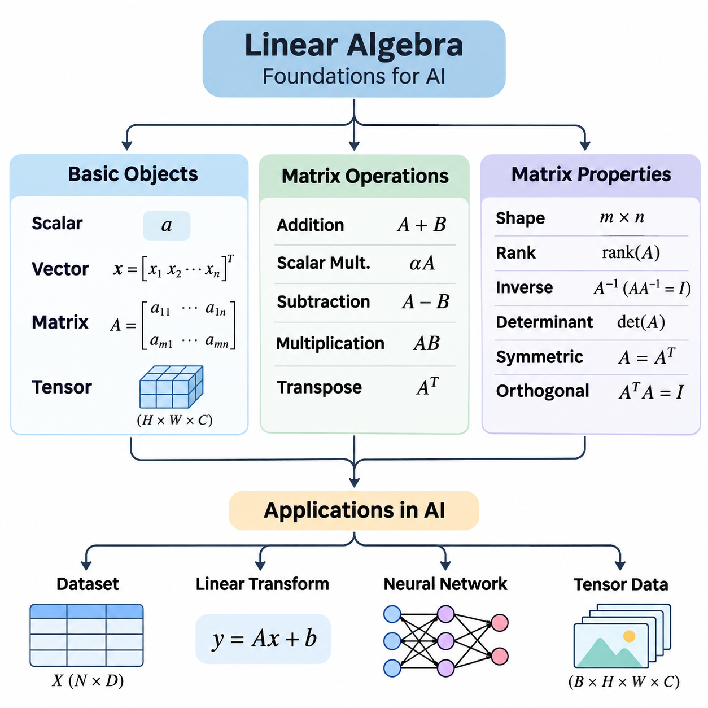
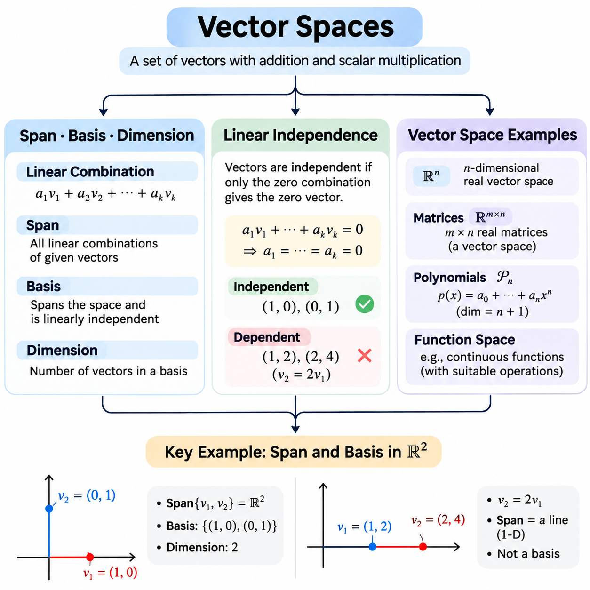
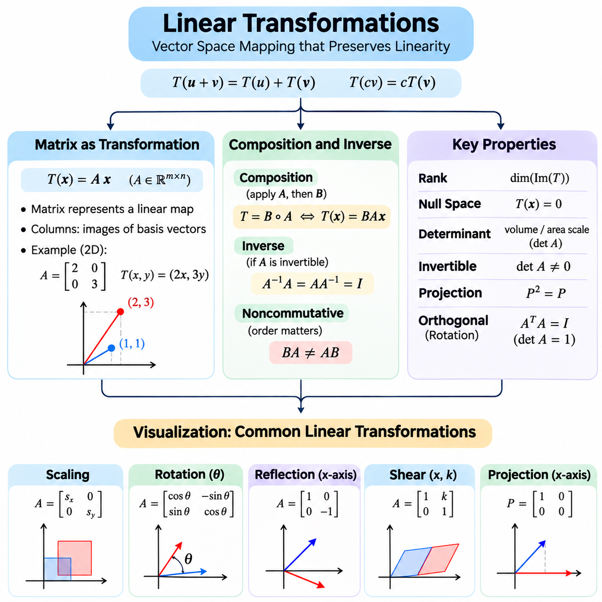
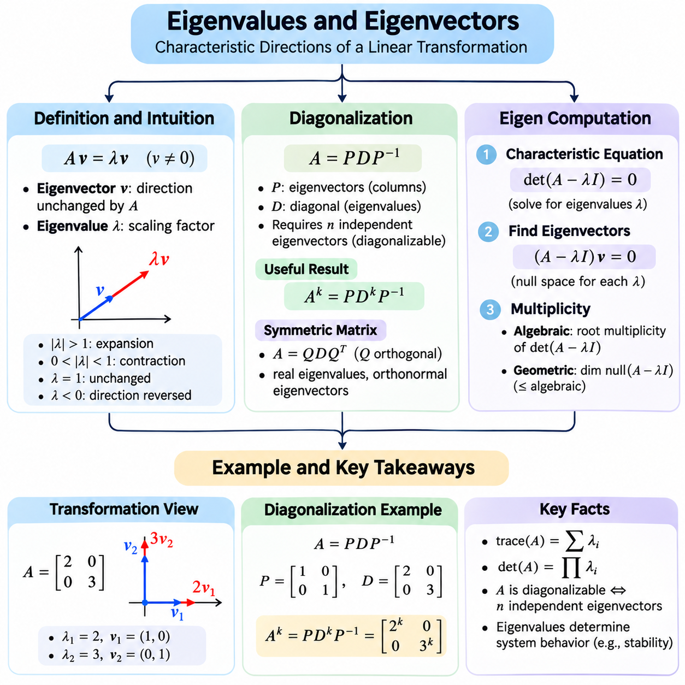
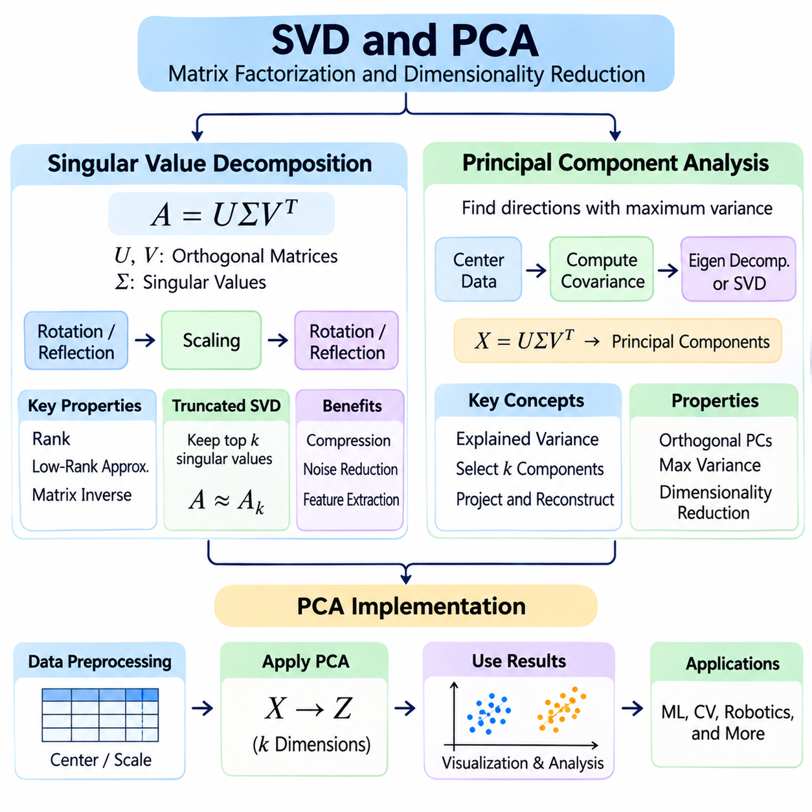
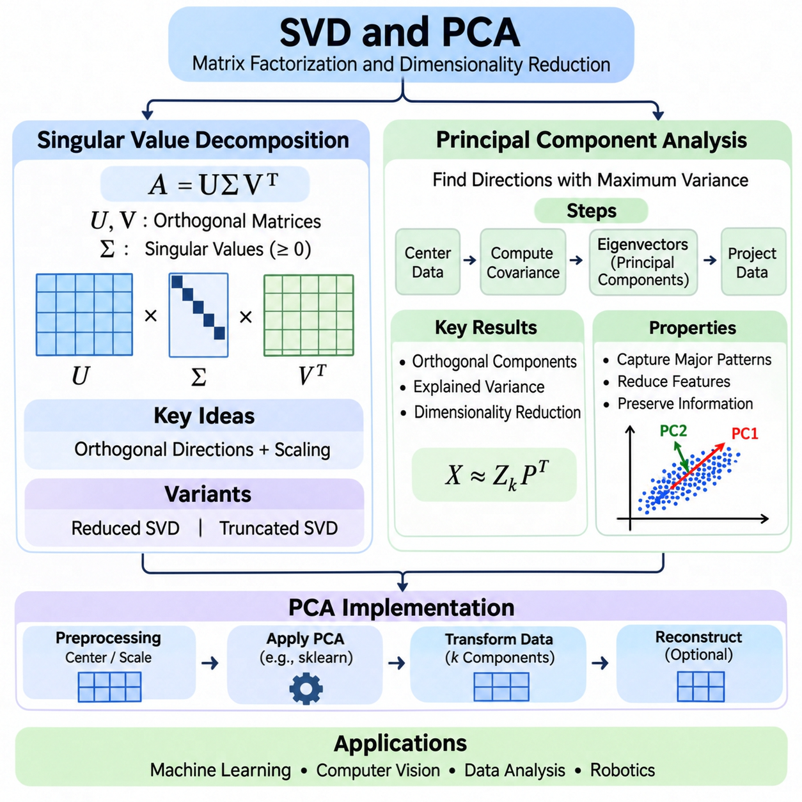
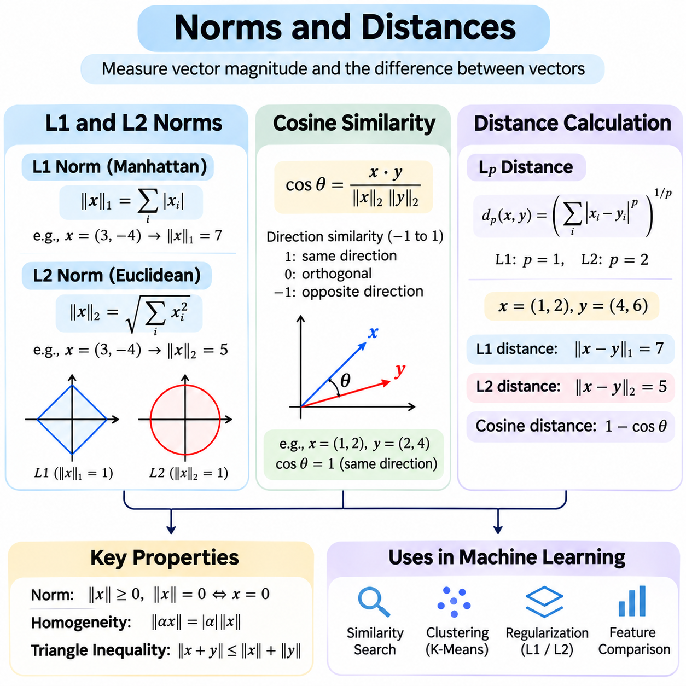
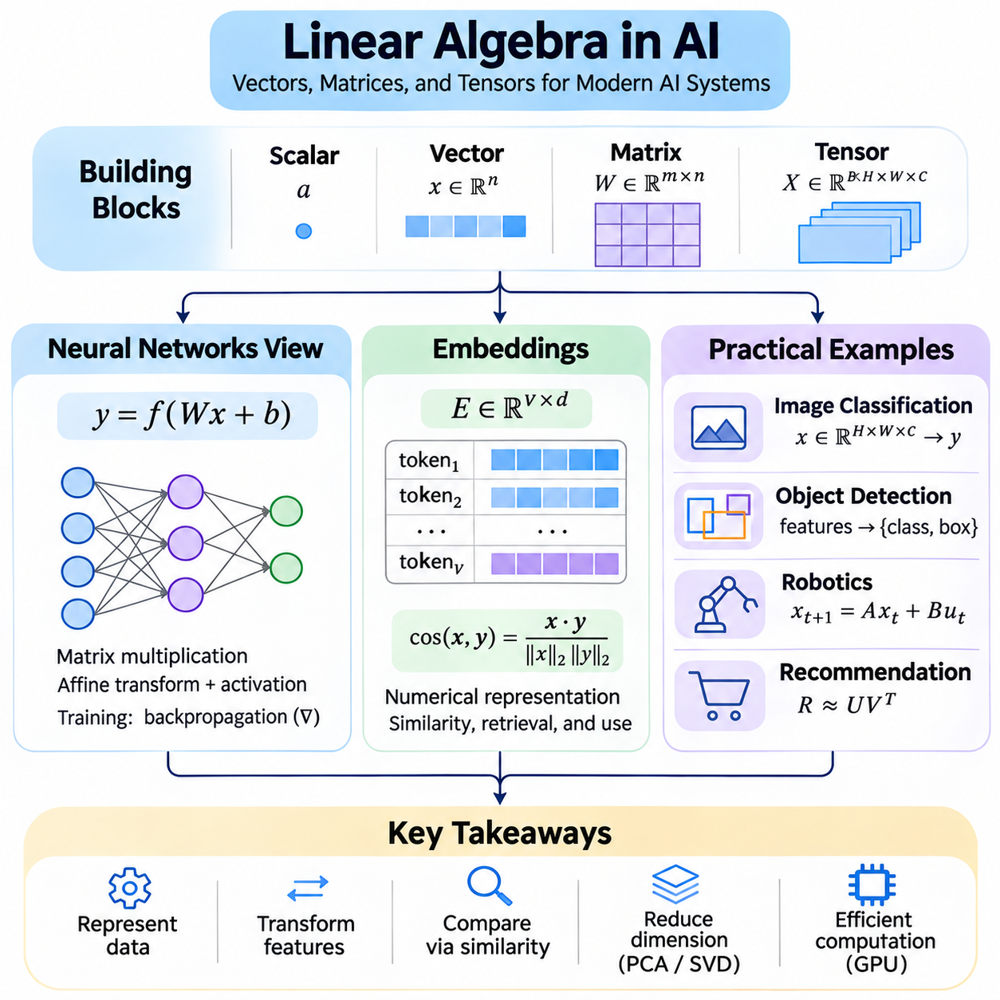

**Volume 05. Mathematics for AI**

# 01. Linear Algebra

## 01.00 Foundations

{width="7.268055555555556in" height="7.268055555555556in"}

Linear algebra provides the mathematical foundation for representing, transforming, and analyzing numerical information in artificial intelligence. Its fundamental objects include scalars, vectors, matrices, and tensors, which organize numerical values according to their dimensional structure. Understanding these objects is essential for machine learning, computer vision, natural language processing, and scientific computing.

A scalar is a single numerical value representing a magnitude, measurement, or parameter. Scalars may describe temperature, probability, learning rate, or individual neural network weights. They are commonly represented by lowercase symbols such as a, b, or x. Although a scalar contains only one value, it can influence complex computations through multiplication, addition, normalization, and parameter adjustment.

A vector is an ordered collection of numerical values that represents a point, direction, feature set, or mathematical quantity. A vector containing n elements belongs to an n-dimensional space, commonly denoted R\^n. In artificial intelligence, vectors represent input features, word embeddings, sensor measurements, and learned parameters. Their dimensionality determines how many independent numerical components are available.

Vectors can be represented as row vectors or column vectors, depending on their orientation. A column vector with three components may represent spatial coordinates, while a row vector may represent one observation in a dataset. Orientation becomes important during matrix multiplication because the dimensions of operands must be compatible. Consistent vector conventions help prevent mathematical and implementation errors.

A matrix is a rectangular arrangement of numerical elements organized into rows and columns. A matrix with m rows and n columns has dimensions m × n. Matrices provide compact representations of datasets, linear transformations, neural network parameters, and systems of equations. Each element is identified by its row and column position, allowing mathematical operations to be expressed systematically.

In machine learning, a dataset can be represented as a matrix in which rows correspond to observations and columns correspond to features. For example, a dataset containing 1,000 observations with 20 numerical features can be organized into a 1000 × 20 matrix. This representation enables efficient batch computation, statistical analysis, and transformation of large collections of training examples.

A tensor generalizes scalar, vector, and matrix representations to multidimensional arrays. A scalar is commonly treated as a zero-dimensional tensor, a vector as a one-dimensional tensor, and a matrix as a two-dimensional tensor. Higher-dimensional tensors organize data across multiple axes, including batch size, spatial dimensions, channels, and time. Their shape determines how numerical values are arranged and accessed.

For example, a color image may be represented by a tensor with dimensions height × width × channels. A collection of images introduces an additional batch dimension. Video data may require further dimensions for temporal sequences, while robotic sensor systems may combine spatial, temporal, and measurement axes. Tensor representations allow artificial intelligence frameworks to process these complex structures consistently.

The shape of a tensor describes the number of elements along each axis, while its rank in array terminology indicates the number of axes. This terminology should be distinguished from matrix rank, which measures linear independence. Tensor shapes are particularly important in neural networks because each layer expects inputs with specific dimensions and produces outputs following defined transformation rules.

Matrix operations provide the computational mechanisms used to manipulate structured numerical information. Matrix addition combines corresponding elements of matrices with identical dimensions. If matrices A and B have the same shape, their sum is obtained by adding each element of A to the corresponding element of B. This operation appears in residual connections, numerical updates, and combinations of feature representations.

Scalar multiplication changes the magnitude of every element in a matrix by multiplying it by a common numerical value. This operation is frequently used in learning-rate adjustments, feature scaling, and weighted combinations. Matrix subtraction similarly operates element by element and is useful for calculating differences between predictions and targets, parameter updates, and numerical approximation errors.

Matrix multiplication differs fundamentally from element-wise multiplication. For matrices A with dimensions m × n and B with dimensions n × p, the product AB has dimensions m × p. Each output element is calculated as the sum of products between a row of A and a column of B. The shared inner dimension must match, making dimensional compatibility a fundamental requirement.

Matrix multiplication is central to neural network computation. A fully connected layer typically multiplies an input matrix by a weight matrix and adds a bias vector through broadcasting. This operation transforms input features into a new representation. Repeated matrix multiplications, combined with nonlinear activation functions, enable deep neural networks to learn complex relationships between input data and desired outputs.

The order of matrix multiplication generally matters because AB is not necessarily equal to BA. In some cases, one product may be defined while the reverse product is not. This noncommutative property distinguishes matrix multiplication from ordinary scalar multiplication. It is especially important when combining transformations, constructing computational pipelines, or implementing neural network architectures.

The transpose of a matrix exchanges its rows and columns. If A has dimensions m × n, its transpose A\^T has dimensions n × m. Transposition is useful when aligning dimensions for multiplication, computing covariance matrices, and expressing inner products. It also appears in gradient calculations, optimization algorithms, and the mathematical formulation of linear regression.

The identity matrix is a square matrix containing ones along its main diagonal and zeros elsewhere. Multiplying a compatible matrix by an identity matrix leaves that matrix unchanged. Identity matrices serve as neutral elements for matrix multiplication and appear in regularization, coordinate transformations, and numerical algorithms. Their role resembles the number one in ordinary multiplication.

The inverse of a square matrix A, when it exists, is denoted A\^(-1) and satisfies AA\^(-1) = A\^(-1)A = I. An inverse allows certain linear systems to be expressed algebraically, but not every square matrix is invertible. In practical numerical computation, solving a linear system directly is usually preferable to explicitly calculating the inverse.

Element-wise multiplication, often called the Hadamard product, multiplies corresponding entries of equally shaped matrices. Unlike ordinary matrix multiplication, it does not combine rows and columns through summation. Element-wise operations are common in neural network gating, attention masks, activation processing, and gradient calculations. Distinguishing these operations is essential for correct mathematical implementation.

Broadcasting extends element-wise operations to arrays with compatible but different shapes. For example, a bias vector may be added to every row of a matrix without explicitly duplicating the vector. Libraries such as NumPy and PyTorch implement broadcasting to simplify mathematical expressions and reduce unnecessary memory allocation. However, incompatible dimensions or unintended broadcasting can produce errors.

Matrix properties describe structural characteristics that influence mathematical behavior and computational efficiency. A square matrix has an equal number of rows and columns, while a rectangular matrix has different row and column counts. Square matrices are particularly important because determinants, eigenvalues, and ordinary matrix inverses are defined for them under appropriate mathematical conditions.

A diagonal matrix contains nonzero values only along its main diagonal, while all off-diagonal entries are zero. Diagonal matrices simplify multiplication and many other computations. A scalar matrix is a diagonal matrix whose diagonal entries are equal. These structures appear in scaling transformations, simplified linear systems, and mathematical descriptions of independent feature transformations.

A symmetric matrix satisfies A = A\^T, meaning its entries are mirrored across the main diagonal. Real symmetric matrices have real eigenvalues and admit orthogonal diagonalization. They frequently arise in covariance analysis, quadratic optimization, and machine learning. Their mathematical properties support stable algorithms and provide useful interpretations of relationships among numerical variables.

An orthogonal matrix satisfies Q\^TQ = I, meaning its transpose is also its inverse. Orthogonal transformations preserve Euclidean lengths and angles, making them useful for rotations and coordinate changes. Orthogonality is important in numerical computation because it can reduce certain sources of numerical instability and preserve geometric relationships during transformations.

Matrix rank measures the number of linearly independent rows or columns in a matrix. It describes the effective dimensionality of the linear information represented by the matrix. A matrix with full column rank contains independent columns, while a rank-deficient matrix contains linear dependencies. Rank affects the uniqueness of solutions, invertibility, and the amount of redundant information.

The determinant is a scalar associated with a square matrix that describes the signed scaling factor of its corresponding linear transformation. A zero determinant indicates that the matrix is singular and therefore not invertible. Determinants also provide information about orientation changes and volume scaling. However, direct determinant computation is often unnecessary for practical numerical algorithms.

The trace of a square matrix is the sum of its diagonal elements. It is also equal to the sum of its eigenvalues, counted with algebraic multiplicity. Trace operations appear in matrix optimization, statistical estimation, and theoretical machine learning. Their algebraic properties allow certain expressions to be simplified, particularly when deriving gradients of matrix-valued functions.

Positive definite matrices satisfy x\^TAx \> 0 for every nonzero real vector x, assuming a real symmetric matrix. Positive semidefinite matrices satisfy the corresponding nonnegative condition. These properties are important in optimization because they characterize quadratic forms and curvature. Covariance matrices are positive semidefinite, while positive definite matrices frequently arise in strictly convex quadratic problems.

Matrix sparsity describes the proportion of elements that are zero. Sparse matrices can represent large systems efficiently when only a small fraction of their entries are nonzero. Specialized storage formats and algorithms avoid unnecessary calculations involving zeros. Sparse representations are particularly valuable in graph processing, recommendation systems, scientific simulation, and large-scale optimization.

The condition number measures how sensitive a matrix-based problem is to perturbations in input values. A poorly conditioned matrix can amplify small numerical errors and produce unreliable solutions. This issue becomes important when processing noisy measurements, solving linear systems, or training models with highly correlated features. Numerical stability therefore depends on both mathematical structure and implementation choices.

Practical matrix computation requires attention to data types, memory organization, and computational complexity. Floating-point precision influences numerical accuracy, while matrix dimensions determine memory consumption and operation counts. GPU acceleration makes large matrix and tensor operations efficient through parallel execution, but performance still depends on data movement, memory layout, and the selected computational algorithms.

Together, scalars, vectors, matrices, tensors, matrix operations, and matrix properties establish the fundamental language of numerical artificial intelligence. They explain how information is represented, how transformations are performed, and why certain computations are stable or unstable. Mastery of these foundations prepares learners for vector spaces, linear transformations, eigenvalue analysis, singular value decomposition, and advanced machine learning mathematics.

## 01.01 Vector Spaces

{width="7.268055555555556in" height="7.268055555555556in"}

A vector space is a mathematical structure consisting of vectors that can be added together and multiplied by scalars while satisfying a defined collection of algebraic rules. These rules include closure, associativity, distributivity, and the existence of additive identities and inverses. Vector spaces provide the foundation for understanding linear relationships, geometric representations, and transformations used throughout artificial intelligence and machine learning.

A vector space is defined over a field, commonly the real numbers or complex numbers. Vector addition combines two elements of the space, while scalar multiplication changes their magnitude or direction according to the scalar value. Both operations must produce elements belonging to the same space. This closure property ensures that mathematical operations remain consistent and that linear combinations can be constructed without leaving the underlying structure.

A linear combination is an expression formed by multiplying vectors by scalar coefficients and adding the results. For vectors v1, v2, and v3, a linear combination can be written as a1v1 + a2v2 + a3v3, where the coefficients are scalars. Linear combinations describe how complex vectors can be constructed from simpler components and provide the mathematical foundation for feature representations, coordinate systems, and linear models.

The span of a collection of vectors is the set of all possible linear combinations of those vectors. If a collection spans an entire vector space, every vector in that space can be expressed as a linear combination of the collection. Span therefore describes the representational coverage of a vector set. In machine learning, this concept helps explain whether selected features can represent all directions within a particular linear feature space.

For example, two nonparallel vectors in a two-dimensional real coordinate space can span the entire plane. Every point in that plane can be expressed through an appropriate linear combination of the two vectors. If the vectors are parallel, their span is restricted to a single line through the origin. This distinction illustrates how vector direction and independence determine the range of possible representations.

A basis is a collection of vectors that spans a vector space while remaining linearly independent. These two conditions ensure that every vector in the space has a unique representation as a linear combination of basis vectors. A basis therefore provides a minimal coordinate framework without unnecessary redundancy. Different bases may represent the same space, although the coordinates of individual vectors depend on the selected basis.

The standard basis of a three-dimensional real vector space consists of the vectors (1,0,0), (0,1,0), and (0,0,1). Each vector represents one coordinate direction, and any three-dimensional vector can be constructed by combining them with suitable coefficients. Alternative bases may use rotated or otherwise transformed directions while preserving the same underlying vector space and its mathematical dimensionality.

The dimension of a finite-dimensional vector space is the number of vectors in any basis of that space. A two-dimensional space requires two basis vectors, while a three-dimensional space requires three. Although different bases may contain different vectors, they always contain the same number of elements. Dimension therefore represents an intrinsic property of the vector space rather than a characteristic of a particular coordinate system.

In artificial intelligence, dimensionality often corresponds to the number of independent coordinates needed to describe a representation. A feature vector containing hundreds of components may occupy a high-dimensional space, although its observed values may exhibit dependencies. Understanding dimension helps distinguish the ambient feature space from lower-dimensional subspaces and provides a foundation for dimensionality reduction and representation learning.

Linear independence describes whether vectors contain algebraically redundant information. A collection of vectors is linearly independent when the only combination producing the zero vector uses zero for every coefficient. If a nontrivial combination produces zero, the vectors are linearly dependent. This definition provides a precise mathematical method for determining whether one vector can be expressed using other vectors in the collection.

For example, the vectors (1,0) and (0,1) are linearly independent because neither can be constructed from the other through scalar multiplication. However, the vectors (1,2) and (2,4) are linearly dependent because the second is twice the first. Their apparent difference in magnitude does not provide an additional independent direction. Consequently, both vectors span only a one-dimensional subspace.

Linear dependence becomes particularly important when analyzing datasets containing redundant features. If one numerical feature is an exact linear combination of other features, the corresponding feature columns are linearly dependent. Such dependencies can make certain model parameters nonunique and affect numerical stability. Identifying these relationships supports feature selection, matrix analysis, and the design of reliable learning systems.

The rank of a matrix is the dimension of its column space, which is equal to the dimension of its row space. It measures the number of linearly independent columns or rows and reveals the effective number of independent linear directions represented by the matrix. A matrix with full column rank has independent columns, while a rank-deficient matrix contains dependencies that reduce its representational dimensionality.

Linear independence can be examined through Gaussian elimination, matrix rank, or determinants in appropriate square-matrix cases. Gaussian elimination transforms a matrix into row echelon form, making pivot positions visible. The number of pivots determines the matrix rank. For a square matrix, a nonzero determinant indicates that its columns are linearly independent and form a basis for the corresponding coordinate space.

A subspace is a subset of a vector space that is itself a vector space under the inherited addition and scalar multiplication operations. It must contain the zero vector and remain closed under vector addition and scalar multiplication. Examples include lines and planes passing through the origin in three-dimensional space. Subspaces provide a mathematical framework for analyzing restricted representations within larger feature spaces.

The column space of a matrix consists of all linear combinations of its columns, while its null space contains vectors mapped to zero by the matrix. These subspaces describe complementary aspects of a linear transformation. The column space identifies possible outputs, whereas the null space identifies input directions that produce no change in the output. Their dimensions are related through the rank-nullity theorem.

The rank-nullity theorem states that the dimension of the domain of a linear transformation equals the sum of its rank and nullity. For a matrix with n columns, this relationship becomes n = rank(A) + nullity(A). The theorem explains how independent output directions and information-losing input directions account for the entire input space. It is fundamental to understanding underdetermined systems and nonunique solutions.

A familiar example of a vector space is R\^n, the collection of all real-valued vectors containing n components. These spaces support ordinary vector addition and scalar multiplication and appear throughout machine learning. Feature vectors, parameter vectors, and embedding representations are commonly modeled as elements of R\^n. Their mathematical structure enables distance calculations, linear transformations, and optimization.

Matrices of a fixed shape also form vector spaces. For example, all real 2 × 3 matrices form a six-dimensional vector space because each matrix contains six independently selectable entries. Matrix addition and scalar multiplication satisfy the vector space axioms. This example demonstrates that vectors need not be represented as single rows or columns; more complex mathematical objects can also possess vector space structure.

Polynomial functions provide another important example. The collection of real polynomials of degree at most two forms a three-dimensional vector space with basis 1, x, and x². Every polynomial in this space can be represented uniquely as a linear combination of these basis functions. Polynomial spaces are useful for understanding function approximation, regression models, and mathematical representations of nonlinear relationships.

Function spaces extend vector space concepts beyond finite coordinate arrays. Collections of functions satisfying suitable conditions can form vector spaces under pointwise addition and scalar multiplication. Some function spaces are infinite-dimensional because no finite basis can represent every function within them. These spaces provide mathematical foundations for functional analysis, kernel methods, differential equations, and advanced approximation theory.

In computer vision, image arrays of fixed dimensions can be interpreted as vectors by arranging pixel values into a consistent sequence. For example, a grayscale image containing 28 × 28 pixels corresponds to a vector with 784 components. A collection of such images occupies a subset of a 784-dimensional ambient space. Linear algebra then provides tools for studying image variation, projections, and compact representations.

In natural language processing, word and sentence embeddings are represented as vectors in learned feature spaces. Their coordinates encode numerical characteristics acquired during model training. Although these representations may contain hundreds or thousands of dimensions, the meaningful variation within a dataset can sometimes be approximated using fewer directions. Vector space concepts help explain embedding transformations and dimensionality reduction.

In robotics, vectors represent positions, velocities, forces, and sensor measurements within coordinate systems. Basis vectors define reference directions, while linear transformations relate measurements expressed in different frames. The distinction between independent directions and redundant measurements is important for state estimation, sensor fusion, and motion analysis. Vector spaces therefore connect abstract mathematical reasoning with physical system representations.

Computational libraries such as NumPy and PyTorch allow vector space concepts to be explored using numerical arrays. Matrix rank calculations, linear system solvers, and decomposition routines can help examine span, independence, and dimensionality. Numerical implementations must account for floating-point errors because nearly dependent vectors may be difficult to distinguish from exactly dependent vectors without appropriate numerical tolerances.

Vector spaces unify the concepts of span, basis, dimension, and linear independence into a coherent mathematical framework. Span describes what can be represented, a basis provides independent generating directions, and dimension measures the number of directions required. Linear independence identifies redundancy, while subspaces describe restricted structures. Together, these concepts support linear transformations, dimensionality reduction, optimization, and the mathematical foundations of modern artificial intelligence.

## 01.02 Linear Transformations

{width="7.268055555555556in" height="7.268055555555556in"}

A linear transformation is a mathematical mapping between vector spaces that preserves vector addition and scalar multiplication. For a transformation T, linearity requires T(u + v) = T(u) + T(v) and T(cv) = cT(v), where u and v are vectors and c is a scalar. These properties ensure that linear combinations remain consistent under transformation, making linear mappings fundamental to geometry, numerical computation, and artificial intelligence.

Linear transformations describe how vectors change while preserving their underlying linear structure. They can rotate, reflect, scale, shear, or project geometric objects into different spaces. Unlike arbitrary nonlinear mappings, linear transformations always map the zero vector to the zero vector. This restriction provides predictable mathematical behavior and enables complex transformations to be represented through matrix operations.

Every linear transformation between finite-dimensional vector spaces can be represented by a matrix after selecting bases for the input and output spaces. If A is an m × n matrix and x is an n-dimensional column vector, the transformation is expressed as T(x) = Ax. The resulting vector belongs to an m-dimensional space. Matrix representation converts an abstract mathematical mapping into a concrete numerical computation.

The columns of a transformation matrix describe how the standard basis vectors are mapped into the output space. For example, a two-dimensional matrix contains two columns representing the transformed horizontal and vertical basis directions. Any input vector can be expressed as a linear combination of these basis vectors. Consequently, its transformed position is determined by the corresponding linear combination of the matrix columns.

Scaling transformations modify vector magnitudes along selected coordinate directions. A two-dimensional diagonal matrix with diagonal entries 2 and 3 doubles horizontal coordinates and triples vertical coordinates. Uniform scaling uses the same factor in every direction, while nonuniform scaling changes proportions. Scaling operations appear in coordinate normalization, feature transformations, geometric modeling, and numerical preprocessing.

Rotation transformations change vector directions while preserving Euclidean distances and angles. In two dimensions, a counterclockwise rotation by angle θ is represented by the matrix with rows (cos θ, -sin θ) and (sin θ, cos θ). Rotation matrices are orthogonal and have determinant one. These properties make rotations particularly useful in robotics, computer vision, coordinate transformations, and spatial reasoning.

Reflection transformations reverse selected coordinate directions across a line or plane. For example, reflection across the horizontal axis in two dimensions preserves the horizontal coordinate while reversing the vertical coordinate. Reflection matrices preserve distances and angles but reverse orientation. Such transformations are useful for understanding geometric symmetry, image manipulation, and coordinate system relationships.

Shear transformations shift one coordinate in proportion to another while preserving parallel lines. A horizontal shear may transform a point (x,y) into (x + ky,y), where k controls the shear magnitude. Unlike rotations, shear transformations generally change angles and lengths. They are useful in geometric modeling, image processing, and understanding how matrix operations deform coordinate grids.

Projection transformations map vectors onto selected subspaces, reducing or restricting their represented components. An orthogonal projection onto a line retains the component parallel to that line and removes the perpendicular component. Projection matrices satisfy P² = P because applying the same projection twice produces the same result. Projections are central to least-squares estimation, dimensionality reduction, and geometric analysis.

The rank of a transformation matrix determines the dimension of its image, also called its range. A full-rank transformation preserves the maximum possible number of independent output directions, while a rank-deficient transformation collapses some input directions. The null space contains vectors mapped to zero. These concepts explain information preservation, dimensional reduction, and the existence of multiple inputs producing identical outputs.

The determinant of a square transformation matrix describes the signed volume scaling caused by the transformation. In two dimensions, its absolute value gives the area scaling factor, while in three dimensions it gives the volume scaling factor. A negative determinant indicates orientation reversal. A zero determinant means that the transformation collapses dimensionality and cannot be inverted.

Composition combines multiple transformations into a single mapping. If transformation A is applied first and transformation B is applied afterward, the combined transformation is represented by BA when using column vectors. Matrix multiplication therefore expresses sequential transformations mathematically. This relationship is essential for constructing transformation pipelines and understanding how multiple processing stages interact.

The order of transformation composition generally matters because matrix multiplication is not commutative. Rotating an object and then applying nonuniform scaling may produce a different result from scaling first and rotating afterward. This distinction becomes important in computer graphics, robotic coordinate transformations, and machine learning systems where successive operations must follow a specific sequence.

An inverse transformation reverses the effect of an original transformation. If a square matrix A is invertible, its inverse A\^(-1) satisfies A\^(-1)A = AA\^(-1) = I. Applying the inverse to a transformed vector recovers the original vector. Invertibility requires that the transformation preserve all independent dimensions of the input space, preventing distinct input vectors from collapsing into the same output.

Not every linear transformation has an inverse. A projection that removes one coordinate loses information, making exact reconstruction impossible without additional constraints. Similarly, a singular matrix cannot provide a unique reverse mapping. For rectangular or rank-deficient matrices, the Moore-Penrose pseudoinverse provides a generalized solution framework, often used in least-squares estimation and numerical optimization.

The condition number of a transformation matrix describes the sensitivity of its inverse or associated linear system to numerical perturbations. A poorly conditioned matrix may amplify small input errors, producing substantial output uncertainty during reconstruction. This behavior is particularly important in sensor calibration, inverse problems, and numerical learning algorithms. Stable computation requires attention to matrix conditioning and floating-point precision.

A change of basis represents the same abstract linear transformation using different coordinate systems. If a linear operator has matrix A in one basis and the coordinate conversion matrix is P, its representation in another basis may be written as P\^(-1)AP, depending on the conversion convention. The underlying transformation remains unchanged, although its numerical matrix representation differs.

Geometric visualization provides an intuitive method for understanding linear transformations. A coordinate grid can be imagined as a collection of horizontal and vertical lines that move according to the transformation matrix. Rotations turn the grid, scaling changes its spacing, and shear tilts its structure. Observing how basis directions change reveals the geometric meaning of the matrix entries.

The unit square offers a particularly useful conceptual visualization. Under a two-dimensional linear transformation, its basis edges become the columns of the transformation matrix, and the square generally becomes a parallelogram. The area of this parallelogram equals the absolute value of the matrix determinant. This geometric interpretation connects matrix multiplication, basis transformation, and determinant properties.

Visualization also helps explain dimensional collapse. When two independent basis vectors are transformed into parallel vectors, the original coordinate plane collapses onto a line. The transformed area becomes zero, indicating a zero determinant and reduced matrix rank. Such examples demonstrate why singular transformations lose information and why their inverse mappings cannot uniquely recover the original coordinates.

In three-dimensional space, transformations can be understood through the movement of coordinate axes and geometric volumes. Rotation matrices change orientation without altering lengths, while scaling matrices modify dimensions along selected directions. General linear transformations may combine rotation, reflection, shear, and scaling. Their effects can be analyzed through matrix decomposition and the geometry of transformed basis vectors.

In computer vision, linear transformations support image coordinate processing, geometric feature manipulation, and projection calculations. Camera models often combine linear matrix operations with perspective division, which makes the complete perspective mapping nonlinear in ordinary Euclidean coordinates. Homogeneous coordinates allow many geometric transformations to be expressed using matrix multiplication, providing a convenient computational framework.

In robotics, transformation matrices describe relationships between coordinate frames used by sensors, actuators, and moving components. Rotational transformations are linear, while translations are affine rather than linear in ordinary coordinates. Homogeneous transformation matrices combine rotation and translation into a single matrix representation. This approach simplifies coordinate conversion, robot kinematics, and spatial perception.

In neural networks, matrix multiplication represents the linear component of many computational layers. A typical layer computes Wx + b, which is an affine transformation when the bias is nonzero. Nonlinear activation functions are then applied to create more expressive models. Without nonlinear operations, repeated affine layers can be combined into a single affine transformation, limiting the network\'s representational capability.

Linear transformations provide a unified framework for understanding matrix representations, geometric operations, composition, inversion, and coordinate visualization. Their mathematical properties explain how information moves between vector spaces and when transformations preserve or discard dimensions. These principles establish essential foundations for eigenvalue analysis, singular value decomposition, numerical optimization, computer vision, robotics, and modern artificial intelligence.

## 01.03 Eigenvalues and Eigenvectors

{width="7.268055555555556in" height="7.268055555555556in"}

Eigenvalues and eigenvectors describe fundamental properties of linear transformations represented by square matrices. An eigenvector is a nonzero vector whose direction remains unchanged under a transformation, although its magnitude or orientation may change. The corresponding eigenvalue specifies the scaling factor applied to that vector. These concepts reveal intrinsic transformation behavior and support many mathematical techniques used in artificial intelligence.

For a square matrix A, an eigenvector v and its eigenvalue λ satisfy the equation Av = λv, where v is nonzero. This equation states that applying the matrix transformation to v produces a scalar multiple of the original vector. A positive eigenvalue preserves its direction, while a negative eigenvalue reverses its orientation. An eigenvalue of zero indicates that the corresponding eigenvector is mapped to the zero vector.

Geometrically, most vectors change direction when transformed by a general matrix, but eigenvectors identify special directions that remain aligned with themselves. For example, a diagonal matrix with entries 2 and 3 stretches the horizontal direction by a factor of two and the vertical direction by a factor of three. Its coordinate basis vectors are eigenvectors, and their associated eigenvalues describe the stretching along each axis.

Eigenvalues provide information about how a transformation behaves across its characteristic directions. Eigenvalues with absolute values greater than one indicate expansion along corresponding eigenvectors, while values between zero and one in absolute magnitude indicate contraction. An eigenvalue of one preserves the corresponding vector, and an eigenvalue of negative one reverses it without changing its length.

Not every real square matrix has real eigenvalues or real eigenvectors. For example, a two-dimensional rotation through ninety degrees has no nonzero real vector whose direction remains aligned with itself. Its eigenvalues are complex numbers, illustrating why complex arithmetic is important in general eigenvalue analysis. However, every real symmetric matrix has real eigenvalues and an orthonormal basis of eigenvectors.

Eigenvalues are obtained from the characteristic equation det(A − λI) = 0, where I is the identity matrix. This equation follows because Av = λv can be rearranged into (A − λI)v = 0. A nonzero solution exists only when A − λI is singular. Solving the characteristic polynomial therefore identifies the eigenvalues, after which the associated eigenvectors can be determined.

For a two-dimensional matrix, the characteristic equation is a quadratic polynomial in λ. Its roots provide the eigenvalues, which may be distinct, repeated, real, or complex. Once an eigenvalue is known, substituting it into (A − λI)v = 0 produces a homogeneous linear system. Solving this system identifies the eigenspace containing all eigenvectors associated with that eigenvalue, together with the zero vector.

An eigenspace is the null space of A − λI for a particular eigenvalue λ. Its dimension is called the geometric multiplicity of that eigenvalue. The number of times an eigenvalue occurs as a root of the characteristic polynomial is its algebraic multiplicity. Geometric multiplicity cannot exceed algebraic multiplicity, and their relationship helps determine whether a matrix can be diagonalized.

Diagonalization expresses a square matrix in a coordinate system where its transformation becomes particularly simple. If a matrix A possesses n linearly independent eigenvectors, they can form the columns of an invertible matrix P. The matrix can then be written as A = PDP\^(-1), where D is diagonal and contains the corresponding eigenvalues. This representation separates the transformation into a change of basis, diagonal scaling, and a return to the original coordinates.

A diagonal matrix is computationally convenient because its powers are obtained by raising each diagonal entry to the corresponding power. If A = PDP\^(-1), then A\^k = PD\^kP\^(-1) for nonnegative integer k. This identity simplifies repeated transformations and helps analyze iterative processes. Eigenvalues therefore reveal whether repeated matrix applications amplify, suppress, or preserve particular components.

A matrix is diagonalizable precisely when it has enough linearly independent eigenvectors to form a basis. Distinct eigenvalues guarantee independent eigenvectors, but repeated eigenvalues do not necessarily prevent diagonalization. A defective matrix lacks a complete eigenvector basis and cannot be diagonalized. Such matrices require alternative representations, including Jordan normal form, for certain theoretical analyses.

Real symmetric matrices have especially useful spectral properties. The spectral theorem guarantees that they can be diagonalized using an orthogonal matrix Q, giving A = QDQ\^T. Their eigenvectors can be chosen orthonormal, and their eigenvalues are real. This structure is important for covariance matrices, quadratic optimization, principal component analysis, and stable numerical algorithms.

The trace of a square matrix equals the sum of its eigenvalues, counted with algebraic multiplicity. Its determinant equals their product. These relationships connect spectral information with familiar matrix properties and provide useful consistency checks. A zero eigenvalue implies a zero determinant, indicating singularity, while the sum of eigenvalues describes the total trace regardless of whether the matrix is diagonalizable.

Eigenvalues also characterize the stability of linear dynamical systems. In discrete-time systems governed by x(t+1) = Ax(t), eigenvalues determine how state components evolve under repeated multiplication. If all eigenvalues have absolute values below one, the state approaches zero asymptotically. Eigenvalues outside the unit circle indicate growing modes, while eigenvalues on the boundary require additional structural analysis.

In principal component analysis, eigenvectors of a covariance matrix identify orthogonal directions of data variation. Their eigenvalues quantify the variance associated with those directions. Sorting eigenvalues from largest to smallest allows the most informative principal components to be selected. This approach supports dimensionality reduction, data compression, noise filtering, and exploratory analysis of high-dimensional datasets.

Eigenvalue computation for small matrices can be performed analytically through characteristic polynomials. However, this approach becomes inefficient and numerically unreliable for large matrices. Practical numerical algorithms instead use matrix factorizations and iterative procedures. The QR algorithm is a standard method for dense eigenvalue problems, while specialized iterative methods are often preferred for large sparse matrices.

The power iteration method estimates an eigenvector associated with a dominant eigenvalue by repeatedly multiplying a vector by the matrix and normalizing the result. Under suitable conditions, the vector approaches a dominant eigenvector. The associated eigenvalue can be estimated using the Rayleigh quotient, expressed as (v\^TAv)/(v\^Tv) for real vectors. Convergence depends on spectral separation and the initial vector.

Inverse iteration and shifted inverse iteration target eigenvalues near a selected shift rather than only the dominant eigenvalue. The Lanczos method is especially useful for large symmetric matrices, while Arnoldi iteration extends related ideas to general matrices. These methods construct smaller subspace problems whose eigenvalues approximate those of the original matrix, reducing computational requirements for large-scale applications.

Numerical eigenvalue calculations require careful attention to floating-point precision and matrix conditioning. Eigenvalues that are close together may be difficult to separate, and eigenvectors can be sensitive to perturbations, particularly for nonnormal matrices. Residual analysis provides a practical accuracy measure by evaluating the norm of Av − λv. A small residual indicates that a computed eigenpair approximately satisfies the defining equation.

Python libraries such as NumPy and SciPy provide established routines for eigenvalue analysis. NumPy\'s eig function computes eigenvalues and right eigenvectors of general square matrices, while eigh is designed for real symmetric or complex Hermitian matrices. SciPy offers additional algorithms for sparse problems and selected eigenpairs. Choosing a solver that matches the matrix structure improves efficiency, numerical reliability, and interpretability.

Eigenvalues and eigenvectors connect matrix algebra with geometry, numerical computation, and the behavior of complex systems. Their definitions identify invariant directions, diagonalization simplifies transformations, and computational algorithms make spectral analysis practical. These concepts establish essential foundations for principal component analysis, spectral clustering, graph learning, dynamical systems, optimization, and advanced artificial intelligence.

## 01.04 SVD and PCA

{width="7.268055555555556in" height="7.268055555555556in"}

{width="7.268055555555556in" height="7.268055555555556in"}

Singular Value Decomposition (SVD) is a fundamental matrix factorization technique that represents a matrix through orthogonal directions and nonnegative scaling factors. Unlike eigenvalue decomposition, SVD applies to rectangular as well as square matrices. It reveals the internal structure of numerical data and provides essential tools for dimensionality reduction, matrix approximation, noise suppression, and machine learning.

For a real matrix A with m rows and n columns, the singular value decomposition is expressed as A = UΣV\^T. Here, U and V are orthogonal matrices containing left and right singular vectors, while Σ is a rectangular diagonal matrix containing nonnegative singular values. The decomposition describes a linear transformation as a rotation or reflection, followed by directional scaling and another rotation or reflection.

The right singular vectors in V identify orthogonal directions in the input space, while the left singular vectors in U identify corresponding directions in the output space. Each singular value measures the scaling applied along its associated direction. Large singular values indicate strongly represented directions, whereas small singular values identify directions with weaker influence on the transformation.

Singular values are conventionally arranged in descending order, allowing the most significant directions to appear first. The number of strictly positive singular values equals the rank of the matrix. Singular values also relate to eigenvalues because their squares are eigenvalues of A\^TA. This relationship connects SVD with spectral analysis and explains why singular vectors are useful for understanding data variation.

A reduced or economy-sized SVD retains only the singular vectors required to represent the matrix without unnecessary dimensions. For a rank-r matrix, the compact decomposition uses r singular values and corresponding singular vectors. This representation reduces storage requirements and provides a convenient foundation for low-rank approximation, especially when the matrix contains many correlated or redundant features.

Truncated SVD retains only the largest k singular values and their associated vectors, where k is smaller than the matrix rank. The resulting rank-k approximation minimizes reconstruction error among all matrices of rank at most k under the Frobenius norm. This property, established by the Eckart--Young--Mirsky theorem, makes truncated SVD especially valuable for data compression and numerical approximation.

The reconstruction error of a truncated SVD depends on the singular values that are discarded. Under the squared Frobenius norm, this error equals the sum of the squares of the omitted singular values. Rapidly decreasing singular values therefore indicate that a relatively small number of components may preserve most of the matrix information. Slowly decreasing values suggest that stronger compression may cause substantial information loss.

Principal Component Analysis (PCA) is a statistical technique that transforms correlated variables into orthogonal directions called principal components. These directions are selected to capture the greatest possible variance in the observed data. PCA provides a systematic approach to identifying dominant patterns, reducing feature dimensionality, and representing high-dimensional datasets through a smaller collection of informative coordinates.

PCA begins by centering the dataset so that each feature has a mean of zero. For a data matrix X containing samples as rows and features as columns, centering subtracts the mean of each feature from its corresponding column. This operation ensures that principal components describe variation around the dataset mean rather than variation caused by an arbitrary coordinate offset.

The covariance matrix of centered data describes how features vary individually and jointly. Its diagonal entries contain feature variances, while off-diagonal entries represent pairwise covariances. PCA identifies eigenvectors of this covariance matrix and orders them according to their eigenvalues. The eigenvectors define principal component directions, while the eigenvalues quantify the variance captured along those directions.

The first principal component identifies the direction with maximum variance among all unit-length directions. The second principal component captures the greatest remaining variance while remaining orthogonal to the first. Additional components follow the same principle. This construction produces mutually orthogonal directions ordered by decreasing explained variance, allowing dimensionality reduction without arbitrary feature selection.

PCA can also be computed directly through singular value decomposition of the centered data matrix. If X = UΣV\^T, the columns of V provide principal component directions. The squared singular values divided by the number of samples minus one give the corresponding sample covariance eigenvalues. This SVD-based formulation is widely used because it avoids explicitly forming the covariance matrix.

Explained variance measures how much dataset variation is represented by each principal component. The explained variance ratio divides a component\'s variance by the total variance across all components. Cumulative explained variance sums these ratios across the first k components. This measure helps select a reduced dimension that preserves a desired proportion of observed variation.

After selecting k principal components, the centered data is projected onto the corresponding principal directions. The resulting transformed dataset contains k coordinates per sample instead of the original feature count. Approximate reconstruction is possible by mapping these coordinates back into the original feature space and restoring the feature means. Reconstruction accuracy depends on the information retained by the selected components.

PCA is sensitive to feature scales because variables with larger numerical variance can dominate the principal directions. Standardization transforms features to comparable scales, often using zero mean and unit variance. However, standardization changes the mathematical objective from analyzing raw covariance to analyzing standardized variation. The choice between centering and standardization should reflect the meaning and units of the original features.

A practical PCA implementation begins with data validation, missing-value handling, and consistent numerical preprocessing. The dataset is then centered or standardized using parameters calculated from the training data. PCA is fitted to this processed training matrix, and the selected components are used to transform training and evaluation samples. Applying the same preprocessing parameters prevents inconsistent representations and data leakage.

Python libraries such as NumPy and scikit-learn provide established implementations of SVD and PCA. NumPy supports direct singular value decomposition, while scikit-learn provides PCA estimators with configurable component counts and explained variance information. These tools simplify implementation, but users must still understand matrix shapes, preprocessing choices, numerical precision, and the interpretation of transformed features.

For large datasets, full SVD may require substantial computation and memory. Randomized SVD and iterative methods can approximate leading singular components more efficiently when only a limited number of directions is required. Incremental PCA processes data in batches, making it useful when the complete dataset cannot fit into memory. Algorithm selection should consider matrix dimensions, sparsity, desired accuracy, and available hardware.

PCA is useful in computer vision for compact image representations, in sensor systems for identifying correlated measurements, and in machine learning for exploratory analysis and feature compression. However, high variance does not necessarily imply high predictive relevance. PCA is unsupervised and may discard low-variance directions that are important for classification or regression. Its effectiveness should therefore be evaluated against the intended application.

SVD and PCA connect matrix factorization with statistical representation learning. SVD reveals orthogonal transformation directions and supports optimal low-rank approximation, while PCA identifies directions of maximum variance in centered data. Together, they provide a mathematical and computational foundation for dimensionality reduction, compression, denoising, numerical analysis, and efficient artificial intelligence systems.

## 01.05 Norms and Distances

{width="7.268055555555556in" height="7.268055555555556in"}

Norms and distances provide mathematical tools for measuring vector magnitude, comparing numerical representations, and quantifying differences between observations. A norm assigns a nonnegative magnitude to a vector, while a distance measures separation between two elements. These concepts are fundamental to machine learning, optimization, clustering, information retrieval, computer vision, and numerical analysis.

A vector norm must satisfy three fundamental properties: positive definiteness, absolute homogeneity, and the triangle inequality. Positive definiteness ensures that only the zero vector has zero norm. Absolute homogeneity means scaling a vector by a scalar scales its norm by the scalar\'s absolute value. The triangle inequality states that the norm of a vector sum cannot exceed the sum of the individual norms.

The L1 norm, also called the Manhattan norm, measures vector magnitude by summing the absolute values of its components. For a vector x with n components, it is expressed as \|\|x\|\|1 = Σ\|xi\|. This norm treats each coordinate contribution independently and does not square large values. It is useful when absolute deviations are meaningful or when optimization should encourage sparse representations.

For example, a vector with components (3, -4) has an L1 norm of 7 because the absolute values of its coordinates are added. Geometrically, L1 distance corresponds to movement along coordinate axes, similar to navigating a rectangular street grid. This interpretation explains its alternative name, Manhattan distance, and its usefulness when changes occur through separate coordinate directions.

The L2 norm, commonly called the Euclidean norm, measures vector magnitude using the square root of the sum of squared components. It is expressed as \|\|x\|\|2 = sqrt(Σxi²). The L2 norm corresponds to ordinary geometric length in Euclidean space. Because it squares component values before summation, larger components contribute more strongly to the resulting magnitude.

For the vector (3, -4), the L2 norm is 5, corresponding to the length of the hypotenuse of a right triangle. Unlike the L1 norm, the L2 norm measures straight-line displacement rather than movement restricted to coordinate axes. This geometric interpretation makes it natural for spatial coordinates, physical measurements, vector normalization, and many continuous optimization problems.

The L1 and L2 norms respond differently to the distribution of vector components. L1 accumulates absolute magnitudes, while L2 emphasizes larger components through squaring. For the same vector, the L2 norm never exceeds the L1 norm. Their different geometric and optimization properties influence how algorithms handle outliers, distribute errors, and penalize model parameters.

In machine learning, L1 regularization adds a penalty proportional to the sum of absolute model coefficients. This penalty can encourage some coefficients to become exactly zero, producing sparse models and supporting implicit feature selection. Lasso regression uses this principle. The resulting sparsity can improve interpretability, although the best regularization strength depends on the dataset and prediction objective.

L2 regularization penalizes the sum of squared model coefficients, commonly encouraging smaller and more evenly distributed weights. Ridge regression is a representative example. Although related to the squared L2 norm rather than the L2 norm itself, this penalty generally discourages extreme parameter values without forcing coefficients to zero. It is widely used to improve numerical stability and reduce overfitting.

Cosine similarity measures the directional alignment between two nonzero vectors rather than their absolute magnitudes. It is defined as cos(θ) = (x·y)/(\|\|x\|\|2\|\|y\|\|2), where x·y denotes the dot product. The result lies between -1 and 1 for real vectors. A value near 1 indicates similar directions, zero indicates orthogonality, and a value near -1 indicates opposite directions.

Cosine similarity is invariant to multiplication of either vector by a positive scalar. Consequently, two vectors with substantially different magnitudes can have identical cosine similarity when they point in the same direction. This property makes cosine similarity useful for comparing representations where orientation is more meaningful than scale, including text embeddings, document vectors, and learned feature representations.

For example, the vectors (1,2) and (2,4) have cosine similarity equal to 1 because one is a positive multiple of the other. However, their Euclidean distance is not zero because their coordinates differ. This distinction illustrates why similarity and distance metrics must be selected according to the intended interpretation of numerical representations rather than treated as interchangeable quantities.

Cosine distance is commonly defined as one minus cosine similarity. Although useful as a dissimilarity measure, this expression does not satisfy every metric axiom in general, particularly the triangle inequality. For unit-normalized vectors, squared Euclidean distance equals twice the cosine distance. This relationship helps connect angular comparison with geometric distance in normalized embedding spaces.

Distance calculation typically begins by subtracting two vectors and applying a norm to the difference. The L1 distance between vectors x and y is \|\|x − y\|\|1, while their Euclidean distance is \|\|x − y\|\|2. Both satisfy the standard metric properties, including nonnegativity, symmetry, identity of indiscernibles, and the triangle inequality. These properties make them reliable measures of separation.

For points (1,2) and (4,6), the L1 distance is 7 because the coordinate differences have absolute values 3 and 4. The Euclidean distance is 5 because the squared differences sum to 25. These values describe different geometries of separation. Neither distance is universally superior; the appropriate choice depends on the coordinate system, feature scales, and application requirements.

Feature scaling strongly influences distance calculations. If one feature is measured in thousands and another in fractions, the larger-scale feature may dominate Euclidean or Manhattan distances. Standardization and normalization can make feature contributions more comparable. However, preprocessing should preserve meaningful physical relationships, particularly when dimensions represent measurements with different units or uncertainty levels.

The Minkowski distance generalizes L1 and L2 distances through a parameter p, expressed as (Σ\|xi − yi\|\^p)\^(1/p) for p at least one. Setting p to one produces Manhattan distance, while p equal to two produces Euclidean distance. Larger p values increasingly emphasize the largest coordinate differences. This formulation provides a unified mathematical framework for selecting distance behavior.

Mahalanobis distance extends Euclidean distance by incorporating covariance relationships between features. It measures separation using the inverse covariance matrix, accounting for correlations and different scales. When the covariance matrix is invertible, this distance provides a geometry adapted to the data distribution. It is useful in anomaly detection, multivariate statistics, and statistical classification.

Distance metrics are essential to nearest-neighbor methods, clustering algorithms, and similarity-based retrieval systems. K-nearest neighbors identifies nearby observations using a selected metric, while K-means minimizes squared Euclidean distances to cluster centers. Different metrics can produce substantially different neighborhoods and cluster structures, making metric selection a central modeling decision.

Computational efficiency becomes important when calculating distances across large datasets. Vectorized operations, matrix multiplication, and GPU acceleration can evaluate many pairwise comparisons efficiently. However, constructing a complete distance matrix for millions of observations may require excessive memory. Approximate nearest-neighbor search and indexing methods can reduce computational requirements in large-scale applications.

Norms and distances establish a unified framework for quantifying magnitude, direction, and separation in numerical spaces. L1 and L2 norms support geometric measurement and regularization, cosine similarity emphasizes directional relationships, and distance metrics enable structured comparisons between observations. Understanding their mathematical properties and computational implications is essential for reliable artificial intelligence systems.

## 01.06 Linear Algebra in AI

{width="7.268055555555556in" height="7.268055555555556in"}

Linear algebra provides the mathematical foundation for representing data, transforming features, and computing predictions in artificial intelligence systems. Vectors represent observations or learned features, matrices describe transformations between spaces, and tensors organize multidimensional information. These structures enable neural networks to process large datasets efficiently through operations that can be accelerated by modern computing hardware.

A neural network layer commonly applies an affine transformation followed by a nonlinear activation function. For an input vector x, weight matrix W, and bias vector b, the layer output is expressed as y = f(Wx + b). Matrix multiplication combines input features according to learned weights, while the bias shifts the result. The activation function introduces nonlinearity, allowing networks to model relationships beyond linear transformations.

The dimensions of weight matrices determine how information flows between neural network layers. If an input contains n features and a layer produces m outputs, its weight matrix has dimensions m by n when inputs are column vectors. Each row contains coefficients associated with one output neuron. Understanding these dimensions is essential for implementing architectures correctly and diagnosing incompatible tensor shapes.

During training, neural networks update weight matrices and bias vectors to minimize a loss function. Backpropagation computes gradients using the chain rule and matrix operations, while optimization algorithms adjust parameters according to these gradients. Matrix transposition and multiplication are central to calculating derivatives efficiently. This connection makes linear algebra indispensable to both neural network inference and training.

Convolutional neural networks apply learned filters to local regions of images or other structured signals. Although convolution is not always implemented as explicit matrix multiplication, it is a linear operation with respect to its input when the filter is fixed. Convolution can be expressed through structured matrices or transformed into matrix multiplication for efficient computation. This approach supports optimized GPU implementations.

Transformer architectures rely extensively on matrix multiplication to process sequences and relationships between tokens. Input representations are projected into query, key, and value matrices through learned linear transformations. Attention scores are calculated using products between queries and transposed keys. These scores are normalized and used to combine value vectors, allowing contextual information to influence token representations.

In scaled dot-product attention, the attention output is expressed as softmax(QK\^T/sqrt(dk))V, where dk is the dimension of the key vectors. The matrix QK\^T contains pairwise compatibility scores between queries and keys. Scaling controls score magnitude, while softmax converts scores into normalized attention weights. This formulation demonstrates how linear algebra and nonlinear operations cooperate in modern language models.

Embeddings represent discrete or complex objects as vectors in a continuous numerical space. Words, sentences, images, products, and graph nodes can be encoded into fixed-dimensional representations. These vectors are learned so that useful relationships become accessible through numerical operations. Embeddings allow machine learning systems to compare objects even when their original representations differ substantially.

An embedding matrix associates discrete identifiers with learned vectors. In a language model, each token identifier selects a row from a matrix containing token representations. During training, these representations are adjusted to support the model\'s prediction objective. Tokens that appear in related contexts may develop useful geometric relationships, although embedding similarity does not always correspond directly to human semantic similarity.

Embedding spaces are commonly analyzed using dot products, Euclidean distance, and cosine similarity. Dot products combine vector magnitude and directional alignment, while cosine similarity emphasizes orientation. Euclidean distance measures geometric separation between representations. Selecting an appropriate comparison method depends on how embeddings were trained, whether they are normalized, and the intended retrieval or classification task.

Vector normalization transforms embeddings into representations with controlled magnitude. L2 normalization divides a nonzero vector by its Euclidean norm, producing a unit-length vector. For normalized vectors, cosine similarity equals their dot product. This relationship simplifies similarity computation and enables efficient vector search, particularly when large collections of embeddings must be compared against incoming queries.

High-dimensional embeddings can capture complex relationships, but their dimensionality also introduces computational and statistical challenges. Large vectors increase storage requirements and similarity-search costs. Dimensionality reduction techniques such as PCA and truncated SVD can compress representations while preserving important variation. However, compression may remove information relevant to specific downstream prediction tasks.

In image classification, a digital image can be represented as a multidimensional tensor containing height, width, and color channels. Neural network layers transform this tensor into progressively more abstract feature representations. A final classification layer maps learned features into class scores through matrix multiplication. This process illustrates how tensor operations connect raw pixel measurements with semantic predictions.

Object detection systems combine visual feature extraction with predictions of object categories and bounding-box coordinates. Feature tensors are transformed into representations supporting localization and classification. Matrix operations implement learned projections, while geometric calculations compare predicted boxes with reference annotations. Linear algebra therefore contributes to both feature processing and the interpretation of spatial predictions.

In robotics, vectors represent positions, velocities, forces, and sensor measurements, while matrices describe coordinate transformations and system dynamics. Rotation matrices change vector coordinates between reference frames, and homogeneous transformation matrices combine rotation and translation. These operations support robot localization, camera calibration, motion estimation, and the integration of measurements from multiple sensors.

A practical camera-to-robot transformation uses calibrated coordinate relationships to convert observations from the camera frame into the robot frame. A three-dimensional point can be represented in homogeneous coordinates and multiplied by a transformation matrix. Successive transformations connect camera, robot, and world coordinate systems. Accurate calibration is essential because small transformation errors can propagate into positioning errors.

Linear algebra also supports sensor fusion and state estimation. A linear state-space model represents system evolution as x(t+1) = Ax(t) + Bu(t), while measurements may be expressed as z(t) = Hx(t) + noise. Matrices describe how states evolve and how sensors observe them. Kalman filtering uses matrix operations to combine predictions with measurements according to uncertainty estimates.

Recommendation systems frequently represent users and items through latent factor vectors. Matrix factorization approximates an interaction matrix using lower-dimensional user and item representations. Predicted preferences can be calculated through vector dot products. This approach identifies hidden relationships in interaction data and provides a practical example of how low-rank approximation supports machine learning applications.

Efficient implementation requires understanding matrix shapes, memory layouts, numerical precision, and computational complexity. NumPy, PyTorch, and similar libraries provide vectorized operations that avoid unnecessary element-by-element processing. GPU acceleration is especially effective for large matrix multiplications, although data transfers and memory limitations can reduce performance. Profiling is necessary to identify actual computational bottlenecks.

Linear algebra unifies the mathematical operations underlying neural networks, embeddings, computer vision, robotics, and data-driven prediction. Matrix multiplication enables learned transformations, vector geometry supports similarity comparisons, and tensor operations organize complex information. Mastering these concepts provides the foundation for designing efficient models, interpreting numerical behavior, and implementing reliable artificial intelligence systems.
