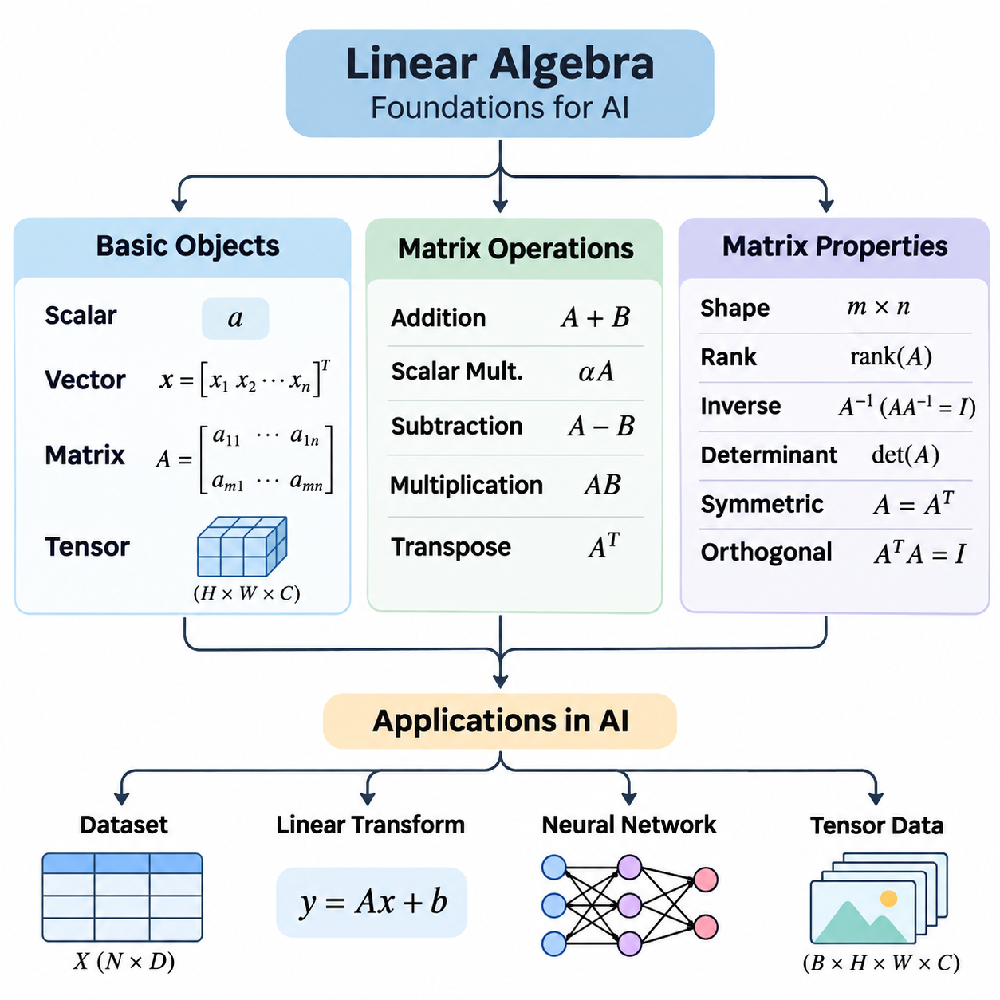
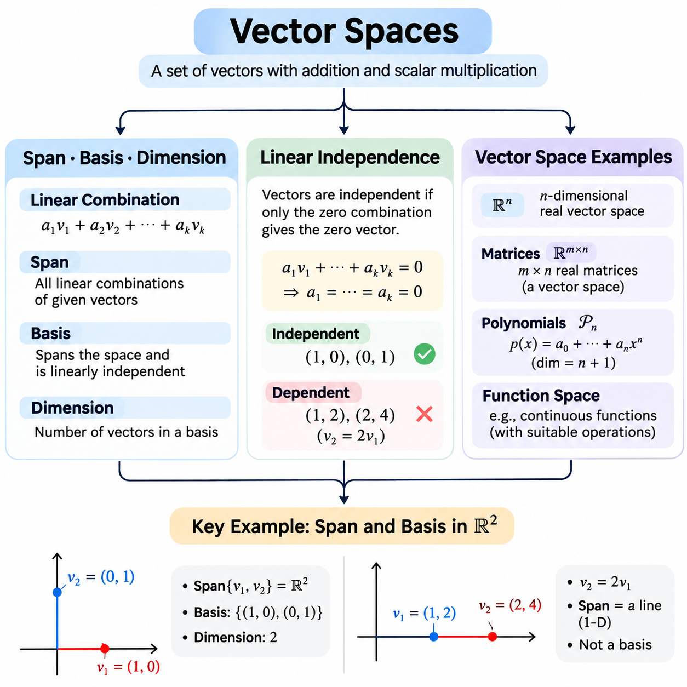
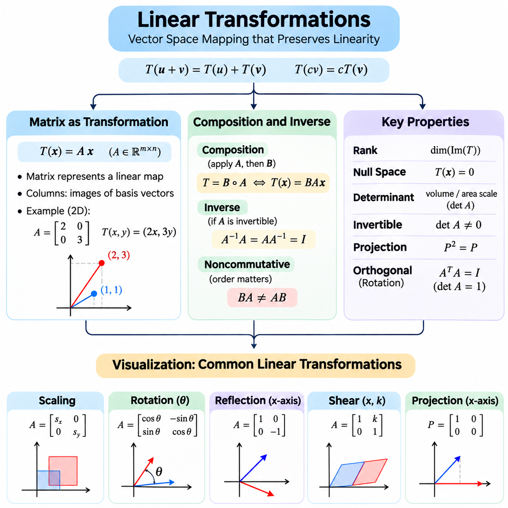
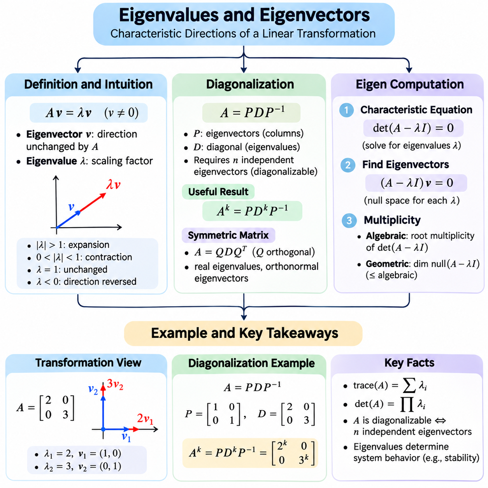
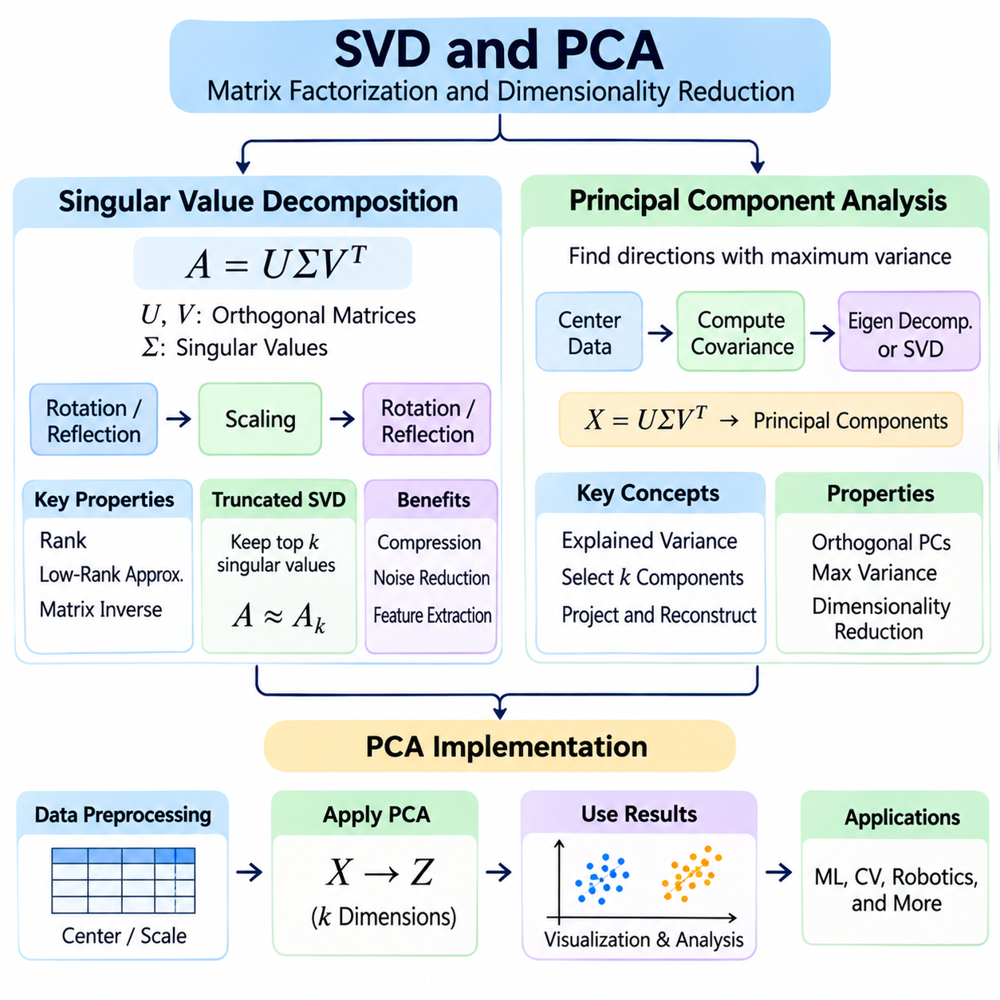
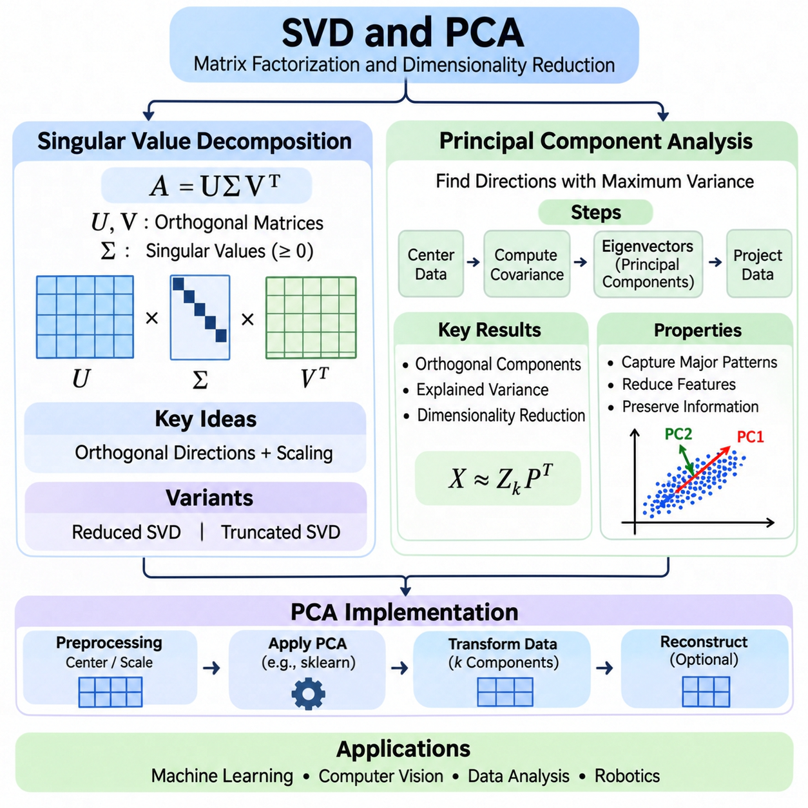
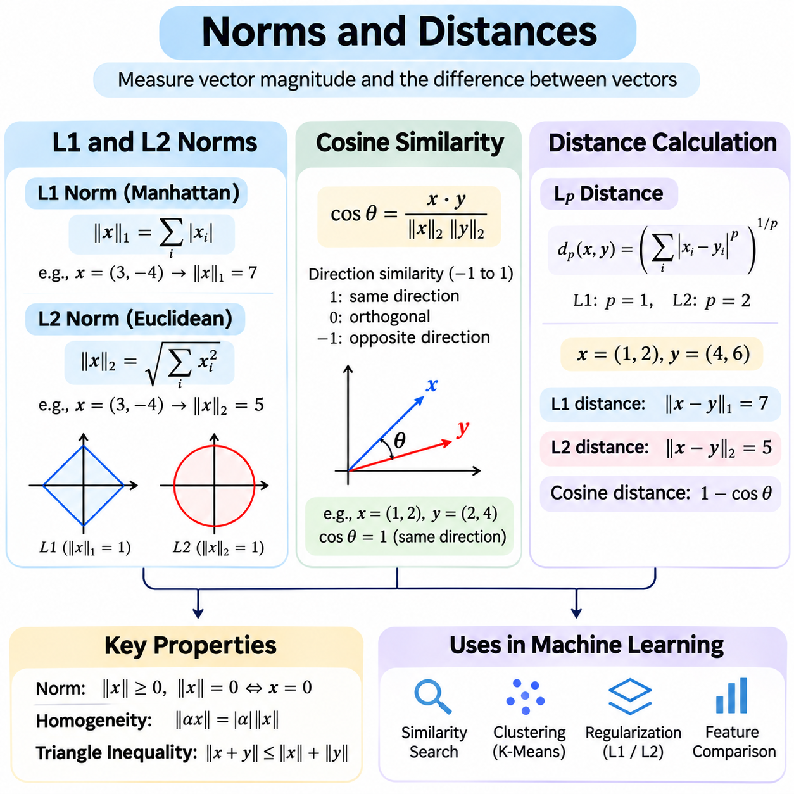
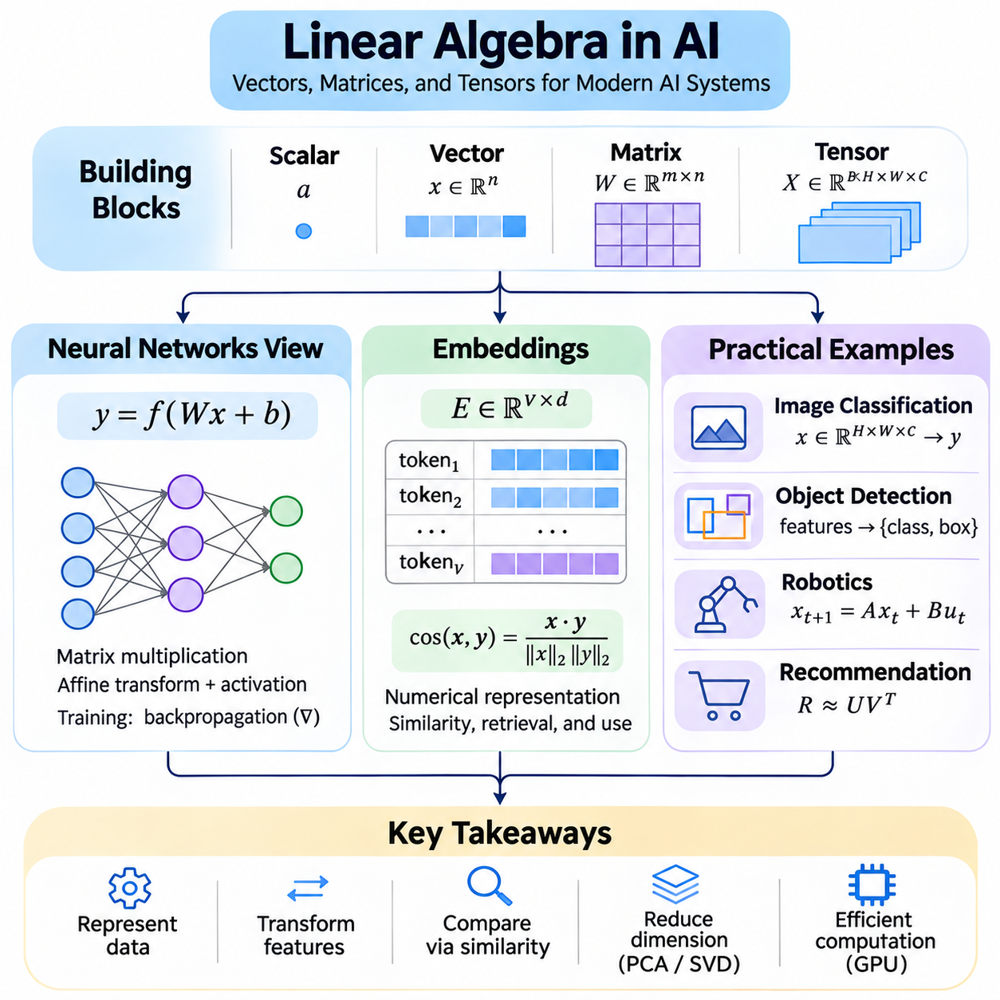

**Volume 05. Mathematics for AI**

# 01. Linear Algebra

## 01.00 Foundations

{width="7.268055555555556in" height="7.268055555555556in"}

선형대수학(Linear Algebra)은 인공지능(Artificial Intelligence)에서 수치 정보를 표현하고 변환하며 분석하기 위한 수학적 기초를 제공합니다. 선형대수학의 기본 객체에는 스칼라(Scalar), 벡터(Vector), 행렬(Matrix), 텐서(Tensor)가 있으며, 이들은 차원 구조(Dimensional Structure)에 따라 수치 값을 체계적으로 구성합니다. 이러한 객체를 이해하는 것은 기계학습(Machine Learning), 컴퓨터 비전(Computer Vision), 자연어 처리(Natural Language Processing), 과학 계산(Scientific Computing)의 필수적인 기초입니다.

스칼라(Scalar)는 크기, 측정값 또는 매개변수(Parameter)를 나타내는 단일 수치 값입니다. 스칼라는 온도, 확률(Probability), 학습률(Learning Rate), 신경망 가중치(Neural Network Weight) 등을 표현할 수 있습니다. 일반적으로 a, b, x와 같은 소문자 기호로 나타냅니다. 스칼라는 하나의 값만 포함하지만 곱셈, 덧셈, 정규화(Normalization), 매개변수 조정(Parameter Adjustment)을 통해 복잡한 계산에 영향을 줄 수 있습니다.

벡터(Vector)는 점(Point), 방향(Direction), 특징 집합(Feature Set) 또는 수학적 양을 나타내는 순서가 있는 수치 값의 모음입니다. n개의 원소(Element)를 포함하는 벡터는 일반적으로 R\^n으로 표시되는 n차원 공간(n-Dimensional Space)에 속합니다. 인공지능에서 벡터는 입력 특징(Input Feature), 단어 임베딩(Word Embedding), 센서 측정값(Sensor Measurement), 학습된 매개변수(Learned Parameter)를 표현합니다. 벡터의 차원(Dimensionality)은 사용 가능한 독립적인 수치 성분의 개수를 결정합니다.

벡터는 방향에 따라 행 벡터(Row Vector) 또는 열 벡터(Column Vector)로 표현할 수 있습니다. 세 개의 성분을 가진 열 벡터는 공간 좌표(Spatial Coordinate)를 나타낼 수 있으며, 행 벡터는 데이터셋(Dataset)의 하나의 관측값(Observation)을 표현할 수 있습니다. 행렬 곱셈(Matrix Multiplication)에서는 피연산자(Operand)의 차원이 서로 호환되어야 하므로 벡터의 방향이 중요합니다. 일관된 벡터 표현 규칙은 수학적 오류와 구현 오류를 방지하는 데 도움이 됩니다.

행렬(Matrix)은 수치 원소를 행(Row)과 열(Column)로 배열한 직사각형 구조입니다. m개의 행과 n개의 열을 가진 행렬의 크기는 m × n으로 표현합니다. 행렬은 데이터셋, 선형 변환(Linear Transformation), 신경망 매개변수(Neural Network Parameter), 연립방정식(System of Equations)을 간결하게 표현합니다. 각 원소는 행과 열의 위치로 식별되므로 수학적 연산을 체계적으로 수행할 수 있습니다.

기계학습에서 데이터셋은 행이 관측값(Observation)에 대응하고 열이 특징(Feature)에 대응하는 행렬로 표현할 수 있습니다. 예를 들어, 20개의 수치 특징을 가진 1,000개의 관측값은 1000 × 20 행렬로 구성할 수 있습니다. 이러한 표현은 효율적인 배치 계산(Batch Computation), 통계 분석(Statistical Analysis), 대규모 학습 데이터(Training Data)의 변환을 가능하게 합니다.

텐서(Tensor)는 스칼라, 벡터, 행렬의 표현을 다차원 배열(Multidimensional Array)로 일반화한 개념입니다. 일반적으로 스칼라는 0차원 텐서(Zero-Dimensional Tensor), 벡터는 1차원 텐서(One-Dimensional Tensor), 행렬은 2차원 텐서(Two-Dimensional Tensor)로 취급합니다. 고차원 텐서(Higher-Dimensional Tensor)는 배치 크기(Batch Size), 공간 차원(Spatial Dimension), 채널(Channel), 시간(Time) 등 여러 축(Axis)을 따라 데이터를 구성합니다. 텐서의 형상(Shape)은 수치 값의 배열 및 접근 방식을 결정합니다.

예를 들어, 컬러 이미지(Color Image)는 높이(Height) × 너비(Width) × 채널(Channels) 차원의 텐서로 표현할 수 있습니다. 여러 이미지의 집합에는 배치 차원(Batch Dimension)이 추가됩니다. 비디오 데이터(Video Data)는 시간적 시퀀스(Temporal Sequence)를 위한 추가 차원이 필요할 수 있으며, 로봇 센서 시스템(Robotic Sensor System)은 공간, 시간, 측정 축을 결합할 수 있습니다. 텐서 표현은 인공지능 프레임워크(AI Framework)가 이러한 복잡한 구조를 일관되게 처리하도록 지원합니다.

텐서의 형상(Tensor Shape)은 각 축에 포함된 원소의 개수를 나타내며, 배열 용어에서 텐서의 차수(Tensor Rank)는 축의 개수를 의미합니다. 이러한 용어는 선형 독립성(Linear Independence)을 측정하는 행렬의 계수(Matrix Rank)와 구별해야 합니다. 텐서 형상은 신경망(Neural Network)에서 특히 중요합니다. 각 계층(Layer)은 특정 차원의 입력을 요구하고 정의된 변환 규칙에 따라 출력을 생성하기 때문입니다.

행렬 연산(Matrix Operations)은 구조화된 수치 정보를 조작하는 계산 메커니즘(Computational Mechanism)을 제공합니다. 행렬 덧셈(Matrix Addition)은 동일한 차원을 가진 두 행렬의 대응 원소를 더하는 연산입니다. 행렬 A와 B의 형상이 같다면 각 위치의 원소를 더하여 합을 계산합니다. 이러한 연산은 잔차 연결(Residual Connection), 수치 갱신(Numerical Update), 특징 표현(Feature Representation)의 결합 등에 사용됩니다.

스칼라 곱셈(Scalar Multiplication)은 행렬의 모든 원소에 동일한 수치 값을 곱하여 크기를 변경하는 연산입니다. 이 연산은 학습률 조정(Learning Rate Adjustment), 특징 스케일링(Feature Scaling), 가중 결합(Weighted Combination)에 자주 사용됩니다. 행렬 뺄셈(Matrix Subtraction) 역시 원소별로 수행되며, 예측값과 목표값의 차이, 매개변수 갱신, 수치 근사 오차(Numerical Approximation Error)를 계산하는 데 유용합니다.

행렬 곱셈(Matrix Multiplication)은 원소별 곱셈(Element-Wise Multiplication)과 근본적으로 다릅니다. 행렬 A의 크기가 m × n이고 행렬 B의 크기가 n × p라면 곱 AB의 크기는 m × p가 됩니다. 출력 행렬의 각 원소는 A의 한 행과 B의 한 열에 있는 대응 원소를 곱한 후 합산하여 계산합니다. 두 행렬의 내부 차원(Inner Dimension)이 일치해야 하므로 차원 호환성(Dimensional Compatibility)이 필수 조건입니다.

행렬 곱셈은 신경망 계산(Neural Network Computation)의 핵심입니다. 완전연결계층(Fully Connected Layer)은 일반적으로 입력 행렬(Input Matrix)에 가중치 행렬(Weight Matrix)을 곱하고 브로드캐스팅(Broadcasting)을 통해 편향 벡터(Bias Vector)를 더합니다. 이러한 연산은 입력 특징을 새로운 표현으로 변환합니다. 반복적인 행렬 곱셈과 비선형 활성화 함수(Nonlinear Activation Function)의 결합을 통해 심층 신경망(Deep Neural Network)은 입력 데이터와 목표 출력 사이의 복잡한 관계를 학습할 수 있습니다.

행렬 곱셈의 순서는 일반적으로 중요합니다. AB와 BA가 반드시 같지는 않기 때문입니다. 경우에 따라 한쪽 곱셈은 정의되지만 반대 순서의 곱셈은 정의되지 않을 수도 있습니다. 이러한 비가환성(Noncommutative Property)은 행렬 곱셈을 일반적인 스칼라 곱셈과 구별하는 특징입니다. 특히 여러 변환을 결합하거나 계산 파이프라인(Computational Pipeline)을 구성하고 신경망 아키텍처(Neural Network Architecture)를 구현할 때 중요합니다.

행렬의 전치(Transpose)는 행과 열을 서로 교환하는 연산입니다. 행렬 A의 크기가 m × n이라면 전치 행렬(Transpose Matrix) A\^T의 크기는 n × m이 됩니다. 전치는 행렬 곱셈의 차원을 정렬하거나 공분산 행렬(Covariance Matrix)을 계산하고 내적(Inner Product)을 표현할 때 유용합니다. 또한 기울기 계산(Gradient Calculation), 최적화 알고리즘(Optimization Algorithm), 선형 회귀(Linear Regression)의 수학적 공식화에도 사용됩니다.

단위 행렬(Identity Matrix)은 주대각선(Main Diagonal)의 원소가 1이고 나머지 원소가 0인 정사각 행렬(Square Matrix)입니다. 호환 가능한 행렬에 단위 행렬을 곱하면 원래 행렬이 유지됩니다. 단위 행렬은 행렬 곱셈의 항등원(Identity Element)으로 작용하며 정규화(Regularization), 좌표 변환(Coordinate Transformation), 수치 알고리즘(Numerical Algorithm)에 사용됩니다. 이러한 역할은 일반적인 수의 곱셈에서 숫자 1이 수행하는 역할과 유사합니다.

정사각 행렬 A의 역행렬(Inverse Matrix)이 존재한다면 A\^(-1)로 표시하며, AA\^(-1) = A\^(-1)A = I를 만족합니다. 역행렬을 이용하면 특정 선형 시스템(Linear System)을 대수적으로 표현할 수 있지만 모든 정사각 행렬이 역행렬을 가지는 것은 아닙니다. 실제 수치 계산(Numerical Computation)에서는 역행렬을 명시적으로 계산하는 것보다 선형 시스템을 직접 푸는 방법이 일반적으로 더 바람직합니다.

원소별 곱셈(Element-Wise Multiplication)은 아다마르 곱(Hadamard Product)이라고도 하며, 동일한 형상의 행렬에서 대응하는 원소끼리 곱하는 연산입니다. 일반적인 행렬 곱셈과 달리 행과 열의 곱을 합산하지 않습니다. 원소별 연산은 신경망 게이팅(Neural Network Gating), 어텐션 마스크(Attention Mask), 활성화 처리(Activation Processing), 기울기 계산(Gradient Calculation)에 자주 사용됩니다. 이러한 연산의 차이를 이해하는 것은 올바른 수학적 구현에 필수적입니다.

브로드캐스팅(Broadcasting)은 서로 다른 형상을 가지지만 호환 가능한 배열 사이에서 원소별 연산을 수행할 수 있도록 확장하는 기능입니다. 예를 들어, 편향 벡터(Bias Vector)를 명시적으로 복제하지 않고 행렬의 모든 행에 더할 수 있습니다. NumPy와 PyTorch 같은 라이브러리는 수학적 표현을 단순화하고 불필요한 메모리 할당(Memory Allocation)을 줄이기 위해 브로드캐스팅을 구현합니다. 그러나 호환되지 않는 차원이나 의도하지 않은 브로드캐스팅은 오류를 발생시킬 수 있습니다.

행렬의 성질(Matrix Properties)은 수학적 동작과 계산 효율성에 영향을 미치는 구조적 특성을 설명합니다. 정사각 행렬(Square Matrix)은 행과 열의 개수가 같으며, 직사각 행렬(Rectangular Matrix)은 두 개수가 서로 다릅니다. 정사각 행렬은 적절한 수학적 조건에서 행렬식(Determinant), 고유값(Eigenvalue), 일반적인 역행렬(Matrix Inverse)이 정의되므로 특히 중요합니다.

대각 행렬(Diagonal Matrix)은 주대각선(Main Diagonal)을 제외한 모든 원소가 0인 행렬입니다. 대각 행렬은 곱셈과 여러 계산을 단순화합니다. 스칼라 행렬(Scalar Matrix)은 모든 대각 원소가 동일한 대각 행렬입니다. 이러한 구조는 스케일링 변환(Scaling Transformation), 단순화된 선형 시스템(Simplified Linear System), 독립적인 특징 변환(Independent Feature Transformation)의 수학적 표현에 사용됩니다.

대칭 행렬(Symmetric Matrix)은 A = A\^T를 만족하며, 주대각선을 기준으로 원소가 대칭적으로 배치됩니다. 실수 대칭 행렬(Real Symmetric Matrix)은 실수 고유값(Real Eigenvalue)을 가지며 직교 대각화(Orthogonal Diagonalization)가 가능합니다. 이러한 행렬은 공분산 분석(Covariance Analysis), 이차 최적화(Quadratic Optimization), 기계학습에서 자주 등장합니다. 대칭 행렬의 수학적 성질은 안정적인 알고리즘을 지원하고 수치 변수 사이의 관계를 해석하는 데 도움을 줍니다.

직교 행렬(Orthogonal Matrix)은 Q\^TQ = I를 만족하며, 전치 행렬이 역행렬과 같습니다. 직교 변환(Orthogonal Transformation)은 유클리드 길이(Euclidean Length)와 각도(Angle)를 보존하므로 회전(Rotation)과 좌표 변환(Coordinate Transformation)에 유용합니다. 직교성(Orthogonality)은 특정 수치 불안정성(Numerical Instability)의 원인을 줄이고 변환 과정에서 기하학적 관계(Geometric Relationship)를 유지하는 데 중요합니다.

행렬의 계수(Matrix Rank)는 행렬에서 선형 독립(Linear Independence)인 행 또는 열의 개수를 측정합니다. 이는 행렬이 표현하는 선형 정보의 유효 차원(Effective Dimensionality)을 설명합니다. 완전 열 계수(Full Column Rank)를 가진 행렬은 모든 열이 선형 독립이며, 계수 부족 행렬(Rank-Deficient Matrix)은 선형 종속성(Linear Dependency)을 포함합니다. 계수는 해의 유일성(Uniqueness of Solution), 가역성(Invertibility), 중복 정보(Redundant Information)의 양에 영향을 미칩니다.

행렬식(Determinant)은 정사각 행렬에 대응하는 스칼라 값으로, 해당 선형 변환(Linear Transformation)의 부호 있는 스케일링 계수(Signed Scaling Factor)를 나타냅니다. 행렬식이 0이면 그 행렬은 특이 행렬(Singular Matrix)이며 역행렬이 존재하지 않습니다. 행렬식은 방향 변화(Orientation Change)와 부피 스케일링(Volume Scaling)에 관한 정보도 제공합니다. 그러나 실제 수치 알고리즘에서는 행렬식을 직접 계산할 필요가 없는 경우가 많습니다.

대각합(Trace)은 정사각 행렬의 주대각선 원소를 모두 더한 값입니다. 대각합은 대수적 중복도(Algebraic Multiplicity)를 고려한 고유값의 합과도 같습니다. 대각합 연산(Trace Operation)은 행렬 최적화(Matrix Optimization), 통계적 추정(Statistical Estimation), 이론적 기계학습(Theoretical Machine Learning)에 사용됩니다. 대각합의 대수적 성질은 특히 행렬값 함수(Matrix-Valued Function)의 기울기를 유도할 때 특정 수학적 표현을 단순화할 수 있습니다.

양의 정부호 행렬(Positive Definite Matrix)은 실수 대칭 행렬(Real Symmetric Matrix)을 가정할 때 모든 0이 아닌 실수 벡터 x에 대해 x\^TAx \> 0을 만족합니다. 양의 준정부호 행렬(Positive Semidefinite Matrix)은 이에 대응하는 비음수 조건(Nonnegative Condition)을 만족합니다. 이러한 성질은 이차 형식(Quadratic Form)과 곡률(Curvature)을 특징짓기 때문에 최적화에서 중요합니다. 공분산 행렬(Covariance Matrix)은 양의 준정부호이며, 양의 정부호 행렬은 엄격한 볼록 이차 문제(Strictly Convex Quadratic Problem)에서 자주 등장합니다.

행렬의 희소성(Matrix Sparsity)은 행렬에서 0인 원소가 차지하는 비율을 설명합니다. 희소 행렬(Sparse Matrix)은 전체 원소 중 극히 일부만 0이 아닌 경우 대규모 시스템을 효율적으로 표현할 수 있습니다. 특수한 저장 형식(Storage Format)과 알고리즘은 0과 관련된 불필요한 계산을 피합니다. 희소 표현(Sparse Representation)은 그래프 처리(Graph Processing), 추천 시스템(Recommendation System), 과학 시뮬레이션(Scientific Simulation), 대규모 최적화(Large-Scale Optimization)에서 특히 유용합니다.

조건수(Condition Number)는 행렬 기반 문제(Matrix-Based Problem)가 입력값의 작은 변화에 얼마나 민감한지를 측정합니다. 조건이 나쁜 행렬(Ill-Conditioned Matrix)은 작은 수치 오차(Numerical Error)를 증폭시켜 신뢰하기 어려운 해를 생성할 수 있습니다. 이러한 문제는 잡음이 포함된 측정값(Noisy Measurement)을 처리하거나 선형 시스템을 풀고 상관성이 높은 특징(Highly Correlated Feature)을 가진 모델을 학습할 때 중요합니다. 따라서 수치 안정성(Numerical Stability)은 수학적 구조와 구현 방식 모두에 영향을 받습니다.

실제 행렬 계산(Matrix Computation)에서는 데이터 유형(Data Type), 메모리 구성(Memory Organization), 계산 복잡도(Computational Complexity)를 고려해야 합니다. 부동소수점 정밀도(Floating-Point Precision)는 수치 정확도(Numerical Accuracy)에 영향을 미치며, 행렬의 차원은 메모리 사용량(Memory Consumption)과 연산 횟수를 결정합니다. GPU 가속(GPU Acceleration)은 병렬 실행(Parallel Execution)을 통해 대규모 행렬 및 텐서 연산을 효율적으로 수행하지만, 성능은 데이터 이동(Data Movement), 메모리 배치(Memory Layout), 선택한 계산 알고리즘(Computational Algorithm)에 따라 달라집니다.

스칼라(Scalar), 벡터(Vector), 행렬(Matrix), 텐서(Tensor), 행렬 연산(Matrix Operations), 행렬의 성질(Matrix Properties)은 함께 수치 기반 인공지능(Numerical Artificial Intelligence)의 기본 언어를 형성합니다. 이러한 개념은 정보가 어떻게 표현되고 변환이 어떻게 수행되며 특정 계산이 왜 안정적이거나 불안정한지를 설명합니다. 이러한 기초를 충분히 이해하면 벡터 공간(Vector Space), 선형 변환(Linear Transformation), 고유값 분석(Eigenvalue Analysis), 특이값 분해(Singular Value Decomposition), 고급 기계학습 수학(Advanced Machine Learning Mathematics)을 학습할 수 있는 기반이 마련됩니다.

## 01.01 Vector Spaces

{width="7.268055555555556in" height="7.268055555555556in"}

벡터 공간(Vector Space)은 벡터(Vector)들을 서로 더하거나 스칼라(Scalar)를 곱할 수 있으며, 이러한 연산이 정의된 대수적 규칙(Algebraic Rules)을 만족하는 수학적 구조(Mathematical Structure)입니다. 이러한 규칙에는 닫힘성(Closure), 결합법칙(Associativity), 분배법칙(Distributivity), 덧셈 항등원(Additive Identity)과 덧셈 역원(Additive Inverse)의 존재 등이 포함됩니다. 벡터 공간은 인공지능(Artificial Intelligence)과 기계학습(Machine Learning) 전반에서 사용되는 선형 관계(Linear Relationship), 기하학적 표현(Geometric Representation), 변환(Transformation)을 이해하기 위한 기초를 제공합니다.

벡터 공간은 일반적으로 실수(Real Numbers) 또는 복소수(Complex Numbers)로 이루어진 체(Field) 위에서 정의됩니다. 벡터 덧셈(Vector Addition)은 공간에 속하는 두 원소를 결합하며, 스칼라 곱셈(Scalar Multiplication)은 스칼라 값에 따라 벡터의 크기나 방향을 변화시킵니다. 두 연산의 결과는 모두 동일한 벡터 공간에 속해야 합니다. 이러한 닫힘성(Closure Property)은 수학적 연산의 일관성을 보장하며, 기본 구조를 벗어나지 않고 선형 결합(Linear Combination)을 구성할 수 있도록 합니다.

선형 결합(Linear Combination)은 벡터에 스칼라 계수(Scalar Coefficient)를 곱한 후 그 결과를 더하여 구성하는 수학적 표현입니다. 벡터 v1, v2, v3에 대한 선형 결합은 a1v1 + a2v2 + a3v3으로 나타낼 수 있으며, 여기서 a1, a2, a3은 스칼라 계수입니다. 선형 결합은 단순한 구성 요소로부터 복잡한 벡터를 생성하는 방법을 설명하며, 특징 표현(Feature Representation), 좌표계(Coordinate System), 선형 모델(Linear Model)의 수학적 기초를 제공합니다.

벡터 집합의 생성 공간(Span)은 해당 벡터들로 만들 수 있는 모든 선형 결합(Linear Combination)의 집합입니다. 어떤 벡터 집합이 전체 벡터 공간을 생성한다면, 그 공간의 모든 벡터는 해당 집합의 선형 결합으로 표현할 수 있습니다. 따라서 생성 공간은 벡터 집합의 표현 범위(Representational Coverage)를 설명합니다. 기계학습에서는 선택된 특징(Selected Features)이 특정 선형 특징 공간(Linear Feature Space)의 모든 방향을 표현할 수 있는지 이해하는 데 도움이 됩니다.

예를 들어, 2차원 실수 좌표 공간(Two-Dimensional Real Coordinate Space)에서 서로 평행하지 않은 두 벡터는 전체 평면을 생성할 수 있습니다. 평면의 모든 점은 두 벡터에 적절한 계수를 적용한 선형 결합으로 표현할 수 있습니다. 반면 두 벡터가 평행하다면 생성 공간은 원점을 지나는 하나의 직선으로 제한됩니다. 이러한 차이는 벡터의 방향과 독립성(Independence)이 가능한 표현의 범위를 결정한다는 사실을 보여줍니다.

기저(Basis)는 벡터 공간을 생성하면서 동시에 선형 독립(Linear Independence)을 유지하는 벡터들의 집합입니다. 이 두 조건은 공간의 모든 벡터가 기저 벡터(Basis Vector)의 선형 결합으로 유일하게 표현될 수 있음을 보장합니다. 따라서 기저는 불필요한 중복이 없는 최소한의 좌표 체계(Coordinate Framework)를 제공합니다. 서로 다른 기저가 동일한 공간을 표현할 수 있지만, 개별 벡터의 좌표는 선택한 기저에 따라 달라집니다.

3차원 실수 벡터 공간(Three-Dimensional Real Vector Space)의 표준 기저(Standard Basis)는 (1,0,0), (0,1,0), (0,0,1)로 구성됩니다. 각 벡터는 하나의 좌표 방향(Coordinate Direction)을 나타내며, 모든 3차원 벡터는 이 벡터들에 적절한 계수를 적용하여 구성할 수 있습니다. 다른 기저는 회전되거나 변환된 방향을 사용할 수 있지만, 동일한 벡터 공간과 수학적 차원(Dimensionality)은 유지됩니다.

유한 차원 벡터 공간(Finite-Dimensional Vector Space)의 차원(Dimension)은 해당 공간의 임의의 기저에 포함된 벡터의 개수입니다. 2차원 공간에는 두 개의 기저 벡터가 필요하고, 3차원 공간에는 세 개가 필요합니다. 서로 다른 기저는 서로 다른 벡터를 포함할 수 있지만, 기저를 구성하는 원소의 개수는 항상 같습니다. 따라서 차원은 특정 좌표계의 특성이 아니라 벡터 공간 자체의 고유한 성질(Intrinsic Property)을 나타냅니다.

인공지능에서 차원성(Dimensionality)은 표현(Representation)을 설명하는 데 필요한 독립적인 좌표의 개수에 대응하는 경우가 많습니다. 수백 개의 성분을 포함하는 특징 벡터(Feature Vector)는 고차원 공간(High-Dimensional Space)에 속할 수 있지만, 실제 관측값 사이에는 종속 관계(Dependency)가 존재할 수 있습니다. 차원을 이해하면 주변 특징 공간(Ambient Feature Space)과 저차원 부분공간(Lower-Dimensional Subspace)을 구별할 수 있으며, 차원 축소(Dimensionality Reduction)와 표현 학습(Representation Learning)의 기초를 마련할 수 있습니다.

선형 독립(Linear Independence)은 벡터들이 대수적으로 중복된 정보(Algebraically Redundant Information)를 포함하는지 설명합니다. 벡터 집합에서 모든 계수가 0인 경우에만 영벡터(Zero Vector)를 생성할 수 있다면 해당 벡터들은 선형 독립입니다. 반대로 0이 아닌 계수를 포함하는 선형 결합이 영벡터를 생성한다면 선형 종속(Linear Dependence)입니다. 이러한 정의는 한 벡터가 집합 내 다른 벡터들로 표현될 수 있는지를 정확하게 판단하는 수학적 방법을 제공합니다.

예를 들어, 벡터 (1,0)과 (0,1)은 어느 한쪽도 다른 벡터의 스칼라 곱셈으로 구성할 수 없으므로 선형 독립(Linear Independence)입니다. 반면 (1,2)와 (2,4)는 두 번째 벡터가 첫 번째 벡터의 두 배이므로 선형 종속(Linear Dependence)입니다. 두 벡터의 크기가 다르더라도 새로운 독립 방향(Independent Direction)을 제공하지 않습니다. 따라서 두 벡터가 생성하는 공간은 1차원 부분공간(One-Dimensional Subspace)에 불과합니다.

선형 종속(Linear Dependence)은 중복된 특징(Redundant Features)을 포함하는 데이터셋(Dataset)을 분석할 때 특히 중요합니다. 하나의 수치 특징이 다른 특징들의 정확한 선형 결합으로 표현된다면 해당 특징 열(Feature Columns)은 선형 종속입니다. 이러한 종속성은 특정 모델 매개변수(Model Parameter)의 유일성을 상실하게 하거나 수치 안정성(Numerical Stability)에 영향을 줄 수 있습니다. 이러한 관계를 식별하면 특징 선택(Feature Selection), 행렬 분석(Matrix Analysis), 신뢰할 수 있는 학습 시스템(Learning System)의 설계에 도움이 됩니다.

행렬의 계수(Matrix Rank)는 열 공간(Column Space)의 차원이며, 행 공간(Row Space)의 차원과도 같습니다. 계수는 선형 독립인 행 또는 열의 개수를 측정하며, 행렬이 표현하는 독립적인 선형 방향의 유효 개수(Effective Number)를 나타냅니다. 완전 열 계수(Full Column Rank)를 가진 행렬은 모든 열이 독립적이며, 계수 부족 행렬(Rank-Deficient Matrix)은 표현 차원(Representational Dimensionality)을 감소시키는 종속 관계를 포함합니다.

선형 독립(Linear Independence)은 가우스 소거법(Gaussian Elimination), 행렬 계수(Matrix Rank), 적절한 정사각 행렬(Square Matrix)의 경우 행렬식(Determinant)을 통해 확인할 수 있습니다. 가우스 소거법은 행렬을 행 사다리꼴(Row Echelon Form)로 변환하여 피벗 위치(Pivot Position)를 확인할 수 있게 합니다. 피벗의 개수는 행렬의 계수를 결정합니다. 정사각 행렬의 행렬식이 0이 아니라면 해당 행렬의 열은 선형 독립이며 대응하는 좌표 공간의 기저를 형성합니다.

부분공간(Subspace)은 기존 벡터 공간의 부분집합(Subset)이면서, 원래 공간의 덧셈과 스칼라 곱셈 연산을 그대로 적용했을 때 자체적으로 벡터 공간을 이루는 집합입니다. 부분공간은 영벡터(Zero Vector)를 포함해야 하며, 벡터 덧셈(Vector Addition)과 스칼라 곱셈(Scalar Multiplication)에 대해 닫혀 있어야 합니다. 3차원 공간에서 원점을 지나는 직선과 평면이 대표적인 예입니다. 부분공간은 더 큰 특징 공간 내부의 제한된 표현 구조(Restricted Representation Structure)를 분석하는 수학적 틀을 제공합니다.

행렬의 열 공간(Column Space)은 모든 열의 선형 결합으로 구성되며, 영공간(Null Space)은 행렬에 의해 영벡터로 변환되는 벡터들의 집합입니다. 이러한 부분공간은 선형 변환(Linear Transformation)의 서로 다른 측면을 설명합니다. 열 공간은 가능한 출력값을 나타내고, 영공간은 출력에 변화를 발생시키지 않는 입력 방향(Input Direction)을 나타냅니다. 두 공간의 차원은 계수-영차원 정리(Rank-Nullity Theorem)를 통해 연결됩니다.

계수-영차원 정리(Rank-Nullity Theorem)는 선형 변환(Linear Transformation)의 정의역(Domain) 차원이 계수(Rank)와 영차원(Nullity)의 합과 같다는 사실을 설명합니다. n개의 열을 가진 행렬에서는 n = rank(A) + nullity(A)로 표현됩니다. 이 정리는 독립적인 출력 방향과 정보가 손실되는 입력 방향이 전체 입력 공간을 어떻게 구성하는지 설명합니다. 따라서 미결정 시스템(Underdetermined System)과 유일하지 않은 해(Nonunique Solution)를 이해하는 데 기본적인 역할을 합니다.

벡터 공간의 대표적인 예는 n개의 성분을 포함하는 모든 실수 벡터의 집합인 R\^n입니다. 이러한 공간은 일반적인 벡터 덧셈(Vector Addition)과 스칼라 곱셈(Scalar Multiplication)을 지원하며 기계학습 전반에서 사용됩니다. 특징 벡터(Feature Vector), 매개변수 벡터(Parameter Vector), 임베딩 표현(Embedding Representation)은 일반적으로 R\^n의 원소로 모델링됩니다. 이러한 수학적 구조는 거리 계산(Distance Calculation), 선형 변환(Linear Transformation), 최적화(Optimization)를 가능하게 합니다.

고정된 형상(Fixed Shape)을 가진 행렬들도 벡터 공간을 형성합니다. 예를 들어, 모든 실수 2 × 3 행렬은 여섯 개의 원소를 각각 독립적으로 선택할 수 있으므로 6차원 벡터 공간(Six-Dimensional Vector Space)을 이룹니다. 행렬 덧셈(Matrix Addition)과 스칼라 곱셈(Scalar Multiplication)은 벡터 공간 공리(Vector Space Axioms)를 만족합니다. 이러한 예는 벡터가 반드시 하나의 행이나 열로 표현될 필요가 없으며, 더 복잡한 수학적 객체도 벡터 공간 구조를 가질 수 있음을 보여줍니다.

다항함수(Polynomial Function)도 중요한 벡터 공간의 예입니다. 차수가 최대 2인 모든 실수 다항식(Real Polynomial)의 집합은 1, x, x²를 기저로 하는 3차원 벡터 공간을 형성합니다. 이 공간의 모든 다항식은 해당 기저 함수(Basis Function)의 선형 결합으로 유일하게 표현할 수 있습니다. 다항식 공간(Polynomial Space)은 함수 근사(Function Approximation), 회귀 모델(Regression Model), 비선형 관계(Nonlinear Relationship)의 수학적 표현을 이해하는 데 유용합니다.

함수 공간(Function Space)은 벡터 공간 개념을 유한한 좌표 배열(Finite Coordinate Array) 이상으로 확장합니다. 적절한 조건을 만족하는 함수들의 집합은 점별 덧셈(Pointwise Addition)과 스칼라 곱셈(Scalar Multiplication)에 따라 벡터 공간을 형성할 수 있습니다. 일부 함수 공간은 유한한 기저로 모든 함수를 표현할 수 없으므로 무한 차원(Infinite-Dimensional)입니다. 이러한 공간은 함수해석학(Functional Analysis), 커널 방법(Kernel Methods), 미분방정식(Differential Equations), 고급 근사 이론(Advanced Approximation Theory)의 수학적 기초를 제공합니다.

컴퓨터 비전(Computer Vision)에서는 고정된 크기의 이미지 배열(Image Array)을 픽셀 값(Pixel Value)을 일관된 순서로 나열하여 벡터로 해석할 수 있습니다. 예를 들어, 28 × 28 픽셀의 회색조 이미지(Grayscale Image)는 784개의 성분을 가진 벡터에 대응합니다. 이러한 이미지의 집합은 784차원 주변 공간(Ambient Space)의 부분집합을 차지합니다. 선형대수학은 이미지 변동(Image Variation), 투영(Projection), 압축된 표현(Compact Representation)을 연구하는 도구를 제공합니다.

자연어 처리(Natural Language Processing)에서는 단어 임베딩(Word Embedding)과 문장 임베딩(Sentence Embedding)을 학습된 특징 공간(Learned Feature Space)의 벡터로 표현합니다. 이러한 벡터의 좌표는 모델 학습(Model Training) 과정에서 획득한 수치적 특성을 인코딩(Encoding)합니다. 표현이 수백 또는 수천 차원을 포함하더라도 데이터셋의 의미 있는 변동(Meaningful Variation)은 더 적은 방향으로 근사할 수 있습니다. 벡터 공간 개념은 임베딩 변환(Embedding Transformation)과 차원 축소(Dimensionality Reduction)를 설명하는 데 도움이 됩니다.

로봇공학(Robotics)에서는 벡터를 사용하여 좌표계(Coordinate System) 내의 위치(Position), 속도(Velocity), 힘(Force), 센서 측정값(Sensor Measurement)을 표현합니다. 기저 벡터(Basis Vector)는 기준 방향(Reference Direction)을 정의하며, 선형 변환(Linear Transformation)은 서로 다른 좌표계에서 표현된 측정값을 연결합니다. 독립적인 방향과 중복 측정값(Redundant Measurement)을 구별하는 것은 상태 추정(State Estimation), 센서 융합(Sensor Fusion), 운동 분석(Motion Analysis)에 중요합니다. 따라서 벡터 공간은 추상적인 수학적 추론과 물리 시스템 표현(Physical System Representation)을 연결합니다.

NumPy와 PyTorch 같은 계산 라이브러리(Computational Library)를 사용하면 수치 배열(Numerical Array)을 통해 벡터 공간 개념을 실험할 수 있습니다. 행렬 계수 계산(Matrix Rank Calculation), 선형 시스템 해법(Linear System Solver), 분해 루틴(Decomposition Routine)은 생성 공간(Span), 선형 독립(Linear Independence), 차원성(Dimensionality)을 분석하는 데 도움이 됩니다. 수치 구현(Numerical Implementation)에서는 부동소수점 오차(Floating-Point Error)를 고려해야 합니다. 적절한 수치 허용오차(Numerical Tolerance)가 없으면 거의 종속적인 벡터와 정확히 종속적인 벡터를 구별하기 어려울 수 있기 때문입니다.

벡터 공간(Vector Space)은 생성 공간(Span), 기저(Basis), 차원(Dimension), 선형 독립(Linear Independence)을 일관된 수학적 체계(Mathematical Framework)로 통합합니다. 생성 공간은 무엇을 표현할 수 있는지 설명하고, 기저는 독립적인 생성 방향(Independent Generating Direction)을 제공하며, 차원은 필요한 방향의 개수를 측정합니다. 선형 독립은 중복성(Redundancy)을 식별하고, 부분공간(Subspace)은 제한된 구조를 설명합니다. 이러한 개념들은 선형 변환(Linear Transformation), 차원 축소(Dimensionality Reduction), 최적화(Optimization), 현대 인공지능(Modern Artificial Intelligence)의 수학적 기초를 함께 뒷받침합니다.

## 01.02 Linear Transformations

{width="7.268055555555556in" height="7.268055555555556in"}

선형 변환(Linear Transformation)은 벡터 덧셈(Vector Addition)과 스칼라 곱셈(Scalar Multiplication)을 보존하는 벡터 공간(Vector Space) 사이의 수학적 사상(Mathematical Mapping)입니다. 변환 T가 선형성을 만족하려면 T(u + v) = T(u) + T(v)와 T(cv) = cT(v)가 성립해야 하며, 여기서 u와 v는 벡터이고 c는 스칼라입니다. 이러한 성질은 선형 결합(Linear Combination)이 변환 이후에도 일관되게 유지되도록 하며, 선형 사상(Linear Mapping)을 기하학(Geometry), 수치 계산(Numerical Computation), 인공지능(Artificial Intelligence)의 핵심 개념으로 만듭니다.

선형 변환(Linear Transformation)은 기본적인 선형 구조(Linear Structure)를 유지하면서 벡터가 어떻게 변화하는지 설명합니다. 선형 변환은 기하학적 객체(Geometric Object)를 회전(Rotation), 반사(Reflection), 확대 및 축소(Scaling), 전단(Shear), 투영(Projection)하여 다른 공간으로 변환할 수 있습니다. 임의의 비선형 사상(Nonlinear Mapping)과 달리 선형 변환은 항상 영벡터(Zero Vector)를 영벡터로 보냅니다. 이러한 제약은 예측 가능한 수학적 동작을 제공하며, 복잡한 변환을 행렬 연산(Matrix Operations)으로 표현할 수 있게 합니다.

유한 차원 벡터 공간(Finite-Dimensional Vector Space) 사이의 모든 선형 변환은 입력 공간(Input Space)과 출력 공간(Output Space)의 기저(Basis)를 선택하면 행렬(Matrix)로 표현할 수 있습니다. A가 m × n 행렬이고 x가 n차원 열 벡터(Column Vector)라면 변환은 T(x) = Ax로 표현됩니다. 결과 벡터는 m차원 공간에 속합니다. 행렬 표현(Matrix Representation)은 추상적인 수학적 사상(Abstract Mathematical Mapping)을 구체적인 수치 계산(Numerical Computation)으로 변환합니다.

변환 행렬(Transformation Matrix)의 열(Column)은 표준 기저 벡터(Standard Basis Vector)가 출력 공간으로 어떻게 사상되는지를 설명합니다. 예를 들어, 2차원 행렬의 두 열은 변환된 수평 및 수직 기저 방향(Basis Direction)을 나타냅니다. 모든 입력 벡터는 이러한 기저 벡터의 선형 결합(Linear Combination)으로 표현할 수 있습니다. 따라서 변환된 위치는 행렬의 각 열에 대응하는 선형 결합에 의해 결정됩니다.

스케일링 변환(Scaling Transformation)은 선택된 좌표 방향(Coordinate Direction)을 따라 벡터의 크기를 변경합니다. 대각 원소(Diagonal Entry)가 2와 3인 2차원 대각 행렬(Diagonal Matrix)은 수평 좌표를 두 배, 수직 좌표를 세 배로 확대합니다. 균일 스케일링(Uniform Scaling)은 모든 방향에 동일한 배율을 적용하고, 비균일 스케일링(Nonuniform Scaling)은 비율을 변경합니다. 이러한 연산은 좌표 정규화(Coordinate Normalization), 특징 변환(Feature Transformation), 기하학적 모델링(Geometric Modeling), 수치 전처리(Numerical Preprocessing)에 사용됩니다.

회전 변환(Rotation Transformation)은 유클리드 거리(Euclidean Distance)와 각도(Angle)를 보존하면서 벡터의 방향을 변경합니다. 2차원에서 각도 θ만큼 반시계 방향으로 회전하는 변환은 행이 각각 (cos θ, -sin θ)와 (sin θ, cos θ)인 행렬로 표현됩니다. 회전 행렬(Rotation Matrix)은 직교 행렬(Orthogonal Matrix)이며 행렬식(Determinant)이 1입니다. 이러한 성질은 로봇공학(Robotics), 컴퓨터 비전(Computer Vision), 좌표 변환(Coordinate Transformation), 공간 추론(Spatial Reasoning)에서 회전 변환을 특히 유용하게 만듭니다.

반사 변환(Reflection Transformation)은 직선이나 평면을 기준으로 선택된 좌표 방향을 반전시킵니다. 예를 들어, 2차원에서 수평축에 대한 반사는 수평 좌표를 유지하면서 수직 좌표의 부호를 반전시킵니다. 반사 행렬(Reflection Matrix)은 거리와 각도를 보존하지만 방향성(Orientation)을 반전시킵니다. 이러한 변환은 기하학적 대칭성(Geometric Symmetry), 이미지 조작(Image Manipulation), 좌표계 관계(Coordinate System Relationship)를 이해하는 데 유용합니다.

전단 변환(Shear Transformation)은 평행선(Parallel Line)을 유지하면서 한 좌표를 다른 좌표에 비례하여 이동시키는 변환입니다. 수평 전단(Horizontal Shear)은 점 (x,y)를 (x + ky,y)로 변환할 수 있으며, 여기서 k는 전단의 크기를 제어합니다. 회전과 달리 전단 변환은 일반적으로 각도와 길이를 변경합니다. 이러한 변환은 기하학적 모델링(Geometric Modeling), 이미지 처리(Image Processing), 행렬 연산에 의한 좌표 격자(Coordinate Grid)의 변형을 이해하는 데 유용합니다.

투영 변환(Projection Transformation)은 벡터를 선택된 부분공간(Subspace)으로 사상하여 표현되는 성분을 줄이거나 제한합니다. 직선에 대한 직교 투영(Orthogonal Projection)은 해당 직선에 평행한 성분을 유지하고 수직 성분을 제거합니다. 투영 행렬(Projection Matrix)은 동일한 투영을 두 번 적용해도 결과가 변하지 않으므로 P² = P를 만족합니다. 투영은 최소제곱 추정(Least-Squares Estimation), 차원 축소(Dimensionality Reduction), 기하학적 분석(Geometric Analysis)의 핵심 개념입니다.

변환 행렬(Transformation Matrix)의 계수(Rank)는 상(Image)의 차원을 결정하며, 상은 치역(Range)이라고도 합니다. 최대 계수(Full Rank)를 가진 변환은 가능한 최대 개수의 독립적인 출력 방향(Independent Output Direction)을 유지하지만, 계수 부족 변환(Rank-Deficient Transformation)은 일부 입력 방향을 축소하거나 소멸시킵니다. 영공간(Null Space)은 영벡터로 사상되는 벡터들을 포함합니다. 이러한 개념은 정보 보존(Information Preservation), 차원 축소(Dimensional Reduction), 서로 다른 입력이 동일한 출력을 생성하는 현상을 설명합니다.

정사각 변환 행렬(Square Transformation Matrix)의 행렬식(Determinant)은 변환으로 발생하는 부호 있는 부피 스케일링(Signed Volume Scaling)을 설명합니다. 2차원에서는 행렬식의 절댓값(Absolute Value)이 면적 배율(Area Scaling Factor)을 나타내고, 3차원에서는 부피 배율(Volume Scaling Factor)을 나타냅니다. 음수 행렬식은 방향 반전(Orientation Reversal)을 의미합니다. 행렬식이 0이면 변환이 차원을 축소하므로 역변환(Inverse Transformation)이 불가능합니다.

변환의 합성(Composition)은 여러 변환을 하나의 사상(Mapping)으로 결합하는 과정입니다. 열 벡터(Column Vector)를 사용하는 경우 변환 A를 먼저 적용하고 이후 변환 B를 적용하면 결합된 변환은 BA로 표현됩니다. 따라서 행렬 곱셈(Matrix Multiplication)은 순차적 변환(Sequential Transformation)을 수학적으로 나타냅니다. 이러한 관계는 변환 파이프라인(Transformation Pipeline)을 구성하고 여러 처리 단계(Processing Stage)가 어떻게 상호작용하는지 이해하는 데 필수적입니다.

행렬 곱셈은 교환법칙(Commutative Property)을 일반적으로 만족하지 않으므로 변환 합성(Transformation Composition)의 순서가 중요합니다. 객체를 먼저 회전한 후 비균일 스케일링(Nonuniform Scaling)을 적용한 결과는 스케일링을 먼저 적용하고 회전한 결과와 다를 수 있습니다. 이러한 차이는 컴퓨터 그래픽스(Computer Graphics), 로봇 좌표 변환(Robotic Coordinate Transformation), 연속된 연산을 특정 순서로 수행해야 하는 기계학습 시스템(Machine Learning System)에서 중요합니다.

역변환(Inverse Transformation)은 원래 변환의 효과를 되돌리는 연산입니다. 정사각 행렬 A가 가역적(Invertible)이라면 역행렬(Inverse Matrix) A\^(-1)은 A\^(-1)A = AA\^(-1) = I를 만족합니다. 변환된 벡터에 역변환을 적용하면 원래 벡터를 복원할 수 있습니다. 가역성(Invertibility)을 위해서는 변환이 입력 공간의 모든 독립적인 차원을 보존해야 하며, 서로 다른 입력 벡터가 동일한 출력으로 축소되지 않아야 합니다.

모든 선형 변환(Linear Transformation)이 역변환을 가지는 것은 아닙니다. 하나의 좌표를 제거하는 투영(Projection)은 정보를 손실하므로 추가적인 제약 조건(Constraint)이 없으면 정확한 복원이 불가능합니다. 마찬가지로 특이 행렬(Singular Matrix)은 유일한 역방향 사상(Reverse Mapping)을 제공할 수 없습니다. 직사각 행렬(Rectangular Matrix)이나 계수 부족 행렬(Rank-Deficient Matrix)의 경우 무어-펜로즈 의사역행렬(Moore-Penrose Pseudoinverse)이 일반화된 해법을 제공하며, 최소제곱 추정(Least-Squares Estimation)과 수치 최적화(Numerical Optimization)에 자주 사용됩니다.

변환 행렬(Transformation Matrix)의 조건수(Condition Number)는 역변환이나 관련 선형 시스템(Linear System)이 수치적 교란(Numerical Perturbation)에 얼마나 민감한지를 설명합니다. 조건이 나쁜 행렬(Ill-Conditioned Matrix)은 작은 입력 오차를 증폭시켜 복원 과정에서 상당한 출력 불확실성(Output Uncertainty)을 발생시킬 수 있습니다. 이러한 현상은 센서 보정(Sensor Calibration), 역문제(Inverse Problem), 수치 학습 알고리즘(Numerical Learning Algorithm)에서 특히 중요합니다. 안정적인 계산을 위해서는 행렬의 조건 상태(Matrix Conditioning)와 부동소수점 정밀도(Floating-Point Precision)를 고려해야 합니다.

기저 변환(Change of Basis)은 동일한 추상적 선형 변환(Abstract Linear Transformation)을 서로 다른 좌표계(Coordinate System)로 표현하는 과정입니다. 선형 연산자(Linear Operator)가 한 기저에서 행렬 A로 표현되고 좌표 변환 행렬(Coordinate Conversion Matrix)이 P라면, 변환 규약(Conversion Convention)에 따라 다른 기저에서의 표현은 P\^(-1)AP로 나타낼 수 있습니다. 수치적 행렬 표현(Numerical Matrix Representation)은 달라지지만 기본적인 선형 변환 자체는 변하지 않습니다.

기하학적 시각화(Geometric Visualization)는 선형 변환을 직관적으로 이해하는 방법을 제공합니다. 좌표 격자(Coordinate Grid)는 변환 행렬에 따라 이동하는 수평선과 수직선의 집합으로 생각할 수 있습니다. 회전(Rotation)은 격자를 회전시키고, 스케일링(Scaling)은 간격을 변경하며, 전단(Shear)은 구조를 기울입니다. 기저 방향(Basis Direction)이 어떻게 변화하는지 관찰하면 행렬 원소(Matrix Entry)의 기하학적 의미(Geometric Meaning)를 이해할 수 있습니다.

단위 정사각형(Unit Square)은 특히 유용한 개념적 시각화(Conceptual Visualization) 대상입니다. 2차원 선형 변환을 적용하면 정사각형의 기저 모서리(Basis Edge)는 변환 행렬의 열(Column)에 대응하며, 정사각형은 일반적으로 평행사변형(Parallelogram)으로 변형됩니다. 이 평행사변형의 면적은 행렬식(Determinant)의 절댓값과 같습니다. 이러한 기하학적 해석(Geometric Interpretation)은 행렬 곱셈(Matrix Multiplication), 기저 변환(Basis Transformation), 행렬식의 성질(Determinant Properties)을 연결합니다.

시각화(Visualization)는 차원 붕괴(Dimensional Collapse)를 설명하는 데에도 도움이 됩니다. 서로 독립적인 두 기저 벡터(Basis Vector)가 평행한 벡터로 변환되면 원래의 좌표 평면(Coordinate Plane)은 하나의 직선으로 축소됩니다. 변환된 면적이 0이 되므로 행렬식(Determinant)은 0이고 행렬의 계수(Matrix Rank)는 감소합니다. 이러한 예는 특이 변환(Singular Transformation)이 정보를 손실하는 이유와 역방향 사상(Inverse Mapping)이 원래 좌표를 유일하게 복원할 수 없는 이유를 보여줍니다.

3차원 공간(Three-Dimensional Space)에서는 좌표축(Coordinate Axis)과 기하학적 부피(Geometric Volume)의 변화를 통해 변환을 이해할 수 있습니다. 회전 행렬(Rotation Matrix)은 길이를 변경하지 않고 방향을 바꾸며, 스케일링 행렬(Scaling Matrix)은 선택된 방향의 크기를 변경합니다. 일반적인 선형 변환은 회전, 반사, 전단, 스케일링을 결합할 수 있습니다. 이러한 효과는 행렬 분해(Matrix Decomposition)와 변환된 기저 벡터(Transformed Basis Vector)의 기하학적 특성을 통해 분석할 수 있습니다.

컴퓨터 비전(Computer Vision)에서 선형 변환(Linear Transformation)은 이미지 좌표 처리(Image Coordinate Processing), 기하학적 특징 조작(Geometric Feature Manipulation), 투영 계산(Projection Calculation)을 지원합니다. 카메라 모델(Camera Model)은 선형 행렬 연산과 원근 나눗셈(Perspective Division)을 결합하는 경우가 많으며, 이로 인해 전체 원근 사상(Perspective Mapping)은 일반적인 유클리드 좌표(Euclidean Coordinate)에서 비선형이 됩니다. 동차 좌표(Homogeneous Coordinates)를 사용하면 많은 기하학적 변환을 행렬 곱셈으로 표현할 수 있어 편리한 계산 체계를 제공합니다.

로봇공학(Robotics)에서 변환 행렬(Transformation Matrix)은 센서(Sensor), 액추에이터(Actuator), 이동 구성 요소(Moving Component)가 사용하는 좌표 프레임(Coordinate Frame) 사이의 관계를 설명합니다. 회전 변환(Rotational Transformation)은 선형이지만, 평행이동(Translation)은 일반적인 좌표에서 선형이 아닌 아핀 변환(Affine Transformation)입니다. 동차 변환 행렬(Homogeneous Transformation Matrix)은 회전과 평행이동을 하나의 행렬 표현으로 결합합니다. 이러한 접근 방식은 좌표 변환(Coordinate Conversion), 로봇 운동학(Robot Kinematics), 공간 인식(Spatial Perception)을 단순화합니다.

신경망(Neural Network)에서 행렬 곱셈(Matrix Multiplication)은 여러 계산 계층(Computational Layer)의 선형 구성 요소(Linear Component)를 표현합니다. 일반적인 계층은 Wx + b를 계산하며, 편향(Bias)이 0이 아닌 경우 이는 아핀 변환(Affine Transformation)입니다. 이후 비선형 활성화 함수(Nonlinear Activation Function)를 적용하여 더욱 표현력이 높은 모델을 구성합니다. 비선형 연산이 없다면 반복된 아핀 계층(Affine Layer)은 하나의 아핀 변환으로 결합될 수 있으므로 신경망의 표현 능력(Representational Capability)이 제한됩니다.

선형 변환(Linear Transformation)은 행렬 표현(Matrix Representation), 기하학적 연산(Geometric Operation), 변환 합성(Composition), 역변환(Inversion), 좌표 시각화(Coordinate Visualization)를 이해하기 위한 통합된 수학적 체계(Mathematical Framework)를 제공합니다. 이러한 수학적 성질은 정보가 벡터 공간 사이에서 어떻게 이동하고, 어떤 조건에서 변환이 차원을 보존하거나 손실하는지를 설명합니다. 이러한 원리는 고유값 분석(Eigenvalue Analysis), 특이값 분해(Singular Value Decomposition), 수치 최적화(Numerical Optimization), 컴퓨터 비전(Computer Vision), 로봇공학(Robotics), 현대 인공지능(Modern Artificial Intelligence)의 필수적인 기초를 형성합니다.

## 01.03 Eigenvalues and Eigenvectors

{width="7.268055555555556in" height="7.268055555555556in"}

고유값(Eigenvalue)과 고유벡터(Eigenvector)는 정사각 행렬(Square Matrix)로 표현되는 선형 변환(Linear Transformation)의 기본적인 성질을 설명합니다. 고유벡터는 변환을 적용하더라도 방향이 동일한 직선상에 유지되는 영벡터가 아닌 벡터(Nonzero Vector)이며, 크기나 방향의 부호는 달라질 수 있습니다. 대응하는 고유값은 해당 벡터에 적용되는 스케일링 계수(Scaling Factor)를 나타냅니다. 이러한 개념은 변환의 고유한 동작을 설명하며 인공지능(Artificial Intelligence)에서 사용되는 다양한 수학적 기법의 기초를 제공합니다.

정사각 행렬 A에 대해 고유벡터 v와 고유값 λ는 Av = λv라는 방정식을 만족하며, 여기서 v는 영벡터가 아닙니다. 이 방정식은 행렬 변환(Matrix Transformation)을 v에 적용한 결과가 원래 벡터의 스칼라 배수(Scalar Multiple)가 된다는 의미입니다. 양의 고유값(Positive Eigenvalue)은 벡터의 방향을 유지하고, 음의 고유값(Negative Eigenvalue)은 방향을 반전시킵니다. 고유값이 0이면 대응하는 고유벡터가 영벡터(Zero Vector)로 사상됩니다.

기하학적 관점(Geometric Perspective)에서 일반적인 행렬 변환은 대부분 벡터의 방향을 변경하지만, 고유벡터는 변환 후에도 원래 벡터와 동일한 직선상에 남는 특별한 방향을 나타냅니다. 예를 들어, 대각 원소(Diagonal Entry)가 2와 3인 대각 행렬(Diagonal Matrix)은 수평 방향을 두 배, 수직 방향을 세 배로 확대합니다. 이때 좌표 기저 벡터(Coordinate Basis Vector)는 고유벡터이며, 대응하는 고유값은 각 축을 따라 발생하는 확대 비율을 설명합니다.

고유값(Eigenvalue)은 변환이 고유한 방향(Characteristic Direction)을 따라 어떻게 작동하는지에 관한 정보를 제공합니다. 절댓값(Absolute Value)이 1보다 큰 고유값은 대응하는 고유벡터 방향의 확대(Expansion)를 나타내며, 절댓값이 0과 1 사이인 고유값은 축소(Contraction)를 나타냅니다. 고유값이 1이면 대응하는 벡터가 그대로 유지되고, 고유값이 -1이면 길이를 변경하지 않으면서 방향만 반전됩니다.

모든 실수 정사각 행렬(Real Square Matrix)이 실수 고유값(Real Eigenvalue)이나 실수 고유벡터(Real Eigenvector)를 가지는 것은 아닙니다. 예를 들어, 2차원에서 90도 회전하는 변환은 변환 후에도 원래 벡터와 동일한 직선상에 남는 영벡터가 아닌 실수 벡터를 가지지 않습니다. 이 변환의 고유값은 복소수(Complex Number)이므로 일반적인 고유값 분석(Eigenvalue Analysis)에서 복소수 연산(Complex Arithmetic)이 중요한 이유를 보여줍니다. 그러나 모든 실수 대칭 행렬(Real Symmetric Matrix)은 실수 고유값과 정규직교 고유벡터 기저(Orthonormal Eigenvector Basis)를 가집니다.

고유값은 특성방정식(Characteristic Equation) det(A − λI) = 0으로부터 구할 수 있으며, 여기서 I는 단위 행렬(Identity Matrix)입니다. 이 방정식은 Av = λv를 (A − λI)v = 0으로 정리하여 얻습니다. 영벡터가 아닌 해(Nonzero Solution)가 존재하려면 A − λI가 특이 행렬(Singular Matrix)이어야 합니다. 따라서 특성다항식(Characteristic Polynomial)을 풀면 고유값을 구할 수 있으며, 이후 각 고유값에 대응하는 고유벡터를 결정할 수 있습니다.

2차원 행렬의 특성방정식(Characteristic Equation)은 λ에 대한 이차다항식(Quadratic Polynomial)입니다. 이 다항식의 근(Root)은 고유값을 제공하며, 고유값은 서로 다르거나 중복될 수 있고 실수 또는 복소수일 수 있습니다. 고유값을 구한 후 이를 (A − λI)v = 0에 대입하면 동차 선형 시스템(Homogeneous Linear System)이 만들어집니다. 이 시스템을 풀면 해당 고유값과 연관된 모든 고유벡터 및 영벡터를 포함하는 고유공간(Eigenspace)을 구할 수 있습니다.

고유공간(Eigenspace)은 특정 고유값 λ에 대한 A − λI의 영공간(Null Space)입니다. 고유공간의 차원(Dimension)을 해당 고유값의 기하학적 중복도(Geometric Multiplicity)라고 합니다. 고유값이 특성다항식(Characteristic Polynomial)의 근으로 나타나는 횟수는 대수적 중복도(Algebraic Multiplicity)입니다. 기하학적 중복도는 대수적 중복도를 초과할 수 없으며, 두 중복도의 관계는 행렬의 대각화 가능성(Diagonalizability)을 판단하는 데 도움이 됩니다.

대각화(Diagonalization)는 정사각 행렬(Square Matrix)을 변환이 특히 단순해지는 좌표계(Coordinate System)에서 표현하는 방법입니다. 행렬 A가 n개의 선형 독립 고유벡터(Linearly Independent Eigenvectors)를 가지면 이들을 가역 행렬(Invertible Matrix) P의 열로 구성할 수 있습니다. 이때 A = PDP\^(-1)로 표현할 수 있으며, D는 대응하는 고유값을 포함하는 대각 행렬(Diagonal Matrix)입니다. 이러한 표현은 변환을 기저 변환(Change of Basis), 대각 스케일링(Diagonal Scaling), 원래 좌표계로의 복귀 과정으로 분리합니다.

대각 행렬(Diagonal Matrix)은 각 대각 원소를 해당 거듭제곱으로 계산하면 행렬의 거듭제곱(Matrix Power)을 구할 수 있으므로 계산상 편리합니다. A = PDP\^(-1)이라면 음이 아닌 정수 k에 대해 A\^k = PD\^kP\^(-1)이 성립합니다. 이러한 항등식(Identity)은 반복적인 변환(Repeated Transformation)을 단순화하고 반복 과정(Iterative Process)을 분석하는 데 도움이 됩니다. 따라서 고유값은 행렬을 반복 적용할 때 특정 성분이 증폭(Amplification), 억제(Suppression), 유지(Preservation)되는지를 설명합니다.

행렬이 대각화 가능(Diagonalizable)하려면 기저를 구성할 만큼 충분한 선형 독립 고유벡터(Linearly Independent Eigenvectors)를 가져야 합니다. 서로 다른 고유값(Distinct Eigenvalues)은 대응하는 고유벡터의 선형 독립성을 보장하지만, 중복 고유값(Repeated Eigenvalues)이 반드시 대각화를 방해하는 것은 아닙니다. 결함 행렬(Defective Matrix)은 완전한 고유벡터 기저를 가지지 못하므로 대각화할 수 없습니다. 이러한 행렬은 특정 이론적 분석에서 조르당 표준형(Jordan Normal Form)과 같은 대체 표현이 필요합니다.

실수 대칭 행렬(Real Symmetric Matrix)은 특히 유용한 스펙트럼 성질(Spectral Properties)을 가집니다. 스펙트럼 정리(Spectral Theorem)는 실수 대칭 행렬이 직교 행렬(Orthogonal Matrix) Q를 사용하여 A = QDQ\^T로 대각화될 수 있음을 보장합니다. 고유벡터는 정규직교(Orthonormal)하도록 선택할 수 있으며 고유값은 모두 실수입니다. 이러한 구조는 공분산 행렬(Covariance Matrix), 이차 최적화(Quadratic Optimization), 주성분 분석(Principal Component Analysis), 안정적인 수치 알고리즘(Numerical Algorithm)에서 중요합니다.

정사각 행렬의 대각합(Trace)은 대수적 중복도(Algebraic Multiplicity)를 고려한 고유값의 합과 같습니다. 행렬식(Determinant)은 고유값의 곱과 같습니다. 이러한 관계는 스펙트럼 정보(Spectral Information)를 익숙한 행렬의 성질(Matrix Properties)과 연결하며 유용한 일관성 검사(Consistency Check)를 제공합니다. 고유값이 0이면 행렬식도 0이므로 특이성(Singularity)을 나타내며, 고유값의 합은 행렬의 대각화 가능성과 관계없이 전체 대각합을 설명합니다.

고유값(Eigenvalue)은 선형 동적 시스템(Linear Dynamical System)의 안정성(Stability)을 특징짓기도 합니다. x(t+1) = Ax(t)로 정의되는 이산시간 시스템(Discrete-Time System)에서는 고유값이 반복적인 행렬 곱셈에 따라 상태 성분(State Component)이 어떻게 변화하는지 결정합니다. 모든 고유값의 절댓값이 1보다 작으면 상태는 점근적으로 0에 접근합니다. 단위원(Unit Circle) 밖의 고유값은 증가하는 모드(Growing Mode)를 나타내며, 경계에 있는 고유값은 추가적인 구조 분석(Structural Analysis)이 필요합니다.

주성분 분석(Principal Component Analysis, PCA)에서 공분산 행렬(Covariance Matrix)의 고유벡터는 데이터 변동(Data Variation)의 직교 방향(Orthogonal Direction)을 식별합니다. 대응하는 고유값은 각 방향과 관련된 분산(Variance)의 크기를 나타냅니다. 고유값을 큰 순서대로 정렬하면 가장 많은 정보를 포함하는 주성분(Principal Component)을 선택할 수 있습니다. 이러한 접근 방식은 차원 축소(Dimensionality Reduction), 데이터 압축(Data Compression), 잡음 제거(Noise Filtering), 고차원 데이터셋(High-Dimensional Dataset)의 탐색적 분석(Exploratory Analysis)을 지원합니다.

작은 행렬의 고유값 계산(Eigenvalue Computation)은 특성다항식(Characteristic Polynomial)을 이용하여 해석적으로 수행할 수 있습니다. 그러나 이러한 방법은 큰 행렬에서 계산 효율성이 낮아지고 수치적으로 신뢰하기 어려워질 수 있습니다. 실제 수치 알고리즘(Numerical Algorithm)은 대신 행렬 분해(Matrix Factorization)와 반복 절차(Iterative Procedure)를 사용합니다. QR 알고리즘(QR Algorithm)은 밀집 행렬(Dense Matrix)의 고유값 문제에 사용되는 표준적인 방법이며, 대규모 희소 행렬(Large Sparse Matrix)에는 특수한 반복 방법이 선호되는 경우가 많습니다.

멱 반복법(Power Iteration Method)은 벡터에 행렬을 반복적으로 곱하고 결과를 정규화(Normalization)하여 지배적인 고유값(Dominant Eigenvalue)에 대응하는 고유벡터를 추정합니다. 적절한 조건에서 반복 벡터는 지배 고유벡터(Dominant Eigenvector)에 접근합니다. 대응하는 고유값은 실수 벡터에 대해 (v\^TAv)/(v\^Tv)로 표현되는 레일리 몫(Rayleigh Quotient)을 사용하여 추정할 수 있습니다. 수렴(Convergence)은 고유값 사이의 분리 정도(Spectral Separation)와 초기 벡터(Initial Vector)에 따라 달라집니다.

역반복법(Inverse Iteration)과 이동 역반복법(Shifted Inverse Iteration)은 지배 고유값만을 구하는 대신 선택한 이동값(Shift)에 가까운 고유값을 대상으로 합니다. 란초스 방법(Lanczos Method)은 대규모 대칭 행렬(Large Symmetric Matrix)에 특히 유용하며, 아놀디 반복법(Arnoldi Iteration)은 관련 개념을 일반 행렬(General Matrix)로 확장합니다. 이러한 방법은 원래 행렬의 고유값을 근사하는 작은 부분공간 문제(Subspace Problem)를 구성하여 대규모 응용에서 계산 요구량(Computational Requirements)을 줄입니다.

수치적 고유값 계산(Numerical Eigenvalue Calculation)에서는 부동소수점 정밀도(Floating-Point Precision)와 행렬의 조건 상태(Matrix Conditioning)를 신중하게 고려해야 합니다. 서로 가까운 고유값은 구별하기 어려울 수 있으며, 특히 비정규 행렬(Nonnormal Matrix)의 고유벡터는 작은 교란(Perturbation)에 민감할 수 있습니다. 잔차 분석(Residual Analysis)은 Av − λv의 노름(Norm)을 계산하여 실용적인 정확도 측정값(Accuracy Measure)을 제공합니다. 잔차가 작다는 것은 계산된 고유값과 고유벡터의 쌍(Eigenpair)이 정의 방정식을 근사적으로 만족한다는 의미입니다.

NumPy와 SciPy 같은 파이썬 라이브러리(Python Library)는 고유값 분석(Eigenvalue Analysis)을 위한 검증된 계산 루틴(Computational Routine)을 제공합니다. NumPy의 eig 함수는 일반적인 정사각 행렬(General Square Matrix)의 고유값과 오른쪽 고유벡터(Right Eigenvector)를 계산하며, eigh 함수는 실수 대칭 행렬(Real Symmetric Matrix) 또는 복소수 에르미트 행렬(Complex Hermitian Matrix)을 위해 설계되었습니다. SciPy는 희소 행렬 문제(Sparse Matrix Problem)와 선택된 고유값 및 고유벡터(Selected Eigenpairs)를 위한 추가 알고리즘을 제공합니다. 행렬 구조에 적합한 해법(Solver)을 선택하면 효율성, 수치적 신뢰성(Numerical Reliability), 해석 가능성(Interpretability)이 향상됩니다.

고유값(Eigenvalue)과 고유벡터(Eigenvector)는 행렬대수(Matrix Algebra)를 기하학(Geometry), 수치 계산(Numerical Computation), 복잡한 시스템의 동작(Complex System Behavior)과 연결합니다. 이들의 정의는 변하지 않는 방향(Invariant Direction)을 식별하고, 대각화(Diagonalization)는 변환을 단순화하며, 계산 알고리즘(Computational Algorithm)은 스펙트럼 분석(Spectral Analysis)을 실용적으로 수행할 수 있게 합니다. 이러한 개념은 주성분 분석(Principal Component Analysis), 스펙트럼 군집화(Spectral Clustering), 그래프 학습(Graph Learning), 동적 시스템(Dynamical System), 최적화(Optimization), 고급 인공지능(Advanced Artificial Intelligence)의 필수적인 기초를 형성합니다.

## 01.04 SVD and PCA

{width="7.268055555555556in" height="7.268055555555556in"}

{width="7.268055555555556in" height="7.268055555555556in"}

특이값 분해(Singular Value Decomposition, SVD)는 행렬(Matrix)을 직교 방향(Orthogonal Direction)과 음이 아닌 스케일링 계수(Nonnegative Scaling Factor)로 표현하는 기본적인 행렬 분해(Matrix Factorization) 기법입니다. 고유값 분해(Eigenvalue Decomposition)와 달리 특이값 분해는 정사각 행렬(Square Matrix)뿐만 아니라 직사각 행렬(Rectangular Matrix)에도 적용할 수 있습니다. 이 기법은 수치 데이터(Numerical Data)의 내부 구조를 밝혀내며, 차원 축소(Dimensionality Reduction), 행렬 근사(Matrix Approximation), 잡음 억제(Noise Suppression), 기계학습(Machine Learning)을 위한 필수적인 도구를 제공합니다.

m개의 행과 n개의 열을 가진 실수 행렬(Real Matrix) A에 대해 특이값 분해는 A = UΣV\^T로 표현됩니다. 여기서 U와 V는 각각 왼쪽 특이벡터(Left Singular Vector)와 오른쪽 특이벡터(Right Singular Vector)를 포함하는 직교 행렬(Orthogonal Matrix)이며, Σ는 음이 아닌 특이값(Singular Value)을 포함하는 직사각 대각 행렬(Rectangular Diagonal Matrix)입니다. 이 분해는 선형 변환(Linear Transformation)을 회전 또는 반사(Rotation or Reflection), 방향별 스케일링(Directional Scaling), 또 다른 회전 또는 반사의 연속 과정으로 설명합니다.

V에 포함된 오른쪽 특이벡터(Right Singular Vector)는 입력 공간(Input Space)의 직교 방향을 식별하며, U에 포함된 왼쪽 특이벡터(Left Singular Vector)는 출력 공간(Output Space)의 대응하는 방향을 식별합니다. 각 특이값(Singular Value)은 해당 방향에 적용되는 스케일링의 크기를 측정합니다. 큰 특이값은 강하게 표현되는 방향을 나타내고, 작은 특이값은 변환에 대한 영향력이 상대적으로 약한 방향을 나타냅니다.

특이값(Singular Value)은 일반적으로 내림차순(Descending Order)으로 정렬되므로 가장 중요한 방향이 먼저 나타납니다. 엄격하게 양수인 특이값의 개수는 행렬의 계수(Matrix Rank)와 같습니다. 또한 특이값의 제곱은 A\^TA의 고유값(Eigenvalue)이므로 특이값은 고유값과 밀접하게 연결됩니다. 이러한 관계는 특이값 분해(SVD)를 스펙트럼 분석(Spectral Analysis)과 연결하며, 특이벡터(Singular Vector)가 데이터 변동(Data Variation)을 이해하는 데 유용한 이유를 설명합니다.

축소형 특이값 분해(Reduced SVD) 또는 경제형 특이값 분해(Economy-Sized SVD)는 불필요한 차원을 제외하고 행렬을 표현하는 데 필요한 특이벡터만 유지합니다. 계수가 r인 행렬의 경우 압축형 분해(Compact Decomposition)는 r개의 특이값과 이에 대응하는 특이벡터를 사용합니다. 이러한 표현은 저장 공간 요구량(Storage Requirements)을 줄이고 저계수 근사(Low-Rank Approximation)를 위한 편리한 기초를 제공하며, 특히 행렬에 상관성이 높거나 중복된 특징(Correlated or Redundant Features)이 많이 포함된 경우 유용합니다.

절단 특이값 분해(Truncated SVD)는 행렬의 계수보다 작은 k에 대해 가장 큰 k개의 특이값과 대응하는 특이벡터만 유지합니다. 이렇게 얻은 계수 k의 근사 행렬(Rank-k Approximation)은 프로베니우스 노름(Frobenius Norm)을 기준으로 계수가 k 이하인 모든 행렬 중 재구성 오차(Reconstruction Error)를 최소화합니다. 에카르트-영-미르스키 정리(Eckart--Young--Mirsky Theorem)로 확립된 이러한 성질은 절단 특이값 분해를 데이터 압축(Data Compression)과 수치 근사(Numerical Approximation)에 특히 유용하게 만듭니다.

절단 특이값 분해(Truncated SVD)의 재구성 오차(Reconstruction Error)는 제거된 특이값(Singular Value)에 따라 결정됩니다. 제곱 프로베니우스 노름(Squared Frobenius Norm)을 기준으로 하면 재구성 오차는 제거된 특이값들의 제곱합과 같습니다. 따라서 특이값이 빠르게 감소한다면 상대적으로 적은 수의 성분만으로도 행렬 정보의 대부분을 보존할 수 있습니다. 반대로 특이값이 천천히 감소한다면 높은 압축률(Compression Ratio)이 상당한 정보 손실(Information Loss)을 발생시킬 수 있습니다.

주성분 분석(Principal Component Analysis, PCA)은 상관관계가 있는 변수(Correlated Variable)를 주성분(Principal Component)이라고 하는 직교 방향(Orthogonal Direction)으로 변환하는 통계적 기법(Statistical Technique)입니다. 이러한 방향은 관측 데이터(Observed Data)의 분산(Variance)을 가능한 한 많이 포착하도록 선택됩니다. 주성분 분석은 주요 패턴(Dominant Pattern)을 식별하고 특징 차원(Feature Dimensionality)을 줄이며, 고차원 데이터셋(High-Dimensional Dataset)을 더 적은 수의 정보성 좌표(Informative Coordinate)로 표현하는 체계적인 방법을 제공합니다.

주성분 분석(PCA)은 각 특징(Feature)의 평균(Mean)이 0이 되도록 데이터셋을 중심화(Centering)하는 과정에서 시작됩니다. 행이 샘플(Sample), 열이 특징을 나타내는 데이터 행렬(Data Matrix) X에 대해 중심화는 각 특징의 평균을 해당 열의 모든 값에서 빼는 연산입니다. 이 과정은 주성분(Principal Component)이 임의의 좌표 오프셋(Coordinate Offset)으로 발생하는 변동이 아니라 데이터셋 평균을 중심으로 발생하는 변동을 설명하도록 보장합니다.

중심화된 데이터(Centered Data)의 공분산 행렬(Covariance Matrix)은 특징들이 개별적으로 그리고 함께 어떻게 변하는지를 설명합니다. 대각 원소(Diagonal Entry)는 각 특징의 분산(Variance)을 포함하고, 비대각 원소(Off-Diagonal Entry)는 특징 쌍 사이의 공분산(Pairwise Covariance)을 나타냅니다. 주성분 분석은 이 공분산 행렬의 고유벡터(Eigenvector)를 식별하고 고유값(Eigenvalue)에 따라 정렬합니다. 고유벡터는 주성분 방향(Principal Component Direction)을 정의하며, 고유값은 해당 방향에서 포착되는 분산의 크기를 나타냅니다.

첫 번째 주성분(First Principal Component)은 모든 단위 길이 방향(Unit-Length Direction) 중 분산이 최대가 되는 방향을 식별합니다. 두 번째 주성분(Second Principal Component)은 첫 번째 주성분과 직교(Orthogonal)하면서 남아 있는 분산을 가장 많이 포착합니다. 이후의 주성분도 동일한 원리를 따릅니다. 이러한 구성은 설명 분산(Explained Variance)이 감소하는 순서로 정렬된 상호 직교 방향(Mutually Orthogonal Direction)을 생성하므로 임의적인 특징 선택(Feature Selection) 없이 차원 축소(Dimensionality Reduction)를 수행할 수 있습니다.

주성분 분석(PCA)은 중심화된 데이터 행렬(Centered Data Matrix)에 특이값 분해(Singular Value Decomposition)를 직접 적용하여 계산할 수도 있습니다. X = UΣV\^T라면 V의 열은 주성분 방향(Principal Component Direction)을 제공합니다. 특이값의 제곱을 샘플 개수에서 1을 뺀 값으로 나누면 대응하는 표본 공분산 고유값(Sample Covariance Eigenvalue)을 얻을 수 있습니다. 이러한 SVD 기반 공식화(SVD-Based Formulation)는 공분산 행렬을 명시적으로 구성할 필요가 없으므로 널리 사용됩니다.

설명 분산(Explained Variance)은 각 주성분(Principal Component)이 데이터셋의 변동을 얼마나 표현하는지 측정합니다. 설명 분산 비율(Explained Variance Ratio)은 특정 주성분의 분산을 모든 주성분의 전체 분산으로 나눈 값입니다. 누적 설명 분산(Cumulative Explained Variance)은 처음 k개 주성분의 설명 분산 비율을 합산한 값입니다. 이러한 측정값은 관측된 변동의 원하는 비율을 보존하는 축소 차원(Reduced Dimension)을 선택하는 데 도움이 됩니다.

k개의 주성분(Principal Component)을 선택한 후 중심화된 데이터(Centered Data)를 해당 주성분 방향으로 투영(Projection)합니다. 변환된 데이터셋(Transformed Dataset)은 원래 특징 개수 대신 각 샘플에 대해 k개의 좌표를 포함합니다. 이러한 좌표를 원래 특징 공간(Original Feature Space)으로 다시 사상하고 특징 평균(Feature Mean)을 복원하면 근사 재구성(Approximate Reconstruction)이 가능합니다. 재구성 정확도(Reconstruction Accuracy)는 선택된 주성분이 얼마나 많은 정보를 유지하는지에 따라 달라집니다.

주성분 분석(PCA)은 수치적 분산이 큰 변수가 주성분 방향(Principal Component Direction)을 지배할 수 있으므로 특징 스케일(Feature Scale)에 민감합니다. 표준화(Standardization)는 일반적으로 평균 0과 분산 1을 사용하여 특징을 비교 가능한 스케일로 변환합니다. 그러나 표준화는 원래 공분산(Raw Covariance)을 분석하는 목적을 표준화된 변동(Standardized Variation)을 분석하는 목적으로 변경합니다. 따라서 중심화(Centering)와 표준화 중 무엇을 선택할지는 원래 특징의 의미와 측정 단위(Measurement Unit)를 반영해야 합니다.

실용적인 주성분 분석 구현(PCA Implementation)은 데이터 검증(Data Validation), 결측값 처리(Missing-Value Handling), 일관된 수치 전처리(Numerical Preprocessing)에서 시작됩니다. 이후 학습 데이터(Training Data)에서 계산한 매개변수(Parameter)를 사용하여 데이터셋을 중심화하거나 표준화합니다. 전처리된 학습 행렬(Training Matrix)에 PCA를 적합(Fitting)하고 선택된 주성분을 사용하여 학습 샘플과 평가 샘플(Evaluation Sample)을 변환합니다. 동일한 전처리 매개변수를 적용하면 표현의 불일치(Inconsistent Representation)와 데이터 누출(Data Leakage)을 방지할 수 있습니다.

NumPy와 scikit-learn 같은 파이썬 라이브러리(Python Library)는 특이값 분해(SVD)와 주성분 분석(PCA)을 위한 검증된 구현(Established Implementation)을 제공합니다. NumPy는 직접적인 특이값 분해를 지원하며, scikit-learn은 주성분 개수(Component Count)와 설명 분산 정보(Explained Variance Information)를 설정할 수 있는 PCA 추정기(Estimator)를 제공합니다. 이러한 도구는 구현을 단순화하지만, 사용자는 여전히 행렬 형상(Matrix Shape), 전처리 선택(Preprocessing Choice), 수치 정밀도(Numerical Precision), 변환된 특징의 해석(Interpretation)을 이해해야 합니다.

대규모 데이터셋(Large Dataset)의 경우 전체 특이값 분해(Full SVD)는 상당한 계산량(Computation)과 메모리(Memory)를 요구할 수 있습니다. 무작위 특이값 분해(Randomized SVD)와 반복 방법(Iterative Method)은 제한된 수의 주요 특이 성분(Leading Singular Component)만 필요한 경우 이를 더욱 효율적으로 근사할 수 있습니다. 점진적 주성분 분석(Incremental PCA)은 데이터를 배치(Batch) 단위로 처리하므로 전체 데이터셋을 메모리에 적재할 수 없는 경우 유용합니다. 알고리즘 선택(Algorithm Selection)에서는 행렬 차원(Matrix Dimension), 희소성(Sparsity), 요구 정확도(Desired Accuracy), 사용 가능한 하드웨어(Available Hardware)를 고려해야 합니다.

주성분 분석(PCA)은 컴퓨터 비전(Computer Vision)에서 압축된 이미지 표현(Compact Image Representation)을 생성하고, 센서 시스템(Sensor System)에서 상관관계가 있는 측정값(Correlated Measurement)을 식별하며, 기계학습(Machine Learning)에서 탐색적 분석(Exploratory Analysis)과 특징 압축(Feature Compression)을 수행하는 데 유용합니다. 그러나 높은 분산(High Variance)이 반드시 높은 예측 관련성(Predictive Relevance)을 의미하지는 않습니다. PCA는 비지도 학습(Unsupervised Learning) 기법이므로 분류(Classification)나 회귀(Regression)에 중요한 저분산 방향(Low-Variance Direction)을 제거할 수도 있습니다. 따라서 PCA의 효과는 실제 적용 목적에 따라 평가해야 합니다.

특이값 분해(SVD)와 주성분 분석(PCA)은 행렬 분해(Matrix Factorization)를 통계적 표현 학습(Statistical Representation Learning)과 연결합니다. SVD는 직교 변환 방향(Orthogonal Transformation Direction)을 밝혀내고 최적 저계수 근사(Optimal Low-Rank Approximation)를 지원하며, PCA는 중심화된 데이터(Centered Data)에서 분산이 최대인 방향을 식별합니다. 두 기법은 함께 차원 축소(Dimensionality Reduction), 압축(Compression), 잡음 제거(Denoising), 수치 분석(Numerical Analysis), 효율적인 인공지능 시스템(Efficient Artificial Intelligence System)을 위한 수학적·계산적 기초를 제공합니다.

## 01.05 Norms and Distances

{width="7.268055555555556in" height="7.268055555555556in"}

노름(Norm)과 거리(Distance)는 벡터의 크기(Vector Magnitude)를 측정하고, 수치적 표현(Numerical Representation)을 비교하며, 관측값(Observation) 사이의 차이를 정량화하는 수학적 도구(Mathematical Tool)를 제공합니다. 노름은 벡터에 음이 아닌 크기를 부여하고, 거리는 두 원소 사이의 분리 정도를 측정합니다. 이러한 개념은 기계학습(Machine Learning), 최적화(Optimization), 군집화(Clustering), 정보 검색(Information Retrieval), 컴퓨터 비전(Computer Vision), 수치 분석(Numerical Analysis)의 기초가 됩니다.

벡터 노름(Vector Norm)은 양의 정부호성(Positive Definiteness), 절대 동차성(Absolute Homogeneity), 삼각 부등식(Triangle Inequality)이라는 세 가지 기본 성질을 만족해야 합니다. 양의 정부호성은 영벡터(Zero Vector)만이 노름 값 0을 가진다는 것을 보장합니다. 절대 동차성은 벡터에 스칼라(Scalar)를 곱하면 노름이 해당 스칼라의 절댓값(Absolute Value)만큼 변한다는 의미입니다. 삼각 부등식은 벡터 합의 노름이 개별 벡터 노름의 합을 초과할 수 없다는 것을 나타냅니다.

L1 노름(L1 Norm)은 맨해튼 노름(Manhattan Norm)이라고도 하며, 벡터의 각 성분(Component)에 대한 절댓값을 합산하여 벡터의 크기를 측정합니다. n개의 성분을 가진 벡터 x에 대해 \|\|x\|\|1 = Σ\|xi\|로 표현됩니다. 이 노름은 각 좌표의 기여도(Coordinate Contribution)를 독립적으로 처리하며 큰 값에 제곱 연산을 적용하지 않습니다. 절대 편차(Absolute Deviation)가 중요한 경우나 최적화(Optimization) 과정에서 희소 표현(Sparse Representation)을 유도해야 하는 경우 유용합니다.

예를 들어, 성분이 (3, -4)인 벡터의 L1 노름(L1 Norm)은 각 좌표의 절댓값을 더한 7입니다. 기하학적으로 L1 거리(L1 Distance)는 직사각형 도로망(Rectangular Street Grid)을 따라 이동하는 것처럼 좌표축(Coordinate Axis)을 따라 이동하는 거리와 대응합니다. 이러한 해석은 맨해튼 거리(Manhattan Distance)라는 대체 명칭을 설명하며, 변화가 서로 분리된 좌표 방향(Coordinate Direction)을 따라 발생하는 상황에서 유용한 이유를 보여줍니다.

L2 노름(L2 Norm)은 일반적으로 유클리드 노름(Euclidean Norm)이라고 하며, 각 성분을 제곱하여 합산한 후 제곱근(Square Root)을 취하는 방식으로 벡터의 크기를 측정합니다. 이는 \|\|x\|\|2 = sqrt(Σxi²)로 표현됩니다. L2 노름은 유클리드 공간(Euclidean Space)에서 일반적인 기하학적 길이(Geometric Length)에 해당합니다. 성분 값을 제곱한 후 합산하기 때문에 큰 성분은 최종 크기에 더 강한 영향을 미칩니다.

벡터 (3, -4)의 L2 노름(L2 Norm)은 5이며, 이는 직각삼각형(Right Triangle)의 빗변(Hypotenuse) 길이에 해당합니다. L1 노름과 달리 L2 노름은 좌표축을 따라 제한적으로 이동하는 거리가 아니라 직선 변위(Straight-Line Displacement)를 측정합니다. 이러한 기하학적 해석(Geometric Interpretation)은 공간 좌표(Spatial Coordinate), 물리적 측정(Physical Measurement), 벡터 정규화(Vector Normalization), 다양한 연속 최적화 문제(Continuous Optimization Problem)에 자연스럽게 적용됩니다.

L1 노름(L1 Norm)과 L2 노름(L2 Norm)은 벡터 성분의 분포(Component Distribution)에 서로 다르게 반응합니다. L1 노름은 절댓값의 크기를 누적하는 반면, L2 노름은 제곱 연산을 통해 큰 성분을 더욱 강조합니다. 동일한 벡터에 대해 L2 노름은 항상 L1 노름보다 작거나 같습니다. 두 노름의 서로 다른 기하학적 성질(Geometric Property)과 최적화 성질(Optimization Property)은 알고리즘이 이상치(Outlier)를 처리하고 오차(Error)를 분배하며 모델 매개변수(Model Parameter)에 페널티(Penalty)를 부여하는 방식에 영향을 미칩니다.

기계학습(Machine Learning)에서 L1 정규화(L1 Regularization)는 모델 계수(Model Coefficient)의 절댓값 합에 비례하는 페널티(Penalty)를 추가합니다. 이러한 페널티는 일부 계수를 정확히 0으로 만들도록 유도하여 희소 모델(Sparse Model)을 생성하고 암묵적인 특징 선택(Implicit Feature Selection)을 지원할 수 있습니다. 라쏘 회귀(Lasso Regression)는 이러한 원리를 사용합니다. 결과적으로 얻어지는 희소성(Sparsity)은 해석 가능성(Interpretability)을 향상시킬 수 있지만, 최적의 정규화 강도(Regularization Strength)는 데이터셋(Dataset)과 예측 목표(Prediction Objective)에 따라 달라집니다.

L2 정규화(L2 Regularization)는 모델 계수(Model Coefficient)의 제곱합에 페널티를 부여하여 일반적으로 가중치(Weight)가 더 작고 고르게 분포하도록 유도합니다. 릿지 회귀(Ridge Regression)가 대표적인 예입니다. 이 페널티는 L2 노름 자체가 아니라 제곱 L2 노름(Squared L2 Norm)과 관련되며, 일반적으로 계수를 정확히 0으로 만들지 않으면서 극단적인 매개변수 값(Extreme Parameter Value)을 억제합니다. 이는 수치적 안정성(Numerical Stability)을 개선하고 과적합(Overfitting)을 줄이는 데 널리 사용됩니다.

코사인 유사도(Cosine Similarity)는 두 영벡터가 아닌 벡터(Nonzero Vector)의 절대적인 크기보다 방향의 정렬 정도(Directional Alignment)를 측정합니다. 이는 cos(θ) = (x·y)/(\|\|x\|\|2\|\|y\|\|2)로 정의되며, x·y는 내적(Dot Product)을 의미합니다. 실수 벡터(Real Vector)에 대해 결과는 -1에서 1 사이의 값을 가집니다. 1에 가까운 값은 유사한 방향을 나타내고, 0은 직교성(Orthogonality)을 나타내며, -1에 가까운 값은 서로 반대 방향을 나타냅니다.

코사인 유사도(Cosine Similarity)는 두 벡터 중 어느 하나에 양의 스칼라(Positive Scalar)를 곱하더라도 변하지 않습니다. 따라서 크기가 상당히 다른 두 벡터라도 같은 방향을 가리키면 동일한 코사인 유사도를 가질 수 있습니다. 이러한 성질은 크기보다 방향이 중요한 표현(Representation)을 비교하는 데 유용하며, 텍스트 임베딩(Text Embedding), 문서 벡터(Document Vector), 학습된 특징 표현(Learned Feature Representation) 등에 활용됩니다.

예를 들어, 벡터 (1,2)와 (2,4)는 하나가 다른 벡터의 양의 스칼라 배수(Positive Scalar Multiple)이므로 코사인 유사도(Cosine Similarity)가 1입니다. 그러나 두 벡터의 좌표가 서로 다르기 때문에 유클리드 거리(Euclidean Distance)는 0이 아닙니다. 이러한 차이는 유사도(Similarity)와 거리 측정 기준(Distance Metric)을 서로 교환 가능한 개념으로 취급해서는 안 되며, 수치적 표현(Numerical Representation)의 의도된 해석에 따라 선택해야 한다는 점을 보여줍니다.

코사인 거리(Cosine Distance)는 일반적으로 1에서 코사인 유사도(Cosine Similarity)를 뺀 값으로 정의됩니다. 이 표현은 비유사도 측정값(Dissimilarity Measure)으로 유용하지만, 일반적으로 모든 거리 공리(Metric Axiom), 특히 삼각 부등식(Triangle Inequality)을 만족하지는 않습니다. 단위 정규화 벡터(Unit-Normalized Vector)에 대해서는 제곱 유클리드 거리(Squared Euclidean Distance)가 코사인 거리의 두 배와 같습니다. 이러한 관계는 정규화된 임베딩 공간(Normalized Embedding Space)에서 각도 기반 비교(Angular Comparison)와 기하학적 거리(Geometric Distance)를 연결하는 데 도움이 됩니다.

거리 계산(Distance Calculation)은 일반적으로 두 벡터를 뺀 후 그 차이에 노름(Norm)을 적용하는 과정에서 시작됩니다. 벡터 x와 y 사이의 L1 거리(L1 Distance)는 \|\|x − y\|\|1이며, 유클리드 거리(Euclidean Distance)는 \|\|x − y\|\|2입니다. 두 거리 모두 비음수성(Nonnegativity), 대칭성(Symmetry), 동일성 공리(Identity of Indiscernibles), 삼각 부등식(Triangle Inequality)을 포함한 표준 거리 성질(Metric Property)을 만족합니다. 이러한 성질은 두 대상 사이의 분리 정도를 신뢰성 있게 측정할 수 있도록 합니다.

점 (1,2)와 (4,6) 사이의 L1 거리(L1 Distance)는 좌표 차이의 절댓값이 각각 3과 4이므로 7입니다. 유클리드 거리(Euclidean Distance)는 좌표 차이의 제곱합이 25이므로 5입니다. 이 값들은 서로 다른 거리 기하학(Distance Geometry)을 설명합니다. 어느 한 거리 측정 방법이 모든 상황에서 우월한 것은 아니며, 적절한 선택은 좌표계(Coordinate System), 특징 스케일(Feature Scale), 응용 요구사항(Application Requirement)에 따라 달라집니다.

특징 스케일링(Feature Scaling)은 거리 계산(Distance Calculation)에 큰 영향을 미칩니다. 한 특징은 수천 단위로 측정되고 다른 특징은 소수 단위로 측정된다면, 스케일이 큰 특징이 유클리드 거리(Euclidean Distance)나 맨해튼 거리(Manhattan Distance)를 지배할 수 있습니다. 표준화(Standardization)와 정규화(Normalization)는 특징들의 기여도를 더욱 비교 가능하게 만들 수 있습니다. 그러나 전처리(Preprocessing)는 의미 있는 물리적 관계(Physical Relationship)를 보존해야 하며, 특히 차원이 서로 다른 측정 단위(Measurement Unit)나 불확실성 수준(Uncertainty Level)을 나타내는 경우 더욱 중요합니다.

민코프스키 거리(Minkowski Distance)는 p라는 매개변수(Parameter)를 사용하여 L1 거리와 L2 거리를 일반화하며, p가 1 이상일 때 (Σ\|xi − yi\|\^p)\^(1/p)로 표현됩니다. p를 1로 설정하면 맨해튼 거리(Manhattan Distance)가 되고, p를 2로 설정하면 유클리드 거리(Euclidean Distance)가 됩니다. p가 커질수록 가장 큰 좌표 차이(Coordinate Difference)가 더욱 강조됩니다. 이러한 공식은 거리의 동작 특성(Distance Behavior)을 선택하기 위한 통합된 수학적 체계(Mathematical Framework)를 제공합니다.

마할라노비스 거리(Mahalanobis Distance)는 특징 사이의 공분산 관계(Covariance Relationship)를 반영하여 유클리드 거리(Euclidean Distance)를 확장합니다. 이 거리는 역공분산 행렬(Inverse Covariance Matrix)을 사용하여 분리 정도를 측정하며, 특징 사이의 상관관계(Correlation)와 서로 다른 스케일을 고려합니다. 공분산 행렬(Covariance Matrix)이 가역(Invertible)인 경우 데이터 분포(Data Distribution)에 적응한 거리 기하학(Distance Geometry)을 제공합니다. 이는 이상 탐지(Anomaly Detection), 다변량 통계(Multivariate Statistics), 통계적 분류(Statistical Classification)에 유용합니다.

거리 측정 기준(Distance Metric)은 최근접 이웃 방법(Nearest-Neighbor Method), 군집화 알고리즘(Clustering Algorithm), 유사도 기반 검색 시스템(Similarity-Based Retrieval System)에 필수적입니다. K-최근접 이웃(K-Nearest Neighbors, KNN)은 선택한 거리 측정 기준을 사용하여 가까운 관측값(Nearby Observation)을 식별하며, K-평균 군집화(K-Means Clustering)는 군집 중심(Cluster Center)까지의 제곱 유클리드 거리(Squared Euclidean Distance)를 최소화합니다. 서로 다른 거리 측정 기준은 상당히 다른 이웃 구조(Neighborhood Structure)와 군집 구조(Cluster Structure)를 생성할 수 있으므로 거리 기준의 선택은 핵심적인 모델링 결정(Modeling Decision)이 됩니다.

대규모 데이터셋(Large Dataset)에서 거리를 계산할 때는 계산 효율성(Computational Efficiency)이 중요해집니다. 벡터화 연산(Vectorized Operation), 행렬 곱셈(Matrix Multiplication), GPU 가속(GPU Acceleration)을 사용하면 많은 쌍별 비교(Pairwise Comparison)를 효율적으로 수행할 수 있습니다. 그러나 수백만 개의 관측값에 대한 전체 거리 행렬(Complete Distance Matrix)을 구성하면 과도한 메모리(Memory)가 필요할 수 있습니다. 근사 최근접 이웃 검색(Approximate Nearest-Neighbor Search)과 인덱싱 방법(Indexing Method)은 대규모 응용에서 계산 요구량(Computational Requirements)을 줄일 수 있습니다.

노름(Norm)과 거리(Distance)는 수치 공간(Numerical Space)에서 크기(Magnitude), 방향(Direction), 분리 정도(Separation)를 정량화하는 통합된 체계(Unified Framework)를 제공합니다. L1 및 L2 노름은 기하학적 측정(Geometric Measurement)과 정규화(Regularization)를 지원하고, 코사인 유사도(Cosine Similarity)는 방향 관계(Directional Relationship)를 강조하며, 거리 측정 기준(Distance Metric)은 관측값 사이의 구조화된 비교(Structured Comparison)를 가능하게 합니다. 이러한 개념의 수학적 성질(Mathematical Property)과 계산적 영향(Computational Implication)을 이해하는 것은 신뢰성 있는 인공지능 시스템(Reliable Artificial Intelligence System)을 구축하는 데 필수적입니다.

## 01.06 Linear Algebra in AI

{width="7.268055555555556in" height="7.268055555555556in"}

선형대수학(Linear Algebra)은 인공지능 시스템(Artificial Intelligence System)에서 데이터를 표현하고, 특징(Feature)을 변환하며, 예측(Prediction)을 계산하기 위한 수학적 기초(Mathematical Foundation)를 제공합니다. 벡터(Vector)는 관측값(Observation)이나 학습된 특징(Learned Feature)을 나타내고, 행렬(Matrix)은 공간 사이의 변환(Transformation)을 설명하며, 텐서(Tensor)는 다차원 정보(Multidimensional Information)를 구성합니다. 이러한 구조는 신경망(Neural Network)이 현대적인 컴퓨팅 하드웨어(Computing Hardware)로 가속할 수 있는 연산을 통해 대규모 데이터셋(Large Dataset)을 효율적으로 처리하도록 지원합니다.

신경망 계층(Neural Network Layer)은 일반적으로 아핀 변환(Affine Transformation)을 적용한 후 비선형 활성화 함수(Nonlinear Activation Function)를 사용합니다. 입력 벡터(Input Vector) x, 가중치 행렬(Weight Matrix) W, 편향 벡터(Bias Vector) b에 대해 계층의 출력은 y = f(Wx + b)로 표현됩니다. 행렬 곱셈(Matrix Multiplication)은 학습된 가중치(Learned Weight)에 따라 입력 특징(Input Feature)을 결합하고, 편향(Bias)은 결과를 이동시킵니다. 활성화 함수(Activation Function)는 비선형성(Nonlinearity)을 도입하여 신경망이 선형 변환을 넘어서는 관계를 모델링할 수 있도록 합니다.

가중치 행렬(Weight Matrix)의 차원(Dimension)은 신경망 계층 사이에서 정보가 어떻게 흐르는지를 결정합니다. 입력이 n개의 특징(Feature)을 포함하고 계층이 m개의 출력을 생성한다면, 입력을 열벡터(Column Vector)로 표현할 때 가중치 행렬의 크기는 m × n입니다. 각 행(Row)은 하나의 출력 뉴런(Output Neuron)에 대응하는 계수(Coefficient)를 포함합니다. 이러한 차원을 이해하는 것은 신경망 아키텍처(Neural Network Architecture)를 올바르게 구현하고 호환되지 않는 텐서 형상(Incompatible Tensor Shape)을 진단하는 데 필수적입니다.

학습(Training) 과정에서 신경망(Neural Network)은 손실 함수(Loss Function)를 최소화하도록 가중치 행렬(Weight Matrix)과 편향 벡터(Bias Vector)를 업데이트합니다. 역전파(Backpropagation)는 연쇄 법칙(Chain Rule)과 행렬 연산(Matrix Operation)을 사용하여 기울기(Gradient)를 계산하고, 최적화 알고리즘(Optimization Algorithm)은 이러한 기울기에 따라 매개변수(Parameter)를 조정합니다. 행렬 전치(Matrix Transposition)와 행렬 곱셈(Matrix Multiplication)은 도함수(Derivative)를 효율적으로 계산하는 데 핵심적인 역할을 합니다. 이러한 관계로 인해 선형대수학은 신경망의 추론(Inference)과 학습 모두에서 필수적입니다.

합성곱 신경망(Convolutional Neural Network, CNN)은 이미지(Image)나 다른 구조화된 신호(Structured Signal)의 국소 영역(Local Region)에 학습된 필터(Learned Filter)를 적용합니다. 합성곱(Convolution)이 항상 명시적인 행렬 곱셈(Matrix Multiplication)으로 구현되는 것은 아니지만, 필터가 고정되어 있을 때 입력에 대한 선형 연산(Linear Operation)입니다. 합성곱은 구조화된 행렬(Structured Matrix)로 표현하거나 효율적인 계산을 위해 행렬 곱셈으로 변환할 수 있습니다. 이러한 접근 방식은 최적화된 GPU 구현(GPU Implementation)을 지원합니다.

트랜스포머 아키텍처(Transformer Architecture)는 시퀀스(Sequence)와 토큰(Token) 사이의 관계를 처리하기 위해 행렬 곱셈(Matrix Multiplication)을 광범위하게 사용합니다. 입력 표현(Input Representation)은 학습된 선형 변환(Learned Linear Transformation)을 통해 쿼리 행렬(Query Matrix), 키 행렬(Key Matrix), 값 행렬(Value Matrix)로 투영됩니다. 어텐션 점수(Attention Score)는 쿼리(Query)와 전치된 키(Transposed Key)의 곱을 사용하여 계산됩니다. 이러한 점수는 정규화(Normalization)된 후 값 벡터(Value Vector)를 결합하는 데 사용되며, 문맥 정보(Contextual Information)가 토큰 표현(Token Representation)에 영향을 미치도록 합니다.

스케일드 내적 어텐션(Scaled Dot-Product Attention)에서 어텐션 출력(Attention Output)은 softmax(QK\^T/sqrt(dk))V로 표현되며, 여기서 dk는 키 벡터(Key Vector)의 차원입니다. 행렬 QK\^T는 쿼리와 키 사이의 쌍별 호환성 점수(Pairwise Compatibility Score)를 포함합니다. 스케일링(Scaling)은 점수의 크기를 조절하고, 소프트맥스(Softmax)는 점수를 정규화된 어텐션 가중치(Normalized Attention Weight)로 변환합니다. 이러한 공식은 현대적인 언어 모델(Language Model)에서 선형대수학과 비선형 연산(Nonlinear Operation)이 어떻게 협력하는지를 보여줍니다.

임베딩(Embedding)은 이산적 객체(Discrete Object)나 복잡한 객체(Complex Object)를 연속적인 수치 공간(Continuous Numerical Space)의 벡터(Vector)로 표현합니다. 단어(Word), 문장(Sentence), 이미지(Image), 제품(Product), 그래프 노드(Graph Node)는 고정 차원 표현(Fixed-Dimensional Representation)으로 인코딩(Encoding)될 수 있습니다. 이러한 벡터는 유용한 관계를 수치 연산(Numerical Operation)으로 파악할 수 있도록 학습됩니다. 임베딩은 원래의 표현이 상당히 다른 객체 사이에서도 기계학습 시스템(Machine Learning System)이 비교를 수행할 수 있도록 합니다.

임베딩 행렬(Embedding Matrix)은 이산 식별자(Discrete Identifier)를 학습된 벡터(Learned Vector)와 연결합니다. 언어 모델(Language Model)에서는 각 토큰 식별자(Token Identifier)가 토큰 표현(Token Representation)을 포함하는 행렬에서 하나의 행을 선택합니다. 학습 과정에서 이러한 표현은 모델의 예측 목표(Prediction Objective)를 지원하도록 조정됩니다. 관련된 문맥(Related Context)에 나타나는 토큰들은 유용한 기하학적 관계(Geometric Relationship)를 형성할 수 있지만, 임베딩 유사도(Embedding Similarity)가 항상 인간이 인식하는 의미적 유사도(Semantic Similarity)와 직접적으로 일치하는 것은 아닙니다.

임베딩 공간(Embedding Space)은 일반적으로 내적(Dot Product), 유클리드 거리(Euclidean Distance), 코사인 유사도(Cosine Similarity)를 사용하여 분석합니다. 내적은 벡터의 크기(Vector Magnitude)와 방향 정렬(Directional Alignment)을 함께 반영하고, 코사인 유사도는 방향(Orientation)을 강조합니다. 유클리드 거리는 표현 사이의 기하학적 분리 정도(Geometric Separation)를 측정합니다. 적절한 비교 방법(Comparison Method)의 선택은 임베딩이 학습된 방식, 정규화 여부(Normalization Status), 의도된 검색(Retrieval) 또는 분류(Classification) 작업에 따라 달라집니다.

벡터 정규화(Vector Normalization)는 임베딩(Embedding)을 크기가 제어된 표현(Representation)으로 변환합니다. L2 정규화(L2 Normalization)는 영벡터가 아닌 벡터(Nonzero Vector)를 유클리드 노름(Euclidean Norm)으로 나누어 단위 길이 벡터(Unit-Length Vector)를 생성합니다. 정규화된 벡터에서는 코사인 유사도(Cosine Similarity)가 내적(Dot Product)과 같습니다. 이러한 관계는 유사도 계산(Similarity Computation)을 단순화하고 효율적인 벡터 검색(Vector Search)을 가능하게 하며, 특히 대규모 임베딩 집합(Embedding Collection)을 입력 쿼리(Incoming Query)와 비교해야 하는 경우 유용합니다.

고차원 임베딩(High-Dimensional Embedding)은 복잡한 관계(Complex Relationship)를 표현할 수 있지만, 높은 차원은 계산적·통계적 문제(Computational and Statistical Challenge)도 발생시킵니다. 큰 벡터는 저장 공간 요구량(Storage Requirement)과 유사도 검색 비용(Similarity-Search Cost)을 증가시킵니다. 주성분 분석(Principal Component Analysis, PCA)과 절단 특이값 분해(Truncated Singular Value Decomposition, Truncated SVD) 같은 차원 축소 기법(Dimensionality Reduction Technique)은 중요한 변동(Important Variation)을 보존하면서 표현을 압축할 수 있습니다. 그러나 압축(Compression)은 특정 후속 예측 작업(Downstream Prediction Task)에 중요한 정보를 제거할 수도 있습니다.

이미지 분류(Image Classification)에서 디지털 이미지(Digital Image)는 높이(Height), 너비(Width), 색상 채널(Color Channel)을 포함하는 다차원 텐서(Multidimensional Tensor)로 표현할 수 있습니다. 신경망 계층(Neural Network Layer)은 이러한 텐서를 점차 추상적인 특징 표현(Abstract Feature Representation)으로 변환합니다. 최종 분류 계층(Classification Layer)은 행렬 곱셈(Matrix Multiplication)을 통해 학습된 특징을 클래스 점수(Class Score)로 변환합니다. 이 과정은 텐서 연산(Tensor Operation)이 원시 픽셀 측정값(Raw Pixel Measurement)을 의미적 예측(Semantic Prediction)과 어떻게 연결하는지를 보여줍니다.

객체 감지 시스템(Object Detection System)은 시각적 특징 추출(Visual Feature Extraction)과 객체 범주(Object Category) 및 경계 상자 좌표(Bounding-Box Coordinate)의 예측을 결합합니다. 특징 텐서(Feature Tensor)는 위치 추정(Localization)과 분류(Classification)를 지원하는 표현으로 변환됩니다. 행렬 연산(Matrix Operation)은 학습된 투영(Learned Projection)을 구현하고, 기하학적 계산(Geometric Calculation)은 예측된 경계 상자(Predicted Bounding Box)를 기준 주석(Reference Annotation)과 비교합니다. 따라서 선형대수학(Linear Algebra)은 특징 처리(Feature Processing)와 공간적 예측(Spatial Prediction)의 해석 모두에 기여합니다.

로보틱스(Robotics)에서 벡터(Vector)는 위치(Position), 속도(Velocity), 힘(Force), 센서 측정값(Sensor Measurement)을 나타내며, 행렬(Matrix)은 좌표 변환(Coordinate Transformation)과 시스템 동역학(System Dynamics)을 설명합니다. 회전 행렬(Rotation Matrix)은 기준 좌표계(Reference Frame) 사이에서 벡터 좌표(Vector Coordinate)를 변환하고, 동차 변환 행렬(Homogeneous Transformation Matrix)은 회전(Rotation)과 평행이동(Translation)을 결합합니다. 이러한 연산은 로봇 위치 추정(Robot Localization), 카메라 보정(Camera Calibration), 운동 추정(Motion Estimation), 다중 센서 측정값의 통합(Multiple-Sensor Measurement Integration)을 지원합니다.

실용적인 카메라-로봇 변환(Camera-to-Robot Transformation)은 보정된 좌표 관계(Calibrated Coordinate Relationship)를 사용하여 카메라 좌표계(Camera Frame)의 관측값을 로봇 좌표계(Robot Frame)로 변환합니다. 3차원 점(Three-Dimensional Point)은 동차 좌표(Homogeneous Coordinate)로 표현한 후 변환 행렬(Transformation Matrix)과 곱할 수 있습니다. 연속적인 변환(Successive Transformation)은 카메라, 로봇, 월드 좌표계(World Coordinate System)를 연결합니다. 작은 변환 오차(Transformation Error)도 위치 오차(Positioning Error)로 전파될 수 있으므로 정확한 보정(Calibration)이 필수적입니다.

선형대수학(Linear Algebra)은 센서 융합(Sensor Fusion)과 상태 추정(State Estimation)도 지원합니다. 선형 상태공간 모델(Linear State-Space Model)은 시스템의 상태 변화를 x(t+1) = Ax(t) + Bu(t)로 표현하며, 측정값은 z(t) = Hx(t) + noise로 표현할 수 있습니다. 행렬(Matrix)은 상태가 어떻게 변화하고 센서가 이를 어떻게 관측하는지를 설명합니다. 칼만 필터링(Kalman Filtering)은 행렬 연산(Matrix Operation)을 사용하여 불확실성 추정값(Uncertainty Estimate)에 따라 예측(Prediction)과 측정값(Measurement)을 결합합니다.

추천 시스템(Recommendation System)은 사용자(User)와 항목(Item)을 잠재 요인 벡터(Latent Factor Vector)로 표현하는 경우가 많습니다. 행렬 분해(Matrix Factorization)는 저차원 사용자 표현(Lower-Dimensional User Representation)과 항목 표현(Item Representation)을 사용하여 상호작용 행렬(Interaction Matrix)을 근사합니다. 예측 선호도(Predicted Preference)는 벡터 내적(Vector Dot Product)을 통해 계산할 수 있습니다. 이러한 접근 방식은 상호작용 데이터(Interaction Data)에 숨겨진 관계(Hidden Relationship)를 식별하며, 저계수 근사(Low-Rank Approximation)가 기계학습 응용(Machine Learning Application)을 지원하는 실용적인 사례를 제공합니다.

효율적인 구현(Efficient Implementation)을 위해서는 행렬 형상(Matrix Shape), 메모리 배치(Memory Layout), 수치 정밀도(Numerical Precision), 계산 복잡도(Computational Complexity)를 이해해야 합니다. NumPy, PyTorch 및 유사한 라이브러리(Library)는 불필요한 원소별 처리(Element-by-Element Processing)를 피할 수 있는 벡터화 연산(Vectorized Operation)을 제공합니다. GPU 가속(GPU Acceleration)은 대규모 행렬 곱셈(Large Matrix Multiplication)에서 특히 효과적이지만, 데이터 전송(Data Transfer)과 메모리 제한(Memory Limitation)은 성능을 저하시킬 수 있습니다. 실제 계산 병목 현상(Computational Bottleneck)을 식별하기 위해서는 성능 프로파일링(Profiling)이 필요합니다.

선형대수학(Linear Algebra)은 신경망(Neural Network), 임베딩(Embedding), 컴퓨터 비전(Computer Vision), 로보틱스(Robotics), 데이터 기반 예측(Data-Driven Prediction)의 기반이 되는 수학적 연산(Mathematical Operation)을 통합합니다. 행렬 곱셈(Matrix Multiplication)은 학습된 변환(Learned Transformation)을 가능하게 하고, 벡터 기하학(Vector Geometry)은 유사도 비교(Similarity Comparison)를 지원하며, 텐서 연산(Tensor Operation)은 복잡한 정보(Complex Information)를 구성합니다. 이러한 개념을 숙달하는 것은 효율적인 모델(Efficient Model)을 설계하고, 수치적 동작(Numerical Behavior)을 해석하며, 신뢰성 있는 인공지능 시스템(Reliable Artificial Intelligence System)을 구현하기 위한 기초를 제공합니다.
