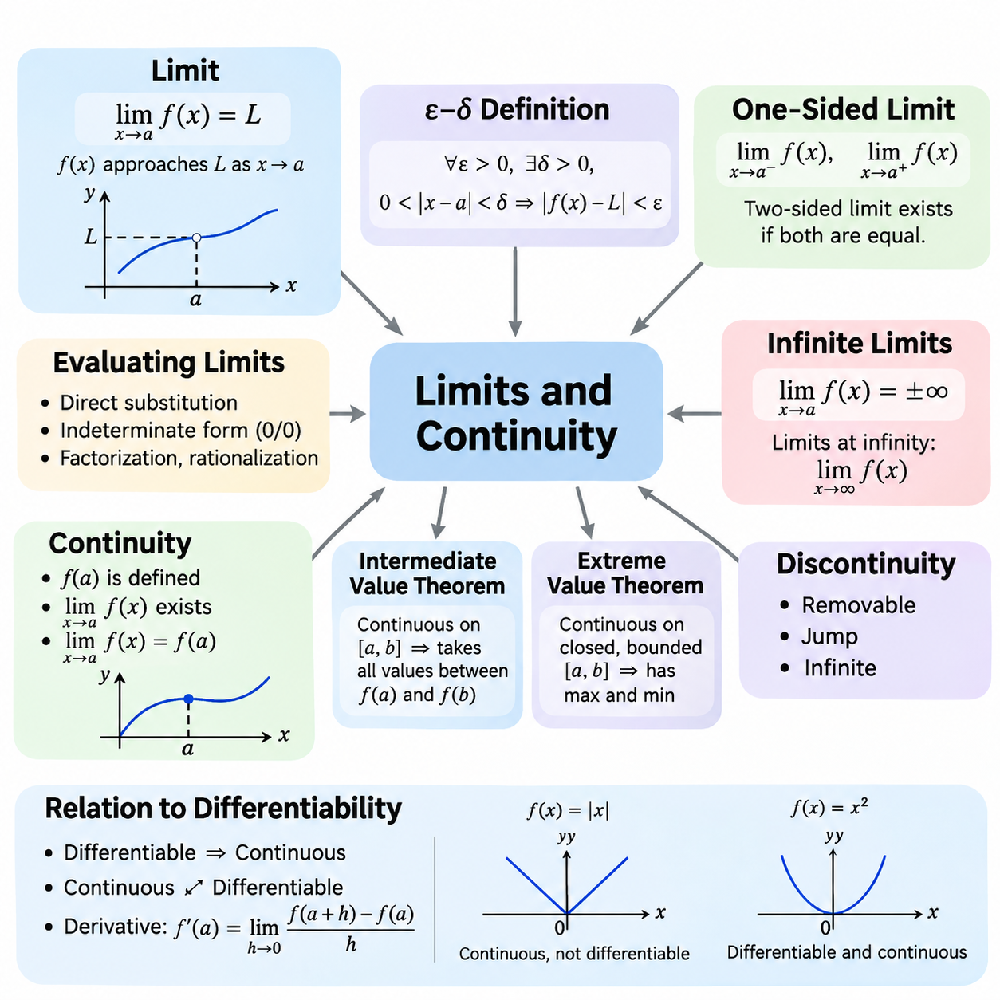
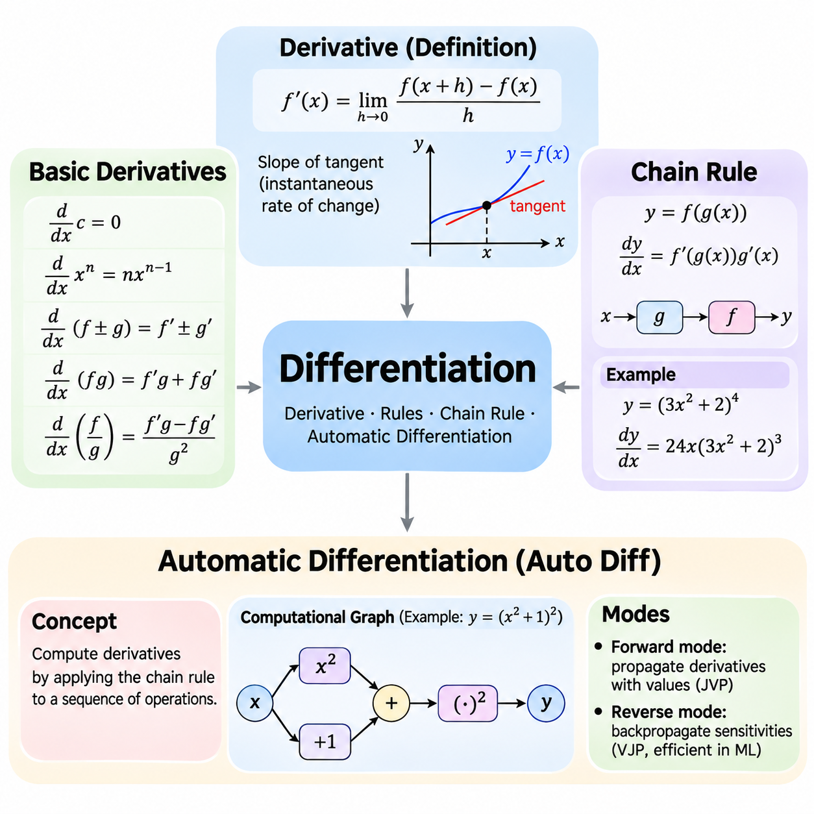
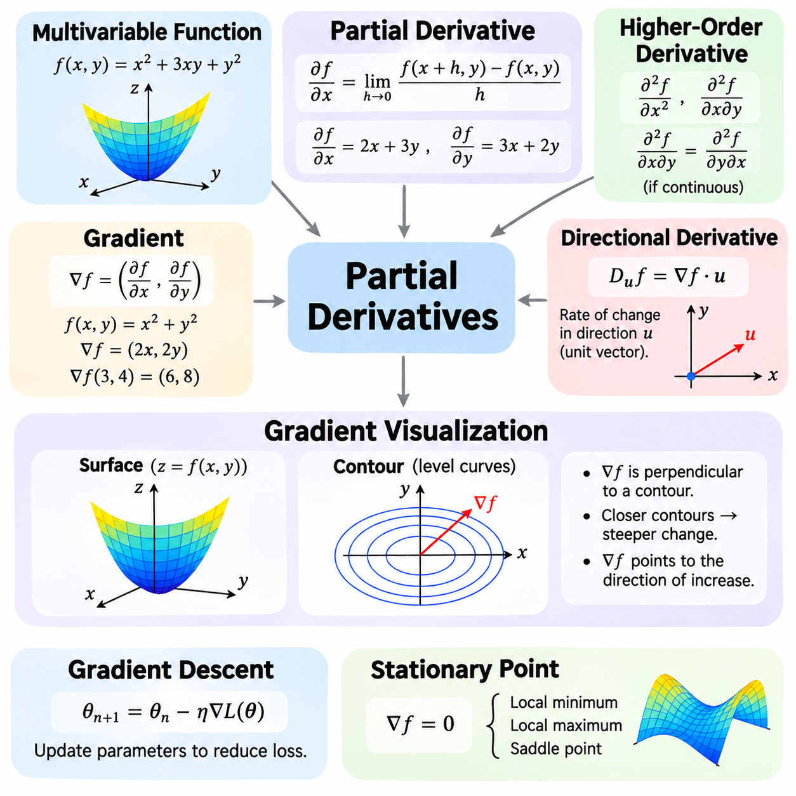
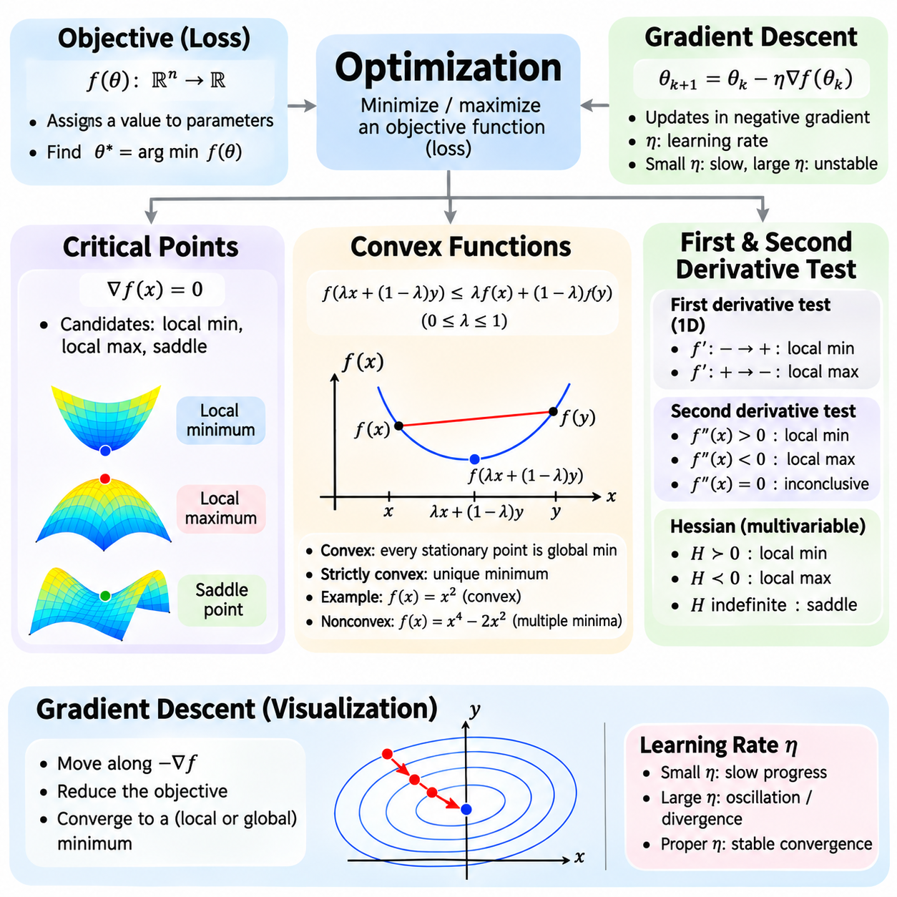
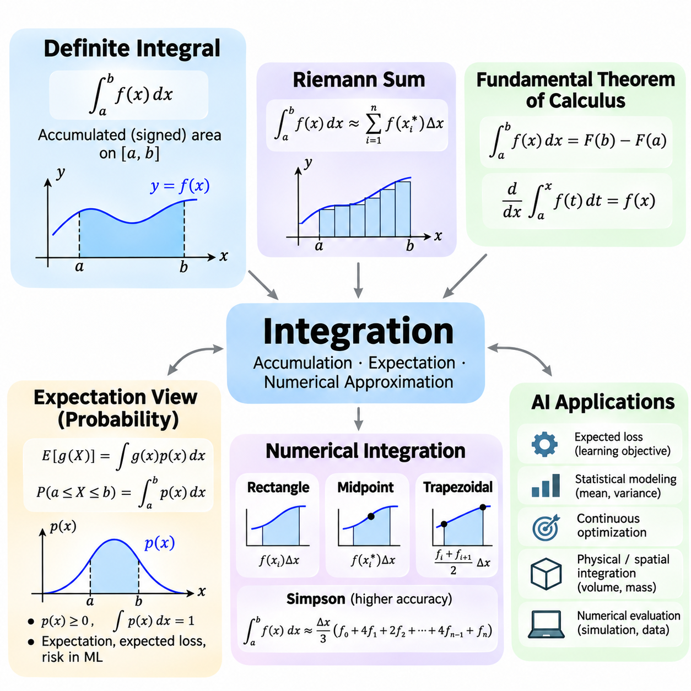
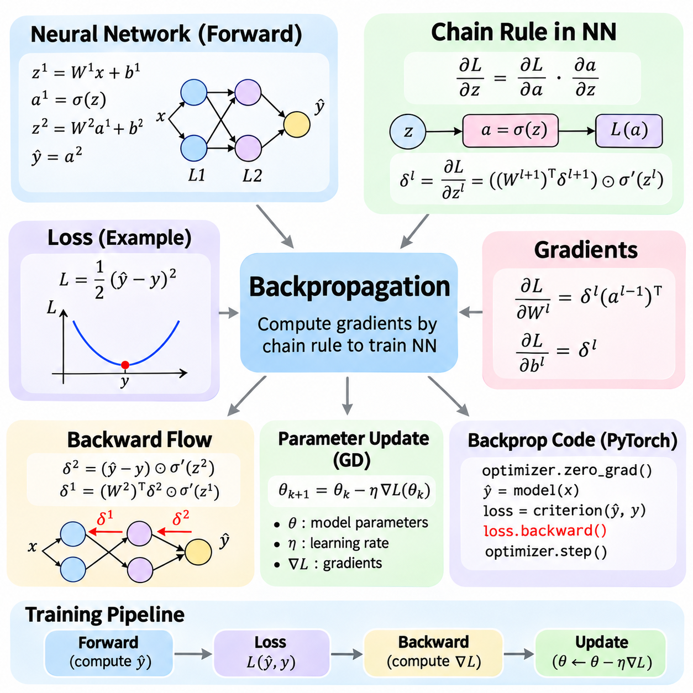
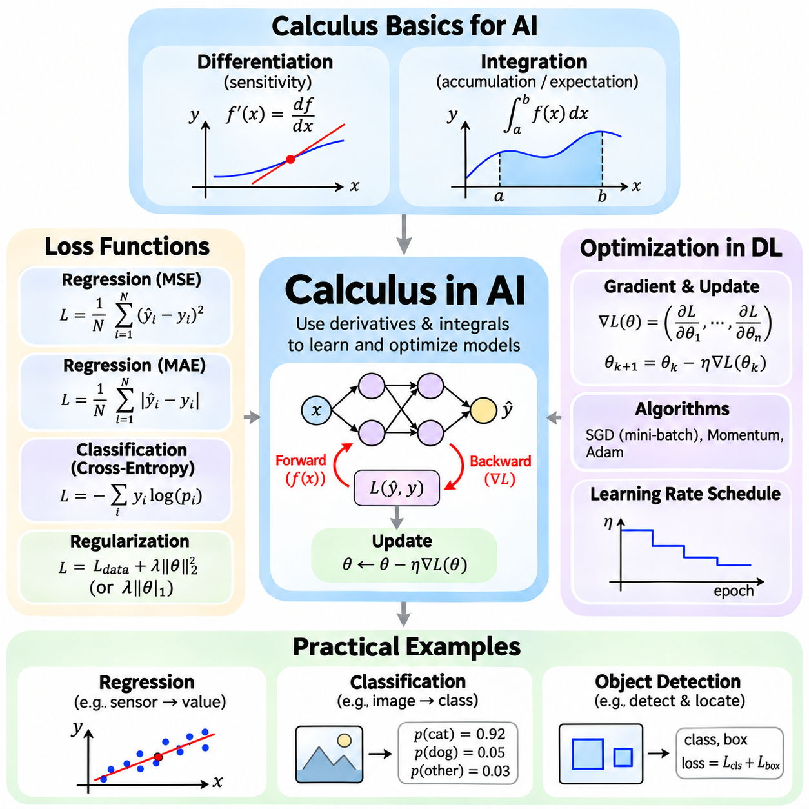

**Volume 05. Mathematics for AI**


# 02. Calculus

## 02.00 Limits and Continuity

{width="7.268055555555556in" height="7.268055555555556in"}

Calculus provides the mathematical foundation for understanding continuous change, and the concepts of limits and continuity establish its essential framework. A limit describes the value that a function approaches as its input moves toward a particular point. This concept allows mathematical analysis even when the function is undefined at that point. In artificial intelligence, limits help explain convergence, numerical approximation, and the behavior of learning algorithms.

The formal definition of a limit expresses how closely a function approaches a target value when its input becomes sufficiently close to a specified point. For a function f(x), the statement lim(x→a) f(x) = L means that f(x) approaches L as x approaches a. The value of f(a) does not necessarily determine the limit. This distinction is fundamental because the behavior surrounding a point can be mathematically meaningful even when the function itself is not defined there.

The epsilon-delta definition provides a rigorous interpretation of limits. For every positive tolerance ε, there must exist a positive distance δ such that 0 \< \|x − a\| \< δ implies \|f(x) − L\| \< ε. This relationship guarantees that function outputs can be made arbitrarily close to L by choosing inputs sufficiently close to a. Such mathematical precision supports convergence proofs, numerical algorithms, and theoretical analysis of optimization procedures.

Limits may be evaluated through direct substitution when a function behaves continuously at the point of interest. For example, the function f(x) = x² + 3x approaches 10 as x approaches 2. However, expressions such as 0/0 require additional analysis because direct substitution produces an indeterminate form. Algebraic factorization, rationalization, and other transformations can reveal the limiting behavior without changing the function\'s values near the point.

One-sided limits examine the behavior of a function when its input approaches a point from only one direction. The left-hand limit considers values smaller than the target, while the right-hand limit considers values larger than the target. A finite two-sided limit exists precisely when both one-sided limits exist and are equal. This distinction is particularly important for piecewise functions, threshold operations, and mathematical models containing abrupt transitions.

Infinite limits describe situations in which function values increase or decrease without bound as the input approaches a particular point. For example, 1/x² approaches positive infinity as x approaches zero from either direction. Limits at infinity instead investigate function behavior as the input grows arbitrarily large in magnitude. These concepts help characterize asymptotic behavior, numerical stability, and the long-term properties of mathematical models.

Continuity describes whether a function changes without a discontinuity at a particular point. A function f(x) is continuous at x = a when f(a) is defined, the limit of f(x) as x approaches a exists, and that limit equals f(a). These three conditions establish consistency between the function\'s actual value and its surrounding behavior. Continuous functions provide a natural mathematical representation of many physical processes and computational relationships.

A function is continuous over an interval when it is continuous at every interior point and satisfies the appropriate one-sided continuity conditions at included endpoints. Polynomial functions are continuous throughout the real numbers, while rational functions are continuous wherever their denominators are nonzero. Exponential, logarithmic, and trigonometric functions also possess continuity within their respective domains. These properties simplify the analysis of mathematical expressions used in AI.

Discontinuities occur when one or more continuity conditions fail. A removable discontinuity arises when a finite limit exists but the function is undefined or assigned an inconsistent value. A jump discontinuity occurs when the finite left-hand and right-hand limits differ. Infinite discontinuities involve unbounded function behavior. Recognizing these categories helps distinguish mathematical irregularities from numerical errors in computational implementations.

The intermediate value theorem establishes an important property of continuous functions. If a function is continuous on a closed interval, it assumes every value between its endpoint values somewhere within that interval. This theorem supports the existence of solutions to nonlinear equations and provides the theoretical basis for root-finding methods such as bisection. Its usefulness extends to calibration, parameter estimation, and numerical problem solving.

The extreme value theorem states that a continuous real-valued function on a closed and bounded interval attains both a maximum and a minimum. This result establishes the existence of optimal values under specific mathematical conditions. Although finding these values may require additional techniques, the theorem provides an important foundation for optimization theory. In machine learning, related existence arguments help distinguish valid optimization problems from unbounded objectives.

Continuity is closely related to differentiability, but the two properties are not equivalent. Every function differentiable at a point must also be continuous there, while a continuous function may fail to be differentiable. The absolute value function f(x) = \|x\| illustrates this distinction because it is continuous at zero but has no ordinary derivative there. Understanding this relationship prepares learners to examine gradients, critical points, and nonsmooth optimization.

The derivative itself is defined through a limit of difference quotients. For a function f(x), the derivative at a point a is the limit of [f(a + h) − f(a)]/h as h approaches zero, provided that the limit exists. This expression measures instantaneous change by examining increasingly small input variations. Consequently, limits provide the conceptual bridge between function behavior and the gradient-based learning methods used in neural networks.

Neural network activation functions demonstrate the practical importance of continuity. The sigmoid and hyperbolic tangent functions are continuous and differentiable throughout their domains. The rectified linear unit, defined as ReLU(x) = max(0, x), is continuous everywhere but is not differentiable at zero. Deep learning frameworks commonly assign a conventional derivative value at this point, allowing gradient-based training to proceed despite the mathematical nondifferentiability.

Loss functions also depend on mathematical properties that influence optimization behavior. Continuous loss functions respond predictably to sufficiently small changes in their inputs, while differentiable losses provide local gradient information. Mean squared error is smooth, whereas absolute error is continuous but nondifferentiable when the prediction error equals zero. These differences influence optimization methods, convergence analysis, and the treatment of nonsmooth objectives.

In numerical computation, mathematical limits must be distinguished from finite-precision approximations. Computers represent real numbers using restricted precision, so extremely small differences may be rounded or lost. A mathematically continuous function can therefore exhibit numerical irregularities when evaluated near singularities or underflow regions. Reliable AI implementations require attention to scaling, stable formulations, and the limitations of floating-point arithmetic.

Convergence analysis frequently uses limits to describe the behavior of iterative algorithms. If a sequence of parameter estimates approaches a fixed value, that value is called its limit. However, convergence of parameter values does not automatically guarantee convergence to a global optimum. Gradient descent and related methods require additional assumptions to establish particular convergence properties. Continuity contributes to these analyses but does not independently guarantee successful optimization.

Uniform continuity strengthens ordinary continuity by requiring a single input-distance tolerance to work throughout an entire domain. Unlike pointwise continuity, the permitted input variation does not depend on the selected location. Every continuous function on a closed and bounded real interval is uniformly continuous. This property is useful when analyzing approximation accuracy, numerical discretization, and error propagation across bounded computational domains.

Limits and continuity also extend to multivariable functions, where several inputs may approach a target simultaneously. A multivariable limit must remain consistent across every valid path approaching the point. This requirement is stronger than checking a few selected directions. Such concepts are essential for understanding continuous parameter spaces, vector-valued functions, neural network mappings, and the mathematical foundations of partial derivatives.

In robotics and physical AI, continuity helps describe trajectories, sensor transformations, and control signals. Position trajectories are often modeled as continuous functions of time, while velocity and acceleration require additional differentiability assumptions. Discontinuous control commands can introduce undesirable physical responses or actuator stress. Mathematical analysis of limits and continuity therefore supports motion planning, trajectory generation, and stable control-system design.

A practical understanding of limits and continuity requires distinguishing mathematical guarantees from computational observations. Numerical experiments can illustrate approaching values, but finite samples cannot establish a limit for every possible input sequence. Formal reasoning identifies the assumptions under which convergence and continuity hold. Together, these concepts establish the foundation for differentiation, integration, backpropagation, and optimization throughout modern artificial intelligence.

미적분학(Calculus)은 연속적인 변화(Continuous Change)를 이해하기 위한 수학적 기초(Mathematical Foundation)를 제공하며, 극한(Limits)과 연속성(Continuity)의 개념은 미적분학의 핵심 체계를 형성합니다. 극한은 함수(Function)의 입력값이 특정 지점에 가까워질 때 함수값이 접근하는 값을 설명합니다. 이 개념을 통해 함수가 해당 지점에서 정의되지 않은 경우에도 수학적 분석(Mathematical Analysis)이 가능합니다. 인공지능(Artificial Intelligence)에서 극한은 수렴(Convergence), 수치 근사(Numerical Approximation), 학습 알고리즘(Learning Algorithms)의 동작을 이해하는 데 중요한 역할을 합니다.

극한의 형식적 정의(Formal Definition)는 함수의 입력값이 특정 지점에 충분히 가까워질 때 함수값이 목표값에 얼마나 가까워지는지를 표현합니다. 함수 f(x)에 대해 lim(x→a) f(x) = L이라는 표현은 x가 a에 접근할 때 f(x)가 L에 접근한다는 의미입니다. 이때 f(a)의 실제 값이 반드시 극한값을 결정하는 것은 아닙니다. 이러한 구분은 함수가 특정 지점에서 정의되지 않더라도 그 주변의 함수 동작이 수학적으로 의미를 가질 수 있기 때문에 중요합니다.

엡실론-델타 정의(Epsilon-Delta Definition)는 극한을 엄밀하게 해석하는 방법을 제공합니다. 모든 양의 허용 오차(Positive Tolerance) ε에 대해 양의 거리 δ가 존재하여 0 \< \|x − a\| \< δ이면 \|f(x) − L\| \< ε을 만족해야 합니다. 이러한 관계는 입력값을 a에 충분히 가깝게 선택하면 함수값을 L에 임의로 가깝게 만들 수 있음을 보장합니다. 이러한 수학적 엄밀성(Mathematical Rigor)은 수렴 증명(Convergence Proofs), 수치 알고리즘(Numerical Algorithms), 최적화 절차(Optimization Procedures)의 이론적 분석을 뒷받침합니다.

함수가 관심 지점에서 연속적으로 동작하는 경우, 극한은 직접 대입(Direct Substitution)을 통해 계산할 수 있습니다. 예를 들어 함수 f(x) = x² + 3x는 x가 2에 접근할 때 10에 접근합니다. 그러나 0/0과 같은 표현은 직접 대입 시 부정형(Indeterminate Form)이 발생하므로 추가적인 분석이 필요합니다. 대수적 인수분해(Algebraic Factorization), 유리화(Rationalization), 기타 수학적 변환(Mathematical Transformations)을 사용하면 해당 지점 주변의 함수값을 변경하지 않으면서 극한의 동작을 파악할 수 있습니다.

한쪽 극한(One-Sided Limits)은 함수의 입력값이 특정 지점에 한 방향에서만 접근할 때의 동작을 분석합니다. 좌극한(Left-Hand Limit)은 목표 지점보다 작은 값에서 접근하는 경우를 의미하며, 우극한(Right-Hand Limit)은 목표 지점보다 큰 값에서 접근하는 경우를 의미합니다. 유한한 양쪽 극한(Two-Sided Limit)이 존재하려면 좌극한과 우극한이 모두 존재하고 서로 같아야 합니다. 이러한 구분은 구간별 정의 함수(Piecewise Functions), 임계값 연산(Threshold Operations), 급격한 전환을 포함하는 수학적 모델(Mathematical Models)을 분석할 때 중요합니다.

무한 극한(Infinite Limits)은 입력값이 특정 지점에 접근할 때 함수값이 제한 없이 증가하거나 감소하는 상황을 설명합니다. 예를 들어 1/x²은 x가 양쪽 방향에서 0에 접근할 때 양의 무한대(Positive Infinity)로 발산합니다. 반면 무한대에서의 극한(Limits at Infinity)은 입력값의 절댓값이 무한히 커질 때 함수의 동작을 분석합니다. 이러한 개념은 점근적 동작(Asymptotic Behavior), 수치 안정성(Numerical Stability), 수학적 모델의 장기적 특성(Long-Term Properties)을 이해하는 데 도움이 됩니다.

연속성(Continuity)은 함수가 특정 지점에서 불연속적인 변화 없이 동작하는지를 설명합니다. 함수 f(x)가 x = a에서 연속이려면 f(a)가 정의되어 있어야 하고, x가 a에 접근할 때 f(x)의 극한이 존재해야 하며, 그 극한값이 f(a)와 같아야 합니다. 이러한 세 가지 조건은 함수의 실제 값과 주변 동작 사이의 일관성(Consistency)을 보장합니다. 연속 함수(Continuous Functions)는 다양한 물리적 과정(Physical Processes)과 계산 관계(Computational Relationships)를 표현하는 자연스러운 수학적 모델을 제공합니다.

함수가 어떤 구간(Interval)에서 연속이라는 것은 해당 구간의 모든 내부 지점에서 연속이고, 포함된 끝점에서는 적절한 한쪽 연속성(One-Sided Continuity) 조건을 만족한다는 의미입니다. 다항함수(Polynomial Functions)는 전체 실수 범위에서 연속이며, 유리함수(Rational Functions)는 분모가 0이 아닌 모든 지점에서 연속입니다. 지수함수(Exponential Functions), 로그함수(Logarithmic Functions), 삼각함수(Trigonometric Functions) 역시 각각의 정의역(Domain)에서 연속성을 가집니다. 이러한 특성은 인공지능에서 사용하는 수학적 표현의 분석을 단순화합니다.

불연속성(Discontinuity)은 연속성 조건 중 하나 이상이 충족되지 않을 때 발생합니다. 제거 가능한 불연속(Removable Discontinuity)은 유한한 극한값이 존재하지만 함수가 해당 지점에서 정의되지 않았거나 일치하지 않는 값으로 정의된 경우입니다. 점프 불연속(Jump Discontinuity)은 유한한 좌극한과 우극한이 서로 다를 때 발생합니다. 무한 불연속(Infinite Discontinuity)은 함수값이 제한 없이 증가하거나 감소하는 경우입니다. 이러한 유형을 구분하면 계산 구현(Computational Implementation)에서 수학적 불규칙성과 수치 오류(Numerical Errors)를 구별하는 데 도움이 됩니다.

중간값 정리(Intermediate Value Theorem)는 연속 함수의 중요한 특성을 설명합니다. 함수가 닫힌 구간(Closed Interval)에서 연속이면 양 끝점의 함수값 사이에 있는 모든 값을 해당 구간의 적어도 한 지점에서 가집니다. 이 정리는 비선형 방정식(Nonlinear Equations)의 해가 존재한다는 사실을 뒷받침하며, 이분법(Bisection Method)과 같은 근 찾기 방법(Root-Finding Methods)의 이론적 기초를 제공합니다. 또한 보정(Calibration), 매개변수 추정(Parameter Estimation), 수치 문제 해결(Numerical Problem Solving)에도 활용됩니다.

최댓값·최솟값 정리(Extreme Value Theorem)는 닫히고 유계인 구간(Closed and Bounded Interval)에서 연속인 실숫값 함수(Real-Valued Function)가 최댓값(Maximum)과 최솟값(Minimum)을 모두 가진다는 것을 설명합니다. 이 결과는 특정 수학적 조건에서 최적값(Optimal Values)의 존재를 보장합니다. 실제 최적값을 찾기 위해서는 추가적인 기법이 필요할 수 있지만, 이 정리는 최적화 이론(Optimization Theory)의 중요한 기초를 제공합니다. 기계학습(Machine Learning)에서는 관련된 존재성 논증(Existence Arguments)을 통해 유효한 최적화 문제와 무한히 발산하는 목적함수(Unbounded Objectives)를 구분할 수 있습니다.

연속성(Continuity)은 미분 가능성(Differentiability)과 밀접하게 관련되어 있지만, 두 특성이 동일한 것은 아닙니다. 어떤 함수가 특정 지점에서 미분 가능하면 반드시 그 지점에서 연속이지만, 연속 함수가 항상 미분 가능한 것은 아닙니다. 절댓값 함수(Absolute Value Function) f(x) = \|x\|는 이러한 차이를 보여주는 대표적인 예로, 0에서 연속이지만 일반적인 도함수(Ordinary Derivative)는 존재하지 않습니다. 이러한 관계를 이해하면 기울기(Gradients), 임계점(Critical Points), 비매끄러운 최적화(Nonsmooth Optimization)를 학습하기 위한 기초를 마련할 수 있습니다.

도함수(Derivative)는 차분 몫(Difference Quotient)의 극한을 통해 정의됩니다. 함수 f(x)에 대해 지점 a에서의 도함수는 h가 0에 접근할 때 [f(a + h) − f(a)]/h의 극한으로 정의되며, 이 극한이 존재해야 합니다. 이 표현은 입력값의 변화량을 점점 작게 만들면서 순간 변화율(Instantaneous Rate of Change)을 측정합니다. 따라서 극한은 함수의 동작과 신경망(Neural Networks)에서 사용하는 기울기 기반 학습 방법(Gradient-Based Learning Methods)을 연결하는 개념적 기반이 됩니다.

신경망의 활성화 함수(Activation Functions)는 연속성의 실용적 중요성을 보여줍니다. 시그모이드 함수(Sigmoid Function)와 쌍곡탄젠트 함수(Hyperbolic Tangent Function)는 전체 정의역에서 연속이며 미분 가능합니다. 정류 선형 유닛(Rectified Linear Unit, ReLU)은 ReLU(x) = max(0, x)로 정의되며 모든 지점에서 연속이지만 0에서는 미분 가능하지 않습니다. 딥러닝 프레임워크(Deep Learning Frameworks)는 일반적으로 이 지점에 관례적인 도함수 값(Conventional Derivative Value)을 지정하여 수학적 미분 불가능성에도 불구하고 기울기 기반 학습을 진행할 수 있도록 합니다.

손실함수(Loss Functions) 역시 최적화 동작에 영향을 미치는 수학적 특성에 의존합니다. 연속 손실함수(Continuous Loss Functions)는 입력값이 충분히 작게 변할 때 예측 가능한 방식으로 반응하며, 미분 가능한 손실함수(Differentiable Loss Functions)는 국소적인 기울기 정보(Local Gradient Information)를 제공합니다. 평균제곱오차(Mean Squared Error)는 매끄러운 함수(Smooth Function)이지만, 절대오차(Absolute Error)는 연속이면서 예측 오차가 0인 지점에서 미분 가능하지 않습니다. 이러한 차이는 최적화 방법(Optimization Methods), 수렴 분석(Convergence Analysis), 비매끄러운 목적함수(Nonsmooth Objectives)의 처리 방식에 영향을 줍니다.

수치 계산(Numerical Computation)에서는 수학적 극한(Mathematical Limits)과 유한 정밀도 근사(Finite-Precision Approximations)를 구분해야 합니다. 컴퓨터는 제한된 정밀도(Restricted Precision)로 실수를 표현하므로 매우 작은 차이가 반올림되거나 사라질 수 있습니다. 따라서 수학적으로 연속인 함수도 특이점(Singularities)이나 언더플로 영역(Underflow Regions) 근처에서 계산할 때 수치적 불규칙성을 나타낼 수 있습니다. 신뢰할 수 있는 인공지능 구현을 위해서는 스케일링(Scaling), 안정적인 수식 구성(Stable Formulations), 부동소수점 연산(Floating-Point Arithmetic)의 한계를 고려해야 합니다.

수렴 분석(Convergence Analysis)은 반복 알고리즘(Iterative Algorithms)의 동작을 설명하기 위해 극한을 자주 사용합니다. 매개변수 추정값(Parameter Estimates)의 수열(Sequence)이 특정한 고정값에 접근하면 그 값을 극한값(Limit)이라고 합니다. 그러나 매개변수 값의 수렴이 반드시 전역 최적해(Global Optimum)로의 수렴을 보장하는 것은 아닙니다. 경사하강법(Gradient Descent)과 관련된 방법들은 특정 수렴 특성을 증명하기 위해 추가적인 가정(Assumptions)이 필요합니다. 연속성은 이러한 분석에 기여하지만, 그 자체만으로 성공적인 최적화를 보장하지는 않습니다.

균등 연속성(Uniform Continuity)은 전체 정의역에서 하나의 공통된 입력 거리 허용 범위(Input-Distance Tolerance)가 적용되도록 요구함으로써 일반적인 연속성을 강화합니다. 점별 연속성(Pointwise Continuity)과 달리 허용되는 입력 변화량은 선택한 위치에 의존하지 않습니다. 닫히고 유계인 실수 구간에서 연속인 모든 함수는 균등 연속입니다. 이러한 특성은 유계 계산 영역(Bounded Computational Domains)에서 근사 정확도(Approximation Accuracy), 수치 이산화(Numerical Discretization), 오차 전파(Error Propagation)를 분석할 때 유용합니다.

극한과 연속성은 여러 입력값이 동시에 목표 지점에 접근하는 다변수 함수(Multivariable Functions)로도 확장됩니다. 다변수 극한(Multivariable Limit)은 해당 지점에 접근하는 모든 유효한 경로(Valid Paths)에서 일관된 값을 가져야 합니다. 이러한 요구 조건은 몇 개의 선택된 방향만 확인하는 것보다 훨씬 엄격합니다. 이 개념은 연속 매개변수 공간(Continuous Parameter Spaces), 벡터값 함수(Vector-Valued Functions), 신경망 매핑(Neural Network Mappings), 편도함수(Partial Derivatives)의 수학적 기초를 이해하는 데 필수적입니다.

로보틱스(Robotics)와 피지컬 인공지능(Physical AI)에서 연속성은 궤적(Trajectories), 센서 변환(Sensor Transformations), 제어 신호(Control Signals)를 설명하는 데 도움이 됩니다. 위치 궤적(Position Trajectories)은 일반적으로 시간에 대한 연속 함수로 모델링되지만, 속도(Velocity)와 가속도(Acceleration)를 정의하려면 추가적인 미분 가능성 조건이 필요합니다. 불연속적인 제어 명령(Discontinuous Control Commands)은 바람직하지 않은 물리적 반응이나 액추에이터 응력(Actuator Stress)을 유발할 수 있습니다. 따라서 극한과 연속성의 수학적 분석은 동작 계획(Motion Planning), 궤적 생성(Trajectory Generation), 안정적인 제어 시스템 설계(Control-System Design)를 지원합니다.

극한과 연속성을 실용적으로 이해하려면 수학적 보장(Mathematical Guarantees)과 계산적 관찰(Computational Observations)을 구분해야 합니다. 수치 실험(Numerical Experiments)은 함수값이 특정 값에 접근하는 현상을 보여줄 수 있지만, 유한한 표본(Finite Samples)만으로 모든 가능한 입력 수열(Input Sequences)에 대한 극한을 증명할 수는 없습니다. 형식적 추론(Formal Reasoning)은 수렴과 연속성이 성립하는 가정과 조건을 명확히 합니다. 이러한 개념들은 현대 인공지능 전반에서 미분(Differentiation), 적분(Integration), 역전파(Backpropagation), 최적화(Optimization)를 이해하기 위한 핵심적인 수학적 기반을 형성합니다.

## 02.01 Differentiation

{width="7.268055555555556in" height="7.268055555555556in"}

Differentiation is a fundamental operation in calculus that measures how a function changes in response to variations in its input. The derivative represents the instantaneous rate of change and provides information about the local behavior of a mathematical function. In artificial intelligence, differentiation is essential for training neural networks, minimizing loss functions, adjusting model parameters, and understanding optimization processes.

The derivative of a function f(x) at a point x is defined as the limit of the difference quotient [f(x + h) − f(x)]/h as h approaches zero. This definition describes how the average rate of change over a small interval approaches an instantaneous rate. Geometrically, the derivative represents the slope of the tangent line at a particular point. A positive derivative indicates local increase, while a negative derivative indicates local decrease.

Basic differentiation rules simplify the calculation of derivatives without repeatedly evaluating limits. The constant rule states that the derivative of a constant is zero, while the power rule gives d(xⁿ)/dx = nxⁿ⁻¹ for real exponents wherever the expression is differentiable. The sum rule allows derivatives to be calculated independently for individual terms. These rules form the computational foundation for differentiating polynomial expressions.

The product rule describes differentiation when two functions are multiplied together. If h(x) = f(x)g(x), then h\'(x) = f\'(x)g(x) + f(x)g\'(x). The quotient rule applies to the division of functions and produces h\'(x) = [f\'(x)g(x) − f(x)g\'(x)]/[g(x)]², provided that g(x) is nonzero. These rules are useful for analyzing complex mathematical expressions encountered in optimization and statistical modeling.

Derivatives of elementary functions appear throughout machine learning and scientific computing. The exponential function satisfies d(eˣ)/dx = eˣ, while the natural logarithm satisfies d(ln x)/dx = 1/x for positive x. Trigonometric functions have characteristic derivatives, including d(sin x)/dx = cos x and d(cos x)/dx = −sin x. Understanding these relationships makes it possible to analyze nonlinear transformations and activation functions.

The chain rule is one of the most important principles in differentiation because it explains how derivatives propagate through composed functions. If y = f(g(x)), then dy/dx = f\'(g(x))g\'(x). This expression separates the derivative of the outer function from the derivative of the inner function. The chain rule enables complex expressions to be differentiated systematically and provides the mathematical foundation for gradient propagation in neural networks.

Consider the composite function y = (3x² + 2)⁴. The outer function raises its input to the fourth power, while the inner function computes 3x² + 2. Applying the chain rule gives dy/dx = 4(3x² + 2)³(6x), which simplifies to 24x(3x² + 2)³. This example demonstrates how differentiation can be decomposed into smaller operations, allowing complicated mathematical expressions to be evaluated efficiently.

For functions containing multiple nested transformations, the chain rule extends across every intermediate operation. If y = f(g(h(x))), then dy/dx = f\'(g(h(x)))g\'(h(x))h\'(x). Each derivative represents the sensitivity of one computational stage to its input. Multiplying these local sensitivities produces the overall derivative. This principle is especially important in deep neural networks, where information passes through many sequential layers.

Neural networks can be interpreted as compositions of mathematical functions. Each layer transforms its input through weighted operations, bias additions, and nonlinear activation functions. During training, the network produces predictions that are compared with target values through a loss function. The chain rule connects changes in the loss to changes in individual parameters, allowing learning algorithms to determine how weights and biases should be updated.

Automatic differentiation is a computational technique that evaluates derivatives by systematically applying differentiation rules to elementary operations. Unlike symbolic differentiation, which constructs algebraic derivative expressions, automatic differentiation computes derivative values through the structure of a program. Unlike finite differences, it does not estimate derivatives by perturbing inputs. Instead, it propagates derivatives using the chain rule and the derivatives of supported operations.

Automatic differentiation represents computations through a sequence of elementary mathematical operations. These operations may include addition, multiplication, exponentiation, logarithms, and activation functions. Each operation has a known local derivative, allowing the complete derivative to be assembled through repeated applications of the chain rule. Computational graphs provide a useful conceptual representation of these dependencies, although automatic differentiation does not require a particular graph implementation.

Forward-mode automatic differentiation propagates derivative information alongside ordinary numerical values. Starting from selected input variables, the algorithm calculates both intermediate values and their derivatives as computation proceeds. This approach efficiently evaluates Jacobian-vector products and is particularly useful when the number of independent inputs is small relative to the number of outputs. It also supports sensitivity analysis and numerical modeling.

Reverse-mode automatic differentiation first evaluates the original function and then propagates derivative information backward through its operations. The forward computation establishes intermediate values, while the reverse computation accumulates sensitivities from outputs toward inputs. Reverse mode efficiently evaluates vector-Jacobian products and is especially effective for scalar-valued loss functions involving many trainable parameters, making it central to modern deep learning.

Backpropagation is a specialized application of reverse-mode automatic differentiation to neural network training. During the forward pass, the network calculates predictions and the corresponding loss. During the backward pass, gradients are propagated through the network using the chain rule. Each trainable parameter receives information describing how a small change in its value affects the loss, enabling optimization algorithms to update the model systematically.

Modern machine learning frameworks such as PyTorch, TensorFlow, and JAX provide automatic differentiation capabilities. PyTorch commonly records differentiable tensor operations and computes gradients through backward propagation. TensorFlow supports automatic differentiation through gradient recording mechanisms, while JAX provides transformations such as grad for differentiating numerical functions. These frameworks reduce the need to implement derivative calculations manually.

Automatic differentiation requires careful treatment of operations that are not differentiable everywhere. Functions such as ReLU are continuous but have points where ordinary derivatives do not exist. Frameworks generally define derivative conventions at such points to support practical optimization. Conditional branches, discrete operations, and unsupported numerical procedures may introduce additional complications, requiring explicit handling or alternative mathematical formulations.

Numerical differentiation provides another method for estimating derivatives through small changes in function inputs. A forward-difference approximation uses [f(x + h) − f(x)]/h, while a central-difference approximation uses [f(x + h) − f(x − h)]/(2h). These methods are straightforward but introduce truncation and floating-point errors. Automatic differentiation generally provides more accurate derivatives for supported differentiable computations without relying on a finite perturbation size.

Gradient checking compares derivatives obtained through automatic differentiation with numerical approximations. By perturbing individual parameters and observing changes in the loss, developers can test whether computed gradients are consistent with expected behavior. However, numerical approximations become unreliable when perturbations are excessively small or when functions contain nondifferentiable points. Appropriate tolerances and carefully selected test inputs are therefore essential.

Differentiation also provides a foundation for understanding gradient-based optimization. When a loss function is differentiable, its derivative indicates the local direction of increasing loss. Gradient descent updates parameters in the opposite direction to reduce the objective under suitable step-size conditions. In multidimensional parameter spaces, partial derivatives combine into a gradient vector that describes local sensitivity across all parameters.

The repeated application of the chain rule can produce vanishing or exploding gradients in deep neural networks. When many local derivatives have magnitudes below one, their products may become extremely small. Conversely, repeated multiplication by large derivatives can produce excessive gradient magnitudes. These behaviors affect training stability and motivate techniques such as careful initialization, normalization, residual connections, and gradient clipping.

Differentiation connects mathematical theory with practical artificial intelligence engineering. Basic derivative rules establish how elementary functions change, the chain rule explains how changes propagate through composed operations, and automatic differentiation makes these calculations computationally practical. Together, these concepts support gradient computation, backpropagation, parameter optimization, and the development of reliable learning systems across modern AI applications.

미분(Differentiation)은 입력값의 변화에 따라 함수(Function)가 어떻게 변하는지를 측정하는 미적분학(Calculus)의 기본 연산입니다. 도함수(Derivative)는 순간 변화율(Instantaneous Rate of Change)을 나타내며, 수학적 함수의 국소적 동작(Local Behavior)에 대한 정보를 제공합니다. 인공지능(Artificial Intelligence)에서 미분은 신경망(Neural Networks)의 학습, 손실함수(Loss Functions)의 최소화, 모델 매개변수(Model Parameters)의 조정, 최적화 과정(Optimization Processes)의 이해에 필수적입니다.

함수 f(x)의 특정 지점 x에서 도함수(Derivative)는 h가 0에 접근할 때 차분 몫(Difference Quotient) [f(x + h) − f(x)]/h의 극한(Limit)으로 정의됩니다. 이 정의는 작은 구간에서의 평균 변화율(Average Rate of Change)이 순간 변화율에 접근하는 과정을 설명합니다. 기하학적으로 도함수는 특정 지점에서 접선(Tangent Line)의 기울기(Slope)를 나타냅니다. 양의 도함수(Positive Derivative)는 국소적인 증가를 의미하고, 음의 도함수(Negative Derivative)는 국소적인 감소를 의미합니다.

기본 미분 법칙(Basic Differentiation Rules)은 극한을 반복적으로 계산하지 않고도 도함수를 간단하게 구할 수 있도록 합니다. 상수 미분 법칙(Constant Rule)은 상수의 도함수가 0임을 나타내며, 거듭제곱 미분 법칙(Power Rule)은 해당 표현이 미분 가능한 지점에서 실수 지수에 대해 d(xⁿ)/dx = nxⁿ⁻¹을 제공합니다. 합의 미분 법칙(Sum Rule)은 각 항의 도함수를 독립적으로 계산할 수 있도록 합니다. 이러한 법칙은 다항식 표현(Polynomial Expressions)을 미분하는 계산적 기초를 형성합니다.

곱의 미분 법칙(Product Rule)은 두 함수가 곱해진 경우의 미분을 설명합니다. h(x) = f(x)g(x)라면 h\'(x) = f\'(x)g(x) + f(x)g\'(x)가 성립합니다. 몫의 미분 법칙(Quotient Rule)은 함수의 나눗셈에 적용되며, g(x)가 0이 아닌 경우 h\'(x) = [f\'(x)g(x) − f(x)g\'(x)]/[g(x)]²로 계산됩니다. 이러한 법칙은 최적화(Optimization)와 통계적 모델링(Statistical Modeling)에서 사용되는 복잡한 수학적 표현을 분석하는 데 유용합니다.

초등함수(Elementary Functions)의 도함수는 기계학습(Machine Learning)과 과학 계산(Scientific Computing) 전반에서 사용됩니다. 지수함수(Exponential Function)는 d(eˣ)/dx = eˣ을 만족하며, 자연로그 함수(Natural Logarithm)는 양의 x에 대해 d(ln x)/dx = 1/x를 만족합니다. 삼각함수(Trigonometric Functions) 역시 고유한 도함수를 가지며, 대표적으로 d(sin x)/dx = cos x와 d(cos x)/dx = −sin x가 있습니다. 이러한 관계를 이해하면 비선형 변환(Nonlinear Transformations)과 활성화 함수(Activation Functions)를 분석할 수 있습니다.

연쇄 법칙(Chain Rule)은 합성함수(Composite Functions)를 통해 도함수가 어떻게 전달되는지를 설명하기 때문에 미분에서 가장 중요한 원리 중 하나입니다. y = f(g(x))라면 dy/dx = f\'(g(x))g\'(x)가 성립합니다. 이 표현은 외부 함수(Outer Function)의 도함수와 내부 함수(Inner Function)의 도함수를 구분합니다. 연쇄 법칙을 사용하면 복잡한 수학적 표현을 체계적으로 미분할 수 있으며, 신경망에서 기울기 전파(Gradient Propagation)를 수행하는 수학적 기초가 됩니다.

합성함수(Composite Function) y = (3x² + 2)⁴를 생각해 볼 수 있습니다. 외부 함수(Outer Function)는 입력값을 네제곱하고, 내부 함수(Inner Function)는 3x² + 2를 계산합니다. 연쇄 법칙(Chain Rule)을 적용하면 dy/dx = 4(3x² + 2)³(6x)가 되며, 이를 정리하면 24x(3x² + 2)³이 됩니다. 이 예시는 미분을 더 작은 연산으로 분해하여 복잡한 수학적 표현을 효율적으로 계산할 수 있음을 보여줍니다.

여러 개의 중첩된 변환(Nested Transformations)을 포함하는 함수에서는 연쇄 법칙(Chain Rule)이 모든 중간 연산으로 확장됩니다. y = f(g(h(x)))라면 dy/dx = f\'(g(h(x)))g\'(h(x))h\'(x)가 성립합니다. 각각의 도함수(Derivative)는 하나의 계산 단계(Computational Stage)가 입력값에 얼마나 민감하게 반응하는지를 나타냅니다. 이러한 국소 민감도(Local Sensitivities)를 곱하면 전체 도함수를 구할 수 있습니다. 이 원리는 정보가 여러 계층을 순차적으로 통과하는 심층 신경망(Deep Neural Networks)에서 특히 중요합니다.

신경망(Neural Networks)은 수학적 함수들의 합성(Composition of Mathematical Functions)으로 해석할 수 있습니다. 각 계층(Layer)은 가중치 연산(Weighted Operations), 편향 추가(Bias Additions), 비선형 활성화 함수(Nonlinear Activation Functions)를 통해 입력값을 변환합니다. 학습 과정에서 신경망은 예측값(Predictions)을 생성하고 손실함수(Loss Function)를 통해 목표값(Target Values)과 비교합니다. 연쇄 법칙(Chain Rule)은 손실의 변화와 개별 매개변수의 변화를 연결하여 가중치와 편향을 어떻게 업데이트해야 하는지 결정할 수 있도록 합니다.

자동 미분(Automatic Differentiation)은 기본 연산(Elementary Operations)에 미분 법칙을 체계적으로 적용하여 도함수를 계산하는 기법입니다. 대수적 도함수 표현을 생성하는 기호 미분(Symbolic Differentiation)과 달리 자동 미분은 프로그램의 계산 구조를 통해 도함수 값을 계산합니다. 또한 입력값을 조금씩 변화시켜 도함수를 추정하는 유한 차분(Finite Differences)과도 다릅니다. 자동 미분은 연쇄 법칙(Chain Rule)과 지원되는 연산의 도함수를 사용하여 미분 정보를 전파합니다.

자동 미분(Automatic Differentiation)은 계산을 일련의 기본 수학 연산(Elementary Mathematical Operations)으로 표현합니다. 이러한 연산에는 덧셈(Addition), 곱셈(Multiplication), 지수 연산(Exponentiation), 로그(Logarithms), 활성화 함수(Activation Functions) 등이 포함됩니다. 각 연산에는 알려진 국소 도함수(Local Derivative)가 있으므로 연쇄 법칙(Chain Rule)을 반복적으로 적용하여 전체 도함수를 구성할 수 있습니다. 계산 그래프(Computational Graphs)는 이러한 의존 관계를 표현하는 유용한 개념이지만, 자동 미분이 반드시 특정 그래프 구현을 요구하는 것은 아닙니다.

순방향 자동 미분(Forward-Mode Automatic Differentiation)은 일반적인 수치값과 함께 도함수 정보를 전파합니다. 선택된 입력 변수(Input Variables)에서 시작하여 계산이 진행되는 동안 중간값(Intermediate Values)과 그 도함수를 동시에 계산합니다. 이 방법은 야코비안-벡터 곱(Jacobian-Vector Products)을 효율적으로 계산하며, 독립 입력 변수의 수가 출력 변수의 수보다 상대적으로 적을 때 특히 유용합니다. 또한 민감도 분석(Sensitivity Analysis)과 수치 모델링(Numerical Modeling)을 지원합니다.

역방향 자동 미분(Reverse-Mode Automatic Differentiation)은 먼저 원래 함수를 계산한 다음 연산의 역방향으로 도함수 정보를 전파합니다. 순방향 계산(Forward Computation)은 중간값을 결정하고, 역방향 계산(Reverse Computation)은 출력에서 입력 방향으로 민감도(Sensitivities)를 누적합니다. 역방향 방식은 벡터-야코비안 곱(Vector-Jacobian Products)을 효율적으로 계산하며, 많은 학습 가능한 매개변수(Trainable Parameters)를 포함하는 스칼라 손실함수(Scalar-Valued Loss Functions)에 특히 효과적이므로 현대 딥러닝의 핵심 기법으로 사용됩니다.

역전파(Backpropagation)는 신경망 학습에 역방향 자동 미분(Reverse-Mode Automatic Differentiation)을 적용한 특수한 방법입니다. 순전파(Forward Pass) 과정에서 신경망은 예측값과 해당 손실값(Loss)을 계산합니다. 역전파(Backward Pass) 과정에서는 연쇄 법칙(Chain Rule)을 사용하여 기울기(Gradients)를 신경망 전체에 전파합니다. 각 학습 가능한 매개변수는 자신의 값이 조금 변할 때 손실이 어떻게 달라지는지에 대한 정보를 얻으며, 이를 통해 최적화 알고리즘(Optimization Algorithms)이 모델을 체계적으로 업데이트할 수 있습니다.

PyTorch, TensorFlow, JAX와 같은 현대 기계학습 프레임워크(Machine Learning Frameworks)는 자동 미분(Automatic Differentiation) 기능을 제공합니다. PyTorch는 일반적으로 미분 가능한 텐서 연산(Differentiable Tensor Operations)을 기록하고 역방향 전파(Backward Propagation)를 통해 기울기를 계산합니다. TensorFlow는 기울기 기록 메커니즘(Gradient Recording Mechanisms)을 통해 자동 미분을 지원하며, JAX는 수치 함수를 미분하기 위한 grad와 같은 변환 기능(Transformations)을 제공합니다. 이러한 프레임워크는 도함수 계산을 수동으로 구현해야 하는 부담을 줄여줍니다.

자동 미분(Automatic Differentiation)은 모든 지점에서 미분 가능하지 않은 연산을 신중하게 처리해야 합니다. ReLU와 같은 함수는 연속적이지만 일반적인 도함수가 존재하지 않는 지점을 포함합니다. 프레임워크(Frameworks)는 실용적인 최적화를 지원하기 위해 이러한 지점에서 관례적인 도함수 값(Derivative Conventions)을 정의하는 경우가 많습니다. 조건 분기(Conditional Branches), 이산 연산(Discrete Operations), 지원되지 않는 수치 절차(Unsupported Numerical Procedures)는 추가적인 문제를 발생시킬 수 있으므로 명시적인 처리나 대체 수학적 표현이 필요할 수 있습니다.

수치 미분(Numerical Differentiation)은 함수 입력값을 조금씩 변화시켜 도함수를 추정하는 또 다른 방법입니다. 전진 차분 근사(Forward-Difference Approximation)는 [f(x + h) − f(x)]/h를 사용하며, 중앙 차분 근사(Central-Difference Approximation)는 [f(x + h) − f(x − h)]/(2h)를 사용합니다. 이러한 방법은 구현이 간단하지만 절단 오차(Truncation Error)와 부동소수점 오차(Floating-Point Error)가 발생합니다. 자동 미분은 일반적으로 지원되는 미분 가능한 계산에서 유한한 입력 변화량에 의존하지 않고 더 정확한 도함수를 제공합니다.

기울기 검사(Gradient Checking)는 자동 미분(Automatic Differentiation)으로 계산한 도함수와 수치 근사(Numerical Approximations)로 얻은 도함수를 비교하는 방법입니다. 개별 매개변수(Parameter)를 조금씩 변화시키고 손실값의 변화를 관찰하면 계산된 기울기가 예상된 동작과 일치하는지 확인할 수 있습니다. 그러나 입력 변화량이 지나치게 작거나 함수에 미분 불가능한 지점(Nondifferentiable Points)이 포함되어 있으면 수치 근사의 신뢰성이 떨어집니다. 따라서 적절한 허용 오차(Tolerances)와 신중하게 선택된 시험 입력값(Test Inputs)이 중요합니다.

미분(Differentiation)은 기울기 기반 최적화(Gradient-Based Optimization)를 이해하기 위한 기초도 제공합니다. 손실함수(Loss Function)가 미분 가능하면 도함수는 손실이 국소적으로 증가하는 방향을 나타냅니다. 경사하강법(Gradient Descent)은 적절한 학습 단계 크기(Step-Size Conditions)에서 목적함수(Objective Function)를 감소시키기 위해 기울기의 반대 방향으로 매개변수를 업데이트합니다. 다차원 매개변수 공간(Multidimensional Parameter Spaces)에서는 편도함수(Partial Derivatives)가 결합되어 모든 매개변수에 대한 국소 민감도를 나타내는 기울기 벡터(Gradient Vector)를 형성합니다.

연쇄 법칙(Chain Rule)을 반복적으로 적용하면 심층 신경망(Deep Neural Networks)에서 기울기 소실(Vanishing Gradients)이나 기울기 폭발(Exploding Gradients)이 발생할 수 있습니다. 많은 국소 도함수(Local Derivatives)의 절댓값이 1보다 작으면 이들의 곱이 매우 작아질 수 있습니다. 반대로 큰 도함수를 반복적으로 곱하면 기울기의 크기가 지나치게 커질 수 있습니다. 이러한 현상은 학습 안정성(Training Stability)에 영향을 미치며, 신중한 초기화(Initialization), 정규화(Normalization), 잔차 연결(Residual Connections), 기울기 클리핑(Gradient Clipping)과 같은 기법이 필요한 이유가 됩니다.

미분(Differentiation)은 수학적 이론(Mathematical Theory)과 실용적인 인공지능 공학(Artificial Intelligence Engineering)을 연결합니다. 기본 미분 법칙(Basic Derivative Rules)은 기본 함수의 변화 방식을 설명하고, 연쇄 법칙(Chain Rule)은 합성 연산을 통해 변화가 어떻게 전파되는지 보여주며, 자동 미분(Automatic Differentiation)은 이러한 계산을 실제 컴퓨터에서 효율적으로 수행할 수 있도록 합니다. 이 개념들은 함께 기울기 계산(Gradient Computation), 역전파(Backpropagation), 매개변수 최적화(Parameter Optimization), 현대 인공지능 응용 분야 전반에서 신뢰할 수 있는 학습 시스템(Learning Systems)의 개발을 지원합니다.

## 02.02 Partial Derivatives

{width="7.268055555555556in" height="7.268055555555556in"}

Partial derivatives extend the concept of differentiation to functions that depend on multiple independent variables. While an ordinary derivative measures change with respect to a single input, a partial derivative measures how a function changes when one variable varies and the others remain fixed. This distinction is essential in artificial intelligence because learning models typically contain many parameters that influence their outputs simultaneously.

A multivariable function maps several inputs to an output and can be written as f(x₁, x₂, \..., xₙ). For example, f(x, y) = x² + 3xy + y² depends on two independent variables. Its output changes when either x or y changes, and the combined effect depends on their interaction. Multivariable functions provide the mathematical foundation for neural network layers, loss functions, optimization objectives, and statistical models.

The partial derivative of f(x, y) with respect to x is calculated by treating y as a constant. For f(x, y) = x² + 3xy + y², the result is ∂f/∂x = 2x + 3y. Similarly, treating x as constant gives ∂f/∂y = 3x + 2y. These expressions describe the sensitivity of the output to each input independently and reveal how changes in individual variables influence the function.

The formal definition of a partial derivative uses a limit similar to ordinary differentiation. For the variable x, ∂f/∂x = lim(h→0)[f(x+h,y) − f(x,y)]/h, provided the limit exists. Other variables remain unchanged during this calculation. This definition establishes the mathematical meaning of local sensitivity and explains why partial derivatives are fundamental to analyzing systems with multiple interacting parameters.

A function of three or more variables follows the same principle. Consider f(x, y, z) = x²y + yz². Its partial derivatives are ∂f/∂x = 2xy, ∂f/∂y = x² + z², and ∂f/∂z = 2yz. Each derivative measures the response to one coordinate while the remaining coordinates are fixed. In high-dimensional AI models, this concept extends to thousands or billions of parameters.

Partial derivatives also describe relationships between variables through higher-order differentiation. A second partial derivative measures how a first partial derivative changes with respect to another variable. For example, ∂²f/∂x² describes curvature along the x direction, while ∂²f/∂x∂y captures interactions between x and y. When the relevant second derivatives are continuous, mixed partial derivatives are equal regardless of differentiation order.

The gradient combines all first-order partial derivatives of a scalar-valued function into a single vector. For f(x₁, x₂, \..., xₙ), the gradient is written as ∇f = (∂f/∂x₁, ∂f/∂x₂, \..., ∂f/∂xₙ). Each component represents sensitivity to one input variable. Together, these components describe how the function changes locally across the complete input space and provide essential information for optimization.

For the function f(x, y) = x² + y², the gradient is ∇f = (2x, 2y). At the point (3, 4), the gradient becomes (6, 8). This vector points toward the direction of steepest local increase in the function, while its negative points toward the direction of steepest decrease. The gradient magnitude, calculated as √(6² + 8²) = 10, represents the maximum directional rate of increase per unit distance.

The directional derivative measures how a function changes along a specified direction rather than along an individual coordinate axis. For a differentiable function and a unit direction vector u, the directional derivative is Dᵤf = ∇f · u. This dot product connects gradient information with directional sensitivity. It also explains why the gradient identifies the direction of maximum local increase when the gradient is nonzero.

Geometrically, a differentiable function of two variables can be interpreted as a surface above the input plane. The height of the surface represents the function value, while the local slopes along the coordinate directions correspond to partial derivatives. The gradient combines these slopes into a direction within the input plane. This interpretation makes abstract derivative calculations easier to understand and connects algebraic expressions with spatial behavior.

Contour lines provide another way to understand multivariable functions. Each contour represents locations where the function has the same value. For a differentiable function at a point with a nonzero gradient, the gradient is perpendicular to the contour passing through that point. Closely spaced contours indicate rapid changes in function values, while widely spaced contours indicate slower changes. These relationships support intuitive interpretation of optimization landscapes.

Gradient visualization helps explain how optimization algorithms move through a parameter space. A scalar loss function can be represented conceptually by a landscape containing valleys, slopes, and stationary points. Gradient vectors indicate local directions of increasing loss, while optimization methods generally seek directions that reduce the objective. Such interpretations are especially useful for understanding gradient descent and the influence of learning rates.

Gradient descent updates model parameters using the negative gradient of the loss function. If θ represents the parameter vector and L(θ) represents the loss, the update is θₙ₊₁ = θₙ − η∇L(θₙ), where η is the learning rate. Each update uses partial derivatives to estimate how the loss responds to parameter changes. Appropriate learning rates and suitable mathematical conditions are necessary for reliable convergence.

The gradient becomes zero at stationary points of differentiable functions. However, a zero gradient does not necessarily indicate a minimum. Stationary points may represent local minima, local maxima, or saddle points. For example, f(x, y) = x² − y² has a zero gradient at the origin, but the function increases along one direction and decreases along another. This distinction is important when analyzing nonconvex optimization problems.

The Hessian matrix extends gradient analysis by collecting second-order partial derivatives. For a twice-differentiable scalar function, the Hessian describes local curvature and interactions among variables. Positive definite Hessians at stationary points indicate strict local minima under standard second-order conditions. Although many deep learning methods rely primarily on first-order gradients, curvature information remains valuable for advanced optimization and stability analysis.

Neural network training involves loss functions that depend on many weights and biases. Each parameter contributes to the network\'s predictions, and its partial derivative indicates how a small parameter change affects the loss. Backpropagation computes these derivatives efficiently through repeated applications of the chain rule. The resulting gradient vector provides the information needed by optimizers to adjust the network during training.

Multivariable differentiation also supports sensitivity analysis in physical AI and robotics. A robot\'s position, orientation, velocity, and control outputs may depend on several interacting variables. Partial derivatives describe the local effect of changing individual inputs, while gradients describe combined sensitivity. These mathematical tools support trajectory optimization, parameter calibration, control design, and the analysis of physical system behavior.

For vector-valued functions, the Jacobian matrix generalizes the gradient concept. If a function maps multiple inputs to multiple outputs, the Jacobian contains the partial derivative of each output with respect to each input. This matrix describes local linear sensitivity between input and output spaces. Jacobians are widely used in robot kinematics, neural network transformations, coordinate mappings, and numerical optimization.

In practical computation, gradients can be obtained through analytical differentiation, automatic differentiation, or numerical approximation. Analytical methods provide explicit expressions, while automatic differentiation efficiently evaluates derivatives through computational operations. Numerical methods estimate derivatives using small input perturbations but may introduce approximation errors. Comparing these approaches helps verify implementations and identify unstable calculations.

Understanding multivariable functions, partial derivatives, gradients, and their geometric interpretation establishes a foundation for modern AI optimization. Partial derivatives quantify individual parameter sensitivity, gradients combine these sensitivities into directional information, and visualization concepts explain how functions behave across parameter spaces. Together, these ideas support backpropagation, gradient descent, sensitivity analysis, and reliable mathematical reasoning in machine learning and robotics.

편도함수(Partial Derivatives)는 여러 독립 변수(Independent Variables)에 의존하는 함수로 미분(Differentiation)의 개념을 확장한 것입니다. 일반적인 도함수(Ordinary Derivative)가 하나의 입력값에 대한 변화를 측정하는 반면, 편도함수는 다른 변수들을 고정한 상태에서 특정 변수 하나가 변할 때 함수가 어떻게 변하는지를 측정합니다. 이러한 구분은 학습 모델(Learning Models)이 일반적으로 출력값에 동시에 영향을 미치는 많은 매개변수(Parameters)를 포함하기 때문에 인공지능(Artificial Intelligence)에서 필수적입니다.

다변수 함수(Multivariable Function)는 여러 입력값을 하나의 출력값으로 대응시키며, f(x₁, x₂, \..., xₙ)과 같이 표현할 수 있습니다. 예를 들어 f(x, y) = x² + 3xy + y²는 두 개의 독립 변수에 의존합니다. 이 함수의 출력값은 x 또는 y가 변할 때 달라지며, 결합된 영향은 변수 간 상호작용(Interaction)에 따라 결정됩니다. 다변수 함수는 신경망 계층(Neural Network Layers), 손실함수(Loss Functions), 최적화 목적함수(Optimization Objectives), 통계 모델(Statistical Models)의 수학적 기초를 제공합니다.

함수 f(x, y)를 x에 대해 편미분(Partial Differentiation)할 때는 y를 상수(Constant)로 취급합니다. f(x, y) = x² + 3xy + y²에 대해 계산하면 ∂f/∂x = 2x + 3y가 됩니다. 마찬가지로 x를 상수로 취급하면 ∂f/∂y = 3x + 2y를 얻습니다. 이러한 표현은 각 입력 변수에 대한 출력값의 민감도(Sensitivity)를 독립적으로 설명하며, 개별 변수의 변화가 함수에 어떤 영향을 미치는지를 보여줍니다.

편도함수(Partial Derivative)의 형식적 정의(Formal Definition)는 일반적인 미분과 유사한 극한(Limit)을 사용합니다. 변수 x에 대한 편도함수는 극한이 존재하는 경우 ∂f/∂x = lim(h→0)[f(x+h,y) − f(x,y)]/h로 정의됩니다. 이 계산에서는 다른 변수들이 변하지 않고 고정됩니다. 이러한 정의는 국소 민감도(Local Sensitivity)의 수학적 의미를 확립하며, 편도함수가 여러 매개변수가 상호작용하는 시스템을 분석하는 데 기본적인 도구가 되는 이유를 설명합니다.

세 개 이상의 변수를 가진 함수에도 동일한 원리가 적용됩니다. f(x, y, z) = x²y + yz²를 생각하면 편도함수는 각각 ∂f/∂x = 2xy, ∂f/∂y = x² + z², ∂f/∂z = 2yz가 됩니다. 각 도함수는 나머지 좌표(Coordinates)를 고정한 상태에서 하나의 좌표 변화에 대한 함수의 반응을 측정합니다. 고차원 인공지능 모델(High-Dimensional AI Models)에서는 이러한 개념이 수천 개에서 수십억 개의 매개변수로 확장됩니다.

편도함수(Partial Derivatives)는 고계 미분(Higher-Order Differentiation)을 통해 변수 간 관계도 설명합니다. 이계 편도함수(Second Partial Derivative)는 일계 편도함수가 다른 변수에 대해 어떻게 변하는지를 측정합니다. 예를 들어 ∂²f/∂x²는 x 방향의 곡률(Curvature)을 설명하고, ∂²f/∂x∂y는 x와 y 사이의 상호작용을 나타냅니다. 관련된 이계 편도함수들이 연속인 경우, 혼합 편도함수(Mixed Partial Derivatives)는 미분 순서와 관계없이 동일한 값을 가집니다.

기울기(Gradient)는 스칼라값 함수(Scalar-Valued Function)의 모든 일계 편도함수(First-Order Partial Derivatives)를 하나의 벡터(Vector)로 결합한 것입니다. f(x₁, x₂, \..., xₙ)에 대해 기울기는 ∇f = (∂f/∂x₁, ∂f/∂x₂, \..., ∂f/∂xₙ)로 표현됩니다. 각 성분(Component)은 하나의 입력 변수에 대한 민감도를 나타냅니다. 이러한 성분들은 전체 입력 공간(Input Space)에서 함수가 국소적으로 어떻게 변하는지를 설명하며, 최적화(Optimization)에 필요한 핵심 정보를 제공합니다.

함수 f(x, y) = x² + y²의 기울기(Gradient)는 ∇f = (2x, 2y)입니다. 지점 (3, 4)에서 기울기는 (6, 8)이 됩니다. 이 벡터는 함수가 국소적으로 가장 빠르게 증가하는 방향(Steepest Local Increase)을 가리키며, 음의 기울기(Negative Gradient)는 가장 빠르게 감소하는 방향을 가리킵니다. 기울기의 크기(Gradient Magnitude)는 √(6² + 8²) = 10으로 계산되며, 단위 거리당 최대 방향 변화율(Maximum Directional Rate of Increase)을 나타냅니다.

방향도함수(Directional Derivative)는 개별 좌표축(Coordinate Axis)이 아니라 지정된 방향을 따라 함수가 어떻게 변하는지를 측정합니다. 미분 가능한 함수(Differentiable Function)와 단위 방향 벡터(Unit Direction Vector) u에 대해 방향도함수는 Dᵤf = ∇f · u로 표현됩니다. 이러한 내적(Dot Product)은 기울기 정보(Gradient Information)와 방향 민감도(Directional Sensitivity)를 연결합니다. 또한 기울기가 0이 아닌 경우, 기울기가 국소적으로 최대 증가 방향을 나타내는 이유를 설명합니다.

기하학적으로 두 변수의 미분 가능한 함수(Differentiable Function)는 입력 평면(Input Plane) 위에 형성된 곡면(Surface)으로 해석할 수 있습니다. 곡면의 높이는 함수값(Function Value)을 나타내며, 좌표 방향에 따른 국소 기울기(Local Slopes)는 편도함수(Partial Derivatives)에 대응합니다. 기울기 벡터(Gradient Vector)는 이러한 기울기들을 입력 평면 내의 하나의 방향으로 결합합니다. 이러한 해석은 추상적인 도함수 계산을 쉽게 이해하도록 하며, 대수적 표현(Algebraic Expressions)과 공간적 동작(Spatial Behavior)을 연결합니다.

등고선(Contour Lines)은 다변수 함수(Multivariable Functions)를 이해하는 또 다른 방법입니다. 각 등고선은 함수값이 동일한 위치들을 나타냅니다. 미분 가능한 함수에서 기울기(Gradient)가 0이 아닌 지점에서는 기울기 벡터가 해당 지점을 통과하는 등고선에 수직(Perpendicular)입니다. 등고선 간격이 좁으면 함수값이 빠르게 변한다는 의미이며, 간격이 넓으면 상대적으로 천천히 변한다는 의미입니다. 이러한 관계는 최적화 지형(Optimization Landscapes)을 직관적으로 해석하는 데 도움이 됩니다.

기울기 시각화(Gradient Visualization)는 최적화 알고리즘(Optimization Algorithms)이 매개변수 공간(Parameter Space)을 어떻게 이동하는지 설명하는 데 도움이 됩니다. 스칼라 손실함수(Scalar Loss Function)는 골짜기(Valleys), 경사면(Slopes), 정지점(Stationary Points)을 포함하는 지형으로 개념화할 수 있습니다. 기울기 벡터(Gradient Vectors)는 손실이 국소적으로 증가하는 방향을 나타내며, 최적화 방법은 일반적으로 목적함수(Objective Function)를 감소시키는 방향을 찾습니다. 이러한 해석은 경사하강법(Gradient Descent)과 학습률(Learning Rates)의 영향을 이해하는 데 특히 유용합니다.

경사하강법(Gradient Descent)은 손실함수(Loss Function)의 음의 기울기(Negative Gradient)를 사용하여 모델 매개변수를 업데이트합니다. θ가 매개변수 벡터(Parameter Vector)를 나타내고 L(θ)가 손실을 나타내면 업데이트 식은 θₙ₊₁ = θₙ − η∇L(θₙ)이며, 여기서 η는 학습률(Learning Rate)입니다. 각 업데이트는 편도함수(Partial Derivatives)를 사용하여 매개변수 변화에 대한 손실의 반응을 추정합니다. 신뢰할 수 있는 수렴(Convergence)을 위해서는 적절한 학습률과 수학적 조건(Mathematical Conditions)이 필요합니다.

미분 가능한 함수(Differentiable Functions)의 정지점(Stationary Points)에서는 기울기(Gradient)가 0이 됩니다. 그러나 기울기가 0이라는 사실이 반드시 최솟값(Minimum)을 의미하지는 않습니다. 정지점은 국소 최솟값(Local Minimum), 국소 최댓값(Local Maximum), 안장점(Saddle Point)일 수 있습니다. 예를 들어 f(x, y) = x² − y²는 원점(Origin)에서 기울기가 0이지만, 한 방향으로는 함수값이 증가하고 다른 방향으로는 감소합니다. 이러한 구분은 비볼록 최적화 문제(Nonconvex Optimization Problems)를 분석할 때 중요합니다.

헤세 행렬(Hessian Matrix)은 이계 편도함수(Second-Order Partial Derivatives)를 모아 기울기 분석(Gradient Analysis)을 확장한 것입니다. 두 번 미분 가능한 스칼라 함수(Twice-Differentiable Scalar Function)에 대해 헤세 행렬은 국소 곡률(Local Curvature)과 변수 간 상호작용을 설명합니다. 정지점에서 헤세 행렬이 양의 정부호(Positive Definite)이면 표준 이계 조건(Second-Order Conditions)에 따라 엄격한 국소 최솟값(Strict Local Minimum)을 나타냅니다. 많은 딥러닝 방법이 주로 일계 기울기(First-Order Gradients)를 사용하지만, 곡률 정보는 고급 최적화(Advanced Optimization)와 안정성 분석(Stability Analysis)에서 여전히 중요합니다.

신경망 학습(Neural Network Training)에는 많은 가중치(Weights)와 편향(Biases)에 의존하는 손실함수(Loss Functions)가 사용됩니다. 각 매개변수(Parameter)는 신경망의 예측값(Predictions)에 영향을 미치며, 해당 편도함수는 매개변수가 조금 변할 때 손실이 어떻게 달라지는지를 나타냅니다. 역전파(Backpropagation)는 연쇄 법칙(Chain Rule)을 반복적으로 적용하여 이러한 도함수들을 효율적으로 계산합니다. 결과적으로 얻어진 기울기 벡터(Gradient Vector)는 최적화 알고리즘(Optimizers)이 학습 중 신경망을 조정하는 데 필요한 정보를 제공합니다.

다변수 미분(Multivariable Differentiation)은 피지컬 인공지능(Physical AI)과 로보틱스(Robotics)의 민감도 분석(Sensitivity Analysis)에도 활용됩니다. 로봇의 위치(Position), 자세(Orientation), 속도(Velocity), 제어 출력(Control Outputs)은 여러 상호작용하는 변수에 의존할 수 있습니다. 편도함수(Partial Derivatives)는 개별 입력값 변화의 국소적 영향을 설명하고, 기울기(Gradients)는 결합된 민감도를 나타냅니다. 이러한 수학적 도구는 궤적 최적화(Trajectory Optimization), 매개변수 보정(Parameter Calibration), 제어 설계(Control Design), 물리 시스템 동작(Physical System Behavior)의 분석을 지원합니다.

벡터값 함수(Vector-Valued Functions)에서는 야코비안 행렬(Jacobian Matrix)이 기울기(Gradient)의 개념을 일반화합니다. 함수가 여러 입력값을 여러 출력값으로 대응시키는 경우, 야코비안 행렬은 각 출력값을 각 입력값에 대해 편미분한 값을 포함합니다. 이 행렬은 입력 공간(Input Space)과 출력 공간(Output Space) 사이의 국소 선형 민감도(Local Linear Sensitivity)를 설명합니다. 야코비안 행렬은 로봇 운동학(Robot Kinematics), 신경망 변환(Neural Network Transformations), 좌표 매핑(Coordinate Mappings), 수치 최적화(Numerical Optimization)에서 널리 사용됩니다.

실제 계산에서 기울기(Gradients)는 해석적 미분(Analytical Differentiation), 자동 미분(Automatic Differentiation), 수치 근사(Numerical Approximation)를 통해 구할 수 있습니다. 해석적 방법(Analytical Methods)은 명시적인 수학적 표현을 제공하며, 자동 미분은 계산 연산(Computational Operations)을 통해 도함수를 효율적으로 평가합니다. 수치적 방법(Numerical Methods)은 작은 입력 변화(Input Perturbations)를 사용하여 도함수를 추정하지만 근사 오차(Approximation Errors)가 발생할 수 있습니다. 이러한 방법을 비교하면 구현의 정확성을 검증하고 불안정한 계산을 식별하는 데 도움이 됩니다.

다변수 함수(Multivariable Functions), 편도함수(Partial Derivatives), 기울기(Gradients), 그리고 기하학적 해석(Geometric Interpretation)을 이해하는 것은 현대 인공지능 최적화(Modern AI Optimization)의 기초를 확립합니다. 편도함수는 개별 매개변수의 민감도(Parameter Sensitivity)를 정량화하고, 기울기는 이러한 민감도를 방향 정보(Directional Information)로 결합하며, 시각화 개념(Visualization Concepts)은 매개변수 공간에서 함수가 어떻게 동작하는지를 설명합니다. 이러한 개념들은 함께 역전파(Backpropagation), 경사하강법(Gradient Descent), 민감도 분석(Sensitivity Analysis), 기계학습(Machine Learning)과 로보틱스(Robotics)의 신뢰할 수 있는 수학적 추론(Mathematical Reasoning)을 지원합니다.

## 02.03 Optimization

{width="7.268055555555556in" height="7.268055555555556in"}

Optimization is the mathematical process of finding input values or model parameters that minimize or maximize an objective function. In artificial intelligence, optimization determines how learning algorithms adjust parameters to improve predictions and reduce errors. Its mathematical foundations include critical points, convexity, and gradient-based methods. Understanding these concepts helps explain why algorithms converge, become unstable, or settle at suboptimal solutions.

An objective function assigns a numerical value to each possible configuration of parameters. In machine learning, this function is commonly called a loss function because it measures disagreement between predictions and target values. Optimization seeks parameters that produce the smallest achievable loss under specified constraints. The resulting solution depends on the objective\'s mathematical structure, the parameter domain, and the optimization algorithm.

Critical points are locations where the derivative of a differentiable function equals zero or, more generally, where a derivative fails to exist at an interior point. For multivariable differentiable functions, stationary points satisfy ∇f(x) = 0. Such points are important candidates for local minima, local maxima, and saddle points. However, identifying a critical point does not automatically establish whether it represents an optimal solution.

A local minimum occurs when a function value is no greater than nearby function values, while a local maximum is no smaller than nearby values. A global minimum has a value no greater than any other feasible point in the entire domain. This distinction matters because optimization algorithms may find locally favorable solutions without discovering the global optimum. The geometry of the objective function strongly influences this behavior.

The first derivative test examines how a function changes around a critical point. If the derivative changes from negative to positive, the point is a local minimum. If it changes from positive to negative, the point is a local maximum. When no appropriate sign change occurs, further analysis may be necessary. This method provides a simple way to classify critical points in one-dimensional optimization problems.

Second derivatives provide additional information about the curvature of a function. For a twice-differentiable function of one variable, a stationary point with f\'\'(x) \> 0 is a strict local minimum, while f\'\'(x) \< 0 indicates a strict local maximum. When f\'\'(x) = 0, the test is inconclusive. For multivariable functions, the Hessian matrix extends curvature analysis to multiple parameter directions.

The Hessian matrix contains second-order partial derivatives of a scalar objective function. At a stationary point, a positive definite Hessian indicates a strict local minimum, while a negative definite Hessian indicates a strict local maximum. An indefinite Hessian indicates a saddle point. These conditions help distinguish different types of stationary behavior and are particularly useful in advanced optimization theory.

Convex functions form an important class of optimization objectives because their geometry provides strong mathematical guarantees. A function f is convex on a convex domain when f(λx + (1−λ)y) ≤ λf(x) + (1−λ)f(y) for all domain points x and y and λ between zero and one. Geometrically, the line segment connecting two points on the function lies on or above the function\'s graph.

For differentiable convex functions, the first-order condition states that f(y) ≥ f(x) + ∇f(x)ᵀ(y−x). This means the tangent approximation provides a global lower bound on the function. Consequently, every stationary point of a differentiable convex function is a global minimum. This property greatly simplifies optimization analysis because local minima cannot be inferior to other feasible solutions.

Strict convexity strengthens the convexity condition by requiring a strict inequality between distinct points for intermediate combinations. If a strictly convex function attains a minimum, that minimum is unique. Strong convexity imposes an additional quadratic lower bound and can support stronger convergence guarantees. These properties are valuable when designing optimization problems with predictable and stable solutions.

Common convex functions include quadratic functions with positive semidefinite Hessians, affine functions, and many regularized regression objectives. For example, f(x) = x² is convex and has its global minimum at x = 0. In contrast, f(x) = x⁴ − 2x² is nonconvex and contains multiple local minima. Comparing these examples illustrates how curvature influences the number and structure of optimization solutions.

Convex optimization also requires attention to constraints. A convex optimization problem minimizes a convex objective over a convex feasible set. Linear equality constraints and convex inequality constraints can preserve this structure when formulated appropriately. Under suitable regularity conditions, optimality conditions such as the Karush-Kuhn-Tucker conditions provide a systematic framework for identifying optimal constrained solutions.

Gradient descent is an iterative optimization algorithm that updates parameters in the direction opposite to the gradient of the objective function. Given parameters θ and learning rate η, the update is θₖ₊₁ = θₖ − η∇f(θₖ). The gradient indicates the direction of steepest local increase, so its negative provides the direction of steepest local decrease when the gradient is nonzero.

The learning rate determines how far gradient descent moves during each iteration. A small learning rate may produce slow progress, while an excessively large learning rate may cause oscillation, divergence, or repeated overshooting of favorable regions. Selecting an appropriate learning rate is therefore essential for stable training. Learning-rate schedules can adjust the step size over time to balance early progress with later refinement.

For the quadratic objective f(x) = x², the derivative is f\'(x) = 2x. Gradient descent therefore produces the update xₖ₊₁ = xₖ − 2ηxₖ = (1−2η)xₖ. With a fixed learning rate satisfying 0 \< η \< 1, the iterates converge to zero from any initial value. This simple example demonstrates how the mathematical structure of an objective and the chosen step size determine convergence behavior.

Gradient descent has several practical variants. Batch gradient descent evaluates gradients using the complete training dataset, while stochastic gradient descent uses individual training examples. Mini-batch gradient descent estimates gradients from smaller groups of examples and is widely used in deep learning. Mini-batches reduce computational requirements per update and introduce gradient noise that can influence optimization trajectories.

Momentum-based optimization accumulates information from previous gradients to improve movement through parameter space. Momentum can reduce oscillations in directions with steep curvature and accelerate progress along consistent descent directions. Adaptive methods such as AdaGrad, RMSProp, and Adam adjust parameter updates using gradient statistics. Their effectiveness depends on the objective, hyperparameters, and training conditions.

Convergence analysis examines whether an optimization algorithm approaches a stationary point or optimal solution. For smooth convex objectives, gradient descent can achieve predictable convergence under appropriate learning-rate assumptions. Strong convexity and smoothness can provide linear convergence rates. Nonconvex objectives generally require weaker guarantees, often concerning gradient norms or stationary points rather than global optimality.

Neural network optimization is typically nonconvex because layers of nonlinear transformations create complicated parameter interactions. Loss landscapes may contain saddle points, flat regions, and multiple parameter configurations with similar performance. Gradient-based methods remain effective in many practical settings, but successful training does not imply that a global optimum has been found. Initialization, architecture, normalization, and data quality all influence the outcome.

Optimization connects critical-point analysis, convexity, and gradient descent into a unified mathematical framework. Critical points identify candidate solutions, convexity establishes conditions for global optimality, and gradient descent provides a computational method for improving parameters iteratively. Together, these principles support loss minimization, neural network training, parameter estimation, and reliable optimization in machine learning and physical AI systems.

최적화(Optimization)는 목적함수(Objective Function)를 최소화하거나 최대화하는 입력값 또는 모델 매개변수(Model Parameters)를 찾는 수학적 과정입니다. 인공지능(Artificial Intelligence)에서 최적화는 학습 알고리즘(Learning Algorithms)이 예측 성능을 개선하고 오차를 줄이기 위해 매개변수를 조정하는 방법을 결정합니다. 최적화의 수학적 기초에는 임계점(Critical Points), 볼록성(Convexity), 기울기 기반 방법(Gradient-Based Methods)이 포함됩니다. 이러한 개념을 이해하면 알고리즘이 수렴하거나 불안정해지는 이유, 또는 최적이 아닌 해에 머무르는 이유를 설명할 수 있습니다.

목적함수(Objective Function)는 가능한 각 매개변수 구성(Parameter Configuration)에 수치값을 부여합니다. 기계학습(Machine Learning)에서는 예측값(Predictions)과 목표값(Target Values) 사이의 불일치를 측정하기 때문에 일반적으로 손실함수(Loss Function)라고 부릅니다. 최적화는 지정된 제약조건(Constraints) 아래에서 가능한 가장 작은 손실을 생성하는 매개변수를 찾습니다. 결과적으로 얻어지는 해(Solution)는 목적함수의 수학적 구조(Mathematical Structure), 매개변수의 정의역(Parameter Domain), 최적화 알고리즘(Optimization Algorithm)에 따라 달라집니다.

임계점(Critical Points)은 미분 가능한 함수의 도함수(Derivative)가 0이 되는 지점 또는 보다 일반적으로 정의역의 내부 지점(Interior Point)에서 도함수가 존재하지 않는 위치를 의미합니다. 다변수 미분 가능 함수(Multivariable Differentiable Functions)에서 정지점(Stationary Points)은 ∇f(x) = 0을 만족합니다. 이러한 지점은 국소 최솟값(Local Minima), 국소 최댓값(Local Maxima), 안장점(Saddle Points)의 중요한 후보가 됩니다. 그러나 임계점을 찾았다는 사실만으로 해당 지점이 최적해(Optimal Solution)라는 것이 자동으로 보장되지는 않습니다.

국소 최솟값(Local Minimum)은 주변 함수값보다 크지 않은 함수값을 의미하며, 국소 최댓값(Local Maximum)은 주변 함수값보다 작지 않은 함수값을 의미합니다. 전역 최솟값(Global Minimum)은 전체 정의역(Domain)의 모든 실행 가능 지점(Feasible Points)보다 크지 않은 함수값을 가집니다. 이러한 구분은 최적화 알고리즘이 국소적으로 유리한 해를 찾더라도 전역 최적해(Global Optimum)를 발견하지 못할 수 있기 때문에 중요합니다. 목적함수의 기하학적 구조(Geometry)는 이러한 동작에 큰 영향을 미칩니다.

일계 도함수 판정법(First Derivative Test)은 임계점(Critical Point) 주변에서 함수가 어떻게 변하는지를 조사합니다. 도함수(Derivative)가 음수에서 양수로 바뀌면 해당 지점은 국소 최솟값(Local Minimum)입니다. 반대로 양수에서 음수로 바뀌면 국소 최댓값(Local Maximum)입니다. 적절한 부호 변화(Sign Change)가 발생하지 않으면 추가적인 분석이 필요할 수 있습니다. 이 방법은 일차원 최적화 문제(One-Dimensional Optimization Problems)에서 임계점을 분류하는 간단한 방법을 제공합니다.

이계 도함수(Second Derivatives)는 함수의 곡률(Curvature)에 대한 추가적인 정보를 제공합니다. 한 변수에 대한 이계 미분 가능 함수(Twice-Differentiable Function)에서 정지점(Stationary Point)의 f\'\'(x) \> 0이면 엄격한 국소 최솟값(Strict Local Minimum)이고, f\'\'(x) \< 0이면 엄격한 국소 최댓값(Strict Local Maximum)입니다. f\'\'(x) = 0이면 판정 결과가 불확정(Inconclusive)입니다. 다변수 함수에서는 헤세 행렬(Hessian Matrix)이 곡률 분석을 여러 매개변수 방향으로 확장합니다.

헤세 행렬(Hessian Matrix)은 스칼라 목적함수(Scalar Objective Function)의 이계 편도함수(Second-Order Partial Derivatives)를 포함합니다. 정지점(Stationary Point)에서 양의 정부호 헤세 행렬(Positive Definite Hessian)은 엄격한 국소 최솟값(Strict Local Minimum)을 나타내며, 음의 정부호 헤세 행렬(Negative Definite Hessian)은 엄격한 국소 최댓값(Strict Local Maximum)을 나타냅니다. 부정부호 헤세 행렬(Indefinite Hessian)은 안장점(Saddle Point)을 나타냅니다. 이러한 조건은 정지점의 다양한 유형을 구분하는 데 도움이 되며, 고급 최적화 이론(Advanced Optimization Theory)에서 특히 유용합니다.

볼록함수(Convex Functions)는 기하학적 구조가 강력한 수학적 보장(Mathematical Guarantees)을 제공하기 때문에 중요한 최적화 목적함수의 한 종류입니다. 함수 f가 볼록 정의역(Convex Domain)에서 볼록하려면 모든 정의역의 점 x와 y, 그리고 0과 1 사이의 λ에 대해 f(λx + (1−λ)y) ≤ λf(x) + (1−λ)f(y)를 만족해야 합니다. 기하학적으로 함수 위의 두 점을 연결하는 선분(Line Segment)은 함수의 그래프(Graph) 위에 있거나 그래프보다 높은 위치에 있습니다.

미분 가능한 볼록함수(Differentiable Convex Functions)에 대한 일계 조건(First-Order Condition)은 f(y) ≥ f(x) + ∇f(x)ᵀ(y−x)로 표현됩니다. 이는 접선 근사(Tangent Approximation)가 함수의 전역 하한(Global Lower Bound)을 제공한다는 의미입니다. 따라서 미분 가능한 볼록함수의 모든 정지점(Stationary Point)은 전역 최솟값(Global Minimum)이 됩니다. 이러한 특성은 국소 최솟값이 다른 실행 가능한 해보다 나쁠 수 없기 때문에 최적화 분석(Optimization Analysis)을 크게 단순화합니다.

엄격한 볼록성(Strict Convexity)은 서로 다른 두 점 사이의 내부 결합(Intermediate Combinations)에 대해 엄격한 부등식(Strict Inequality)을 요구함으로써 볼록성 조건을 강화합니다. 엄격한 볼록함수(Strictly Convex Function)가 최솟값을 가지면 그 최솟값을 달성하는 지점은 유일합니다. 강한 볼록성(Strong Convexity)은 추가적인 이차 하한(Quadratic Lower Bound)을 부과하며 더 강력한 수렴 보장(Convergence Guarantees)을 지원할 수 있습니다. 이러한 특성은 예측 가능하고 안정적인 해를 갖는 최적화 문제를 설계할 때 유용합니다.

대표적인 볼록함수(Convex Functions)에는 양의 준정부호 헤세 행렬(Positive Semidefinite Hessians)을 갖는 이차함수(Quadratic Functions), 아핀 함수(Affine Functions), 다양한 정규화 회귀 목적함수(Regularized Regression Objectives)가 포함됩니다. 예를 들어 f(x) = x²는 볼록함수이며 x = 0에서 전역 최솟값(Global Minimum)을 가집니다. 반면 f(x) = x⁴ − 2x²는 비볼록함수(Nonconvex Function)이며 여러 국소 최솟값(Local Minima)을 포함합니다. 이러한 예시를 비교하면 곡률이 최적화 해의 개수와 구조에 어떤 영향을 미치는지 이해할 수 있습니다.

볼록 최적화(Convex Optimization)에서는 제약조건(Constraints)도 중요하게 고려해야 합니다. 볼록 최적화 문제는 볼록 실행 가능 집합(Convex Feasible Set) 위에서 볼록 목적함수(Convex Objective Function)를 최소화합니다. 선형 등식 제약조건(Linear Equality Constraints)과 볼록 부등식 제약조건(Convex Inequality Constraints)은 적절하게 구성하면 이러한 구조를 유지할 수 있습니다. 적절한 정칙성 조건(Regularity Conditions) 아래에서 카루시-쿤-터커 조건(Karush-Kuhn-Tucker Conditions)은 제약이 있는 최적해(Constrained Optimal Solutions)를 식별하기 위한 체계적인 틀을 제공합니다.

경사하강법(Gradient Descent)은 목적함수(Objective Function)의 기울기(Gradient)와 반대 방향으로 매개변수를 반복적으로 업데이트하는 최적화 알고리즘(Optimization Algorithm)입니다. 매개변수 θ와 학습률(Learning Rate) η가 주어지면 업데이트 식은 θₖ₊₁ = θₖ − η∇f(θₖ)입니다. 기울기는 국소적으로 가장 빠르게 증가하는 방향(Steepest Local Increase)을 나타내므로, 기울기가 0이 아닌 경우 음의 기울기는 국소적으로 가장 빠르게 감소하는 방향(Steepest Local Decrease)을 제공합니다.

학습률(Learning Rate)은 경사하강법(Gradient Descent)이 각 반복(Iteration)에서 이동하는 거리를 결정합니다. 작은 학습률은 진행 속도를 느리게 만들 수 있으며, 지나치게 큰 학습률은 진동(Oscillation), 발산(Divergence), 또는 유리한 영역을 반복적으로 지나치는 현상(Overshooting)을 유발할 수 있습니다. 따라서 적절한 학습률을 선택하는 것은 안정적인 학습(Stable Training)에 필수적입니다. 학습률 스케줄(Learning-Rate Schedules)은 시간에 따라 이동 크기를 조정하여 초기 진행 속도와 후반부의 정밀한 개선 사이에서 균형을 유지할 수 있습니다.

이차 목적함수(Quadratic Objective) f(x) = x²의 도함수(Derivative)는 f\'(x) = 2x입니다. 따라서 경사하강법(Gradient Descent)의 업데이트는 xₖ₊₁ = xₖ − 2ηxₖ = (1−2η)xₖ가 됩니다. 고정 학습률(Fixed Learning Rate)이 0 \< η \< 1을 만족하면 반복값(Iterates)은 어떤 초기값(Initial Value)에서 시작하더라도 0으로 수렴합니다. 이 간단한 예시는 목적함수의 수학적 구조와 선택한 이동 크기(Step Size)가 수렴 동작(Convergence Behavior)을 어떻게 결정하는지 보여줍니다.

경사하강법(Gradient Descent)에는 여러 실용적인 변형(Practical Variants)이 있습니다. 배치 경사하강법(Batch Gradient Descent)은 전체 학습 데이터셋(Training Dataset)을 사용하여 기울기를 계산하고, 확률적 경사하강법(Stochastic Gradient Descent)은 개별 학습 샘플(Training Examples)을 사용합니다. 미니배치 경사하강법(Mini-Batch Gradient Descent)은 더 작은 샘플 그룹에서 기울기를 추정하며 딥러닝(Deep Learning)에서 널리 사용됩니다. 미니배치는 업데이트당 계산 요구량을 줄이고 최적화 경로(Optimization Trajectories)에 영향을 미칠 수 있는 기울기 잡음(Gradient Noise)을 발생시킵니다.

모멘텀 기반 최적화(Momentum-Based Optimization)는 이전 기울기(Previous Gradients)의 정보를 누적하여 매개변수 공간(Parameter Space)에서의 이동을 개선합니다. 모멘텀(Momentum)은 곡률이 가파른 방향에서 진동을 줄이고 일관된 하강 방향(Descent Directions)으로의 진행을 가속할 수 있습니다. AdaGrad, RMSProp, Adam과 같은 적응형 방법(Adaptive Methods)은 기울기 통계(Gradient Statistics)를 사용하여 매개변수 업데이트를 조정합니다. 이러한 방법의 효과는 목적함수(Objective Function), 하이퍼파라미터(Hyperparameters), 학습 조건(Training Conditions)에 따라 달라집니다.

수렴 분석(Convergence Analysis)은 최적화 알고리즘(Optimization Algorithm)이 정지점(Stationary Point) 또는 최적해(Optimal Solution)에 접근하는지를 조사합니다. 매끄러운 볼록 목적함수(Smooth Convex Objectives)에 대해서는 적절한 학습률 가정(Learning-Rate Assumptions) 아래에서 경사하강법이 예측 가능한 수렴을 달성할 수 있습니다. 강한 볼록성(Strong Convexity)과 매끄러움(Smoothness)은 선형 수렴률(Linear Convergence Rates)을 제공할 수 있습니다. 비볼록 목적함수(Nonconvex Objectives)는 일반적으로 전역 최적성보다 기울기 크기(Gradient Norms) 또는 정지점에 관한 더 약한 보장을 필요로 합니다.

신경망 최적화(Neural Network Optimization)는 일반적으로 비볼록(Nonconvex)입니다. 비선형 변환(Nonlinear Transformations)으로 구성된 여러 계층이 복잡한 매개변수 상호작용(Parameter Interactions)을 만들기 때문입니다. 손실 지형(Loss Landscapes)에는 안장점(Saddle Points), 평탄한 영역(Flat Regions), 유사한 성능을 갖는 여러 매개변수 구성이 존재할 수 있습니다. 기울기 기반 방법(Gradient-Based Methods)은 많은 실제 환경에서 효과적이지만, 학습에 성공했다고 해서 전역 최적해(Global Optimum)를 찾았다는 의미는 아닙니다. 초기화(Initialization), 아키텍처(Architecture), 정규화(Normalization), 데이터 품질(Data Quality)은 모두 결과에 영향을 미칩니다.

최적화(Optimization)는 임계점 분석(Critical-Point Analysis), 볼록성(Convexity), 경사하강법(Gradient Descent)을 하나의 통합된 수학적 체계(Mathematical Framework)로 연결합니다. 임계점은 후보 해(Candidate Solutions)를 식별하고, 볼록성은 전역 최적성(Global Optimality)의 조건을 확립하며, 경사하강법은 반복적으로 매개변수를 개선하는 계산 방법(Computational Method)을 제공합니다. 이러한 원리들은 손실 최소화(Loss Minimization), 신경망 학습(Neural Network Training), 매개변수 추정(Parameter Estimation), 기계학습(Machine Learning)과 피지컬 인공지능(Physical AI) 시스템의 신뢰할 수 있는 최적화를 지원합니다.

## 02.04 Integration

{width="7.268055555555556in" height="7.268055555555556in"}

Integration is a fundamental operation in calculus that measures accumulated quantities over a continuous domain. While differentiation describes instantaneous change, integration combines contributions across an interval to determine a total value. In artificial intelligence, integration supports probability calculations, expected loss estimation, continuous optimization, statistical modeling, and the analysis of dynamic physical systems.

A definite integral represents the accumulated contribution of a function between specified boundaries. The expression ∫ₐᵇ f(x) dx describes the signed area between the function and the horizontal axis over the interval [a, b]. Positive contributions increase the integral, while negative contributions decrease it. This interpretation extends beyond geometric area to quantities such as accumulated energy, displacement, probability, and total cost.

The definite integral can be defined through Riemann sums, which approximate accumulation by dividing an interval into smaller subintervals. Each subinterval contributes a function value multiplied by its width. As the maximum subinterval width approaches zero, these sums converge to the integral when the function is Riemann integrable. This limiting process connects discrete numerical calculations with continuous mathematical quantities.

The fundamental theorem of calculus establishes the relationship between differentiation and integration. If F is an antiderivative of a continuous function f, then ∫ₐᵇ f(x) dx = F(b) − F(a). The theorem also states that the derivative of an accumulation function A(x) = ∫ₐˣ f(t) dt equals f(x). These relationships make it possible to evaluate many integrals analytically and explain why integration reverses differentiation in an appropriate sense.

Basic integration rules follow from the linearity of the integral. The integral of a sum equals the sum of the integrals, and constant factors can be moved outside the integral. For example, ∫₀² (3x² + 2) dx = [x³ + 2x]₀² = 12. Such calculations demonstrate how continuous contributions can be accumulated exactly when an antiderivative is available.

Integration techniques extend analytical calculations to more complicated functions. Substitution transforms variables and adjusts the differential to simplify an expression, while integration by parts follows from the product rule of differentiation. Some functions have no elementary antiderivative, even though their definite integrals exist. In these cases, numerical methods or special functions may be necessary to obtain useful results.

Multivariable integration extends accumulation across regions with several dimensions. Double integrals accumulate quantities over two-dimensional domains, while triple integrals operate over three-dimensional regions. These operations are useful for computing spatial distributions, volumes, mass properties, and probability measures. In physical AI, multidimensional integration also supports modeling continuous environments and physical uncertainty.

Probability theory provides an important interpretation of integration through continuous random variables. A probability density function p(x) is nonnegative and integrates to one over its domain. The probability that a random variable X lies between a and b is P(a ≤ X ≤ b) = ∫ₐᵇ p(x) dx. Unlike a probability mass function, a continuous density describes probability through integration rather than assigning positive probability to individual points.

The expectation of a continuous random variable is a probability-weighted integral. For a function g(X), the expected value is E[g(X)] = ∫ g(x)p(x) dx, provided the integral is well defined. This expression combines possible outcomes according to their probability density. It provides a mathematical foundation for average predictions, expected rewards, expected losses, and uncertainty-aware decision-making.

Expected loss is central to statistical learning because a model should perform well across a distribution of possible observations. If L(θ; x, y) denotes the loss for parameters θ and an observation pair (x, y), the population risk is R(θ) = E[L(θ; X, Y)]. This expectation is taken over the underlying data distribution. Minimizing population risk expresses the ideal learning objective, although the true distribution is generally unknown.

Empirical risk minimization approximates expected loss using a finite training dataset. For N observations, the empirical risk is Rₙ(θ) = (1/N)Σᵢ L(θ; xᵢ, yᵢ). This average replaces an unknown distributional expectation with observed samples. The approximation becomes more informative when samples adequately represent the target distribution, but finite data, sampling bias, and distribution shifts can still affect generalization.

Integration also explains statistical quantities such as variance and higher-order moments. For a continuous random variable with mean μ, the variance is Var(X) = ∫(x − μ)²p(x) dx when finite. Higher-order moments describe additional characteristics of a distribution, including asymmetry and tail behavior. These quantities help evaluate uncertainty, prediction reliability, and the statistical properties of AI systems.

Numerical integration estimates definite integrals when analytical evaluation is difficult or computationally impractical. The basic strategy replaces continuous accumulation with a finite weighted sum of function evaluations. Accuracy depends on the numerical method, interval subdivision, and regularity of the integrand. Numerical integration is especially important when functions are available only through simulation, measurements, or complex computational models.

The rectangle rule approximates an integral by evaluating the function at selected points within subintervals. The midpoint rule uses each subinterval\'s center and often improves accuracy for sufficiently smooth functions. The trapezoidal rule approximates the function using straight-line segments between adjacent sample points. These methods convert integration into arithmetic operations that can be implemented efficiently in numerical software.

Simpson\'s rule improves numerical integration by approximating the integrand with quadratic polynomials over pairs of subintervals. For sufficiently smooth functions, it can achieve substantially higher accuracy than basic rectangle or trapezoidal approximations at comparable resolutions. However, its standard composite form requires an even number of subintervals. Method selection should consider function smoothness, computational cost, and desired accuracy.

Numerical integration introduces approximation errors because continuous functions are evaluated at finitely many points. Truncation error arises from replacing the exact integral with a numerical formula, while floating-point error results from finite numerical precision. Refining the integration grid generally reduces truncation error, but excessive refinement may increase computational cost and accumulated rounding effects. Reliable computation requires balancing these factors.

Adaptive quadrature adjusts the locations and sizes of integration intervals according to estimated numerical error. Regions where the integrand changes rapidly receive more evaluation points, while smoother regions require fewer. This strategy can improve efficiency compared with uniformly dividing the entire domain. Adaptive methods are useful for irregular functions, sharply varying distributions, and scientific calculations requiring controlled accuracy.

Monte Carlo integration estimates integrals using random samples rather than deterministic subdivisions. If samples Xᵢ follow a probability distribution p, then E[g(X)] can be estimated by (1/N)Σᵢ g(Xᵢ). Under suitable assumptions, this estimator converges to the expected value as the sample count increases. Monte Carlo methods are particularly valuable for high-dimensional integrals where conventional numerical grids become prohibitively expensive.

In machine learning, Monte Carlo estimation supports stochastic optimization, Bayesian inference, probabilistic modeling, and reinforcement learning. Expected gradients can sometimes be estimated from sampled observations, allowing learning without evaluating an entire probability distribution. However, exchanging differentiation and expectation requires suitable mathematical conditions. Sampling variance can also influence optimization stability and estimation accuracy.

Integration connects continuous mathematics with statistical and computational reasoning in artificial intelligence. Definite integrals quantify accumulated values, expectation expresses probability-weighted outcomes, and numerical integration provides practical approximations when exact solutions are unavailable. Together, these concepts support probabilistic learning, uncertainty estimation, expected loss optimization, simulation, and the analysis of continuous physical processes.

적분(Integration)은 연속적인 영역(Continuous Domain)에서 누적된 양(Accumulated Quantities)을 측정하는 미적분학(Calculus)의 기본 연산입니다. 미분(Differentiation)이 순간적인 변화(Instantaneous Change)를 설명하는 반면, 적분은 특정 구간(Interval)에 걸친 기여량을 결합하여 전체 값을 결정합니다. 인공지능(Artificial Intelligence)에서 적분은 확률 계산(Probability Calculations), 기대 손실 추정(Expected Loss Estimation), 연속 최적화(Continuous Optimization), 통계 모델링(Statistical Modeling), 동적 물리 시스템(Dynamic Physical Systems)의 분석을 지원합니다.

정적분(Definite Integral)은 지정된 경계(Boundaries) 사이에서 함수의 누적 기여량을 나타냅니다. ∫ₐᵇ f(x) dx라는 표현은 구간 [a, b]에서 함수와 수평축(Horizontal Axis) 사이의 부호가 있는 면적(Signed Area)을 설명합니다. 양의 기여량(Positive Contributions)은 적분값을 증가시키고, 음의 기여량(Negative Contributions)은 적분값을 감소시킵니다. 이러한 해석은 기하학적 면적(Geometric Area)을 넘어 누적 에너지(Accumulated Energy), 변위(Displacement), 확률(Probability), 총비용(Total Cost)과 같은 물리적·수학적 양으로 확장됩니다.

정적분(Definite Integral)은 구간을 더 작은 부분 구간(Subintervals)으로 나누어 누적량을 근사하는 리만 합(Riemann Sums)을 통해 정의할 수 있습니다. 각 부분 구간은 함수값(Function Value)에 해당 구간의 폭(Width)을 곱한 값을 기여합니다. 최대 부분 구간 폭이 0에 접근하면, 함수가 리만 적분 가능(Riemann Integrable)한 경우 이러한 합은 적분값으로 수렴합니다. 이 극한 과정(Limiting Process)은 이산적인 수치 계산(Discrete Numerical Calculations)과 연속적인 수학적 양(Continuous Mathematical Quantities)을 연결합니다.

미적분학의 기본정리(Fundamental Theorem of Calculus)는 미분(Differentiation)과 적분(Integration) 사이의 관계를 확립합니다. F가 연속 함수(Continuous Function) f의 원시함수(Antiderivative)라면 ∫ₐᵇ f(x) dx = F(b) − F(a)가 성립합니다. 또한 누적함수(Accumulation Function) A(x) = ∫ₐˣ f(t) dt의 도함수(Derivative)는 f(x)와 같습니다. 이러한 관계를 통해 많은 적분을 해석적으로 계산할 수 있으며, 적절한 의미에서 적분이 미분의 역연산(Inverse Operation)으로 작용하는 이유를 설명합니다.

기본 적분 법칙(Basic Integration Rules)은 적분의 선형성(Linearity)에서 도출됩니다. 합의 적분(Integral of a Sum)은 각 항의 적분을 더한 값과 같으며, 상수 인자(Constant Factors)는 적분 기호 밖으로 이동할 수 있습니다. 예를 들어 ∫₀² (3x² + 2) dx = [x³ + 2x]₀² = 12입니다. 이러한 계산은 원시함수(Antiderivative)를 구할 수 있는 경우 연속적인 기여량을 정확하게 누적할 수 있음을 보여줍니다.

적분 기법(Integration Techniques)은 해석적 계산(Analytical Calculations)을 더욱 복잡한 함수로 확장합니다. 치환적분(Substitution)은 변수와 미분 요소(Differential)를 변환하여 수식을 단순화하며, 부분적분(Integration by Parts)은 미분의 곱의 법칙(Product Rule)에서 유도됩니다. 일부 함수는 정적분이 존재하더라도 초등함수로 표현되는 원시함수(Elementary Antiderivative)를 갖지 않습니다. 이러한 경우 유용한 결과를 얻기 위해 수치적 방법(Numerical Methods)이나 특수함수(Special Functions)가 필요할 수 있습니다.

다변수 적분(Multivariable Integration)은 누적 연산을 여러 차원의 영역으로 확장합니다. 이중적분(Double Integrals)은 이차원 영역(Two-Dimensional Domains)에서 양을 누적하고, 삼중적분(Triple Integrals)은 삼차원 영역(Three-Dimensional Regions)에서 연산을 수행합니다. 이러한 연산은 공간 분포(Spatial Distributions), 부피(Volumes), 질량 특성(Mass Properties), 확률 측도(Probability Measures)를 계산하는 데 유용합니다. 피지컬 인공지능(Physical AI)에서 다차원 적분(Multidimensional Integration)은 연속 환경(Continuous Environments)과 물리적 불확실성(Physical Uncertainty)의 모델링도 지원합니다.

확률 이론(Probability Theory)은 연속 확률변수(Continuous Random Variables)를 통해 적분의 중요한 해석을 제공합니다. 확률밀도함수(Probability Density Function) p(x)는 음수가 아니며, 전체 정의역(Domain)에 걸친 적분값이 1입니다. 확률변수(Random Variable) X가 a와 b 사이에 존재할 확률은 P(a ≤ X ≤ b) = ∫ₐᵇ p(x) dx입니다. 확률질량함수(Probability Mass Function)와 달리 연속 확률밀도는 개별 지점에 양의 확률을 부여하는 대신 적분을 통해 확률을 설명합니다.

연속 확률변수(Continuous Random Variable)의 기댓값(Expectation)은 확률로 가중된 적분(Probability-Weighted Integral)입니다. 함수 g(X)에 대해 기댓값은 적분이 적절하게 정의되는 경우 E[g(X)] = ∫ g(x)p(x) dx로 표현됩니다. 이 식은 가능한 결과들을 해당 확률밀도(Probability Density)에 따라 결합합니다. 이러한 개념은 평균 예측(Average Predictions), 기대 보상(Expected Rewards), 기대 손실(Expected Losses), 불확실성을 고려한 의사결정(Uncertainty-Aware Decision-Making)의 수학적 기초를 제공합니다.

기대 손실(Expected Loss)은 모델이 가능한 관측값(Observations)의 분포 전반에서 우수한 성능을 보여야 한다는 점에서 통계적 학습(Statistical Learning)의 핵심 개념입니다. L(θ; x, y)가 매개변수 θ와 관측값 쌍 (x, y)에 대한 손실을 나타내면 모집단 위험(Population Risk)은 R(θ) = E[L(θ; X, Y)]입니다. 이 기댓값은 기초 데이터 분포(Underlying Data Distribution)에 대해 계산됩니다. 모집단 위험을 최소화하는 것은 이상적인 학습 목표(Learning Objective)를 나타내지만, 실제 데이터 분포는 일반적으로 알려져 있지 않습니다.

경험적 위험 최소화(Empirical Risk Minimization)는 유한한 학습 데이터셋(Training Dataset)을 사용하여 기대 손실(Expected Loss)을 근사합니다. N개의 관측값에 대해 경험적 위험(Empirical Risk)은 Rₙ(θ) = (1/N)Σᵢ L(θ; xᵢ, yᵢ)로 표현됩니다. 이러한 평균은 알려지지 않은 분포의 기댓값(Distributional Expectation)을 관측된 샘플(Observed Samples)로 대체합니다. 샘플이 목표 분포(Target Distribution)를 충분히 대표하면 근사의 유용성이 높아지지만, 유한한 데이터(Finite Data), 표본 편향(Sampling Bias), 분포 이동(Distribution Shifts)은 여전히 일반화(Generalization)에 영향을 미칠 수 있습니다.

적분(Integration)은 분산(Variance)과 고차 적률(Higher-Order Moments) 같은 통계적 양(Statistical Quantities)도 설명합니다. 평균(Mean)이 μ인 연속 확률변수(Continuous Random Variable)의 분산은 유한한 경우 Var(X) = ∫(x − μ)²p(x) dx입니다. 고차 적률은 비대칭성(Asymmetry)과 꼬리 동작(Tail Behavior)을 포함하여 분포의 추가적인 특성을 설명합니다. 이러한 양은 불확실성(Uncertainty), 예측 신뢰성(Prediction Reliability), 인공지능 시스템의 통계적 특성(Statistical Properties)을 평가하는 데 도움이 됩니다.

수치 적분(Numerical Integration)은 해석적 계산(Analytical Evaluation)이 어렵거나 계산상 비실용적인 경우 정적분(Definite Integrals)을 추정합니다. 기본 전략은 연속적인 누적(Continuous Accumulation)을 유한한 함수 평가값들의 가중합(Finite Weighted Sum)으로 대체하는 것입니다. 정확도(Accuracy)는 수치적 방법(Numerical Method), 구간 분할(Interval Subdivision), 피적분함수(Integrand)의 정칙성(Regularity)에 따라 달라집니다. 수치 적분은 함수가 시뮬레이션(Simulation), 측정(Measurements), 복잡한 계산 모델(Computational Models)을 통해서만 제공되는 경우 특히 중요합니다.

직사각형 공식(Rectangle Rule)은 부분 구간(Subintervals) 내에서 선택한 지점의 함수값을 평가하여 적분을 근사합니다. 중점 공식(Midpoint Rule)은 각 부분 구간의 중심을 사용하며, 충분히 매끄러운 함수(Smooth Functions)에 대해 정확도를 개선하는 경우가 많습니다. 사다리꼴 공식(Trapezoidal Rule)은 인접한 표본점(Sample Points)을 연결하는 직선 구간(Straight-Line Segments)을 사용하여 함수를 근사합니다. 이러한 방법은 적분을 수치 소프트웨어(Numerical Software)에서 효율적으로 구현할 수 있는 산술 연산(Arithmetic Operations)으로 변환합니다.

심프슨 공식(Simpson\'s Rule)은 두 개의 부분 구간(Subintervals)에 걸쳐 이차 다항식(Quadratic Polynomials)으로 피적분함수(Integrand)를 근사하여 수치 적분(Numerical Integration)을 개선합니다. 충분히 매끄러운 함수에 대해서는 비슷한 분할 해상도(Resolution)에서 기본적인 직사각형 또는 사다리꼴 근사보다 훨씬 높은 정확도를 달성할 수 있습니다. 그러나 표준 복합 심프슨 공식(Standard Composite Simpson\'s Rule)은 부분 구간의 개수가 짝수여야 합니다. 방법을 선택할 때는 함수의 매끄러움(Function Smoothness), 계산 비용(Computational Cost), 요구 정확도(Desired Accuracy)를 고려해야 합니다.

수치 적분(Numerical Integration)은 연속 함수를 유한한 개수의 지점에서 평가하기 때문에 근사 오차(Approximation Errors)를 발생시킵니다. 절단 오차(Truncation Error)는 정확한 적분을 수치 공식(Numerical Formula)으로 대체하면서 발생하고, 부동소수점 오차(Floating-Point Error)는 유한한 수치 정밀도(Finite Numerical Precision)에서 발생합니다. 적분 격자(Integration Grid)를 세분화하면 일반적으로 절단 오차가 감소하지만, 지나친 세분화는 계산 비용과 누적 반올림 오차(Accumulated Rounding Errors)를 증가시킬 수 있습니다. 신뢰할 수 있는 계산을 위해서는 이러한 요소들 사이의 균형이 필요합니다.

적응형 구적법(Adaptive Quadrature)은 추정된 수치 오차(Estimated Numerical Error)에 따라 적분 구간(Integration Intervals)의 위치와 크기를 조정합니다. 피적분함수(Integrand)가 빠르게 변하는 영역에는 더 많은 평가 지점(Evaluation Points)을 배치하고, 변화가 완만한 영역에는 상대적으로 적은 지점을 사용합니다. 이러한 전략은 전체 정의역(Domain)을 균일하게 분할하는 방법보다 효율성을 높일 수 있습니다. 적응형 방법(Adaptive Methods)은 불규칙한 함수(Irregular Functions), 급격하게 변하는 분포(Sharply Varying Distributions), 정확도 제어(Controlled Accuracy)가 필요한 과학 계산(Scientific Calculations)에 유용합니다.

몬테카를로 적분(Monte Carlo Integration)은 결정론적 구간 분할(Deterministic Subdivisions) 대신 무작위 표본(Random Samples)을 사용하여 적분을 추정합니다. 표본 Xᵢ가 확률분포(Probability Distribution) p를 따르면 E[g(X)]는 (1/N)Σᵢ g(Xᵢ)로 추정할 수 있습니다. 적절한 가정(Assumptions) 아래에서 이 추정량(Estimator)은 표본 수(Sample Count)가 증가함에 따라 기댓값(Expected Value)으로 수렴합니다. 몬테카를로 방법(Monte Carlo Methods)은 기존 수치 격자(Numerical Grids)의 계산 비용이 지나치게 커지는 고차원 적분(High-Dimensional Integrals)에서 특히 유용합니다.

기계학습(Machine Learning)에서 몬테카를로 추정(Monte Carlo Estimation)은 확률적 최적화(Stochastic Optimization), 베이지안 추론(Bayesian Inference), 확률 모델링(Probabilistic Modeling), 강화학습(Reinforcement Learning)을 지원합니다. 기대 기울기(Expected Gradients)는 경우에 따라 표본 관측값(Sampled Observations)으로 추정할 수 있으므로 전체 확률분포를 평가하지 않고도 학습이 가능합니다. 그러나 미분(Differentiation)과 기댓값(Expectation)의 순서를 교환하려면 적절한 수학적 조건(Mathematical Conditions)이 필요합니다. 표본 추출 분산(Sampling Variance) 역시 최적화 안정성(Optimization Stability)과 추정 정확도(Estimation Accuracy)에 영향을 미칠 수 있습니다.

적분(Integration)은 연속 수학(Continuous Mathematics)을 인공지능의 통계적 추론(Statistical Reasoning) 및 계산적 추론(Computational Reasoning)과 연결합니다. 정적분(Definite Integrals)은 누적된 값을 정량화하고, 기댓값(Expectation)은 확률로 가중된 결과를 표현하며, 수치 적분(Numerical Integration)은 정확한 해(Exact Solutions)를 구할 수 없을 때 실용적인 근사값을 제공합니다. 이러한 개념들은 확률적 학습(Probabilistic Learning), 불확실성 추정(Uncertainty Estimation), 기대 손실 최적화(Expected Loss Optimization), 시뮬레이션(Simulation), 연속 물리 과정(Continuous Physical Processes)의 분석을 함께 지원합니다.

## 02.05 Backpropagation

{width="7.268055555555556in" height="7.268055555555556in"}

Backpropagation is a fundamental algorithm for training neural networks by computing how changes in model parameters affect a loss function. It applies the chain rule of calculus to propagate gradient information backward through interconnected layers. Rather than calculating each parameter derivative independently, backpropagation reuses intermediate results, making gradient computation efficient even in networks containing millions of trainable parameters.

A neural network can be represented as a composition of mathematical transformations. Each layer receives an input vector, performs weighted operations, adds biases, and applies an activation function. For layer l, the computation is expressed as zˡ = Wˡaˡ⁻¹ + bˡ and aˡ = σ(zˡ). Here, W represents weights, b represents biases, σ denotes an activation function, and a represents the layer output.

During the forward pass, input data moves through successive layers to produce predictions. The final prediction is compared with a target value using a loss function such as mean squared error or cross-entropy. The resulting scalar loss measures prediction error and establishes the objective for optimization. Intermediate activations and other required values are retained or recomputed to support subsequent gradient calculations.

The chain rule provides the mathematical foundation for propagating derivatives through neural network layers. If a loss L depends on an activation a, which depends on an intermediate value z, then ∂L/∂z = (∂L/∂a)(∂a/∂z). For deeper networks, this relationship extends through every connected transformation. Each local derivative describes sensitivity at one stage, while their composition determines the overall parameter gradient.

Consider a single neuron with input x, weight w, bias b, and activation a = σ(wx + b). If the loss is L = ½(a − y)², then ∂L/∂w = (a − y)σ\'(wx + b)x. Similarly, ∂L/∂b = (a − y)σ\'(wx + b). These expressions demonstrate how prediction error, activation sensitivity, and input magnitude combine to determine the gradients used for parameter updates.

For a multilayer network, backpropagation introduces an error signal δˡ = ∂L/∂zˡ for each layer. At the output layer, this signal combines the derivative of the loss with the derivative of the activation function. For hidden layers, the error signal is computed as δˡ = ((Wˡ⁺¹)ᵀδˡ⁺¹) ⊙ σ\'(zˡ), where ⊙ denotes elementwise multiplication. This recurrence propagates sensitivity backward.

Once the error signal for a layer is available, the gradients of its parameters can be calculated directly. For a fully connected layer, ∂L/∂Wˡ = δˡ(aˡ⁻¹)ᵀ and ∂L/∂bˡ = δˡ. The weight gradient is an outer product between the current layer\'s error signal and the previous layer\'s activation. These equations form the core mathematical operations used in standard multilayer perceptron training.

The backward computation proceeds in reverse order because later layers depend on the outputs of earlier layers. Starting from the loss, the algorithm computes output-layer sensitivities and then recursively determines gradients for preceding layers. Intermediate derivatives are reused instead of recalculating complete dependency chains for every parameter. This dynamic reuse is responsible for much of backpropagation\'s computational efficiency.

Activation functions influence how gradients propagate through a network. Sigmoid and hyperbolic tangent functions can produce small derivatives in saturated regions, reducing the magnitude of backward signals. ReLU has a derivative of one for positive inputs and zero for negative inputs, with a conventional derivative choice at zero. These properties influence training behavior and motivate careful activation selection.

Vanishing gradients occur when repeated multiplication by small local derivatives causes earlier-layer gradients to approach zero. Exploding gradients occur when derivative products produce excessively large values. Both phenomena can make optimization difficult, especially in deep or recurrent networks. Appropriate initialization, residual connections, normalization, and gradient clipping can improve stability under suitable conditions.

Backpropagation is distinct from the optimization algorithm that uses its results. Backpropagation computes gradients of the loss with respect to parameters, while an optimizer determines how those parameters should change. For ordinary gradient descent, the update is θₖ₊₁ = θₖ − η∇L(θₖ), where η is the learning rate. More advanced optimizers such as momentum-based methods and Adam use additional information when calculating updates.

A basic implementation of backpropagation can be organized into a forward computation, loss evaluation, backward derivative calculation, and parameter update. In a manually implemented neural network, these stages require explicit matrix operations and activation derivatives. Such implementations are useful for understanding the mathematics, but careful handling of tensor dimensions, numerical stability, and batch averaging is essential.

For example, a two-layer network can compute hidden activations using h = σ(XW₁ + b₁), followed by predictions ŷ = hW₂ + b₂. With mean squared error, the output gradient is obtained from the prediction residual, including the appropriate normalization factor. The output weight gradient depends on hᵀ and the output sensitivity, while the hidden-layer gradient follows by multiplying the propagated sensitivity by σ\' at the hidden preactivation.

In practical Python implementations, automatic differentiation frameworks eliminate most manual derivative calculations. PyTorch records supported tensor operations and constructs the information needed for reverse-mode differentiation. Calling loss.backward() computes gradients for tensors requiring gradients, while an optimizer subsequently updates the parameters. This separation allows developers to define complex models without manually deriving every gradient expression.

A typical PyTorch training iteration begins by clearing previously accumulated gradients through optimizer.zero_grad(). The model then performs a forward pass, computes the loss, and executes loss.backward(). Finally, optimizer.step() updates trainable parameters using the calculated gradients. These operations form the standard training cycle, although gradient accumulation and specialized training strategies may modify their ordering or frequency.

Gradient accumulation is an important implementation detail because many frameworks add newly computed gradients to existing gradient buffers. If gradients are not cleared intentionally, multiple backward passes contribute to the same accumulated values. This behavior can support training with effective batch sizes larger than available memory, but unintended accumulation changes parameter updates and may destabilize training.

Gradient checking provides a practical method for validating manually implemented backpropagation. Numerical finite differences approximate the derivative of the loss by perturbing a parameter slightly and measuring the resulting loss change. Comparing this estimate with the analytical gradient can reveal incorrect signs, missing factors, or matrix dimension errors. Appropriate tolerances are necessary because numerical approximations introduce their own errors.

Automatic differentiation is not limited to fully connected neural networks. Convolutional layers, attention mechanisms, recurrent operations, and many differentiable transformations can participate in the same backward computation. Each supported operation contributes a local derivative rule, allowing gradients to propagate through complex computational structures. Custom operations may require explicitly defined derivative behavior.

Backpropagation also supports differentiable physical models and robotics applications. Neural controllers, learned dynamics models, and differentiable simulation components can use gradients to optimize parameters against defined objectives. However, discontinuous physical events, discrete decisions, and non-differentiable simulation operations may interrupt gradient propagation. Such systems require appropriate approximations, custom derivatives, or alternative optimization strategies.

Understanding backpropagation requires connecting the chain rule, layerwise derivatives, computational reuse, and practical implementation. The mathematical equations explain how sensitivities propagate from a loss function toward earlier parameters, while automatic differentiation provides an efficient software mechanism for performing these calculations. Together, these principles enable scalable neural network training and gradient-based learning across modern artificial intelligence systems.

역전파(Backpropagation)는 모델 매개변수(Model Parameters)의 변화가 손실함수(Loss Function)에 어떤 영향을 미치는지 계산하여 신경망(Neural Networks)을 학습시키는 핵심 알고리즘입니다. 역전파는 미적분학(Calculus)의 연쇄 법칙(Chain Rule)을 적용하여 연결된 계층(Layers)을 따라 기울기 정보(Gradient Information)를 역방향으로 전달합니다. 각 매개변수의 도함수(Derivative)를 독립적으로 계산하는 대신 중간 계산 결과(Intermediate Results)를 재사용하므로, 수백만 개의 학습 가능한 매개변수를 포함하는 신경망에서도 효율적으로 기울기를 계산할 수 있습니다.

신경망(Neural Network)은 수학적 변환(Mathematical Transformations)의 합성(Composition)으로 표현할 수 있습니다. 각 계층(Layer)은 입력 벡터(Input Vector)를 받아 가중치 연산(Weighted Operations)을 수행하고, 편향(Biases)을 더한 다음 활성화 함수(Activation Function)를 적용합니다. 계층 l의 계산은 zˡ = Wˡaˡ⁻¹ + bˡ 및 aˡ = σ(zˡ)로 표현됩니다. 여기서 W는 가중치(Weights), b는 편향(Biases), σ는 활성화 함수, a는 계층의 출력값(Layer Output)을 나타냅니다.

순전파(Forward Pass) 과정에서는 입력 데이터(Input Data)가 연속된 계층을 통과하여 예측값(Predictions)을 생성합니다. 최종 예측값은 평균제곱오차(Mean Squared Error) 또는 교차 엔트로피(Cross-Entropy)와 같은 손실함수(Loss Function)를 사용하여 목표값(Target Value)과 비교됩니다. 결과로 얻어진 스칼라 손실(Scalar Loss)은 예측 오차(Prediction Error)를 측정하고 최적화(Optimization)의 목적을 정의합니다. 이후 기울기 계산을 지원하기 위해 중간 활성화값(Intermediate Activations)과 필요한 값들이 저장되거나 다시 계산됩니다.

연쇄 법칙(Chain Rule)은 신경망 계층을 통해 도함수(Derivatives)를 전파하는 수학적 기초를 제공합니다. 손실 L이 활성화값 a에 의존하고, a가 중간값 z에 의존한다면 ∂L/∂z = (∂L/∂a)(∂a/∂z)가 성립합니다. 더 깊은 신경망에서는 이러한 관계가 연결된 모든 변환(Transformations)으로 확장됩니다. 각 국소 도함수(Local Derivative)는 하나의 계산 단계에서 민감도(Sensitivity)를 설명하며, 이들을 결합하면 전체 매개변수 기울기(Parameter Gradient)를 결정할 수 있습니다.

입력 x, 가중치 w, 편향 b, 활성화값 a = σ(wx + b)를 갖는 단일 뉴런(Single Neuron)을 생각해 볼 수 있습니다. 손실이 L = ½(a − y)²라면 ∂L/∂w = (a − y)σ\'(wx + b)x가 됩니다. 마찬가지로 ∂L/∂b = (a − y)σ\'(wx + b)가 성립합니다. 이러한 표현은 예측 오차(Prediction Error), 활성화 민감도(Activation Sensitivity), 입력 크기(Input Magnitude)가 결합하여 매개변수 업데이트(Parameter Updates)에 사용되는 기울기(Gradients)를 결정하는 과정을 보여줍니다.

다층 신경망(Multilayer Network)에서 역전파(Backpropagation)는 각 계층에 대해 오차 신호(Error Signal) δˡ = ∂L/∂zˡ을 도입합니다. 출력 계층(Output Layer)에서는 이 신호가 손실함수의 도함수와 활성화 함수의 도함수를 결합합니다. 은닉 계층(Hidden Layers)의 오차 신호는 δˡ = ((Wˡ⁺¹)ᵀδˡ⁺¹) ⊙ σ\'(zˡ)로 계산되며, 여기서 ⊙는 원소별 곱셈(Elementwise Multiplication)을 나타냅니다. 이러한 점화 관계(Recurrence Relation)는 민감도 정보를 역방향으로 전파합니다.

특정 계층의 오차 신호(Error Signal)를 구하면 해당 계층의 매개변수 기울기(Parameter Gradients)를 직접 계산할 수 있습니다. 완전연결 계층(Fully Connected Layer)의 경우 ∂L/∂Wˡ = δˡ(aˡ⁻¹)ᵀ 및 ∂L/∂bˡ = δˡ가 성립합니다. 가중치 기울기(Weight Gradient)는 현재 계층의 오차 신호와 이전 계층의 활성화값(Activation) 사이의 외적(Outer Product)으로 계산됩니다. 이러한 방정식은 표준 다층 퍼셉트론(Multilayer Perceptron) 학습에 사용되는 핵심 수학 연산을 구성합니다.

역방향 계산(Backward Computation)은 뒤쪽 계층이 앞쪽 계층의 출력값에 의존하기 때문에 순전파와 반대 순서로 진행됩니다. 손실(Loss)에서 시작하여 출력 계층의 민감도(Output-Layer Sensitivities)를 계산한 다음, 앞선 계층들의 기울기를 재귀적으로 결정합니다. 모든 매개변수에 대해 전체 의존 관계(Dependency Chains)를 다시 계산하는 대신 중간 도함수(Intermediate Derivatives)를 재사용합니다. 이러한 동적 재사용(Dynamic Reuse)은 역전파의 높은 계산 효율성(Computational Efficiency)을 가능하게 하는 중요한 요소입니다.

활성화 함수(Activation Functions)는 신경망을 통한 기울기 전파(Gradient Propagation)에 영향을 미칩니다. 시그모이드 함수(Sigmoid Function)와 쌍곡탄젠트 함수(Hyperbolic Tangent Function)는 포화 영역(Saturated Regions)에서 작은 도함수를 생성하여 역방향 신호의 크기를 감소시킬 수 있습니다. 정류 선형 유닛(Rectified Linear Unit, ReLU)은 양의 입력에서 도함수가 1이고 음의 입력에서 0이며, 입력이 0인 지점에서는 관례적으로 선택한 도함수 값을 사용합니다. 이러한 특성은 학습 동작(Training Behavior)에 영향을 미치며 활성화 함수를 신중하게 선택해야 하는 이유가 됩니다.

기울기 소실(Vanishing Gradients)은 작은 국소 도함수(Local Derivatives)를 반복적으로 곱하면서 앞쪽 계층의 기울기가 0에 가까워지는 현상입니다. 기울기 폭발(Exploding Gradients)은 도함수들의 곱으로 인해 지나치게 큰 값이 발생하는 현상입니다. 두 현상 모두 특히 심층 신경망(Deep Networks)이나 순환 신경망(Recurrent Networks)에서 최적화를 어렵게 만들 수 있습니다. 적절한 초기화(Initialization), 잔차 연결(Residual Connections), 정규화(Normalization), 기울기 클리핑(Gradient Clipping)은 적절한 조건에서 학습 안정성(Training Stability)을 개선할 수 있습니다.

역전파(Backpropagation)는 계산된 기울기를 사용하는 최적화 알고리즘(Optimization Algorithm)과 구별됩니다. 역전파는 손실에 대한 매개변수의 기울기(Gradients)를 계산하는 반면, 최적화 알고리즘은 해당 매개변수를 어떻게 변경할지 결정합니다. 일반적인 경사하강법(Gradient Descent)의 업데이트 식은 θₖ₊₁ = θₖ − η∇L(θₖ)이며, 여기서 η는 학습률(Learning Rate)입니다. 모멘텀 기반 방법(Momentum-Based Methods)과 Adam 같은 고급 최적화 알고리즘은 매개변수 업데이트를 계산할 때 추가적인 정보를 사용합니다.

역전파(Backpropagation)의 기본 구현(Basic Implementation)은 순방향 계산(Forward Computation), 손실 평가(Loss Evaluation), 역방향 도함수 계산(Backward Derivative Calculation), 매개변수 업데이트(Parameter Update)로 구성할 수 있습니다. 수동으로 구현한 신경망(Manually Implemented Neural Network)에서는 이러한 단계에 명시적인 행렬 연산(Matrix Operations)과 활성화 함수의 도함수(Activation Derivatives)가 필요합니다. 이러한 구현은 수학적 원리를 이해하는 데 유용하지만, 텐서 차원(Tensor Dimensions), 수치 안정성(Numerical Stability), 배치 평균(Batch Averaging)을 신중하게 처리해야 합니다.

예를 들어 이계층 신경망(Two-Layer Network)은 h = σ(XW₁ + b₁)을 사용하여 은닉 활성화값(Hidden Activations)을 계산한 다음, ŷ = hW₂ + b₂를 통해 예측값(Predictions)을 생성할 수 있습니다. 평균제곱오차(Mean Squared Error)를 사용하는 경우 출력 기울기(Output Gradient)는 적절한 정규화 인자(Normalization Factor)를 포함한 예측 잔차(Prediction Residual)로부터 계산됩니다. 출력 가중치 기울기(Output Weight Gradient)는 hᵀ와 출력 민감도(Output Sensitivity)에 의존하며, 은닉 계층 기울기(Hidden-Layer Gradient)는 전파된 민감도에 은닉 계층의 활성화 이전 값(Preactivation)에서 계산한 σ\'를 곱하여 구합니다.

실제 파이썬(Python) 구현에서는 자동 미분 프레임워크(Automatic Differentiation Frameworks)를 사용하여 대부분의 수동 도함수 계산을 제거합니다. PyTorch는 지원되는 텐서 연산(Tensor Operations)을 기록하고 역방향 모드 미분(Reverse-Mode Differentiation)에 필요한 정보를 구성합니다. loss.backward()를 호출하면 기울기 계산이 필요한 텐서(Tensors)에 대해 기울기가 계산되며, 이후 최적화 알고리즘(Optimizer)이 매개변수를 업데이트합니다. 이러한 분리는 개발자가 모든 기울기 표현을 직접 유도하지 않고도 복잡한 모델을 정의할 수 있도록 합니다.

일반적인 PyTorch 학습 반복(Training Iteration)은 optimizer.zero_grad()를 통해 이전에 누적된 기울기(Accumulated Gradients)를 초기화하는 것으로 시작합니다. 이후 모델이 순전파(Forward Pass)를 수행하고 손실(Loss)을 계산한 다음 loss.backward()를 실행합니다. 마지막으로 optimizer.step()은 계산된 기울기를 사용하여 학습 가능한 매개변수(Trainable Parameters)를 업데이트합니다. 이러한 연산은 표준 학습 주기(Standard Training Cycle)를 구성하지만, 기울기 누적(Gradient Accumulation)이나 특수 학습 전략(Specialized Training Strategies)에 따라 실행 순서 또는 빈도가 달라질 수 있습니다.

기울기 누적(Gradient Accumulation)은 많은 프레임워크가 새롭게 계산한 기울기를 기존 기울기 버퍼(Gradient Buffers)에 더하기 때문에 중요한 구현 세부사항(Implementation Detail)입니다. 기울기를 의도적으로 초기화하지 않으면 여러 번의 역전파(Backward Passes)가 동일한 누적값에 기여합니다. 이러한 동작은 사용 가능한 메모리보다 큰 유효 배치 크기(Effective Batch Size)로 학습하는 데 활용할 수 있지만, 의도하지 않은 누적은 매개변수 업데이트를 변경하고 학습을 불안정하게 만들 수 있습니다.

기울기 검사(Gradient Checking)는 수동으로 구현한 역전파(Backpropagation)를 검증하는 실용적인 방법입니다. 수치 유한 차분(Numerical Finite Differences)은 매개변수(Parameter)를 조금씩 변화시키고 그에 따른 손실 변화(Loss Change)를 측정하여 도함수를 근사합니다. 이 추정값을 해석적 기울기(Analytical Gradient)와 비교하면 잘못된 부호(Incorrect Signs), 누락된 인자(Missing Factors), 행렬 차원 오류(Matrix Dimension Errors)를 발견할 수 있습니다. 수치 근사 자체에도 오차가 발생하므로 적절한 허용 오차(Tolerances)를 설정해야 합니다.

자동 미분(Automatic Differentiation)은 완전연결 신경망(Fully Connected Neural Networks)에만 제한되지 않습니다. 합성곱 계층(Convolutional Layers), 어텐션 메커니즘(Attention Mechanisms), 순환 연산(Recurrent Operations), 다양한 미분 가능한 변환(Differentiable Transformations)이 동일한 역방향 계산(Backward Computation)에 참여할 수 있습니다. 지원되는 각 연산은 국소 도함수 법칙(Local Derivative Rule)을 제공하여 복잡한 계산 구조를 통해 기울기가 전파되도록 합니다. 사용자 정의 연산(Custom Operations)에는 명시적으로 정의된 도함수 동작(Derivative Behavior)이 필요할 수 있습니다.

역전파(Backpropagation)는 미분 가능한 물리 모델(Differentiable Physical Models)과 로보틱스(Robotics) 응용 분야도 지원합니다. 신경망 제어기(Neural Controllers), 학습된 동역학 모델(Learned Dynamics Models), 미분 가능한 시뮬레이션 구성요소(Differentiable Simulation Components)는 정의된 목적함수(Objectives)에 대해 매개변수를 최적화하는 데 기울기를 사용할 수 있습니다. 그러나 불연속적인 물리적 사건(Discontinuous Physical Events), 이산적 의사결정(Discrete Decisions), 미분 불가능한 시뮬레이션 연산(Non-Differentiable Simulation Operations)은 기울기 전파를 중단시킬 수 있습니다. 이러한 시스템에는 적절한 근사(Approximations), 사용자 정의 도함수(Custom Derivatives), 대체 최적화 전략(Alternative Optimization Strategies)이 필요합니다.

역전파(Backpropagation)를 이해하려면 연쇄 법칙(Chain Rule), 계층별 도함수(Layerwise Derivatives), 계산 결과 재사용(Computational Reuse), 실제 구현(Practical Implementation)을 연결해야 합니다. 수학적 방정식(Mathematical Equations)은 손실함수에서 앞쪽 매개변수로 민감도(Sensitivities)가 어떻게 전파되는지를 설명하며, 자동 미분(Automatic Differentiation)은 이러한 계산을 효율적으로 수행하는 소프트웨어 메커니즘(Software Mechanism)을 제공합니다. 이러한 원리들은 현대 인공지능 시스템 전반에서 확장 가능한 신경망 학습(Scalable Neural Network Training)과 기울기 기반 학습(Gradient-Based Learning)을 가능하게 합니다.

## 02.06 Calculus in AI

{width="7.268055555555556in" height="7.268055555555556in"}

Calculus provides the mathematical foundation for understanding how artificial intelligence models learn from data and improve their predictions. Differentiation measures sensitivity to parameter changes, while integration supports expected values and probabilistic reasoning. Together, these operations connect loss functions, optimization algorithms, and neural network training. Their practical importance lies in transforming prediction errors into systematic parameter updates.

A loss function measures the discrepancy between a model\'s predictions and the desired outputs. During supervised learning, the model produces predictions from input data, and the loss function assigns a numerical penalty based on prediction accuracy. Training attempts to minimize this penalty by adjusting model parameters. The mathematical properties of the loss function influence gradient behavior, convergence, stability, and the quality of the learned model.

Mean squared error is commonly used for regression problems involving continuous numerical predictions. For N observations, MSE = (1/N)Σᵢ(ŷᵢ − yᵢ)², where ŷᵢ represents a prediction and yᵢ represents its target. Squaring the residuals emphasizes larger errors and produces a differentiable objective. Its gradient provides information about how predictions should change to reduce the average squared discrepancy.

Mean absolute error measures the average magnitude of prediction errors using MAE = (1/N)Σᵢ\|ŷᵢ − yᵢ\|. Unlike mean squared error, it penalizes deviations linearly and is less sensitive to unusually large residuals. However, the absolute value function is not differentiable at zero. Optimization methods can handle this limitation through subgradients or suitable derivative conventions, allowing absolute-error objectives to remain practical.

Classification problems commonly use cross-entropy loss to evaluate predicted class probabilities. For a target distribution y and predicted probabilities p, cross-entropy is L = −Σᵢ yᵢ log(pᵢ). This objective assigns larger penalties when the model gives low probability to the correct class. Its differentiable structure, combined with suitable output transformations, makes it effective for gradient-based classification training.

Binary classification frequently combines a sigmoid output with binary cross-entropy, while multiclass classification commonly combines logits with softmax cross-entropy. Implementations often use numerically stable formulations that avoid explicitly computing logarithms of extremely small probabilities. The resulting gradients describe how prediction scores should change to improve classification performance and provide efficient signals for backpropagation.

Regularization modifies an optimization objective to encourage desirable parameter properties. L2 regularization adds a penalty proportional to the squared parameter magnitudes, while L1 regularization adds a penalty based on absolute parameter values. These terms influence the gradients or subgradients used during optimization. Regularization can reduce overfitting, encourage simpler models, and improve generalization when appropriately configured.

The gradient of a loss function describes its local sensitivity to changes in model parameters. For a parameter vector θ, the gradient ∇L(θ) contains partial derivatives with respect to each parameter. These derivatives indicate how small parameter changes affect the objective. Backpropagation efficiently computes the required gradients through the chain rule, enabling neural networks with many layers to be trained using gradient-based optimization.

Gradient descent updates parameters by moving against the local gradient of the loss function. The standard update is θₖ₊₁ = θₖ − η∇L(θₖ), where η denotes the learning rate. A suitable learning rate allows progressive loss reduction, while an excessively large value may cause instability. Very small learning rates can slow convergence. The optimization process therefore depends on both gradient accuracy and step-size selection.

Deep learning commonly uses mini-batch stochastic gradient descent rather than calculating gradients over the entire dataset for every update. Each mini-batch provides an estimate of the full training gradient, reducing computational requirements per iteration. This approach introduces sampling noise, which affects the optimization trajectory. Batch size influences memory consumption, gradient variance, training throughput, and sometimes generalization behavior.

Momentum-based optimization uses information from previous gradients to smooth parameter updates and accelerate movement along consistent directions. Adaptive optimizers such as Adam adjust updates using estimates of gradient moments. These methods can improve practical training efficiency, but their effectiveness depends on model architecture, data characteristics, and hyperparameter settings. No optimizer guarantees the best performance across every learning problem.

Learning-rate scheduling changes the step size during training to balance exploration and refinement. Common approaches include step decay, exponential decay, cosine schedules, and warmup strategies. A larger initial learning rate may accelerate early progress, while smaller later values can support more stable convergence. Scheduling decisions should be evaluated using validation performance rather than assuming that decreasing training loss always improves generalization.

A practical regression example involves predicting a continuous measurement from sensor observations. A neural network receives input features, generates a numerical estimate, and compares it with the target using mean squared error. Automatic differentiation calculates parameter gradients, and an optimizer updates the weights. Repeating this process across training batches allows the model to learn relationships between sensor inputs and measured quantities.

In image classification, a convolutional or transformer-based model transforms image pixels into class scores. Cross-entropy loss compares these scores with ground-truth labels, while backpropagation computes gradients through the model\'s layers. Optimization adjusts feature extraction and classification parameters simultaneously. Validation accuracy and loss provide complementary information about whether the learned representation generalizes beyond the training examples.

Object detection combines multiple prediction objectives, often including classification and bounding-box localization losses. The total objective may contain weighted terms that measure category correctness, box alignment, and other task-specific properties. Differentiation allows gradients from these components to influence shared network parameters. Appropriate loss weighting is important because different objectives may have different numerical scales and optimization behavior.

A physical AI example involves estimating object mass from camera observations of items moving along a conveyor. Image features can be processed by a regression model that predicts mass, while a separate classifier identifies object categories. Regression and classification losses may be optimized independently or jointly. Gradient-based learning adjusts model parameters, but reliable performance also depends on calibrated measurements, representative data, and controlled evaluation.

Calculus also supports learning in robotics and control systems. A differentiable model may predict future robot states from control inputs, allowing gradients of a trajectory cost to be calculated with respect to control parameters. Optimization can then reduce tracking errors, energy consumption, or other defined objectives. Physical constraints, discontinuous contacts, and model uncertainty must be considered because not every real-world process is smoothly differentiable.

Practical implementations commonly use automatic differentiation frameworks such as PyTorch, TensorFlow, or JAX. A training iteration typically performs a forward computation, evaluates the loss, calculates gradients, and applies an optimizer update. Monitoring gradient magnitudes, parameter changes, and validation metrics helps identify unstable training. Gradient clipping, normalization, and appropriate numerical precision can improve robustness when necessary.

Successful optimization does not guarantee that a model will generalize to unseen data. Training loss measures performance on observed examples, while validation and test evaluations estimate behavior on separate data. Overfitting may occur when optimization captures training-specific patterns rather than useful relationships. Regularization, representative datasets, appropriate model capacity, and careful evaluation are therefore essential complements to calculus-based learning.

Calculus connects loss functions, deep learning optimization, and practical AI applications through a common mathematical framework. Loss functions define measurable objectives, differentiation provides gradients, and optimization algorithms use those gradients to improve model parameters. Integration supports expected risk and uncertainty-aware learning. Together, these principles enable systematic training, quantitative evaluation, and reliable development of modern AI and physical AI systems.

미적분학(Calculus)은 인공지능(Artificial Intelligence) 모델이 데이터로부터 학습하고 예측 성능을 개선하는 과정을 이해하기 위한 수학적 기초를 제공합니다. 미분(Differentiation)은 매개변수 변화(Parameter Changes)에 대한 민감도(Sensitivity)를 측정하며, 적분(Integration)은 기댓값(Expected Values)과 확률적 추론(Probabilistic Reasoning)을 지원합니다. 이러한 연산은 손실함수(Loss Functions), 최적화 알고리즘(Optimization Algorithms), 신경망 학습(Neural Network Training)을 연결합니다. 실제적인 중요성은 예측 오차(Prediction Errors)를 체계적인 매개변수 업데이트(Parameter Updates)로 변환하는 데 있습니다.

손실함수(Loss Function)는 모델의 예측값(Predictions)과 원하는 출력값(Desired Outputs) 사이의 차이를 측정합니다. 지도학습(Supervised Learning) 과정에서 모델은 입력 데이터(Input Data)로부터 예측값을 생성하고, 손실함수는 예측 정확도(Prediction Accuracy)에 따라 수치적인 벌점(Numerical Penalty)을 부여합니다. 학습은 모델 매개변수(Model Parameters)를 조정하여 이러한 벌점을 최소화하는 과정입니다. 손실함수의 수학적 특성(Mathematical Properties)은 기울기 동작(Gradient Behavior), 수렴(Convergence), 안정성(Stability), 학습된 모델의 품질(Model Quality)에 영향을 미칩니다.

평균제곱오차(Mean Squared Error, MSE)는 연속적인 수치 예측(Continuous Numerical Predictions)을 다루는 회귀 문제(Regression Problems)에서 일반적으로 사용됩니다. N개의 관측값(Observations)에 대해 MSE = (1/N)Σᵢ(ŷᵢ − yᵢ)²이며, 여기서 ŷᵢ는 예측값(Prediction), yᵢ는 목표값(Target)을 나타냅니다. 잔차(Residuals)를 제곱하면 큰 오차에 더 높은 비중을 부여하면서 미분 가능한 목적함수(Differentiable Objective)를 생성합니다. 이 함수의 기울기(Gradient)는 평균제곱 차이(Average Squared Discrepancy)를 줄이기 위해 예측값을 어떻게 변경해야 하는지에 대한 정보를 제공합니다.

평균절대오차(Mean Absolute Error, MAE)는 MAE = (1/N)Σᵢ\|ŷᵢ − yᵢ\|를 사용하여 예측 오차(Prediction Errors)의 평균 크기를 측정합니다. 평균제곱오차(Mean Squared Error)와 달리 편차(Deviations)에 선형적으로 벌점을 부여하며, 비정상적으로 큰 잔차(Large Residuals)에 상대적으로 덜 민감합니다. 그러나 절댓값 함수(Absolute Value Function)는 0에서 미분할 수 없습니다. 최적화 방법(Optimization Methods)은 부분기울기(Subgradients) 또는 적절한 도함수 규약(Derivative Conventions)을 통해 이러한 한계를 처리할 수 있으므로 절대오차 기반 목적함수(Absolute-Error Objectives)도 실용적으로 사용할 수 있습니다.

분류 문제(Classification Problems)에서는 일반적으로 교차 엔트로피 손실(Cross-Entropy Loss)을 사용하여 예측된 클래스 확률(Predicted Class Probabilities)을 평가합니다. 목표 분포(Target Distribution) y와 예측 확률(Predicted Probabilities) p에 대해 교차 엔트로피는 L = −Σᵢ yᵢ log(pᵢ)로 표현됩니다. 이 목적함수는 모델이 정답 클래스(Correct Class)에 낮은 확률을 부여할수록 더 큰 벌점을 부과합니다. 적절한 출력 변환(Output Transformations)과 결합된 미분 가능한 구조(Differentiable Structure)는 기울기 기반 분류 학습(Gradient-Based Classification Training)에 효과적입니다.

이진 분류(Binary Classification)는 일반적으로 시그모이드 출력(Sigmoid Output)과 이진 교차 엔트로피(Binary Cross-Entropy)를 결합하며, 다중 클래스 분류(Multiclass Classification)는 로짓(Logits)과 소프트맥스 교차 엔트로피(Softmax Cross-Entropy)를 결합합니다. 실제 구현에서는 매우 작은 확률의 로그(Logarithms)를 직접 계산하지 않도록 수치적으로 안정적인 공식(Numerically Stable Formulations)을 사용하는 경우가 많습니다. 결과적으로 얻어지는 기울기(Gradients)는 분류 성능(Classification Performance)을 개선하기 위해 예측 점수(Prediction Scores)를 어떻게 변경해야 하는지 설명하며, 역전파(Backpropagation)에 효율적인 신호를 제공합니다.

정규화(Regularization)는 바람직한 매개변수 특성(Parameter Properties)을 유도하기 위해 최적화 목적함수(Optimization Objective)를 수정합니다. L2 정규화(L2 Regularization)는 매개변수 크기의 제곱(Squared Parameter Magnitudes)에 비례하는 벌점을 추가하고, L1 정규화(L1 Regularization)는 매개변수 절댓값(Absolute Parameter Values)에 기반한 벌점을 추가합니다. 이러한 항들은 최적화 과정에서 사용되는 기울기(Gradients) 또는 부분기울기(Subgradients)에 영향을 미칩니다. 정규화를 적절하게 설정하면 과적합(Overfitting)을 줄이고, 더 단순한 모델(Simpler Models)을 유도하며, 일반화(Generalization)를 개선할 수 있습니다.

손실함수(Loss Function)의 기울기(Gradient)는 모델 매개변수(Model Parameters)의 변화에 대한 국소 민감도(Local Sensitivity)를 설명합니다. 매개변수 벡터(Parameter Vector) θ에 대해 기울기 ∇L(θ)는 각 매개변수에 대한 편도함수(Partial Derivatives)를 포함합니다. 이러한 도함수는 작은 매개변수 변화가 목적함수(Objective)에 어떤 영향을 미치는지 나타냅니다. 역전파(Backpropagation)는 연쇄 법칙(Chain Rule)을 통해 필요한 기울기를 효율적으로 계산하므로, 여러 계층을 포함하는 신경망을 기울기 기반 최적화(Gradient-Based Optimization)로 학습할 수 있습니다.

경사하강법(Gradient Descent)은 손실함수(Loss Function)의 국소 기울기(Local Gradient)와 반대 방향으로 이동하여 매개변수를 업데이트합니다. 표준 업데이트 식(Standard Update)은 θₖ₊₁ = θₖ − η∇L(θₖ)이며, 여기서 η는 학습률(Learning Rate)을 나타냅니다. 적절한 학습률은 손실을 점진적으로 감소시키지만, 지나치게 큰 값은 불안정성(Instability)을 유발할 수 있습니다. 매우 작은 학습률은 수렴(Convergence)을 느리게 만들 수 있습니다. 따라서 최적화 과정은 기울기 정확도(Gradient Accuracy)와 이동 크기 선택(Step-Size Selection)에 모두 의존합니다.

딥러닝(Deep Learning)에서는 매번 전체 데이터셋에 대한 기울기를 계산하는 대신 미니배치 확률적 경사하강법(Mini-Batch Stochastic Gradient Descent)을 일반적으로 사용합니다. 각 미니배치(Mini-Batch)는 전체 학습 기울기(Full Training Gradient)의 추정값을 제공하여 반복당 계산 요구량(Computational Requirements)을 줄입니다. 이러한 접근법은 표본 추출 잡음(Sampling Noise)을 발생시키며, 이는 최적화 경로(Optimization Trajectory)에 영향을 미칩니다. 배치 크기(Batch Size)는 메모리 사용량(Memory Consumption), 기울기 분산(Gradient Variance), 학습 처리량(Training Throughput), 경우에 따라 일반화 동작(Generalization Behavior)에도 영향을 미칩니다.

모멘텀 기반 최적화(Momentum-Based Optimization)는 이전 기울기(Previous Gradients)의 정보를 활용하여 매개변수 업데이트(Parameter Updates)를 부드럽게 만들고 일관된 방향으로의 이동을 가속합니다. Adam과 같은 적응형 최적화 알고리즘(Adaptive Optimizers)은 기울기 모멘트(Gradient Moments)의 추정값을 사용하여 업데이트를 조정합니다. 이러한 방법은 실제 학습 효율성(Training Efficiency)을 개선할 수 있지만, 효과는 모델 아키텍처(Model Architecture), 데이터 특성(Data Characteristics), 하이퍼파라미터 설정(Hyperparameter Settings)에 따라 달라집니다. 모든 학습 문제에서 최상의 성능을 보장하는 단일 최적화 알고리즘은 존재하지 않습니다.

학습률 스케줄링(Learning-Rate Scheduling)은 학습 중 이동 크기(Step Size)를 변경하여 탐색(Exploration)과 정밀한 개선(Refinement) 사이의 균형을 유지합니다. 대표적인 접근법에는 단계적 감소(Step Decay), 지수적 감소(Exponential Decay), 코사인 스케줄(Cosine Schedules), 워밍업 전략(Warmup Strategies)이 포함됩니다. 초기의 큰 학습률은 빠른 진행을 지원하고, 후반의 작은 학습률은 안정적인 수렴(Stable Convergence)을 도울 수 있습니다. 학습 손실(Training Loss)이 감소하면 일반화가 항상 개선된다고 가정하기보다 검증 성능(Validation Performance)을 기준으로 스케줄링을 평가해야 합니다.

실용적인 회귀 예제(Practical Regression Example)로 센서 관측값(Sensor Observations)으로부터 연속적인 측정값(Continuous Measurement)을 예측하는 문제를 생각할 수 있습니다. 신경망(Neural Network)은 입력 특징(Input Features)을 받아 수치 추정값(Numerical Estimate)을 생성하고 평균제곱오차(Mean Squared Error)를 사용하여 목표값과 비교합니다. 자동 미분(Automatic Differentiation)은 매개변수 기울기(Parameter Gradients)를 계산하고, 최적화 알고리즘(Optimizer)은 가중치(Weights)를 업데이트합니다. 이러한 과정을 학습 배치(Training Batches)에 걸쳐 반복하면 모델은 센서 입력과 측정값 사이의 관계를 학습할 수 있습니다.

이미지 분류(Image Classification)에서 합성곱 기반 모델(Convolutional Model) 또는 트랜스포머 기반 모델(Transformer-Based Model)은 이미지 픽셀(Image Pixels)을 클래스 점수(Class Scores)로 변환합니다. 교차 엔트로피 손실(Cross-Entropy Loss)은 이러한 점수를 정답 레이블(Ground-Truth Labels)과 비교하며, 역전파(Backpropagation)는 모델 계층을 통해 기울기를 계산합니다. 최적화(Optimization)는 특징 추출(Feature Extraction)과 분류 매개변수(Classification Parameters)를 동시에 조정합니다. 검증 정확도(Validation Accuracy)와 검증 손실(Validation Loss)은 학습된 표현(Learned Representation)이 학습 샘플 이외의 데이터에도 일반화되는지에 대한 상호 보완적인 정보를 제공합니다.

객체 감지(Object Detection)는 일반적으로 분류(Classification)와 경계 상자 위치 추정(Bounding-Box Localization) 손실을 포함한 여러 예측 목적함수(Prediction Objectives)를 결합합니다. 전체 목적함수(Total Objective)는 클래스의 정확성(Category Correctness), 경계 상자 정렬(Box Alignment), 기타 작업별 특성(Task-Specific Properties)을 측정하는 가중 항(Weighted Terms)을 포함할 수 있습니다. 미분(Differentiation)을 통해 이러한 구성요소의 기울기가 공유 신경망 매개변수(Shared Network Parameters)에 영향을 미칠 수 있습니다. 서로 다른 목적함수는 수치적 크기(Numerical Scales)와 최적화 동작(Optimization Behavior)이 다를 수 있으므로 적절한 손실 가중치(Loss Weighting)가 중요합니다.

피지컬 인공지능(Physical AI)의 예제로 컨베이어(Conveyor)를 따라 이동하는 물체의 카메라 관측값(Camera Observations)으로부터 질량(Object Mass)을 추정하는 문제를 생각할 수 있습니다. 이미지 특징(Image Features)은 질량을 예측하는 회귀 모델(Regression Model)에 입력되고, 별도의 분류기(Classifier)는 물체의 종류(Object Categories)를 식별할 수 있습니다. 회귀 손실(Regression Loss)과 분류 손실(Classification Loss)은 독립적으로 또는 공동으로 최적화할 수 있습니다. 기울기 기반 학습(Gradient-Based Learning)은 모델 매개변수를 조정하지만, 신뢰할 수 있는 성능은 보정된 측정값(Calibrated Measurements), 대표성 있는 데이터(Representative Data), 통제된 평가(Controlled Evaluation)에도 의존합니다.

미적분학(Calculus)은 로보틱스(Robotics)와 제어 시스템(Control Systems)의 학습도 지원합니다. 미분 가능한 모델(Differentiable Model)은 제어 입력(Control Inputs)으로부터 미래 로봇 상태(Future Robot States)를 예측할 수 있으며, 이를 통해 제어 매개변수(Control Parameters)에 대한 궤적 비용(Trajectory Cost)의 기울기를 계산할 수 있습니다. 최적화(Optimization)는 추종 오차(Tracking Errors), 에너지 소비(Energy Consumption), 기타 정의된 목적함수(Objectives)를 줄이는 데 사용됩니다. 모든 실제 물리 과정이 매끄럽게 미분 가능한 것은 아니므로 물리적 제약조건(Physical Constraints), 불연속적인 접촉(Discontinuous Contacts), 모델 불확실성(Model Uncertainty)을 고려해야 합니다.

실제 구현(Practical Implementations)에서는 일반적으로 PyTorch, TensorFlow, JAX와 같은 자동 미분 프레임워크(Automatic Differentiation Frameworks)를 사용합니다. 학습 반복(Training Iteration)은 일반적으로 순방향 계산(Forward Computation), 손실 평가(Loss Evaluation), 기울기 계산(Gradient Calculation), 최적화 업데이트(Optimizer Update)를 수행합니다. 기울기 크기(Gradient Magnitudes), 매개변수 변화(Parameter Changes), 검증 지표(Validation Metrics)를 모니터링하면 불안정한 학습을 식별하는 데 도움이 됩니다. 필요한 경우 기울기 클리핑(Gradient Clipping), 정규화(Normalization), 적절한 수치 정밀도(Numerical Precision)를 사용하여 강건성(Robustness)을 개선할 수 있습니다.

최적화(Optimization)에 성공했다고 해서 모델이 관측되지 않은 데이터(Unseen Data)에 대해 일반화(Generalization)된다는 보장은 없습니다. 학습 손실(Training Loss)은 관측된 샘플(Observed Examples)에 대한 성능을 측정하는 반면, 검증 및 테스트 평가(Validation and Test Evaluations)는 별도의 데이터에서 나타나는 동작을 추정합니다. 최적화가 유용한 관계(Useful Relationships)보다 학습 데이터에 특화된 패턴(Training-Specific Patterns)을 학습하면 과적합(Overfitting)이 발생할 수 있습니다. 따라서 정규화(Regularization), 대표성 있는 데이터셋(Representative Datasets), 적절한 모델 용량(Model Capacity), 신중한 평가(Careful Evaluation)는 미적분학 기반 학습(Calculus-Based Learning)을 보완하는 필수 요소입니다.

미적분학(Calculus)은 손실함수(Loss Functions), 딥러닝 최적화(Deep Learning Optimization), 실제 인공지능 응용(Practical AI Applications)을 공통된 수학적 체계(Mathematical Framework)로 연결합니다. 손실함수는 측정 가능한 목적(Measurable Objectives)을 정의하고, 미분(Differentiation)은 기울기(Gradients)를 제공하며, 최적화 알고리즘(Optimization Algorithms)은 이러한 기울기를 사용하여 모델 매개변수를 개선합니다. 적분(Integration)은 기대 위험(Expected Risk)과 불확실성을 고려한 학습(Uncertainty-Aware Learning)을 지원합니다. 이러한 원리들은 현대 인공지능(AI) 및 피지컬 인공지능(Physical AI) 시스템의 체계적인 학습(Systematic Training), 정량적 평가(Quantitative Evaluation), 신뢰할 수 있는 개발(Reliable Development)을 가능하게 합니다.
