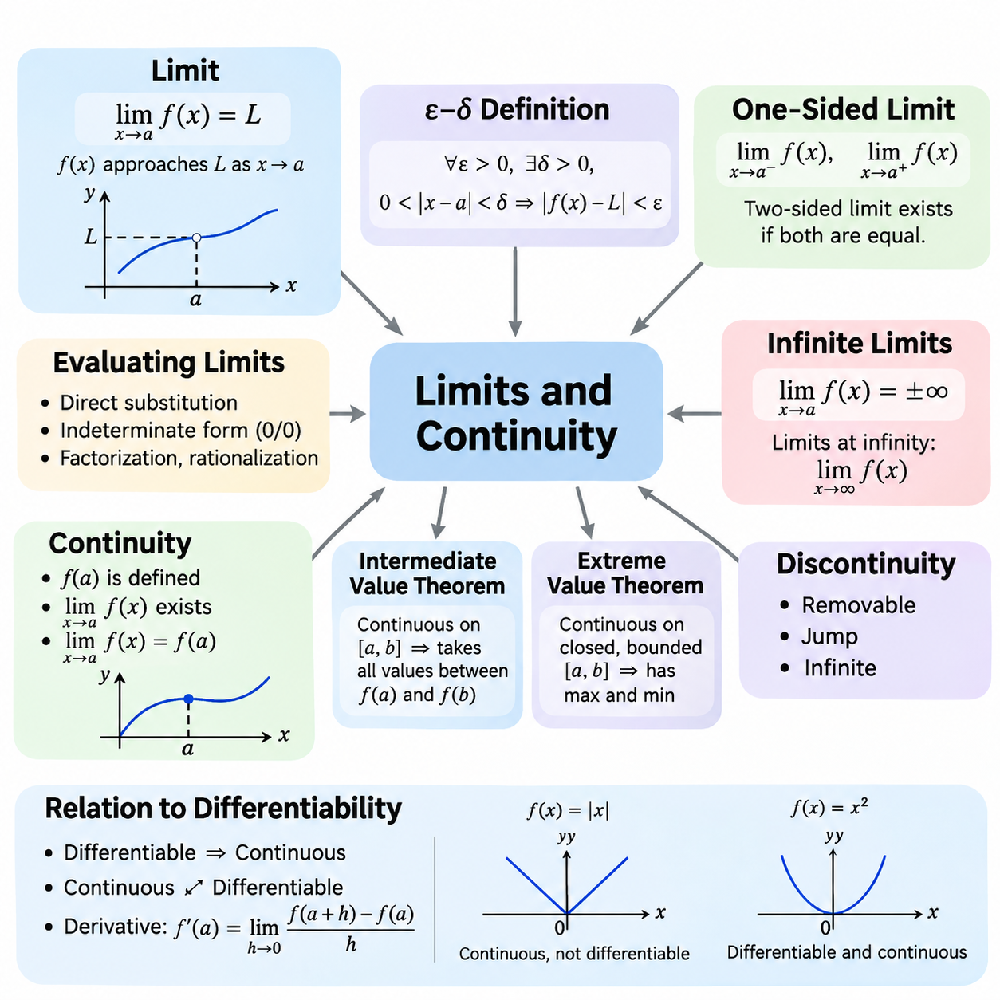
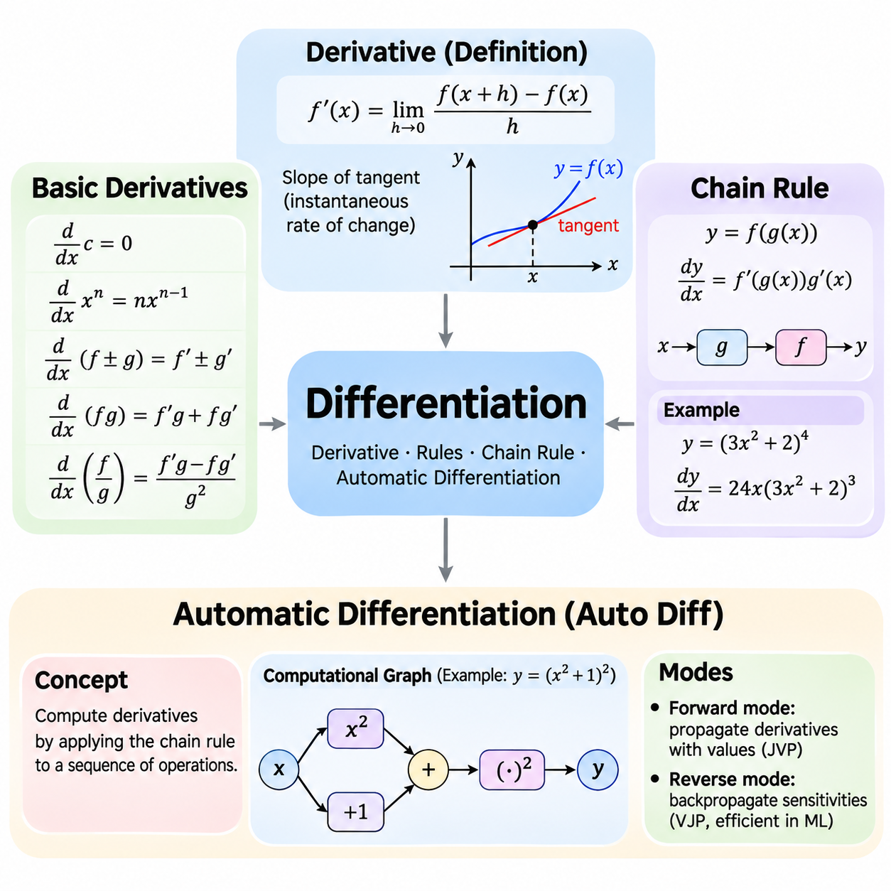
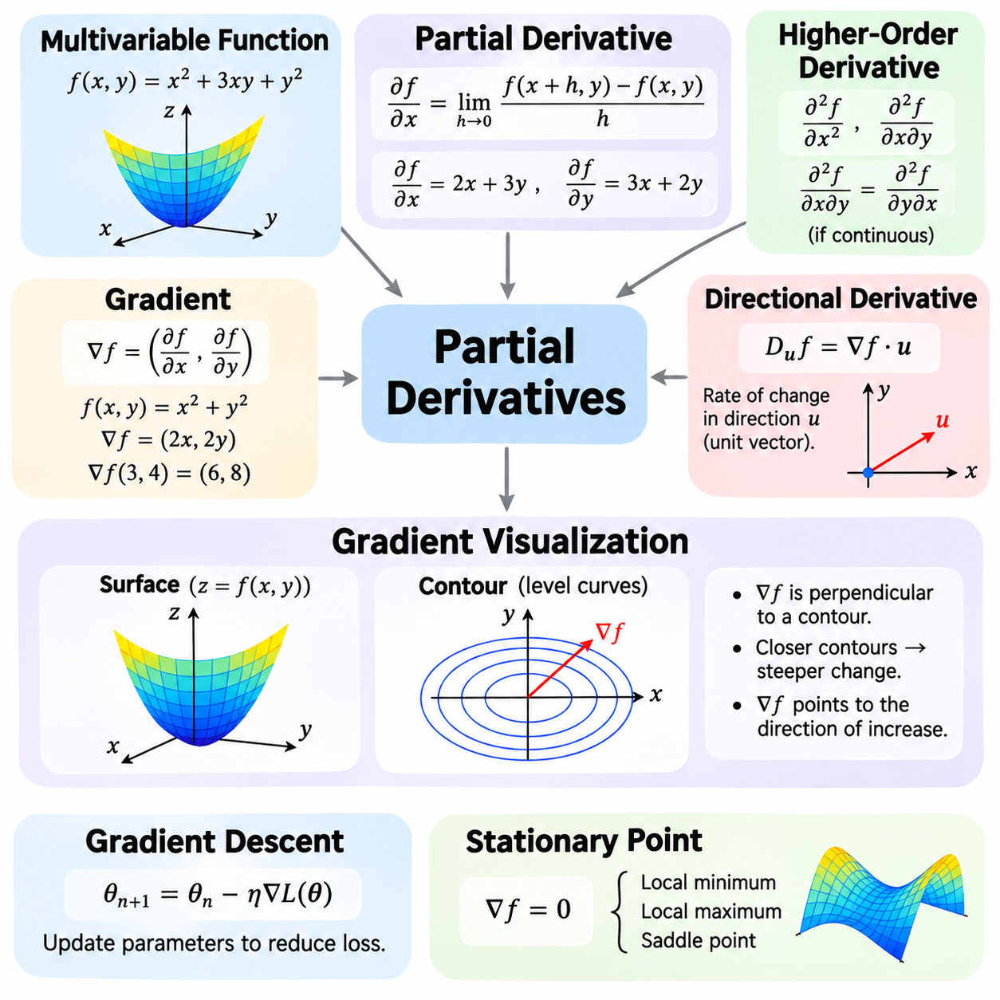
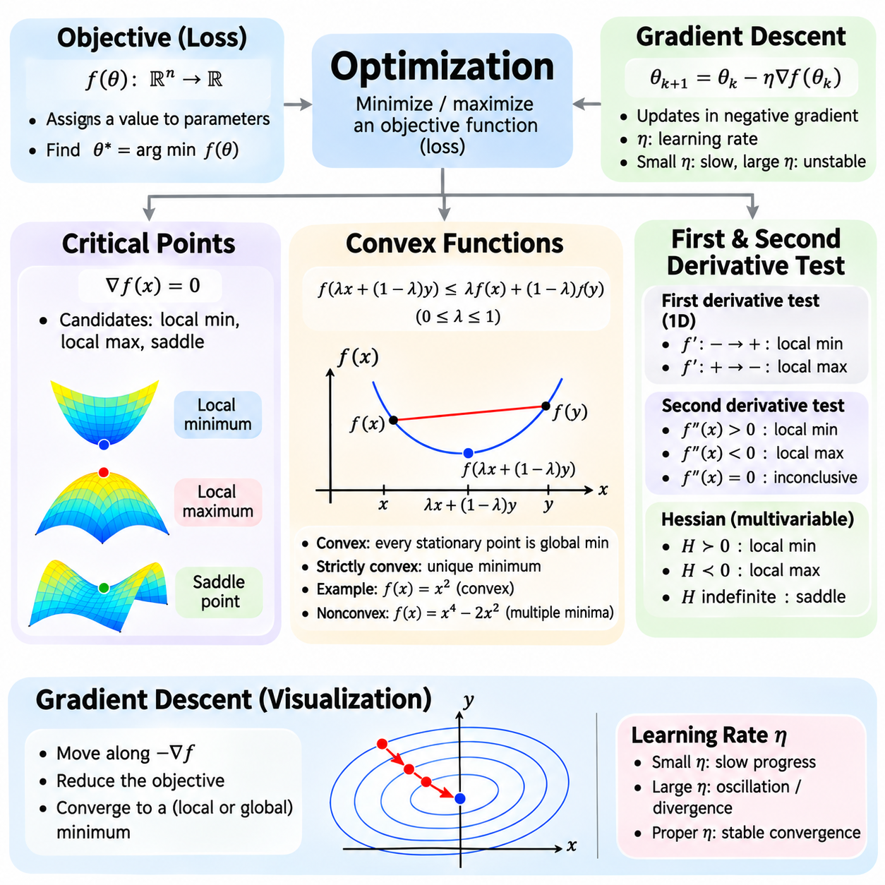
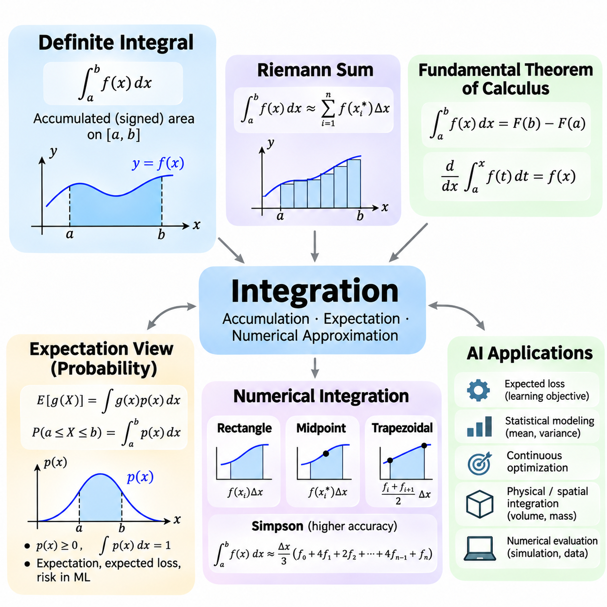
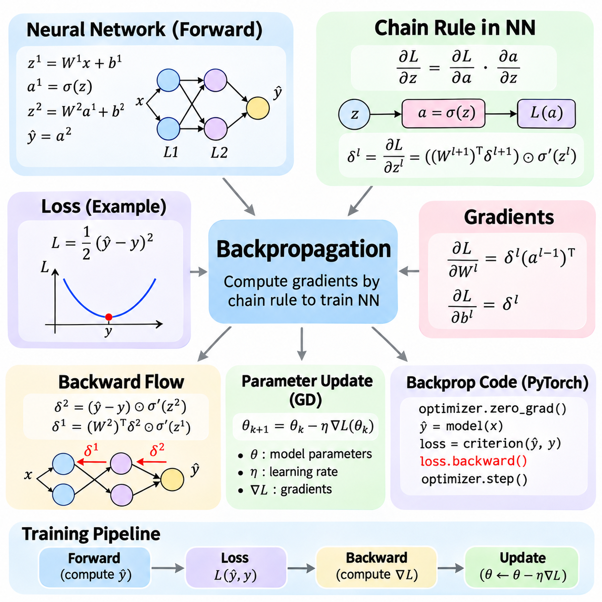
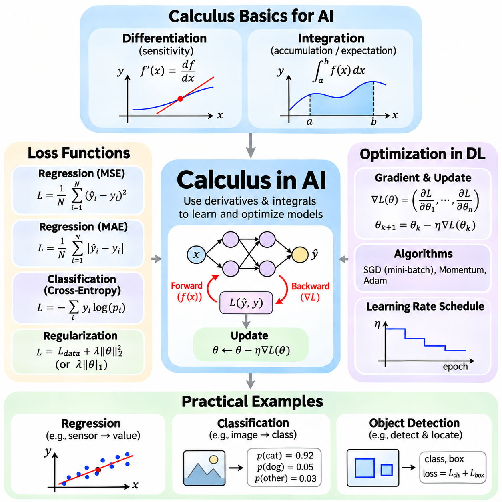

**Volume 05. Mathematics for AI**

# 02. Calculus

## 02.00 Limits and Continuity

{width="7.268055555555556in" height="7.268055555555556in"}

Calculus provides the mathematical foundation for understanding continuous change, and the concepts of limits and continuity establish its essential framework. A limit describes the value that a function approaches as its input moves toward a particular point. This concept allows mathematical analysis even when the function is undefined at that point. In artificial intelligence, limits help explain convergence, numerical approximation, and the behavior of learning algorithms.

The formal definition of a limit expresses how closely a function approaches a target value when its input becomes sufficiently close to a specified point. For a function f(x), the statement lim(x→a) f(x) = L means that f(x) approaches L as x approaches a. The value of f(a) does not necessarily determine the limit. This distinction is fundamental because the behavior surrounding a point can be mathematically meaningful even when the function itself is not defined there.

The epsilon-delta definition provides a rigorous interpretation of limits. For every positive tolerance ε, there must exist a positive distance δ such that 0 \< \|x − a\| \< δ implies \|f(x) − L\| \< ε. This relationship guarantees that function outputs can be made arbitrarily close to L by choosing inputs sufficiently close to a. Such mathematical precision supports convergence proofs, numerical algorithms, and theoretical analysis of optimization procedures.

Limits may be evaluated through direct substitution when a function behaves continuously at the point of interest. For example, the function f(x) = x² + 3x approaches 10 as x approaches 2. However, expressions such as 0/0 require additional analysis because direct substitution produces an indeterminate form. Algebraic factorization, rationalization, and other transformations can reveal the limiting behavior without changing the function\'s values near the point.

One-sided limits examine the behavior of a function when its input approaches a point from only one direction. The left-hand limit considers values smaller than the target, while the right-hand limit considers values larger than the target. A finite two-sided limit exists precisely when both one-sided limits exist and are equal. This distinction is particularly important for piecewise functions, threshold operations, and mathematical models containing abrupt transitions.

Infinite limits describe situations in which function values increase or decrease without bound as the input approaches a particular point. For example, 1/x² approaches positive infinity as x approaches zero from either direction. Limits at infinity instead investigate function behavior as the input grows arbitrarily large in magnitude. These concepts help characterize asymptotic behavior, numerical stability, and the long-term properties of mathematical models.

Continuity describes whether a function changes without a discontinuity at a particular point. A function f(x) is continuous at x = a when f(a) is defined, the limit of f(x) as x approaches a exists, and that limit equals f(a). These three conditions establish consistency between the function\'s actual value and its surrounding behavior. Continuous functions provide a natural mathematical representation of many physical processes and computational relationships.

A function is continuous over an interval when it is continuous at every interior point and satisfies the appropriate one-sided continuity conditions at included endpoints. Polynomial functions are continuous throughout the real numbers, while rational functions are continuous wherever their denominators are nonzero. Exponential, logarithmic, and trigonometric functions also possess continuity within their respective domains. These properties simplify the analysis of mathematical expressions used in AI.

Discontinuities occur when one or more continuity conditions fail. A removable discontinuity arises when a finite limit exists but the function is undefined or assigned an inconsistent value. A jump discontinuity occurs when the finite left-hand and right-hand limits differ. Infinite discontinuities involve unbounded function behavior. Recognizing these categories helps distinguish mathematical irregularities from numerical errors in computational implementations.

The intermediate value theorem establishes an important property of continuous functions. If a function is continuous on a closed interval, it assumes every value between its endpoint values somewhere within that interval. This theorem supports the existence of solutions to nonlinear equations and provides the theoretical basis for root-finding methods such as bisection. Its usefulness extends to calibration, parameter estimation, and numerical problem solving.

The extreme value theorem states that a continuous real-valued function on a closed and bounded interval attains both a maximum and a minimum. This result establishes the existence of optimal values under specific mathematical conditions. Although finding these values may require additional techniques, the theorem provides an important foundation for optimization theory. In machine learning, related existence arguments help distinguish valid optimization problems from unbounded objectives.

Continuity is closely related to differentiability, but the two properties are not equivalent. Every function differentiable at a point must also be continuous there, while a continuous function may fail to be differentiable. The absolute value function f(x) = \|x\| illustrates this distinction because it is continuous at zero but has no ordinary derivative there. Understanding this relationship prepares learners to examine gradients, critical points, and nonsmooth optimization.

The derivative itself is defined through a limit of difference quotients. For a function f(x), the derivative at a point a is the limit of [f(a + h) − f(a)]/h as h approaches zero, provided that the limit exists. This expression measures instantaneous change by examining increasingly small input variations. Consequently, limits provide the conceptual bridge between function behavior and the gradient-based learning methods used in neural networks.

Neural network activation functions demonstrate the practical importance of continuity. The sigmoid and hyperbolic tangent functions are continuous and differentiable throughout their domains. The rectified linear unit, defined as ReLU(x) = max(0, x), is continuous everywhere but is not differentiable at zero. Deep learning frameworks commonly assign a conventional derivative value at this point, allowing gradient-based training to proceed despite the mathematical nondifferentiability.

Loss functions also depend on mathematical properties that influence optimization behavior. Continuous loss functions respond predictably to sufficiently small changes in their inputs, while differentiable losses provide local gradient information. Mean squared error is smooth, whereas absolute error is continuous but nondifferentiable when the prediction error equals zero. These differences influence optimization methods, convergence analysis, and the treatment of nonsmooth objectives.

In numerical computation, mathematical limits must be distinguished from finite-precision approximations. Computers represent real numbers using restricted precision, so extremely small differences may be rounded or lost. A mathematically continuous function can therefore exhibit numerical irregularities when evaluated near singularities or underflow regions. Reliable AI implementations require attention to scaling, stable formulations, and the limitations of floating-point arithmetic.

Convergence analysis frequently uses limits to describe the behavior of iterative algorithms. If a sequence of parameter estimates approaches a fixed value, that value is called its limit. However, convergence of parameter values does not automatically guarantee convergence to a global optimum. Gradient descent and related methods require additional assumptions to establish particular convergence properties. Continuity contributes to these analyses but does not independently guarantee successful optimization.

Uniform continuity strengthens ordinary continuity by requiring a single input-distance tolerance to work throughout an entire domain. Unlike pointwise continuity, the permitted input variation does not depend on the selected location. Every continuous function on a closed and bounded real interval is uniformly continuous. This property is useful when analyzing approximation accuracy, numerical discretization, and error propagation across bounded computational domains.

Limits and continuity also extend to multivariable functions, where several inputs may approach a target simultaneously. A multivariable limit must remain consistent across every valid path approaching the point. This requirement is stronger than checking a few selected directions. Such concepts are essential for understanding continuous parameter spaces, vector-valued functions, neural network mappings, and the mathematical foundations of partial derivatives.

In robotics and physical AI, continuity helps describe trajectories, sensor transformations, and control signals. Position trajectories are often modeled as continuous functions of time, while velocity and acceleration require additional differentiability assumptions. Discontinuous control commands can introduce undesirable physical responses or actuator stress. Mathematical analysis of limits and continuity therefore supports motion planning, trajectory generation, and stable control-system design.

A practical understanding of limits and continuity requires distinguishing mathematical guarantees from computational observations. Numerical experiments can illustrate approaching values, but finite samples cannot establish a limit for every possible input sequence. Formal reasoning identifies the assumptions under which convergence and continuity hold. Together, these concepts establish the foundation for differentiation, integration, backpropagation, and optimization throughout modern artificial intelligence.

## 02.01 Differentiation

{width="7.268055555555556in" height="7.268055555555556in"}

Differentiation is a fundamental operation in calculus that measures how a function changes in response to variations in its input. The derivative represents the instantaneous rate of change and provides information about the local behavior of a mathematical function. In artificial intelligence, differentiation is essential for training neural networks, minimizing loss functions, adjusting model parameters, and understanding optimization processes.

The derivative of a function f(x) at a point x is defined as the limit of the difference quotient [f(x + h) − f(x)]/h as h approaches zero. This definition describes how the average rate of change over a small interval approaches an instantaneous rate. Geometrically, the derivative represents the slope of the tangent line at a particular point. A positive derivative indicates local increase, while a negative derivative indicates local decrease.

Basic differentiation rules simplify the calculation of derivatives without repeatedly evaluating limits. The constant rule states that the derivative of a constant is zero, while the power rule gives d(xⁿ)/dx = nxⁿ⁻¹ for real exponents wherever the expression is differentiable. The sum rule allows derivatives to be calculated independently for individual terms. These rules form the computational foundation for differentiating polynomial expressions.

The product rule describes differentiation when two functions are multiplied together. If h(x) = f(x)g(x), then h\'(x) = f\'(x)g(x) + f(x)g\'(x). The quotient rule applies to the division of functions and produces h\'(x) = [f\'(x)g(x) − f(x)g\'(x)]/[g(x)]², provided that g(x) is nonzero. These rules are useful for analyzing complex mathematical expressions encountered in optimization and statistical modeling.

Derivatives of elementary functions appear throughout machine learning and scientific computing. The exponential function satisfies d(eˣ)/dx = eˣ, while the natural logarithm satisfies d(ln x)/dx = 1/x for positive x. Trigonometric functions have characteristic derivatives, including d(sin x)/dx = cos x and d(cos x)/dx = −sin x. Understanding these relationships makes it possible to analyze nonlinear transformations and activation functions.

The chain rule is one of the most important principles in differentiation because it explains how derivatives propagate through composed functions. If y = f(g(x)), then dy/dx = f\'(g(x))g\'(x). This expression separates the derivative of the outer function from the derivative of the inner function. The chain rule enables complex expressions to be differentiated systematically and provides the mathematical foundation for gradient propagation in neural networks.

Consider the composite function y = (3x² + 2)⁴. The outer function raises its input to the fourth power, while the inner function computes 3x² + 2. Applying the chain rule gives dy/dx = 4(3x² + 2)³(6x), which simplifies to 24x(3x² + 2)³. This example demonstrates how differentiation can be decomposed into smaller operations, allowing complicated mathematical expressions to be evaluated efficiently.

For functions containing multiple nested transformations, the chain rule extends across every intermediate operation. If y = f(g(h(x))), then dy/dx = f\'(g(h(x)))g\'(h(x))h\'(x). Each derivative represents the sensitivity of one computational stage to its input. Multiplying these local sensitivities produces the overall derivative. This principle is especially important in deep neural networks, where information passes through many sequential layers.

Neural networks can be interpreted as compositions of mathematical functions. Each layer transforms its input through weighted operations, bias additions, and nonlinear activation functions. During training, the network produces predictions that are compared with target values through a loss function. The chain rule connects changes in the loss to changes in individual parameters, allowing learning algorithms to determine how weights and biases should be updated.

Automatic differentiation is a computational technique that evaluates derivatives by systematically applying differentiation rules to elementary operations. Unlike symbolic differentiation, which constructs algebraic derivative expressions, automatic differentiation computes derivative values through the structure of a program. Unlike finite differences, it does not estimate derivatives by perturbing inputs. Instead, it propagates derivatives using the chain rule and the derivatives of supported operations.

Automatic differentiation represents computations through a sequence of elementary mathematical operations. These operations may include addition, multiplication, exponentiation, logarithms, and activation functions. Each operation has a known local derivative, allowing the complete derivative to be assembled through repeated applications of the chain rule. Computational graphs provide a useful conceptual representation of these dependencies, although automatic differentiation does not require a particular graph implementation.

Forward-mode automatic differentiation propagates derivative information alongside ordinary numerical values. Starting from selected input variables, the algorithm calculates both intermediate values and their derivatives as computation proceeds. This approach efficiently evaluates Jacobian-vector products and is particularly useful when the number of independent inputs is small relative to the number of outputs. It also supports sensitivity analysis and numerical modeling.

Reverse-mode automatic differentiation first evaluates the original function and then propagates derivative information backward through its operations. The forward computation establishes intermediate values, while the reverse computation accumulates sensitivities from outputs toward inputs. Reverse mode efficiently evaluates vector-Jacobian products and is especially effective for scalar-valued loss functions involving many trainable parameters, making it central to modern deep learning.

Backpropagation is a specialized application of reverse-mode automatic differentiation to neural network training. During the forward pass, the network calculates predictions and the corresponding loss. During the backward pass, gradients are propagated through the network using the chain rule. Each trainable parameter receives information describing how a small change in its value affects the loss, enabling optimization algorithms to update the model systematically.

Modern machine learning frameworks such as PyTorch, TensorFlow, and JAX provide automatic differentiation capabilities. PyTorch commonly records differentiable tensor operations and computes gradients through backward propagation. TensorFlow supports automatic differentiation through gradient recording mechanisms, while JAX provides transformations such as grad for differentiating numerical functions. These frameworks reduce the need to implement derivative calculations manually.

Automatic differentiation requires careful treatment of operations that are not differentiable everywhere. Functions such as ReLU are continuous but have points where ordinary derivatives do not exist. Frameworks generally define derivative conventions at such points to support practical optimization. Conditional branches, discrete operations, and unsupported numerical procedures may introduce additional complications, requiring explicit handling or alternative mathematical formulations.

Numerical differentiation provides another method for estimating derivatives through small changes in function inputs. A forward-difference approximation uses [f(x + h) − f(x)]/h, while a central-difference approximation uses [f(x + h) − f(x − h)]/(2h). These methods are straightforward but introduce truncation and floating-point errors. Automatic differentiation generally provides more accurate derivatives for supported differentiable computations without relying on a finite perturbation size.

Gradient checking compares derivatives obtained through automatic differentiation with numerical approximations. By perturbing individual parameters and observing changes in the loss, developers can test whether computed gradients are consistent with expected behavior. However, numerical approximations become unreliable when perturbations are excessively small or when functions contain nondifferentiable points. Appropriate tolerances and carefully selected test inputs are therefore essential.

Differentiation also provides a foundation for understanding gradient-based optimization. When a loss function is differentiable, its derivative indicates the local direction of increasing loss. Gradient descent updates parameters in the opposite direction to reduce the objective under suitable step-size conditions. In multidimensional parameter spaces, partial derivatives combine into a gradient vector that describes local sensitivity across all parameters.

The repeated application of the chain rule can produce vanishing or exploding gradients in deep neural networks. When many local derivatives have magnitudes below one, their products may become extremely small. Conversely, repeated multiplication by large derivatives can produce excessive gradient magnitudes. These behaviors affect training stability and motivate techniques such as careful initialization, normalization, residual connections, and gradient clipping.

Differentiation connects mathematical theory with practical artificial intelligence engineering. Basic derivative rules establish how elementary functions change, the chain rule explains how changes propagate through composed operations, and automatic differentiation makes these calculations computationally practical. Together, these concepts support gradient computation, backpropagation, parameter optimization, and the development of reliable learning systems across modern AI applications.

## 02.02 Partial Derivatives

{width="7.268055555555556in" height="7.268055555555556in"}

Partial derivatives extend the concept of differentiation to functions that depend on multiple independent variables. While an ordinary derivative measures change with respect to a single input, a partial derivative measures how a function changes when one variable varies and the others remain fixed. This distinction is essential in artificial intelligence because learning models typically contain many parameters that influence their outputs simultaneously.

A multivariable function maps several inputs to an output and can be written as f(x₁, x₂, \..., xₙ). For example, f(x, y) = x² + 3xy + y² depends on two independent variables. Its output changes when either x or y changes, and the combined effect depends on their interaction. Multivariable functions provide the mathematical foundation for neural network layers, loss functions, optimization objectives, and statistical models.

The partial derivative of f(x, y) with respect to x is calculated by treating y as a constant. For f(x, y) = x² + 3xy + y², the result is ∂f/∂x = 2x + 3y. Similarly, treating x as constant gives ∂f/∂y = 3x + 2y. These expressions describe the sensitivity of the output to each input independently and reveal how changes in individual variables influence the function.

The formal definition of a partial derivative uses a limit similar to ordinary differentiation. For the variable x, ∂f/∂x = lim(h→0)[f(x+h,y) − f(x,y)]/h, provided the limit exists. Other variables remain unchanged during this calculation. This definition establishes the mathematical meaning of local sensitivity and explains why partial derivatives are fundamental to analyzing systems with multiple interacting parameters.

A function of three or more variables follows the same principle. Consider f(x, y, z) = x²y + yz². Its partial derivatives are ∂f/∂x = 2xy, ∂f/∂y = x² + z², and ∂f/∂z = 2yz. Each derivative measures the response to one coordinate while the remaining coordinates are fixed. In high-dimensional AI models, this concept extends to thousands or billions of parameters.

Partial derivatives also describe relationships between variables through higher-order differentiation. A second partial derivative measures how a first partial derivative changes with respect to another variable. For example, ∂²f/∂x² describes curvature along the x direction, while ∂²f/∂x∂y captures interactions between x and y. When the relevant second derivatives are continuous, mixed partial derivatives are equal regardless of differentiation order.

The gradient combines all first-order partial derivatives of a scalar-valued function into a single vector. For f(x₁, x₂, \..., xₙ), the gradient is written as ∇f = (∂f/∂x₁, ∂f/∂x₂, \..., ∂f/∂xₙ). Each component represents sensitivity to one input variable. Together, these components describe how the function changes locally across the complete input space and provide essential information for optimization.

For the function f(x, y) = x² + y², the gradient is ∇f = (2x, 2y). At the point (3, 4), the gradient becomes (6, 8). This vector points toward the direction of steepest local increase in the function, while its negative points toward the direction of steepest decrease. The gradient magnitude, calculated as √(6² + 8²) = 10, represents the maximum directional rate of increase per unit distance.

The directional derivative measures how a function changes along a specified direction rather than along an individual coordinate axis. For a differentiable function and a unit direction vector u, the directional derivative is Dᵤf = ∇f · u. This dot product connects gradient information with directional sensitivity. It also explains why the gradient identifies the direction of maximum local increase when the gradient is nonzero.

Geometrically, a differentiable function of two variables can be interpreted as a surface above the input plane. The height of the surface represents the function value, while the local slopes along the coordinate directions correspond to partial derivatives. The gradient combines these slopes into a direction within the input plane. This interpretation makes abstract derivative calculations easier to understand and connects algebraic expressions with spatial behavior.

Contour lines provide another way to understand multivariable functions. Each contour represents locations where the function has the same value. For a differentiable function at a point with a nonzero gradient, the gradient is perpendicular to the contour passing through that point. Closely spaced contours indicate rapid changes in function values, while widely spaced contours indicate slower changes. These relationships support intuitive interpretation of optimization landscapes.

Gradient visualization helps explain how optimization algorithms move through a parameter space. A scalar loss function can be represented conceptually by a landscape containing valleys, slopes, and stationary points. Gradient vectors indicate local directions of increasing loss, while optimization methods generally seek directions that reduce the objective. Such interpretations are especially useful for understanding gradient descent and the influence of learning rates.

Gradient descent updates model parameters using the negative gradient of the loss function. If θ represents the parameter vector and L(θ) represents the loss, the update is θₙ₊₁ = θₙ − η∇L(θₙ), where η is the learning rate. Each update uses partial derivatives to estimate how the loss responds to parameter changes. Appropriate learning rates and suitable mathematical conditions are necessary for reliable convergence.

The gradient becomes zero at stationary points of differentiable functions. However, a zero gradient does not necessarily indicate a minimum. Stationary points may represent local minima, local maxima, or saddle points. For example, f(x, y) = x² − y² has a zero gradient at the origin, but the function increases along one direction and decreases along another. This distinction is important when analyzing nonconvex optimization problems.

The Hessian matrix extends gradient analysis by collecting second-order partial derivatives. For a twice-differentiable scalar function, the Hessian describes local curvature and interactions among variables. Positive definite Hessians at stationary points indicate strict local minima under standard second-order conditions. Although many deep learning methods rely primarily on first-order gradients, curvature information remains valuable for advanced optimization and stability analysis.

Neural network training involves loss functions that depend on many weights and biases. Each parameter contributes to the network\'s predictions, and its partial derivative indicates how a small parameter change affects the loss. Backpropagation computes these derivatives efficiently through repeated applications of the chain rule. The resulting gradient vector provides the information needed by optimizers to adjust the network during training.

Multivariable differentiation also supports sensitivity analysis in physical AI and robotics. A robot\'s position, orientation, velocity, and control outputs may depend on several interacting variables. Partial derivatives describe the local effect of changing individual inputs, while gradients describe combined sensitivity. These mathematical tools support trajectory optimization, parameter calibration, control design, and the analysis of physical system behavior.

For vector-valued functions, the Jacobian matrix generalizes the gradient concept. If a function maps multiple inputs to multiple outputs, the Jacobian contains the partial derivative of each output with respect to each input. This matrix describes local linear sensitivity between input and output spaces. Jacobians are widely used in robot kinematics, neural network transformations, coordinate mappings, and numerical optimization.

In practical computation, gradients can be obtained through analytical differentiation, automatic differentiation, or numerical approximation. Analytical methods provide explicit expressions, while automatic differentiation efficiently evaluates derivatives through computational operations. Numerical methods estimate derivatives using small input perturbations but may introduce approximation errors. Comparing these approaches helps verify implementations and identify unstable calculations.

Understanding multivariable functions, partial derivatives, gradients, and their geometric interpretation establishes a foundation for modern AI optimization. Partial derivatives quantify individual parameter sensitivity, gradients combine these sensitivities into directional information, and visualization concepts explain how functions behave across parameter spaces. Together, these ideas support backpropagation, gradient descent, sensitivity analysis, and reliable mathematical reasoning in machine learning and robotics.

## 02.03 Optimization

{width="7.268055555555556in" height="7.268055555555556in"}

Optimization is the mathematical process of finding input values or model parameters that minimize or maximize an objective function. In artificial intelligence, optimization determines how learning algorithms adjust parameters to improve predictions and reduce errors. Its mathematical foundations include critical points, convexity, and gradient-based methods. Understanding these concepts helps explain why algorithms converge, become unstable, or settle at suboptimal solutions.

An objective function assigns a numerical value to each possible configuration of parameters. In machine learning, this function is commonly called a loss function because it measures disagreement between predictions and target values. Optimization seeks parameters that produce the smallest achievable loss under specified constraints. The resulting solution depends on the objective\'s mathematical structure, the parameter domain, and the optimization algorithm.

Critical points are locations where the derivative of a differentiable function equals zero or, more generally, where a derivative fails to exist at an interior point. For multivariable differentiable functions, stationary points satisfy ∇f(x) = 0. Such points are important candidates for local minima, local maxima, and saddle points. However, identifying a critical point does not automatically establish whether it represents an optimal solution.

A local minimum occurs when a function value is no greater than nearby function values, while a local maximum is no smaller than nearby values. A global minimum has a value no greater than any other feasible point in the entire domain. This distinction matters because optimization algorithms may find locally favorable solutions without discovering the global optimum. The geometry of the objective function strongly influences this behavior.

The first derivative test examines how a function changes around a critical point. If the derivative changes from negative to positive, the point is a local minimum. If it changes from positive to negative, the point is a local maximum. When no appropriate sign change occurs, further analysis may be necessary. This method provides a simple way to classify critical points in one-dimensional optimization problems.

Second derivatives provide additional information about the curvature of a function. For a twice-differentiable function of one variable, a stationary point with f\'\'(x) \> 0 is a strict local minimum, while f\'\'(x) \< 0 indicates a strict local maximum. When f\'\'(x) = 0, the test is inconclusive. For multivariable functions, the Hessian matrix extends curvature analysis to multiple parameter directions.

The Hessian matrix contains second-order partial derivatives of a scalar objective function. At a stationary point, a positive definite Hessian indicates a strict local minimum, while a negative definite Hessian indicates a strict local maximum. An indefinite Hessian indicates a saddle point. These conditions help distinguish different types of stationary behavior and are particularly useful in advanced optimization theory.

Convex functions form an important class of optimization objectives because their geometry provides strong mathematical guarantees. A function f is convex on a convex domain when f(λx + (1−λ)y) ≤ λf(x) + (1−λ)f(y) for all domain points x and y and λ between zero and one. Geometrically, the line segment connecting two points on the function lies on or above the function\'s graph.

For differentiable convex functions, the first-order condition states that f(y) ≥ f(x) + ∇f(x)ᵀ(y−x). This means the tangent approximation provides a global lower bound on the function. Consequently, every stationary point of a differentiable convex function is a global minimum. This property greatly simplifies optimization analysis because local minima cannot be inferior to other feasible solutions.

Strict convexity strengthens the convexity condition by requiring a strict inequality between distinct points for intermediate combinations. If a strictly convex function attains a minimum, that minimum is unique. Strong convexity imposes an additional quadratic lower bound and can support stronger convergence guarantees. These properties are valuable when designing optimization problems with predictable and stable solutions.

Common convex functions include quadratic functions with positive semidefinite Hessians, affine functions, and many regularized regression objectives. For example, f(x) = x² is convex and has its global minimum at x = 0. In contrast, f(x) = x⁴ − 2x² is nonconvex and contains multiple local minima. Comparing these examples illustrates how curvature influences the number and structure of optimization solutions.

Convex optimization also requires attention to constraints. A convex optimization problem minimizes a convex objective over a convex feasible set. Linear equality constraints and convex inequality constraints can preserve this structure when formulated appropriately. Under suitable regularity conditions, optimality conditions such as the Karush-Kuhn-Tucker conditions provide a systematic framework for identifying optimal constrained solutions.

Gradient descent is an iterative optimization algorithm that updates parameters in the direction opposite to the gradient of the objective function. Given parameters θ and learning rate η, the update is θₖ₊₁ = θₖ − η∇f(θₖ). The gradient indicates the direction of steepest local increase, so its negative provides the direction of steepest local decrease when the gradient is nonzero.

The learning rate determines how far gradient descent moves during each iteration. A small learning rate may produce slow progress, while an excessively large learning rate may cause oscillation, divergence, or repeated overshooting of favorable regions. Selecting an appropriate learning rate is therefore essential for stable training. Learning-rate schedules can adjust the step size over time to balance early progress with later refinement.

For the quadratic objective f(x) = x², the derivative is f\'(x) = 2x. Gradient descent therefore produces the update xₖ₊₁ = xₖ − 2ηxₖ = (1−2η)xₖ. With a fixed learning rate satisfying 0 \< η \< 1, the iterates converge to zero from any initial value. This simple example demonstrates how the mathematical structure of an objective and the chosen step size determine convergence behavior.

Gradient descent has several practical variants. Batch gradient descent evaluates gradients using the complete training dataset, while stochastic gradient descent uses individual training examples. Mini-batch gradient descent estimates gradients from smaller groups of examples and is widely used in deep learning. Mini-batches reduce computational requirements per update and introduce gradient noise that can influence optimization trajectories.

Momentum-based optimization accumulates information from previous gradients to improve movement through parameter space. Momentum can reduce oscillations in directions with steep curvature and accelerate progress along consistent descent directions. Adaptive methods such as AdaGrad, RMSProp, and Adam adjust parameter updates using gradient statistics. Their effectiveness depends on the objective, hyperparameters, and training conditions.

Convergence analysis examines whether an optimization algorithm approaches a stationary point or optimal solution. For smooth convex objectives, gradient descent can achieve predictable convergence under appropriate learning-rate assumptions. Strong convexity and smoothness can provide linear convergence rates. Nonconvex objectives generally require weaker guarantees, often concerning gradient norms or stationary points rather than global optimality.

Neural network optimization is typically nonconvex because layers of nonlinear transformations create complicated parameter interactions. Loss landscapes may contain saddle points, flat regions, and multiple parameter configurations with similar performance. Gradient-based methods remain effective in many practical settings, but successful training does not imply that a global optimum has been found. Initialization, architecture, normalization, and data quality all influence the outcome.

Optimization connects critical-point analysis, convexity, and gradient descent into a unified mathematical framework. Critical points identify candidate solutions, convexity establishes conditions for global optimality, and gradient descent provides a computational method for improving parameters iteratively. Together, these principles support loss minimization, neural network training, parameter estimation, and reliable optimization in machine learning and physical AI systems.

## 02.04 Integration

{width="7.268055555555556in" height="7.268055555555556in"}

Integration is a fundamental operation in calculus that measures accumulated quantities over a continuous domain. While differentiation describes instantaneous change, integration combines contributions across an interval to determine a total value. In artificial intelligence, integration supports probability calculations, expected loss estimation, continuous optimization, statistical modeling, and the analysis of dynamic physical systems.

A definite integral represents the accumulated contribution of a function between specified boundaries. The expression ∫ₐᵇ f(x) dx describes the signed area between the function and the horizontal axis over the interval [a, b]. Positive contributions increase the integral, while negative contributions decrease it. This interpretation extends beyond geometric area to quantities such as accumulated energy, displacement, probability, and total cost.

The definite integral can be defined through Riemann sums, which approximate accumulation by dividing an interval into smaller subintervals. Each subinterval contributes a function value multiplied by its width. As the maximum subinterval width approaches zero, these sums converge to the integral when the function is Riemann integrable. This limiting process connects discrete numerical calculations with continuous mathematical quantities.

The fundamental theorem of calculus establishes the relationship between differentiation and integration. If F is an antiderivative of a continuous function f, then ∫ₐᵇ f(x) dx = F(b) − F(a). The theorem also states that the derivative of an accumulation function A(x) = ∫ₐˣ f(t) dt equals f(x). These relationships make it possible to evaluate many integrals analytically and explain why integration reverses differentiation in an appropriate sense.

Basic integration rules follow from the linearity of the integral. The integral of a sum equals the sum of the integrals, and constant factors can be moved outside the integral. For example, ∫₀² (3x² + 2) dx = [x³ + 2x]₀² = 12. Such calculations demonstrate how continuous contributions can be accumulated exactly when an antiderivative is available.

Integration techniques extend analytical calculations to more complicated functions. Substitution transforms variables and adjusts the differential to simplify an expression, while integration by parts follows from the product rule of differentiation. Some functions have no elementary antiderivative, even though their definite integrals exist. In these cases, numerical methods or special functions may be necessary to obtain useful results.

Multivariable integration extends accumulation across regions with several dimensions. Double integrals accumulate quantities over two-dimensional domains, while triple integrals operate over three-dimensional regions. These operations are useful for computing spatial distributions, volumes, mass properties, and probability measures. In physical AI, multidimensional integration also supports modeling continuous environments and physical uncertainty.

Probability theory provides an important interpretation of integration through continuous random variables. A probability density function p(x) is nonnegative and integrates to one over its domain. The probability that a random variable X lies between a and b is P(a ≤ X ≤ b) = ∫ₐᵇ p(x) dx. Unlike a probability mass function, a continuous density describes probability through integration rather than assigning positive probability to individual points.

The expectation of a continuous random variable is a probability-weighted integral. For a function g(X), the expected value is E[g(X)] = ∫ g(x)p(x) dx, provided the integral is well defined. This expression combines possible outcomes according to their probability density. It provides a mathematical foundation for average predictions, expected rewards, expected losses, and uncertainty-aware decision-making.

Expected loss is central to statistical learning because a model should perform well across a distribution of possible observations. If L(θ; x, y) denotes the loss for parameters θ and an observation pair (x, y), the population risk is R(θ) = E[L(θ; X, Y)]. This expectation is taken over the underlying data distribution. Minimizing population risk expresses the ideal learning objective, although the true distribution is generally unknown.

Empirical risk minimization approximates expected loss using a finite training dataset. For N observations, the empirical risk is Rₙ(θ) = (1/N)Σᵢ L(θ; xᵢ, yᵢ). This average replaces an unknown distributional expectation with observed samples. The approximation becomes more informative when samples adequately represent the target distribution, but finite data, sampling bias, and distribution shifts can still affect generalization.

Integration also explains statistical quantities such as variance and higher-order moments. For a continuous random variable with mean μ, the variance is Var(X) = ∫(x − μ)²p(x) dx when finite. Higher-order moments describe additional characteristics of a distribution, including asymmetry and tail behavior. These quantities help evaluate uncertainty, prediction reliability, and the statistical properties of AI systems.

Numerical integration estimates definite integrals when analytical evaluation is difficult or computationally impractical. The basic strategy replaces continuous accumulation with a finite weighted sum of function evaluations. Accuracy depends on the numerical method, interval subdivision, and regularity of the integrand. Numerical integration is especially important when functions are available only through simulation, measurements, or complex computational models.

The rectangle rule approximates an integral by evaluating the function at selected points within subintervals. The midpoint rule uses each subinterval\'s center and often improves accuracy for sufficiently smooth functions. The trapezoidal rule approximates the function using straight-line segments between adjacent sample points. These methods convert integration into arithmetic operations that can be implemented efficiently in numerical software.

Simpson\'s rule improves numerical integration by approximating the integrand with quadratic polynomials over pairs of subintervals. For sufficiently smooth functions, it can achieve substantially higher accuracy than basic rectangle or trapezoidal approximations at comparable resolutions. However, its standard composite form requires an even number of subintervals. Method selection should consider function smoothness, computational cost, and desired accuracy.

Numerical integration introduces approximation errors because continuous functions are evaluated at finitely many points. Truncation error arises from replacing the exact integral with a numerical formula, while floating-point error results from finite numerical precision. Refining the integration grid generally reduces truncation error, but excessive refinement may increase computational cost and accumulated rounding effects. Reliable computation requires balancing these factors.

Adaptive quadrature adjusts the locations and sizes of integration intervals according to estimated numerical error. Regions where the integrand changes rapidly receive more evaluation points, while smoother regions require fewer. This strategy can improve efficiency compared with uniformly dividing the entire domain. Adaptive methods are useful for irregular functions, sharply varying distributions, and scientific calculations requiring controlled accuracy.

Monte Carlo integration estimates integrals using random samples rather than deterministic subdivisions. If samples Xᵢ follow a probability distribution p, then E[g(X)] can be estimated by (1/N)Σᵢ g(Xᵢ). Under suitable assumptions, this estimator converges to the expected value as the sample count increases. Monte Carlo methods are particularly valuable for high-dimensional integrals where conventional numerical grids become prohibitively expensive.

In machine learning, Monte Carlo estimation supports stochastic optimization, Bayesian inference, probabilistic modeling, and reinforcement learning. Expected gradients can sometimes be estimated from sampled observations, allowing learning without evaluating an entire probability distribution. However, exchanging differentiation and expectation requires suitable mathematical conditions. Sampling variance can also influence optimization stability and estimation accuracy.

Integration connects continuous mathematics with statistical and computational reasoning in artificial intelligence. Definite integrals quantify accumulated values, expectation expresses probability-weighted outcomes, and numerical integration provides practical approximations when exact solutions are unavailable. Together, these concepts support probabilistic learning, uncertainty estimation, expected loss optimization, simulation, and the analysis of continuous physical processes.

## 02.05 Backpropagation

{width="7.268055555555556in" height="7.268055555555556in"}

Backpropagation is a fundamental algorithm for training neural networks by computing how changes in model parameters affect a loss function. It applies the chain rule of calculus to propagate gradient information backward through interconnected layers. Rather than calculating each parameter derivative independently, backpropagation reuses intermediate results, making gradient computation efficient even in networks containing millions of trainable parameters.

A neural network can be represented as a composition of mathematical transformations. Each layer receives an input vector, performs weighted operations, adds biases, and applies an activation function. For layer l, the computation is expressed as zˡ = Wˡaˡ⁻¹ + bˡ and aˡ = σ(zˡ). Here, W represents weights, b represents biases, σ denotes an activation function, and a represents the layer output.

During the forward pass, input data moves through successive layers to produce predictions. The final prediction is compared with a target value using a loss function such as mean squared error or cross-entropy. The resulting scalar loss measures prediction error and establishes the objective for optimization. Intermediate activations and other required values are retained or recomputed to support subsequent gradient calculations.

The chain rule provides the mathematical foundation for propagating derivatives through neural network layers. If a loss L depends on an activation a, which depends on an intermediate value z, then ∂L/∂z = (∂L/∂a)(∂a/∂z). For deeper networks, this relationship extends through every connected transformation. Each local derivative describes sensitivity at one stage, while their composition determines the overall parameter gradient.

Consider a single neuron with input x, weight w, bias b, and activation a = σ(wx + b). If the loss is L = ½(a − y)², then ∂L/∂w = (a − y)σ\'(wx + b)x. Similarly, ∂L/∂b = (a − y)σ\'(wx + b). These expressions demonstrate how prediction error, activation sensitivity, and input magnitude combine to determine the gradients used for parameter updates.

For a multilayer network, backpropagation introduces an error signal δˡ = ∂L/∂zˡ for each layer. At the output layer, this signal combines the derivative of the loss with the derivative of the activation function. For hidden layers, the error signal is computed as δˡ = ((Wˡ⁺¹)ᵀδˡ⁺¹) ⊙ σ\'(zˡ), where ⊙ denotes elementwise multiplication. This recurrence propagates sensitivity backward.

Once the error signal for a layer is available, the gradients of its parameters can be calculated directly. For a fully connected layer, ∂L/∂Wˡ = δˡ(aˡ⁻¹)ᵀ and ∂L/∂bˡ = δˡ. The weight gradient is an outer product between the current layer\'s error signal and the previous layer\'s activation. These equations form the core mathematical operations used in standard multilayer perceptron training.

The backward computation proceeds in reverse order because later layers depend on the outputs of earlier layers. Starting from the loss, the algorithm computes output-layer sensitivities and then recursively determines gradients for preceding layers. Intermediate derivatives are reused instead of recalculating complete dependency chains for every parameter. This dynamic reuse is responsible for much of backpropagation\'s computational efficiency.

Activation functions influence how gradients propagate through a network. Sigmoid and hyperbolic tangent functions can produce small derivatives in saturated regions, reducing the magnitude of backward signals. ReLU has a derivative of one for positive inputs and zero for negative inputs, with a conventional derivative choice at zero. These properties influence training behavior and motivate careful activation selection.

Vanishing gradients occur when repeated multiplication by small local derivatives causes earlier-layer gradients to approach zero. Exploding gradients occur when derivative products produce excessively large values. Both phenomena can make optimization difficult, especially in deep or recurrent networks. Appropriate initialization, residual connections, normalization, and gradient clipping can improve stability under suitable conditions.

Backpropagation is distinct from the optimization algorithm that uses its results. Backpropagation computes gradients of the loss with respect to parameters, while an optimizer determines how those parameters should change. For ordinary gradient descent, the update is θₖ₊₁ = θₖ − η∇L(θₖ), where η is the learning rate. More advanced optimizers such as momentum-based methods and Adam use additional information when calculating updates.

A basic implementation of backpropagation can be organized into a forward computation, loss evaluation, backward derivative calculation, and parameter update. In a manually implemented neural network, these stages require explicit matrix operations and activation derivatives. Such implementations are useful for understanding the mathematics, but careful handling of tensor dimensions, numerical stability, and batch averaging is essential.

For example, a two-layer network can compute hidden activations using h = σ(XW₁ + b₁), followed by predictions ŷ = hW₂ + b₂. With mean squared error, the output gradient is obtained from the prediction residual, including the appropriate normalization factor. The output weight gradient depends on hᵀ and the output sensitivity, while the hidden-layer gradient follows by multiplying the propagated sensitivity by σ\' at the hidden preactivation.

In practical Python implementations, automatic differentiation frameworks eliminate most manual derivative calculations. PyTorch records supported tensor operations and constructs the information needed for reverse-mode differentiation. Calling loss.backward() computes gradients for tensors requiring gradients, while an optimizer subsequently updates the parameters. This separation allows developers to define complex models without manually deriving every gradient expression.

A typical PyTorch training iteration begins by clearing previously accumulated gradients through optimizer.zero_grad(). The model then performs a forward pass, computes the loss, and executes loss.backward(). Finally, optimizer.step() updates trainable parameters using the calculated gradients. These operations form the standard training cycle, although gradient accumulation and specialized training strategies may modify their ordering or frequency.

Gradient accumulation is an important implementation detail because many frameworks add newly computed gradients to existing gradient buffers. If gradients are not cleared intentionally, multiple backward passes contribute to the same accumulated values. This behavior can support training with effective batch sizes larger than available memory, but unintended accumulation changes parameter updates and may destabilize training.

Gradient checking provides a practical method for validating manually implemented backpropagation. Numerical finite differences approximate the derivative of the loss by perturbing a parameter slightly and measuring the resulting loss change. Comparing this estimate with the analytical gradient can reveal incorrect signs, missing factors, or matrix dimension errors. Appropriate tolerances are necessary because numerical approximations introduce their own errors.

Automatic differentiation is not limited to fully connected neural networks. Convolutional layers, attention mechanisms, recurrent operations, and many differentiable transformations can participate in the same backward computation. Each supported operation contributes a local derivative rule, allowing gradients to propagate through complex computational structures. Custom operations may require explicitly defined derivative behavior.

Backpropagation also supports differentiable physical models and robotics applications. Neural controllers, learned dynamics models, and differentiable simulation components can use gradients to optimize parameters against defined objectives. However, discontinuous physical events, discrete decisions, and non-differentiable simulation operations may interrupt gradient propagation. Such systems require appropriate approximations, custom derivatives, or alternative optimization strategies.

Understanding backpropagation requires connecting the chain rule, layerwise derivatives, computational reuse, and practical implementation. The mathematical equations explain how sensitivities propagate from a loss function toward earlier parameters, while automatic differentiation provides an efficient software mechanism for performing these calculations. Together, these principles enable scalable neural network training and gradient-based learning across modern artificial intelligence systems.

## 02.06 Calculus in AI

{width="7.268055555555556in" height="7.268055555555556in"}

Calculus provides the mathematical foundation for understanding how artificial intelligence models learn from data and improve their predictions. Differentiation measures sensitivity to parameter changes, while integration supports expected values and probabilistic reasoning. Together, these operations connect loss functions, optimization algorithms, and neural network training. Their practical importance lies in transforming prediction errors into systematic parameter updates.

A loss function measures the discrepancy between a model\'s predictions and the desired outputs. During supervised learning, the model produces predictions from input data, and the loss function assigns a numerical penalty based on prediction accuracy. Training attempts to minimize this penalty by adjusting model parameters. The mathematical properties of the loss function influence gradient behavior, convergence, stability, and the quality of the learned model.

Mean squared error is commonly used for regression problems involving continuous numerical predictions. For N observations, MSE = (1/N)Σᵢ(ŷᵢ − yᵢ)², where ŷᵢ represents a prediction and yᵢ represents its target. Squaring the residuals emphasizes larger errors and produces a differentiable objective. Its gradient provides information about how predictions should change to reduce the average squared discrepancy.

Mean absolute error measures the average magnitude of prediction errors using MAE = (1/N)Σᵢ\|ŷᵢ − yᵢ\|. Unlike mean squared error, it penalizes deviations linearly and is less sensitive to unusually large residuals. However, the absolute value function is not differentiable at zero. Optimization methods can handle this limitation through subgradients or suitable derivative conventions, allowing absolute-error objectives to remain practical.

Classification problems commonly use cross-entropy loss to evaluate predicted class probabilities. For a target distribution y and predicted probabilities p, cross-entropy is L = −Σᵢ yᵢ log(pᵢ). This objective assigns larger penalties when the model gives low probability to the correct class. Its differentiable structure, combined with suitable output transformations, makes it effective for gradient-based classification training.

Binary classification frequently combines a sigmoid output with binary cross-entropy, while multiclass classification commonly combines logits with softmax cross-entropy. Implementations often use numerically stable formulations that avoid explicitly computing logarithms of extremely small probabilities. The resulting gradients describe how prediction scores should change to improve classification performance and provide efficient signals for backpropagation.

Regularization modifies an optimization objective to encourage desirable parameter properties. L2 regularization adds a penalty proportional to the squared parameter magnitudes, while L1 regularization adds a penalty based on absolute parameter values. These terms influence the gradients or subgradients used during optimization. Regularization can reduce overfitting, encourage simpler models, and improve generalization when appropriately configured.

The gradient of a loss function describes its local sensitivity to changes in model parameters. For a parameter vector θ, the gradient ∇L(θ) contains partial derivatives with respect to each parameter. These derivatives indicate how small parameter changes affect the objective. Backpropagation efficiently computes the required gradients through the chain rule, enabling neural networks with many layers to be trained using gradient-based optimization.

Gradient descent updates parameters by moving against the local gradient of the loss function. The standard update is θₖ₊₁ = θₖ − η∇L(θₖ), where η denotes the learning rate. A suitable learning rate allows progressive loss reduction, while an excessively large value may cause instability. Very small learning rates can slow convergence. The optimization process therefore depends on both gradient accuracy and step-size selection.

Deep learning commonly uses mini-batch stochastic gradient descent rather than calculating gradients over the entire dataset for every update. Each mini-batch provides an estimate of the full training gradient, reducing computational requirements per iteration. This approach introduces sampling noise, which affects the optimization trajectory. Batch size influences memory consumption, gradient variance, training throughput, and sometimes generalization behavior.

Momentum-based optimization uses information from previous gradients to smooth parameter updates and accelerate movement along consistent directions. Adaptive optimizers such as Adam adjust updates using estimates of gradient moments. These methods can improve practical training efficiency, but their effectiveness depends on model architecture, data characteristics, and hyperparameter settings. No optimizer guarantees the best performance across every learning problem.

Learning-rate scheduling changes the step size during training to balance exploration and refinement. Common approaches include step decay, exponential decay, cosine schedules, and warmup strategies. A larger initial learning rate may accelerate early progress, while smaller later values can support more stable convergence. Scheduling decisions should be evaluated using validation performance rather than assuming that decreasing training loss always improves generalization.

A practical regression example involves predicting a continuous measurement from sensor observations. A neural network receives input features, generates a numerical estimate, and compares it with the target using mean squared error. Automatic differentiation calculates parameter gradients, and an optimizer updates the weights. Repeating this process across training batches allows the model to learn relationships between sensor inputs and measured quantities.

In image classification, a convolutional or transformer-based model transforms image pixels into class scores. Cross-entropy loss compares these scores with ground-truth labels, while backpropagation computes gradients through the model\'s layers. Optimization adjusts feature extraction and classification parameters simultaneously. Validation accuracy and loss provide complementary information about whether the learned representation generalizes beyond the training examples.

Object detection combines multiple prediction objectives, often including classification and bounding-box localization losses. The total objective may contain weighted terms that measure category correctness, box alignment, and other task-specific properties. Differentiation allows gradients from these components to influence shared network parameters. Appropriate loss weighting is important because different objectives may have different numerical scales and optimization behavior.

A physical AI example involves estimating object mass from camera observations of items moving along a conveyor. Image features can be processed by a regression model that predicts mass, while a separate classifier identifies object categories. Regression and classification losses may be optimized independently or jointly. Gradient-based learning adjusts model parameters, but reliable performance also depends on calibrated measurements, representative data, and controlled evaluation.

Calculus also supports learning in robotics and control systems. A differentiable model may predict future robot states from control inputs, allowing gradients of a trajectory cost to be calculated with respect to control parameters. Optimization can then reduce tracking errors, energy consumption, or other defined objectives. Physical constraints, discontinuous contacts, and model uncertainty must be considered because not every real-world process is smoothly differentiable.

Practical implementations commonly use automatic differentiation frameworks such as PyTorch, TensorFlow, or JAX. A training iteration typically performs a forward computation, evaluates the loss, calculates gradients, and applies an optimizer update. Monitoring gradient magnitudes, parameter changes, and validation metrics helps identify unstable training. Gradient clipping, normalization, and appropriate numerical precision can improve robustness when necessary.

Successful optimization does not guarantee that a model will generalize to unseen data. Training loss measures performance on observed examples, while validation and test evaluations estimate behavior on separate data. Overfitting may occur when optimization captures training-specific patterns rather than useful relationships. Regularization, representative datasets, appropriate model capacity, and careful evaluation are therefore essential complements to calculus-based learning.

Calculus connects loss functions, deep learning optimization, and practical AI applications through a common mathematical framework. Loss functions define measurable objectives, differentiation provides gradients, and optimization algorithms use those gradients to improve model parameters. Integration supports expected risk and uncertainty-aware learning. Together, these principles enable systematic training, quantitative evaluation, and reliable development of modern AI and physical AI systems.
