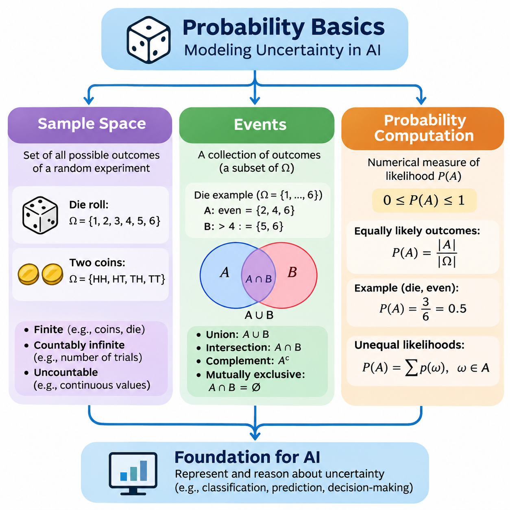
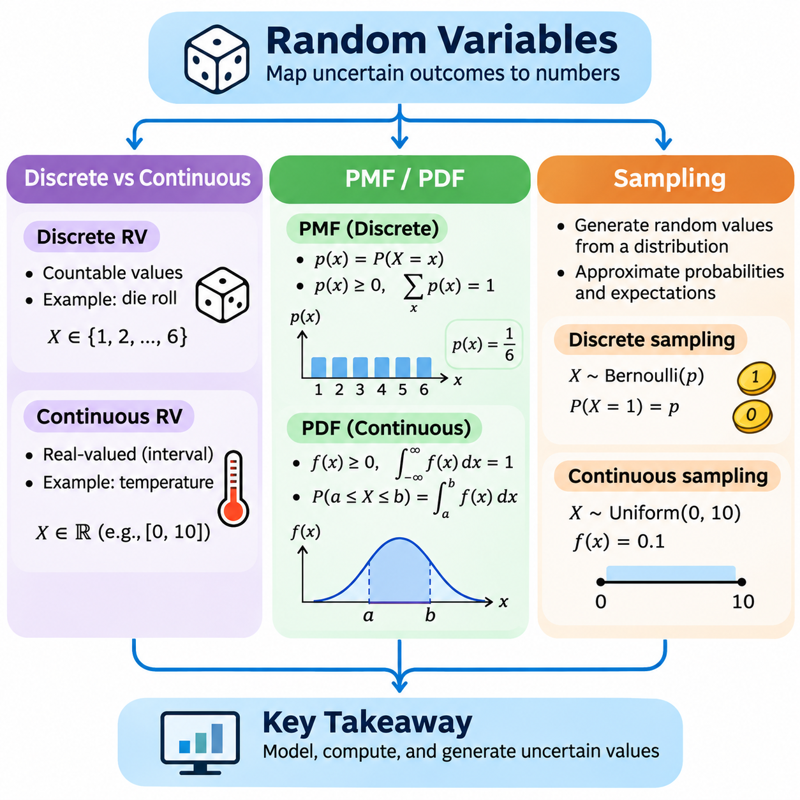
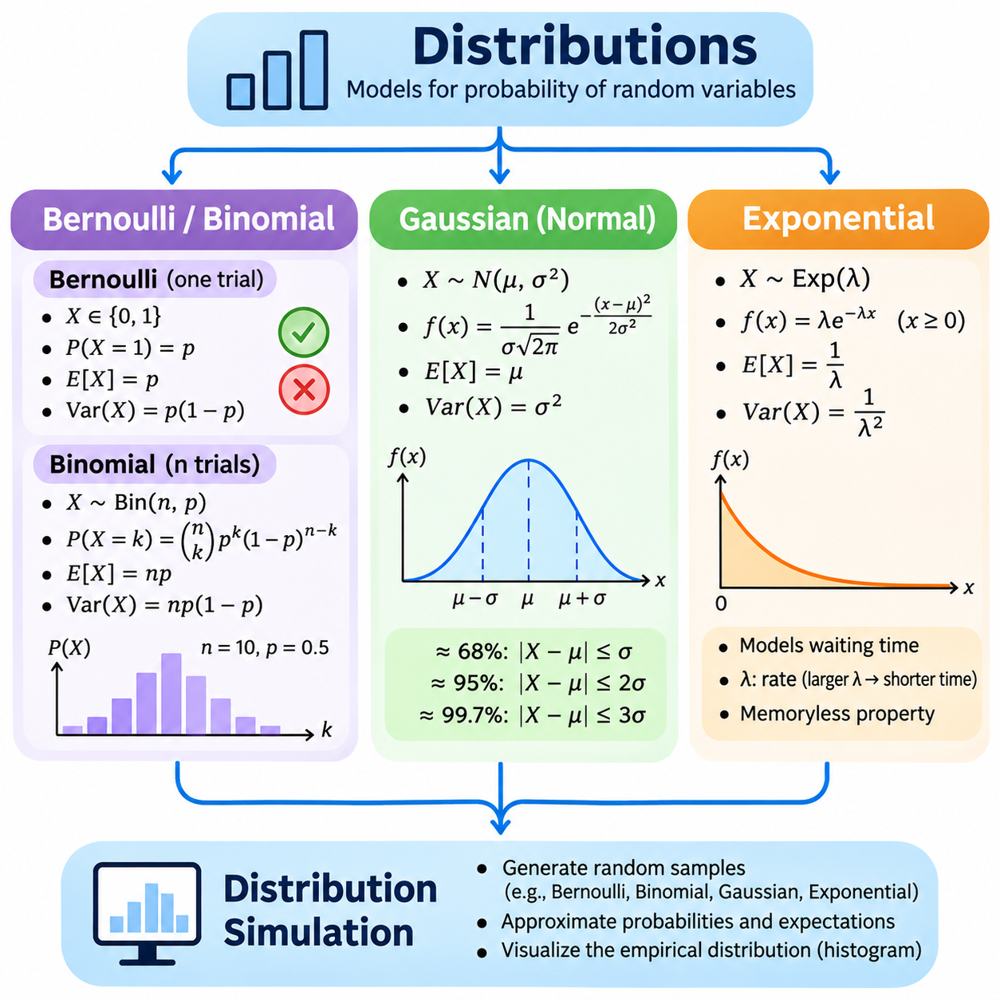
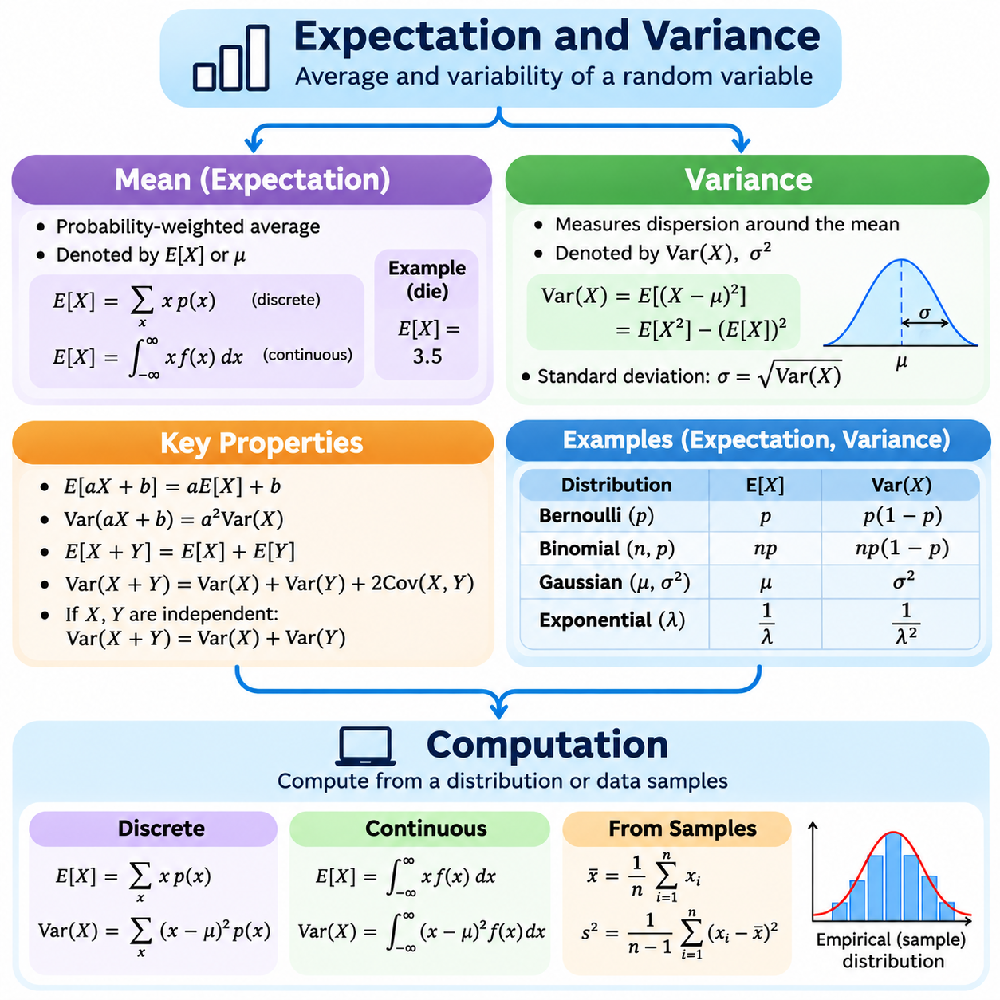
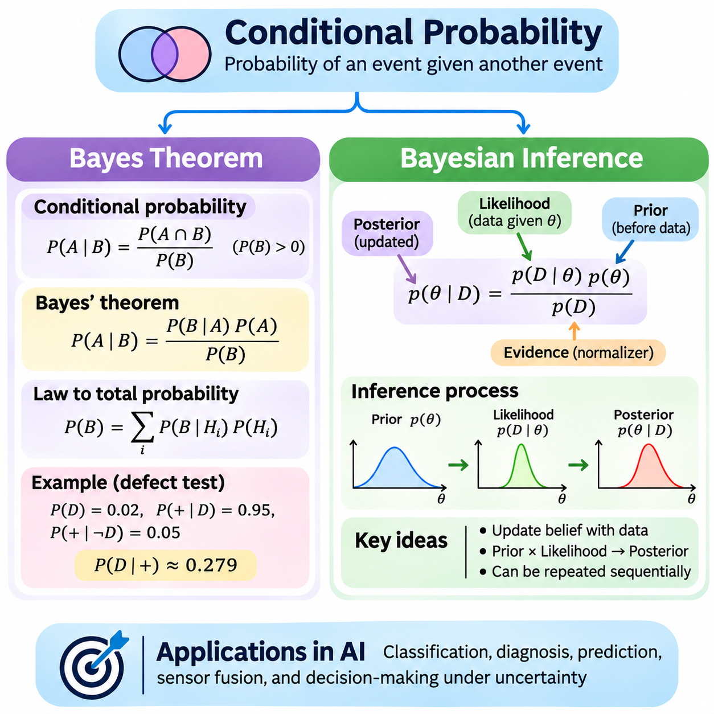
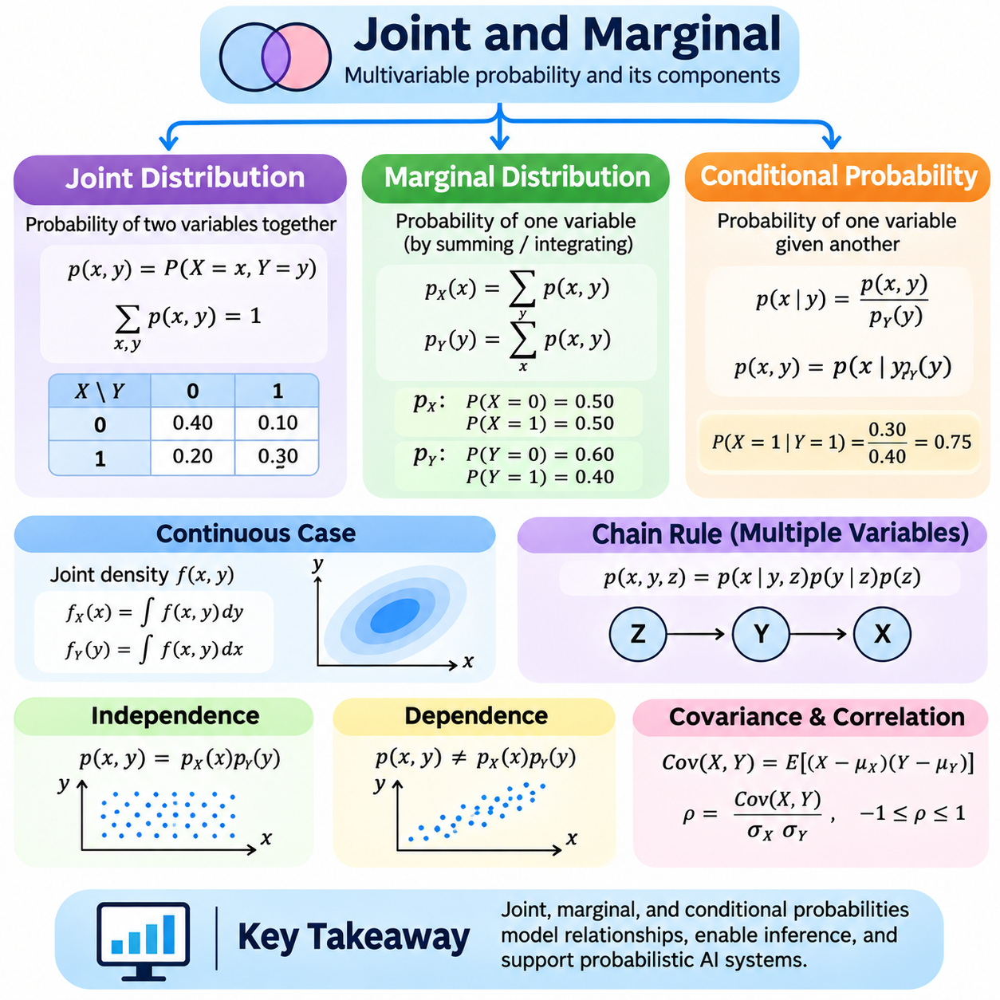
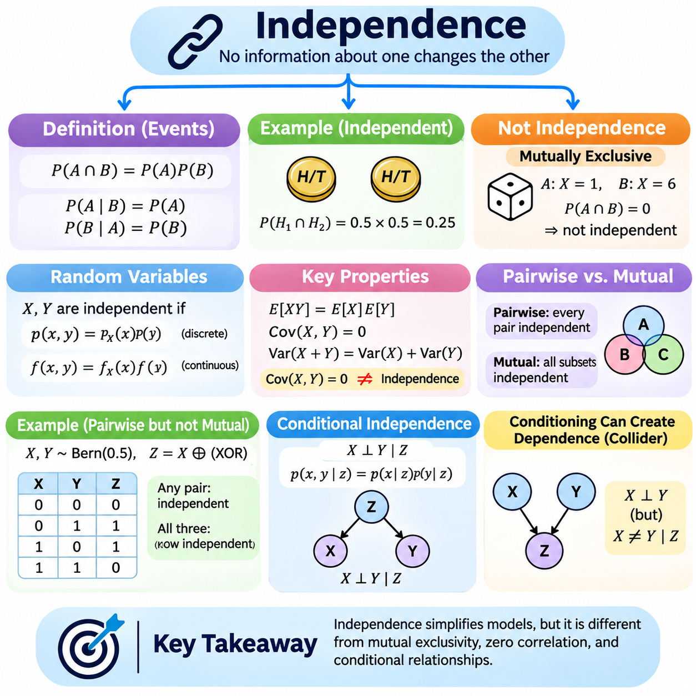
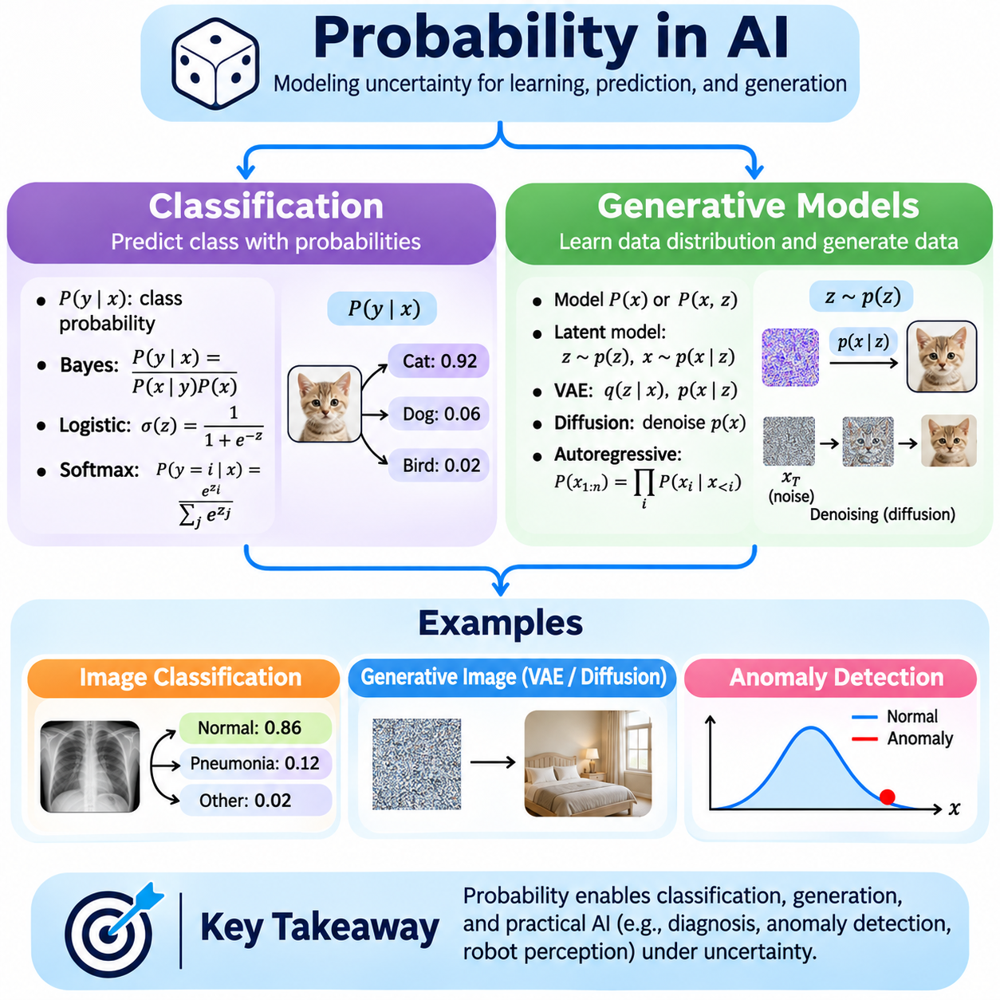

**Volume 05. Mathematics for AI**

# 03. Probability

## 03.00 Probability Basics

{width="7.268055555555556in" height="7.268055555555556in"}

Probability provides a mathematical framework for describing uncertainty, measuring the likelihood of possible outcomes, and reasoning about events whose results cannot be predicted with complete certainty. It is fundamental to artificial intelligence because real-world environments contain incomplete observations, measurement noise, unpredictable behavior, and uncertain relationships. Probability allows AI systems to represent these uncertainties quantitatively rather than relying exclusively on deterministic assumptions.

The foundations of probability begin with the concept of a random experiment, which is a process that produces an outcome that cannot be determined with certainty before the experiment is performed. Examples include rolling a die, selecting a data sample, measuring sensor noise, or observing whether a machine component fails. Although the individual result may be uncertain, the collection of possible outcomes can often be defined precisely, providing the basis for mathematical analysis.

A sample space, commonly represented by the symbol Ω, is the set of all possible outcomes of a random experiment. When a standard six-sided die is rolled, the sample space is Ω = 6. Each element represents an elementary outcome, and the complete set describes every result permitted by the experiment. Defining the sample space correctly is essential because probability calculations depend on the outcomes included in the underlying mathematical model.

Sample spaces may be finite, countably infinite, or uncountably infinite. A finite sample space contains a limited number of outcomes, such as the possible results of tossing three coins. A countably infinite sample space may describe the number of attempts required before the first successful operation. An uncountable sample space can represent continuous measurements, including temperature, distance, velocity, and sensor readings within a specified interval.

The structure of a sample space depends on how an experiment is defined. Tossing two distinguishable coins produces the ordered outcomes HH, HT, TH, and TT, where H represents heads and T represents tails. Although HT and TH contain the same number of heads, they remain different outcomes because the order identifies which coin produced each result. This distinction becomes important when constructing probability models involving sequences, combinations, or repeated observations.

In artificial intelligence, sample spaces frequently represent possible system states, predicted labels, environmental conditions, or alternative actions. An image classification system may consider a finite set of object categories, while a robot localization system may consider a continuous collection of positions and orientations. The mathematical definition of the sample space determines how uncertainty can be represented, evaluated, and incorporated into subsequent computations.

An event is a collection of outcomes within a sample space. For a discrete experiment, an event can be represented as a subset A of Ω. When rolling a die, the event of obtaining an even number is A = 6, while the event of obtaining a value greater than four is B = 6. Events allow probability theory to describe meaningful conditions rather than treating every elementary outcome as an isolated occurrence.

Events can be combined using fundamental set operations. The union A ∪ B represents outcomes belonging to A, B, or both, while the intersection A ∩ B represents outcomes shared by both events. The complement Aᶜ contains outcomes in the sample space that do not belong to A. These operations provide a formal language for expressing complex conditions, including simultaneous failures, alternative classifications, and combinations of uncertain observations.

Two events are mutually exclusive when they cannot occur simultaneously, meaning their intersection is empty. For example, obtaining a two and obtaining a five on a single die roll are mutually exclusive events. However, obtaining an even number and obtaining a number greater than four are not mutually exclusive because both events contain the outcome six. Recognizing this distinction prevents incorrect probability calculations when multiple conditions overlap.

The probability of an event A is written as P(A), representing a numerical measure of its likelihood. Probability values range from zero to one, where zero indicates an impossible event and one indicates an event that occurs with certainty under the model. Intermediate values express different degrees of likelihood. A probability of 0.8 indicates that the event has an assigned likelihood of eighty percent, rather than guaranteeing its occurrence in any individual experiment.

A mathematically valid probability measure satisfies three fundamental axioms. Every event has a nonnegative probability, the complete sample space has probability one, and probabilities of countably many pairwise disjoint events add together. These principles establish a consistent foundation for probability computation across both discrete and continuous settings. They also ensure that derived probability rules remain logically compatible with the underlying mathematical model.

When a finite sample space contains equally likely elementary outcomes, the probability of an event can be computed by dividing the number of favorable outcomes by the total number of possible outcomes. For a fair six-sided die, the probability of obtaining an even number is P(A) = 3/6 = 0.5. This counting approach is useful for simple experiments, but it cannot be applied directly when outcomes have unequal probabilities.

For experiments involving unequal likelihoods, each elementary outcome must receive an appropriate probability weight. Consider a classification system that assigns probabilities of 0.6, 0.3, and 0.1 to three mutually exclusive and exhaustive categories. The probability of an event containing the first two categories is 0.9. This calculation illustrates how probability models can incorporate different likelihoods without assuming that all possible outcomes are equally probable.

The complement rule provides an efficient method for calculating probabilities when the opposite event is easier to describe. Because an event and its complement together cover the complete sample space without overlap, P(Aᶜ) = 1 − P(A). For example, if the probability of successful communication is 0.97, the probability of unsuccessful communication is 0.03. This principle is particularly useful in reliability analysis and failure probability estimation.

The addition rule describes the probability that at least one of two events occurs. For arbitrary events A and B, the relationship is P(A ∪ B) = P(A) + P(B) − P(A ∩ B). Subtracting the intersection prevents outcomes shared by both events from being counted twice. When the events are mutually exclusive, their intersection has probability zero, and the formula simplifies to the sum of their individual probabilities.

Probability can also be understood through repeated experimentation. Under suitable assumptions, the relative frequency of an event approaches its theoretical probability as the number of independent, identically distributed trials increases. For example, repeated simulations of a fair coin toss generally produce a proportion of heads that approaches 0.5. This behavior is explained by the law of large numbers and provides a connection between theoretical probability and empirical observation.

Empirical probability estimation uses observed data rather than relying exclusively on a predefined mathematical model. If an event occurs 240 times in 1,000 observations, its observed relative frequency is 0.24. This value can serve as an estimate of the event probability when the observations are representative of the process being studied. However, sampling variability, measurement errors, and systematic bias can affect the accuracy of such estimates.

Computational probability analysis frequently combines mathematical formulas with numerical simulation. Python programs can represent finite sample spaces using lists, tuples, or sets, while probability weights can be stored in arrays or dictionaries. NumPy supports efficient numerical operations and random sampling, making it suitable for demonstrating theoretical results and evaluating probability estimates. Computational experiments are especially useful when direct enumeration becomes impractical.

A simple probability simulation may generate thousands of random die rolls and count the proportion of outcomes satisfying a selected event. The program can compare the empirical estimate with the theoretical probability of 0.5 for obtaining an even number. As the simulation grows, the estimate typically becomes more stable, although individual runs may still exhibit random fluctuations. Reproducible experiments can use fixed random seeds to support debugging and comparison.

For more complex sample spaces, exhaustive enumeration may require substantial computational resources. If an experiment contains n independent binary outcomes, the number of possible sequences is 2ⁿ. Even moderate values of n can therefore produce extremely large outcome spaces. Sampling-based methods provide practical alternatives by estimating event probabilities from generated observations rather than examining every possible outcome individually.

Monte Carlo methods extend this computational perspective by estimating probabilities through repeated random sampling. An event probability can be approximated by the fraction of simulated outcomes that satisfy the event condition, provided the sampling process follows the intended probability model. Monte Carlo estimation is valuable for high-dimensional problems, uncertain physical systems, and complex simulations where exact analytical calculations are difficult or computationally expensive.

Probability computation also requires careful attention to numerical precision and model assumptions. Floating-point arithmetic may introduce small rounding errors, while poorly normalized probability weights can produce invalid results. A discrete probability distribution must assign nonnegative weights whose total equals one. Computational implementations should therefore validate input values, verify normalization, and distinguish genuine probabilistic uncertainty from errors introduced by numerical approximation.

In machine learning, probability provides a foundation for representing uncertain predictions. A classification model may produce a probability distribution over candidate classes, allowing its output to express relative confidence rather than only a single predicted label. These probabilities can support decision thresholds, uncertainty-aware evaluation, and downstream reasoning. However, predicted probabilities must be evaluated for calibration before they can be interpreted as reliable estimates of real-world event frequencies.

Probability is equally important in robotics and physical AI, where sensors produce measurements affected by noise, occlusion, and environmental variability. A robot may assign different probabilities to possible locations or object identities based on incomplete observations. Such representations help distinguish uncertainty from deterministic error and provide a mathematical foundation for subsequent methods involving conditional probability, probabilistic inference, and state estimation.

Understanding sample spaces, events, and probability computation establishes the conceptual foundation for more advanced mathematical models. Sample spaces define what may occur, events identify the conditions of interest, and probability measures quantify their likelihood. Together, these concepts enable consistent reasoning about uncertainty and prepare the mathematical groundwork for random variables, probability distributions, expectation, conditional probability, and probabilistic artificial intelligence.

## 03.01 Random Variables

{width="7.268055555555556in" height="7.268055555555556in"}

Random variables provide a mathematical mechanism for representing uncertain outcomes as numerical values. A random variable is formally defined as a measurable function that maps outcomes from a sample space to real numbers. This transformation allows probability theory to describe complex experiments through numerical relationships. In artificial intelligence, random variables represent uncertain observations, predicted classes, sensor measurements, and environmental conditions.

The distinction between a random experiment and a random variable is fundamental. A random experiment produces an outcome, while a random variable assigns a numerical value to that outcome. For example, when two coins are tossed, the sample space contains HH, HT, TH, and TT. A random variable X representing the number of heads assigns values 2, 1, 1, and 0, respectively. Different outcomes may therefore produce identical numerical values.

Random variables are commonly classified as discrete or continuous according to the mathematical structure of their possible values. Discrete random variables take values from finite or countably infinite sets, while continuous random variables are typically modeled using probability distributions with densities over real-valued intervals. This distinction determines how probabilities are represented, calculated, and interpreted in mathematical models and computational systems.

A discrete random variable may represent the number of defective products, the result of a die roll, or the number of objects detected in an image. Its possible values can be enumerated individually, even when the collection is countably infinite. For example, a variable describing the number of vehicles passing through an intersection during a fixed period may take values 0, 1, 2, and so forth. Each possible value can be assigned a probability.

A continuous random variable can represent measurements such as temperature, distance, velocity, pressure, or elapsed time. Its possible values are typically modeled over intervals of real numbers rather than isolated categories. For example, a robot\'s measured position may be represented by a continuous variable whose values lie within a spatial region. Measurement precision may be finite, but the mathematical model can still treat the underlying quantity as continuous.

The distinction between discrete and continuous variables is especially important when interpreting individual outcomes. A discrete variable may assign positive probability to a particular value, such as obtaining exactly three successes. For a continuous variable with a probability density function, the probability of observing any single exact value is zero. Meaningful probabilities are instead assigned to intervals or more general measurable sets of values.

A probability mass function, abbreviated PMF, describes the probability distribution of a discrete random variable. It is commonly written as p(x) = P(X = x), where X is the random variable and x is a possible value. The PMF assigns a nonnegative probability to each possible outcome, and the sum of these probabilities across all possible values must equal one. These properties ensure that the function defines a valid discrete probability distribution.

Consider a fair six-sided die represented by a random variable X. Its probability mass function assigns p(x) = 1/6 for x belonging to 6, and zero otherwise. The probability of obtaining a value greater than four is calculated by adding the probabilities associated with five and six. Therefore, P(X \> 4) = 1/6 + 1/6 = 1/3, demonstrating how a PMF supports event probability computation.

Discrete probability distributions do not necessarily assign equal probabilities to all values. A binary classification outcome may be modeled using a Bernoulli random variable with P(X = 1) = p and P(X = 0) = 1 − p. The parameter p determines the likelihood of success, while the complementary probability represents failure. This simple mathematical structure appears frequently in binary classification, reliability modeling, and probabilistic decision systems.

A probability density function, abbreviated PDF, describes a continuous random variable when its probability distribution admits a density. The density is commonly written as f(x), and it must be nonnegative with its integral over the real line equal to one. Unlike a probability mass function, a density value does not directly represent the probability of an exact outcome. Probabilities are obtained by integrating the density over selected intervals.

For a continuous random variable X with density f(x), the probability of observing a value between a and b is P(a ≤ X ≤ b) = ∫[a,b] f(x) dx. This relationship expresses probability as the accumulated density over an interval. The probability density itself may exceed one in certain regions, provided the total integral remains one. Consequently, density height and event probability must not be interpreted as interchangeable quantities.

A uniform continuous distribution provides a straightforward example of a probability density function. If X is uniformly distributed between zero and ten, its density is f(x) = 0.1 within that interval and zero elsewhere. The probability that X lies between two and five is calculated as 0.1 multiplied by the interval length of three, producing 0.3. This example illustrates the relationship between interval width, probability density, and accumulated probability.

The cumulative distribution function, abbreviated CDF, provides a unified representation for both discrete and continuous random variables. It is defined as F(x) = P(X ≤ x), describing the probability that a random variable does not exceed a specified value. For discrete variables, the CDF accumulates probability masses. For continuous variables with densities, it accumulates probability through integration. Every CDF is nondecreasing and approaches zero and one at the respective extremes.

For a continuous random variable with a sufficiently regular cumulative distribution function, the probability density can be recovered through differentiation, expressed as f(x) = dF(x)/dx wherever the derivative exists. Conversely, the cumulative distribution function can be obtained by integrating the density from negative infinity to x. These relationships connect probability theory with calculus and provide mathematical tools for evaluating distributions and probability intervals.

Sampling is the process of generating or selecting observations from a probability distribution or population. In computational probability, random sampling produces numerical values according to a specified probabilistic model. Each generated value represents one realization of a random variable. Repeated sampling creates a collection of observations that can be used to investigate distribution characteristics, estimate probabilities, and evaluate statistical behavior.

Sampling from a discrete distribution requires selecting among possible values according to their assigned probability masses. For example, a categorical variable with probabilities 0.5, 0.3, and 0.2 should generate its three categories at approximately those relative frequencies over sufficiently many independent samples. A sampling algorithm must preserve the intended probability weights rather than treating all categories as equally likely unless uniform sampling is explicitly required.

Sampling from continuous distributions typically relies on numerical algorithms that transform uniformly generated pseudorandom numbers into values following a target distribution. Inverse transform sampling uses the inverse cumulative distribution function when it can be evaluated appropriately. Other approaches include rejection sampling and specialized distribution-specific algorithms. The selected method affects computational efficiency, numerical accuracy, and practical scalability.

Python provides accessible tools for implementing probability sampling experiments. The NumPy random number generation interface supports sampling from uniform, normal, Bernoulli-related, and categorical distributions. A generator can be initialized with a fixed seed to produce reproducible pseudorandom sequences. Reproducibility is particularly important when comparing algorithms, debugging numerical implementations, or conducting controlled machine learning experiments.

An empirical probability mass function can be estimated by counting how frequently each discrete value appears in a collection of samples. If a simulated categorical variable produces 10,000 observations, the relative frequency of each category approximates its underlying probability under suitable sampling assumptions. Increasing the sample size generally reduces sampling variability, although empirical frequencies do not necessarily match theoretical probabilities exactly.

For continuous observations, probability distributions can be investigated using interval counts and density estimation methods. A histogram groups sampled values into bins and measures how frequently observations fall within each interval. When normalized appropriately, histogram heights can approximate probability density rather than direct point probabilities. The choice of bin width influences the resulting estimate and introduces a tradeoff between resolution and statistical variability.

Sampling quality depends on the assumptions and implementation of the random number generation process. Pseudorandom number generators produce deterministic sequences designed to exhibit useful statistical properties, but they are not inherently sources of physical randomness. Statistical simulation requires suitable generators, correct distribution parameters, and careful handling of sampling independence. Reproducibility and statistical validity must therefore be considered separately.

In machine learning, random sampling is essential for constructing mini-batches, initializing model parameters, selecting training examples, and estimating expectations. Sampling procedures influence training efficiency and the statistical properties of optimization algorithms. Uniform sampling is common, but weighted, stratified, and importance-based sampling may be used when datasets are imbalanced or particular observations require different selection probabilities.

Random variables also support uncertainty modeling in robotics and physical AI systems. Sensor measurements can be represented as continuous random variables, while object identities or operating modes may be represented as discrete variables. Sampling from these models enables simulation of noisy observations, evaluation of alternative system states, and testing under uncertain environmental conditions. Such methods provide a foundation for probabilistic perception and state estimation.

Understanding discrete and continuous random variables, probability mass functions, probability density functions, and sampling establishes a foundation for more advanced probabilistic analysis. These concepts explain how uncertain outcomes become numerical representations, how probabilities are assigned to values or intervals, and how observations can be generated computationally. Together, they support probability distributions, expectation, variance, Bayesian inference, and uncertainty-aware artificial intelligence.

## 03.02 Distributions

{width="7.268055555555556in" height="7.268055555555556in"}

Probability distributions describe how the likelihood of possible outcomes is assigned across the values of a random variable. They provide mathematical models for uncertainty, variability, and random behavior in natural and artificial systems. In artificial intelligence, probability distributions are essential for representing uncertain predictions, modeling measurement noise, describing data characteristics, and constructing probabilistic learning algorithms.

A probability distribution may be discrete or continuous depending on the random variable being modeled. Discrete distributions assign probability masses to individual values, while continuous distributions describe probability through density functions over intervals. Each distribution has mathematical parameters that determine its shape and behavior. Selecting an appropriate distribution requires understanding the underlying process, the possible outcomes, and the assumptions governing their occurrence.

The Bernoulli distribution represents a random experiment with exactly two possible outcomes, commonly interpreted as success and failure. A Bernoulli random variable X takes the value one with probability p and zero with probability 1 − p. Its probability mass function is P(X = x) = p\^x(1 − p)\^(1 − x), where x belongs to 1. The parameter p must lie between zero and one and determines the relative likelihood of the two outcomes.

The expected value of a Bernoulli random variable is E[X] = p, while its variance is Var(X) = p(1 − p). These quantities describe the average outcome and its variability across repeated observations. The variance reaches its maximum when p = 0.5, reflecting the greatest uncertainty between the two outcomes. Bernoulli models are useful for representing binary classification labels, equipment failures, and individual success-or-failure events.

The binomial distribution extends the Bernoulli model to a fixed number of independent trials with an identical probability of success. If X counts the number of successes in n trials, then X follows a binomial distribution with parameters n and p. Its probability mass function is P(X = k) = C(n,k)p\^k(1 − p)\^(n − k), where C(n,k) represents the number of ways to select k successes from n trials.

The binomial distribution has expected value E[X] = np and variance Var(X) = np(1 − p). For example, if a quality inspection process examines ten independent products, each having a defect probability of 0.1, the expected number of defective products is one. The binomial model can calculate the probability of observing any specified number of defects, provided the independence and constant-probability assumptions are reasonable.

Bernoulli and binomial distributions are closely related but describe different levels of observation. A Bernoulli variable represents the outcome of one binary trial, whereas a binomial variable represents the total number of successes across multiple trials. Their mathematical simplicity makes them useful for modeling discrete events, evaluating binary predictions, and constructing probabilistic simulations involving repeated decisions or independent system operations.

The Gaussian distribution, also called the normal distribution, is a continuous probability distribution characterized by its symmetric bell-shaped density. It is defined by two parameters: the mean μ and the variance σ², where σ is the positive standard deviation. Its probability density function is f(x) = [1/(σ√(2π))] exp(−(x − μ)²/(2σ²)), describing how density decreases as values move away from the mean.

The mean determines the center of a Gaussian distribution, while the standard deviation controls its spread. A smaller standard deviation concentrates probability near the mean, whereas a larger standard deviation produces a broader distribution. Approximately 68 percent of the probability lies within one standard deviation of the mean, 95 percent within two, and 99.7 percent within three. These proportions provide practical guidance for interpreting normally distributed observations.

Gaussian distributions appear frequently in statistics, signal processing, and machine learning because many aggregate effects can be approximated by normal distributions. The central limit theorem explains why appropriately normalized sums or averages of many independent random variables often approach a Gaussian distribution under suitable conditions. However, this result does not imply that every measurement or dataset follows a normal distribution.

A standard normal distribution has mean zero and variance one. A Gaussian random variable X with mean μ and standard deviation σ can be standardized using Z = (X − μ)/σ. This transformation converts the original variable into a standard normal variable without changing its relative position within the distribution. Standardization supports probability calculations, statistical comparisons, anomaly detection, and numerical preprocessing.

In artificial intelligence, Gaussian distributions are commonly used to model measurement uncertainty, sensor noise, latent variables, and prediction errors. For example, a robot localization system may approximate uncertainty in a position coordinate using a Gaussian model. The mean represents the estimated position, while the variance describes uncertainty around that estimate. Such models are computationally convenient but may be inadequate for multimodal or strongly asymmetric uncertainty.

The exponential distribution is a continuous probability distribution commonly used to model waiting times between events in a homogeneous Poisson process. Its probability density function is f(x) = λ exp(−λx) for x ≥ 0, where λ is a positive rate parameter. The density is zero for negative values. The parameter λ determines how rapidly the probability density decreases as the waiting time increases.

The expected value of an exponential random variable is E[X] = 1/λ, and its variance is Var(X) = 1/λ². A larger rate parameter corresponds to shorter expected waiting times, while a smaller rate produces longer expected intervals. For example, if events occur at an average rate of two per minute according to a homogeneous Poisson process, the expected waiting time until the next event is half a minute.

A defining characteristic of the exponential distribution is its memoryless property. For nonnegative values s and t, P(X \> s + t \| X \> s) = P(X \> t). This means that the probability of waiting an additional duration does not depend on how much time has already elapsed. The property is appropriate for processes with a constant event rate but may be unrealistic for systems whose failure rates change with age or operating conditions.

Exponential distributions are useful for modeling event arrivals, communication delays, service intervals, and certain reliability processes. In industrial AI, they may describe waiting times between independently occurring events when a constant-rate Poisson model is justified. Their mathematical structure supports queueing analysis and stochastic simulation, although real operational data should be examined before adopting the exponential assumption.

Distribution simulation is the computational process of generating random samples that follow a specified probability distribution. Simulation allows theoretical models to be investigated experimentally, especially when analytical calculations become complicated. By generating many observations, researchers can examine empirical frequencies, estimate statistical properties, compare alternative assumptions, and evaluate the behavior of probabilistic algorithms.

Python and NumPy provide practical interfaces for simulating Bernoulli, binomial, Gaussian, and exponential distributions. Bernoulli samples can be generated through binary trials, while binomial sampling produces success counts across repeated trials. Normal sampling requires a mean and standard deviation, whereas exponential sampling in NumPy uses a scale parameter equal to 1/λ rather than the rate parameter itself.

A reproducible simulation begins by initializing a pseudorandom number generator with a specified seed and selecting appropriate distribution parameters. The generated samples can then be analyzed using empirical means, variances, and event frequencies. Comparing these estimates with theoretical expectations helps verify implementation correctness. Larger sample sizes generally improve estimation precision, although random variation remains present.

For Bernoulli simulations, the sample mean estimates the success probability p, while binomial simulations can verify that the average success count approaches np. Gaussian simulations can examine whether empirical means and variances approximate μ and σ². Exponential simulations can test whether the observed average waiting time approaches 1/λ. These comparisons connect mathematical distribution properties with computational experiments.

Simulation accuracy depends on parameter selection, sample size, random number generator quality, and numerical implementation. A mismatch between theoretical and empirical results may arise from finite-sample variability, incorrect parameterization, or flawed assumptions. Therefore, simulation should be accompanied by validation of probability constraints, distribution parameters, and statistical estimates rather than treating generated observations as automatically correct.

In machine learning and physical AI, distribution simulation supports synthetic data generation, robustness testing, uncertainty analysis, and stochastic system evaluation. Gaussian noise may be added to sensor measurements, Bernoulli variables may represent component availability, binomial variables may describe repeated detection successes, and exponential variables may model suitable event waiting times. These applications require distributions that reflect the actual mechanisms being studied.

Understanding Bernoulli, binomial, Gaussian, and exponential distributions establishes a foundation for probabilistic modeling across discrete and continuous domains. Each distribution represents a different type of random process and provides specific mathematical tools for calculating likelihoods, expectations, and variability. Combined with computational simulation, these models support uncertainty-aware learning, statistical inference, and reliable artificial intelligence system development.

## 03.03 Expectation and Variance

{width="7.268055555555556in" height="7.268055555555556in"}

Expectation and variance are fundamental statistical quantities used to describe the central tendency and variability of random variables. Expectation represents the probability-weighted average of possible outcomes, while variance measures how widely values are distributed around that expectation. Together, they summarize important characteristics of probability distributions and support uncertainty analysis, statistical inference, and mathematical modeling in artificial intelligence.

The expected value of a random variable X is commonly denoted by E[X] or μ. It describes the theoretical average obtained when outcomes are weighted according to their probabilities. Expectation does not necessarily correspond to an outcome that can actually occur. For example, the expected result of rolling a fair six-sided die is 3.5, although no individual roll can produce that value. It represents a long-run average rather than a guaranteed observation.

For a discrete random variable with probability mass function p(x), expectation is calculated as E[X] = Σx p(x), where the summation covers all possible values of X. Each possible outcome contributes its numerical value multiplied by its probability. For a fair die, E[X] = (1 + 2 + 3 + 4 + 5 + 6)/6 = 3.5. This calculation illustrates how expectation combines the possible outcomes and their likelihoods into a single numerical summary.

For a continuous random variable with probability density function f(x), expectation is defined through integration as E[X] = ∫ x f(x) dx over the real line, provided the integral is absolutely convergent. The density determines the relative contribution of different values to the average. Continuous expectation is therefore analogous to discrete expectation, but integration replaces summation because the variable may take values across an uncountable range.

Expectation is meaningful only when the required mathematical conditions are satisfied. Some probability distributions have heavy tails that cause the expected value to be infinite or undefined. Consequently, the existence of a probability distribution does not automatically guarantee a finite expectation. This distinction becomes important when modeling extreme events, financial risks, rare failures, or uncertain systems with unusually large possible outcomes.

Variance measures the expected squared deviation of a random variable from its mean. It is defined as Var(X) = E[(X − μ)²], where μ = E[X]. Squaring the deviations prevents positive and negative differences from canceling and gives greater influence to values far from the mean. A small variance indicates concentration around the expectation, while a large variance indicates greater dispersion in the distribution.

Variance can also be computed using the equivalent identity Var(X) = E[X²] − (E[X])², provided the second moment exists. This expression is particularly useful for deriving theoretical results and simplifying symbolic calculations. For a discrete variable, E[X²] is obtained by summing squared values weighted by their probabilities. For a continuous variable, the corresponding second moment is calculated through integration.

The standard deviation is defined as σ = √Var(X) and expresses variability in the same units as the original random variable. Variance uses squared units, which can make direct interpretation difficult in physical applications. For example, if a robot\'s position is measured in meters, its variance is measured in square meters, while its standard deviation is measured in meters. Standard deviation is therefore often more intuitive for interpreting measurement uncertainty.

Expectation and variance follow important mathematical transformation rules. For constants a and b, E[aX + b] = aE[X] + b, while Var(aX + b) = a²Var(X). Adding a constant shifts the mean without changing the variance, whereas multiplying a variable scales its variance by the square of the multiplier. These properties are useful when converting measurement units, normalizing data, and transforming probabilistic models.

For two random variables X and Y, expectation satisfies E[X + Y] = E[X] + E[Y] whenever the expectations exist, regardless of independence. Variance behaves differently because relationships between variables must be considered. The general identity is Var(X + Y) = Var(X) + Var(Y) + 2Cov(X,Y), where covariance measures how the variables vary together. When X and Y are independent, their covariance is zero.

The distinction between population variance and sample variance is important in statistical computation. Population variance describes the variability of an entire probability distribution or population, while sample variance estimates that variability from observed data. For n observations, the sample mean is x̄ = Σxᵢ/n. The commonly used unbiased sample variance is s² = Σ(xᵢ − x̄)²/(n − 1), assuming independent observations from a common distribution with finite variance.

The denominator n − 1 in sample variance is known as Bessel\'s correction. It compensates for the tendency of the average squared deviations around the sample mean to underestimate population variance when divided by n. This correction produces an unbiased variance estimator under standard independent and identically distributed sampling assumptions. However, unbiasedness does not imply that an individual estimate must equal the true population variance.

Expectation and variance can be calculated analytically when the probability distribution is known. A Bernoulli random variable with success probability p has E[X] = p and Var(X) = p(1 − p). A binomial random variable with parameters n and p has expectation np and variance np(1 − p). A Gaussian distribution has expectation μ and variance σ², while an exponential distribution with rate λ has expectation 1/λ and variance 1/λ².

Computational estimation becomes important when analytical expressions are unavailable or the underlying probability distribution is unknown. Given observations x₁, x₂, \..., xₙ, the empirical mean approximates expectation by averaging the sampled values. Variance can be estimated from squared deviations around the sample mean. These estimates provide practical numerical summaries, although their accuracy depends on sample size, dependence, sampling bias, and distribution characteristics.

Python and NumPy provide efficient functions for computing means, variances, and standard deviations. NumPy\'s mean function calculates arithmetic averages, while var and std calculate variance and standard deviation. By default, NumPy variance uses a denominator of n for an array containing n observations. Setting ddof=1 applies the n − 1 denominator commonly used for unbiased sample variance estimation under appropriate sampling assumptions.

A practical computational experiment can generate random observations from a known distribution and compare empirical estimates with theoretical values. For example, a simulation may generate thousands of Gaussian samples with mean ten and standard deviation two. The resulting sample mean should generally be close to ten, while the sample variance should approach four as the sample size increases. Differences between theoretical and empirical values reflect sampling variability.

Monte Carlo estimation uses repeated random sampling to approximate expectations that may be difficult to calculate analytically. If samples X₁ through Xₙ are independently drawn from a distribution with finite expectation, the estimator (1/n)ΣXᵢ converges toward E[X] under the law of large numbers. When variance is finite, the estimator\'s standard error decreases proportionally to 1/√n, illustrating the computational cost of improving precision.

Numerical stability is an important consideration when computing variance from large datasets. Directly evaluating E[X²] − (E[X])² can produce substantial floating-point cancellation errors when values are large but their variance is small. More stable approaches calculate deviations from the mean or use incremental algorithms such as Welford\'s method. These techniques improve reliability in streaming analytics and large-scale numerical processing.

In machine learning, expectation appears in objective functions that average prediction losses over data distributions. Expected risk describes the average loss associated with a model under an assumed data-generating process. Variance helps characterize uncertainty, fluctuations in model predictions, and sensitivity to training data. These concepts also contribute to bias-variance analysis, ensemble learning, probabilistic regression, and uncertainty-aware evaluation.

In robotics and physical AI, expectation and variance are central to sensor fusion, localization, motion estimation, and reliability analysis. A position estimate may be represented by its expected value, while variance describes uncertainty in the estimated coordinate. For multiple correlated state variables, covariance matrices extend variance to multidimensional representations. Such models support probabilistic filtering and decisions based on estimated uncertainty.

Expectation and variance should not be interpreted as complete descriptions of every probability distribution. Different distributions may share identical means and variances while exhibiting different shapes, asymmetry, tail behavior, or multiple modes. Therefore, these statistics are most informative when considered alongside distribution assumptions and additional measures. Their value lies in providing concise, mathematically interpretable summaries rather than replacing the full probability model.

Understanding expectation and variance establishes a foundation for advanced statistical reasoning and probabilistic computation. Expectation describes the average behavior of uncertain quantities, while variance measures their dispersion around that average. Analytical formulas, sample estimators, numerical algorithms, and Monte Carlo simulations provide complementary approaches for calculating these quantities. Together, they support statistical learning, uncertainty quantification, and reliable artificial intelligence systems.

## 03.04 Conditional Probability

{width="7.268055555555556in" height="7.268055555555556in"}

Conditional probability describes the likelihood of an event when another event is known to have occurred. It provides a mathematical foundation for updating uncertainty using available information. In artificial intelligence, conditional probability supports classification, diagnosis, prediction, sensor interpretation, and decision-making under incomplete observations. It connects prior knowledge with new evidence through a consistent probabilistic framework.

For events A and B with P(B) \> 0, conditional probability is defined as P(A\|B) = P(A ∩ B)/P(B). The expression P(A\|B) represents the probability of A given that B has occurred. Conditioning restricts attention to outcomes belonging to B and evaluates the relative frequency of A within that restricted space. This definition explains how additional information changes the probability assigned to an event.

Conditional probability does not necessarily equal the unconditional probability of an event. For example, the probability that a machine fails may differ from the probability that it fails given an abnormal temperature reading. The observation changes the relevant information available for prediction. However, conditioning does not automatically imply causation, because statistical relationships may arise from shared influences or other dependencies.

The multiplication rule follows directly from the definition of conditional probability. It states that P(A ∩ B) = P(A\|B)P(B), provided P(B) is positive. An equivalent expression is P(A ∩ B) = P(B\|A)P(A). These identities describe joint event probabilities using conditional relationships and form the mathematical basis for Bayes\' theorem and many probabilistic graphical models.

Bayes\' theorem provides a systematic method for reversing conditional probabilities. For events A and B with positive relevant probabilities, it is expressed as P(A\|B) = P(B\|A)P(A)/P(B). The theorem combines an initial probability with evidence about how likely an observation is under a particular hypothesis. It is fundamental to Bayesian inference because it transforms prior beliefs into updated probabilities after evidence becomes available.

In Bayesian terminology, P(A) is the prior probability, P(B\|A) is the likelihood of the observed evidence under hypothesis A, and P(A\|B) is the posterior probability. The denominator P(B) is the evidence or marginal likelihood, which normalizes the result. These components provide a structured interpretation of probabilistic updating and clarify how background knowledge and observations contribute to inference.

The law of total probability helps calculate the evidence term in Bayes\' theorem. If mutually exclusive hypotheses H₁ through Hₙ cover all possible cases, then P(B) = Σ P(B\|Hᵢ)P(Hᵢ). Each hypothesis contributes according to its prior probability and the likelihood of observing B under that hypothesis. This calculation ensures that posterior probabilities are normalized across the complete set of alternatives.

Consider a diagnostic system in which a defect occurs in 2 percent of products. Suppose an inspection detects 95 percent of defective products and incorrectly flags 5 percent of nondefective products. The probability that a flagged product is defective is 0.95 × 0.02 divided by [(0.95 × 0.02) + (0.05 × 0.98)], giving approximately 0.279. This illustrates why prior prevalence strongly influences posterior probabilities.

Bayes\' theorem distinguishes the probability of evidence given a hypothesis from the probability of a hypothesis given evidence. These quantities are generally different and should not be confused. A highly sensitive detection system may produce positive observations that do not imply a high probability of the underlying condition when the condition is rare. This distinction is important in medical screening, anomaly detection, and industrial quality inspection.

Bayesian inference extends Bayes\' theorem from individual events to unknown parameters and probabilistic models. An unknown parameter θ is assigned a prior distribution p(θ), while observed data D are described through a likelihood p(D\|θ). The posterior distribution is p(θ\|D) = p(D\|θ)p(θ)/p(D). This formulation expresses uncertainty about model parameters rather than treating every unknown quantity as a fixed point estimate.

A prior distribution represents assumptions or information available before observing the current dataset. Priors may reflect previous experiments, physical constraints, domain expertise, or deliberately weak initial information. Their influence depends on the amount and informativeness of the observed data. Choosing a prior requires care because it can affect posterior conclusions, especially when observations are limited or weakly informative.

The likelihood function measures how compatible observed data are with different parameter values under a specified model. For independent observations x₁ through xₙ conditional on θ, the joint likelihood can be written as p(D\|θ) = ∏ p(xᵢ\|θ). The likelihood is a function of θ with the observations held fixed, and it is not generally a normalized probability distribution over θ. Combining it with the prior produces the posterior.

Bayesian updating can be performed sequentially as new observations become available. The posterior distribution obtained from one dataset can serve as the prior for subsequent observations when the model assumptions remain appropriate. This recursive process is useful for online learning, adaptive monitoring, and systems that continuously receive sensor measurements. It allows uncertainty estimates to evolve as evidence accumulates.

A simple Bayesian estimation example uses a Bernoulli likelihood with an unknown success probability p. A beta distribution can serve as a conjugate prior because the resulting posterior also belongs to the beta family. If the prior is Beta(α, β) and the observations contain s successes and f failures, the posterior becomes Beta(α + s, β + f). This relationship provides an analytically convenient model for learning binary event probabilities.

Posterior distributions support several forms of statistical estimation. The posterior mean summarizes the average parameter value under the updated distribution, while the maximum a posteriori estimate identifies a parameter value with the highest posterior density or mass. Credible intervals describe regions containing a specified posterior probability. Unlike frequentist confidence intervals, their interpretation directly depends on the posterior model and its assumptions.

Bayesian prediction accounts for uncertainty in model parameters when estimating future observations. The posterior predictive distribution is p(x_new\|D) = ∫ p(x_new\|θ)p(θ\|D)dθ for continuous parameters. Instead of relying on a single parameter estimate, this calculation averages predictions across plausible parameter values. It can improve uncertainty representation when training data are limited or parameter estimates remain uncertain.

Exact Bayesian inference may become computationally expensive when models contain many variables or complex dependencies. Analytical posterior calculations are possible for certain conjugate models, but more general problems require approximation. Numerical integration, variational inference, and Markov chain Monte Carlo methods provide alternative computational approaches. Each method introduces tradeoffs involving accuracy, computational cost, and convergence behavior.

Markov chain Monte Carlo methods generate samples from a target posterior distribution using a carefully constructed stochastic process. The resulting samples can approximate posterior expectations, credible intervals, and predictive probabilities. Common approaches include Metropolis-Hastings and Hamiltonian Monte Carlo. Reliable application requires examining convergence, sample dependence, and the effective amount of information contained in the generated samples.

Variational inference approximates a complex posterior distribution using a more manageable family of probability distributions. Optimization adjusts the approximation to reduce a divergence measure, commonly through maximizing an evidence lower bound. This approach can be computationally efficient for large models, although approximation quality depends on the selected distribution family and optimization procedure. It is widely used in probabilistic machine learning.

Python provides practical tools for implementing Bayesian calculations and inference experiments. NumPy and SciPy support probability distributions, numerical integration, and likelihood evaluation, while specialized probabilistic programming frameworks support more complex Bayesian models. For numerical stability, likelihood products are often evaluated using logarithms. Log-probability calculations help prevent underflow when processing many observations with small individual probabilities.

In machine learning, Bayesian reasoning supports probabilistic classification, parameter uncertainty estimation, model comparison, and adaptive prediction. Naive Bayes classifiers use conditional probability relationships together with conditional independence assumptions to estimate class probabilities. More sophisticated Bayesian models represent dependencies among variables and uncertainty in learned parameters. Their effectiveness depends on the suitability of the underlying probabilistic assumptions.

In robotics and physical AI, Bayesian inference provides a foundation for localization, tracking, sensor fusion, and state estimation. A robot may maintain a probability distribution over possible positions and update it using motion predictions and sensor observations. Bayesian filtering combines predicted state uncertainty with measurement likelihoods to produce updated state estimates. Kalman filters and particle filters implement related principles under different modeling assumptions.

Conditional probability, Bayes\' theorem, and Bayesian inference establish a unified framework for reasoning under uncertainty. Conditional probability describes how information changes event likelihoods, while Bayes\' theorem provides a mathematical rule for reversing conditional relationships. Bayesian inference extends these ideas to parameter estimation, prediction, and sequential learning. Together, they support interpretable uncertainty modeling and evidence-driven artificial intelligence systems.

## 03.05 Joint and Marginal

{width="7.268055555555556in" height="7.268055555555556in"}

Joint and marginal probability distributions describe how uncertainty is represented across multiple random variables and their individual components. A joint distribution captures the combined behavior of two or more variables, while a marginal distribution describes one variable without explicitly retaining the others. These concepts are fundamental to probabilistic modeling, statistical inference, machine learning, and artificial intelligence systems that process related observations.

When two random variables X and Y are considered together, their joint distribution specifies the probabilities associated with their possible combinations. For discrete variables, the joint probability mass function is written as p(x,y) = P(X = x, Y = y). Each value describes the probability that X equals x and Y equals y simultaneously. The function must assign nonnegative probabilities, and the sum across all possible combinations must equal one.

A joint probability distribution can be represented through a table when the variables have a small number of discrete outcomes. Consider two binary variables describing whether a machine is operating and whether an alarm is active. The four possible combinations can receive different probabilities according to observed system behavior. Such a table reveals not only the individual occurrence frequencies but also relationships between operating conditions and alarm activation.

For continuous random variables, a joint probability density function describes probability across a multidimensional space. It is commonly written as f(x,y), where the density is nonnegative and its integral over the complete domain equals one. The probability that X and Y fall within a specified region is obtained by integrating the joint density over that region. Individual density values do not directly represent probabilities of exact coordinate pairs.

Marginal probability distributions are obtained by eliminating variables from a joint distribution through summation or integration. For discrete variables, the marginal probability mass function of X is p_X(x) = Σ_y p(x,y). Similarly, p_Y(y) = Σ_x p(x,y). These operations accumulate the probabilities associated with all possible values of the variable being removed, preserving the probability distribution of the variable of interest.

For continuous random variables, marginalization is performed through integration. Given a joint density f(x,y), the marginal density of X is f_X(x) = ∫ f(x,y)dy over the domain of Y. Likewise, f_Y(y) = ∫ f(x,y)dx over the domain of X. These expressions show how a multidimensional probability model can be reduced to lower-dimensional distributions without requiring specific values for the eliminated variables.

Marginalization is particularly useful when some variables are unobserved, irrelevant to a particular prediction, or introduced as latent variables in a probabilistic model. A robot may estimate its position while accounting for uncertain sensor conditions, even when those conditions are not directly measured. Integrating over the unknown conditions produces a probability distribution for the position alone, reflecting uncertainty inherited from the full model.

Joint and marginal distributions are closely connected to conditional probability. For discrete variables with p_Y(y) \> 0, the conditional distribution of X given Y = y is p(x\|y) = p(x,y)/p_Y(y). Rearranging gives p(x,y) = p(x\|y)p_Y(y). This factorization expresses the joint distribution as a conditional distribution multiplied by a marginal distribution, providing a foundation for probabilistic inference and structured modeling.

The same relationship applies to continuous variables when suitable probability densities exist. Wherever f_Y(y) is positive, the conditional density can be expressed as f(x\|y) = f(x,y)/f_Y(y). The joint density then satisfies f(x,y) = f(x\|y)f_Y(y). These relationships allow complex distributions to be decomposed into smaller components and support reasoning about uncertain observations and hidden system states.

The chain rule of probability extends joint distribution factorization to multiple random variables. For three variables, a joint distribution can be expressed as p(x,y,z) = p(x\|y,z)p(y\|z)p(z). More generally, a distribution over many variables can be decomposed into a product of conditional probabilities. This mathematical principle underlies Bayesian networks, autoregressive models, and probabilistic graphical representations.

Independence has a precise interpretation in terms of joint and marginal distributions. Two discrete random variables X and Y are independent when p(x,y) = p_X(x)p_Y(y) for every possible combination. For continuous variables with densities, independence similarly implies factorization of the joint density into the product of marginal densities. When this relationship does not hold, the variables are statistically dependent.

Statistical dependence means that knowledge about one variable can change the probability distribution assigned to another. For example, temperature measurements and equipment failure indicators may exhibit dependence because operating conditions influence failure behavior. However, a joint distribution alone does not establish a causal relationship. Shared environmental factors, hidden variables, or selection effects can produce statistical associations without direct causation.

Covariance provides one numerical measure of the relationship between two random variables. It is defined as Cov(X,Y) = E[(X − E[X])(Y − E[Y])], assuming the required moments exist. Positive covariance indicates a tendency for variables to increase together, while negative covariance indicates opposing linear tendencies. Zero covariance does not generally imply independence, although independence with finite second moments implies zero covariance.

Correlation normalizes covariance by the standard deviations of the variables. The Pearson correlation coefficient is ρ = Cov(X,Y)/(σ_Xσ_Y), provided both standard deviations are positive. Its value lies between negative one and positive one and summarizes linear association. Correlation is useful for comparing relationships across variables with different measurement units, but it cannot capture every form of nonlinear dependence.

Joint distributions also support the computation of expectations involving multiple variables. For discrete variables, E[g(X,Y)] = Σ_x Σ_y g(x,y)p(x,y), provided the expectation exists. For continuous variables, the corresponding expression integrates g(x,y) against the joint density. This formulation allows expected costs, combined risks, and interactions between uncertain quantities to be evaluated within a unified mathematical framework.

The law of total expectation connects conditional and marginal distributions. It states that E[X] = E[E[X\|Y]] when the relevant expectations exist. The inner expectation describes the expected value of X for a given Y, while the outer expectation averages across the distribution of Y. This identity is useful for hierarchical models, uncertainty decomposition, and calculations involving partially observed information.

The law of total variance provides a related decomposition of uncertainty. It is expressed as Var(X) = E[Var(X\|Y)] + Var(E[X\|Y]), assuming finite variance. The first term represents average uncertainty remaining after Y is known, while the second represents variability in conditional expectations across different values of Y. This distinction helps separate uncertainty within conditions from variation between conditions.

Computationally, discrete joint distributions can be represented using multidimensional arrays or probability tables. Marginal distributions are obtained by summing across selected array axes. In Python, NumPy supports these operations through array summation and broadcasting. Correct implementation requires checking that all probabilities are nonnegative, that the complete joint distribution sums to one, and that marginal distributions remain properly normalized.

For continuous distributions, numerical integration and sampling provide practical methods for marginalization. Analytical integration may be possible for simple models, but high-dimensional distributions often require approximate computation. Monte Carlo methods estimate marginal quantities by generating samples from a suitable joint distribution. Kernel density estimation and histogram methods can also provide empirical approximations when sufficient representative observations are available.

The computational complexity of joint distributions increases rapidly with the number of variables. If n discrete variables each have k possible values, a complete joint probability table contains k\^n entries. This exponential growth makes direct representation impractical for many large systems. Factorized models, conditional independence assumptions, and probabilistic graphical structures reduce computational requirements by exploiting relationships among variables.

In machine learning, joint distributions describe relationships between input features, target labels, latent representations, and observed data. Generative models often seek to represent joint data distributions, while discriminative models focus on conditional distributions such as p(y\|x). Marginalization allows hidden variables to be integrated out when calculating observable probabilities, predictive distributions, or model evidence.

In robotics and physical AI, joint distributions can represent uncertainty across position, velocity, orientation, sensor measurements, and environmental states. Marginal distributions provide uncertainty estimates for individual quantities without requiring every variable to be reported simultaneously. These operations support localization, tracking, sensor fusion, probabilistic planning, and state estimation, where multiple uncertain variables interact continuously.

Understanding joint and marginal distributions establishes a foundation for analyzing relationships among random variables and reducing complex probability models to relevant components. Joint distributions preserve combined uncertainty, marginalization removes unwanted variables, and conditional distributions describe how information changes probabilities. Together, these concepts support Bayesian inference, probabilistic graphical models, uncertainty propagation, and reliable artificial intelligence systems.

## 03.06 Independence

{width="7.268055555555556in" height="7.268055555555556in"}

Independence is a fundamental concept in probability theory that describes situations in which knowledge of one event does not change the probability of another event. It provides a mathematical framework for understanding relationships between uncertain outcomes. In artificial intelligence, independence assumptions simplify probabilistic models, reduce computational complexity, and support statistical inference, machine learning, and decision-making under uncertainty.

Two events A and B are independent when P(A ∩ B) = P(A)P(B). This definition states that the probability of both events occurring equals the product of their individual probabilities. When P(B) \> 0, independence also implies P(A\|B) = P(A). Similarly, when P(A) \> 0, P(B\|A) = P(B). These equivalent relationships show that observing one event provides no additional information about the occurrence of the other.

A simple example involves tossing two fair coins. The outcome of the first coin does not influence the outcome of the second coin when the tosses are independent. The probability that both coins show heads is P(H₁ ∩ H₂) = 0.5 × 0.5 = 0.25. This calculation illustrates how independent event probabilities combine through multiplication. However, independence must be justified by the underlying experiment rather than assumed from numerical coincidence.

Independence differs from mutual exclusivity, although these concepts are sometimes confused. Mutually exclusive events cannot occur simultaneously, so P(A ∩ B) = 0. If both events have positive probabilities, they cannot be independent because P(A)P(B) \> 0. For example, obtaining a one and obtaining a six on the same die roll are mutually exclusive but not independent events. This distinction is essential for correct probability calculations.

Independence can also be defined for random variables rather than individual events. Two discrete random variables X and Y are independent when their joint probability mass function satisfies p(x,y) = p_X(x)p_Y(y) for every possible pair of values. This factorization means that their joint distribution contains no statistical dependence beyond the individual marginal distributions. It provides a practical criterion for examining independence in discrete probability models.

For continuous random variables with probability densities, independence implies f(x,y) = f_X(x)f_Y(y) almost everywhere. The joint density can therefore be represented as the product of its marginal densities. This property simplifies multidimensional integration and probability calculations. However, a factorized density must be valid over the relevant domain, and statistical independence should not be inferred merely from visual similarities between distributions.

Independent random variables possess useful mathematical properties. If X and Y have finite expectations, E[XY] = E[X]E[Y]. If their variances are finite, Cov(X,Y) = 0 and Var(X + Y) = Var(X) + Var(Y). These relationships simplify the analysis of combined uncertainty. They are particularly valuable when modeling independent measurement errors, repeated experiments, and aggregated random processes.

Zero covariance does not generally imply independence. Covariance measures linear association, whereas statistical dependence may involve nonlinear relationships. For example, let X follow a symmetric distribution around zero and define Y = X². Under suitable finite-moment conditions, X and Y can have zero covariance even though Y is completely determined by X. This example demonstrates why correlation alone cannot establish statistical independence.

Pairwise independence and mutual independence are different concepts when three or more events are involved. Pairwise independence requires every pair of events to be independent. Mutual independence requires the probability of the intersection of every nonempty subset of events to equal the product of their individual probabilities. Consequently, pairwise independence does not guarantee mutual independence, and higher-order relationships must sometimes be examined explicitly.

A classic example uses two independent fair binary variables X and Y and defines Z as their exclusive-or operation. Each pair among X, Y, and Z is independent, but the three variables are not mutually independent because knowing any two determines the third. This construction demonstrates that dependencies can exist across groups of variables even when every pair appears independent. Such relationships matter in multivariate statistical modeling.

Conditional independence describes situations in which two variables become independent after a third variable is known. It is written as X ⟂ Y \| Z and means that p(x,y\|z) = p(x\|z)p(y\|z) wherever the relevant conditional distributions are defined. Conditional independence does not require unconditional independence. Instead, it states that information about one variable provides no additional predictive information about the other once Z is given.

Consider two temperature sensors measuring the same environmental condition. Their observations may be statistically dependent because both respond to the underlying temperature. If the actual temperature is known and their measurement noises are independent, the sensor readings become conditionally independent. This example illustrates how a shared hidden cause can produce dependence that disappears after conditioning on the relevant variable.

Conditioning does not always remove dependence and can sometimes introduce it. For example, two independent causes may both influence a common outcome. Observing that outcome can create statistical dependence between the causes, even when they were originally independent. This phenomenon is associated with collider structures in probabilistic graphical models. Understanding it helps prevent incorrect conclusions when analyzing selected or conditioned datasets.

Conditional independence is central to Bayesian networks, which represent probability distributions using directed graphical structures. Each variable is associated with a conditional probability distribution given its parent variables. The complete joint distribution is factorized into the product of these local conditional distributions. This representation can greatly reduce the number of parameters required compared with an unrestricted joint probability table.

The Naive Bayes classifier uses conditional independence assumptions to simplify classification. Given a class label C, input features X₁ through Xₙ are assumed conditionally independent, yielding p(x₁,\...,xₙ\|C) = ∏ p(xᵢ\|C). This factorization makes probability estimation computationally efficient. Although real-world features are often dependent, the classifier can still perform effectively when its assumptions provide a useful approximation.

Independent and identically distributed observations are commonly described using the abbreviation IID. Independence means that observing one sample does not alter the distribution of another, while identical distribution means that all samples follow the same probability law. These are separate requirements. IID assumptions appear in statistical estimation, supervised learning, and theoretical analyses of sample averages, although real datasets may violate them.

The law of large numbers relies on suitable assumptions about the behavior of sampled variables. For IID observations with finite expectation, the sample mean converges toward the population expectation as the number of observations increases. Independence prevents persistent dependencies from undermining the standard argument, while identical distribution provides a common expected value. More general versions of the law can apply under weaker conditions.

Independence also influences the central limit theorem and uncertainty aggregation. For IID random variables with finite positive variance, appropriately standardized sums converge in distribution toward a standard Gaussian distribution. This result explains why approximately Gaussian fluctuations arise in many aggregated measurements. However, strong dependence, heavy-tailed distributions, or changing data-generating processes may require different mathematical treatment.

In computational statistics, independence assumptions affect sampling procedures and estimation accuracy. Random number generators can produce sequences designed to approximate independent samples, but deterministic pseudorandom sequences are not mathematically independent in the strictest sense. Monte Carlo methods often rely on sufficiently well-behaved sampling processes. Markov chain Monte Carlo methods instead generate dependent samples and require appropriate convergence and effective sample size analysis.

In machine learning, independence assumptions can simplify likelihood functions, training objectives, and probabilistic predictions. However, training samples may be correlated because of shared subjects, temporal proximity, repeated measurements, or common acquisition conditions. Ignoring these dependencies can produce misleading confidence estimates and overly optimistic evaluations. Group-aware data splitting and time-aware validation help address such problems.

In robotics and physical AI, sensor measurements, actuator disturbances, and environmental observations frequently exhibit dependencies. Measurements from multiple cameras may share lighting effects, while inertial sensors can exhibit temporally correlated drift. Assuming independence without justification may underestimate uncertainty in sensor fusion and localization. Accurate probabilistic models must account for shared disturbances, temporal correlations, and conditional relationships.

Independence is therefore both a mathematical property and a modeling assumption that requires careful evaluation. Event independence, random-variable independence, mutual independence, and conditional independence describe distinct relationships. Their correct application enables efficient probability calculations and structured inference, while unjustified assumptions can distort uncertainty estimates. Understanding these distinctions is essential for reliable statistical learning and probabilistic artificial intelligence systems.

## 03.07 Probability in AI

{width="7.268055555555556in" height="7.268055555555556in"}

Probability provides a mathematical foundation for artificial intelligence systems that must reason under uncertainty. Real-world data contain noise, ambiguity, missing observations, and unpredictable outcomes. Probabilistic models represent these uncertainties explicitly rather than treating every prediction as completely certain. In artificial intelligence, probability supports classification, generative modeling, decision-making, uncertainty estimation, and reliable interpretation of model outputs.

Probabilistic classification assigns probabilities to possible class labels given observed input features. For an input x and class label y, the conditional probability P(y\|x) represents the model\'s estimated likelihood of class membership. A classifier may predict the class with the highest probability, but the complete probability distribution provides additional information about competing predictions. This distinction is important when prediction uncertainty affects downstream decisions.

Bayes\' theorem connects classification probabilities with prior class frequencies and feature likelihoods. It is expressed as P(y\|x) = P(x\|y)P(y)/P(x). The prior P(y) describes class prevalence, while P(x\|y) measures how compatible the observed features are with a particular class. The denominator normalizes probabilities across classes. This framework is useful when class frequencies are unequal or prior knowledge influences classification decisions.

Naive Bayes classification simplifies probabilistic inference by assuming that input features are conditionally independent given the class label. Under this assumption, P(x₁,\...,xₙ\|y) = ∏P(xᵢ\|y). The resulting classifier can estimate class probabilities efficiently, even with relatively limited training data. Although the independence assumption is often imperfect, Naive Bayes remains useful for text classification, document filtering, and simple diagnostic systems.

Logistic regression provides another probabilistic classification method. For binary classification, the model estimates P(y=1\|x) = 1/(1+exp(−z)), where z is a learned linear function of the input features. The sigmoid function transforms an unrestricted numerical score into a value between zero and one. Model parameters are commonly learned by minimizing binary cross-entropy, which corresponds to maximizing the conditional likelihood of observed labels.

Multiclass classification frequently uses the softmax function to convert model scores into class probabilities. Given logits z₁ through zₖ, the probability assigned to class i is P(y=i\|x) = exp(zᵢ)/Σⱼexp(zⱼ). The resulting values are nonnegative and sum to one. Softmax is widely used in neural networks for image recognition, language processing, and other classification tasks involving multiple mutually exclusive categories.

Classification probabilities require careful interpretation because high confidence does not automatically imply correctness. A model may assign probability 0.99 to an incorrect prediction, particularly when encountering unfamiliar inputs or distribution shifts. Probability calibration evaluates whether predicted confidence levels correspond to observed outcome frequencies. Techniques such as temperature scaling can improve calibration without necessarily changing classification accuracy.

Probabilistic classification also supports decisions based on unequal error costs. In medical diagnosis, industrial inspection, or autonomous robotics, false positives and false negatives may have different consequences. The optimal decision threshold therefore depends on class probabilities and application-specific losses. Expected risk minimization selects actions by considering both the likelihood of possible outcomes and the cost associated with each decision.

Generative models approach probability from a different perspective by learning how observations are distributed. Instead of focusing only on P(y\|x), a generative model may represent P(x), P(x,y), or distributions involving latent variables. Once trained, such models can generate new samples that resemble the training distribution. They can also support density estimation, missing-data reconstruction, anomaly detection, and representation learning.

A probabilistic generative model describes the mechanisms through which observations may arise. For example, a model might first sample a latent variable z from a prior distribution and then generate an observation x according to P(x\|z). The resulting marginal distribution is P(x) = ∫P(x\|z)P(z)dz for continuous latent variables. This formulation explains how hidden factors can influence observable data and how uncertainty propagates through a generative process.

Variational autoencoders use probabilistic latent-variable models to learn representations and generate observations. An encoder approximates the posterior distribution of latent variables given input data, while a decoder models the distribution of observations conditioned on those variables. Training commonly maximizes an evidence lower bound that balances reconstruction quality with regularization of the latent distribution. This enables probabilistic sampling and structured latent representations.

Diffusion models generate data by learning to reverse a progressive noise-injection process. During training, observations are corrupted according to a specified stochastic process, and a neural network learns information needed to reverse that corruption. Generation begins from a noise distribution and proceeds through successive denoising steps. The approach is used in image, audio, and other generative applications where complex high-dimensional distributions must be modeled.

Autoregressive generative models factorize a joint distribution into sequential conditional probabilities. For a sequence x₁ through xₙ, the probability can be written as P(x₁,\...,xₙ) = ∏P(xᵢ\|x₁,\...,xᵢ₋₁). Each new element is predicted using previously generated elements. This factorization underlies many language models and sequence-generation systems, allowing complex distributions to be represented through conditional prediction.

Probability also supports anomaly detection by describing expected patterns of normal behavior. A probabilistic model may assign low likelihood to observations that differ substantially from its learned distribution. However, low likelihood alone does not always indicate a meaningful anomaly, particularly in high-dimensional data. Reliable anomaly detection requires appropriate modeling assumptions, calibrated decision criteria, and validation against relevant abnormal conditions.

A practical classification experiment can use Python, NumPy, and scikit-learn to train a probabilistic classifier on labeled data. The dataset is divided into training and evaluation subsets, and the model produces predicted class probabilities for unseen observations. Accuracy measures classification correctness, while log loss evaluates the probabilities assigned to actual labels. Calibration curves and confusion matrices provide complementary information about predictive behavior.

A second experiment can demonstrate Bayesian classification using synthetic sensor measurements. Suppose two operating states produce Gaussian temperature distributions with different means and variances. Given a new temperature measurement, the likelihood under each state can be combined with prior state probabilities using Bayes\' theorem. The resulting posterior probabilities provide a classification decision while preserving uncertainty about the machine\'s actual condition.

A generative modeling experiment can begin with a simple Gaussian mixture distribution. Samples are generated by selecting a component according to mixture weights and then drawing an observation from the selected Gaussian distribution. The resulting dataset may contain multiple clusters representing different operating conditions. Estimating the mixture parameters illustrates how probabilistic models capture heterogeneous data and represent uncertainty over hidden component assignments.

Monte Carlo simulation provides another practical application of probability in artificial intelligence. Repeated random sampling can estimate expected losses, event probabilities, and uncertainty intervals when analytical solutions are difficult. For example, a robotic perception system can be tested under randomly generated sensor noise and environmental disturbances. The resulting performance distribution reveals variability that cannot be understood from a single deterministic evaluation.

In physical AI, probabilistic classification can estimate object categories, while generative models can produce synthetic observations for training and testing. Sensor fusion combines uncertain measurements, and probabilistic prediction represents possible future states. These capabilities are especially important when robots operate under changing lighting, occlusion, measurement noise, and incomplete environmental information. Reliable deployment requires evaluating both predictive accuracy and uncertainty quality.

Probability-based AI systems must also address distribution shift, biased training data, and incorrect model assumptions. A probability estimate is meaningful only relative to the model and information used to produce it. Out-of-distribution inputs may cause unreliable predictions even when training performance is strong. Robust evaluation therefore includes calibration, representative test conditions, uncertainty analysis, and monitoring after deployment.

Understanding probability in artificial intelligence connects mathematical theory with practical learning algorithms and intelligent systems. Classification uses conditional probabilities to estimate labels, while generative models describe and sample complex data distributions. Computational examples demonstrate how probability supports prediction, simulation, and uncertainty quantification. Together, these methods establish a foundation for interpretable, adaptable, and reliable artificial intelligence.
