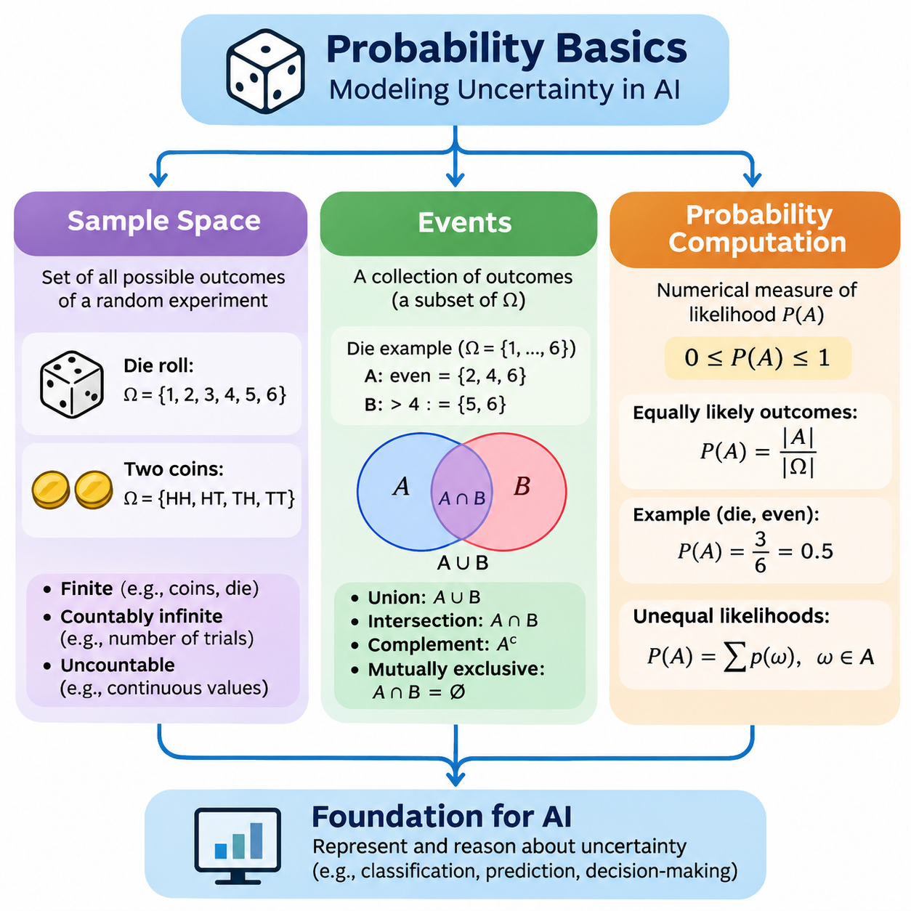
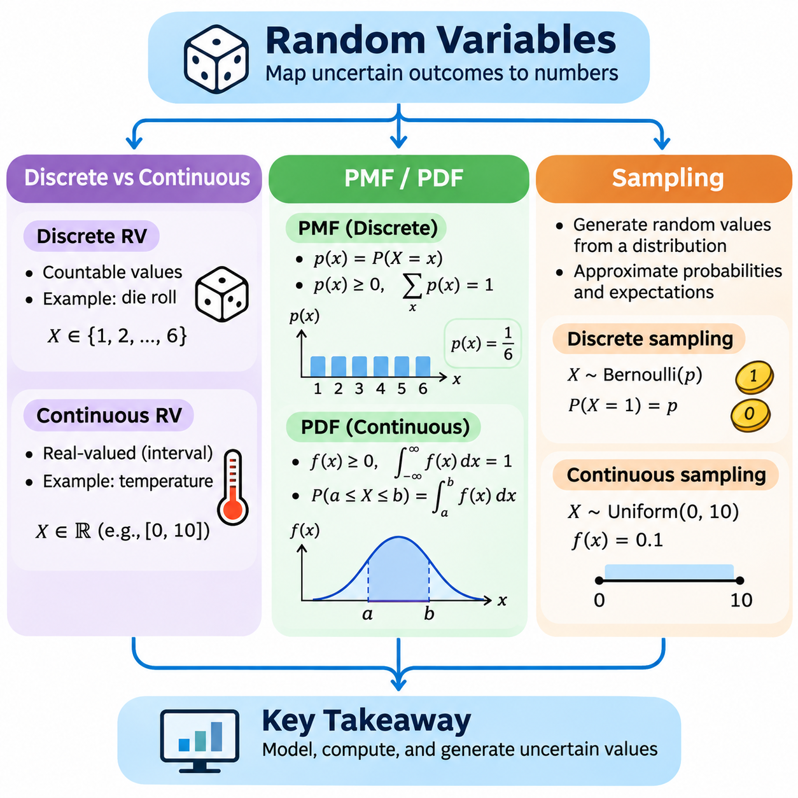
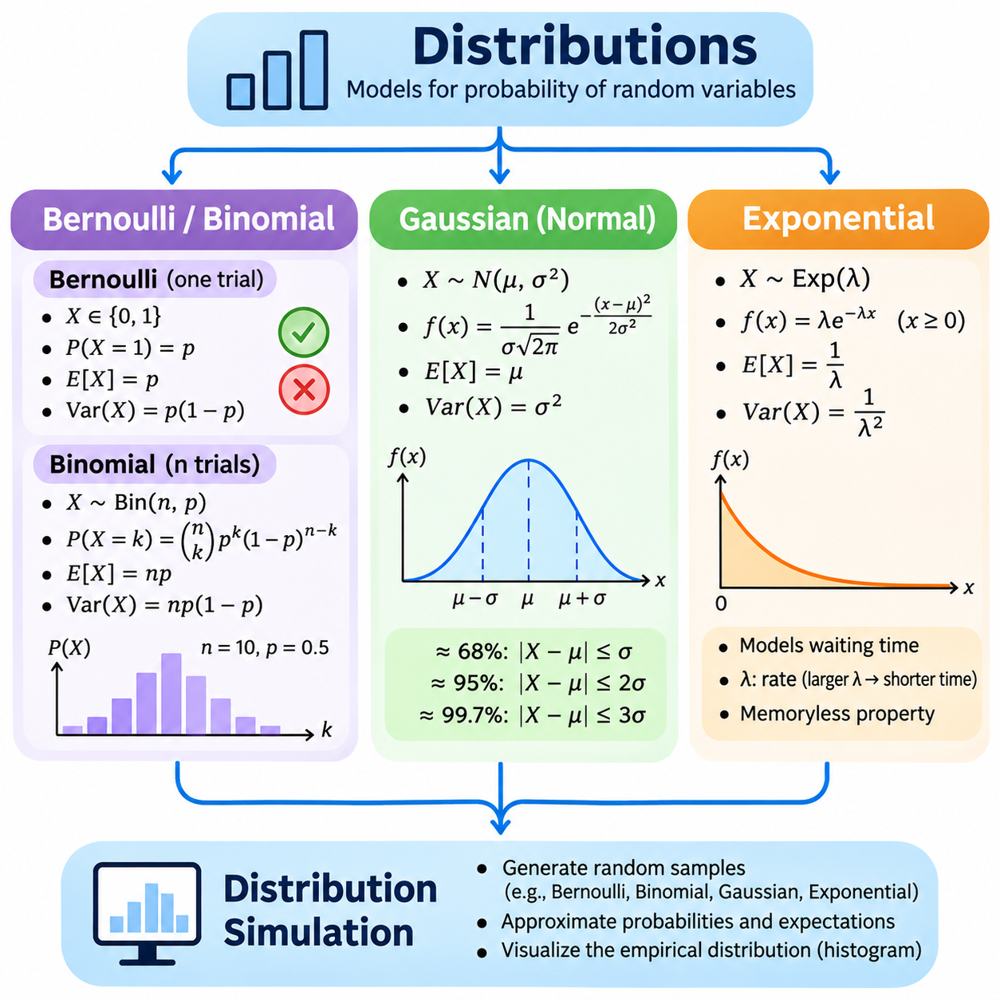
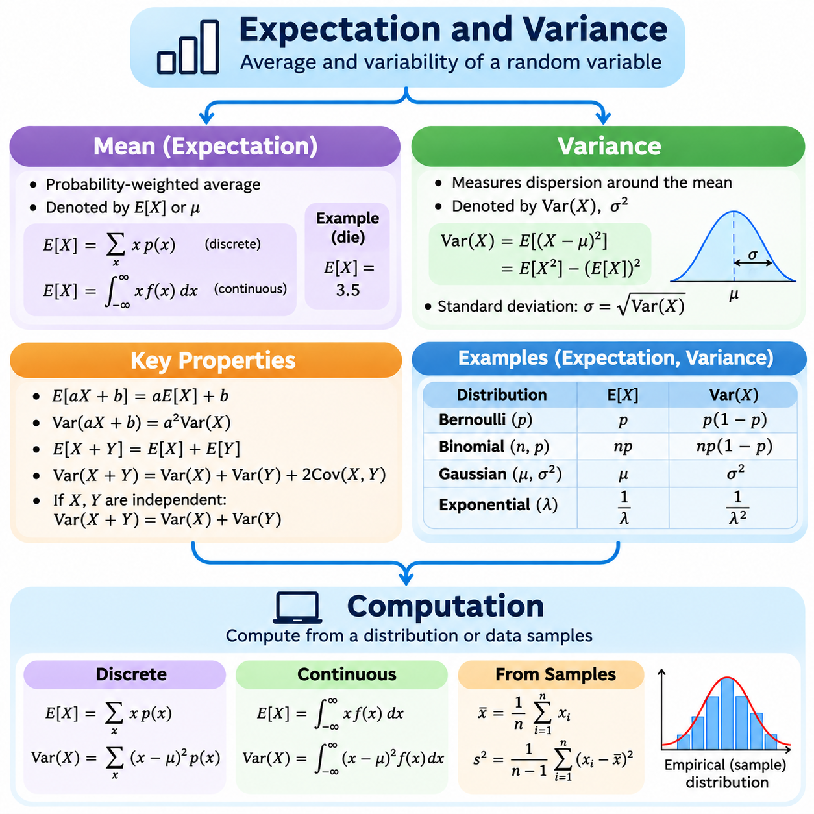
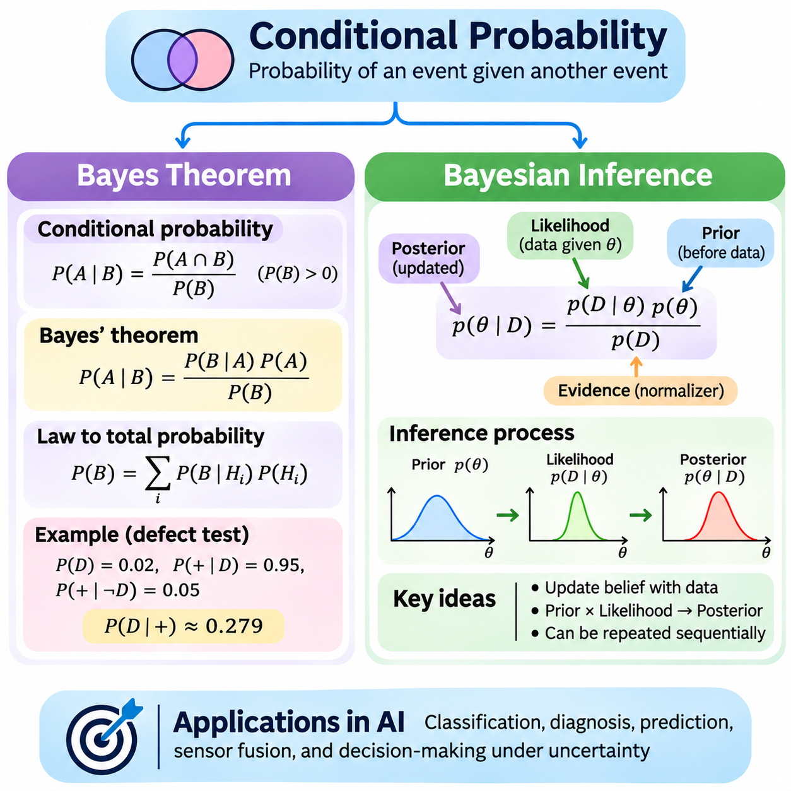
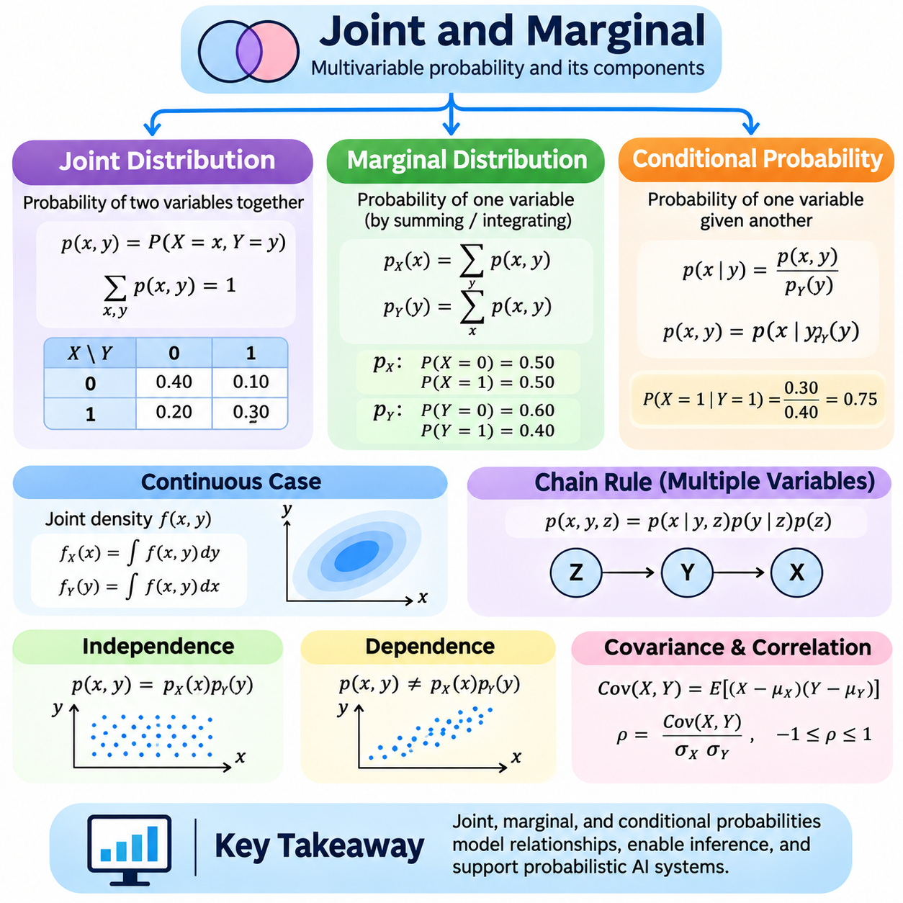
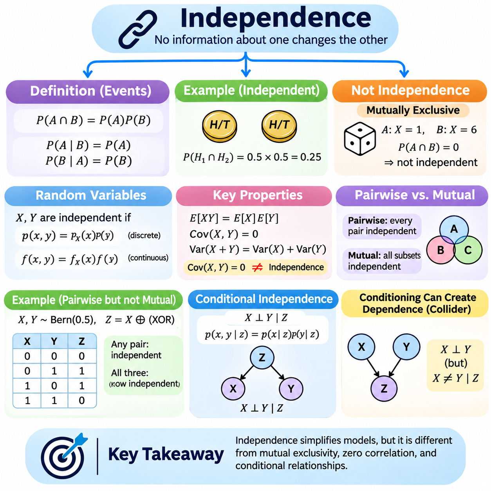
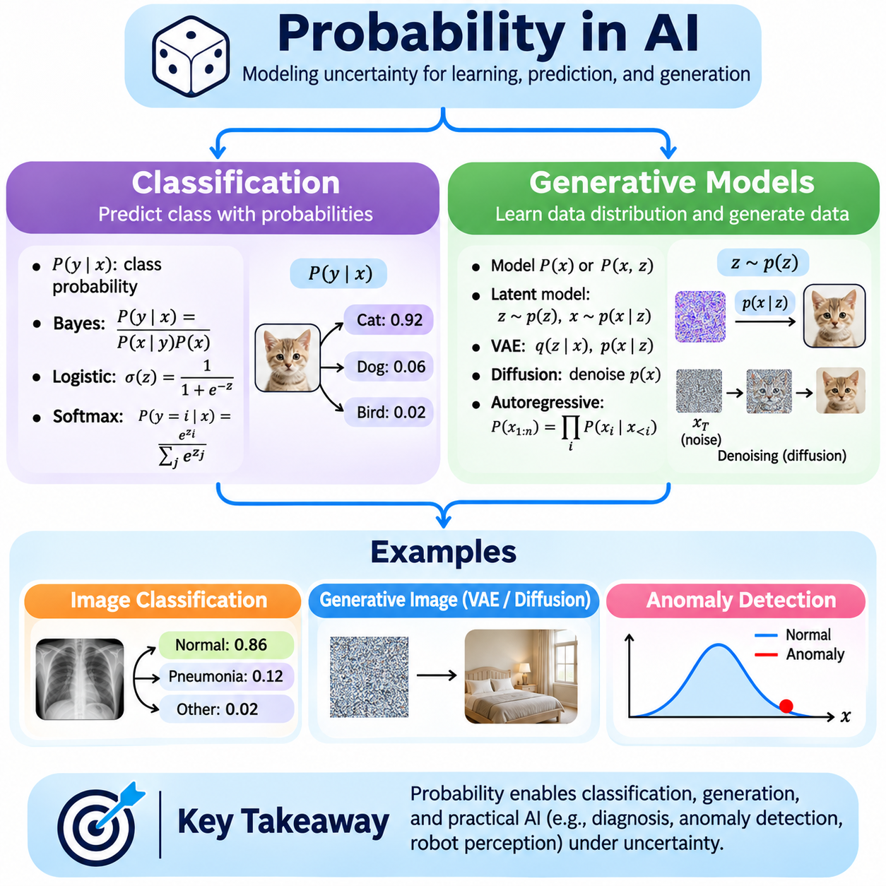

**Volume 05. Mathematics for AI**

# 03. Probability

## 03.00 Probability Basics

{width="7.268055555555556in" height="7.268055555555556in"}

확률(Probability)은 불확실성(Uncertainty)을 설명하고, 가능한 결과의 발생 가능성을 측정하며, 결과를 완전히 예측할 수 없는 사건(Event)에 대해 추론하기 위한 수학적 체계(Mathematical Framework)를 제공한다. 실제 환경에는 불완전한 관측(Incomplete Observations), 측정 잡음(Measurement Noise), 예측하기 어려운 행동, 불확실한 관계가 존재하므로 확률은 인공지능(Artificial Intelligence)의 핵심 기반이 된다. 확률을 활용하면 인공지능 시스템은 결정론적 가정(Deterministic Assumptions)에만 의존하지 않고 이러한 불확실성을 정량적으로 표현할 수 있다.

확률의 기초는 무작위 실험(Random Experiment)이라는 개념에서 시작한다. 무작위 실험은 실험을 수행하기 전에 결과를 확실하게 결정할 수 없는 과정을 의미한다. 주사위를 던지거나, 데이터 표본(Data Sample)을 선택하거나, 센서 잡음(Sensor Noise)을 측정하거나, 기계 부품의 고장 여부를 관측하는 것이 대표적인 예이다. 개별 결과는 불확실할 수 있지만 가능한 결과들의 집합은 명확하게 정의할 수 있으며, 이를 통해 수학적 분석(Mathematical Analysis)의 기반을 마련할 수 있다.

표본공간(Sample Space)은 일반적으로 기호 Ω로 표현하며, 무작위 실험에서 발생할 수 있는 모든 가능한 결과의 집합을 의미한다. 표준적인 6면체 주사위를 던지는 경우 표본공간은 Ω = 6으로 정의된다. 각 원소는 기본 결과(Elementary Outcome)를 나타내며, 전체 집합은 해당 실험에서 허용되는 모든 결과를 포함한다. 확률 계산(Probability Computation)은 수학적 모델에 포함된 결과에 따라 달라지므로 표본공간을 올바르게 정의하는 것이 중요하다.

표본공간은 유한(Finite), 가산 무한(Countably Infinite), 비가산 무한(Uncountably Infinite)으로 구분할 수 있다. 유한 표본공간(Finite Sample Space)은 동전을 세 번 던졌을 때 가능한 결과처럼 제한된 개수의 결과를 포함한다. 가산 무한 표본공간은 첫 번째 성공이 발생할 때까지 필요한 시도 횟수를 표현할 수 있다. 비가산 표본공간은 특정 구간 내의 온도, 거리, 속도, 센서 측정값처럼 연속적인 측정값을 표현하는 데 사용된다.

표본공간의 구조는 실험을 어떻게 정의하는지에 따라 달라진다. 구별 가능한 두 개의 동전을 던지면 HH, HT, TH, TT라는 순서가 있는 결과가 생성되며, H는 앞면(Heads), T는 뒷면(Tails)을 의미한다. HT와 TH는 앞면의 개수가 같지만 어느 동전에서 각 결과가 발생했는지를 구별하므로 서로 다른 결과로 취급한다. 이러한 차이는 순서열(Sequence), 조합(Combination), 반복 관측(Repeated Observations)을 포함하는 확률 모델을 구성할 때 중요하다.

인공지능에서 표본공간은 가능한 시스템 상태(System States), 예측 레이블(Predicted Labels), 환경 조건(Environmental Conditions), 대안적 행동(Alternative Actions)을 표현하는 데 자주 사용된다. 이미지 분류(Image Classification) 시스템은 유한한 객체 범주(Object Categories)를 고려할 수 있으며, 로봇 위치 추정(Robot Localization) 시스템은 연속적인 위치(Position)와 방향(Orientation)의 집합을 고려할 수 있다. 표본공간의 수학적 정의는 불확실성을 표현하고 평가하며 이후 계산에 반영하는 방식을 결정한다.

사건(Event)은 표본공간에 포함된 결과들의 집합이다. 이산 실험(Discrete Experiment)에서는 사건을 Ω의 부분집합(Subset) A로 표현할 수 있다. 주사위를 던질 때 짝수가 나오는 사건은 A = 6이며, 4보다 큰 숫자가 나오는 사건은 B = 6으로 정의된다. 사건이라는 개념을 사용하면 각각의 기본 결과를 독립적으로 다루는 대신 의미 있는 조건을 중심으로 확률을 설명할 수 있다.

사건은 기본적인 집합 연산(Set Operations)을 이용하여 결합할 수 있다. 합집합(Union) A ∪ B는 A 또는 B 중 하나 이상에 속하는 결과를 나타내며, 교집합(Intersection) A ∩ B는 두 사건에 공통으로 포함되는 결과를 의미한다. 여사건(Complement) Aᶜ는 표본공간에서 A에 속하지 않는 결과를 포함한다. 이러한 연산은 동시 고장(Simultaneous Failures), 대안적 분류(Alternative Classifications), 불확실한 관측의 조합과 같은 복잡한 조건을 표현하는 형식적 언어를 제공한다.

두 사건이 동시에 발생할 수 없다면 이를 상호 배타적 사건(Mutually Exclusive Events)이라고 하며, 두 사건의 교집합은 공집합(Empty Set)이 된다. 예를 들어 한 번의 주사위 던지기에서 2가 나오는 사건과 5가 나오는 사건은 상호 배타적이다. 그러나 짝수가 나오는 사건과 4보다 큰 숫자가 나오는 사건은 모두 6을 포함하므로 상호 배타적이지 않다. 이러한 차이를 이해하면 여러 조건이 중복되는 상황에서 잘못된 확률 계산을 방지할 수 있다.

사건 A의 확률은 P(A)로 표기하며, 해당 사건이 발생할 가능성을 수치적으로 나타낸다. 확률값(Probability Value)은 0에서 1 사이의 범위를 가지며, 0은 불가능한 사건(Impossible Event)을 의미하고 1은 해당 모델에서 반드시 발생하는 사건(Certain Event)을 의미한다. 중간값은 서로 다른 발생 가능성을 표현한다. 예를 들어 확률이 0.8이라는 것은 해당 사건에 80%의 발생 가능성이 부여되었다는 의미이지, 개별 실험에서 반드시 발생한다는 보장은 아니다.

수학적으로 유효한 확률 측도(Probability Measure)는 세 가지 기본 공리(Axioms)를 만족해야 한다. 모든 사건의 확률은 음수가 아니어야 하며, 전체 표본공간의 확률은 1이어야 하고, 서로 겹치지 않는 가산 개의 사건에 대한 확률은 각각의 확률을 합한 값과 같아야 한다. 이러한 원칙은 이산 공간과 연속 공간 모두에서 일관된 확률 계산의 기초를 형성하며, 파생된 확률 규칙들이 수학적 모델과 논리적으로 일치하도록 보장한다.

유한 표본공간에서 모든 기본 결과의 발생 가능성이 동일하다면, 사건의 확률은 유리한 결과의 개수(Favorable Outcomes)를 전체 가능한 결과의 개수로 나누어 계산할 수 있다. 공정한 6면체 주사위에서 짝수가 나올 확률은 P(A) = 3/6 = 0.5이다. 이러한 계수 기반 접근법(Counting-Based Approach)은 단순한 실험에 유용하지만, 결과마다 발생 확률이 서로 다른 경우에는 직접 적용할 수 없다.

발생 가능성이 서로 다른 실험에서는 각 기본 결과에 적절한 확률 가중치(Probability Weight)를 부여해야 한다. 세 개의 상호 배타적이며 전체 경우를 포괄하는 범주에 대해 분류 시스템이 각각 0.6, 0.3, 0.1의 확률을 할당한다고 가정하자. 첫 번째 범주와 두 번째 범주를 포함하는 사건의 확률은 0.9가 된다. 이러한 계산은 모든 결과가 동일한 확률을 가진다고 가정하지 않고도 서로 다른 발생 가능성을 확률 모델에 반영할 수 있음을 보여준다.

여사건 규칙(Complement Rule)은 반대 사건을 설명하는 것이 더 쉬운 경우 확률을 효율적으로 계산하는 방법을 제공한다. 사건과 그 여사건은 서로 중복되지 않으면서 전체 표본공간을 구성하므로 P(Aᶜ) = 1 − P(A)가 성립한다. 예를 들어 통신 성공(Communication Success) 확률이 0.97이라면 통신 실패(Communication Failure) 확률은 0.03이다. 이러한 원리는 신뢰성 분석(Reliability Analysis)과 고장 확률 추정(Failure Probability Estimation)에 특히 유용하다.

덧셈 법칙(Addition Rule)은 두 사건 중 적어도 하나가 발생할 확률을 설명한다. 임의의 사건 A와 B에 대해 P(A ∪ B) = P(A) + P(B) − P(A ∩ B)가 성립한다. 교집합의 확률을 빼는 이유는 두 사건에 공통으로 포함된 결과가 중복 계산되는 것을 방지하기 위해서이다. 두 사건이 상호 배타적이라면 교집합의 확률은 0이 되므로 해당 공식은 두 사건의 개별 확률을 단순히 더하는 형태로 정리된다.

확률은 반복 실험(Repeated Experimentation)을 통해서도 이해할 수 있다. 적절한 가정이 충족되면 독립적이고 동일한 분포를 따르는 시행(Independent and Identically Distributed Trials)의 횟수가 증가할수록 사건의 상대도수(Relative Frequency)는 이론적 확률(Theoretical Probability)에 가까워진다. 예를 들어 공정한 동전을 반복적으로 던지는 시뮬레이션에서는 앞면의 비율이 일반적으로 0.5에 접근한다. 이러한 현상은 큰 수의 법칙(Law of Large Numbers)으로 설명되며 이론적 확률과 경험적 관측을 연결한다.

경험적 확률 추정(Empirical Probability Estimation)은 사전에 정의된 수학적 모델에만 의존하지 않고 실제 관측 데이터를 활용한다. 어떤 사건이 1,000번의 관측 중 240번 발생했다면 관측된 상대도수는 0.24이다. 관측값이 분석 대상 과정을 대표한다면 이 값을 사건 확률의 추정치(Estimate)로 사용할 수 있다. 그러나 표본 변동성(Sampling Variability), 측정 오류(Measurement Errors), 체계적 편향(Systematic Bias)은 이러한 추정의 정확도에 영향을 줄 수 있다.

계산적 확률 분석(Computational Probability Analysis)은 수학적 공식과 수치 시뮬레이션(Numerical Simulation)을 결합하는 경우가 많다. 파이썬(Python) 프로그램에서는 리스트(List), 튜플(Tuple), 집합(Set)을 이용하여 유한 표본공간을 표현할 수 있으며, 확률 가중치는 배열(Array)이나 딕셔너리(Dictionary)에 저장할 수 있다. 넘파이(NumPy)는 효율적인 수치 연산(Numerical Operations)과 무작위 표본 추출(Random Sampling)을 지원하므로 이론적 결과를 검증하고 확률 추정치를 평가하는 데 적합하다.

간단한 확률 시뮬레이션(Probability Simulation)은 수천 번의 무작위 주사위 던지기를 생성하고 특정 사건의 조건을 만족하는 결과의 비율을 계산할 수 있다. 프로그램은 짝수가 나올 경험적 추정치(Empirical Estimate)를 이론적 확률 0.5와 비교할 수 있다. 시뮬레이션 규모가 커질수록 추정치는 일반적으로 안정되지만 개별 실행에서는 여전히 무작위 변동(Random Fluctuations)이 발생할 수 있다. 재현 가능한 실험(Reproducible Experiments)을 위해 고정된 난수 시드(Random Seed)를 사용할 수 있다.

더 복잡한 표본공간에서는 모든 결과를 빠짐없이 열거하는 완전 열거(Exhaustive Enumeration)에 상당한 계산 자원이 필요할 수 있다. 하나의 실험에 n개의 독립적인 이진 결과(Binary Outcomes)가 포함된다면 가능한 순서열의 개수는 2ⁿ이다. 따라서 n이 비교적 작은 값이더라도 결과 공간은 매우 커질 수 있다. 표본 추출 기반 방법(Sampling-Based Methods)은 모든 결과를 조사하는 대신 생성된 관측값으로 사건의 확률을 추정하는 실용적인 대안을 제공한다.

몬테카를로 방법(Monte Carlo Methods)은 반복적인 무작위 표본 추출을 통해 확률을 추정하는 계산적 접근법이다. 표본 추출 과정이 의도한 확률 모델을 따른다는 조건에서 사건의 확률은 시뮬레이션 결과 중 사건 조건을 만족하는 비율로 근사할 수 있다. 몬테카를로 추정(Monte Carlo Estimation)은 정확한 해석적 계산(Analytical Calculation)이 어렵거나 계산 비용이 높은 고차원 문제(High-Dimensional Problems), 불확실한 물리 시스템, 복잡한 시뮬레이션에서 유용하다.

확률 계산에서는 수치 정밀도(Numerical Precision)와 모델 가정(Model Assumptions)을 신중하게 고려해야 한다. 부동소수점 연산(Floating-Point Arithmetic)은 작은 반올림 오차(Rounding Errors)를 발생시킬 수 있으며, 적절하게 정규화되지 않은 확률 가중치는 유효하지 않은 결과를 만들 수 있다. 이산 확률분포(Discrete Probability Distribution)는 음수가 아닌 가중치를 가져야 하고 그 합계는 1이어야 한다. 따라서 계산 구현에서는 입력값 검증(Input Validation), 정규화(Normalization) 확인, 확률적 불확실성과 수치 근사 오류의 구분이 필요하다.

기계학습(Machine Learning)에서 확률은 불확실한 예측(Uncertain Predictions)을 표현하는 기반을 제공한다. 분류 모델(Classification Model)은 후보 클래스(Candidate Classes)에 대한 확률분포를 출력하여 단일 예측 레이블뿐 아니라 상대적인 신뢰도(Relative Confidence)를 표현할 수 있다. 이러한 확률은 의사결정 임계값(Decision Thresholds), 불확실성을 고려한 평가(Uncertainty-Aware Evaluation), 후속 추론(Downstream Reasoning)을 지원한다. 그러나 예측 확률을 실제 사건의 발생 빈도에 대한 신뢰할 수 있는 추정치로 해석하려면 보정(Calibration) 수준을 평가해야 한다.

확률은 로봇공학(Robotics)과 피지컬 인공지능(Physical AI)에서도 중요하다. 센서는 잡음(Noise), 가림(Occlusion), 환경적 변동성(Environmental Variability)의 영향을 받는 측정값을 생성하기 때문이다. 로봇은 불완전한 관측을 바탕으로 가능한 위치나 객체 정체성(Object Identity)에 서로 다른 확률을 부여할 수 있다. 이러한 표현은 불확실성과 결정론적 오류(Deterministic Error)를 구분하도록 지원하며, 조건부 확률(Conditional Probability), 확률적 추론(Probabilistic Inference), 상태 추정(State Estimation)을 포함하는 후속 기법의 수학적 기반을 제공한다.

표본공간(Sample Space), 사건(Event), 확률 계산(Probability Computation)을 이해하는 것은 더욱 발전된 수학적 모델을 학습하기 위한 개념적 토대를 형성한다. 표본공간은 발생 가능한 결과를 정의하고, 사건은 관심 있는 조건을 식별하며, 확률 측도(Probability Measure)는 그 발생 가능성을 정량화한다. 이러한 개념은 불확실성에 대한 일관된 추론을 가능하게 하며, 확률변수(Random Variables), 확률분포(Probability Distributions), 기댓값(Expectation), 조건부 확률, 확률적 인공지능(Probabilistic Artificial Intelligence)을 이해하기 위한 수학적 기초를 마련한다.

## 03.01 Random Variables

{width="7.268055555555556in" height="7.268055555555556in"}

확률변수(Random Variable)는 불확실한 결과를 수치로 표현하기 위한 수학적 메커니즘(Mathematical Mechanism)을 제공한다. 확률변수는 표본공간(Sample Space)의 결과를 실수(Real Number)에 대응시키는 가측 함수(Measurable Function)로 정의된다. 이러한 변환을 통해 확률이론(Probability Theory)은 복잡한 실험을 수치적 관계로 설명할 수 있다. 인공지능(Artificial Intelligence)에서 확률변수는 불확실한 관측값(Uncertain Observations), 예측 클래스(Predicted Classes), 센서 측정값(Sensor Measurements), 환경 조건(Environmental Conditions)을 표현한다.

무작위 실험(Random Experiment)과 확률변수(Random Variable)의 차이를 이해하는 것은 기본적으로 중요하다. 무작위 실험은 하나의 결과를 생성하는 반면, 확률변수는 그 결과에 수치값을 할당한다. 예를 들어 두 개의 동전을 던지면 표본공간에는 HH, HT, TH, TT가 포함된다. 앞면의 개수를 나타내는 확률변수 X는 각각 2, 1, 1, 0의 값을 할당한다. 따라서 서로 다른 실험 결과가 동일한 수치값으로 표현될 수 있다.

확률변수는 가능한 값의 수학적 구조에 따라 일반적으로 이산형(Discrete)과 연속형(Continuous)으로 분류된다. 이산 확률변수(Discrete Random Variable)는 유한 집합(Finite Set) 또는 가산 무한 집합(Countably Infinite Set)의 값을 가지며, 연속 확률변수(Continuous Random Variable)는 일반적으로 실수 구간에서 확률밀도(Probability Density)를 갖는 확률분포(Probability Distribution)를 이용하여 모델링된다. 이러한 구분은 수학적 모델과 계산 시스템에서 확률을 표현하고 계산하며 해석하는 방식을 결정한다.

이산 확률변수는 불량 제품의 개수, 주사위 결과, 이미지에서 감지된 객체의 개수 등을 표현할 수 있다. 가능한 값의 집합이 가산 무한이더라도 각각의 값을 개별적으로 열거할 수 있다. 예를 들어 일정 시간 동안 교차로를 통과하는 차량의 수를 나타내는 변수는 0, 1, 2 등의 값을 가질 수 있다. 이러한 각각의 가능한 값에는 특정 확률을 할당할 수 있으며, 이를 통해 개별 결과의 발생 가능성을 정량적으로 표현할 수 있다.

연속 확률변수는 온도(Temperature), 거리(Distance), 속도(Velocity), 압력(Pressure), 경과 시간(Elapsed Time)과 같은 측정값을 표현할 수 있다. 가능한 값은 개별 범주가 아니라 일반적으로 실수 구간(Real-Valued Interval)에 걸쳐 모델링된다. 예를 들어 로봇의 측정 위치는 특정 공간 영역(Spatial Region) 내의 값을 가지는 연속 변수로 표현할 수 있다. 실제 측정 정밀도(Measurement Precision)는 유한하더라도 수학적 모델에서는 기초가 되는 물리량을 연속적으로 취급할 수 있다.

이산 변수와 연속 변수의 차이는 개별 결과를 해석할 때 특히 중요하다. 이산 변수는 정확히 세 번 성공하는 사건처럼 특정 값에 양의 확률(Positive Probability)을 할당할 수 있다. 반면 확률밀도함수(Probability Density Function)를 갖는 연속 변수에서는 특정한 하나의 정확한 값이 관측될 확률이 0이다. 따라서 의미 있는 확률은 개별 점이 아니라 구간(Interval) 또는 보다 일반적인 가측 집합(Measurable Set)에 할당된다.

확률질량함수(Probability Mass Function, PMF)는 이산 확률변수의 확률분포를 설명한다. 일반적으로 p(x) = P(X = x)로 표현하며, 여기서 X는 확률변수이고 x는 가능한 값이다. 확률질량함수는 각 가능한 결과에 음수가 아닌 확률을 할당하며, 모든 가능한 값에 대한 확률의 합은 반드시 1이어야 한다. 이러한 성질은 해당 함수가 유효한 이산 확률분포(Discrete Probability Distribution)를 정의하도록 보장한다.

공정한 6면체 주사위를 확률변수 X로 표현한다고 가정하자. 이 경우 확률질량함수는 x가 6에 속하면 p(x) = 1/6을 할당하고, 그 외의 값에는 0을 할당한다. 4보다 큰 값이 나올 확률은 5와 6에 해당하는 확률을 더하여 계산한다. 따라서 P(X \> 4) = 1/6 + 1/6 = 1/3이 된다. 이는 확률질량함수를 이용하여 사건 확률(Event Probability)을 계산하는 방법을 보여준다.

이산 확률분포가 모든 값에 동일한 확률을 할당해야 하는 것은 아니다. 이진 분류(Binary Classification)의 결과는 P(X = 1) = p, P(X = 0) = 1 − p를 갖는 베르누이 확률변수(Bernoulli Random Variable)로 모델링할 수 있다. 매개변수(Parameter) p는 성공 확률(Success Probability)을 결정하며, 여확률(Complementary Probability)은 실패를 나타낸다. 이러한 단순한 수학적 구조는 이진 분류, 신뢰성 모델링(Reliability Modeling), 확률적 의사결정 시스템(Probabilistic Decision Systems)에서 자주 사용된다.

확률밀도함수(Probability Density Function, PDF)는 확률분포가 밀도함수를 갖는 연속 확률변수를 설명한다. 확률밀도는 일반적으로 f(x)로 표현하며, 음수가 아니어야 하고 전체 실수 구간에 대한 적분값(Integral)이 1이어야 한다. 확률질량함수와 달리 확률밀도함수의 값 자체는 특정 결과가 발생할 확률을 직접 나타내지 않는다. 확률은 선택한 구간에 대해 밀도함수를 적분(Integration)하여 계산한다.

확률밀도 f(x)를 갖는 연속 확률변수 X에서 a와 b 사이의 값이 관측될 확률은 P(a ≤ X ≤ b) = ∫[a,b] f(x) dx로 표현된다. 이 관계는 특정 구간에 걸쳐 누적된 확률밀도를 확률로 해석한다는 의미이다. 전체 적분값이 1이라는 조건을 만족한다면 특정 영역에서 확률밀도 자체가 1보다 클 수도 있다. 따라서 밀도의 높이(Density Height)와 사건 확률(Event Probability)을 동일한 개념으로 해석해서는 안 된다.

연속 균등분포(Continuous Uniform Distribution)는 확률밀도함수를 이해하기 위한 간단한 예이다. 확률변수 X가 0과 10 사이에서 균등하게 분포한다면 해당 구간의 밀도는 f(x) = 0.1이며, 그 외의 영역에서는 0이다. X가 2와 5 사이에 존재할 확률은 0.1에 구간 길이 3을 곱하여 0.3으로 계산된다. 이러한 예는 구간 너비(Interval Width), 확률밀도(Probability Density), 누적 확률(Accumulated Probability) 사이의 관계를 보여준다.

누적분포함수(Cumulative Distribution Function, CDF)는 이산 확률변수와 연속 확률변수를 모두 표현할 수 있는 통합적인 방법을 제공한다. F(x) = P(X ≤ x)로 정의되며, 확률변수가 지정된 값 이하일 확률을 나타낸다. 이산 변수에서는 확률질량(Probability Mass)을 누적하고, 밀도함수를 갖는 연속 변수에서는 적분을 통해 확률을 누적한다. 모든 누적분포함수는 비감소 함수(Nondecreasing Function)이며, 양쪽 극한에서 각각 0과 1에 접근한다.

충분한 정칙성(Regularity)을 갖는 누적분포함수를 가진 연속 확률변수에서는 미분(Differentiation)을 통해 확률밀도를 구할 수 있으며, 도함수가 존재하는 지점에서 f(x) = dF(x)/dx로 표현된다. 반대로 확률밀도를 음의 무한대(Negative Infinity)부터 x까지 적분하면 누적분포함수를 얻을 수 있다. 이러한 관계는 확률이론과 미적분학(Calculus)을 연결하며, 확률분포와 확률 구간을 평가하기 위한 수학적 도구를 제공한다.

표본 추출(Sampling)은 확률분포 또는 모집단(Population)에서 관측값을 생성하거나 선택하는 과정이다. 계산 확률(Computational Probability)에서는 무작위 표본 추출(Random Sampling)을 통해 지정된 확률 모델(Probabilistic Model)에 따라 수치값을 생성한다. 생성된 각각의 값은 확률변수의 하나의 실현값(Realization)을 나타낸다. 반복적인 표본 추출은 분포의 특성을 조사하고, 확률을 추정하며, 통계적 행동(Statistical Behavior)을 평가하는 데 사용할 수 있는 관측값 집합을 생성한다.

이산분포(Discrete Distribution)에서 표본을 추출하려면 각 값에 할당된 확률질량에 따라 가능한 값 중 하나를 선택해야 한다. 예를 들어 확률이 각각 0.5, 0.3, 0.2인 범주형 변수(Categorical Variable)는 충분히 많은 독립 표본(Independent Samples)을 생성했을 때 세 범주가 대략 해당 상대도수(Relative Frequency)로 나타나야 한다. 표본 추출 알고리즘(Sampling Algorithm)은 균등 표본 추출(Uniform Sampling)이 명시적으로 요구되지 않는 한 모든 범주를 동일하게 취급하지 않고 의도한 확률 가중치를 유지해야 한다.

연속분포(Continuous Distribution)에서 표본을 추출할 때는 일반적으로 균등하게 생성된 의사난수(Pseudorandom Numbers)를 목표 분포(Target Distribution)에 따르는 값으로 변환하는 수치 알고리즘(Numerical Algorithm)을 사용한다. 역변환 표본 추출(Inverse Transform Sampling)은 역누적분포함수(Inverse Cumulative Distribution Function)를 적절하게 계산할 수 있을 때 이를 활용한다. 다른 방법으로는 거절 표본 추출(Rejection Sampling)과 분포별 특화 알고리즘(Distribution-Specific Algorithms)이 있으며, 선택한 방법은 계산 효율성, 수치 정확도, 확장성에 영향을 준다.

파이썬(Python)은 확률 표본 추출 실험을 구현하기 위한 접근하기 쉬운 도구를 제공한다. 넘파이(NumPy)의 난수 생성 인터페이스(Random Number Generation Interface)는 균등분포(Uniform Distribution), 정규분포(Normal Distribution), 베르누이 관련 분포(Bernoulli-Related Distributions), 범주형 분포(Categorical Distribution)에서 표본을 추출하는 기능을 지원한다. 난수 생성기(Random Generator)는 고정된 시드(Seed)로 초기화하여 재현 가능한 의사난수 순서열(Pseudorandom Sequence)을 생성할 수 있다. 재현성(Reproducibility)은 알고리즘 비교, 수치 구현 디버깅, 통제된 기계학습 실험에서 중요하다.

경험적 확률질량함수(Empirical Probability Mass Function)는 표본 집합에서 각 이산 값이 얼마나 자주 나타나는지 계산하여 추정할 수 있다. 시뮬레이션된 범주형 변수가 10,000개의 관측값을 생성했다면, 적절한 표본 추출 가정 아래 각 범주의 상대도수는 실제 확률에 가까워진다. 표본 크기(Sample Size)가 증가하면 일반적으로 표본 변동성(Sampling Variability)이 감소하지만, 경험적 빈도가 이론적 확률(Theoretical Probability)과 반드시 정확하게 일치하는 것은 아니다.

연속 관측값(Continuous Observations)의 경우 구간별 개수(Interval Counts)와 밀도 추정 방법(Density Estimation Methods)을 이용하여 확률분포를 분석할 수 있다. 히스토그램(Histogram)은 표본값을 구간(Bin)으로 묶고 각 구간에 관측값이 얼마나 자주 포함되는지 측정한다. 적절하게 정규화하면 히스토그램의 높이는 개별 점의 확률이 아니라 확률밀도를 근사할 수 있다. 구간 너비(Bin Width)의 선택은 추정 결과에 영향을 주며, 해상도(Resolution)와 통계적 변동성 사이의 절충 관계(Tradeoff)를 발생시킨다.

표본 추출 품질(Sampling Quality)은 난수 생성 과정의 가정과 구현 방식에 따라 달라진다. 의사난수 생성기(Pseudorandom Number Generator)는 유용한 통계적 성질(Statistical Properties)을 나타내도록 설계된 결정론적 순서열(Deterministic Sequence)을 생성하지만, 그 자체가 물리적 무작위성(Physical Randomness)의 원천은 아니다. 통계적 시뮬레이션(Statistical Simulation)에는 적절한 생성기, 올바른 분포 매개변수(Distribution Parameters), 표본 독립성(Sampling Independence)에 대한 신중한 처리가 필요하다. 따라서 재현성과 통계적 타당성(Statistical Validity)은 별도로 고려해야 한다.

기계학습(Machine Learning)에서 무작위 표본 추출은 미니배치(Mini-Batch) 구성, 모델 매개변수 초기화(Model Parameter Initialization), 학습 예제(Training Examples) 선택, 기댓값(Expectation) 추정에 필수적이다. 표본 추출 절차는 학습 효율성(Training Efficiency)과 최적화 알고리즘(Optimization Algorithm)의 통계적 특성에 영향을 준다. 균등 표본 추출이 일반적이지만, 데이터셋이 불균형하거나 특정 관측값에 서로 다른 선택 확률이 필요한 경우 가중 표본 추출(Weighted Sampling), 층화 표본 추출(Stratified Sampling), 중요도 기반 표본 추출(Importance-Based Sampling)을 사용할 수 있다.

확률변수는 로봇공학(Robotics)과 피지컬 인공지능(Physical AI) 시스템의 불확실성 모델링(Uncertainty Modeling)도 지원한다. 센서 측정값은 연속 확률변수로 표현할 수 있으며, 객체 정체성(Object Identity)이나 작동 모드(Operating Mode)는 이산 변수로 표현할 수 있다. 이러한 모델에서 표본을 추출하면 잡음이 포함된 관측값(Noisy Observations)을 시뮬레이션하고, 대안적 시스템 상태(Alternative System States)를 평가하며, 불확실한 환경 조건에서 시스템을 시험할 수 있다. 이러한 방법은 확률적 인식(Probabilistic Perception)과 상태 추정(State Estimation)의 기반을 제공한다.

이산 확률변수(Discrete Random Variable), 연속 확률변수(Continuous Random Variable), 확률질량함수(Probability Mass Function), 확률밀도함수(Probability Density Function), 표본 추출(Sampling)을 이해하는 것은 고급 확률 분석(Advanced Probabilistic Analysis)을 위한 기초를 확립한다. 이러한 개념은 불확실한 결과가 어떻게 수치적 표현으로 변환되는지, 값이나 구간에 확률이 어떻게 할당되는지, 관측값을 계산적으로 어떻게 생성할 수 있는지를 설명한다. 이들은 함께 확률분포(Probability Distributions), 기댓값(Expectation), 분산(Variance), 베이즈 추론(Bayesian Inference), 불확실성을 고려하는 인공지능(Uncertainty-Aware Artificial Intelligence)의 기반을 형성한다.

## 03.02 Distributions

{width="7.268055555555556in" height="7.268055555555556in"}

확률분포(Probability Distribution)는 확률변수(Random Variable)의 가능한 값들에 발생 가능성이 어떻게 할당되는지를 설명한다. 확률분포는 자연 시스템(Natural Systems)과 인공 시스템(Artificial Systems)에서 불확실성(Uncertainty), 변동성(Variability), 무작위 행동(Random Behavior)을 표현하기 위한 수학적 모델을 제공한다. 인공지능(Artificial Intelligence)에서 확률분포는 불확실한 예측(Uncertain Predictions), 측정 잡음(Measurement Noise), 데이터 특성(Data Characteristics), 확률적 학습 알고리즘(Probabilistic Learning Algorithms)을 모델링하는 데 필수적이다.

확률분포는 모델링하는 확률변수에 따라 이산형(Discrete) 또는 연속형(Continuous)으로 구분할 수 있다. 이산분포(Discrete Distribution)는 개별 값에 확률질량(Probability Mass)을 할당하는 반면, 연속분포(Continuous Distribution)는 구간에 대한 밀도함수(Density Function)를 통해 확률을 설명한다. 각 분포에는 형태와 동작을 결정하는 수학적 매개변수(Mathematical Parameters)가 존재한다. 적절한 분포를 선택하려면 기초가 되는 과정, 가능한 결과, 발생을 지배하는 가정(Assumptions)을 이해해야 한다.

베르누이 분포(Bernoulli Distribution)는 일반적으로 성공(Success)과 실패(Failure)로 해석되는 정확히 두 가지 가능한 결과를 갖는 무작위 실험(Random Experiment)을 나타낸다. 베르누이 확률변수(Bernoulli Random Variable) X는 확률 p로 1을, 확률 1 − p로 0을 가진다. 확률질량함수(Probability Mass Function)는 P(X = x) = p\^x(1 − p)\^(1 − x)로 표현되며, x는 1에 속한다. 매개변수 p는 0과 1 사이에 있어야 하며 두 결과의 상대적인 발생 가능성을 결정한다.

베르누이 확률변수의 기댓값(Expected Value)은 E[X] = p이며, 분산(Variance)은 Var(X) = p(1 − p)이다. 이러한 값은 반복 관측(Repeated Observations)에서 평균적인 결과와 변동성을 설명한다. 분산은 p = 0.5일 때 최댓값에 도달하며, 이는 두 결과 사이의 불확실성이 가장 크다는 것을 의미한다. 베르누이 모델(Bernoulli Model)은 이진 분류 레이블(Binary Classification Labels), 장비 고장(Equipment Failures), 개별적인 성공 또는 실패 사건을 표현하는 데 유용하다.

이항분포(Binomial Distribution)는 동일한 성공 확률을 갖는 고정된 횟수의 독립 시행(Independent Trials)으로 베르누이 모델을 확장한 것이다. 확률변수 X가 n번의 시행에서 성공 횟수를 나타낸다면 X는 매개변수 n과 p를 갖는 이항분포를 따른다. 확률질량함수는 P(X = k) = C(n,k)p\^k(1 − p)\^(n − k)로 표현되며, C(n,k)는 n번의 시행에서 k번의 성공을 선택하는 경우의 수(Number of Combinations)를 의미한다.

이항분포의 기댓값은 E[X] = np이며, 분산은 Var(X) = np(1 − p)이다. 예를 들어 품질 검사 과정(Quality Inspection Process)에서 서로 독립적인 제품 10개를 검사하고 각 제품의 불량 확률(Defect Probability)이 0.1이라면 예상 불량 제품 수는 1개이다. 독립성(Independence)과 일정한 성공 확률(Constant Success Probability)에 대한 가정이 합리적이라면 이항분포를 이용하여 지정된 개수의 불량 제품이 관측될 확률을 계산할 수 있다.

베르누이 분포와 이항분포는 밀접하게 관련되어 있지만 서로 다른 관측 수준(Observation Levels)을 설명한다. 베르누이 변수는 하나의 이진 시행(Binary Trial)의 결과를 나타내는 반면, 이항 변수는 여러 시행에서 발생한 전체 성공 횟수를 나타낸다. 이러한 분포는 수학적으로 단순하므로 이산 사건(Discrete Events)의 모델링, 이진 예측(Binary Predictions)의 평가, 반복적인 의사결정이나 독립적인 시스템 작동을 포함하는 확률적 시뮬레이션(Probabilistic Simulation)에 유용하다.

가우시안 분포(Gaussian Distribution)는 정규분포(Normal Distribution)라고도 하며, 대칭적인 종 모양(Bell-Shaped)의 밀도를 특징으로 하는 연속 확률분포(Continuous Probability Distribution)이다. 평균(Mean) μ와 분산(Variance) σ²라는 두 매개변수로 정의되며, σ는 양의 표준편차(Standard Deviation)이다. 확률밀도함수(Probability Density Function)는 f(x) = [1/(σ√(2π))] exp(−(x − μ)²/(2σ²))로 표현되며, 평균에서 멀어질수록 밀도가 감소하는 방식을 설명한다.

평균은 가우시안 분포의 중심(Center)을 결정하고, 표준편차는 분포의 퍼짐 정도(Spread)를 제어한다. 표준편차가 작으면 확률이 평균 주변에 집중되며, 표준편차가 크면 더 넓은 분포가 형성된다. 전체 확률의 약 68%는 평균에서 표준편차 1배 이내에, 약 95%는 2배 이내에, 약 99.7%는 3배 이내에 존재한다. 이러한 비율은 정규분포를 따르는 관측값(Normally Distributed Observations)을 해석하기 위한 실용적인 기준을 제공한다.

가우시안 분포는 많은 집계 효과(Aggregate Effects)를 정규분포로 근사할 수 있기 때문에 통계학(Statistics), 신호처리(Signal Processing), 기계학습(Machine Learning)에서 자주 등장한다. 중심극한정리(Central Limit Theorem)는 적절한 조건에서 다수의 독립 확률변수(Independent Random Variables)의 합이나 평균을 적절하게 정규화하면 가우시안 분포에 가까워지는 이유를 설명한다. 그러나 이러한 결과가 모든 측정값이나 데이터셋이 정규분포를 따른다는 의미는 아니다.

표준정규분포(Standard Normal Distribution)는 평균이 0이고 분산이 1인 정규분포이다. 평균 μ와 표준편차 σ를 갖는 가우시안 확률변수 X는 Z = (X − μ)/σ를 이용하여 표준화(Standardization)할 수 있다. 이러한 변환은 원래 분포 내에서 값이 차지하는 상대적 위치(Relative Position)를 변경하지 않으면서 표준정규변수(Standard Normal Variable)로 변환한다. 표준화는 확률 계산, 통계적 비교(Statistical Comparisons), 이상 탐지(Anomaly Detection), 수치 전처리(Numerical Preprocessing)를 지원한다.

인공지능에서 가우시안 분포는 측정 불확실성(Measurement Uncertainty), 센서 잡음(Sensor Noise), 잠재변수(Latent Variables), 예측 오차(Prediction Errors)를 모델링하는 데 일반적으로 사용된다. 예를 들어 로봇 위치 추정 시스템(Robot Localization System)은 위치 좌표(Position Coordinate)의 불확실성을 가우시안 모델로 근사할 수 있다. 평균은 추정 위치(Estimated Position)를 나타내고, 분산은 해당 추정값 주변의 불확실성을 설명한다. 이러한 모델은 계산상 편리하지만 다봉형(Multimodal) 또는 강하게 비대칭적인 불확실성에는 적합하지 않을 수 있다.

지수분포(Exponential Distribution)는 일반적으로 동질 포아송 과정(Homogeneous Poisson Process)에서 사건 사이의 대기 시간(Waiting Time)을 모델링하는 데 사용되는 연속 확률분포이다. 확률밀도함수는 x ≥ 0에서 f(x) = λ exp(−λx)로 표현되며, λ는 양의 발생률 매개변수(Rate Parameter)이다. 음수 값에 대한 밀도는 0이다. 매개변수 λ는 대기 시간이 증가함에 따라 확률밀도가 얼마나 빠르게 감소하는지를 결정한다.

지수 확률변수(Exponential Random Variable)의 기댓값은 E[X] = 1/λ이며, 분산은 Var(X) = 1/λ²이다. 발생률 매개변수가 클수록 예상 대기 시간(Expected Waiting Time)은 짧아지고, 발생률이 작을수록 예상 간격(Expected Interval)은 길어진다. 예를 들어 동질 포아송 과정에 따라 사건이 분당 평균 두 번 발생한다면 다음 사건이 발생할 때까지의 예상 대기 시간은 0.5분이다.

지수분포의 대표적인 특성은 무기억성(Memoryless Property)이다. 음수가 아닌 s와 t에 대해 P(X \> s + t \| X \> s) = P(X \> t)가 성립한다. 이는 추가로 일정 시간을 기다려야 할 확률이 이미 경과한 시간에 의존하지 않는다는 의미이다. 이러한 특성은 일정한 사건 발생률(Constant Event Rate)을 갖는 과정에는 적합하지만, 사용 기간이나 작동 조건에 따라 고장률(Failure Rate)이 변하는 시스템에는 현실적이지 않을 수 있다.

지수분포는 사건 도착(Event Arrivals), 통신 지연(Communication Delays), 서비스 간격(Service Intervals), 특정 신뢰성 과정(Reliability Processes)을 모델링하는 데 유용하다. 산업 인공지능(Industrial AI)에서는 일정한 발생률을 갖는 포아송 모델(Poisson Model)이 정당화될 때 독립적으로 발생하는 사건 사이의 대기 시간을 설명할 수 있다. 지수분포의 수학적 구조는 대기행렬 분석(Queueing Analysis)과 확률적 시뮬레이션(Stochastic Simulation)을 지원하지만, 실제 운영 데이터(Operational Data)를 검토한 후 지수분포 가정을 채택해야 한다.

분포 시뮬레이션(Distribution Simulation)은 지정된 확률분포를 따르는 무작위 표본(Random Samples)을 생성하는 계산 과정(Computational Process)이다. 시뮬레이션을 사용하면 특히 해석적 계산(Analytical Calculation)이 복잡해지는 경우 이론적 모델을 실험적으로 조사할 수 있다. 다수의 관측값을 생성함으로써 연구자는 경험적 빈도(Empirical Frequencies)를 분석하고, 통계적 특성(Statistical Properties)을 추정하며, 대안적 가정을 비교하고, 확률적 알고리즘(Probabilistic Algorithms)의 동작을 평가할 수 있다.

파이썬(Python)과 넘파이(NumPy)는 베르누이 분포, 이항분포, 가우시안 분포, 지수분포를 시뮬레이션하기 위한 실용적인 인터페이스(Practical Interfaces)를 제공한다. 베르누이 표본은 이진 시행(Binary Trials)을 통해 생성할 수 있으며, 이항 표본 추출(Binomial Sampling)은 반복 시행의 성공 횟수를 생성한다. 정규분포 표본 추출(Normal Sampling)에는 평균과 표준편차가 필요하다. 반면 넘파이의 지수분포 표본 추출(Exponential Sampling)은 발생률 매개변수 자체가 아니라 1/λ에 해당하는 척도 매개변수(Scale Parameter)를 사용한다.

재현 가능한 시뮬레이션(Reproducible Simulation)은 지정된 시드(Seed)로 의사난수 생성기(Pseudorandom Number Generator)를 초기화하고 적절한 분포 매개변수(Distribution Parameters)를 선택하는 것에서 시작한다. 생성된 표본은 경험적 평균(Empirical Mean), 분산(Variance), 사건 빈도(Event Frequencies)를 이용하여 분석할 수 있다. 이러한 추정치를 이론적 기댓값(Theoretical Expectations)과 비교하면 구현의 정확성(Implementation Correctness)을 검증하는 데 도움이 된다. 일반적으로 표본 크기가 증가하면 추정 정밀도(Estimation Precision)가 향상되지만 무작위 변동은 여전히 존재한다.

베르누이 시뮬레이션에서 표본평균(Sample Mean)은 성공 확률 p를 추정하며, 이항 시뮬레이션에서는 평균 성공 횟수가 np에 접근하는지 확인할 수 있다. 가우시안 시뮬레이션에서는 경험적 평균과 분산이 각각 μ와 σ²에 근접하는지 분석할 수 있다. 지수분포 시뮬레이션에서는 관측된 평균 대기 시간이 1/λ에 접근하는지 시험할 수 있다. 이러한 비교는 수학적 분포 특성(Mathematical Distribution Properties)과 계산 실험(Computational Experiments)을 연결한다.

시뮬레이션 정확도(Simulation Accuracy)는 매개변수 선택(Parameter Selection), 표본 크기(Sample Size), 난수 생성기 품질(Random Number Generator Quality), 수치 구현(Numerical Implementation)에 따라 달라진다. 이론적 결과와 경험적 결과 사이의 불일치(Mismatch)는 유한 표본 변동성(Finite-Sample Variability), 잘못된 매개변수 설정(Incorrect Parameterization), 부적절한 가정(Flawed Assumptions)으로 인해 발생할 수 있다. 따라서 생성된 관측값을 자동으로 올바른 결과로 간주하기보다는 확률 제약조건(Probability Constraints), 분포 매개변수, 통계적 추정치를 검증해야 한다.

기계학습(Machine Learning)과 피지컬 인공지능(Physical AI)에서 분포 시뮬레이션은 합성 데이터 생성(Synthetic Data Generation), 강건성 시험(Robustness Testing), 불확실성 분석(Uncertainty Analysis), 확률적 시스템 평가(Stochastic System Evaluation)를 지원한다. 가우시안 잡음(Gaussian Noise)은 센서 측정값에 추가할 수 있으며, 베르누이 변수는 부품 가용성(Component Availability)을 표현할 수 있다. 이항 변수는 반복적인 감지 성공(Detection Successes)을 설명하고, 지수 변수는 적절한 사건 대기 시간을 모델링할 수 있다. 이러한 응용에서는 실제 연구 대상의 작동 메커니즘을 반영하는 분포를 사용해야 한다.

베르누이 분포(Bernoulli Distribution), 이항분포(Binomial Distribution), 가우시안 분포(Gaussian Distribution), 지수분포(Exponential Distribution)를 이해하는 것은 이산 영역(Discrete Domain)과 연속 영역(Continuous Domain)에 걸친 확률적 모델링(Probabilistic Modeling)의 기초를 확립한다. 각 분포는 서로 다른 유형의 무작위 과정(Random Process)을 나타내며, 발생 가능성(Likelihood), 기댓값(Expectation), 변동성(Variability)을 계산하기 위한 고유한 수학적 도구를 제공한다. 계산적 시뮬레이션(Computational Simulation)과 결합하면 이러한 모델은 불확실성을 고려한 학습(Uncertainty-Aware Learning), 통계적 추론(Statistical Inference), 신뢰성 높은 인공지능 시스템 개발(Reliable Artificial Intelligence System Development)을 지원한다.

## 03.03 Expectation and Variance

{width="7.268055555555556in" height="7.268055555555556in"}

기댓값(Expectation)과 분산(Variance)은 확률변수(Random Variable)의 중심 경향성(Central Tendency)과 변동성(Variability)을 설명하는 기본적인 통계량(Statistical Quantities)이다. 기댓값은 가능한 결과의 확률 가중 평균(Probability-Weighted Average)을 나타내며, 분산은 값들이 기댓값을 중심으로 얼마나 넓게 분포하는지를 측정한다. 두 통계량은 확률분포(Probability Distribution)의 중요한 특성을 요약하며, 인공지능(Artificial Intelligence)의 불확실성 분석(Uncertainty Analysis), 통계적 추론(Statistical Inference), 수학적 모델링(Mathematical Modeling)을 지원한다.

확률변수 X의 기댓값(Expected Value)은 일반적으로 E[X] 또는 μ로 표기한다. 기댓값은 각 결과에 해당 확률을 가중치로 적용하여 얻는 이론적 평균(Theoretical Average)을 의미한다. 기댓값이 반드시 실제로 발생할 수 있는 결과와 일치하는 것은 아니다. 예를 들어 공정한 6면체 주사위를 던졌을 때 기댓값은 3.5이지만, 개별 시행에서 3.5라는 결과는 나올 수 없다. 따라서 기댓값은 보장된 관측값(Guaranteed Observation)이 아니라 장기적인 평균(Long-Run Average)을 나타낸다.

확률질량함수(Probability Mass Function) p(x)를 갖는 이산 확률변수(Discrete Random Variable)의 기댓값은 E[X] = Σx p(x)로 계산하며, 합산은 X의 모든 가능한 값에 대해 수행한다. 각 결과는 해당 수치값에 발생 확률을 곱한 만큼 기댓값에 기여한다. 공정한 주사위의 경우 E[X] = (1 + 2 + 3 + 4 + 5 + 6)/6 = 3.5이다. 이러한 계산은 기댓값이 가능한 결과와 발생 가능성을 하나의 수치적 요약(Numerical Summary)으로 결합하는 방법을 보여준다.

확률밀도함수(Probability Density Function) f(x)를 갖는 연속 확률변수(Continuous Random Variable)의 기댓값은 적분(Integration)을 이용하여 E[X] = ∫ x f(x) dx로 정의하며, 적분은 전체 실수 구간(Real Line)에서 수행하고 절대수렴(Absolute Convergence)해야 한다. 확률밀도는 서로 다른 값들이 평균에 기여하는 상대적인 정도를 결정한다. 따라서 연속 확률변수의 기댓값은 이산 확률변수의 기댓값과 유사하지만, 변수가 비가산 범위(Uncountable Range)의 값을 가질 수 있으므로 합산 대신 적분을 사용한다.

기댓값은 필요한 수학적 조건(Mathematical Conditions)이 충족될 때만 의미 있게 정의된다. 일부 확률분포는 두꺼운 꼬리(Heavy Tails)를 가지므로 기댓값이 무한대가 되거나 정의되지 않을 수 있다. 따라서 확률분포가 존재한다고 해서 반드시 유한한 기댓값(Finite Expectation)이 존재하는 것은 아니다. 이러한 구분은 극단적 사건(Extreme Events), 금융 위험(Financial Risks), 드문 고장(Rare Failures), 비정상적으로 큰 결과가 발생할 수 있는 불확실한 시스템을 모델링할 때 중요하다.

분산(Variance)은 확률변수가 평균에서 벗어나는 편차(Deviation)의 제곱에 대한 기댓값을 측정한다. 분산은 Var(X) = E[(X − μ)²]로 정의하며, 여기서 μ = E[X]이다. 편차를 제곱하면 양의 차이와 음의 차이가 서로 상쇄되는 것을 방지하고, 평균에서 멀리 떨어진 값에 더 큰 영향을 부여한다. 분산이 작으면 값들이 기댓값 주변에 집중되어 있음을 의미하고, 분산이 크면 확률분포의 산포도(Dispersion)가 더 크다는 것을 의미한다.

분산은 이차 모멘트(Second Moment)가 존재할 때 Var(X) = E[X²] − (E[X])²라는 동등한 항등식(Identity)을 이용하여 계산할 수도 있다. 이 표현은 이론적 결과를 유도하거나 기호 계산(Symbolic Calculation)을 단순화할 때 특히 유용하다. 이산 변수의 E[X²]는 가능한 값의 제곱에 해당 확률을 곱하여 합산함으로써 계산한다. 연속 변수의 경우 이에 대응하는 이차 모멘트를 적분을 통해 계산한다.

표준편차(Standard Deviation)는 σ = √Var(X)로 정의하며, 원래 확률변수와 동일한 단위로 변동성을 표현한다. 분산은 제곱 단위(Squared Units)를 사용하므로 물리적 응용(Physical Applications)에서 직접 해석하기 어려울 수 있다. 예를 들어 로봇의 위치를 미터(Meter) 단위로 측정한다면 위치 분산은 제곱미터(Square Meter) 단위를 사용하지만, 표준편차는 미터 단위를 사용한다. 따라서 표준편차는 측정 불확실성(Measurement Uncertainty)을 해석할 때 더 직관적인 경우가 많다.

기댓값과 분산에는 중요한 수학적 변환 규칙(Mathematical Transformation Rules)이 적용된다. 상수 a와 b에 대해 E[aX + b] = aE[X] + b가 성립하며, Var(aX + b) = a²Var(X)가 성립한다. 상수를 더하면 평균은 이동하지만 분산은 변하지 않는 반면, 확률변수에 상수를 곱하면 분산은 그 상수의 제곱에 비례하여 변한다. 이러한 성질은 측정 단위 변환(Unit Conversion), 데이터 정규화(Data Normalization), 확률 모델 변환(Probabilistic Model Transformation)에 유용하다.

두 확률변수 X와 Y에 대해 기댓값이 존재한다면 독립성(Independence) 여부와 관계없이 E[X + Y] = E[X] + E[Y]가 성립한다. 그러나 분산은 변수 사이의 관계를 고려해야 하므로 다르게 동작한다. 일반적인 항등식은 Var(X + Y) = Var(X) + Var(Y) + 2Cov(X,Y)이며, 여기서 공분산(Covariance)은 두 변수가 함께 변하는 정도를 측정한다. X와 Y가 서로 독립적이라면 공분산은 0이 된다.

모분산(Population Variance)과 표본분산(Sample Variance)의 차이는 통계적 계산(Statistical Computation)에서 중요하다. 모분산은 전체 확률분포 또는 모집단(Population)의 변동성을 설명하는 반면, 표본분산은 관측 데이터(Observed Data)를 이용하여 해당 변동성을 추정한다. n개의 관측값에 대한 표본평균(Sample Mean)은 x̄ = Σxᵢ/n이다. 일반적으로 사용하는 불편 표본분산(Unbiased Sample Variance)은 s² = Σ(xᵢ − x̄)²/(n − 1)로 계산하며, 공통 분포에서 추출한 독립적인 관측값과 유한한 분산을 가정한다.

표본분산에서 사용하는 분모 n − 1은 베셀 보정(Bessel\'s Correction)이라고 한다. 이는 표본평균을 기준으로 계산한 편차 제곱의 평균을 n으로 나누었을 때 모분산을 과소평가하는 경향을 보정한다. 이러한 보정은 표준적인 독립 동일분포(Independent and Identically Distributed, IID) 표본 추출 가정에서 불편 분산 추정량(Unbiased Variance Estimator)을 제공한다. 그러나 불편성(Unbiasedness)이 개별 추정값이 실제 모분산과 반드시 일치한다는 의미는 아니다.

확률분포를 알고 있다면 기댓값과 분산을 해석적 방법(Analytical Methods)으로 계산할 수 있다. 성공 확률 p를 갖는 베르누이 확률변수(Bernoulli Random Variable)는 E[X] = p와 Var(X) = p(1 − p)를 가진다. 매개변수 n과 p를 갖는 이항 확률변수(Binomial Random Variable)는 기댓값 np와 분산 np(1 − p)를 가진다. 가우시안 분포(Gaussian Distribution)의 기댓값은 μ이고 분산은 σ²이며, 발생률 매개변수(Rate Parameter) λ를 갖는 지수분포(Exponential Distribution)의 기댓값은 1/λ이고 분산은 1/λ²이다.

해석적 수식(Analytical Expressions)을 사용할 수 없거나 기초가 되는 확률분포를 알 수 없는 경우에는 계산적 추정(Computational Estimation)이 중요해진다. 관측값 x₁, x₂, \..., xₙ이 주어지면 경험적 평균(Empirical Mean)은 표본값의 산술평균(Arithmetic Average)을 계산하여 기댓값을 근사한다. 분산은 표본평균을 기준으로 한 편차 제곱을 이용하여 추정할 수 있다. 이러한 추정치는 실용적인 수치적 요약을 제공하지만 정확도는 표본 크기(Sample Size), 의존성(Dependence), 표본 추출 편향(Sampling Bias), 분포 특성(Distribution Characteristics)에 따라 달라진다.

파이썬(Python)과 넘파이(NumPy)는 평균(Mean), 분산(Variance), 표준편차(Standard Deviation)를 효율적으로 계산하기 위한 함수를 제공한다. 넘파이의 mean 함수는 산술평균을 계산하고, var와 std 함수는 각각 분산과 표준편차를 계산한다. 기본적으로 넘파이의 분산 계산은 n개의 관측값을 포함하는 배열(Array)에 대해 분모 n을 사용한다. ddof=1로 설정하면 적절한 표본 추출 가정에서 불편 표본분산을 추정할 때 일반적으로 사용하는 n − 1의 분모를 적용한다.

실용적인 계산 실험(Computational Experiment)에서는 알려진 확률분포에서 무작위 관측값(Random Observations)을 생성하고 경험적 추정치(Empirical Estimates)를 이론적 값(Theoretical Values)과 비교할 수 있다. 예를 들어 평균이 10이고 표준편차가 2인 가우시안 분포에서 수천 개의 표본을 생성하는 시뮬레이션을 수행할 수 있다. 표본평균은 일반적으로 10에 가까워지고, 표본분산은 표본 크기가 증가함에 따라 4에 접근해야 한다. 이론적 값과 경험적 값 사이의 차이는 표본 변동성(Sampling Variability)을 반영한다.

몬테카를로 추정(Monte Carlo Estimation)은 반복적인 무작위 표본 추출(Random Sampling)을 사용하여 해석적으로 계산하기 어려운 기댓값을 근사한다. 유한한 기댓값을 갖는 분포에서 X₁부터 Xₙ까지의 표본을 독립적으로 추출하면 추정량(Estimator) (1/n)ΣXᵢ는 큰 수의 법칙(Law of Large Numbers)에 따라 E[X]로 수렴한다. 분산이 유한하다면 추정량의 표준오차(Standard Error)는 1/√n에 비례하여 감소하며, 이는 추정 정밀도(Estimation Precision)를 향상하는 데 필요한 계산 비용을 보여준다.

대규모 데이터셋(Large Datasets)에서 분산을 계산할 때는 수치적 안정성(Numerical Stability)을 중요하게 고려해야 한다. 값 자체는 크지만 분산이 작은 경우 E[X²] − (E[X])²를 직접 계산하면 상당한 부동소수점 상쇄 오차(Floating-Point Cancellation Errors)가 발생할 수 있다. 더 안정적인 방법은 평균으로부터의 편차를 계산하거나 웰포드 방법(Welford\'s Method)과 같은 점진적 알고리즘(Incremental Algorithms)을 사용하는 것이다. 이러한 기법은 스트리밍 분석(Streaming Analytics)과 대규모 수치 처리(Large-Scale Numerical Processing)의 신뢰성을 향상한다.

기계학습(Machine Learning)에서 기댓값은 데이터 분포(Data Distribution)에 대한 예측 손실(Prediction Losses)의 평균을 계산하는 목적함수(Objective Functions)에 등장한다. 기대 위험(Expected Risk)은 가정된 데이터 생성 과정(Data-Generating Process)에서 모델의 평균 손실을 설명한다. 분산은 불확실성, 모델 예측의 변동(Fluctuations), 학습 데이터에 대한 민감도(Sensitivity)를 특성화하는 데 도움이 된다. 이러한 개념은 편향-분산 분석(Bias-Variance Analysis), 앙상블 학습(Ensemble Learning), 확률적 회귀(Probabilistic Regression), 불확실성을 고려한 평가(Uncertainty-Aware Evaluation)에도 기여한다.

로봇공학(Robotics)과 피지컬 인공지능(Physical AI)에서 기댓값과 분산은 센서 융합(Sensor Fusion), 위치 추정(Localization), 운동 추정(Motion Estimation), 신뢰성 분석(Reliability Analysis)의 핵심 요소이다. 위치 추정값(Position Estimate)은 기댓값으로 표현할 수 있으며, 분산은 추정 좌표(Estimated Coordinate)의 불확실성을 설명한다. 여러 상태변수(State Variables)가 서로 상관되어 있다면 공분산 행렬(Covariance Matrix)을 사용하여 분산을 다차원 표현(Multidimensional Representation)으로 확장할 수 있다. 이러한 모델은 확률적 필터링(Probabilistic Filtering)과 추정 불확실성에 기반한 의사결정(Decision-Making)을 지원한다.

기댓값과 분산을 모든 확률분포의 완전한 설명(Complete Description)으로 해석해서는 안 된다. 서로 다른 분포가 동일한 평균과 분산을 가지면서도 형태(Shape), 비대칭성(Asymmetry), 꼬리 특성(Tail Behavior), 다중 최빈값(Multiple Modes)에서 차이를 보일 수 있다. 따라서 이러한 통계량은 분포에 대한 가정(Distribution Assumptions)과 추가적인 측도(Additional Measures)를 함께 고려할 때 가장 유용하다. 기댓값과 분산의 가치는 전체 확률 모델을 대체하는 것이 아니라 간결하고 수학적으로 해석 가능한 요약을 제공하는 데 있다.

기댓값(Expectation)과 분산(Variance)을 이해하는 것은 고급 통계적 추론(Advanced Statistical Reasoning)과 확률적 계산(Probabilistic Computation)의 기초를 확립한다. 기댓값은 불확실한 수량의 평균적인 행동(Average Behavior)을 설명하고, 분산은 그 평균을 중심으로 한 산포도(Dispersion)를 측정한다. 해석적 공식(Analytical Formulas), 표본 추정량(Sample Estimators), 수치 알고리즘(Numerical Algorithms), 몬테카를로 시뮬레이션(Monte Carlo Simulations)은 이러한 값을 계산하기 위한 상호 보완적인 접근법을 제공한다. 이들은 함께 통계적 학습(Statistical Learning), 불확실성 정량화(Uncertainty Quantification), 신뢰성 높은 인공지능 시스템(Reliable Artificial Intelligence Systems)을 지원한다.

## 03.04 Conditional Probability

{width="7.268055555555556in" height="7.268055555555556in"}

조건부 확률(Conditional Probability)은 다른 사건이 발생했다는 사실을 알고 있을 때 특정 사건이 발생할 가능성을 설명한다. 이는 이용 가능한 정보(Available Information)를 활용하여 불확실성(Uncertainty)을 갱신하기 위한 수학적 기반을 제공한다. 인공지능(Artificial Intelligence)에서 조건부 확률은 분류(Classification), 진단(Diagnosis), 예측(Prediction), 센서 해석(Sensor Interpretation), 불완전한 관측(Incomplete Observations)에 기반한 의사결정(Decision-Making)을 지원한다. 또한 일관된 확률적 체계(Probabilistic Framework)를 통해 사전 지식(Prior Knowledge)과 새로운 증거(New Evidence)를 연결한다.

사건 A와 B에 대해 P(B) \> 0이면 조건부 확률은 P(A\|B) = P(A ∩ B)/P(B)로 정의된다. P(A\|B)는 사건 B가 발생했다는 조건에서 사건 A가 발생할 확률을 나타낸다. 조건화(Conditioning)는 관심 대상을 B에 속하는 결과로 제한하고, 제한된 공간(Restricted Space) 내에서 A가 발생하는 상대적 빈도(Relative Frequency)를 평가한다. 이러한 정의는 추가 정보가 사건에 할당되는 확률을 어떻게 변화시키는지 설명한다.

조건부 확률이 반드시 사건의 무조건부 확률(Unconditional Probability)과 동일한 것은 아니다. 예를 들어 기계가 고장 날 확률은 비정상적인 온도 측정값(Abnormal Temperature Reading)이 관측되었다는 조건에서 기계가 고장 날 확률과 다를 수 있다. 이러한 관측은 예측에 활용할 수 있는 관련 정보를 변화시킨다. 그러나 조건화가 자동으로 인과관계(Causation)를 의미하는 것은 아니다. 통계적 관계(Statistical Relationships)는 공통적인 영향 요인(Shared Influences)이나 다른 의존성(Dependencies)에 의해 발생할 수도 있기 때문이다.

곱셈 법칙(Multiplication Rule)은 조건부 확률의 정의에서 직접 유도된다. P(B)가 양수일 때 P(A ∩ B) = P(A\|B)P(B)가 성립한다. 이와 동등한 표현은 P(A ∩ B) = P(B\|A)P(A)이다. 이러한 항등식(Identities)은 조건부 관계(Conditional Relationships)를 이용하여 결합 사건 확률(Joint Event Probabilities)을 설명하며, 베이즈 정리(Bayes\' Theorem)와 다양한 확률적 그래프 모델(Probabilistic Graphical Models)의 수학적 기초를 형성한다.

베이즈 정리(Bayes\' Theorem)는 조건부 확률의 방향을 반대로 전환하는 체계적인 방법을 제공한다. 관련 확률이 양수인 사건 A와 B에 대해 P(A\|B) = P(B\|A)P(A)/P(B)로 표현된다. 이 정리는 특정 가설(Hypothesis) 아래에서 관측이 발생할 가능성에 관한 증거(Evidence)와 초기 확률(Initial Probability)을 결합한다. 새로운 증거가 주어졌을 때 사전 믿음(Prior Beliefs)을 갱신된 확률(Updated Probabilities)로 변환하므로 베이즈 추론(Bayesian Inference)의 핵심 원리가 된다.

베이즈 용어(Bayesian Terminology)에서 P(A)는 사전확률(Prior Probability), P(B\|A)는 가설 A 아래에서 관측된 증거의 우도(Likelihood), P(A\|B)는 사후확률(Posterior Probability)이다. 분모 P(B)는 증거(Evidence) 또는 주변우도(Marginal Likelihood)라고 하며, 계산 결과를 정규화(Normalization)하는 역할을 한다. 이러한 구성 요소는 확률 갱신(Probabilistic Updating)에 대한 구조화된 해석을 제공하며, 배경 지식(Background Knowledge)과 관측값(Observations)이 추론에 어떻게 기여하는지 명확하게 설명한다.

전확률 법칙(Law of Total Probability)은 베이즈 정리의 증거 항(Evidence Term)을 계산하는 데 사용된다. 서로 배타적인 가설(Mutually Exclusive Hypotheses) H₁부터 Hₙ까지가 모든 가능한 경우를 포함한다면 P(B) = Σ P(B\|Hᵢ)P(Hᵢ)가 성립한다. 각 가설은 자신의 사전확률과 해당 가설 아래에서 B가 관측될 우도에 따라 기여한다. 이러한 계산은 전체 대안 집합(Complete Set of Alternatives)에 걸쳐 사후확률이 올바르게 정규화되도록 보장한다.

제품의 2%에서 결함(Defect)이 발생하는 진단 시스템(Diagnostic System)을 생각해 보자. 검사 시스템이 결함 제품의 95%를 감지하고 정상 제품의 5%를 잘못된 양성(False Positive)으로 판정한다고 가정한다. 양성 판정을 받은 제품이 실제로 결함 제품일 확률은 0.95 × 0.02를 [(0.95 × 0.02) + (0.05 × 0.98)]로 나눈 값이며, 약 0.279이다. 이 예는 사전 발생률(Prior Prevalence)이 사후확률에 얼마나 큰 영향을 미치는지 보여준다.

베이즈 정리는 가설이 주어졌을 때 증거가 발생할 확률과 증거가 주어졌을 때 가설이 성립할 확률을 구분한다. 두 확률은 일반적으로 서로 다르므로 혼동해서는 안 된다. 민감도(Sensitivity)가 높은 감지 시스템이라도 대상 조건이 드물게 발생한다면 양성 관측(Positive Observation)이 해당 조건의 높은 발생 확률을 의미하지 않을 수 있다. 이러한 차이는 의료 선별검사(Medical Screening), 이상 탐지(Anomaly Detection), 산업 품질 검사(Industrial Quality Inspection)에서 중요하다.

베이즈 추론(Bayesian Inference)은 베이즈 정리를 개별 사건에서 미지의 매개변수(Unknown Parameters)와 확률 모델(Probabilistic Models)로 확장한다. 미지의 매개변수 θ에는 사전분포(Prior Distribution) p(θ)를 할당하고, 관측 데이터(Observed Data) D는 우도 p(D\|θ)를 통해 설명한다. 사후분포(Posterior Distribution)는 p(θ\|D) = p(D\|θ)p(θ)/p(D)로 표현된다. 이러한 공식은 모든 미지의 수량을 고정된 점추정값(Point Estimate)으로 취급하는 대신 모델 매개변수에 대한 불확실성을 표현한다.

사전분포(Prior Distribution)는 현재 데이터셋(Current Dataset)을 관측하기 전에 이용할 수 있는 가정이나 정보를 나타낸다. 사전분포는 이전 실험(Previous Experiments), 물리적 제약조건(Physical Constraints), 도메인 전문 지식(Domain Expertise), 의도적으로 약하게 설정한 초기 정보(Weak Initial Information)를 반영할 수 있다. 사전분포의 영향력은 관측 데이터의 양과 정보량(Informativeness)에 따라 달라진다. 특히 관측값이 제한적이거나 정보가 부족한 경우 사전분포의 선택이 사후 결론(Posterior Conclusions)에 영향을 줄 수 있으므로 신중해야 한다.

우도함수(Likelihood Function)는 지정된 모델 아래에서 관측 데이터가 서로 다른 매개변수 값과 얼마나 양립 가능한지를 측정한다. 매개변수 θ가 주어졌을 때 관측값 x₁부터 xₙ까지가 조건부 독립(Conditionally Independent)이라면 결합우도(Joint Likelihood)는 p(D\|θ) = ∏ p(xᵢ\|θ)로 표현할 수 있다. 우도는 관측값을 고정한 상태에서 θ에 대한 함수이며, 일반적으로 θ에 대해 정규화된 확률분포가 아니다. 우도를 사전분포와 결합하면 사후분포를 얻을 수 있다.

베이즈 갱신(Bayesian Updating)은 새로운 관측값이 들어올 때마다 순차적으로 수행할 수 있다. 하나의 데이터셋에서 얻은 사후분포는 모델의 가정이 적절하게 유지되는 경우 후속 관측에 대한 사전분포로 사용할 수 있다. 이러한 재귀적 과정(Recursive Process)은 온라인 학습(Online Learning), 적응형 모니터링(Adaptive Monitoring), 센서 측정값을 지속적으로 수신하는 시스템에 유용하다. 또한 증거가 누적됨에 따라 불확실성 추정치(Uncertainty Estimates)를 지속적으로 변화시킬 수 있다.

간단한 베이즈 추정(Bayesian Estimation)의 예로 성공 확률 p를 알 수 없는 베르누이 우도(Bernoulli Likelihood)를 사용할 수 있다. 베타분포(Beta Distribution)는 결과 사후분포도 베타분포 계열에 속하기 때문에 켤레 사전분포(Conjugate Prior)로 사용할 수 있다. 사전분포가 Beta(α, β)이고 관측값에 s번의 성공과 f번의 실패가 포함되어 있다면 사후분포는 Beta(α + s, β + f)가 된다. 이러한 관계는 이진 사건 확률(Binary Event Probabilities)을 학습하기 위한 해석적으로 편리한 모델을 제공한다.

사후분포(Posterior Distribution)는 여러 형태의 통계적 추정(Statistical Estimation)을 지원한다. 사후평균(Posterior Mean)은 갱신된 분포에서 매개변수의 평균값을 요약하며, 최대 사후확률 추정(Maximum A Posteriori Estimation, MAP)은 사후확률밀도 또는 확률질량이 가장 높은 매개변수 값을 식별한다. 신용구간(Credible Interval)은 지정된 사후확률을 포함하는 영역을 설명한다. 빈도주의 신뢰구간(Frequentist Confidence Interval)과 달리 신용구간의 해석은 사후 모델과 그 가정에 직접적으로 의존한다.

베이즈 예측(Bayesian Prediction)은 미래 관측값(Future Observations)을 추정할 때 모델 매개변수의 불확실성을 고려한다. 연속 매개변수에 대한 사후예측분포(Posterior Predictive Distribution)는 p(x_new\|D) = ∫ p(x_new\|θ)p(θ\|D)dθ로 표현된다. 이 계산은 하나의 매개변수 추정값에만 의존하는 대신 가능한 매개변수 값 전체에 걸쳐 예측을 평균화한다. 따라서 학습 데이터가 제한적이거나 매개변수 추정에 불확실성이 남아 있는 경우 불확실성을 더 적절하게 표현하는 데 도움이 될 수 있다.

모델에 많은 변수나 복잡한 의존성(Complex Dependencies)이 포함되면 정확한 베이즈 추론(Exact Bayesian Inference)은 계산 비용이 매우 높아질 수 있다. 일부 켤레 모델(Conjugate Models)에서는 해석적 사후분포 계산(Analytical Posterior Calculation)이 가능하지만, 일반적인 문제에서는 근사(Approximation)가 필요하다. 수치 적분(Numerical Integration), 변분 추론(Variational Inference), 마르코프 연쇄 몬테카를로(Markov Chain Monte Carlo, MCMC)는 대안적인 계산 방법을 제공한다. 각 방법은 정확도(Accuracy), 계산 비용(Computational Cost), 수렴 특성(Convergence Behavior) 사이의 절충 관계를 가진다.

마르코프 연쇄 몬테카를로 방법(Markov Chain Monte Carlo Methods)은 신중하게 구성된 확률적 과정(Stochastic Process)을 이용하여 목표 사후분포(Target Posterior Distribution)에서 표본을 생성한다. 생성된 표본은 사후 기댓값(Posterior Expectations), 신용구간(Credible Intervals), 예측 확률(Predictive Probabilities)을 근사하는 데 사용할 수 있다. 대표적인 방법으로 메트로폴리스-헤이스팅스(Metropolis-Hastings)와 해밀토니안 몬테카를로(Hamiltonian Monte Carlo)가 있다. 신뢰성 있는 적용을 위해서는 수렴성, 표본 의존성(Sample Dependence), 생성된 표본에 포함된 유효 정보량(Effective Information)을 검토해야 한다.

변분 추론(Variational Inference)은 복잡한 사후분포를 계산하기 쉬운 확률분포 계열(Probability Distribution Family)로 근사한다. 최적화(Optimization)는 일반적으로 증거 하한(Evidence Lower Bound, ELBO)을 최대화하는 방식으로 발산 척도(Divergence Measure)를 줄이도록 근사분포를 조정한다. 이러한 접근법은 대규모 모델(Large Models)에서 계산 효율성이 높을 수 있지만, 근사 품질(Approximation Quality)은 선택한 분포 계열과 최적화 절차에 따라 달라진다. 따라서 확률적 기계학습(Probabilistic Machine Learning)에서 널리 사용된다.

파이썬(Python)은 베이즈 계산(Bayesian Calculations)과 추론 실험(Inference Experiments)을 구현하기 위한 실용적인 도구를 제공한다. 넘파이(NumPy)와 사이파이(SciPy)는 확률분포, 수치 적분, 우도 평가(Likelihood Evaluation)를 지원하며, 전문적인 확률적 프로그래밍 프레임워크(Probabilistic Programming Frameworks)는 더욱 복잡한 베이즈 모델을 지원한다. 수치적 안정성(Numerical Stability)을 위해 우도의 곱은 로그(Logarithm)를 이용하여 계산하는 경우가 많다. 로그 확률(Log-Probability) 계산은 작은 개별 확률을 갖는 많은 관측값을 처리할 때 언더플로(Underflow)를 방지하는 데 도움이 된다.

기계학습(Machine Learning)에서 베이즈 추론은 확률적 분류(Probabilistic Classification), 매개변수 불확실성 추정(Parameter Uncertainty Estimation), 모델 비교(Model Comparison), 적응형 예측(Adaptive Prediction)을 지원한다. 나이브 베이즈 분류기(Naive Bayes Classifier)는 조건부 확률 관계와 조건부 독립 가정(Conditional Independence Assumptions)을 이용하여 클래스 확률(Class Probabilities)을 추정한다. 더 정교한 베이즈 모델은 변수 사이의 의존성과 학습된 매개변수의 불확실성을 표현한다. 이러한 모델의 효과는 기초가 되는 확률적 가정의 적절성에 따라 달라진다.

로봇공학(Robotics)과 피지컬 인공지능(Physical AI)에서 베이즈 추론은 위치 추정(Localization), 추적(Tracking), 센서 융합(Sensor Fusion), 상태 추정(State Estimation)의 기반을 제공한다. 로봇은 가능한 위치에 대한 확률분포를 유지하면서 운동 예측(Motion Predictions)과 센서 관측(Sensor Observations)을 이용하여 이를 갱신할 수 있다. 베이즈 필터링(Bayesian Filtering)은 예측된 상태 불확실성(Predicted State Uncertainty)과 측정 우도(Measurement Likelihood)를 결합하여 갱신된 상태 추정값을 생성한다. 칼만 필터(Kalman Filter)와 파티클 필터(Particle Filter)는 서로 다른 모델링 가정 아래에서 관련 원리를 구현한다.

조건부 확률(Conditional Probability), 베이즈 정리(Bayes\' Theorem), 베이즈 추론(Bayesian Inference)은 불확실성 아래에서 추론하기 위한 통합된 체계(Unified Framework)를 확립한다. 조건부 확률은 정보가 사건의 발생 가능성을 어떻게 변화시키는지 설명하고, 베이즈 정리는 조건부 관계의 방향을 전환하기 위한 수학적 규칙을 제공한다. 베이즈 추론은 이러한 개념을 매개변수 추정(Parameter Estimation), 예측(Prediction), 순차 학습(Sequential Learning)으로 확장한다. 이들은 함께 해석 가능한 불확실성 모델링(Interpretable Uncertainty Modeling)과 증거 기반 인공지능 시스템(Evidence-Driven Artificial Intelligence Systems)을 지원한다.

## 03.05 Joint and Marginal

{width="7.268055555555556in" height="7.268055555555556in"}

결합확률분포(Joint Probability Distribution)와 주변확률분포(Marginal Probability Distribution)는 여러 확률변수(Random Variables)와 각각의 개별 구성 요소에 걸쳐 불확실성(Uncertainty)이 어떻게 표현되는지를 설명한다. 결합분포(Joint Distribution)는 두 개 이상의 변수에 대한 결합된 행동(Combined Behavior)을 나타내며, 주변분포(Marginal Distribution)는 다른 변수들을 명시적으로 유지하지 않고 하나의 변수를 설명한다. 이러한 개념은 확률적 모델링(Probabilistic Modeling), 통계적 추론(Statistical Inference), 기계학습(Machine Learning), 관련된 관측값을 처리하는 인공지능(Artificial Intelligence) 시스템의 기초가 된다.

두 확률변수 X와 Y를 함께 고려할 때 결합분포(Joint Distribution)는 가능한 변수 조합에 해당하는 확률을 지정한다. 이산 변수(Discrete Variables)의 경우 결합확률질량함수(Joint Probability Mass Function)는 p(x,y) = P(X = x, Y = y)로 표현한다. 각 값은 X가 x이고 동시에 Y가 y일 확률을 나타낸다. 이 함수는 음수가 아닌 확률(Nonnegative Probabilities)을 할당해야 하며, 가능한 모든 조합에 대한 확률의 합은 1이어야 한다.

변수들이 적은 수의 이산 결과(Discrete Outcomes)를 갖는 경우 결합확률분포(Joint Probability Distribution)는 표(Table)를 이용하여 표현할 수 있다. 기계의 작동 여부와 경보의 활성화 여부를 나타내는 두 개의 이진 변수(Binary Variables)를 생각해 보자. 가능한 네 가지 조합에는 관측된 시스템 동작(System Behavior)에 따라 서로 다른 확률을 할당할 수 있다. 이러한 표는 개별 발생 빈도(Occurrence Frequencies)뿐만 아니라 작동 조건(Operating Conditions)과 경보 활성화(Alarm Activation) 사이의 관계도 보여준다.

연속 확률변수(Continuous Random Variables)의 경우 결합확률밀도함수(Joint Probability Density Function)는 다차원 공간(Multidimensional Space)에 걸친 확률을 설명한다. 일반적으로 f(x,y)로 표현하며, 밀도(Density)는 음수가 아니어야 하고 전체 정의역(Complete Domain)에 대한 적분값은 1이어야 한다. X와 Y가 지정된 영역(Region)에 포함될 확률은 해당 영역에서 결합밀도를 적분하여 계산한다. 개별 밀도값은 특정 좌표쌍(Exact Coordinate Pairs)의 확률을 직접 나타내지 않는다.

주변확률분포(Marginal Probability Distribution)는 합산(Summation)이나 적분(Integration)을 통해 결합분포에서 변수를 제거하여 얻는다. 이산 변수의 경우 X의 주변확률질량함수(Marginal Probability Mass Function)는 p_X(x) = Σ_y p(x,y)이다. 마찬가지로 p_Y(y) = Σ_x p(x,y)이다. 이러한 연산은 제거할 변수의 모든 가능한 값에 해당하는 확률을 누적하여 관심 변수(Variable of Interest)의 확률분포를 유지한다.

연속 확률변수의 경우 주변화(Marginalization)는 적분을 통해 수행한다. 결합밀도(Joint Density) f(x,y)가 주어지면 X의 주변밀도(Marginal Density)는 Y의 정의역에 대해 f_X(x) = ∫ f(x,y)dy로 계산한다. 마찬가지로 X의 정의역에 대해 f_Y(y) = ∫ f(x,y)dx이다. 이러한 수식은 제거되는 변수의 특정 값을 지정하지 않고도 다차원 확률 모델(Multidimensional Probability Model)을 저차원 분포(Lower-Dimensional Distribution)로 축소할 수 있음을 보여준다.

주변화(Marginalization)는 일부 변수가 관측되지 않았거나(Unobserved), 특정 예측과 관련이 없거나, 확률 모델의 잠재변수(Latent Variables)로 도입된 경우 특히 유용하다. 로봇은 센서 상태(Sensor Conditions)를 직접 측정하지 못하더라도 그 불확실성을 고려하면서 자신의 위치(Position)를 추정할 수 있다. 알려지지 않은 센서 상태에 대해 적분하면 전체 모델(Full Model)에서 전달된 불확실성을 반영하는 위치만의 확률분포를 얻을 수 있다.

결합분포(Joint Distribution)와 주변분포(Marginal Distribution)는 조건부 확률(Conditional Probability)과 밀접하게 연결된다. p_Y(y) \> 0인 이산 변수의 경우 Y = y가 주어졌을 때 X의 조건부분포(Conditional Distribution)는 p(x\|y) = p(x,y)/p_Y(y)이다. 이를 변형하면 p(x,y) = p(x\|y)p_Y(y)가 된다. 이러한 인수분해(Factorization)는 결합분포를 조건부분포와 주변분포의 곱으로 표현하며, 확률적 추론(Probabilistic Inference)과 구조화된 모델링(Structured Modeling)의 기초를 제공한다.

적절한 확률밀도함수(Probability Density Functions)가 존재하는 경우 동일한 관계가 연속 변수에도 적용된다. f_Y(y)가 양수인 영역에서는 조건부 밀도(Conditional Density)를 f(x\|y) = f(x,y)/f_Y(y)로 표현할 수 있다. 따라서 결합밀도는 f(x,y) = f(x\|y)f_Y(y)를 만족한다. 이러한 관계는 복잡한 분포를 더 작은 구성 요소로 분해할 수 있게 하며, 불확실한 관측값(Uncertain Observations)과 숨겨진 시스템 상태(Hidden System States)에 대한 추론을 지원한다.

확률의 연쇄 법칙(Chain Rule of Probability)은 결합분포의 인수분해를 여러 확률변수로 확장한다. 세 변수의 경우 결합분포는 p(x,y,z) = p(x\|y,z)p(y\|z)p(z)로 표현할 수 있다. 일반적으로 많은 변수에 대한 분포는 조건부 확률(Conditional Probabilities)의 곱으로 분해할 수 있다. 이러한 수학적 원리는 베이즈 네트워크(Bayesian Networks), 자기회귀 모델(Autoregressive Models), 확률적 그래프 표현(Probabilistic Graphical Representations)의 기반이 된다.

독립성(Independence)은 결합분포와 주변분포를 통해 정확하게 정의할 수 있다. 두 이산 확률변수 X와 Y가 독립적이라는 것은 가능한 모든 조합에 대해 p(x,y) = p_X(x)p_Y(y)가 성립한다는 의미이다. 확률밀도를 갖는 연속 변수에서도 독립성은 결합밀도를 주변밀도들의 곱으로 인수분해할 수 있음을 의미한다. 이러한 관계가 성립하지 않으면 변수들은 통계적으로 의존적(Statistically Dependent)이다.

통계적 의존성(Statistical Dependence)은 하나의 변수에 대한 정보가 다른 변수에 할당되는 확률분포를 변화시킬 수 있음을 의미한다. 예를 들어 온도 측정값(Temperature Measurements)과 장비 고장 지표(Equipment Failure Indicators)는 작동 조건이 고장 행동에 영향을 미치기 때문에 의존성을 나타낼 수 있다. 그러나 결합분포만으로 인과관계(Causal Relationship)를 확립할 수는 없다. 공통 환경 요인(Shared Environmental Factors), 숨겨진 변수(Hidden Variables), 선택 효과(Selection Effects)는 직접적인 인과관계 없이도 통계적 연관성(Statistical Associations)을 만들어 낼 수 있다.

공분산(Covariance)은 두 확률변수 사이의 관계를 나타내는 하나의 수치적 측도(Numerical Measure)를 제공한다. 필요한 모멘트(Moments)가 존재한다고 가정하면 Cov(X,Y) = E[(X − E[X])(Y − E[Y])]로 정의된다. 양의 공분산(Positive Covariance)은 변수들이 함께 증가하는 경향을 나타내며, 음의 공분산(Negative Covariance)은 서로 반대 방향으로 변화하는 선형적 경향(Linear Tendencies)을 나타낸다. 공분산이 0이라고 해서 일반적으로 독립성을 의미하지는 않지만, 유한한 이차 모멘트(Finite Second Moments)를 갖는 독립 변수의 공분산은 0이다.

상관관계(Correlation)는 변수의 표준편차(Standard Deviations)를 이용하여 공분산을 정규화(Normalization)한다. 피어슨 상관계수(Pearson Correlation Coefficient)는 두 표준편차가 모두 양수일 때 ρ = Cov(X,Y)/(σ_Xσ_Y)로 정의된다. 그 값은 -1에서 +1 사이에 있으며 선형적 연관성(Linear Association)을 요약한다. 상관관계는 측정 단위가 서로 다른 변수들의 관계를 비교하는 데 유용하지만, 모든 형태의 비선형 의존성(Nonlinear Dependence)을 포착할 수는 없다.

결합분포(Joint Distribution)는 여러 변수를 포함하는 기댓값(Expectation)의 계산도 지원한다. 이산 변수의 경우 기댓값이 존재한다면 E[g(X,Y)] = Σ_x Σ_y g(x,y)p(x,y)이다. 연속 변수의 경우 이에 대응하는 표현은 함수 g(x,y)에 결합밀도를 곱하여 적분한다. 이러한 공식은 기대 비용(Expected Costs), 결합 위험(Combined Risks), 불확실한 수량 사이의 상호작용(Interactions)을 통합된 수학적 체계(Unified Mathematical Framework) 내에서 평가할 수 있게 한다.

전기댓값 법칙(Law of Total Expectation)은 조건부분포(Conditional Distribution)와 주변분포(Marginal Distribution)를 연결한다. 관련 기댓값이 존재할 때 E[X] = E[E[X\|Y]]가 성립한다. 내부 기댓값(Inner Expectation)은 주어진 Y에 대한 X의 기댓값을 설명하고, 외부 기댓값(Outer Expectation)은 Y의 분포 전체에 걸쳐 이를 평균화한다. 이러한 항등식(Identity)은 계층적 모델(Hierarchical Models), 불확실성 분해(Uncertainty Decomposition), 부분적으로 관측된 정보(Partially Observed Information)를 포함하는 계산에 유용하다.

전분산 법칙(Law of Total Variance)은 불확실성에 대한 관련된 분해 방법을 제공한다. 유한한 분산(Finite Variance)을 가정하면 Var(X) = E[Var(X\|Y)] + Var(E[X\|Y])로 표현된다. 첫 번째 항은 Y를 알고 난 이후에도 남아 있는 평균적인 불확실성을 나타내며, 두 번째 항은 Y의 서로 다른 값에 따른 조건부 기댓값(Conditional Expectations)의 변동성을 나타낸다. 이러한 구분은 조건 내부의 불확실성(Within-Condition Uncertainty)과 조건 사이의 변동(Between-Condition Variation)을 분리하는 데 도움이 된다.

계산적 관점(Computational Perspective)에서 이산 결합분포는 다차원 배열(Multidimensional Arrays)이나 확률표(Probability Tables)를 이용하여 표현할 수 있다. 주변분포는 선택한 배열 축(Array Axes)을 따라 합산하여 얻는다. 파이썬(Python)의 넘파이(NumPy)는 배열 합산(Array Summation)과 브로드캐스팅(Broadcasting)을 통해 이러한 연산을 지원한다. 올바른 구현을 위해서는 모든 확률이 음수가 아닌지, 전체 결합분포의 합이 1인지, 주변분포가 적절하게 정규화되어 있는지 확인해야 한다.

연속분포(Continuous Distributions)의 경우 수치 적분(Numerical Integration)과 표본 추출(Sampling)은 주변화를 수행하기 위한 실용적인 방법을 제공한다. 단순한 모델에서는 해석적 적분(Analytical Integration)이 가능하지만, 고차원 분포(High-Dimensional Distributions)에서는 근사 계산(Approximate Computation)이 필요한 경우가 많다. 몬테카를로 방법(Monte Carlo Methods)은 적절한 결합분포에서 표본을 생성하여 주변 확률량(Marginal Quantities)을 추정한다. 충분한 대표 관측값(Representative Observations)이 있다면 커널 밀도 추정(Kernel Density Estimation)과 히스토그램 방법(Histogram Methods)도 경험적 근사(Empirical Approximations)를 제공할 수 있다.

결합분포의 계산 복잡도(Computational Complexity)는 변수의 수가 증가함에 따라 빠르게 증가한다. n개의 이산 변수가 각각 k개의 가능한 값을 갖는다면 완전한 결합확률표(Complete Joint Probability Table)에는 k\^n개의 항목이 필요하다. 이러한 지수적 증가(Exponential Growth)는 많은 대규모 시스템에서 직접적인 표현을 비현실적으로 만든다. 인수분해 모델(Factorized Models), 조건부 독립 가정(Conditional Independence Assumptions), 확률적 그래프 구조(Probabilistic Graphical Structures)는 변수 사이의 관계를 활용하여 계산 요구량을 줄인다.

기계학습(Machine Learning)에서 결합분포는 입력 특징(Input Features), 목표 레이블(Target Labels), 잠재 표현(Latent Representations), 관측 데이터(Observed Data) 사이의 관계를 설명한다. 생성 모델(Generative Models)은 결합 데이터 분포(Joint Data Distributions)를 표현하려는 경우가 많으며, 판별 모델(Discriminative Models)은 p(y\|x)와 같은 조건부분포에 집중한다. 주변화(Marginalization)는 관측 가능한 확률(Observable Probabilities), 예측분포(Predictive Distributions), 모델 증거(Model Evidence)를 계산할 때 숨겨진 변수를 적분하여 제거할 수 있게 한다.

로봇공학(Robotics)과 피지컬 인공지능(Physical AI)에서 결합분포는 위치(Position), 속도(Velocity), 자세(Orientation), 센서 측정값(Sensor Measurements), 환경 상태(Environmental States)에 걸친 불확실성을 표현할 수 있다. 주변분포는 모든 변수를 동시에 보고할 필요 없이 개별 수량에 대한 불확실성 추정치(Uncertainty Estimates)를 제공한다. 이러한 연산은 여러 불확실한 변수가 지속적으로 상호작용하는 위치 추정(Localization), 추적(Tracking), 센서 융합(Sensor Fusion), 확률적 계획(Probabilistic Planning), 상태 추정(State Estimation)을 지원한다.

결합분포(Joint Distribution)와 주변분포(Marginal Distribution)를 이해하는 것은 확률변수 사이의 관계를 분석하고 복잡한 확률 모델을 관련 구성 요소로 축소하기 위한 기초를 확립한다. 결합분포는 결합된 불확실성(Combined Uncertainty)을 보존하고, 주변화(Marginalization)는 불필요한 변수를 제거하며, 조건부분포(Conditional Distribution)는 정보가 확률을 어떻게 변화시키는지 설명한다. 이러한 개념은 함께 베이즈 추론(Bayesian Inference), 확률적 그래프 모델(Probabilistic Graphical Models), 불확실성 전파(Uncertainty Propagation), 신뢰성 높은 인공지능 시스템(Reliable Artificial Intelligence Systems)을 지원한다.

## 03.06 Independence

{width="7.268055555555556in" height="7.268055555555556in"}

독립성(Independence)은 하나의 사건에 대한 정보가 다른 사건의 발생 확률을 변화시키지 않는 상황을 설명하는 확률이론(Probability Theory)의 기본 개념이다. 이는 불확실한 결과(Uncertain Outcomes) 사이의 관계를 이해하기 위한 수학적 체계(Mathematical Framework)를 제공한다. 인공지능(Artificial Intelligence)에서 독립성 가정(Independence Assumptions)은 확률 모델(Probabilistic Models)을 단순화하고 계산 복잡도(Computational Complexity)를 줄이며, 통계적 추론(Statistical Inference), 기계학습(Machine Learning), 불확실성 아래에서의 의사결정(Decision-Making under Uncertainty)을 지원한다.

두 사건 A와 B는 P(A ∩ B) = P(A)P(B)를 만족할 때 서로 독립적(Independent)이라고 한다. 이 정의는 두 사건이 동시에 발생할 확률이 각각의 개별 확률을 곱한 값과 같다는 것을 의미한다. P(B) \> 0이면 독립성은 P(A\|B) = P(A)를 의미한다. 마찬가지로 P(A) \> 0이면 P(B\|A) = P(B)가 성립한다. 이러한 동등한 관계(Equivalent Relationships)는 하나의 사건을 관측하더라도 다른 사건의 발생에 관한 추가 정보(Additional Information)가 제공되지 않음을 보여준다.

간단한 예로 두 개의 공정한 동전(Fair Coins)을 던지는 상황을 생각할 수 있다. 두 번의 동전 던지기가 독립적이라면 첫 번째 동전의 결과는 두 번째 동전의 결과에 영향을 미치지 않는다. 두 동전 모두 앞면(Heads)이 나올 확률은 P(H₁ ∩ H₂) = 0.5 × 0.5 = 0.25이다. 이 계산은 독립 사건의 확률이 곱셈(Multiplication)을 통해 결합되는 방법을 보여준다. 그러나 독립성은 단순히 수치가 우연히 일치한다는 이유로 가정해서는 안 되며, 기초가 되는 실험(Underlying Experiment)의 특성을 통해 정당화되어야 한다.

독립성(Independence)은 상호 배타성(Mutual Exclusivity)과 다르지만, 두 개념은 때때로 혼동된다. 상호 배타적인 사건(Mutually Exclusive Events)은 동시에 발생할 수 없으므로 P(A ∩ B) = 0이다. 두 사건이 모두 양의 확률을 갖는다면 P(A)P(B) \> 0이므로 서로 독립적일 수 없다. 예를 들어 하나의 주사위를 던져 1이 나오는 사건과 6이 나오는 사건은 상호 배타적이지만 독립적이지 않다. 이러한 차이를 이해하는 것은 올바른 확률 계산(Probability Calculation)에 필수적이다.

독립성은 개별 사건뿐만 아니라 확률변수(Random Variables)에 대해서도 정의할 수 있다. 두 이산 확률변수(Discrete Random Variables) X와 Y는 가능한 모든 값의 쌍에 대해 결합확률질량함수(Joint Probability Mass Function)가 p(x,y) = p_X(x)p_Y(y)를 만족할 때 독립적이다. 이러한 인수분해(Factorization)는 결합분포(Joint Distribution)가 개별 주변분포(Marginal Distributions) 이외의 통계적 의존성(Statistical Dependence)을 포함하지 않음을 의미한다. 이는 이산 확률 모델(Discrete Probability Models)에서 독립성을 검토하기 위한 실용적인 기준을 제공한다.

확률밀도함수(Probability Density Functions)를 갖는 연속 확률변수(Continuous Random Variables)의 경우 독립성은 거의 모든 곳(Almost Everywhere)에서 f(x,y) = f_X(x)f_Y(y)가 성립함을 의미한다. 따라서 결합밀도(Joint Density)는 주변밀도(Marginal Densities)의 곱으로 표현할 수 있다. 이러한 성질은 다차원 적분(Multidimensional Integration)과 확률 계산을 단순화한다. 그러나 인수분해된 밀도는 관련 정의역(Domain)에서 유효해야 하며, 분포의 시각적 유사성만으로 통계적 독립성을 추론해서는 안 된다.

독립 확률변수(Independent Random Variables)는 유용한 수학적 성질(Mathematical Properties)을 가진다. X와 Y의 기댓값(Expectations)이 유한하다면 E[XY] = E[X]E[Y]가 성립한다. 분산(Variances)이 유한하다면 Cov(X,Y) = 0이고 Var(X + Y) = Var(X) + Var(Y)가 성립한다. 이러한 관계는 결합된 불확실성(Combined Uncertainty)의 분석을 단순화한다. 특히 독립적인 측정 오차(Independent Measurement Errors), 반복 실험(Repeated Experiments), 집계된 확률 과정(Aggregated Random Processes)을 모델링할 때 유용하다.

공분산(Covariance)이 0이라고 해서 일반적으로 독립성(Independence)이 성립하는 것은 아니다. 공분산은 선형적 연관성(Linear Association)을 측정하지만, 통계적 의존성(Statistical Dependence)은 비선형 관계(Nonlinear Relationships)를 포함할 수 있다. 예를 들어 X가 0을 중심으로 대칭적인 분포(Symmetric Distribution)를 따르고 Y = X²로 정의된다고 하자. 적절한 유한 모멘트(Finite-Moment) 조건에서 X와 Y는 공분산이 0일 수 있지만, Y는 X에 의해 완전히 결정된다. 이 예는 상관관계(Correlation)만으로 통계적 독립성을 확립할 수 없는 이유를 보여준다.

세 개 이상의 사건을 다룰 때 쌍별 독립성(Pairwise Independence)과 상호 독립성(Mutual Independence)은 서로 다른 개념이다. 쌍별 독립성은 모든 사건 쌍이 서로 독립적일 것을 요구한다. 상호 독립성은 사건들의 모든 공집합이 아닌 부분집합(Nonempty Subsets)에 대해 교집합의 확률이 개별 확률의 곱과 같을 것을 요구한다. 따라서 쌍별 독립성이 상호 독립성을 보장하지는 않으며, 경우에 따라 고차 관계(Higher-Order Relationships)를 명시적으로 검토해야 한다.

대표적인 예로 두 개의 독립적인 공정한 이진 변수(Binary Variables) X와 Y를 사용하고, Z를 두 변수의 배타적 논리합(Exclusive-OR Operation)으로 정의할 수 있다. X, Y, Z 중 어떤 두 변수도 서로 독립적이지만, 세 변수는 상호 독립적이지 않다. 두 변수의 값을 알면 나머지 하나의 값이 결정되기 때문이다. 이러한 구성은 모든 변수 쌍이 독립적으로 보이더라도 변수 집합 전체에는 의존성이 존재할 수 있음을 보여준다. 이러한 관계는 다변량 통계 모델링(Multivariate Statistical Modeling)에서 중요하다.

조건부 독립성(Conditional Independence)은 세 번째 변수를 알고 난 이후 두 변수가 독립적으로 되는 상황을 설명한다. 이는 X ⟂ Y \| Z로 표기하며, 관련 조건부분포(Conditional Distributions)가 정의되는 곳에서 p(x,y\|z) = p(x\|z)p(y\|z)가 성립함을 의미한다. 조건부 독립성은 무조건부 독립성(Unconditional Independence)을 요구하지 않는다. 대신 Z가 주어졌을 때 하나의 변수에 대한 정보가 다른 변수의 예측에 추가적인 정보를 제공하지 않는다는 것을 의미한다.

동일한 환경 조건(Environmental Condition)을 측정하는 두 개의 온도 센서(Temperature Sensors)를 생각해 보자. 두 센서의 관측값(Observations)은 모두 실제 온도에 반응하므로 통계적으로 의존적일 수 있다. 그러나 실제 온도를 알고 있고 두 센서의 측정 잡음(Measurement Noises)이 서로 독립적이라면 센서 측정값은 조건부 독립적(Conditionally Independent)이 된다. 이 예는 공통의 숨겨진 원인(Shared Hidden Cause)이 의존성을 발생시킬 수 있으며, 관련 변수를 조건으로 지정하면 이러한 의존성이 사라질 수 있음을 보여준다.

조건화(Conditioning)가 항상 의존성을 제거하는 것은 아니며, 때로는 새로운 의존성을 만들어 낼 수도 있다. 예를 들어 두 개의 독립적인 원인(Independent Causes)이 하나의 공통 결과(Common Outcome)에 영향을 미칠 수 있다. 이 결과를 관측하면 원래 서로 독립적이었던 원인 사이에 통계적 의존성이 발생할 수 있다. 이러한 현상은 확률적 그래프 모델(Probabilistic Graphical Models)의 충돌자 구조(Collider Structures)와 관련된다. 이를 이해하면 선택되거나 조건화된 데이터셋(Conditioned Datasets)을 분석할 때 잘못된 결론을 방지하는 데 도움이 된다.

조건부 독립성(Conditional Independence)은 방향성 그래프 구조(Directed Graphical Structures)를 이용하여 확률분포를 표현하는 베이즈 네트워크(Bayesian Networks)의 핵심 개념이다. 각 변수에는 부모 변수(Parent Variables)가 주어졌을 때의 조건부 확률분포(Conditional Probability Distribution)가 연결된다. 전체 결합분포(Joint Distribution)는 이러한 국소 조건부분포(Local Conditional Distributions)의 곱으로 인수분해된다. 이러한 표현은 제약 없는 결합확률표(Unrestricted Joint Probability Table)에 비해 필요한 매개변수(Parameter)의 수를 크게 줄일 수 있다.

나이브 베이즈 분류기(Naive Bayes Classifier)는 조건부 독립성 가정(Conditional Independence Assumptions)을 이용하여 분류(Classification)를 단순화한다. 클래스 레이블(Class Label) C가 주어졌을 때 입력 특징(Input Features) X₁부터 Xₙ까지가 조건부 독립적이라고 가정하면 p(x₁,\...,xₙ\|C) = ∏ p(xᵢ\|C)가 성립한다. 이러한 인수분해는 확률 추정(Probability Estimation)을 계산적으로 효율적으로 만든다. 실제 특징들은 서로 의존적인 경우가 많지만, 이러한 가정이 유용한 근사를 제공한다면 분류기는 여전히 효과적으로 작동할 수 있다.

독립 동일분포(Independent and Identically Distributed)는 일반적으로 IID라는 약어로 표현한다. 독립성(Independence)은 하나의 표본(Sample)을 관측하더라도 다른 표본의 분포가 변하지 않는다는 의미이며, 동일분포(Identically Distributed)는 모든 표본이 동일한 확률 법칙(Probability Law)을 따른다는 의미이다. 두 조건은 서로 별개의 요구사항이다. IID 가정은 통계적 추정(Statistical Estimation), 지도학습(Supervised Learning), 표본평균(Sample Averages)의 이론적 분석에서 사용되지만, 실제 데이터셋에서는 위반될 수 있다.

큰 수의 법칙(Law of Large Numbers)은 표본 변수(Sampled Variables)의 행동에 관한 적절한 가정에 의존한다. 유한한 기댓값(Finite Expectation)을 갖는 IID 관측값의 경우 표본평균(Sample Mean)은 관측값의 수가 증가함에 따라 모집단 기댓값(Population Expectation)으로 수렴한다. 독립성은 지속적인 의존성이 표준적인 논증을 방해하지 않도록 하며, 동일분포는 공통 기댓값(Common Expected Value)을 제공한다. 다만 큰 수의 법칙의 더 일반적인 형태는 더 약한 조건에서도 적용될 수 있다.

독립성은 중심극한정리(Central Limit Theorem)와 불확실성 집계(Uncertainty Aggregation)에도 영향을 미친다. 유한한 양의 분산(Finite Positive Variance)을 갖는 IID 확률변수의 경우 적절하게 표준화된 합(Standardized Sums)은 표준 가우시안 분포(Standard Gaussian Distribution)로 분포상 수렴(Convergence in Distribution)한다. 이 결과는 많은 집계 측정값에서 근사적인 가우시안 변동(Gaussian Fluctuations)이 나타나는 이유를 설명한다. 그러나 강한 의존성(Strong Dependence), 두꺼운 꼬리 분포(Heavy-Tailed Distributions), 변화하는 데이터 생성 과정(Changing Data-Generating Processes)은 다른 수학적 처리가 필요할 수 있다.

계산통계학(Computational Statistics)에서 독립성 가정은 표본 추출 절차(Sampling Procedures)와 추정 정확도(Estimation Accuracy)에 영향을 미친다. 난수 생성기(Random Number Generators)는 독립 표본(Independent Samples)을 근사하도록 설계된 수열을 생성할 수 있지만, 결정론적 의사난수 수열(Deterministic Pseudorandom Sequences)은 엄밀한 수학적 의미에서 독립적이지 않다. 몬테카를로 방법(Monte Carlo Methods)은 충분히 적절한 통계적 특성을 갖는 표본 추출 과정에 의존하는 경우가 많다. 반면 마르코프 연쇄 몬테카를로(Markov Chain Monte Carlo, MCMC)는 의존적인 표본을 생성하므로 적절한 수렴 분석(Convergence Analysis)과 유효 표본 크기(Effective Sample Size) 분석이 필요하다.

기계학습(Machine Learning)에서 독립성 가정은 우도함수(Likelihood Functions), 학습 목적함수(Training Objectives), 확률적 예측(Probabilistic Predictions)을 단순화할 수 있다. 그러나 학습 표본(Training Samples)은 동일한 대상(Shared Subjects), 시간적 근접성(Temporal Proximity), 반복 측정(Repeated Measurements), 공통 데이터 획득 조건(Common Acquisition Conditions) 때문에 상관되어 있을 수 있다. 이러한 의존성을 무시하면 잘못된 신뢰도 추정(Confidence Estimates)과 지나치게 낙관적인 평가(Overly Optimistic Evaluations)가 발생할 수 있다. 그룹 인식 데이터 분할(Group-Aware Data Splitting)과 시간 인식 검증(Time-Aware Validation)은 이러한 문제를 해결하는 데 도움이 된다.

로봇공학(Robotics)과 피지컬 인공지능(Physical AI)에서 센서 측정값(Sensor Measurements), 구동기 교란(Actuator Disturbances), 환경 관측값(Environmental Observations)은 자주 의존성을 나타낸다. 여러 카메라의 측정값은 공통 조명 효과(Shared Lighting Effects)의 영향을 받을 수 있으며, 관성 센서(Inertial Sensors)는 시간적으로 상관된 드리프트(Temporally Correlated Drift)를 나타낼 수 있다. 충분한 근거 없이 독립성을 가정하면 센서 융합(Sensor Fusion)과 위치 추정(Localization)에서 불확실성을 과소평가할 수 있다. 정확한 확률 모델(Probabilistic Models)은 공통 교란(Shared Disturbances), 시간적 상관관계(Temporal Correlations), 조건부 관계(Conditional Relationships)를 고려해야 한다.

따라서 독립성(Independence)은 수학적 성질(Mathematical Property)이면서 동시에 신중한 평가가 필요한 모델링 가정(Modeling Assumption)이다. 사건 독립성(Event Independence), 확률변수 독립성(Random-Variable Independence), 상호 독립성(Mutual Independence), 조건부 독립성(Conditional Independence)은 서로 다른 관계를 설명한다. 이러한 개념을 올바르게 적용하면 효율적인 확률 계산(Probability Calculations)과 구조화된 추론(Structured Inference)이 가능하지만, 정당화되지 않은 가정은 불확실성 추정(Uncertainty Estimates)을 왜곡할 수 있다. 이러한 차이를 이해하는 것은 신뢰성 높은 통계적 학습(Statistical Learning)과 확률적 인공지능 시스템(Probabilistic Artificial Intelligence Systems)을 구축하는 데 필수적이다.

## 03.07 Probability in AI

{width="7.268055555555556in" height="7.268055555555556in"}

확률(Probability)은 불확실성(Uncertainty) 아래에서 추론해야 하는 인공지능(Artificial Intelligence) 시스템에 수학적 기반(Mathematical Foundation)을 제공한다. 실제 데이터(Real-World Data)에는 잡음(Noise), 모호성(Ambiguity), 누락된 관측값(Missing Observations), 예측할 수 없는 결과(Unpredictable Outcomes)가 포함된다. 확률 모델(Probabilistic Models)은 모든 예측을 완전히 확실한 것으로 취급하는 대신 이러한 불확실성을 명시적으로 표현한다. 인공지능에서 확률은 분류(Classification), 생성 모델링(Generative Modeling), 의사결정(Decision-Making), 불확실성 추정(Uncertainty Estimation), 모델 출력의 신뢰성 있는 해석(Reliable Interpretation)을 지원한다.

확률적 분류(Probabilistic Classification)는 관측된 입력 특징(Input Features)이 주어졌을 때 가능한 클래스 레이블(Class Labels)에 확률을 할당한다. 입력 x와 클래스 레이블 y에 대해 조건부 확률(Conditional Probability) P(y\|x)는 모델이 추정한 클래스 소속 가능성(Class Membership Likelihood)을 나타낸다. 분류기(Classifier)는 가장 높은 확률을 가진 클래스를 예측할 수 있지만, 전체 확률분포(Probability Distribution)는 경쟁하는 예측들에 관한 추가 정보를 제공한다. 이러한 차이는 예측 불확실성(Prediction Uncertainty)이 후속 의사결정에 영향을 미칠 때 중요하다.

베이즈 정리(Bayes\' Theorem)는 분류 확률(Classification Probabilities)을 사전 클래스 빈도(Prior Class Frequencies) 및 특징 우도(Feature Likelihoods)와 연결한다. 이는 P(y\|x) = P(x\|y)P(y)/P(x)로 표현된다. 사전확률(Prior Probability) P(y)는 클래스의 발생 비율(Class Prevalence)을 설명하며, P(x\|y)는 관측된 특징이 특정 클래스와 얼마나 양립 가능한지를 측정한다. 분모는 클래스 전체에 걸쳐 확률을 정규화(Normalization)한다. 이러한 체계는 클래스 빈도가 불균등하거나 사전 지식(Prior Knowledge)이 분류 결정에 영향을 미치는 경우 유용하다.

나이브 베이즈 분류(Naive Bayes Classification)는 클래스 레이블이 주어졌을 때 입력 특징들이 조건부 독립적(Conditionally Independent)이라고 가정하여 확률적 추론(Probabilistic Inference)을 단순화한다. 이러한 가정 아래에서 P(x₁,\...,xₙ\|y) = ∏P(xᵢ\|y)가 성립한다. 결과적으로 분류기는 비교적 제한된 학습 데이터(Training Data)만으로도 클래스 확률을 효율적으로 추정할 수 있다. 독립성 가정(Independence Assumption)이 완벽하지 않은 경우가 많지만, 나이브 베이즈는 텍스트 분류(Text Classification), 문서 필터링(Document Filtering), 간단한 진단 시스템(Diagnostic Systems)에서 여전히 유용하다.

로지스틱 회귀(Logistic Regression)는 또 다른 확률적 분류 방법(Probabilistic Classification Method)을 제공한다. 이진 분류(Binary Classification)에서 모델은 P(y=1\|x) = 1/(1+exp(−z))를 추정하며, 여기서 z는 입력 특징에 대한 학습된 선형함수(Linear Function)이다. 시그모이드 함수(Sigmoid Function)는 제한이 없는 수치 점수(Numerical Score)를 0과 1 사이의 값으로 변환한다. 모델 매개변수(Model Parameters)는 일반적으로 이진 교차 엔트로피(Binary Cross-Entropy)를 최소화하여 학습하며, 이는 관측된 레이블의 조건부 우도(Conditional Likelihood)를 최대화하는 것과 같다.

다중 클래스 분류(Multiclass Classification)에서는 모델 점수(Model Scores)를 클래스 확률(Class Probabilities)로 변환하기 위해 소프트맥스 함수(Softmax Function)를 자주 사용한다. 로짓(Logits) z₁부터 zₖ까지가 주어지면 클래스 i에 할당되는 확률은 P(y=i\|x) = exp(zᵢ)/Σⱼexp(zⱼ)이다. 결과값은 음수가 아니며 합계가 1이 된다. 소프트맥스는 여러 개의 상호 배타적인 범주(Mutually Exclusive Categories)를 다루는 이미지 인식(Image Recognition), 언어 처리(Language Processing), 기타 분류 작업의 신경망(Neural Networks)에서 널리 사용된다.

분류 확률(Classification Probabilities)은 높은 신뢰도(Confidence)가 반드시 정확성을 의미하지 않으므로 신중하게 해석해야 한다. 특히 익숙하지 않은 입력(Unfamiliar Inputs)이나 분포 변화(Distribution Shift)를 접할 때 모델은 잘못된 예측에 0.99의 확률을 할당할 수도 있다. 확률 보정(Probability Calibration)은 예측된 신뢰도 수준이 실제 관측 결과의 빈도(Observed Outcome Frequencies)와 일치하는지를 평가한다. 온도 스케일링(Temperature Scaling)과 같은 기법은 분류 정확도(Classification Accuracy)를 반드시 변화시키지 않으면서 보정 성능을 개선할 수 있다.

확률적 분류(Probabilistic Classification)는 서로 다른 오류 비용(Unequal Error Costs)에 기반한 의사결정도 지원한다. 의료 진단(Medical Diagnosis), 산업 검사(Industrial Inspection), 자율 로봇공학(Autonomous Robotics)에서는 거짓 양성(False Positives)과 거짓 음성(False Negatives)이 서로 다른 결과를 초래할 수 있다. 따라서 최적의 결정 임계값(Decision Threshold)은 클래스 확률과 응용 분야별 손실(Application-Specific Losses)에 따라 달라진다. 기대 위험 최소화(Expected Risk Minimization)는 가능한 결과의 발생 가능성과 각 결정에 따른 비용을 함께 고려하여 행동을 선택한다.

생성 모델(Generative Models)은 관측값이 어떻게 분포하는지를 학습한다는 점에서 확률에 대해 다른 접근법을 사용한다. 생성 모델은 P(y\|x)에만 집중하는 대신 P(x), P(x,y), 또는 잠재변수(Latent Variables)를 포함하는 분포를 표현할 수 있다. 학습이 완료되면 이러한 모델은 학습분포(Training Distribution)와 유사한 새로운 표본(New Samples)을 생성할 수 있다. 또한 밀도 추정(Density Estimation), 누락 데이터 복원(Missing-Data Reconstruction), 이상 탐지(Anomaly Detection), 표현 학습(Representation Learning)을 지원할 수 있다.

확률적 생성 모델(Probabilistic Generative Model)은 관측값이 발생할 수 있는 메커니즘(Mechanisms)을 설명한다. 예를 들어 모델은 먼저 사전분포(Prior Distribution)에서 잠재변수 z를 추출한 다음, P(x\|z)에 따라 관측값 x를 생성할 수 있다. 연속 잠재변수(Continuous Latent Variables)의 경우 결과 주변분포(Marginal Distribution)는 P(x) = ∫P(x\|z)P(z)dz로 표현된다. 이러한 공식은 숨겨진 요인(Hidden Factors)이 관측 가능한 데이터에 어떻게 영향을 미치고, 불확실성이 생성 과정(Generative Process)을 통해 어떻게 전파되는지를 설명한다.

변분 오토인코더(Variational Autoencoders, VAE)는 확률적 잠재변수 모델(Probabilistic Latent-Variable Models)을 사용하여 표현을 학습하고 관측값을 생성한다. 인코더(Encoder)는 입력 데이터가 주어졌을 때 잠재변수의 사후분포(Posterior Distribution)를 근사하며, 디코더(Decoder)는 잠재변수를 조건으로 하는 관측값의 분포를 모델링한다. 학습에서는 일반적으로 재구성 품질(Reconstruction Quality)과 잠재분포의 정규화(Regularization) 사이의 균형을 맞추는 증거 하한(Evidence Lower Bound, ELBO)을 최대화한다. 이를 통해 확률적 표본 추출(Probabilistic Sampling)과 구조화된 잠재 표현(Structured Latent Representations)이 가능해진다.

확산 모델(Diffusion Models)은 점진적인 잡음 주입 과정(Progressive Noise-Injection Process)을 역전시키는 방법을 학습하여 데이터를 생성한다. 학습 과정에서 관측값은 지정된 확률적 과정(Stochastic Process)에 따라 손상되며, 신경망(Neural Network)은 이러한 손상을 되돌리는 데 필요한 정보를 학습한다. 생성은 잡음분포(Noise Distribution)에서 시작하여 연속적인 잡음 제거 단계(Denoising Steps)를 거쳐 진행된다. 이러한 접근법은 복잡한 고차원 분포(High-Dimensional Distributions)를 모델링해야 하는 이미지(Image), 오디오(Audio), 기타 생성 응용 분야에서 사용된다.

자기회귀 생성 모델(Autoregressive Generative Models)은 결합분포(Joint Distribution)를 순차적인 조건부 확률(Sequential Conditional Probabilities)로 인수분해한다. x₁부터 xₙ까지의 시퀀스(Sequence)에 대한 확률은 P(x₁,\...,xₙ) = ∏P(xᵢ\|x₁,\...,xᵢ₋₁)로 표현할 수 있다. 각각의 새로운 요소는 이전에 생성된 요소를 사용하여 예측된다. 이러한 인수분해는 많은 언어 모델(Language Models)과 시퀀스 생성 시스템(Sequence-Generation Systems)의 기반이 되며, 조건부 예측(Conditional Prediction)을 통해 복잡한 분포를 표현할 수 있게 한다.

확률(Probability)은 정상적인 행동(Normal Behavior)의 예상 패턴(Expected Patterns)을 설명함으로써 이상 탐지(Anomaly Detection)도 지원한다. 확률 모델은 학습된 분포에서 크게 벗어나는 관측값에 낮은 우도(Low Likelihood)를 할당할 수 있다. 그러나 특히 고차원 데이터(High-Dimensional Data)에서는 낮은 우도만으로 의미 있는 이상 상태(Meaningful Anomaly)를 판단할 수 없는 경우가 있다. 신뢰성 높은 이상 탐지에는 적절한 모델링 가정(Modeling Assumptions), 보정된 결정 기준(Calibrated Decision Criteria), 관련된 비정상 조건(Abnormal Conditions)에 대한 검증(Validation)이 필요하다.

실용적인 분류 실험(Classification Experiment)에서는 파이썬(Python), 넘파이(NumPy), 사이킷런(scikit-learn)을 사용하여 레이블이 지정된 데이터(Labeled Data)로 확률적 분류기(Probabilistic Classifier)를 학습할 수 있다. 데이터셋(Dataset)은 학습용 부분집합(Training Subset)과 평가용 부분집합(Evaluation Subset)으로 나누며, 모델은 관측하지 않은 데이터에 대한 예측 클래스 확률(Predicted Class Probabilities)을 출력한다. 정확도(Accuracy)는 분류의 정답 여부를 측정하고, 로그 손실(Log Loss)은 실제 레이블에 할당된 확률을 평가한다. 보정 곡선(Calibration Curves)과 혼동행렬(Confusion Matrices)은 예측 행동에 대한 상호 보완적인 정보를 제공한다.

두 번째 실험에서는 합성 센서 측정값(Synthetic Sensor Measurements)을 사용하여 베이즈 분류(Bayesian Classification)를 설명할 수 있다. 두 가지 작동 상태(Operating States)가 서로 다른 평균(Means)과 분산(Variances)을 갖는 가우시안 온도 분포(Gaussian Temperature Distributions)를 생성한다고 가정한다. 새로운 온도 측정값이 주어지면 각 상태에 대한 우도(Likelihood)를 베이즈 정리(Bayes\' Theorem)를 사용하여 사전 상태 확률(Prior State Probabilities)과 결합할 수 있다. 결과 사후확률(Posterior Probabilities)은 기계의 실제 상태에 대한 불확실성을 유지하면서 분류 결정을 제공한다.

생성 모델링 실험(Generative Modeling Experiment)은 간단한 가우시안 혼합분포(Gaussian Mixture Distribution)에서 시작할 수 있다. 표본은 혼합 가중치(Mixture Weights)에 따라 구성 요소(Component)를 선택한 다음, 선택된 가우시안 분포에서 관측값을 추출하여 생성한다. 결과 데이터셋에는 서로 다른 작동 조건을 나타내는 여러 군집(Clusters)이 포함될 수 있다. 혼합 매개변수(Mixture Parameters)를 추정하면 확률 모델이 이질적인 데이터(Heterogeneous Data)를 포착하고 숨겨진 구성 요소 할당(Hidden Component Assignments)에 대한 불확실성을 표현하는 방법을 이해할 수 있다.

몬테카를로 시뮬레이션(Monte Carlo Simulation)은 인공지능에서 확률을 활용하는 또 다른 실용적인 응용 사례이다. 반복적인 무작위 표본 추출(Random Sampling)은 해석적 해(Analytical Solutions)를 구하기 어려운 경우 기대 손실(Expected Losses), 사건 확률(Event Probabilities), 불확실성 구간(Uncertainty Intervals)을 추정할 수 있다. 예를 들어 로봇 인지 시스템(Robotic Perception System)은 무작위로 생성된 센서 잡음(Sensor Noise)과 환경 교란(Environmental Disturbances) 아래에서 시험할 수 있다. 그 결과로 얻은 성능분포(Performance Distribution)는 하나의 결정론적 평가(Deterministic Evaluation)만으로는 이해할 수 없는 변동성을 보여준다.

피지컬 인공지능(Physical AI)에서 확률적 분류(Probabilistic Classification)는 객체 범주(Object Categories)를 추정할 수 있으며, 생성 모델(Generative Models)은 학습과 시험을 위한 합성 관측값(Synthetic Observations)을 생성할 수 있다. 센서 융합(Sensor Fusion)은 불확실한 측정값을 결합하고, 확률적 예측(Probabilistic Prediction)은 가능한 미래 상태(Future States)를 표현한다. 이러한 기능은 로봇이 변화하는 조명(Changing Lighting), 가림 현상(Occlusion), 측정 잡음(Measurement Noise), 불완전한 환경 정보(Incomplete Environmental Information) 아래에서 작동할 때 특히 중요하다. 신뢰성 높은 배포(Reliable Deployment)를 위해서는 예측 정확도(Predictive Accuracy)와 불확실성 품질(Uncertainty Quality)을 모두 평가해야 한다.

확률 기반 인공지능 시스템(Probability-Based AI Systems)은 분포 변화(Distribution Shift), 편향된 학습 데이터(Biased Training Data), 잘못된 모델 가정(Incorrect Model Assumptions)도 해결해야 한다. 확률 추정치(Probability Estimate)는 이를 생성하는 데 사용된 모델과 정보에 상대적으로만 의미를 가진다. 분포 외 입력(Out-of-Distribution Inputs)은 학습 성능(Training Performance)이 우수하더라도 신뢰할 수 없는 예측을 유발할 수 있다. 따라서 강건한 평가(Robust Evaluation)에는 확률 보정(Calibration), 대표성 있는 시험 조건(Representative Test Conditions), 불확실성 분석(Uncertainty Analysis), 배포 후 모니터링(Post-Deployment Monitoring)이 포함된다.

인공지능에서 확률(Probability)을 이해하는 것은 수학적 이론(Mathematical Theory)을 실용적인 학습 알고리즘(Learning Algorithms) 및 지능형 시스템(Intelligent Systems)과 연결한다. 분류(Classification)는 조건부 확률(Conditional Probabilities)을 사용하여 레이블을 추정하며, 생성 모델(Generative Models)은 복잡한 데이터 분포를 설명하고 표본을 생성한다. 계산적 예제(Computational Examples)는 확률이 예측(Prediction), 시뮬레이션(Simulation), 불확실성 정량화(Uncertainty Quantification)를 어떻게 지원하는지 보여준다. 이러한 방법은 함께 해석 가능하고(Interpretable), 적응 가능하며(Adaptable), 신뢰성 높은(Reliable) 인공지능의 기초를 확립한다.
