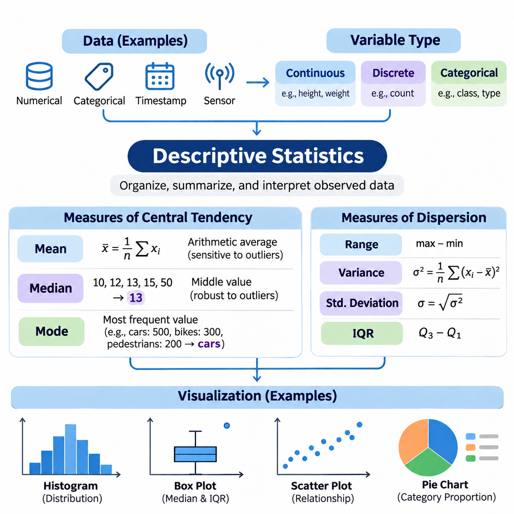
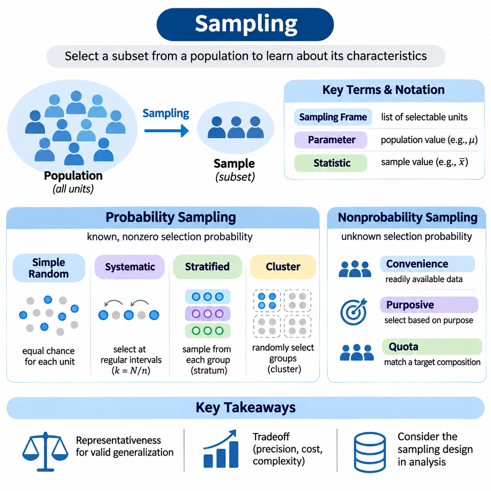
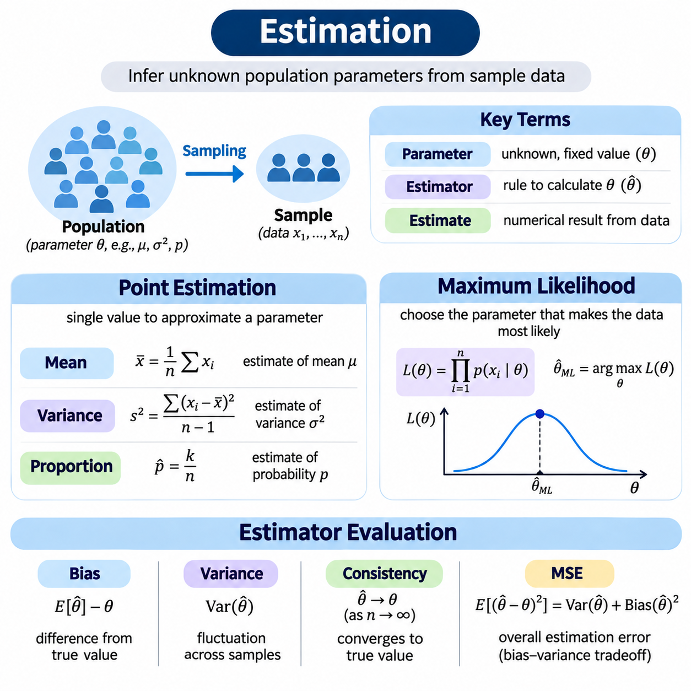
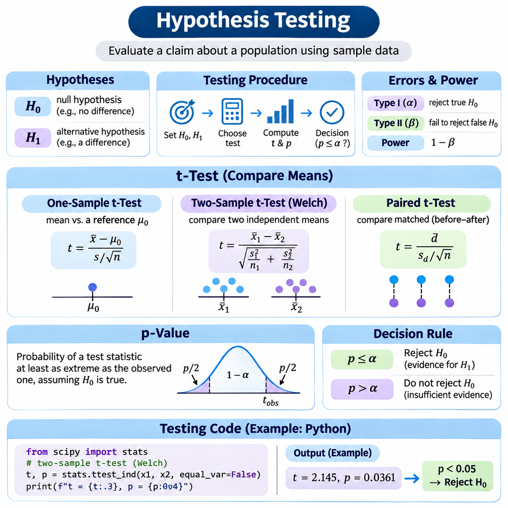
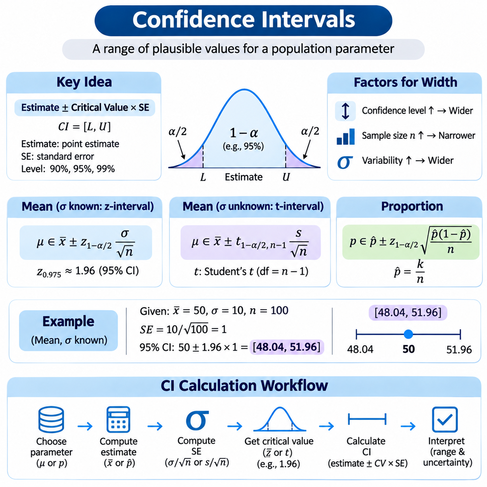
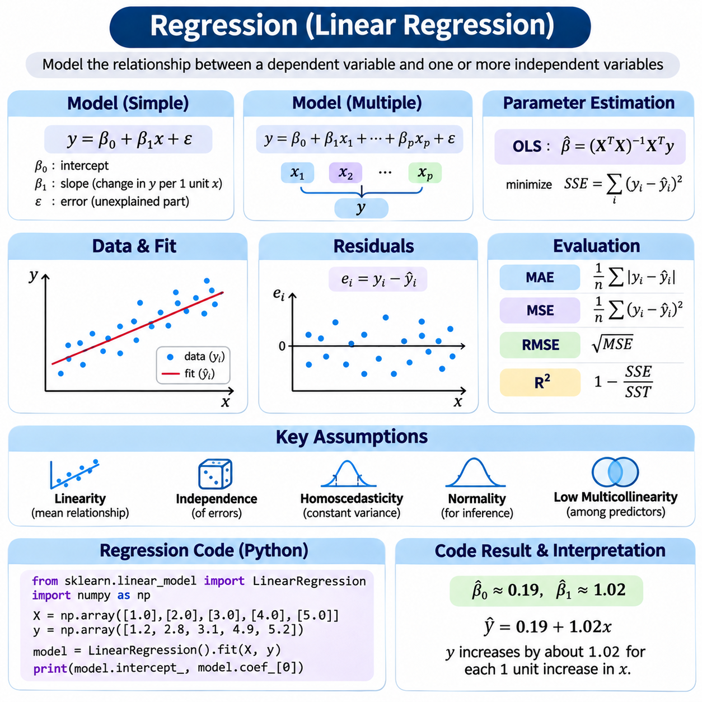
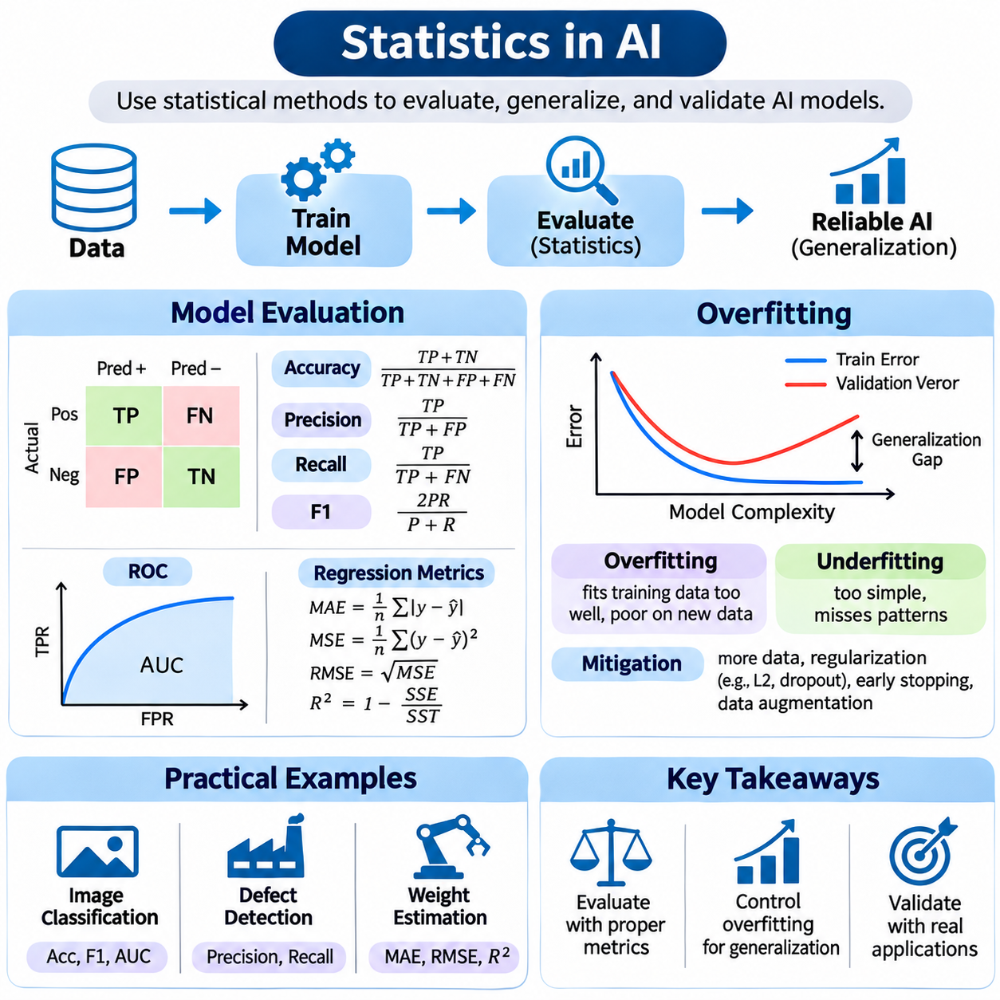

**Volume 05. Mathematics for AI**

# 04. Statistics

## 04.00 Descriptive Statistics

{width="7.268055555555556in" height="7.268055555555556in"}

Descriptive statistics provides the fundamental methods for organizing, summarizing, and interpreting observed data. Rather than making predictions about an entire population, it focuses on describing the characteristics of available observations. In artificial intelligence, descriptive statistics supports dataset exploration, feature analysis, data quality assessment, and the identification of patterns that may influence machine learning performance.

A dataset may contain numerical measurements, categorical labels, timestamps, or structured observations collected from sensors and digital systems. Before statistical summaries are calculated, the analyst must understand the meaning, measurement scale, and reliability of each variable. Continuous variables represent measurable quantities, while discrete variables represent countable values. Categorical variables describe groups or classes rather than numerical magnitudes.

Measures of central tendency describe the representative location of observations within a distribution. The three principal measures are the arithmetic mean, median, and mode. Although these statistics are frequently presented together, they capture different properties of the data. Selecting an appropriate measure requires understanding the distribution, the presence of extreme observations, and whether the underlying variable is numerical or categorical.

The arithmetic mean is calculated by dividing the sum of observed values by the number of observations. For a dataset containing n values, the mean is expressed as x̄ = (1/n)Σxᵢ. This statistic incorporates every observation and provides a useful representation of the distribution\'s numerical center. However, because unusually large or small values influence the calculation, the mean can be sensitive to outliers and skewed distributions.

Consider five sensor measurements with values 10, 12, 13, 15, and 50. Their arithmetic mean is 20, even though four observations are concentrated between 10 and 15. The unusually high measurement shifts the mean away from the region containing most observations. This example demonstrates why the mean should not automatically be interpreted as a typical value without examining the distribution and potential measurement anomalies.

The median represents the middle observation after numerical values have been arranged in ascending order. For an odd number of observations, it is the central value, while for an even number, it is the average of the two central values. The median is less sensitive to extreme observations than the mean, making it particularly useful for skewed datasets, irregular measurements, and distributions containing unusually large or small values.

For the measurements 10, 12, 13, 15, and 50, the median equals 13. Unlike the mean of 20, this value remains close to the central cluster of observations. Such differences are important when analyzing industrial sensor readings, transaction values, or response times. Comparing the mean and median can reveal distributional asymmetry, although their difference alone cannot establish the complete shape of a distribution.

The mode identifies the most frequently occurring value or category within a dataset. A distribution may have one mode, multiple modes, or no uniquely dominant value. Unlike the mean and median, the mode can summarize categorical observations, such as product types, defect categories, or classification labels. Its interpretation depends on the frequency structure of the data and the precision used when recording numerical measurements.

For example, a classification dataset containing 500 images of cars, 300 images of bicycles, and 200 images of pedestrians has cars as its modal category. This result immediately identifies the most common class but does not describe the complete distribution. In machine learning, modal frequencies help reveal class imbalance, which may influence model training, evaluation metrics, and predictions for underrepresented categories.

Measures of central tendency become more informative when combined with measures of dispersion. The range describes the difference between the maximum and minimum observations, while variance and standard deviation quantify variability around the mean. The interquartile range measures the distance between the first and third quartiles. These complementary statistics distinguish datasets with similar centers but substantially different levels of variability.

Variance is calculated from the squared deviations of observations around their mean. Population variance divides the sum of squared deviations by the population size, whereas conventional sample variance uses n − 1 in the denominator. Standard deviation is the square root of variance and retains the original measurement units. These statistics are essential for understanding feature scales, measurement consistency, and variability in AI datasets.

Quantiles provide additional information about the distribution of observations. The first quartile corresponds approximately to the 25th percentile, the median to the 50th percentile, and the third quartile to the 75th percentile. Their difference defines the interquartile range. Quantile-based summaries are particularly valuable when observations contain outliers because they describe the central portion of a distribution without depending heavily on extreme values.

Statistical visualization transforms numerical summaries into representations that make patterns easier to recognize. A well-designed visualization reveals distributional shape, variability, concentration, and potential anomalies. Numerical summaries and visual representations should be interpreted together because different datasets may share identical means and variances while exhibiting fundamentally different structures, relationships, or concentrations of observations.

Histograms represent numerical distributions by dividing the observation range into intervals called bins. The height of each bar indicates the frequency or density of observations within an interval. Histograms help identify skewness, multiple peaks, concentration, and unusual observations. However, the choice of bin width significantly influences the displayed appearance, so analysts should examine alternative resolutions before drawing conclusions.

Box plots summarize distributions using the median, quartiles, whiskers, and potential outliers. A conventional box extends from the first to the third quartile, with a line marking the median. A common convention places whiskers at the most extreme observations within 1.5 times the interquartile range from the quartiles. Values beyond these boundaries are flagged as potential outliers rather than automatically classified as erroneous measurements.

Bar charts are suitable for comparing frequencies or aggregated measurements across categorical groups. Unlike histograms, their categories represent distinct groups rather than consecutive numerical intervals. In AI dataset analysis, bar charts can display class frequencies, annotation categories, or the number of observations collected from different sources. Clear labels and consistent numerical scales are necessary to prevent misleading comparisons.

Scatter plots visualize relationships between two numerical variables by representing observations as points in a coordinate system. They can reveal positive associations, negative associations, nonlinear patterns, clusters, and unusual combinations of values. For example, plotting object size against detection confidence may reveal performance differences across scales. Nevertheless, an observed association does not establish a causal relationship between the variables.

Line plots are especially useful for observations collected over time or another ordered dimension. They can illustrate changing sensor measurements, production statistics, or variations in data acquisition conditions. When examining time-dependent observations, analysts should preserve chronological ordering and distinguish genuine trends from noise. Connecting unrelated categorical observations with lines can incorrectly suggest continuity and should generally be avoided.

Density plots provide smoothed representations of numerical distributions. Kernel density estimation constructs an estimated probability density by combining localized contributions from observed values. Compared with histograms, density curves can facilitate comparisons between datasets, but their appearance depends on the smoothing bandwidth. Excessive smoothing may conceal meaningful peaks, while insufficient smoothing may exaggerate random fluctuations.

Heatmaps represent numerical values through color intensity and are useful for examining matrices of relationships. A correlation heatmap, for example, can summarize pairwise linear associations among numerical features using Pearson correlation coefficients. Strong correlations may indicate redundant information or related measurements, but correlation does not imply causation. Nonlinear relationships may also remain hidden when only linear correlation is examined.

Visualization quality depends on correct axis selection, meaningful units, appropriate scales, and consistent representation of missing values. Truncated axes can exaggerate differences, while poorly selected color scales may conceal important variation. Large datasets may require transparency, aggregation, or sampling to reduce overplotting. Every transformation should preserve the analytical meaning of the observations and avoid introducing artificial patterns.

Descriptive statistical analysis must also account for missing data, duplicate records, measurement errors, and inconsistent units. Missing observations may distort summary statistics when their absence is associated with particular conditions or values. Outliers may represent sensor faults, recording mistakes, or legitimate rare events. Consequently, data cleaning should follow an explicit understanding of the collection process rather than relying on automatic deletion rules.

In practical AI workflows, descriptive statistics provides the first systematic assessment of dataset suitability. Feature means, medians, standard deviations, and distribution plots help identify scaling requirements, abnormal measurements, and differences between training and evaluation datasets. Class-frequency summaries reveal imbalance, while visual comparisons can expose distribution shifts that may reduce model generalization.

Python libraries such as NumPy, pandas, Matplotlib, and Seaborn support reproducible descriptive analysis. NumPy provides numerical operations, pandas offers tabular summaries and aggregation, and visualization libraries produce histograms, box plots, and comparative charts. A reliable workflow records data preprocessing decisions, calculation conventions, visualization settings, and software versions so that statistical results can be reproduced and independently examined.

Descriptive statistics does not establish population-level conclusions or quantify the uncertainty of generalization by itself. Those objectives require sampling theory, statistical estimation, confidence intervals, and hypothesis testing. Nevertheless, descriptive analysis provides the empirical foundation for these methods. By combining central tendency, dispersion, distributional analysis, and visualization, AI practitioners can understand their datasets before constructing more advanced statistical models.

## 04.01 Sampling

{width="7.268055555555556in" height="7.268055555555556in"}

Sampling is a fundamental statistical process used to select a subset of observations from a larger population. Its primary purpose is to obtain information about population characteristics without examining every individual or measurement. In artificial intelligence, sampling supports dataset construction, model training, experimental evaluation, and efficient data processing when complete population analysis is impractical or computationally expensive.

A population represents the complete collection of individuals, objects, measurements, or events relevant to a statistical investigation. A sample is a selected subset of that population, while a sampling frame identifies the units available for selection. The distinction is important because the sampling frame may exclude some population members, creating coverage errors that affect the reliability and generalizability of statistical conclusions.

Population parameters describe characteristics of the entire population, whereas sample statistics summarize observations within the selected sample. For example, a population mean is commonly represented by μ, while a sample mean is denoted by x̄. Statistical inference uses sample statistics to estimate unknown population parameters, making the sampling process essential for determining how accurately conclusions reflect the underlying population.

Representative sampling aims to preserve relevant population characteristics within the selected observations. A representative sample should adequately reflect important variations in demographics, measurement conditions, categories, or operational environments. However, representativeness is not guaranteed by sample size alone. Selection mechanisms, population coverage, and the distribution of relevant characteristics strongly influence whether a sample supports valid generalization.

Probability sampling assigns each population unit a known, nonzero probability of selection. This framework supports design-based statistical inference because selection probabilities can be incorporated into estimation procedures. Common probability sampling approaches include simple random sampling, systematic sampling, stratified sampling, and cluster sampling. Each method provides different tradeoffs involving statistical precision, implementation complexity, and data collection costs.

Simple random sampling selects observations so that every possible subset of a specified size has an equal probability of selection. When sampling without replacement from a population of size N, each individual unit has an inclusion probability of n/N for a sample of size n. This method reduces systematic selection bias when the sampling frame is complete, although random variation may still produce imbalanced samples.

Systematic sampling selects observations at regular intervals after choosing an appropriate random starting position. If the population contains N units and the desired sample size is n, the approximate sampling interval is k = N/n. This approach is convenient for ordered records and continuous data collection. However, periodic patterns in the ordering may interact with the sampling interval and introduce systematic distortions.

Stratified sampling divides the population into mutually exclusive groups called strata before selecting observations from each group. Strata may represent geographic regions, product categories, operating conditions, or demographic characteristics. Sampling within each stratum can improve statistical precision when groups are internally similar. It also helps ensure adequate representation of important subpopulations that might otherwise be overlooked.

Stratified sampling may use proportional allocation, where each stratum contributes observations according to its population share, or disproportionate allocation, where selected groups receive additional observations. Disproportionate sampling is particularly useful for rare classes in AI datasets. However, estimates intended to describe the original population may require sampling weights to correct for unequal selection probabilities.

Cluster sampling divides the population into naturally occurring groups, such as schools, factories, geographic regions, or data collection sessions. Instead of selecting individuals independently throughout the population, the procedure randomly selects clusters and examines all or some units within them. This method can reduce collection costs, although similarities among observations within clusters may increase sampling variance.

Multistage sampling extends cluster sampling by applying several selection stages. For example, researchers may randomly select manufacturing facilities, choose production lines within those facilities, and sample sensor measurements from selected lines. This hierarchical procedure is useful for large distributed populations. Statistical analysis must account for the sampling design because observations collected from the same cluster may be correlated.

Nonprobability sampling selects observations without known selection probabilities. Common approaches include convenience sampling, purposive sampling, quota sampling, and snowball sampling. These methods may be practical when population lists are unavailable or data collection resources are limited. However, conventional probability-based uncertainty estimates generally cannot be justified from the selection process alone.

Convenience sampling uses observations that are readily accessible, such as publicly available images, existing laboratory measurements, or data collected from nearby devices. Although efficient, this method may overrepresent familiar environments and common conditions. An AI model trained exclusively on convenient observations may perform well during development but fail when deployed under different lighting, geographic, environmental, or operational conditions.

Purposive sampling deliberately selects observations according to predefined research objectives. In machine learning, this may involve collecting rare defects, difficult visual conditions, or unusual robot operating scenarios. Such sampling can improve coverage of critical cases, but the resulting dataset may not reflect their natural frequencies. Evaluation datasets should therefore distinguish targeted challenge coverage from representative operational performance.

Sampling bias occurs when the selection process systematically favors certain observations or excludes relevant population groups. Coverage bias arises from incomplete sampling frames, while nonresponse bias occurs when selected units fail to provide usable information. Selection bias may also result from filtering records according to availability or quality. These mechanisms can distort estimated relationships and undermine model generalization.

Sampling variability refers to differences between statistics calculated from different samples of the same population. Even when sampling is unbiased, independently selected samples generally produce different means, proportions, and other estimates. The sampling distribution describes the probability distribution of a statistic across repeated samples. Understanding this variability provides the foundation for standard errors, confidence intervals, and statistical hypothesis testing.

The standard error quantifies the variability of a sample statistic across repeated sampling. For independent observations from a population with standard deviation σ, the standard error of the sample mean is σ/√n under sampling with replacement or an effectively infinite population. For finite populations sampled without replacement, an appropriate finite population correction reduces this uncertainty.

The central limit theorem explains why sample means often approach a normal distribution as sample size increases under suitable assumptions. For independent, identically distributed observations with finite variance, the standardized sample mean converges in distribution toward a standard normal variable. This principle supports many statistical procedures, although strongly dependent observations or heavy-tailed distributions may require additional consideration.

Sample size influences estimation precision, computational cost, and the ability to represent uncommon population characteristics. Larger samples generally reduce random sampling error, but they do not automatically eliminate systematic bias. Sample size planning should consider population variability, desired precision, confidence requirements, sampling design, and available resources. Rare-event analysis may require substantially more observations than ordinary average estimation.

In artificial intelligence, sampling also determines how training, validation, and test datasets are constructed. Random splitting can provide reasonable evaluation partitions when observations are independent and identically distributed. However, correlated images, repeated measurements, or records from the same individual may cause data leakage if assigned to different partitions. Group-based or time-aware splitting is often necessary.

Class imbalance introduces additional sampling considerations in classification tasks. Oversampling increases the representation of minority classes, while undersampling reduces observations from majority classes. These techniques can influence optimization behavior and class-specific performance. Synthetic oversampling may generate additional training examples, but artificial observations must be created only within training partitions to avoid contaminating evaluation results.

Sampling with replacement permits an observation to be selected multiple times, whereas sampling without replacement prevents repeated selection within the same sample. Bootstrap resampling commonly draws observations with replacement to approximate the sampling variability of estimators. This technique supports uncertainty assessment and model evaluation, although ordinary bootstrap procedures may be inappropriate for dependent observations without suitable modifications.

Data sampling is also important in large-scale and streaming AI systems. Reservoir sampling maintains a fixed-size sample from a data stream whose total length may be unknown. Under standard reservoir sampling, every observed item has an equal probability of remaining in the reservoir. This method enables bounded-memory processing, but additional mechanisms may be required when recent observations or changing data distributions deserve greater attention.

Sampling quality should be evaluated through coverage analysis, subgroup comparisons, duplicate detection, and examination of selection probabilities whenever available. Researchers should document the target population, sampling frame, collection procedures, exclusion criteria, and potential sources of bias. These records improve reproducibility and help distinguish genuine model limitations from weaknesses introduced during dataset construction.

Sampling connects descriptive statistics with statistical estimation, hypothesis testing, and machine learning evaluation. A carefully designed sample enables efficient analysis while preserving information about relevant population characteristics. By understanding probability sampling, nonprobability sampling, sampling variability, bias, and dataset partitioning, AI practitioners can develop more reliable experiments and models that generalize beyond their observed training data.

## 04.02 Estimation

{width="7.268055555555556in" height="7.268055555555556in"}

Statistical estimation is the process of using observed sample data to infer unknown characteristics of a population or statistical model. These characteristics are represented by parameters such as means, variances, probabilities, and regression coefficients. In artificial intelligence, estimation provides the mathematical foundation for learning model parameters, describing uncertainty, and extracting useful information from incomplete observations.

A parameter is a fixed but generally unknown quantity describing a population or probability distribution. An estimator is a mathematical rule that calculates an approximation of that parameter from sample observations. The numerical result produced by applying an estimator to a particular dataset is called an estimate. This distinction separates the statistical procedure from the specific value obtained during an experiment.

Point estimation produces a single numerical value intended to approximate an unknown parameter. For example, the sample mean estimates the population mean, while the sample proportion estimates the probability of a particular event. Point estimates provide compact summaries that are convenient for statistical analysis and machine learning. However, a single estimate does not directly communicate the uncertainty associated with the sampling process.

The sample mean is defined as x̄ = (1/n)Σxᵢ, where n represents the number of observations and xᵢ denotes each observed value. When observations are independently sampled from a population with a finite mean, the sample mean is an unbiased estimator of the population mean. Its precision generally improves with increasing sample size, although the rate of improvement depends on population variability and dependence among observations.

The sample variance estimates the variability of observations around their population mean. A commonly used unbiased estimator is s² = Σ(xᵢ − x̄)²/(n − 1), assuming independent observations from a common distribution with finite variance. The denominator n − 1 compensates for estimating the mean from the same sample. This correction illustrates how estimator design affects statistical bias and accuracy.

The sample proportion estimates the probability of a binary event by dividing the number of observed successes by the total number of trials. If k successes occur among n independent Bernoulli observations, the estimate is p̂ = k/n. This method is widely used to estimate defect frequencies, classification outcomes, and event probabilities. Its reliability depends on sample size, selection procedures, and the independence assumptions.

Estimator quality is commonly evaluated through bias, variance, consistency, and efficiency. Bias measures the difference between an estimator\'s expected value and the true parameter. Variance describes how much estimates fluctuate across repeated samples. Consistency means that an estimator converges toward the true parameter as sample size increases. Efficiency compares estimators according to their statistical variability under specified assumptions.

An unbiased estimator has an expected value equal to the parameter being estimated. However, unbiasedness does not guarantee that individual estimates are accurate, especially when estimator variance is large. A slightly biased estimator may sometimes provide better overall accuracy than an unbiased alternative. Therefore, statistical estimation requires examining multiple performance characteristics rather than relying on a single criterion.

The mean squared error measures estimation accuracy by combining variance and squared bias. For an estimator θ̂ of parameter θ, MSE(θ̂) = E[(θ̂ − θ)²] = Var(θ̂) + Bias(θ̂)². This decomposition reveals the bias-variance tradeoff, which also appears in machine learning model design. Reducing estimator variance may justify introducing limited bias when the resulting mean squared error becomes smaller.

Consistency describes the behavior of an estimator as the number of observations increases. A consistent estimator approaches the true parameter in probability under appropriate assumptions. The law of large numbers explains why sample averages converge toward population expectations for many common sampling models. Nevertheless, increasing sample size cannot automatically correct systematic selection bias, incorrect model assumptions, or corrupted measurements.

The method of moments estimates unknown parameters by matching theoretical distribution moments to corresponding sample moments. For example, the theoretical mean and variance of a distribution may be expressed in terms of unknown parameters. Replacing those theoretical quantities with sample estimates produces equations that can be solved for the parameters. This approach is often computationally simple, although its statistical efficiency varies across models.

Maximum likelihood estimation provides a systematic framework for selecting parameter values that make observed data most plausible under an assumed probability model. Given observations x₁ through xₙ and a parameter θ, the likelihood function is L(θ) = p(x₁, ..., xₙ \| θ). The maximum likelihood estimator selects the parameter value that maximizes this function while treating the observed data as fixed.

The likelihood function must be distinguished from a probability distribution over parameters. Probability models describe how observations vary when parameters are fixed, whereas likelihood evaluates different parameter values for a fixed dataset. A larger likelihood indicates stronger relative support from the observed data within the assumed model. It does not directly represent the probability that a particular parameter value is correct.

For independent and identically distributed observations, the likelihood becomes L(θ) = ∏p(xᵢ \| θ). Because products of many small probabilities can cause numerical underflow, maximum likelihood estimation commonly uses the log-likelihood function. Taking logarithms converts products into sums, giving ℓ(θ) = Σlog p(xᵢ \| θ). Since logarithms are strictly increasing, maximizing likelihood and log-likelihood produces the same parameter estimates.

Consider independent observations drawn from a Gaussian distribution with unknown mean μ and known variance σ². Maximizing the Gaussian log-likelihood with respect to μ yields the sample mean as the maximum likelihood estimate. This result connects a familiar descriptive statistic with a general estimation principle. It also demonstrates how assumptions about the probability distribution determine the mathematical form of an estimator.

When both the mean and variance of a Gaussian distribution are unknown, maximum likelihood estimation produces μ̂ = x̄ and σ̂² = Σ(xᵢ − x̄)²/n. The maximum likelihood variance estimator uses n rather than n − 1 and is generally biased for finite samples. Nevertheless, it is consistent under standard assumptions, illustrating that maximum likelihood estimators are not necessarily unbiased in small datasets.

For independent Bernoulli observations, the likelihood depends on the probability of success p. If k successes occur in n trials, the likelihood is proportional to pᵏ(1 − p)⁽ⁿ⁻ᵏ⁾. Maximizing this expression gives p̂ = k/n. The same estimate arises from the sample proportion, showing that elementary statistical summaries can be derived through likelihood-based reasoning.

Maximum likelihood estimation can also be applied to exponential, Poisson, multinomial, and many other probability distributions. The selected model determines the likelihood expression and the parameters to be estimated. Some models admit analytical solutions, while others require numerical optimization. Model selection and distributional assumptions are therefore essential components of a reliable estimation procedure.

Numerical maximum likelihood estimation frequently relies on gradient-based optimization methods. The gradient of the log-likelihood indicates how parameter changes affect the objective function. Gradient ascent increases log-likelihood, while minimizing negative log-likelihood permits the use of gradient descent. Modern machine learning frameworks implement these calculations efficiently through automatic differentiation and iterative optimization algorithms.

In supervised classification, maximum likelihood estimation provides a probabilistic interpretation of common training objectives. A model assigns probabilities to target classes, and parameter optimization seeks to maximize the likelihood of observed labels. Minimizing negative log-likelihood corresponds to minimizing cross-entropy loss under the relevant categorical probability model. This connection links classical statistical estimation directly to neural network training.

Maximum likelihood estimation has important theoretical properties under suitable regularity and identifiability assumptions. In many regular parametric models, maximum likelihood estimators are consistent, asymptotically normal, and asymptotically efficient. These properties describe behavior as sample size becomes large, but they do not guarantee reliable performance with limited observations, misspecified models, or poorly identified parameters.

The Fisher information measures how strongly observed data can distinguish nearby parameter values within a probability model. Greater information generally corresponds to lower achievable estimation uncertainty. Under suitable regularity conditions, the Cramér-Rao lower bound establishes a theoretical variance limit for unbiased estimators. These concepts help explain statistical efficiency and the relationship between sample size, model sensitivity, and parameter precision.

Likelihood-based estimation can become unreliable when observations contain substantial outliers, dependence, missing values, or distributional mismatches. Optimization algorithms may also encounter local optima, numerical instability, or poorly conditioned parameter spaces. Reliable estimation therefore requires checking model assumptions, examining residual patterns, evaluating sensitivity, and confirming that numerical optimization has produced meaningful solutions.

Point estimation and maximum likelihood estimation provide complementary foundations for statistical inference and artificial intelligence. Point estimation defines the objective of approximating unknown parameters, while maximum likelihood supplies a general method for constructing estimators from probability models. Understanding bias, variance, consistency, likelihood functions, and optimization enables practitioners to interpret learned parameters and assess the reliability of data-driven models.

## 04.03 Hypothesis Testing

{width="7.268055555555556in" height="7.268055555555556in"}

Hypothesis testing is a statistical framework for evaluating claims about population characteristics using observed sample data. It determines whether the evidence is sufficiently inconsistent with a specified assumption to justify rejecting that assumption. In artificial intelligence, hypothesis testing supports model comparisons, experimental validation, performance analysis, and the assessment of whether observed improvements are distinguishable from random variation.

A statistical hypothesis is a statement about an unknown population parameter or probability distribution. The null hypothesis, denoted H₀, usually represents a reference condition such as no difference, no effect, or a specified parameter value. The alternative hypothesis, denoted H₁, describes the competing possibility. Testing evaluates the compatibility of observed data with H₀ rather than directly proving either hypothesis to be true.

A hypothesis test begins by defining the research question, population, sampling procedure, and measurable outcome. The investigator then specifies H₀ and H₁, chooses a test statistic, and determines an appropriate significance level. After collecting observations, the test statistic and p-value are calculated. The final decision is interpreted alongside the estimated effect, assumptions, and practical importance of the result.

A test statistic summarizes the evidence in a sample relative to the null hypothesis. Its probability distribution under H₀ provides the reference for evaluating unusual outcomes. Different tests use different statistics depending on the data type, sampling structure, and underlying assumptions. Common examples include t-statistics, z-statistics, chi-square statistics, and F-statistics, each addressing particular statistical questions.

The significance level, commonly represented by α, specifies the maximum probability of a Type I error that the testing procedure is designed to permit under its assumptions. A frequently used value is α = 0.05, although this threshold is conventional rather than universally appropriate. The significance level should be selected before examining the results and should reflect the consequences of incorrect decisions.

A Type I error occurs when the null hypothesis is rejected even though it is true. A Type II error occurs when the test fails to reject a false null hypothesis. Statistical power is the probability of correctly rejecting H₀ when a specified alternative is true, and equals 1 − β. Power depends on effect size, sample size, variability, significance level, and the structure of the statistical test.

The t-test is a widely used parametric method for evaluating hypotheses about population means. It is especially useful when population variance is unknown and must be estimated from sample observations. The test compares an observed mean difference against its estimated standard error. Under the null hypothesis and suitable assumptions, the resulting statistic follows a Student\'s t-distribution with an appropriate number of degrees of freedom.

A one-sample t-test evaluates whether the mean of a population differs from a specified reference value μ₀. Its test statistic is t = (x̄ − μ₀)/(s/√n), where x̄ is the sample mean, s is the sample standard deviation, and n is the sample size. Under independent normal observations and H₀, the statistic follows a t-distribution with n − 1 degrees of freedom.

An independent two-sample t-test compares population means using observations from two independent groups. Welch\'s t-test is generally useful because it does not require equal population variances. Its statistic is t = (x̄₁ − x̄₂)/√(s₁²/n₁ + s₂²/n₂). The reference distribution uses approximate degrees of freedom determined by the Welch-Satterthwaite equation.

A paired t-test is appropriate when measurements are naturally matched, such as performance results obtained from the same experimental units before and after an intervention. Each pair produces a difference, and the test evaluates whether the population mean difference is zero. Pairing removes variation associated with stable differences between experimental units, potentially improving precision when measurements are correlated.

The assumptions of a t-test depend on its specific form. Independence between relevant sampling units is essential, while normality concerns the observations or paired differences used to construct the statistic. For sufficiently large samples, some departures from normality may be tolerable. However, extreme outliers, strongly skewed small samples, or dependent observations can make standard t-test results unreliable.

The p-value measures how incompatible the observed test statistic is with the null hypothesis under the specified statistical model. More precisely, it is the probability, assuming H₀ and the model assumptions are true, of obtaining a test statistic at least as extreme as the observed statistic in the direction or directions specified by the alternative hypothesis. Smaller p-values indicate stronger evidence against H₀.

A p-value does not represent the probability that the null hypothesis is true. It also does not directly measure effect size, practical importance, or the probability that a result occurred purely by chance. For example, p = 0.03 means that the specified test would produce a result at least as extreme as the observed one with probability 0.03 under H₀, not that H₀ has a three-percent probability of being correct.

In a conventional testing procedure, the null hypothesis is rejected when p ≤ α and otherwise is not rejected. Failure to reject H₀ should not be interpreted as proof that the null hypothesis is true or that two systems are equivalent. A nonsignificant result may reflect insufficient sample size, high measurement variability, or a genuinely small effect. Equivalence requires a separately designed equivalence test.

A one-sided test evaluates evidence for a directional alternative, such as whether one model has a higher mean accuracy than another. A two-sided test evaluates whether the population means differ in either direction. The choice affects the definition of extreme outcomes and the resulting p-value. Test direction should follow the research question and be specified before inspecting the observed difference.

Effect size describes the magnitude of an observed relationship or difference. For mean comparisons, the raw difference retains the original measurement units, while standardized measures such as Cohen\'s d express differences relative to variability. Statistical significance can arise from a very small effect when the sample is large. Therefore, hypothesis testing should report effect estimates and confidence intervals alongside p-values.

In artificial intelligence experiments, hypothesis testing can compare inference latency, prediction errors, classification performance, or resource consumption. The experimental unit must be clearly identified because repeated measurements from the same model, dataset, or device are often correlated. Treating dependent measurements as independent artificially increases the apparent sample size and can produce misleading significance claims.

Comparing two models on identical test examples often creates paired observations. For example, prediction errors from two regression models can be subtracted for each example, allowing analysis of their mean difference. However, classification accuracy comparisons may require methods suited to paired categorical outcomes, such as McNemar\'s test. The statistical procedure must match the measurement scale and experimental design.

Repeated model training introduces another source of variability through random initialization, data ordering, and stochastic optimization. Performance measurements across independent training runs can help characterize this variability. However, results from different random seeds are not necessarily independent when they share datasets or evaluation conditions. Experimental conclusions should reflect the actual sources of randomness.

Multiple hypothesis testing increases the probability of obtaining at least one false positive when many comparisons are performed. Procedures such as the Bonferroni correction control the family-wise error rate, while the Benjamini-Hochberg procedure controls the false discovery rate under suitable assumptions. These adjustments are important when evaluating numerous models, hyperparameters, features, or experimental conditions.

Python provides practical tools for implementing hypothesis tests through libraries such as SciPy, NumPy, pandas, and statsmodels. SciPy\'s scipy.stats.ttest_1samp performs one-sample t-tests, ttest_ind supports independent-group comparisons, and ttest_rel evaluates paired observations. These functions return test statistics and p-values, while additional calculations may be required to report effect sizes and confidence intervals.

A reliable testing workflow begins with inspecting missing values, sample sizes, distributions, and the relationship between observations. The analyst selects a test based on the experimental design, checks assumptions, calculates the statistic, and interprets the p-value with the chosen significance level. Reproducible Python implementations should preserve data preparation steps, library versions, random seeds where relevant, and test configurations.

Consider an AI experiment comparing inference times from two independently operated hardware configurations. If latency measurements are approximately suitable for mean-based inference, Welch\'s t-test can assess whether the population mean latencies differ. However, repeated timings may exhibit temporal dependence or hardware warm-up effects. Randomized measurement order and an appropriate experimental design are necessary before statistical conclusions can be trusted.

Hypothesis testing complements estimation by evaluating evidence about population parameters rather than merely calculating their approximate values. A well-designed analysis combines test statistics, p-values, effect sizes, confidence intervals, and explicit assumptions. When applied carefully, these methods help AI practitioners distinguish meaningful experimental findings from sampling variability while avoiding exaggerated claims about model performance.

## 04.04 Confidence Intervals

{width="7.268055555555556in" height="7.268055555555556in"}

Confidence intervals are statistical tools used to express uncertainty about unknown population parameters through ranges of plausible values. Unlike point estimates, which provide a single numerical approximation, confidence intervals combine an estimate with information about sampling variability. In artificial intelligence, they help evaluate model performance, compare experimental results, and communicate the precision of measurements obtained from limited datasets.

A confidence interval is constructed using a statistical procedure designed to achieve a specified coverage probability under appropriate assumptions. A 95% confidence procedure produces intervals containing the true fixed population parameter in 95% of repeated samples in the long run. This interpretation concerns the reliability of the procedure rather than assigning a 95% probability to the parameter lying inside one particular calculated interval.

The confidence level represents the intended long-run coverage probability of the interval construction method. Common choices include 90%, 95%, and 99%, depending on the desired degree of confidence and the consequences of estimation errors. Higher confidence levels generally produce wider intervals when the dataset and estimation method remain unchanged. This relationship reflects the tradeoff between statistical precision and coverage reliability.

A confidence interval commonly consists of a point estimate, a standard error, and a critical value obtained from a reference probability distribution. Its general form is Estimate ± Critical Value × Standard Error. The standard error describes sampling variability, while the critical value determines the interval width required for the selected confidence level. The exact formula depends on the parameter, sampling design, and statistical assumptions.

The margin of error is the distance between the point estimate and either endpoint of a symmetric confidence interval. It is calculated by multiplying the appropriate critical value by the standard error. A smaller margin of error indicates greater statistical precision under the assumed model. However, narrow intervals do not guarantee accuracy when sampling bias, measurement errors, or incorrect distributional assumptions are present.

For independent observations from a normal population with known standard deviation σ, a confidence interval for the population mean μ is x̄ ± z₁₋α/₂ × σ/√n. Here, x̄ represents the sample mean, n is the sample size, and z₁₋α/₂ is the standard normal critical value. For a 95% confidence level, this critical value is approximately 1.96, providing a familiar formula for mean estimation.

Suppose a sample of 100 independent measurements has a mean of 50 and the population standard deviation is known to be 10. The standard error is 10/√100 = 1, and the 95% margin of error is approximately 1.96. The resulting confidence interval is [48.04, 51.96]. Under the stated sampling and distributional assumptions, this interval is produced by a procedure with approximately 95% long-run coverage.

In practical applications, population standard deviation is often unknown and must be estimated using the sample standard deviation s. For independent observations from a normal population, the confidence interval for the mean becomes x̄ ± t₁₋α/₂,ₙ₋₁ × s/√n. The critical value comes from Student\'s t-distribution with n − 1 degrees of freedom, accounting for additional uncertainty introduced by estimating variability.

Student\'s t-distribution has heavier tails than the standard normal distribution, especially when the sample size is small. Consequently, t-based confidence intervals are generally wider than corresponding z-based intervals using the same estimated standard error. As the sample size increases, the t-distribution approaches the normal distribution. This behavior explains why the distinction between the two methods becomes less important with large samples.

The width of a confidence interval depends on sample size, population variability, confidence level, and the estimation procedure. Increasing sample size generally reduces standard error at a rate proportional to 1/√n for independent observations with finite variance. Therefore, reducing the margin of error by half typically requires approximately four times as many observations when other conditions remain unchanged.

Confidence intervals can also estimate population proportions, such as defect rates or classification success probabilities. For independent Bernoulli observations, the sample proportion is p̂ = k/n. A simple approximate interval is p̂ ± z₁₋α/₂√[p̂(1 − p̂)/n]. However, this Wald interval can perform poorly for small samples or proportions near zero or one, making alternative procedures preferable.

The Wilson score interval is often recommended for binomial proportions because it generally provides more reliable coverage than the basic Wald interval. Its construction adjusts both the interval center and width according to sample size and the estimated proportion. Other approaches include exact binomial intervals and likelihood-based methods. The appropriate method depends on the required coverage properties and characteristics of the observed data.

Confidence intervals for differences between two population means are important in comparative experiments. For independent samples, an interval estimates μ₁ − μ₂ using the observed difference x̄₁ − x̄₂ and its standard error. Welch\'s method accommodates unequal population variances and uses an approximate t-distribution. Such intervals indicate both the estimated direction of a difference and the uncertainty surrounding its magnitude.

Paired observations require a different confidence interval construction. When the same experimental units are measured under two conditions, the analysis first calculates the difference within each pair. A confidence interval is then constructed for the population mean of those differences. This method preserves the pairing structure and can reduce uncertainty when measurements within pairs are positively correlated.

Confidence intervals and hypothesis tests are closely related. For a conventional two-sided test at significance level α, a corresponding 100(1 − α)% confidence interval excludes the null parameter value exactly when the matching test rejects the null hypothesis, provided both procedures use consistent assumptions. Confidence intervals offer additional information because they display a range of parameter values rather than only a rejection decision.

Statistical significance should not be confused with practical significance. A narrow confidence interval around a very small performance improvement may establish statistical evidence while indicating little operational benefit. Conversely, a wide interval may include both meaningful improvement and meaningful deterioration. AI evaluation should therefore consider interval endpoints relative to practical thresholds such as acceptable latency, accuracy, or safety margins.

Bootstrap confidence intervals estimate uncertainty by repeatedly resampling observations from an available dataset. Each bootstrap sample produces a new estimate, and the distribution of these estimates approximates sampling variability. Percentile intervals use selected quantiles of the bootstrap distribution, while more advanced methods adjust for bias and asymmetry. Bootstrap validity depends on the sampling structure and regularity of the estimator.

Ordinary bootstrap resampling assumes observations can be treated as independent and exchangeable. This assumption may fail for time series, clustered measurements, repeated sensor readings, or related images. Block bootstrap and cluster bootstrap methods preserve relevant dependence structures during resampling. Choosing the correct resampling unit is essential because ignoring dependence can produce confidence intervals that are misleadingly narrow.

Confidence intervals are useful for evaluating classification accuracy, regression errors, inference latency, and other AI performance metrics. However, different metrics require different estimation procedures. Accuracy may be treated as a proportion under suitable sampling assumptions, while nonlinear metrics such as F1 score often require specialized or resampling-based approaches. Evaluation methods should reflect the mathematical properties of the selected metric.

Python supports confidence interval calculations through NumPy, SciPy, pandas, and statsmodels. SciPy provides probability distribution quantiles and statistical estimation functions, while statsmodels includes methods for proportion intervals and model parameter uncertainty. A reproducible implementation should explicitly define the confidence level, estimator, standard error, distributional assumptions, and treatment of missing observations.

For example, scipy.stats.t.interval can calculate a t-based confidence interval when supplied with the appropriate degrees of freedom, sample mean, and standard error. The sample standard deviation should use the correct degrees-of-freedom convention, typically ddof=1 in NumPy. The resulting interval should be interpreted in relation to the sampling design rather than treated as an unconditional guarantee about the population parameter.

Confidence interval calculations can be distorted by biased sampling, data leakage, incorrect independence assumptions, or repeated selection of favorable experimental results. Confidence intervals constructed after extensive model selection may not retain their nominal coverage without appropriate adjustments. Reliable reporting should distinguish exploratory analysis from confirmatory evaluation and use independent test data when assessing final model performance.

Confidence intervals complement point estimation and hypothesis testing by quantifying the precision of statistical conclusions. Their reliability depends on suitable assumptions, appropriate uncertainty calculations, and careful interpretation of repeated-sampling coverage. By incorporating confidence intervals into AI experimentation, practitioners can report not only estimated performance but also the uncertainty and practical limitations associated with those estimates.

## 04.05 Regression

{width="7.268055555555556in" height="7.268055555555556in"}

Regression is a statistical modeling approach used to describe relationships between a dependent variable and one or more independent variables. Its primary purpose is to estimate how an outcome changes as explanatory variables change. In artificial intelligence, regression provides a foundation for continuous-value prediction, parameter estimation, trend analysis, and the interpretation of relationships within structured datasets.

Linear regression assumes that the expected value of a response variable can be expressed as a linear combination of explanatory variables. In simple linear regression, the model is written as y = β₀ + β₁x + ε, where β₀ is the intercept, β₁ is the slope, and ε represents the error term. The model separates systematic relationships from unexplained variation in observed outcomes.

The intercept represents the expected response when the explanatory variable equals zero, provided that this value is meaningful within the observed domain. The slope measures the expected change in the response associated with a one-unit increase in the explanatory variable. A positive slope indicates an increasing relationship, while a negative slope indicates a decreasing relationship, assuming the other relevant conditions remain unchanged.

Multiple linear regression extends the model to several explanatory variables. Its general form is y = β₀ + β₁x₁ + β₂x₂ + \... + βₚxₚ + ε, where each coefficient represents a conditional relationship between one predictor and the response. This framework can analyze how temperature, pressure, operating speed, and other measurements jointly relate to an industrial process outcome.

The word linear refers to linearity in the model coefficients rather than requiring every predictor to appear only in its original form. Polynomial terms, logarithmic transformations, and interaction variables can be included while retaining a linear regression structure. For example, y = β₀ + β₁x + β₂x² + ε remains linear in its coefficients even though the relationship between x and y is curved.

Ordinary least squares is the most widely used method for estimating linear regression coefficients. It selects parameter values that minimize the sum of squared residuals, expressed as SSE = Σ(yᵢ − ŷᵢ)². Here, yᵢ represents an observed response and ŷᵢ represents the model prediction. Squaring residuals penalizes larger deviations more strongly and produces a mathematically convenient optimization objective.

A residual is the difference between an observed value and its fitted prediction. Residual analysis helps determine whether the model adequately captures relationships in the data. Randomly scattered residuals around zero are generally consistent with a suitable mean structure, while systematic patterns may indicate nonlinear relationships, missing predictors, changing error variance, or other forms of model misspecification.

In matrix notation, linear regression can be expressed as y = Xβ + ε, where X is the design matrix, β is the coefficient vector, and y contains observed responses. When X has full column rank, the ordinary least squares solution is β̂ = (XᵀX)⁻¹Xᵀy. In practical numerical computing, QR decomposition or singular value decomposition is generally preferred over explicitly calculating the matrix inverse.

The statistical interpretation of linear regression depends on assumptions about the relationship between predictors and errors. A central condition is that the conditional expectation of the error is zero, expressed as E[ε \| X] = 0. This condition supports unbiased coefficient estimation under appropriate sampling assumptions. Violations may arise from omitted variables, measurement errors, simultaneous relationships, or systematic selection mechanisms.

Independence is another important consideration, especially when observations are collected across time, locations, or repeated experiments. Correlated errors can cause conventional standard error calculations to become unreliable even when coefficient estimates remain meaningful under other assumptions. Time-series regression, clustered observations, and repeated measurements may require specialized covariance estimators or alternative statistical models.

Homoscedasticity means that the conditional variance of regression errors remains constant across predictor values. When error variance changes systematically, the data exhibit heteroscedasticity. Ordinary least squares coefficients may remain unbiased under suitable conditions, but conventional uncertainty estimates can become inaccurate. Heteroscedasticity-consistent standard errors or weighted least squares can address particular forms of this problem.

Normality of regression errors is not required for ordinary least squares coefficient calculation or unbiasedness. However, normally distributed errors support exact finite-sample t-tests and confidence intervals under the classical regression assumptions. With sufficiently large samples, asymptotic methods may provide approximate inference without strict normality, although strong dependence, heavy tails, or influential observations require additional attention.

Multicollinearity occurs when explanatory variables contain strong linear relationships with one another. This condition can increase coefficient uncertainty and make individual parameter estimates sensitive to small changes in the data. Perfect multicollinearity prevents unique identification of all coefficients. Diagnostic tools such as variance inflation factors and singular value analysis help identify problematic predictor relationships.

Model evaluation measures how accurately regression predictions correspond to observed values. Mean absolute error is MAE = (1/n)Σ\|yᵢ − ŷᵢ\|, while mean squared error is MSE = (1/n)Σ(yᵢ − ŷᵢ)². Root mean squared error is the square root of MSE. These metrics emphasize different aspects of prediction error, and their interpretation depends on the measurement units and operational requirements.

The coefficient of determination, R², describes the proportion of observed response variation explained relative to a constant-mean baseline in the standard setting. It is commonly calculated as R² = 1 − SSE/SST, where SST is the total sum of squares. High R² does not establish causality or guarantee predictive generalization, and R² may be negative when evaluated on unseen data.

Overfitting occurs when a regression model captures random fluctuations or dataset-specific patterns rather than relationships that generalize. Adding predictors can reduce training error while increasing uncertainty or worsening test performance. Training, validation, and test partitions help evaluate this behavior. Cross-validation provides additional evidence about predictive stability when its partitioning strategy respects the structure of the observations.

Regularization modifies the regression objective to discourage excessively large or unstable coefficients. Ridge regression adds an L2 penalty proportional to the sum of squared coefficients, while Lasso regression adds an L1 penalty based on absolute coefficient values. These methods introduce bias to reduce variance and improve generalization in suitable settings. Regularization strength is normally selected using validation data.

Feature scaling is particularly important when regression coefficients are optimized numerically or regularization penalties are applied. Standardization transforms features to comparable scales, often by subtracting their training-set means and dividing by their training-set standard deviations. Scaling parameters must be learned from training data only, then applied consistently to validation and test observations to prevent data leakage.

Gradient descent provides an iterative alternative to analytical least squares estimation. The algorithm updates coefficients in the direction opposite the gradient of a loss function, commonly mean squared error. Learning rate selection influences convergence speed and numerical stability. Batch gradient descent, stochastic gradient descent, and mini-batch optimization provide different computational tradeoffs for large datasets.

Linear regression has a probabilistic interpretation when errors are assumed to follow independent Gaussian distributions with constant variance. Under these assumptions, maximizing the likelihood of observed responses is equivalent to minimizing the sum of squared errors. This relationship connects ordinary least squares with maximum likelihood estimation and explains why squared-error objectives are widely used in statistical learning.

Python libraries provide efficient implementations of regression analysis. NumPy supports matrix calculations, SciPy provides numerical optimization, statsmodels emphasizes statistical inference, and scikit-learn offers prediction-oriented estimators such as LinearRegression, Ridge, and Lasso. A reliable implementation should record preprocessing steps, feature definitions, model settings, evaluation procedures, and the assumptions used for interpretation.

In industrial AI, linear regression can estimate product weight from visual measurements, predict energy consumption from machine operating conditions, or analyze how sensor readings relate to production quality. These applications require checking whether the learned relationships remain stable across equipment, operating regimes, and environmental conditions. Accurate prediction within a limited dataset does not guarantee reliable extrapolation beyond its observed range.

Linear regression also provides an interpretable baseline for comparing more complex machine learning methods. Its coefficients offer a compact description of conditional relationships, while residual analysis reveals patterns that may require nonlinear models or additional features. By combining sound statistical assumptions, appropriate estimation, careful validation, and transparent reporting, practitioners can use linear regression for reliable prediction and evidence-based analysis.

## 04.06 Statistics in AI

{width="7.268055555555556in" height="7.268055555555556in"}

Statistics provides the mathematical foundation for evaluating artificial intelligence systems, measuring uncertainty, and distinguishing genuine learning from random variation. While optimization algorithms determine model parameters, statistical methods assess whether the resulting predictions are reliable. Model evaluation, overfitting analysis, and experimental validation are therefore essential for developing AI systems that generalize beyond their training datasets.

Model evaluation measures how effectively a trained system performs on observations that were not used to fit its parameters. A typical workflow separates data into training, validation, and test sets. Training data support parameter optimization, validation data guide model selection and hyperparameter tuning, and test data provide a final assessment of generalization performance. These roles must remain distinct to prevent evaluation bias.

Classification models are commonly evaluated using a confusion matrix that summarizes true positives, true negatives, false positives, and false negatives. Accuracy measures the proportion of correct predictions, while precision measures the proportion of predicted positives that are correct. Recall measures the proportion of actual positives detected, and specificity measures the proportion of actual negatives correctly identified.

Precision and recall often involve competing operational priorities. In medical screening or industrial defect detection, missing a positive case may be more costly than generating an additional false alarm. The F1 score combines precision and recall through their harmonic mean, F1 = 2PR/(P + R). However, no single metric adequately describes every application, and evaluation criteria should reflect the consequences of different errors.

Receiver operating characteristic curves examine the relationship between true positive rate and false positive rate across classification thresholds. The area under the ROC curve summarizes ranking discrimination, while precision-recall curves can be particularly informative for rare positive classes. Threshold-independent metrics describe ranking behavior, but deployment decisions still require selecting thresholds based on operational costs.

Regression models require evaluation metrics suited to continuous outcomes. Mean absolute error measures average absolute deviation, while mean squared error emphasizes larger deviations through squaring. Root mean squared error restores the original measurement units, and R² describes improvement relative to a constant-mean reference. Metric selection should reflect whether occasional large errors or typical deviations matter more.

Statistical uncertainty must accompany performance estimates whenever possible. Confidence intervals quantify sampling variability, while hypothesis tests evaluate evidence for differences between models. Bootstrap resampling can estimate uncertainty for complex metrics when its assumptions are appropriate. Repeated training runs help characterize variation caused by initialization and stochastic optimization, although shared evaluation data can introduce dependence.

Cross-validation evaluates generalization by repeatedly fitting models on different training subsets and measuring performance on held-out observations. In k-fold cross-validation, the dataset is partitioned into k groups, and each group serves as a validation fold once. Stratified sampling helps preserve class proportions, while grouped and time-aware splitting methods prevent related observations or future information from leaking into training.

Overfitting occurs when a model learns patterns specific to its training data rather than relationships that remain valid for unseen observations. A highly flexible model may achieve extremely low training error while performing poorly on new examples. This difference between training and validation performance is commonly called the generalization gap. A persistent gap can indicate excessive complexity, inadequate regularization, or limited representative data.

Underfitting represents the opposite problem, in which a model lacks sufficient capacity or appropriate features to capture important relationships. Both training and validation performance may remain poor. The bias-variance tradeoff describes how model complexity influences systematic approximation error and sensitivity to training samples. Effective learning balances representational capacity with stability under changes in the observed dataset.

Learning curves reveal how training and validation errors evolve as additional data or training iterations become available. A large persistent gap may suggest overfitting, while similarly high errors may indicate underfitting. Early stopping limits training when validation performance ceases to improve, and regularization discourages unstable parameter values. Data augmentation can improve robustness when transformations preserve the correct target labels.

Data leakage is a major source of misleading evaluation results. It occurs when information unavailable during real deployment influences model training or selection. Examples include fitting preprocessing transformations before splitting data, sharing near-duplicate images across partitions, or using future measurements to predict earlier outcomes. Leakage can create apparently excellent performance without genuine predictive capability.

Dataset shift occurs when the statistical properties of deployment data differ from those of training data. Covariate shift changes the distribution of input features, while label shift changes class proportions under particular assumptions. Concept drift involves changes in the relationship between inputs and targets. Monitoring these changes is important because strong historical test performance does not guarantee reliable future predictions.

A practical classification experiment might compare two object detection models using the same held-out images. Evaluation should consider precision, recall, mean average precision, inference latency, and performance across object categories. Differences should be examined using paired observations or suitable resampling methods. Reporting only the highest accuracy from repeated experiments can exaggerate the evidence for model superiority.

In an industrial conveyor application, AI may estimate product weight from images while simultaneously classifying product categories. Classification accuracy and macro-averaged F1 can describe category recognition, while MAE and RMSE evaluate weight estimation. Performance should also be examined across conveyor speeds, lighting conditions, product positions, and weight ranges to identify systematic prediction errors.

For example, a weight estimation model might achieve MAE = 2.5 g and RMSE = 4.1 g on a held-out dataset. The difference suggests that some errors are relatively large, although the distribution must be examined to understand their frequency and causes. Residual analysis can reveal whether errors increase for heavier products or particular categories. Confidence intervals help quantify uncertainty in these reported metrics.

In computer vision, random image-level splitting can be inappropriate when multiple frames originate from the same recording or physical object. Nearly identical images may appear in both training and test partitions, producing optimistic estimates. Splitting by recording session, object identity, production batch, or acquisition date can provide a more realistic assessment of generalization to genuinely new conditions.

Statistical evaluation also applies to computational efficiency. Inference latency, throughput, memory consumption, and energy usage should be measured under controlled hardware conditions. Repeated timings may be affected by GPU warm-up, asynchronous execution, thermal behavior, and competing processes. Meaningful comparisons require synchronized measurements, consistent workloads, and careful treatment of correlated observations.

Model selection introduces additional statistical uncertainty because many architectures and hyperparameter configurations may be evaluated before choosing a final system. Repeated optimization against the same validation set can overfit the selection process itself. Nested cross-validation separates tuning from performance estimation when appropriate, while an untouched test set supports final evaluation after development decisions have been completed.

Python provides a practical environment for statistical AI evaluation through NumPy, pandas, SciPy, scikit-learn, and statsmodels. These libraries support confusion matrices, classification reports, regression metrics, cross-validation, statistical tests, and uncertainty estimation. Reproducible experiments should record dataset versions, random seeds, preprocessing rules, model checkpoints, evaluation scripts, and hardware configurations.

A reliable evaluation report should distinguish measured results from interpretations and acknowledge limitations in sample size, representativeness, and experimental design. Aggregate metrics should be supplemented with subgroup analysis and failure-case inspection when relevant. Statistical significance alone does not establish operational usefulness, especially when deployment requirements include strict latency, reliability, or safety constraints.

Statistics connects AI development with evidence-based engineering by transforming experimental observations into interpretable performance estimates. Proper evaluation identifies strengths and weaknesses, overfitting analysis explains failures of generalization, and practical experiments test operational assumptions. Together, these methods support transparent model comparison, reliable deployment decisions, and continuous improvement of AI systems.
