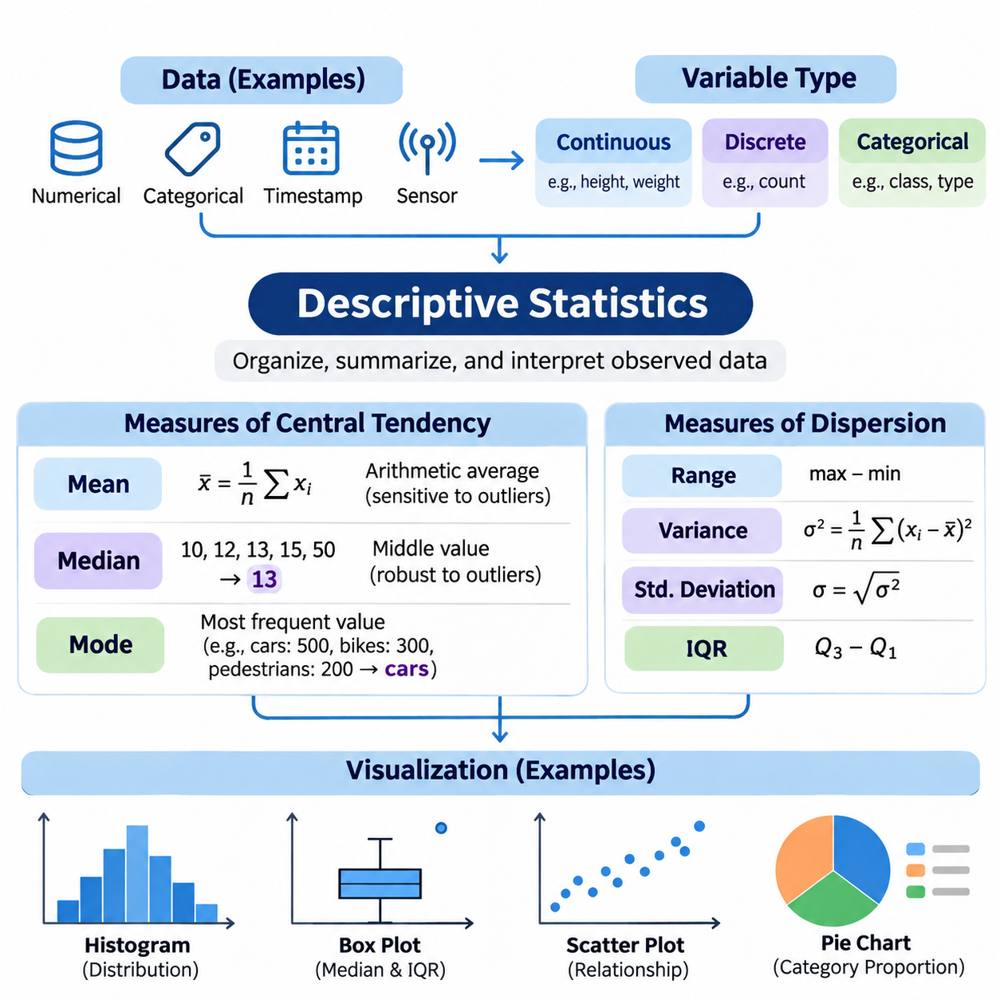
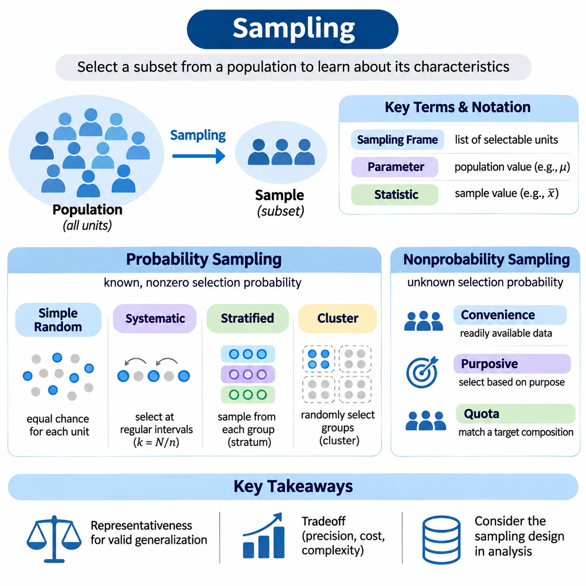
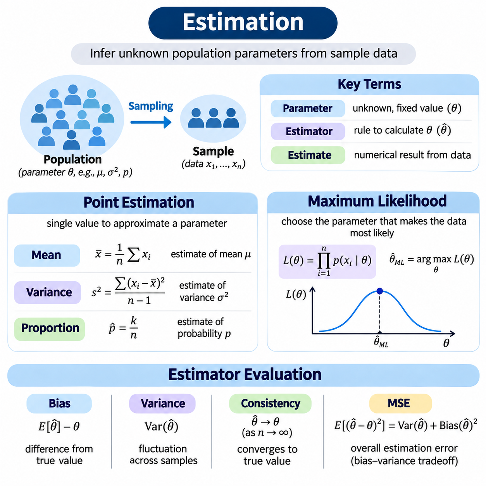
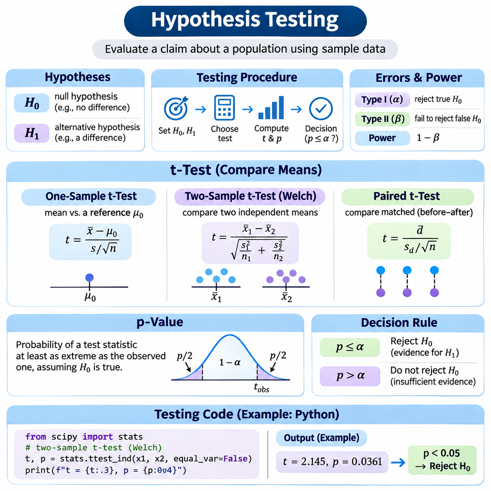
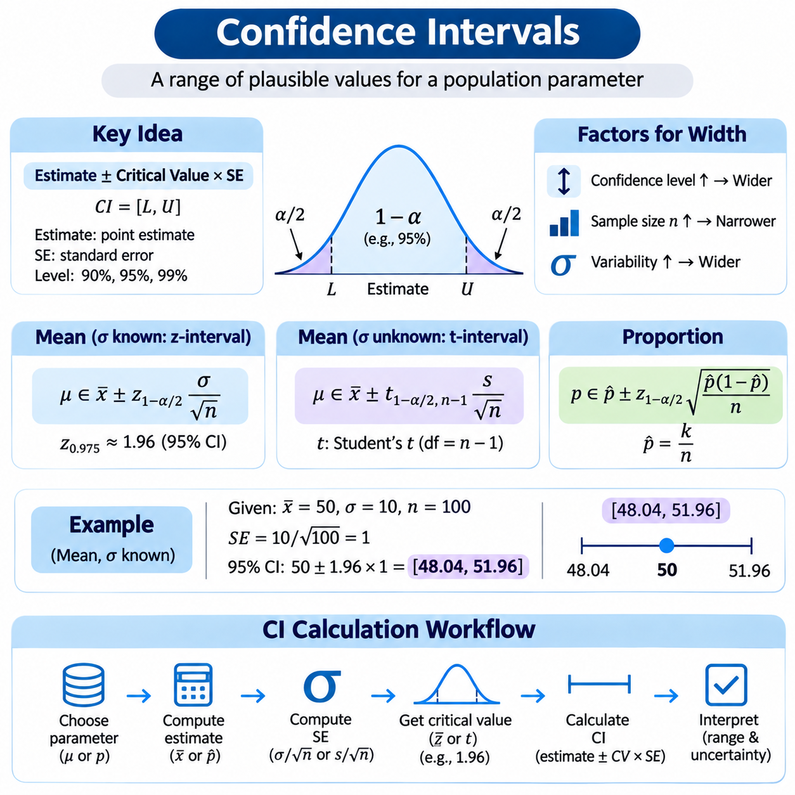
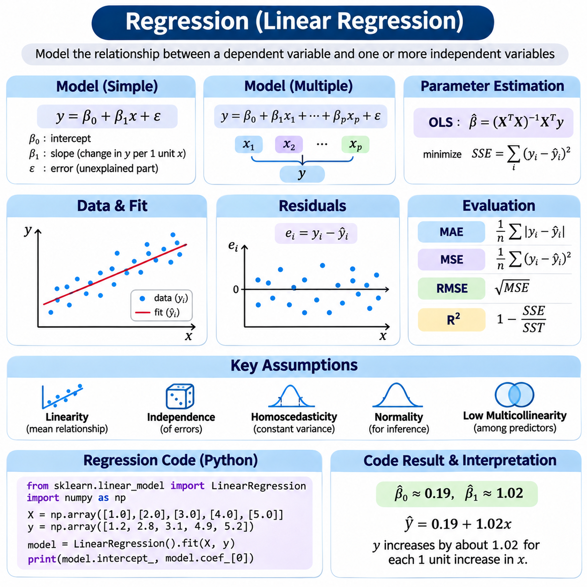
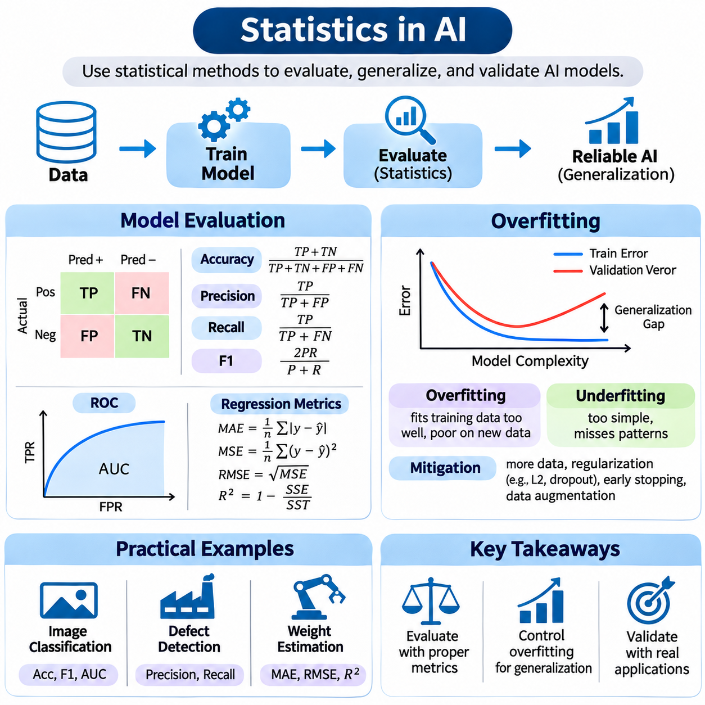

**Volume 05. Mathematics for AI**

# 04. Statistics

## 04.00 Descriptive Statistics

{width="7.268055555555556in" height="7.268055555555556in"}

기술통계(Descriptive Statistics)는 관측된 데이터(Observed Data)를 체계적으로 구성하고 요약하며 해석하기 위한 기본적인 방법을 제공합니다. 전체 모집단(Population)에 대한 예측을 수행하기보다는 확보된 관측값(Observations)의 특성을 설명하는 데 중점을 둡니다. 인공지능(Artificial Intelligence)에서 기술통계는 데이터셋 탐색(Dataset Exploration), 특징 분석(Feature Analysis), 데이터 품질 평가(Data Quality Assessment), 기계학습(Machine Learning) 성능에 영향을 미칠 수 있는 패턴(Pattern)의 식별을 지원합니다.

데이터셋(Dataset)에는 센서(Sensor)와 디지털 시스템(Digital System)에서 수집한 수치 측정값(Numerical Measurements), 범주형 레이블(Categorical Labels), 타임스탬프(Timestamps), 구조화된 관측값(Structured Observations) 등이 포함될 수 있습니다. 통계적 요약(Statistical Summary)을 계산하기 전에 분석가는 각 변수(Variable)의 의미, 측정 척도(Measurement Scale), 신뢰성(Reliability)을 이해해야 합니다. 연속형 변수(Continuous Variables)는 측정 가능한 양을 나타내며, 이산형 변수(Discrete Variables)는 셀 수 있는 값을 나타냅니다. 범주형 변수(Categorical Variables)는 수치적 크기보다 그룹(Group)이나 클래스(Class)를 설명합니다.

중심경향 측도(Measures of Central Tendency)는 분포(Distribution) 내에서 관측값의 대표적인 위치를 설명합니다. 세 가지 주요 측도는 산술평균(Arithmetic Mean), 중앙값(Median), 최빈값(Mode)입니다. 이러한 통계량(Statistics)은 함께 제시되는 경우가 많지만, 각각 데이터의 서로 다른 특성을 나타냅니다. 적절한 측도를 선택하려면 분포의 형태, 극단적인 관측값(Extreme Observations)의 존재 여부, 그리고 기초 변수(Underlying Variable)가 수치형인지 범주형인지를 이해해야 합니다.

산술평균(Arithmetic Mean)은 관측값의 합계를 관측값의 개수로 나누어 계산합니다. n개의 값을 포함하는 데이터셋에서 평균(Mean)은 x̄ = (1/n)Σxᵢ로 표현됩니다. 이 통계량은 모든 관측값을 반영하며 분포의 수치적 중심(Numerical Center)을 나타내는 데 유용합니다. 그러나 비정상적으로 크거나 작은 값이 계산 결과에 영향을 미치므로 평균은 이상값(Outliers)과 비대칭 분포(Skewed Distributions)에 민감할 수 있습니다.

10, 12, 13, 15, 50이라는 다섯 개의 센서 측정값(Sensor Measurements)을 생각해 볼 수 있습니다. 이 값들의 산술평균은 20이지만, 다섯 개 중 네 개의 관측값은 10에서 15 사이에 집중되어 있습니다. 비정상적으로 높은 측정값이 평균을 대부분의 관측값이 위치한 영역에서 멀어지게 만듭니다. 이러한 사례는 분포와 잠재적인 측정 이상(Measurement Anomalies)을 검토하지 않고 평균을 자동으로 대표값(Typical Value)으로 해석해서는 안 된다는 점을 보여줍니다.

중앙값(Median)은 수치 데이터를 오름차순(Ascending Order)으로 정렬했을 때 가운데에 위치하는 관측값을 나타냅니다. 관측값의 개수가 홀수이면 중앙에 있는 값이 중앙값이며, 짝수이면 가운데 두 값의 평균이 중앙값이 됩니다. 중앙값은 평균보다 극단적인 관측값의 영향을 적게 받으므로 비대칭 데이터셋(Skewed Datasets), 불규칙한 측정값(Irregular Measurements), 비정상적으로 크거나 작은 값이 포함된 분포를 분석할 때 유용합니다.

10, 12, 13, 15, 50이라는 측정값에서 중앙값은 13입니다. 평균인 20과 달리 중앙값은 관측값이 집중된 중심 영역(Central Cluster)에 가깝게 유지됩니다. 이러한 차이는 산업용 센서 측정값(Industrial Sensor Readings), 거래 금액(Transaction Values), 응답 시간(Response Times)을 분석할 때 중요합니다. 평균과 중앙값을 비교하면 분포의 비대칭성(Distributional Asymmetry)을 파악하는 데 도움이 되지만, 두 값의 차이만으로 분포의 전체 형태를 확정할 수는 없습니다.

최빈값(Mode)은 데이터셋에서 가장 빈번하게 나타나는 값이나 범주(Category)를 의미합니다. 하나의 분포에는 하나의 최빈값, 여러 개의 최빈값이 존재할 수 있으며, 뚜렷하게 우세한 값이 없을 수도 있습니다. 평균이나 중앙값과 달리 최빈값은 제품 유형(Product Types), 결함 범주(Defect Categories), 분류 레이블(Classification Labels)과 같은 범주형 관측값을 요약할 수 있습니다. 최빈값의 해석은 데이터의 빈도 구조(Frequency Structure)와 수치 측정값을 기록할 때 사용한 정밀도(Precision)에 따라 달라집니다.

예를 들어 자동차(Car) 이미지 500개, 자전거(Bicycle) 이미지 300개, 보행자(Pedestrian) 이미지 200개를 포함하는 분류 데이터셋(Classification Dataset)에서는 자동차가 최빈 범주(Modal Category)가 됩니다. 이러한 결과는 가장 일반적인 클래스를 즉시 식별하지만 전체 분포를 설명하지는 않습니다. 기계학습에서 최빈 범주의 빈도는 클래스 불균형(Class Imbalance)을 파악하는 데 도움이 되며, 이러한 불균형은 모델 학습(Model Training), 평가 지표(Evaluation Metrics), 소수 클래스(Underrepresented Classes)에 대한 예측에 영향을 미칠 수 있습니다.

중심경향 측도(Measures of Central Tendency)는 산포도 측도(Measures of Dispersion)와 함께 사용할 때 더욱 유용해집니다. 범위(Range)는 최댓값(Maximum)과 최솟값(Minimum)의 차이를 나타내며, 분산(Variance)과 표준편차(Standard Deviation)는 평균을 중심으로 한 변동성(Variability)을 정량화합니다. 사분위범위(Interquartile Range)는 제1사분위수(First Quartile)와 제3사분위수(Third Quartile) 사이의 거리를 측정합니다. 이러한 보완적인 통계량은 중심이 비슷하지만 변동성 수준이 크게 다른 데이터셋을 구별하는 데 도움이 됩니다.

분산(Variance)은 각 관측값과 평균 사이의 편차(Deviation)를 제곱하여 계산합니다. 모집단 분산(Population Variance)은 제곱편차(Squared Deviations)의 합을 모집단 크기로 나누지만, 일반적인 표본분산(Sample Variance)은 분모에 n − 1을 사용합니다. 표준편차(Standard Deviation)는 분산의 제곱근(Square Root)이며 원래 측정 단위(Measurement Units)를 유지합니다. 이러한 통계량은 인공지능 데이터셋의 특징 척도(Feature Scales), 측정 일관성(Measurement Consistency), 변동성을 이해하는 데 필수적입니다.

분위수(Quantiles)는 관측값의 분포에 관한 추가적인 정보를 제공합니다. 제1사분위수(First Quartile)는 대략 25백분위수(25th Percentile), 중앙값은 50백분위수(50th Percentile), 제3사분위수(Third Quartile)는 75백분위수(75th Percentile)에 해당합니다. 제3사분위수와 제1사분위수의 차이는 사분위범위(Interquartile Range)를 정의합니다. 분위수 기반 요약(Quantile-Based Summaries)은 극단적인 값에 크게 의존하지 않으면서 분포의 중심 부분을 설명하므로 이상값이 포함된 데이터에서 특히 유용합니다.

통계적 시각화(Statistical Visualization)는 수치적 요약(Numerical Summaries)을 패턴을 쉽게 인식할 수 있는 표현으로 변환합니다. 적절하게 설계된 시각화는 분포의 형태(Distributional Shape), 변동성(Variability), 집중도(Concentration), 잠재적인 이상 현상(Potential Anomalies)을 드러냅니다. 서로 다른 데이터셋이 동일한 평균과 분산을 가지면서도 구조, 관계, 관측값의 집중 형태가 근본적으로 다를 수 있으므로 수치적 요약과 시각적 표현(Visual Representations)을 함께 해석해야 합니다.

히스토그램(Histogram)은 관측값의 범위를 구간(Bins)으로 나누어 수치 분포(Numerical Distribution)를 표현합니다. 각 막대의 높이는 해당 구간에 포함된 관측값의 빈도(Frequency) 또는 밀도(Density)를 나타냅니다. 히스토그램은 왜도(Skewness), 다중 봉우리(Multiple Peaks), 데이터 집중도, 비정상적인 관측값을 식별하는 데 도움이 됩니다. 그러나 구간 너비(Bin Width)의 선택이 표시되는 형태에 상당한 영향을 미치므로 분석가는 결론을 내리기 전에 여러 해상도(Resolutions)를 검토해야 합니다.

상자그림(Box Plot)은 중앙값, 사분위수(Quartiles), 수염(Whiskers), 잠재적인 이상값을 사용하여 분포를 요약합니다. 일반적으로 상자는 제1사분위수에서 제3사분위수까지 확장되며 내부의 선은 중앙값을 나타냅니다. 널리 사용되는 방식에서는 수염을 각 사분위수에서 사분위범위의 1.5배 이내에 있는 가장 극단적인 관측값까지 표시합니다. 이 경계를 벗어나는 값은 자동으로 잘못된 측정값으로 판단되는 것이 아니라 잠재적인 이상값(Potential Outliers)으로 표시됩니다.

막대그래프(Bar Chart)는 범주형 그룹(Categorical Groups) 사이의 빈도 또는 집계된 측정값(Aggregated Measurements)을 비교하는 데 적합합니다. 히스토그램과 달리 막대그래프의 범주는 연속된 수치 구간이 아니라 서로 구별되는 그룹을 나타냅니다. 인공지능 데이터셋 분석에서 막대그래프는 클래스 빈도(Class Frequencies), 어노테이션 범주(Annotation Categories), 서로 다른 데이터 소스(Data Sources)에서 수집한 관측값의 개수를 표시할 수 있습니다. 잘못된 비교를 방지하려면 명확한 레이블(Labels)과 일관된 수치 척도(Numerical Scales)가 필요합니다.

산점도(Scatter Plot)는 관측값을 좌표계(Coordinate System)의 점으로 표현하여 두 수치형 변수 사이의 관계를 시각화합니다. 이를 통해 양의 연관성(Positive Associations), 음의 연관성(Negative Associations), 비선형 패턴(Nonlinear Patterns), 군집(Clusters), 비정상적인 값의 조합을 발견할 수 있습니다. 예를 들어 객체 크기(Object Size)와 감지 신뢰도(Detection Confidence)를 함께 표시하면 크기에 따른 성능 차이를 확인할 수 있습니다. 그러나 관측된 연관성이 두 변수 사이의 인과관계(Causal Relationship)를 입증하는 것은 아닙니다.

선그래프(Line Plot)는 시간이나 다른 순서가 있는 차원(Ordered Dimension)에 따라 수집한 관측값을 표현할 때 특히 유용합니다. 센서 측정값의 변화, 생산 통계(Production Statistics), 데이터 수집 조건(Data Acquisition Conditions)의 변동을 나타낼 수 있습니다. 시간 의존적 관측값(Time-Dependent Observations)을 분석할 때는 시간 순서(Chronological Ordering)를 유지하고 실제 추세(Genuine Trends)와 잡음(Noise)을 구별해야 합니다. 서로 관련 없는 범주형 관측값을 선으로 연결하면 연속성이 존재한다는 잘못된 인상을 줄 수 있으므로 일반적으로 피해야 합니다.

밀도그래프(Density Plot)는 수치 분포를 평활화(Smoothing)하여 표현합니다. 커널 밀도 추정(Kernel Density Estimation)은 관측값 주변의 국소적인 기여(Local Contributions)를 결합하여 확률밀도(Probability Density)를 추정합니다. 히스토그램과 비교하면 밀도곡선(Density Curves)은 데이터셋 사이의 비교를 쉽게 만들 수 있지만, 표시 형태는 평활화 대역폭(Smoothing Bandwidth)에 따라 달라집니다. 지나친 평활화는 의미 있는 봉우리를 감출 수 있으며, 평활화가 부족하면 무작위 변동(Random Fluctuations)을 과장할 수 있습니다.

히트맵(Heatmap)은 색상 강도(Color Intensity)를 통해 수치값을 표현하며 관계를 나타내는 행렬(Matrix)을 분석하는 데 유용합니다. 예를 들어 상관관계 히트맵(Correlation Heatmap)은 피어슨 상관계수(Pearson Correlation Coefficients)를 사용하여 수치형 특징 사이의 쌍별 선형 연관성(Pairwise Linear Associations)을 요약할 수 있습니다. 강한 상관관계는 중복 정보(Redundant Information)나 관련된 측정값을 나타낼 수 있지만 인과관계를 의미하지는 않습니다. 또한 선형 상관관계만 분석하면 비선형 관계가 드러나지 않을 수 있습니다.

시각화 품질(Visualization Quality)은 올바른 축 선택(Axis Selection), 의미 있는 단위(Units), 적절한 척도(Scales), 결측값(Missing Values)의 일관된 표현에 따라 결정됩니다. 잘린 축(Truncated Axes)은 차이를 과장할 수 있으며, 부적절한 색상 척도(Color Scales)는 중요한 변화를 감출 수 있습니다. 대규모 데이터셋에서는 점의 과도한 중첩(Overplotting)을 줄이기 위해 투명도(Transparency), 집계(Aggregation), 샘플링(Sampling)이 필요할 수 있습니다. 모든 변환(Transformation)은 관측값의 분석적 의미를 유지하고 인위적인 패턴을 만들지 않아야 합니다.

기술통계 분석(Descriptive Statistical Analysis)에서는 결측 데이터(Missing Data), 중복 레코드(Duplicate Records), 측정 오류(Measurement Errors), 일관되지 않은 단위(Inconsistent Units)도 고려해야 합니다. 특정 조건이나 값과 관련하여 데이터가 누락되면 결측 관측값이 통계적 요약을 왜곡할 수 있습니다. 이상값은 센서 고장(Sensor Faults), 기록 오류(Recording Mistakes), 또는 실제로 발생한 드문 사건(Rare Events)을 나타낼 수 있습니다. 따라서 데이터 정제(Data Cleaning)는 자동 삭제 규칙에만 의존하기보다 데이터 수집 과정(Data Collection Process)에 대한 명확한 이해를 바탕으로 수행해야 합니다.

실제 인공지능 작업흐름(AI Workflows)에서 기술통계는 데이터셋 적합성(Dataset Suitability)을 평가하는 첫 번째 체계적인 단계입니다. 특징 평균(Feature Means), 중앙값, 표준편차, 분포 그래프(Distribution Plots)는 척도 조정 요구사항(Scaling Requirements), 비정상적인 측정값, 학습 데이터셋(Training Dataset)과 평가 데이터셋(Evaluation Dataset) 사이의 차이를 식별하는 데 도움이 됩니다. 클래스 빈도 요약은 불균형을 드러내며, 시각적 비교는 모델의 일반화(Generalization)를 저하시킬 수 있는 분포 이동(Distribution Shift)을 발견하는 데 기여합니다.

NumPy, pandas, Matplotlib, Seaborn과 같은 파이썬 라이브러리(Python Libraries)는 재현 가능한 기술통계 분석(Reproducible Descriptive Analysis)을 지원합니다. NumPy는 수치 연산(Numerical Operations)을 제공하고, pandas는 표 형식의 요약(Tabular Summaries)과 집계(Aggregation)를 지원하며, 시각화 라이브러리(Visualization Libraries)는 히스토그램, 상자그림, 비교 그래프를 생성합니다. 신뢰할 수 있는 작업흐름은 데이터 전처리 결정(Data Preprocessing Decisions), 계산 규칙(Calculation Conventions), 시각화 설정(Visualization Settings), 소프트웨어 버전(Software Versions)을 기록하여 통계 결과를 재현하고 독립적으로 검토할 수 있도록 합니다.

기술통계 자체만으로는 모집단 수준의 결론(Population-Level Conclusions)을 확립하거나 일반화의 불확실성(Uncertainty of Generalization)을 정량화할 수 없습니다. 이러한 목적에는 표본추출 이론(Sampling Theory), 통계적 추정(Statistical Estimation), 신뢰구간(Confidence Intervals), 가설검정(Hypothesis Testing)이 필요합니다. 그럼에도 기술통계는 이러한 방법의 실증적 기반(Empirical Foundation)을 제공합니다. 중심경향, 산포도, 분포 분석(Distributional Analysis), 시각화를 결합하면 인공지능 개발자는 더욱 고급화된 통계 모델(Statistical Models)을 구축하기 전에 데이터셋을 체계적으로 이해할 수 있습니다.

## 04.01 Sampling

{width="7.268055555555556in" height="7.268055555555556in"}

표본추출(Sampling)은 더 큰 모집단(Population)에서 관측값(Observations)의 일부를 선택하는 기본적인 통계적 과정(Statistical Process)입니다. 주요 목적은 모든 개체나 측정값을 조사하지 않고도 모집단의 특성(Population Characteristics)에 관한 정보를 확보하는 것입니다. 인공지능(Artificial Intelligence)에서 표본추출은 전체 모집단 분석이 현실적으로 어렵거나 계산 비용(Computational Cost)이 높은 경우 데이터셋 구축(Dataset Construction), 모델 학습(Model Training), 실험 평가(Experimental Evaluation), 효율적인 데이터 처리(Data Processing)를 지원합니다.

모집단(Population)은 통계적 조사(Statistical Investigation)와 관련된 개체(Individuals), 객체(Objects), 측정값(Measurements), 사건(Events)의 전체 집합을 의미합니다. 표본(Sample)은 모집단에서 선택된 부분집합(Subset)이며, 표본추출틀(Sampling Frame)은 선택 가능한 단위(Units)를 식별합니다. 표본추출틀이 모집단의 일부 구성원을 제외할 수 있다는 점에서 이러한 구분은 중요합니다. 이러한 제외는 포괄오차(Coverage Error)를 발생시켜 통계적 결론의 신뢰성(Reliability)과 일반화 가능성(Generalizability)에 영향을 미칠 수 있습니다.

모집단 모수(Population Parameters)는 전체 모집단의 특성을 설명하는 반면, 표본통계량(Sample Statistics)은 선택된 표본에 포함된 관측값을 요약합니다. 예를 들어 모집단 평균(Population Mean)은 일반적으로 μ로 표현하고, 표본평균(Sample Mean)은 x̄로 나타냅니다. 통계적 추론(Statistical Inference)은 표본통계량을 사용하여 알려지지 않은 모집단 모수를 추정합니다. 따라서 표본추출 과정은 통계적 결론이 실제 모집단을 얼마나 정확하게 반영하는지 결정하는 데 필수적입니다.

대표성 있는 표본추출(Representative Sampling)은 선택된 관측값에서 모집단의 관련 특성을 유지하는 것을 목표로 합니다. 대표 표본(Representative Sample)은 인구통계학적 특성(Demographics), 측정 조건(Measurement Conditions), 범주(Categories), 운영 환경(Operational Environments)의 중요한 변화를 적절하게 반영해야 합니다. 그러나 표본 크기(Sample Size)만으로 대표성이 보장되지는 않습니다. 선택 메커니즘(Selection Mechanisms), 모집단 포괄 범위(Population Coverage), 관련 특성의 분포가 표본의 일반화 타당성(Validity of Generalization)에 큰 영향을 미칩니다.

확률표본추출(Probability Sampling)은 모집단의 각 단위에 알려진 0보다 큰 선택 확률(Selection Probability)을 부여합니다. 이러한 체계는 선택 확률을 추정 절차(Estimation Procedures)에 반영할 수 있으므로 표본설계 기반 통계적 추론(Design-Based Statistical Inference)을 지원합니다. 대표적인 확률표본추출 방법에는 단순무작위표본추출(Simple Random Sampling), 계통표본추출(Systematic Sampling), 층화표본추출(Stratified Sampling), 군집표본추출(Cluster Sampling)이 있습니다. 각 방법은 통계적 정밀도(Statistical Precision), 구현 복잡성(Implementation Complexity), 데이터 수집 비용(Data Collection Costs) 사이에서 서로 다른 절충관계(Tradeoffs)를 제공합니다.

단순무작위표본추출(Simple Random Sampling)은 지정된 크기의 가능한 모든 부분집합이 동일한 선택 확률을 갖도록 관측값을 선택합니다. 크기가 N인 모집단에서 비복원추출(Without Replacement)을 통해 크기가 n인 표본을 선택하면 각 개별 단위의 포함확률(Inclusion Probability)은 n/N입니다. 이 방법은 표본추출틀이 완전한 경우 체계적인 선택 편향(Systematic Selection Bias)을 줄이지만, 무작위 변동(Random Variation)으로 인해 불균형한 표본이 생성될 가능성은 여전히 존재합니다.

계통표본추출(Systematic Sampling)은 적절한 무작위 시작점(Random Starting Position)을 선택한 후 일정한 간격으로 관측값을 추출합니다. 모집단에 N개의 단위가 있고 원하는 표본 크기가 n이면 대략적인 표본추출 간격(Sampling Interval)은 k = N/n입니다. 이 방법은 순서가 있는 레코드(Ordered Records)와 연속적인 데이터 수집(Continuous Data Collection)에 편리합니다. 그러나 데이터 정렬 순서에 존재하는 주기적 패턴(Periodic Patterns)이 표본추출 간격과 상호작용하면 체계적인 왜곡(Systematic Distortions)이 발생할 수 있습니다.

층화표본추출(Stratified Sampling)은 관측값을 선택하기 전에 모집단을 서로 겹치지 않는 그룹인 층(Strata)으로 나눕니다. 층은 지리적 지역(Geographic Regions), 제품 범주(Product Categories), 운영 조건(Operating Conditions), 인구통계학적 특성(Demographic Characteristics)을 나타낼 수 있습니다. 각 층 내부의 관측값이 서로 유사한 경우 층별 표본추출은 통계적 정밀도를 향상시킬 수 있습니다. 또한 일반적인 표본추출 과정에서 누락될 수 있는 중요한 하위 모집단(Subpopulations)의 충분한 대표성을 확보하는 데 도움이 됩니다.

층화표본추출은 각 층이 모집단에서 차지하는 비율에 따라 관측값을 배분하는 비례배분(Proportional Allocation)이나 특정 그룹에 추가 관측값을 할당하는 비비례배분(Disproportionate Allocation)을 사용할 수 있습니다. 비비례표본추출(Disproportionate Sampling)은 인공지능 데이터셋에서 희귀 클래스(Rare Classes)를 확보할 때 특히 유용합니다. 그러나 원래 모집단을 설명하기 위한 추정에서는 서로 다른 선택 확률을 보정하기 위해 표본추출 가중치(Sampling Weights)가 필요할 수 있습니다.

군집표본추출(Cluster Sampling)은 모집단을 학교, 공장, 지리적 지역, 데이터 수집 세션(Data Collection Sessions)과 같이 자연적으로 형성된 그룹으로 나눕니다. 모집단 전체에서 개별 관측값을 독립적으로 선택하는 대신 군집(Clusters)을 무작위로 선택하고, 선택된 군집 내의 모든 단위 또는 일부 단위를 조사합니다. 이 방법은 데이터 수집 비용을 줄일 수 있지만, 동일한 군집 내 관측값 사이의 유사성으로 인해 표본분산(Sampling Variance)이 증가할 수 있습니다.

다단계표본추출(Multistage Sampling)은 여러 선택 단계를 적용하여 군집표본추출을 확장한 방법입니다. 예를 들어 연구자는 제조시설(Manufacturing Facilities)을 무작위로 선택한 다음, 해당 시설의 생산라인(Production Lines)을 선택하고, 선택된 생산라인에서 센서 측정값을 추출할 수 있습니다. 이러한 계층적 절차(Hierarchical Procedure)는 대규모 분산 모집단(Distributed Populations)에 유용합니다. 동일한 군집에서 수집된 관측값은 서로 상관관계(Correlation)를 가질 수 있으므로 통계 분석에서는 표본설계(Sampling Design)를 고려해야 합니다.

비확률표본추출(Nonprobability Sampling)은 선택 확률을 알 수 없는 상태에서 관측값을 선택하는 방법입니다. 대표적인 방식에는 편의표본추출(Convenience Sampling), 목적표본추출(Purposive Sampling), 할당표본추출(Quota Sampling), 눈덩이표본추출(Snowball Sampling)이 있습니다. 이러한 방법은 모집단 목록을 확보할 수 없거나 데이터 수집 자원이 제한된 경우 실용적일 수 있습니다. 그러나 선택 과정만으로는 일반적인 확률 기반 불확실성 추정(Probability-Based Uncertainty Estimates)을 정당화하기 어렵습니다.

편의표본추출(Convenience Sampling)은 공개적으로 이용할 수 있는 이미지, 기존 실험실 측정값(Laboratory Measurements), 가까운 장치에서 수집한 데이터처럼 쉽게 접근할 수 있는 관측값을 사용합니다. 이 방법은 효율적이지만 익숙한 환경과 일반적인 조건을 과도하게 대표할 수 있습니다. 편의표본만으로 학습한 인공지능 모델(AI Model)은 개발 과정에서는 우수한 성능을 보이더라도 조명(Lighting), 지리적 환경(Geographic Environment), 주변 환경(Environmental Conditions), 운영 조건이 달라지면 성능이 저하될 수 있습니다.

목적표본추출(Purposive Sampling)은 사전에 정의한 연구 목표(Research Objectives)에 따라 관측값을 의도적으로 선택합니다. 기계학습에서는 희귀 결함(Rare Defects), 어려운 시각적 조건(Challenging Visual Conditions), 비정상적인 로봇 운영 시나리오(Unusual Robot Operating Scenarios)를 수집하는 방식으로 활용할 수 있습니다. 이러한 표본추출은 중요한 사례(Critical Cases)의 포괄 범위를 개선하지만, 결과 데이터셋이 실제 발생 빈도(Natural Frequencies)를 반영하지 않을 수 있습니다. 따라서 평가 데이터셋(Evaluation Datasets)에서는 특정 어려운 사례에 대한 평가 범위(Targeted Challenge Coverage)와 실제 운영 환경을 대표하는 성능(Representative Operational Performance)을 구분해야 합니다.

표본추출 편향(Sampling Bias)은 선택 과정에서 특정 관측값이 체계적으로 선호되거나 관련 모집단 그룹이 제외될 때 발생합니다. 포괄 편향(Coverage Bias)은 불완전한 표본추출틀에서 발생하며, 무응답 편향(Nonresponse Bias)은 선택된 단위가 사용 가능한 정보를 제공하지 않을 때 발생합니다. 선택 편향(Selection Bias)은 데이터의 가용성(Availability)이나 품질(Quality)에 따라 레코드를 필터링하는 과정에서도 발생할 수 있습니다. 이러한 메커니즘은 추정된 관계를 왜곡하고 모델의 일반화 성능(Model Generalization)을 저하시킬 수 있습니다.

표본추출 변동성(Sampling Variability)은 동일한 모집단에서 선택한 서로 다른 표본으로 계산한 통계량 사이의 차이를 의미합니다. 표본추출에 편향이 없더라도 독립적으로 선택한 표본은 일반적으로 서로 다른 평균, 비율(Proportions), 기타 추정값을 생성합니다. 표본분포(Sampling Distribution)는 반복적으로 표본을 추출할 때 통계량이 나타내는 확률분포(Probability Distribution)를 설명합니다. 이러한 변동성을 이해하는 것은 표준오차(Standard Errors), 신뢰구간(Confidence Intervals), 통계적 가설검정(Statistical Hypothesis Testing)의 기초가 됩니다.

표준오차(Standard Error)는 반복적인 표본추출에서 표본통계량이 나타내는 변동성을 정량화합니다. 모집단 표준편차(Population Standard Deviation)가 σ인 독립 관측값에 대해 복원추출(Sampling With Replacement)을 수행하거나 모집단이 사실상 무한하다고 가정하면 표본평균의 표준오차는 σ/√n입니다. 유한 모집단(Finite Population)에서 비복원추출을 수행하는 경우에는 적절한 유한모집단수정(Finite Population Correction)을 적용하여 이러한 불확실성을 줄일 수 있습니다.

중심극한정리(Central Limit Theorem)는 적절한 가정 아래에서 표본 크기가 증가하면 표본평균(Sample Means)의 분포가 정규분포(Normal Distribution)에 가까워지는 이유를 설명합니다. 유한한 분산(Finite Variance)을 갖는 독립동일분포(Independent and Identically Distributed) 관측값에서는 표준화된 표본평균(Standardized Sample Mean)이 표준정규확률변수(Standard Normal Variable)의 분포로 수렴합니다. 이 원리는 다양한 통계적 절차를 지원하지만, 강한 의존성을 갖는 관측값(Dependent Observations)이나 두꺼운 꼬리 분포(Heavy-Tailed Distributions)는 추가적인 고려가 필요할 수 있습니다.

표본 크기(Sample Size)는 추정 정밀도(Estimation Precision), 계산 비용(Computational Cost), 드물게 나타나는 모집단 특성(Uncommon Population Characteristics)을 대표할 수 있는 능력에 영향을 미칩니다. 표본이 커지면 일반적으로 무작위 표본추출 오차(Random Sampling Error)가 감소하지만 체계적 편향(Systematic Bias)이 자동으로 제거되지는 않습니다. 표본 크기를 계획할 때는 모집단 변동성(Population Variability), 목표 정밀도(Desired Precision), 신뢰도 요구사항(Confidence Requirements), 표본설계, 가용 자원(Available Resources)을 고려해야 합니다. 희귀 사건 분석(Rare-Event Analysis)에는 일반적인 평균 추정보다 훨씬 많은 관측값이 필요할 수 있습니다.

인공지능에서 표본추출은 학습 데이터셋(Training Dataset), 검증 데이터셋(Validation Dataset), 시험 데이터셋(Test Dataset)을 구성하는 방법도 결정합니다. 관측값이 독립동일분포(Independent and Identically Distributed)를 따른다면 무작위 분할(Random Splitting)은 합리적인 평가용 데이터 분할(Evaluation Partitions)을 제공할 수 있습니다. 그러나 서로 연관된 이미지(Correlated Images), 반복 측정값(Repeated Measurements), 동일한 개체에서 수집된 레코드가 서로 다른 분할에 배정되면 데이터 누출(Data Leakage)이 발생할 수 있습니다. 따라서 그룹 기반 분할(Group-Based Splitting)이나 시간 인식 분할(Time-Aware Splitting)이 필요한 경우가 많습니다.

클래스 불균형(Class Imbalance)은 분류 작업(Classification Tasks)에서 추가적인 표본추출 고려사항을 발생시킵니다. 오버샘플링(Oversampling)은 소수 클래스(Minority Classes)의 표현 비율을 높이고, 언더샘플링(Undersampling)은 다수 클래스(Majority Classes)의 관측값을 줄입니다. 이러한 기법은 최적화 동작(Optimization Behavior)과 클래스별 성능(Class-Specific Performance)에 영향을 미칠 수 있습니다. 합성 오버샘플링(Synthetic Oversampling)은 추가적인 학습 사례를 생성할 수 있지만, 평가 결과의 오염(Evaluation Contamination)을 방지하려면 인공 관측값(Artificial Observations)은 반드시 학습 데이터 분할 내부에서만 생성해야 합니다.

복원추출(Sampling With Replacement)은 동일한 관측값이 여러 번 선택되는 것을 허용하지만, 비복원추출(Sampling Without Replacement)은 동일한 표본 내에서 반복 선택을 허용하지 않습니다. 부트스트랩 재표본추출(Bootstrap Resampling)은 일반적으로 복원추출을 통해 관측값을 다시 선택하여 추정량(Estimators)의 표본추출 변동성을 근사합니다. 이 기법은 불확실성 평가(Uncertainty Assessment)와 모델 평가(Model Evaluation)를 지원하지만, 의존성이 있는 관측값에 대해서는 적절한 수정 없이 일반적인 부트스트랩 절차를 적용하는 것이 부적절할 수 있습니다.

데이터 표본추출(Data Sampling)은 대규모 및 스트리밍 인공지능 시스템(Large-Scale and Streaming AI Systems)에서도 중요합니다. 저장소 표본추출(Reservoir Sampling)은 전체 길이를 알 수 없는 데이터 스트림(Data Stream)에서 고정 크기의 표본을 유지합니다. 표준적인 저장소 표본추출에서는 관측된 모든 항목이 저장소(Reservoir)에 남아 있을 확률이 동일합니다. 이 방법은 제한된 메모리(Bounded Memory)에서 데이터를 처리할 수 있도록 하지만, 최근 관측값이나 변화하는 데이터 분포(Changing Data Distributions)에 더 높은 중요도를 부여해야 한다면 추가적인 메커니즘이 필요할 수 있습니다.

표본추출 품질(Sampling Quality)은 포괄 범위 분석(Coverage Analysis), 하위 그룹 비교(Subgroup Comparisons), 중복 탐지(Duplicate Detection), 가능한 경우 선택 확률 검토를 통해 평가해야 합니다. 연구자는 목표 모집단(Target Population), 표본추출틀(Sampling Frame), 데이터 수집 절차(Collection Procedures), 제외 기준(Exclusion Criteria), 잠재적인 편향 원인(Potential Sources of Bias)을 문서화해야 합니다. 이러한 기록은 재현성(Reproducibility)을 향상시키고, 실제 모델의 한계(Model Limitations)와 데이터셋 구축 과정에서 발생한 약점을 구별하는 데 도움이 됩니다.

표본추출(Sampling)은 기술통계(Descriptive Statistics)를 통계적 추정(Statistical Estimation), 가설검정(Hypothesis Testing), 기계학습 평가(Machine Learning Evaluation)와 연결합니다. 신중하게 설계된 표본은 모집단의 관련 특성에 관한 정보를 유지하면서 효율적인 분석을 가능하게 합니다. 확률표본추출(Probability Sampling), 비확률표본추출(Nonprobability Sampling), 표본추출 변동성(Sampling Variability), 편향(Bias), 데이터셋 분할(Dataset Partitioning)을 이해함으로써 인공지능 개발자는 더욱 신뢰할 수 있는 실험을 설계하고 관측된 학습 데이터(Observed Training Data)를 넘어 일반화할 수 있는 모델을 개발할 수 있습니다.

## 04.02 Estimation

{width="7.268055555555556in" height="7.268055555555556in"}

통계적 추정(Statistical Estimation)은 관측된 표본 데이터(Sample Data)를 사용하여 모집단(Population)이나 통계 모델(Statistical Model)의 알려지지 않은 특성을 추론하는 과정입니다. 이러한 특성은 평균(Means), 분산(Variances), 확률(Probabilities), 회귀계수(Regression Coefficients)와 같은 모수(Parameters)로 표현됩니다. 인공지능(Artificial Intelligence)에서 추정은 모델 모수 학습(Model Parameter Learning), 불확실성 설명(Uncertainty Description), 불완전한 관측값(Incomplete Observations)으로부터 유용한 정보를 추출하는 수학적 기반을 제공합니다.

모수(Parameter)는 모집단이나 확률분포(Probability Distribution)를 설명하는 고정되어 있지만 일반적으로 알려지지 않은 양입니다. 추정량(Estimator)은 표본 관측값(Sample Observations)으로부터 해당 모수의 근삿값을 계산하는 수학적 규칙(Mathematical Rule)입니다. 특정 데이터셋에 추정량을 적용하여 얻은 수치적 결과를 추정값(Estimate)이라고 합니다. 이러한 구분은 통계적 절차(Statistical Procedure)와 실제 실험에서 얻어진 특정 값을 명확하게 분리합니다.

점추정(Point Estimation)은 알려지지 않은 모수를 근사하기 위한 하나의 수치값을 생성합니다. 예를 들어 표본평균(Sample Mean)은 모집단 평균(Population Mean)을 추정하고, 표본비율(Sample Proportion)은 특정 사건(Event)이 발생할 확률을 추정합니다. 점추정값(Point Estimates)은 통계 분석(Statistical Analysis)과 기계학습(Machine Learning)에 편리한 간결한 요약 정보를 제공합니다. 그러나 하나의 추정값만으로는 표본추출 과정(Sampling Process)과 관련된 불확실성을 직접적으로 전달할 수 없습니다.

표본평균(Sample Mean)은 x̄ = (1/n)Σxᵢ로 정의되며, 여기서 n은 관측값의 개수를 나타내고 xᵢ는 각각의 관측값을 의미합니다. 관측값이 유한한 평균(Finite Mean)을 갖는 모집단에서 독립적으로 추출되면 표본평균은 모집단 평균의 불편추정량(Unbiased Estimator)이 됩니다. 표본 크기(Sample Size)가 증가하면 일반적으로 추정 정밀도(Estimation Precision)가 향상되지만, 향상 속도는 모집단 변동성(Population Variability)과 관측값 사이의 의존성(Dependence)에 따라 달라집니다.

표본분산(Sample Variance)은 모집단 평균을 중심으로 관측값이 얼마나 변동하는지를 추정합니다. 일반적으로 사용하는 불편추정량(Unbiased Estimator)은 s² = Σ(xᵢ − x̄)²/(n − 1)이며, 이는 유한한 분산을 갖는 공통 분포(Common Distribution)에서 관측값이 독립적으로 추출되었다고 가정합니다. 분모의 n − 1은 동일한 표본에서 평균을 추정한 영향을 보정합니다. 이러한 보정은 추정량 설계(Estimator Design)가 통계적 편향(Statistical Bias)과 정확도(Accuracy)에 영향을 미치는 방식을 보여줍니다.

표본비율(Sample Proportion)은 관측된 성공 횟수(Number of Successes)를 전체 시행 횟수(Number of Trials)로 나누어 이진 사건(Binary Event)의 발생 확률을 추정합니다. n개의 독립적인 베르누이 관측값(Bernoulli Observations)에서 k번의 성공이 발생했다면 추정값은 p̂ = k/n입니다. 이 방법은 결함 발생 빈도(Defect Frequencies), 분류 결과(Classification Outcomes), 사건 발생 확률(Event Probabilities)을 추정하는 데 널리 사용됩니다. 신뢰성(Reliability)은 표본 크기, 선택 절차(Selection Procedures), 독립성 가정(Independence Assumptions)에 따라 달라집니다.

추정량의 품질(Estimator Quality)은 일반적으로 편향(Bias), 분산(Variance), 일치성(Consistency), 효율성(Efficiency)을 통해 평가합니다. 편향은 추정량의 기댓값(Expected Value)과 실제 모수(True Parameter) 사이의 차이를 측정합니다. 분산은 반복 표본추출(Repeated Sampling)에서 추정값이 얼마나 변동하는지를 설명합니다. 일치성은 표본 크기가 증가할 때 추정량이 실제 모수로 수렴하는 성질을 의미합니다. 효율성은 지정된 가정 아래에서 추정량의 통계적 변동성(Statistical Variability)을 비교합니다.

불편추정량(Unbiased Estimator)은 기댓값이 추정하려는 모수와 동일한 추정량입니다. 그러나 불편성(Unbiasedness)은 특히 추정량의 분산이 큰 경우 개별 추정값의 정확성을 보장하지 않습니다. 약간의 편향이 있는 추정량이 불편추정량보다 전체적으로 더 높은 정확도를 제공하는 경우도 있습니다. 따라서 통계적 추정에서는 하나의 기준에만 의존하기보다 여러 성능 특성(Performance Characteristics)을 함께 검토해야 합니다.

평균제곱오차(Mean Squared Error)는 분산과 편향의 제곱을 결합하여 추정 정확도(Estimation Accuracy)를 측정합니다. 모수 θ의 추정량 θ̂에 대해 MSE(θ̂) = E[(θ̂ − θ)²] = Var(θ̂) + Bias(θ̂)²로 정의됩니다. 이러한 분해(Decomposition)는 기계학습 모델 설계(Machine Learning Model Design)에서도 나타나는 편향-분산 절충관계(Bias-Variance Tradeoff)를 보여줍니다. 제한적인 편향을 도입하더라도 결과적으로 평균제곱오차가 감소한다면 추정량의 분산을 줄이는 것이 유리할 수 있습니다.

일치성(Consistency)은 관측값의 개수가 증가할 때 추정량이 나타내는 동작을 설명합니다. 일치추정량(Consistent Estimator)은 적절한 가정 아래에서 확률적으로 실제 모수에 가까워집니다. 대수의 법칙(Law of Large Numbers)은 일반적인 여러 표본추출 모델에서 표본평균이 모집단 기댓값(Population Expectation)으로 수렴하는 이유를 설명합니다. 그러나 표본 크기를 증가시키는 것만으로는 체계적인 선택 편향(Systematic Selection Bias), 잘못된 모델 가정(Incorrect Model Assumptions), 손상된 측정값(Corrupted Measurements)을 자동으로 수정할 수 없습니다.

적률법(Method of Moments)은 이론적 분포의 적률(Theoretical Distribution Moments)을 해당 표본적률(Sample Moments)과 일치시켜 알려지지 않은 모수를 추정합니다. 예를 들어 분포의 이론적 평균과 분산을 알려지지 않은 모수로 표현할 수 있습니다. 이러한 이론적 수치를 표본 추정값(Sample Estimates)으로 대체하면 모수를 구하기 위한 방정식(Equations)을 구성할 수 있습니다. 이 방법은 계산적으로 단순한 경우가 많지만 통계적 효율성(Statistical Efficiency)은 모델에 따라 달라집니다.

최대우도추정(Maximum Likelihood Estimation)은 가정한 확률 모델(Probability Model) 아래에서 관측된 데이터가 가장 그럴듯하게 나타나도록 하는 모수값을 선택하는 체계적인 방법입니다. 관측값 x₁부터 xₙ까지와 모수 θ가 주어지면 우도함수(Likelihood Function)는 L(θ) = p(x₁, ..., xₙ \| θ)로 표현됩니다. 최대우도추정량(Maximum Likelihood Estimator)은 관측 데이터를 고정된 것으로 취급하면서 이 함수를 최대화하는 모수값을 선택합니다.

우도함수(Likelihood Function)는 모수에 대한 확률분포(Probability Distribution Over Parameters)와 구별해야 합니다. 확률 모델은 모수가 고정되었을 때 관측값이 어떻게 변하는지를 설명하지만, 우도는 고정된 데이터셋에 대해 서로 다른 모수값을 평가합니다. 우도가 크다는 것은 가정한 모델 내에서 관측 데이터가 해당 모수값을 상대적으로 더 강하게 지지한다는 의미입니다. 이는 특정 모수값이 올바를 확률(Probability)이 직접적으로 높다는 의미는 아닙니다.

독립동일분포(Independent and Identically Distributed)를 따르는 관측값에서는 우도함수가 L(θ) = ∏p(xᵢ \| θ)로 표현됩니다. 매우 작은 확률값을 여러 번 곱하면 수치적 언더플로(Numerical Underflow)가 발생할 수 있으므로 최대우도추정에서는 일반적으로 로그우도함수(Log-Likelihood Function)를 사용합니다. 로그를 취하면 곱셈이 덧셈으로 변환되어 ℓ(θ) = Σlog p(xᵢ \| θ)가 됩니다. 로그함수(Logarithmic Function)는 엄격한 증가함수(Strictly Increasing Function)이므로 우도와 로그우도를 최대화하면 동일한 모수 추정값을 얻습니다.

평균 μ는 알려지지 않았지만 분산 σ²는 알려진 가우시안 분포(Gaussian Distribution)에서 독립적으로 추출한 관측값을 생각할 수 있습니다. μ에 대해 가우시안 로그우도(Gaussian Log-Likelihood)를 최대화하면 표본평균이 최대우도추정값(Maximum Likelihood Estimate)으로 도출됩니다. 이 결과는 익숙한 기술통계량(Descriptive Statistic)을 일반적인 추정 원리(Estimation Principle)와 연결합니다. 또한 확률분포에 대한 가정이 추정량의 수학적 형태를 어떻게 결정하는지 보여줍니다.

가우시안 분포의 평균과 분산이 모두 알려지지 않은 경우 최대우도추정은 μ̂ = x̄와 σ̂² = Σ(xᵢ − x̄)²/n을 생성합니다. 최대우도 분산추정량(Maximum Likelihood Variance Estimator)은 n − 1이 아니라 n을 사용하므로 유한한 표본에서는 일반적으로 편향이 있습니다. 그럼에도 표준적인 가정 아래에서는 일치성(Consistency)을 가지며, 이는 최대우도추정량이 작은 데이터셋에서 반드시 불편추정량이 되는 것은 아니라는 점을 보여줍니다.

독립적인 베르누이 관측값(Bernoulli Observations)에서는 우도가 성공확률(Probability of Success) p에 따라 결정됩니다. n번의 시행에서 k번의 성공이 발생하면 우도는 pᵏ(1 − p)⁽ⁿ⁻ᵏ⁾에 비례합니다. 이 식을 최대화하면 p̂ = k/n이 도출됩니다. 동일한 추정값을 표본비율(Sample Proportion)에서도 얻을 수 있으므로, 기본적인 통계적 요약(Statistical Summaries)이 우도 기반 추론(Likelihood-Based Reasoning)을 통해 도출될 수 있음을 보여줍니다.

최대우도추정은 지수분포(Exponential Distribution), 포아송분포(Poisson Distribution), 다항분포(Multinomial Distribution)를 비롯한 다양한 확률분포에도 적용할 수 있습니다. 선택한 모델은 우도식(Likelihood Expression)과 추정해야 할 모수를 결정합니다. 일부 모델은 해석적 해(Analytical Solutions)를 제공하지만 다른 모델은 수치 최적화(Numerical Optimization)가 필요합니다. 따라서 모델 선택(Model Selection)과 분포 가정(Distributional Assumptions)은 신뢰할 수 있는 추정 절차의 필수 구성요소입니다.

수치적 최대우도추정(Numerical Maximum Likelihood Estimation)은 경사 기반 최적화(Gradient-Based Optimization) 방법을 자주 사용합니다. 로그우도의 기울기(Gradient)는 모수 변화가 목적함수(Objective Function)에 어떤 영향을 미치는지 나타냅니다. 경사상승법(Gradient Ascent)은 로그우도를 증가시키고, 음의 로그우도(Negative Log-Likelihood)를 최소화하면 경사하강법(Gradient Descent)을 사용할 수 있습니다. 현대 기계학습 프레임워크(Machine Learning Frameworks)는 자동미분(Automatic Differentiation)과 반복 최적화 알고리즘(Iterative Optimization Algorithms)을 통해 이러한 계산을 효율적으로 수행합니다.

지도 분류(Supervised Classification)에서 최대우도추정은 일반적인 학습 목적함수(Training Objectives)에 확률적 해석(Probabilistic Interpretation)을 제공합니다. 모델은 목표 클래스(Target Classes)에 확률을 할당하며, 모수 최적화(Parameter Optimization)는 관측된 레이블(Observed Labels)의 우도를 최대화하도록 수행됩니다. 관련 범주형 확률 모델(Categorical Probability Model)에서 음의 로그우도를 최소화하는 것은 교차엔트로피 손실(Cross-Entropy Loss)을 최소화하는 것과 같습니다. 이러한 연결은 고전적인 통계적 추정(Classical Statistical Estimation)을 신경망 학습(Neural Network Training)과 직접적으로 연결합니다.

최대우도추정은 적절한 정규성 조건(Regularity Conditions)과 식별가능성 가정(Identifiability Assumptions) 아래에서 중요한 이론적 성질(Theoretical Properties)을 가집니다. 많은 정규 모수 모델(Regular Parametric Models)에서 최대우도추정량은 일치성(Consistency), 점근정규성(Asymptotic Normality), 점근효율성(Asymptotic Efficiency)을 가집니다. 이러한 성질은 표본 크기가 커질 때의 동작을 설명하지만, 관측값이 제한적이거나 모델이 잘못 지정되었거나 모수가 충분히 식별되지 않는 경우에도 신뢰할 수 있는 성능을 보장하는 것은 아닙니다.

피셔 정보량(Fisher Information)은 확률 모델 내에서 관측 데이터가 서로 가까운 모수값을 얼마나 명확하게 구별할 수 있는지를 측정합니다. 정보량이 많을수록 일반적으로 달성 가능한 추정 불확실성(Estimation Uncertainty)이 낮아집니다. 적절한 정규성 조건 아래에서 크라메르-라오 하한(Cramér-Rao Lower Bound)은 불편추정량의 분산에 대한 이론적 하한(Theoretical Variance Limit)을 설정합니다. 이러한 개념은 통계적 효율성과 표본 크기, 모델 민감도(Model Sensitivity), 모수 정밀도(Parameter Precision) 사이의 관계를 설명하는 데 도움이 됩니다.

우도 기반 추정(Likelihood-Based Estimation)은 관측값에 상당한 이상값(Outliers), 의존성(Dependence), 결측값(Missing Values), 분포 불일치(Distributional Mismatches)가 포함된 경우 신뢰성이 낮아질 수 있습니다. 최적화 알고리즘(Optimization Algorithms)은 국소 최적점(Local Optima), 수치적 불안정성(Numerical Instability), 조건이 나쁜 모수 공간(Poorly Conditioned Parameter Spaces)에 직면할 수도 있습니다. 따라서 신뢰할 수 있는 추정을 위해서는 모델 가정 검토(Model Assumption Checking), 잔차 패턴 분석(Residual Pattern Analysis), 민감도 평가(Sensitivity Evaluation), 수치 최적화 결과의 타당성 확인이 필요합니다.

점추정(Point Estimation)과 최대우도추정(Maximum Likelihood Estimation)은 통계적 추론(Statistical Inference)과 인공지능을 위한 상호보완적인 기반을 제공합니다. 점추정은 알려지지 않은 모수를 근사한다는 목표를 정의하고, 최대우도추정은 확률 모델에서 추정량을 구성하는 일반적인 방법을 제공합니다. 편향(Bias), 분산(Variance), 일치성(Consistency), 우도함수(Likelihood Functions), 최적화(Optimization)를 이해하면 개발자는 학습된 모수(Learned Parameters)를 올바르게 해석하고 데이터 기반 모델(Data-Driven Models)의 신뢰성을 평가할 수 있습니다.

## 04.03 Hypothesis Testing

{width="7.268055555555556in" height="7.268055555555556in"}

가설검정(Hypothesis Testing)은 관측된 표본 데이터(Sample Data)를 사용하여 모집단 특성(Population Characteristics)에 관한 주장을 평가하는 통계적 체계(Statistical Framework)입니다. 특정 가정(Assumption)에 대해 관측된 증거가 충분히 일치하지 않는지를 판단하여 해당 가정을 기각할 근거가 있는지 결정합니다. 인공지능(Artificial Intelligence)에서 가설검정은 모델 비교(Model Comparison), 실험 검증(Experimental Validation), 성능 분석(Performance Analysis), 관측된 성능 향상이 무작위 변동(Random Variation)과 구별될 수 있는지 평가하는 데 활용됩니다.

통계적 가설(Statistical Hypothesis)은 알려지지 않은 모집단 모수(Population Parameter)나 확률분포(Probability Distribution)에 관한 진술입니다. H₀로 표시하는 귀무가설(Null Hypothesis)은 일반적으로 차이 없음(No Difference), 효과 없음(No Effect), 특정 모수값(Specified Parameter Value)과 같은 기준 조건을 나타냅니다. H₁로 표시하는 대립가설(Alternative Hypothesis)은 경쟁하는 가능성을 설명합니다. 가설검정은 두 가설 중 어느 하나가 참이라는 사실을 직접 증명하기보다 관측 데이터가 귀무가설과 얼마나 양립할 수 있는지를 평가합니다.

가설검정은 연구 질문(Research Question), 모집단(Population), 표본추출 절차(Sampling Procedure), 측정 가능한 결과(Measurable Outcome)를 정의하는 것에서 시작합니다. 이후 연구자는 귀무가설과 대립가설을 설정하고, 검정통계량(Test Statistic)을 선택하며, 적절한 유의수준(Significance Level)을 결정합니다. 관측값을 수집한 다음 검정통계량과 p값(p-value)을 계산합니다. 최종 결정은 추정된 효과(Estimated Effect), 통계적 가정(Statistical Assumptions), 결과의 실질적 중요성(Practical Importance)을 함께 고려하여 해석합니다.

검정통계량(Test Statistic)은 귀무가설을 기준으로 표본에 포함된 증거를 요약합니다. 귀무가설 아래에서 검정통계량이 따르는 확률분포(Probability Distribution)는 비정상적으로 나타나는 결과를 평가하기 위한 기준을 제공합니다. 검정 방법마다 데이터 유형(Data Type), 표본추출 구조(Sampling Structure), 기본 가정(Underlying Assumptions)에 따라 서로 다른 통계량을 사용합니다. 대표적인 예로 t통계량(t-Statistic), z통계량(z-Statistic), 카이제곱통계량(Chi-Square Statistic), F통계량(F-Statistic)이 있으며, 각각 특정한 통계적 질문을 다룹니다.

일반적으로 α로 표시하는 유의수준(Significance Level)은 검정 절차가 해당 가정 아래에서 허용하도록 설계된 제1종 오류(Type I Error)의 최대 확률을 지정합니다. 자주 사용하는 값은 α = 0.05이지만, 이러한 임계값(Threshold)은 관례적인 것이며 모든 상황에 보편적으로 적합한 것은 아닙니다. 유의수준은 결과를 확인하기 전에 선택해야 하며, 잘못된 의사결정(Incorrect Decisions)이 초래할 수 있는 결과를 반영해야 합니다.

제1종 오류(Type I Error)는 귀무가설이 실제로 참인데도 이를 기각할 때 발생합니다. 제2종 오류(Type II Error)는 귀무가설이 거짓인데도 이를 기각하지 못할 때 발생합니다. 통계적 검정력(Statistical Power)은 지정된 대립가설이 참일 때 귀무가설을 올바르게 기각할 확률이며, 1 − β로 표현됩니다. 검정력은 효과 크기(Effect Size), 표본 크기(Sample Size), 변동성(Variability), 유의수준, 통계적 검정의 구조에 따라 달라집니다.

t검정(t-Test)은 모집단 평균(Population Mean)에 관한 가설을 평가하는 데 널리 사용되는 모수적 방법(Parametric Method)입니다. 모집단 분산(Population Variance)을 알 수 없어 표본 관측값으로 추정해야 하는 경우 특히 유용합니다. 이 검정은 관측된 평균 차이(Observed Mean Difference)를 추정된 표준오차(Estimated Standard Error)와 비교합니다. 귀무가설과 적절한 가정 아래에서 계산된 통계량은 해당 자유도(Degrees of Freedom)를 갖는 스튜던트 t분포(Student\'s t-Distribution)를 따릅니다.

일표본 t검정(One-Sample t-Test)은 모집단 평균이 지정된 기준값 μ₀와 다른지를 평가합니다. 검정통계량은 t = (x̄ − μ₀)/(s/√n)으로 정의되며, 여기서 x̄는 표본평균(Sample Mean), s는 표본표준편차(Sample Standard Deviation), n은 표본 크기를 나타냅니다. 관측값이 독립적인 정규분포(Normal Distribution)를 따르고 귀무가설이 참인 경우, 이 통계량은 자유도가 n − 1인 t분포를 따릅니다.

독립 이표본 t검정(Independent Two-Sample t-Test)은 서로 독립적인 두 그룹의 관측값을 사용하여 모집단 평균을 비교합니다. 웰치 t검정(Welch\'s t-Test)은 두 모집단의 분산이 동일하다는 가정을 요구하지 않으므로 일반적으로 유용합니다. 검정통계량은 t = (x̄₁ − x̄₂)/√(s₁²/n₁ + s₂²/n₂)로 표현됩니다. 기준 분포(Reference Distribution)는 웰치-새터스웨이트 방정식(Welch-Satterthwaite Equation)으로 결정되는 근사 자유도(Approximate Degrees of Freedom)를 사용합니다.

대응표본 t검정(Paired t-Test)은 동일한 실험 단위(Experimental Units)에 대해 개입(Intervention) 전후의 성능을 측정하는 경우처럼 관측값이 자연스럽게 짝을 이루는 상황에 적합합니다. 각 관측값 쌍(Pair)은 하나의 차이값(Difference)을 생성하며, 검정은 모집단 평균 차이(Population Mean Difference)가 0인지 평가합니다. 대응 구조(Pairing)는 실험 단위 사이의 안정적인 차이로 인한 변동을 제거하므로 측정값 사이에 상관관계가 있을 때 추정 정밀도(Precision)를 향상시킬 수 있습니다.

t검정의 가정(Assumptions)은 구체적인 검정 유형에 따라 달라집니다. 관련 표본추출 단위(Sampling Units) 사이의 독립성(Independence)은 필수적이며, 정규성(Normality)은 검정통계량을 구성하는 관측값이나 대응 차이값(Paired Differences)에 적용됩니다. 표본 크기가 충분히 크면 정규성에서 일부 벗어나는 경우도 허용될 수 있습니다. 그러나 극단적인 이상값(Extreme Outliers), 강하게 비대칭적인 소규모 표본(Strongly Skewed Small Samples), 의존적인 관측값(Dependent Observations)은 표준적인 t검정 결과의 신뢰성을 떨어뜨릴 수 있습니다.

p값(p-value)은 지정된 통계 모델(Statistical Model) 아래에서 관측된 검정통계량이 귀무가설과 얼마나 양립하기 어려운지를 측정합니다. 보다 정확하게는 귀무가설과 모델 가정이 참이라고 가정할 때, 대립가설이 지정한 방향에서 관측된 통계량만큼 또는 그보다 더 극단적인 검정통계량을 얻을 확률입니다. p값이 작을수록 귀무가설에 반하는 증거(Evidence Against H₀)가 더 강하다는 것을 나타냅니다.

p값은 귀무가설이 참일 확률을 나타내지 않습니다. 또한 효과 크기(Effect Size), 실질적 중요성(Practical Importance), 결과가 순전히 우연으로 발생했을 확률을 직접 측정하지도 않습니다. 예를 들어 p = 0.03은 귀무가설 아래에서 지정된 검정이 관측된 결과만큼 또는 그보다 더 극단적인 결과를 생성할 확률이 0.03이라는 의미입니다. 귀무가설이 올바를 확률이 3%라는 의미는 아닙니다.

일반적인 검정 절차에서는 p ≤ α이면 귀무가설을 기각하고, 그렇지 않으면 귀무가설을 기각하지 않습니다. 귀무가설을 기각하지 못했다는 사실을 귀무가설이 참이라는 증거나 두 시스템이 동등하다는 증거로 해석해서는 안 됩니다. 통계적으로 유의하지 않은 결과(Non-Significant Result)는 표본 크기 부족, 높은 측정 변동성(Measurement Variability), 실제로 작은 효과를 반영할 수 있습니다. 동등성(Equivalence)을 확인하려면 별도로 설계된 동등성 검정(Equivalence Test)이 필요합니다.

단측검정(One-Sided Test)은 한 모델의 평균 정확도(Mean Accuracy)가 다른 모델보다 높은지와 같이 방향이 지정된 대립가설(Directional Alternative)에 대한 증거를 평가합니다. 양측검정(Two-Sided Test)은 모집단 평균이 어느 방향으로든 차이가 있는지를 평가합니다. 이러한 선택은 극단적인 결과(Extreme Outcomes)의 정의와 계산되는 p값에 영향을 미칩니다. 검정 방향(Test Direction)은 연구 질문에 따라 결정해야 하며, 관측된 차이를 확인하기 전에 지정해야 합니다.

효과 크기(Effect Size)는 관측된 관계나 차이의 크기(Magnitude)를 설명합니다. 평균 비교에서 원시 차이(Raw Difference)는 원래의 측정 단위(Measurement Units)를 유지하지만, 코헨의 d(Cohen\'s d)와 같은 표준화 측도(Standardized Measures)는 변동성을 기준으로 차이를 표현합니다. 표본이 충분히 크면 매우 작은 효과도 통계적으로 유의하게 나타날 수 있습니다. 따라서 가설검정에서는 p값과 함께 효과 추정값(Effect Estimates)과 신뢰구간(Confidence Intervals)을 보고해야 합니다.

인공지능 실험(AI Experiments)에서 가설검정은 추론 지연시간(Inference Latency), 예측오차(Prediction Errors), 분류 성능(Classification Performance), 자원 소비(Resource Consumption)를 비교하는 데 활용할 수 있습니다. 동일한 모델, 데이터셋, 장치에서 반복적으로 측정한 값은 서로 상관관계를 갖는 경우가 많으므로 실험 단위를 명확하게 식별해야 합니다. 의존적인 측정값을 독립적인 것으로 취급하면 표본 크기가 실제보다 커 보이게 되어 통계적 유의성(Statistical Significance)에 관한 잘못된 주장을 초래할 수 있습니다.

동일한 시험 사례(Test Examples)에서 두 모델을 비교하면 대응 관측값(Paired Observations)이 생성되는 경우가 많습니다. 예를 들어 두 회귀 모델(Regression Models)의 예측오차를 각 사례별로 빼면 평균 차이(Mean Difference)를 분석할 수 있습니다. 그러나 분류 정확도(Classification Accuracy)를 비교할 때는 맥니마 검정(McNemar\'s Test)처럼 대응 범주형 결과(Paired Categorical Outcomes)에 적합한 방법이 필요할 수 있습니다. 통계적 절차는 측정 척도(Measurement Scale)와 실험설계(Experimental Design)에 부합해야 합니다.

반복적인 모델 학습(Repeated Model Training)은 무작위 초기화(Random Initialization), 데이터 순서(Data Ordering), 확률적 최적화(Stochastic Optimization)를 통해 추가적인 변동성을 발생시킵니다. 독립적인 학습 실행(Independent Training Runs)에서 얻은 성능 측정값은 이러한 변동성을 파악하는 데 도움이 됩니다. 그러나 서로 다른 난수 시드(Random Seeds)를 사용한 결과라도 데이터셋이나 평가 조건을 공유하면 반드시 독립적인 것은 아닙니다. 실험적 결론(Experimental Conclusions)은 실제 무작위성의 원인(Sources of Randomness)을 반영해야 합니다.

다중가설검정(Multiple Hypothesis Testing)은 많은 비교를 수행할 때 적어도 하나의 거짓 양성(False Positive)이 발생할 확률을 증가시킵니다. 본페로니 보정(Bonferroni Correction)과 같은 절차는 가족별 오류율(Family-Wise Error Rate)을 제어하고, 벤자미니-호크버그 절차(Benjamini-Hochberg Procedure)는 적절한 가정 아래에서 거짓발견율(False Discovery Rate)을 제어합니다. 이러한 조정은 다수의 모델, 하이퍼파라미터(Hyperparameters), 특징(Features), 실험 조건(Experimental Conditions)을 평가할 때 중요합니다.

파이썬(Python)은 SciPy, NumPy, pandas, statsmodels와 같은 라이브러리를 통해 가설검정을 구현하는 실용적인 도구를 제공합니다. SciPy의 scipy.stats.ttest_1samp는 일표본 t검정을 수행하고, ttest_ind는 독립 그룹 비교를 지원하며, ttest_rel은 대응 관측값을 평가합니다. 이러한 함수는 검정통계량과 p값을 반환하지만, 효과 크기와 신뢰구간을 보고하려면 추가적인 계산이 필요할 수 있습니다.

신뢰할 수 있는 검정 작업흐름(Testing Workflow)은 결측값(Missing Values), 표본 크기, 분포(Distributions), 관측값 사이의 관계를 조사하는 것에서 시작합니다. 분석가는 실험설계에 따라 검정 방법을 선택하고, 가정을 확인한 다음, 통계량을 계산하고 선택한 유의수준에 따라 p값을 해석합니다. 재현 가능한 파이썬 구현(Reproducible Python Implementation)은 데이터 전처리 단계(Data Preparation Steps), 라이브러리 버전(Library Versions), 필요한 경우 난수 시드, 검정 설정(Test Configurations)을 보존해야 합니다.

서로 독립적으로 운영되는 두 하드웨어 구성(Hardware Configurations)의 추론 시간(Inference Times)을 비교하는 인공지능 실험을 생각할 수 있습니다. 지연시간 측정값(Latency Measurements)이 평균 기반 추론(Mean-Based Inference)에 적절하다면 웰치 t검정을 사용하여 모집단 평균 지연시간(Population Mean Latencies)이 서로 다른지 평가할 수 있습니다. 그러나 반복적인 시간 측정은 시간적 의존성(Temporal Dependence)이나 하드웨어 예열 효과(Hardware Warm-Up Effects)를 나타낼 수 있습니다. 통계적 결론을 신뢰하려면 측정 순서의 무작위화(Randomized Measurement Order)와 적절한 실험설계가 필요합니다.

가설검정(Hypothesis Testing)은 모집단 모수의 근삿값을 계산하는 데 그치지 않고 해당 모수에 관한 증거를 평가함으로써 추정(Estimation)을 보완합니다. 잘 설계된 분석은 검정통계량(Test Statistics), p값(p-values), 효과 크기(Effect Sizes), 신뢰구간(Confidence Intervals), 명시적인 가정(Explicit Assumptions)을 결합합니다. 이러한 방법을 신중하게 적용하면 인공지능 개발자는 의미 있는 실험 결과(Meaningful Experimental Findings)를 표본추출 변동성(Sampling Variability)과 구별하고, 모델 성능(Model Performance)에 대한 과장된 주장을 방지할 수 있습니다.

## 04.04 Confidence Intervals

{width="7.268055555555556in" height="7.268055555555556in"}

신뢰구간(Confidence Interval)은 알려지지 않은 모집단 모수(Population Parameter)에 대한 불확실성(Uncertainty)을 가능한 값의 범위로 표현하는 통계적 도구(Statistical Tool)입니다. 하나의 수치적 근삿값을 제공하는 점추정(Point Estimation)과 달리 신뢰구간은 추정값(Estimate)과 표본추출 변동성(Sampling Variability)에 관한 정보를 결합합니다. 인공지능(Artificial Intelligence)에서는 모델 성능(Model Performance)을 평가하고, 실험 결과(Experimental Results)를 비교하며, 제한된 데이터셋(Dataset)에서 얻은 측정값의 정밀도(Precision)를 전달하는 데 활용됩니다.

신뢰구간(Confidence Interval)은 적절한 가정 아래에서 지정된 포함확률(Coverage Probability)을 달성하도록 설계된 통계적 절차(Statistical Procedure)를 사용하여 구성됩니다. 95% 신뢰구간 절차는 표본추출을 반복할 경우 장기적으로 생성된 구간의 95%가 실제 고정된 모집단 모수를 포함하도록 설계됩니다. 이러한 해석은 특정하게 계산된 하나의 구간 안에 모수가 존재할 확률을 95%로 부여하는 것이 아니라, 구간을 생성하는 절차의 신뢰성(Reliability)에 관한 것입니다.

신뢰수준(Confidence Level)은 신뢰구간 구성 방법(Interval Construction Method)이 목표로 하는 장기적인 포함확률(Long-Run Coverage Probability)을 나타냅니다. 일반적으로 90%, 95%, 99%가 사용되며, 원하는 신뢰 정도(Degree of Confidence)와 추정 오류(Estimation Errors)의 결과에 따라 선택합니다. 데이터셋과 추정 방법이 동일하다면 신뢰수준이 높을수록 일반적으로 신뢰구간이 넓어집니다. 이러한 관계는 통계적 정밀도(Statistical Precision)와 포함 신뢰성(Coverage Reliability) 사이의 절충관계(Tradeoff)를 반영합니다.

신뢰구간은 일반적으로 점추정값(Point Estimate), 표준오차(Standard Error), 기준 확률분포(Reference Probability Distribution)에서 얻은 임계값(Critical Value)으로 구성됩니다. 일반적인 형태는 추정값 ± 임계값 × 표준오차(Estimate ± Critical Value × Standard Error)입니다. 표준오차는 표본추출 변동성을 설명하고, 임계값은 선택한 신뢰수준에 필요한 구간의 너비(Interval Width)를 결정합니다. 정확한 계산식은 모수, 표본설계(Sampling Design), 통계적 가정(Statistical Assumptions)에 따라 달라집니다.

오차한계(Margin of Error)는 대칭 신뢰구간(Symmetric Confidence Interval)에서 점추정값과 양쪽 끝점(Endpoints) 사이의 거리를 의미합니다. 적절한 임계값에 표준오차를 곱하여 계산합니다. 오차한계가 작을수록 가정한 모델 아래에서 통계적 정밀도가 높다는 것을 나타냅니다. 그러나 표본추출 편향(Sampling Bias), 측정 오류(Measurement Errors), 잘못된 분포 가정(Incorrect Distributional Assumptions)이 존재한다면 좁은 신뢰구간이 반드시 높은 정확도(Accuracy)를 보장하는 것은 아닙니다.

모집단 표준편차(Population Standard Deviation) σ를 알고 있는 정규 모집단(Normal Population)에서 독립적인 관측값(Independent Observations)을 추출한 경우, 모집단 평균 μ에 대한 신뢰구간은 x̄ ± z₁₋α/₂ × σ/√n으로 표현됩니다. 여기서 x̄는 표본평균(Sample Mean), n은 표본 크기(Sample Size), z₁₋α/₂는 표준정규분포 임계값(Standard Normal Critical Value)입니다. 95% 신뢰수준에서 이 임계값은 약 1.96이며, 평균 추정(Mean Estimation)에 널리 사용되는 계산식을 제공합니다.

100개의 독립적인 측정값(Independent Measurements)으로 구성된 표본의 평균이 50이고, 모집단 표준편차가 10으로 알려져 있다고 가정할 수 있습니다. 표준오차는 10/√100 = 1이며, 95% 오차한계는 약 1.96입니다. 따라서 신뢰구간은 [48.04, 51.96]이 됩니다. 명시된 표본추출 및 분포 가정(Sampling and Distributional Assumptions) 아래에서 이 구간은 장기적으로 약 95%의 포함확률을 갖는 절차에 의해 생성된 것입니다.

실제 응용에서는 모집단 표준편차를 알 수 없는 경우가 많으므로 표본표준편차(Sample Standard Deviation) s를 사용하여 추정해야 합니다. 정규 모집단에서 독립적인 관측값을 추출한 경우 평균에 대한 신뢰구간은 x̄ ± t₁₋α/₂,ₙ₋₁ × s/√n으로 표현됩니다. 임계값은 자유도(Degrees of Freedom)가 n − 1인 스튜던트 t분포(Student\'s t-Distribution)에서 얻으며, 변동성을 추정함으로써 발생하는 추가적인 불확실성을 반영합니다.

스튜던트 t분포(Student\'s t-Distribution)는 표준정규분포(Standard Normal Distribution)보다 꼬리가 두꺼우며(Heavier Tails), 특히 표본 크기가 작을 때 이러한 특성이 두드러집니다. 따라서 동일한 추정 표준오차(Estimated Standard Error)를 사용하는 경우 t분포 기반 신뢰구간(t-Based Confidence Interval)은 일반적으로 대응하는 z분포 기반 신뢰구간(z-Based Confidence Interval)보다 넓습니다. 표본 크기가 증가하면 t분포는 정규분포에 가까워지며, 이러한 특성은 큰 표본에서 두 방법의 차이가 줄어드는 이유를 설명합니다.

신뢰구간의 너비(Confidence Interval Width)는 표본 크기, 모집단 변동성(Population Variability), 신뢰수준, 추정 절차(Estimation Procedure)에 따라 결정됩니다. 유한한 분산(Finite Variance)을 갖는 독립적인 관측값에서는 표본 크기를 증가시키면 일반적으로 표준오차가 1/√n에 비례하여 감소합니다. 따라서 다른 조건이 동일하다면 오차한계를 절반으로 줄이기 위해서는 일반적으로 약 네 배의 관측값이 필요합니다.

신뢰구간은 결함률(Defect Rates)이나 분류 성공 확률(Classification Success Probabilities)과 같은 모집단 비율(Population Proportions)을 추정하는 데도 사용할 수 있습니다. 독립적인 베르누이 관측값(Bernoulli Observations)에서 표본비율은 p̂ = k/n입니다. 간단한 근사 신뢰구간은 p̂ ± z₁₋α/₂√[p̂(1 − p̂)/n]으로 표현됩니다. 그러나 이러한 월드 신뢰구간(Wald Interval)은 표본이 작거나 비율이 0 또는 1에 가까울 때 성능이 좋지 않을 수 있으므로 다른 방법을 사용하는 것이 바람직합니다.

윌슨 점수 신뢰구간(Wilson Score Interval)은 기본적인 월드 신뢰구간보다 일반적으로 더 신뢰할 수 있는 포함확률(Coverage Probability)을 제공하므로 이항비율(Binomial Proportions)에 자주 권장됩니다. 이 방법은 표본 크기와 추정 비율(Estimated Proportion)에 따라 구간의 중심(Interval Center)과 너비를 모두 조정합니다. 다른 방법으로는 정확 이항 신뢰구간(Exact Binomial Intervals)과 우도 기반 방법(Likelihood-Based Methods)이 있습니다. 적절한 방법은 요구되는 포함 특성(Coverage Properties)과 관측 데이터의 특성에 따라 결정됩니다.

두 모집단 평균의 차이에 대한 신뢰구간(Confidence Interval for the Difference Between Two Population Means)은 비교 실험(Comparative Experiments)에서 중요합니다. 독립표본(Independent Samples)의 경우 관측된 차이 x̄₁ − x̄₂와 그 표준오차를 사용하여 μ₁ − μ₂를 추정합니다. 웰치 방법(Welch\'s Method)은 서로 다른 모집단 분산(Unequal Population Variances)을 허용하며 근사 t분포(Approximate t-Distribution)를 사용합니다. 이러한 신뢰구간은 추정된 차이의 방향과 크기를 둘러싼 불확실성을 함께 나타냅니다.

대응 관측값(Paired Observations)은 서로 다른 신뢰구간 구성 방법을 필요로 합니다. 동일한 실험 단위(Experimental Units)를 두 조건에서 측정한 경우, 분석에서는 먼저 각 관측값 쌍(Pair) 내부의 차이값(Difference)을 계산합니다. 이후 이러한 차이값의 모집단 평균(Population Mean)에 대한 신뢰구간을 구성합니다. 이 방법은 대응 구조(Pairing Structure)를 유지하며, 쌍 내부의 측정값이 양의 상관관계(Positive Correlation)를 가질 때 불확실성을 줄일 수 있습니다.

신뢰구간(Confidence Intervals)과 가설검정(Hypothesis Tests)은 밀접하게 관련되어 있습니다. 유의수준(Significance Level) α에서 수행하는 일반적인 양측검정(Two-Sided Test)의 경우, 대응하는 100(1 − α)% 신뢰구간이 귀무가설의 모수값(Null Parameter Value)을 포함하지 않는 시점과 해당 검정이 귀무가설(Null Hypothesis)을 기각하는 시점이 일치합니다. 다만 두 절차는 일관된 가정을 사용해야 합니다. 신뢰구간은 단순한 기각 여부뿐 아니라 가능한 모수값의 범위를 보여주므로 추가적인 정보를 제공합니다.

통계적 유의성(Statistical Significance)을 실질적 유의성(Practical Significance)과 혼동해서는 안 됩니다. 매우 작은 성능 향상(Performance Improvement)을 중심으로 형성된 좁은 신뢰구간은 통계적 증거를 제공하면서도 운영상의 이점(Operational Benefit)이 거의 없음을 나타낼 수 있습니다. 반대로 넓은 신뢰구간은 의미 있는 성능 향상과 의미 있는 성능 저하를 모두 포함할 수 있습니다. 따라서 인공지능 평가(AI Evaluation)에서는 허용 가능한 지연시간(Latency), 정확도(Accuracy), 안전 여유(Safety Margins)와 같은 실질적인 임계값(Practical Thresholds)을 기준으로 신뢰구간의 끝점을 검토해야 합니다.

부트스트랩 신뢰구간(Bootstrap Confidence Interval)은 사용 가능한 데이터셋에서 관측값을 반복적으로 재표본추출(Resampling)하여 불확실성을 추정합니다. 각 부트스트랩 표본(Bootstrap Sample)은 새로운 추정값을 생성하며, 이러한 추정값의 분포는 표본추출 변동성을 근사합니다. 백분위수 신뢰구간(Percentile Intervals)은 부트스트랩 분포의 특정 분위수(Quantiles)를 사용하고, 더 발전된 방법은 편향(Bias)과 비대칭성(Asymmetry)을 보정합니다. 부트스트랩의 타당성(Validity)은 표본추출 구조와 추정량의 정규성 조건(Regularity Conditions)에 따라 달라집니다.

일반적인 부트스트랩 재표본추출(Ordinary Bootstrap Resampling)은 관측값을 독립적이고 교환 가능한(Independent and Exchangeable) 것으로 취급할 수 있다고 가정합니다. 이러한 가정은 시계열(Time Series), 군집 측정값(Clustered Measurements), 반복적인 센서 측정값(Repeated Sensor Readings), 서로 관련된 이미지(Related Images)에서 성립하지 않을 수 있습니다. 블록 부트스트랩(Block Bootstrap)과 군집 부트스트랩(Cluster Bootstrap)은 재표본추출 과정에서 관련된 의존 구조(Dependence Structures)를 유지합니다. 의존성을 무시하면 신뢰구간이 실제보다 지나치게 좁아질 수 있으므로 올바른 재표본추출 단위(Resampling Unit)를 선택하는 것이 필수적입니다.

신뢰구간은 분류 정확도(Classification Accuracy), 회귀오차(Regression Errors), 추론 지연시간(Inference Latency), 기타 인공지능 성능 지표(AI Performance Metrics)를 평가하는 데 유용합니다. 그러나 지표마다 서로 다른 추정 절차가 필요합니다. 적절한 표본추출 가정 아래에서 정확도는 비율(Proportion)로 취급할 수 있지만, F1 점수(F1 Score)와 같은 비선형 지표(Nonlinear Metrics)는 특수한 방법이나 재표본추출 기반 접근법(Resampling-Based Approaches)이 필요한 경우가 많습니다. 평가 방법은 선택한 지표의 수학적 특성(Mathematical Properties)을 반영해야 합니다.

파이썬(Python)은 NumPy, SciPy, pandas, statsmodels를 통해 신뢰구간 계산(Confidence Interval Calculation)을 지원합니다. SciPy는 확률분포 분위수(Probability Distribution Quantiles)와 통계적 추정 함수(Statistical Estimation Functions)를 제공하며, statsmodels는 비율 신뢰구간(Proportion Intervals)과 모델 모수 불확실성(Model Parameter Uncertainty)을 계산하는 방법을 포함합니다. 재현 가능한 구현(Reproducible Implementation)에서는 신뢰수준, 추정량(Estimator), 표준오차, 분포 가정(Distributional Assumptions), 결측 관측값(Missing Observations)의 처리 방법을 명시적으로 정의해야 합니다.

예를 들어 scipy.stats.t.interval은 적절한 자유도(Degrees of Freedom), 표본평균(Sample Mean), 표준오차(Standard Error)를 제공하면 t분포 기반 신뢰구간(t-Based Confidence Interval)을 계산할 수 있습니다. 표본표준편차(Sample Standard Deviation)는 올바른 자유도 규칙(Degrees-of-Freedom Convention)을 사용해야 하며, NumPy에서는 일반적으로 ddof=1을 적용합니다. 계산된 신뢰구간은 모집단 모수에 대한 무조건적인 보장(Unconditional Guarantee)으로 취급하기보다 표본설계(Sampling Design)와 관련하여 해석해야 합니다.

신뢰구간 계산은 편향된 표본추출(Biased Sampling), 데이터 누출(Data Leakage), 잘못된 독립성 가정(Incorrect Independence Assumptions), 유리한 실험 결과의 반복적인 선택(Repeated Selection of Favorable Experimental Results)에 의해 왜곡될 수 있습니다. 광범위한 모델 선택(Model Selection) 이후에 구성한 신뢰구간은 적절한 조정 없이 명목 포함확률(Nominal Coverage Probability)을 유지하지 못할 수 있습니다. 신뢰할 수 있는 보고에서는 탐색적 분석(Exploratory Analysis)과 확인적 평가(Confirmatory Evaluation)를 구분하고, 최종 모델 성능(Final Model Performance)을 평가할 때 독립적인 시험 데이터(Independent Test Data)를 사용해야 합니다.

신뢰구간(Confidence Intervals)은 통계적 결론의 정밀도(Precision)를 정량화함으로써 점추정(Point Estimation)과 가설검정(Hypothesis Testing)을 보완합니다. 신뢰구간의 신뢰성(Reliability)은 적절한 가정, 올바른 불확실성 계산(Uncertainty Calculations), 반복 표본추출 포함확률(Repeated-Sampling Coverage)에 대한 신중한 해석에 따라 달라집니다. 인공지능 실험(AI Experimentation)에 신뢰구간을 도입하면 개발자는 추정된 성능(Estimated Performance)뿐 아니라 해당 추정값과 관련된 불확실성과 실질적인 한계(Practical Limitations)까지 함께 보고할 수 있습니다.

## 04.05 Regression

{width="7.268055555555556in" height="7.268055555555556in"}

회귀(Regression)는 종속변수(Dependent Variable)와 하나 이상의 독립변수(Independent Variables) 사이의 관계를 설명하는 통계적 모델링 접근법(Statistical Modeling Approach)입니다. 주요 목적은 설명변수(Explanatory Variables)가 변화할 때 결과변수(Outcome Variable)가 어떻게 달라지는지를 추정하는 것입니다. 인공지능(Artificial Intelligence)에서 회귀는 연속값 예측(Continuous-Value Prediction), 모수 추정(Parameter Estimation), 추세 분석(Trend Analysis), 구조화된 데이터셋(Structured Datasets) 내부의 관계 해석을 위한 기초를 제공합니다.

선형회귀(Linear Regression)는 반응변수(Response Variable)의 기댓값(Expected Value)을 설명변수들의 선형결합(Linear Combination)으로 표현할 수 있다고 가정합니다. 단순선형회귀(Simple Linear Regression)에서 모델은 y = β₀ + β₁x + ε로 표현되며, β₀는 절편(Intercept), β₁은 기울기(Slope), ε는 오차항(Error Term)을 나타냅니다. 이 모델은 관측된 결과의 체계적인 관계(Systematic Relationships)와 설명되지 않은 변동(Unexplained Variation)을 구분합니다.

절편(Intercept)은 설명변수가 0일 때 예상되는 반응값(Expected Response)을 나타내며, 이 값이 관측된 영역(Observed Domain)에서 의미가 있는 경우에 해석할 수 있습니다. 기울기(Slope)는 설명변수가 한 단위 증가할 때 반응변수의 기댓값이 얼마나 변화하는지를 측정합니다. 양의 기울기(Positive Slope)는 증가하는 관계를 나타내고, 음의 기울기(Negative Slope)는 감소하는 관계를 나타내며, 이는 다른 관련 조건이 변하지 않는다는 가정 아래에서 성립합니다.

다중선형회귀(Multiple Linear Regression)는 여러 설명변수를 포함하도록 모델을 확장합니다. 일반적인 형태는 y = β₀ + β₁x₁ + β₂x₂ + \... + βₚxₚ + ε이며, 각 계수(Coefficient)는 하나의 예측변수(Predictor)와 반응변수 사이의 조건부 관계(Conditional Relationship)를 나타냅니다. 이 체계는 온도(Temperature), 압력(Pressure), 작동 속도(Operating Speed), 기타 측정값이 산업 공정의 결과(Industrial Process Outcome)와 어떻게 공동으로 관련되는지를 분석할 수 있습니다.

선형(Linear)이라는 용어는 모든 예측변수가 원래 형태로만 나타나야 한다는 의미가 아니라 모델 계수에 대한 선형성(Linearity in Coefficients)을 의미합니다. 다항식 항(Polynomial Terms), 로그 변환(Logarithmic Transformations), 상호작용 변수(Interaction Variables)를 포함하면서도 선형회귀 구조를 유지할 수 있습니다. 예를 들어 y = β₀ + β₁x + β₂x² + ε는 x와 y 사이의 관계가 곡선 형태이더라도 계수에 대해서는 선형입니다.

보통최소제곱법(Ordinary Least Squares, OLS)은 선형회귀 계수를 추정하는 데 가장 널리 사용되는 방법입니다. 이 방법은 SSE = Σ(yᵢ − ŷᵢ)²로 표현되는 잔차제곱합(Sum of Squared Errors)을 최소화하는 모수값(Parameter Values)을 선택합니다. 여기서 yᵢ는 관측된 반응값(Observed Response), ŷᵢ는 모델 예측값(Model Prediction)을 나타냅니다. 잔차를 제곱하면 큰 편차에 더 강한 불이익을 부여하며, 수학적으로 다루기 편리한 최적화 목적함수(Optimization Objective)를 형성합니다.

잔차(Residual)는 관측값(Observed Value)과 모델이 적합한 예측값(Fitted Prediction) 사이의 차이입니다. 잔차 분석(Residual Analysis)은 모델이 데이터에 포함된 관계를 적절하게 포착하는지 판단하는 데 도움이 됩니다. 잔차가 0을 중심으로 무작위로 분포하는 형태는 일반적으로 적절한 평균 구조(Mean Structure)와 일치하지만, 체계적인 패턴(Systematic Patterns)은 비선형 관계(Nonlinear Relationships), 누락된 예측변수(Missing Predictors), 변화하는 오차분산(Error Variance), 기타 모델 명세 오류(Model Misspecification)를 나타낼 수 있습니다.

행렬 표기법(Matrix Notation)에서 선형회귀는 y = Xβ + ε로 표현할 수 있으며, X는 설계행렬(Design Matrix), β는 계수벡터(Coefficient Vector), y는 관측된 반응값을 포함합니다. X가 완전 열계수(Full Column Rank)를 갖는 경우 보통최소제곱 해는 β̂ = (XᵀX)⁻¹Xᵀy입니다. 실제 수치계산(Numerical Computing)에서는 역행렬(Matrix Inverse)을 명시적으로 계산하는 것보다 QR 분해(QR Decomposition) 또는 특이값 분해(Singular Value Decomposition)를 사용하는 것이 일반적으로 권장됩니다.

선형회귀의 통계적 해석(Statistical Interpretation)은 예측변수와 오차 사이의 관계에 관한 가정에 따라 달라집니다. 핵심 조건 중 하나는 E[ε \| X] = 0으로 표현되는 오차의 조건부 기댓값(Conditional Expectation)이 0이라는 것입니다. 이 조건은 적절한 표본추출 가정(Sampling Assumptions) 아래에서 편향되지 않은 계수 추정(Unbiased Coefficient Estimation)을 뒷받침합니다. 이 조건을 위반하는 원인으로는 누락변수(Omitted Variables), 측정오차(Measurement Errors), 동시적 관계(Simultaneous Relationships), 체계적인 선택 메커니즘(Systematic Selection Mechanisms) 등이 있습니다.

독립성(Independence)은 특히 시간, 위치, 반복 실험에 걸쳐 관측값을 수집할 때 중요한 고려사항입니다. 상관된 오차(Correlated Errors)는 다른 가정 아래에서 계수 추정값이 여전히 의미를 갖더라도 일반적인 표준오차 계산(Standard Error Calculations)의 신뢰성을 떨어뜨릴 수 있습니다. 시계열 회귀(Time-Series Regression), 군집 관측값(Clustered Observations), 반복 측정(Repeated Measurements)에서는 특수한 공분산 추정량(Covariance Estimators)이나 대체 통계 모델(Alternative Statistical Models)이 필요할 수 있습니다.

등분산성(Homoscedasticity)은 예측변수 값에 관계없이 회귀 오차의 조건부 분산(Conditional Variance)이 일정하게 유지되는 것을 의미합니다. 오차분산이 체계적으로 변화하면 데이터는 이분산성(Heteroscedasticity)을 나타냅니다. 적절한 조건 아래에서 보통최소제곱 계수는 여전히 불편성(Unbiasedness)을 유지할 수 있지만, 일반적인 불확실성 추정(Uncertainty Estimates)은 부정확해질 수 있습니다. 이분산성 일치 표준오차(Heteroscedasticity-Consistent Standard Errors) 또는 가중최소제곱법(Weighted Least Squares)은 이러한 문제의 특정 형태를 해결할 수 있습니다.

회귀 오차의 정규성(Normality)은 보통최소제곱 계수의 계산이나 불편성(Unbiasedness)을 위해 반드시 필요한 조건은 아닙니다. 그러나 정규분포를 따르는 오차(Normally Distributed Errors)는 고전적 회귀 가정(Classical Regression Assumptions) 아래에서 정확한 유한표본 t검정(Exact Finite-Sample t-Tests)과 신뢰구간(Confidence Intervals)을 뒷받침합니다. 표본 크기가 충분히 크면 엄격한 정규성 없이도 점근적 방법(Asymptotic Methods)을 통해 근사 추론(Approximate Inference)이 가능하지만, 강한 의존성(Strong Dependence), 두꺼운 꼬리(Heavy Tails), 영향력이 큰 관측값(Influential Observations)은 추가적인 검토가 필요합니다.

다중공선성(Multicollinearity)은 설명변수들이 서로 강한 선형 관계(Linear Relationships)를 갖는 경우 발생합니다. 이러한 조건은 계수의 불확실성(Coefficient Uncertainty)을 증가시키고, 데이터의 작은 변화에도 개별 모수 추정값(Individual Parameter Estimates)이 민감하게 반응하도록 만들 수 있습니다. 완전 다중공선성(Perfect Multicollinearity)은 모든 계수를 유일하게 식별(Unique Identification)하는 것을 불가능하게 합니다. 분산팽창계수(Variance Inflation Factor, VIF)와 특이값 분석(Singular Value Analysis) 같은 진단 도구(Diagnostic Tools)는 문제가 되는 예측변수 관계를 식별하는 데 도움이 됩니다.

모델 평가(Model Evaluation)는 회귀 예측값이 관측값과 얼마나 정확하게 일치하는지를 측정합니다. 평균절대오차(Mean Absolute Error, MAE)는 MAE = (1/n)Σ\|yᵢ − ŷᵢ\|이며, 평균제곱오차(Mean Squared Error, MSE)는 MSE = (1/n)Σ(yᵢ − ŷᵢ)²입니다. 평균제곱근오차(Root Mean Squared Error, RMSE)는 MSE의 제곱근입니다. 이러한 지표는 예측오차(Prediction Error)의 서로 다른 측면을 강조하며, 해석은 측정 단위(Measurement Units)와 운영 요구사항(Operational Requirements)에 따라 달라집니다.

결정계수(Coefficient of Determination, R²)는 일반적인 설정에서 상수 평균 기준모델(Constant-Mean Baseline)과 비교하여 관측된 반응변수의 변동 중 모델이 설명하는 정도를 나타냅니다. 일반적으로 R² = 1 − SSE/SST로 계산하며, 여기서 SST는 총제곱합(Total Sum of Squares)입니다. 높은 R²는 인과관계(Causality)를 입증하거나 예측 일반화(Predictive Generalization)를 보장하지 않으며, 관측되지 않은 데이터(Unseen Data)에서 평가할 경우 R²가 음수가 될 수도 있습니다.

과적합(Overfitting)은 회귀 모델이 일반화 가능한 관계보다 무작위 변동(Random Fluctuations)이나 데이터셋에 특화된 패턴(Dataset-Specific Patterns)을 학습할 때 발생합니다. 예측변수를 추가하면 학습오차(Training Error)는 감소할 수 있지만 불확실성이 증가하거나 시험 성능(Test Performance)이 악화될 수 있습니다. 학습, 검증, 시험 데이터 분할(Training, Validation, and Test Partitions)은 이러한 현상을 평가하는 데 도움이 됩니다. 교차검증(Cross-Validation)은 분할 전략(Partitioning Strategy)이 관측값의 구조를 존중하는 경우 예측 안정성(Predictive Stability)에 관한 추가적인 증거를 제공합니다.

정규화(Regularization)는 지나치게 크거나 불안정한 계수를 억제하도록 회귀 목적함수(Regression Objective)를 수정합니다. 릿지 회귀(Ridge Regression)는 계수제곱합(Sum of Squared Coefficients)에 비례하는 L2 페널티(L2 Penalty)를 추가하고, 라쏘 회귀(Lasso Regression)는 계수의 절댓값에 기반한 L1 페널티(L1 Penalty)를 추가합니다. 이러한 방법은 적절한 조건에서 편향(Bias)을 도입하는 대신 분산(Variance)을 줄여 일반화 성능(Generalization Performance)을 개선합니다. 정규화 강도(Regularization Strength)는 일반적으로 검증 데이터(Validation Data)를 사용하여 선택합니다.

특징 스케일링(Feature Scaling)은 회귀 계수를 수치적으로 최적화하거나 정규화 페널티를 적용할 때 특히 중요합니다. 표준화(Standardization)는 일반적으로 학습 데이터의 평균(Training-Set Mean)을 빼고 학습 데이터의 표준편차(Training-Set Standard Deviation)로 나누어 특징을 비교 가능한 척도(Comparable Scales)로 변환합니다. 데이터 누출(Data Leakage)을 방지하려면 스케일링 모수(Scaling Parameters)를 학습 데이터에서만 추정한 다음 검증 및 시험 관측값에 일관되게 적용해야 합니다.

경사하강법(Gradient Descent)은 해석적 최소제곱 추정(Analytical Least Squares Estimation)을 대체할 수 있는 반복적 방법(Iterative Method)입니다. 이 알고리즘은 일반적으로 평균제곱오차와 같은 손실함수(Loss Function)의 기울기(Gradient)와 반대 방향으로 계수를 갱신합니다. 학습률(Learning Rate)의 선택은 수렴 속도(Convergence Speed)와 수치적 안정성(Numerical Stability)에 영향을 미칩니다. 배치 경사하강법(Batch Gradient Descent), 확률적 경사하강법(Stochastic Gradient Descent), 미니배치 최적화(Mini-Batch Optimization)는 대규모 데이터셋에서 서로 다른 계산상의 절충관계(Computational Tradeoffs)를 제공합니다.

선형회귀는 오차가 일정한 분산(Constant Variance)을 갖는 독립적인 가우시안 분포(Independent Gaussian Distributions)를 따른다고 가정할 때 확률적 해석(Probabilistic Interpretation)이 가능합니다. 이러한 가정 아래에서 관측된 반응값의 우도(Likelihood)를 최대화하는 것은 잔차제곱합(Sum of Squared Errors)을 최소화하는 것과 동등합니다. 이러한 관계는 보통최소제곱법과 최대우도추정(Maximum Likelihood Estimation)을 연결하며, 제곱오차 목적함수(Squared-Error Objectives)가 통계적 학습(Statistical Learning)에서 널리 사용되는 이유를 설명합니다.

파이썬(Python) 라이브러리는 회귀분석(Regression Analysis)을 효율적으로 구현할 수 있는 기능을 제공합니다. NumPy는 행렬 계산(Matrix Calculations)을 지원하고, SciPy는 수치 최적화(Numerical Optimization)를 제공하며, statsmodels는 통계적 추론(Statistical Inference)에 중점을 둡니다. scikit-learn은 LinearRegression, Ridge, Lasso와 같은 예측 중심 추정량(Prediction-Oriented Estimators)을 제공합니다. 신뢰할 수 있는 구현에서는 전처리 단계(Preprocessing Steps), 특징 정의(Feature Definitions), 모델 설정(Model Settings), 평가 절차(Evaluation Procedures), 해석에 사용된 가정을 기록해야 합니다.

산업 인공지능(Industrial AI)에서 선형회귀는 시각적 측정값(Visual Measurements)으로 제품 무게(Product Weight)를 추정하거나, 기계 작동 조건(Machine Operating Conditions)으로 에너지 소비량(Energy Consumption)을 예측하거나, 센서 측정값(Sensor Readings)이 생산 품질(Production Quality)과 어떤 관계를 갖는지 분석하는 데 사용할 수 있습니다. 이러한 응용에서는 학습된 관계(Learned Relationships)가 장비(Equipment), 작동 영역(Operating Regimes), 환경 조건(Environmental Conditions)에 걸쳐 안정적으로 유지되는지 확인해야 합니다. 제한된 데이터셋에서 정확한 예측을 수행하더라도 관측 범위를 벗어난 외삽(Extrapolation)의 신뢰성이 보장되는 것은 아닙니다.

선형회귀(Linear Regression)는 더 복잡한 기계학습 방법(Machine Learning Methods)을 비교하기 위한 해석 가능한 기준모델(Interpretable Baseline)도 제공합니다. 회귀계수(Regression Coefficients)는 조건부 관계(Conditional Relationships)를 간결하게 설명하며, 잔차 분석(Residual Analysis)은 비선형 모델(Nonlinear Models)이나 추가 특징(Additional Features)이 필요한 패턴을 드러냅니다. 건전한 통계적 가정(Statistical Assumptions), 적절한 추정(Estimation), 신중한 검증(Validation), 투명한 보고(Transparent Reporting)를 결합하면 선형회귀를 신뢰할 수 있는 예측(Reliable Prediction)과 증거 기반 분석(Evidence-Based Analysis)에 활용할 수 있습니다.

## 04.06 Statistics in AI

{width="7.268055555555556in" height="7.268055555555556in"}

통계학(Statistics)은 인공지능(Artificial Intelligence) 시스템을 평가하고, 불확실성(Uncertainty)을 측정하며, 실제 학습(Genuine Learning)과 무작위 변동(Random Variation)을 구별하기 위한 수학적 기초(Mathematical Foundation)를 제공합니다. 최적화 알고리즘(Optimization Algorithms)이 모델 모수(Model Parameters)를 결정하는 동안, 통계적 방법(Statistical Methods)은 그 결과로 생성된 예측이 신뢰할 수 있는지를 평가합니다. 따라서 모델 평가(Model Evaluation), 과적합 분석(Overfitting Analysis), 실험 검증(Experimental Validation)은 학습 데이터셋(Training Datasets)을 넘어 일반화(Generalization)할 수 있는 인공지능 시스템을 개발하는 데 필수적입니다.

모델 평가(Model Evaluation)는 학습된 시스템이 모수 적합(Parameter Fitting)에 사용되지 않은 관측값에 대해 얼마나 효과적으로 작동하는지를 측정합니다. 일반적인 작업흐름(Workflow)은 데이터를 학습 세트(Training Set), 검증 세트(Validation Set), 시험 세트(Test Set)로 분리합니다. 학습 데이터는 모수 최적화(Parameter Optimization)를 지원하고, 검증 데이터는 모델 선택(Model Selection)과 하이퍼파라미터 튜닝(Hyperparameter Tuning)에 사용되며, 시험 데이터는 일반화 성능(Generalization Performance)의 최종 평가를 제공합니다. 평가 편향(Evaluation Bias)을 방지하려면 이러한 역할을 명확하게 구분해야 합니다.

분류 모델(Classification Models)은 일반적으로 참양성(True Positive), 참음성(True Negative), 거짓양성(False Positive), 거짓음성(False Negative)을 요약하는 혼동행렬(Confusion Matrix)을 사용하여 평가합니다. 정확도(Accuracy)는 전체 예측 중 올바른 예측의 비율을 측정하고, 정밀도(Precision)는 양성으로 예측한 사례 중 실제 양성인 비율을 측정합니다. 재현율(Recall)은 실제 양성 중 올바르게 탐지한 비율을 측정하며, 특이도(Specificity)는 실제 음성 중 올바르게 식별한 비율을 나타냅니다.

정밀도(Precision)와 재현율(Recall)은 서로 상충하는 운영상의 우선순위(Operational Priorities)를 갖는 경우가 많습니다. 의료 선별검사(Medical Screening)나 산업 결함 탐지(Industrial Defect Detection)에서는 양성 사례를 놓치는 것이 추가적인 거짓 경보(False Alarm)를 발생시키는 것보다 더 큰 비용을 초래할 수 있습니다. F1 점수(F1 Score)는 조화평균(Harmonic Mean)을 사용하여 정밀도와 재현율을 결합하며, F1 = 2PR/(P + R)로 표현됩니다. 그러나 하나의 지표만으로 모든 응용을 충분히 설명할 수는 없으므로 평가 기준(Evaluation Criteria)은 서로 다른 오류의 결과를 반영해야 합니다.

수신자 조작 특성 곡선(Receiver Operating Characteristic Curve, ROC Curve)은 분류 임계값(Classification Thresholds)에 따라 참양성률(True Positive Rate)과 거짓양성률(False Positive Rate) 사이의 관계를 분석합니다. ROC 곡선 아래 면적(Area Under the ROC Curve, AUC)은 순위 판별 능력(Ranking Discrimination)을 요약하며, 정밀도-재현율 곡선(Precision-Recall Curve)은 양성 클래스(Positive Class)가 드문 경우 특히 유용할 수 있습니다. 임계값 독립 지표(Threshold-Independent Metrics)는 순위 특성을 설명하지만, 실제 배포(Deployment)에서는 운영 비용(Operational Costs)을 기준으로 임계값을 선택해야 합니다.

회귀 모델(Regression Models)은 연속형 결과(Continuous Outcomes)에 적합한 평가 지표(Evaluation Metrics)를 필요로 합니다. 평균절대오차(Mean Absolute Error, MAE)는 평균적인 절대 편차(Average Absolute Deviation)를 측정하고, 평균제곱오차(Mean Squared Error, MSE)는 오차를 제곱하여 큰 편차를 더 강조합니다. 평균제곱근오차(Root Mean Squared Error, RMSE)는 원래의 측정 단위(Measurement Units)를 복원하며, 결정계수(Coefficient of Determination, R²)는 상수 평균 기준모델(Constant-Mean Reference) 대비 개선 정도를 설명합니다. 지표 선택은 간헐적으로 발생하는 큰 오류와 일반적인 편차 중 무엇이 더 중요한지를 반영해야 합니다.

가능한 경우 성능 추정값(Performance Estimates)에는 통계적 불확실성(Statistical Uncertainty)을 함께 제시해야 합니다. 신뢰구간(Confidence Intervals)은 표본추출 변동성(Sampling Variability)을 정량화하고, 가설검정(Hypothesis Tests)은 모델 간 차이에 대한 증거를 평가합니다. 부트스트랩 재표본추출(Bootstrap Resampling)은 가정이 적절한 경우 복잡한 지표의 불확실성을 추정할 수 있습니다. 반복 학습 실행(Repeated Training Runs)은 초기화(Initialization)와 확률적 최적화(Stochastic Optimization)로 인한 변동을 파악하는 데 도움이 되지만, 공유된 평가 데이터(Shared Evaluation Data)는 관측값 사이에 의존성(Dependence)을 발생시킬 수 있습니다.

교차검증(Cross-Validation)은 서로 다른 학습 부분집합(Training Subsets)에서 모델을 반복적으로 적합하고, 제외된 관측값(Held-Out Observations)에 대한 성능을 측정하여 일반화 능력을 평가합니다. k겹 교차검증(k-Fold Cross-Validation)에서는 데이터셋을 k개의 그룹으로 분할하고, 각 그룹을 한 번씩 검증 폴드(Validation Fold)로 사용합니다. 층화 표본추출(Stratified Sampling)은 클래스 비율(Class Proportions)을 유지하는 데 도움이 되며, 그룹 기반 및 시간 인식 분할(Grouped and Time-Aware Splitting)은 관련된 관측값이나 미래 정보가 학습 과정으로 누출되는 것을 방지합니다.

과적합(Overfitting)은 모델이 관측되지 않은 데이터(Unseen Observations)에서도 유효한 관계보다 학습 데이터에 특화된 패턴(Training-Data-Specific Patterns)을 학습할 때 발생합니다. 유연성이 높은 모델(Highly Flexible Model)은 학습오차(Training Error)를 매우 낮게 만들면서도 새로운 사례(New Examples)에서는 성능이 저하될 수 있습니다. 학습 성능과 검증 성능 사이의 이러한 차이를 일반화 격차(Generalization Gap)라고 합니다. 지속적인 격차는 과도한 모델 복잡도(Model Complexity), 불충분한 정규화(Regularization), 대표성이 부족한 데이터(Limited Representative Data)를 나타낼 수 있습니다.

과소적합(Underfitting)은 반대되는 문제로, 모델이 중요한 관계를 포착하기에 충분한 표현 능력(Model Capacity)이나 적절한 특징(Features)을 갖추지 못한 경우 발생합니다. 이때 학습 성능과 검증 성능이 모두 낮게 유지될 수 있습니다. 편향-분산 절충관계(Bias-Variance Tradeoff)는 모델 복잡도가 체계적인 근사오차(Systematic Approximation Error)와 학습 표본에 대한 민감도(Sensitivity to Training Samples)에 어떤 영향을 미치는지를 설명합니다. 효과적인 학습은 표현 능력(Representational Capacity)과 관측 데이터 변화에 대한 안정성(Stability) 사이의 균형을 필요로 합니다.

학습곡선(Learning Curves)은 추가 데이터나 학습 반복(Training Iterations)이 제공됨에 따라 학습오차와 검증오차가 어떻게 변화하는지를 보여줍니다. 지속적으로 큰 격차가 나타나면 과적합을 의심할 수 있으며, 두 오차가 모두 비슷하게 높다면 과소적합을 나타낼 수 있습니다. 조기 종료(Early Stopping)는 검증 성능이 더 이상 개선되지 않을 때 학습을 제한하고, 정규화(Regularization)는 불안정한 모수값(Parameter Values)을 억제합니다. 데이터 증강(Data Augmentation)은 변환(Transformations)이 올바른 목표 레이블(Target Labels)을 유지하는 경우 강건성(Robustness)을 향상시킬 수 있습니다.

데이터 누출(Data Leakage)은 잘못된 평가 결과(Misleading Evaluation Results)를 발생시키는 주요 원인입니다. 실제 배포 환경에서 사용할 수 없는 정보가 모델 학습이나 선택에 영향을 미칠 때 발생합니다. 예를 들어 데이터를 분할하기 전에 전처리 변환(Preprocessing Transformations)을 적합하거나, 거의 중복된 이미지(Near-Duplicate Images)를 서로 다른 데이터 분할에 포함하거나, 미래 측정값(Future Measurements)을 사용하여 과거 결과를 예측하는 경우가 있습니다. 데이터 누출은 실제 예측 능력(Genuine Predictive Capability)이 부족하더라도 겉으로는 매우 우수한 성능을 나타나게 할 수 있습니다.

데이터셋 이동(Dataset Shift)은 배포 데이터(Deployment Data)의 통계적 특성이 학습 데이터의 특성과 달라질 때 발생합니다. 공변량 이동(Covariate Shift)은 입력 특징(Input Features)의 분포가 변화하는 현상이며, 레이블 이동(Label Shift)은 특정 가정 아래에서 클래스 비율(Class Proportions)이 변화하는 현상입니다. 개념 드리프트(Concept Drift)는 입력과 목표값 사이의 관계가 변화하는 것을 의미합니다. 과거 시험 성능(Historical Test Performance)이 우수하더라도 미래 예측의 신뢰성(Future Prediction Reliability)을 보장하지 않으므로 이러한 변화를 모니터링하는 것이 중요합니다.

실용적인 분류 실험(Practical Classification Experiment)에서는 동일한 보류 이미지(Held-Out Images)를 사용하여 두 객체 탐지 모델(Object Detection Models)을 비교할 수 있습니다. 평가에서는 정밀도(Precision), 재현율(Recall), 평균정밀도(mAP, Mean Average Precision), 추론 지연시간(Inference Latency), 객체 범주별 성능(Performance Across Object Categories)을 고려해야 합니다. 모델 간 차이는 대응 관측값(Paired Observations)이나 적절한 재표본추출 방법(Resampling Methods)을 사용하여 검토해야 합니다. 반복 실험에서 가장 높은 정확도만 보고하면 모델 우수성(Model Superiority)에 관한 증거가 과장될 수 있습니다.

산업용 컨베이어 응용(Industrial Conveyor Application)에서는 인공지능이 이미지로부터 제품 무게(Product Weight)를 추정하면서 동시에 제품 범주(Product Categories)를 분류할 수 있습니다. 분류 정확도(Classification Accuracy)와 매크로 평균 F1 점수(Macro-Averaged F1)는 범주 인식(Category Recognition)을 설명하며, MAE와 RMSE는 무게 추정(Weight Estimation)을 평가합니다. 체계적인 예측오차(Systematic Prediction Errors)를 식별하려면 컨베이어 속도(Conveyor Speeds), 조명 조건(Lighting Conditions), 제품 위치(Product Positions), 무게 범위(Weight Ranges)에 따른 성능도 검토해야 합니다.

예를 들어 무게 추정 모델(Weight Estimation Model)이 보류 데이터셋(Held-Out Dataset)에서 MAE = 2.5 g, RMSE = 4.1 g을 달성했다고 가정할 수 있습니다. 이러한 차이는 일부 오차가 상대적으로 크다는 것을 시사하지만, 발생 빈도와 원인을 이해하려면 오차분포(Error Distribution)를 조사해야 합니다. 잔차 분석(Residual Analysis)은 무거운 제품이나 특정 범주에서 오차가 증가하는지를 밝혀낼 수 있습니다. 신뢰구간(Confidence Intervals)은 보고된 성능 지표의 불확실성을 정량화하는 데 도움이 됩니다.

컴퓨터 비전(Computer Vision)에서는 여러 프레임(Frames)이 동일한 녹화 영상(Recording)이나 물리적 객체(Physical Object)에서 생성된 경우 무작위 이미지 수준 분할(Random Image-Level Splitting)이 적절하지 않을 수 있습니다. 거의 동일한 이미지가 학습 및 시험 데이터 분할에 동시에 포함되면 지나치게 낙관적인 성능 추정(Optimistic Performance Estimates)이 발생할 수 있습니다. 녹화 세션(Recording Session), 객체 식별자(Object Identity), 생산 배치(Production Batch), 데이터 획득 날짜(Acquisition Date)를 기준으로 분할하면 실제로 새로운 조건에 대한 일반화 능력을 더욱 현실적으로 평가할 수 있습니다.

통계적 평가(Statistical Evaluation)는 계산 효율성(Computational Efficiency)에도 적용됩니다. 추론 지연시간(Inference Latency), 처리량(Throughput), 메모리 소비량(Memory Consumption), 에너지 사용량(Energy Usage)은 통제된 하드웨어 조건(Controlled Hardware Conditions)에서 측정해야 합니다. 반복적인 시간 측정은 GPU 예열(GPU Warm-Up), 비동기 실행(Asynchronous Execution), 열적 동작(Thermal Behavior), 경쟁 프로세스(Competing Processes)의 영향을 받을 수 있습니다. 의미 있는 비교를 위해서는 동기화된 측정(Synchronized Measurements), 일관된 작업부하(Consistent Workloads), 상관된 관측값(Correlated Observations)에 대한 신중한 처리가 필요합니다.

모델 선택(Model Selection)은 최종 시스템을 선택하기 전에 여러 아키텍처(Architectures)와 하이퍼파라미터 구성(Hyperparameter Configurations)을 평가할 수 있으므로 추가적인 통계적 불확실성(Statistical Uncertainty)을 발생시킵니다. 동일한 검증 세트(Validation Set)를 대상으로 최적화를 반복하면 모델 선택 과정 자체가 과적합될 수 있습니다. 적절한 경우 중첩 교차검증(Nested Cross-Validation)은 튜닝(Tuning)과 성능 추정(Performance Estimation)을 분리하며, 개발 의사결정이 완료된 후에는 사용하지 않은 시험 세트(Untouched Test Set)를 통해 최종 평가를 수행할 수 있습니다.

파이썬(Python)은 NumPy, pandas, SciPy, scikit-learn, statsmodels를 통해 통계적 인공지능 평가(Statistical AI Evaluation)를 위한 실용적인 환경을 제공합니다. 이러한 라이브러리는 혼동행렬(Confusion Matrices), 분류 보고서(Classification Reports), 회귀 지표(Regression Metrics), 교차검증(Cross-Validation), 통계적 검정(Statistical Tests), 불확실성 추정(Uncertainty Estimation)을 지원합니다. 재현 가능한 실험(Reproducible Experiments)을 위해서는 데이터셋 버전(Dataset Versions), 난수 시드(Random Seeds), 전처리 규칙(Preprocessing Rules), 모델 체크포인트(Model Checkpoints), 평가 스크립트(Evaluation Scripts), 하드웨어 구성(Hardware Configurations)을 기록해야 합니다.

신뢰할 수 있는 평가 보고서(Evaluation Report)는 측정된 결과(Measured Results)와 해석(Interpretations)을 구분하고, 표본 크기(Sample Size), 대표성(Representativeness), 실험설계(Experimental Design)의 한계를 명시해야 합니다. 필요한 경우 집계 지표(Aggregate Metrics)에 하위 그룹 분석(Subgroup Analysis)과 실패 사례 조사(Failure-Case Inspection)를 추가해야 합니다. 통계적 유의성(Statistical Significance)만으로 운영상의 유용성(Operational Usefulness)이 입증되는 것은 아니며, 특히 배포 요구사항(Deployment Requirements)에 엄격한 지연시간, 신뢰성(Reliability), 안전 제약(Safety Constraints)이 포함된 경우 더욱 그렇습니다.

통계학(Statistics)은 실험 관측값(Experimental Observations)을 해석 가능한 성능 추정값(Interpretable Performance Estimates)으로 변환함으로써 인공지능 개발(AI Development)과 증거 기반 공학(Evidence-Based Engineering)을 연결합니다. 적절한 모델 평가(Model Evaluation)는 강점과 약점을 식별하고, 과적합 분석(Overfitting Analysis)은 일반화 실패(Generalization Failures)의 원인을 설명하며, 실용적인 실험(Practical Experiments)은 운영상의 가정(Operational Assumptions)을 검증합니다. 이러한 방법을 결합하면 투명한 모델 비교(Transparent Model Comparison), 신뢰할 수 있는 배포 의사결정(Reliable Deployment Decisions), 인공지능 시스템의 지속적인 개선(Continuous Improvement)을 지원할 수 있습니다.
