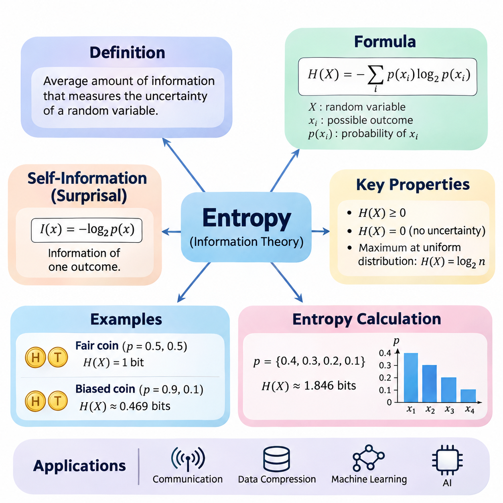
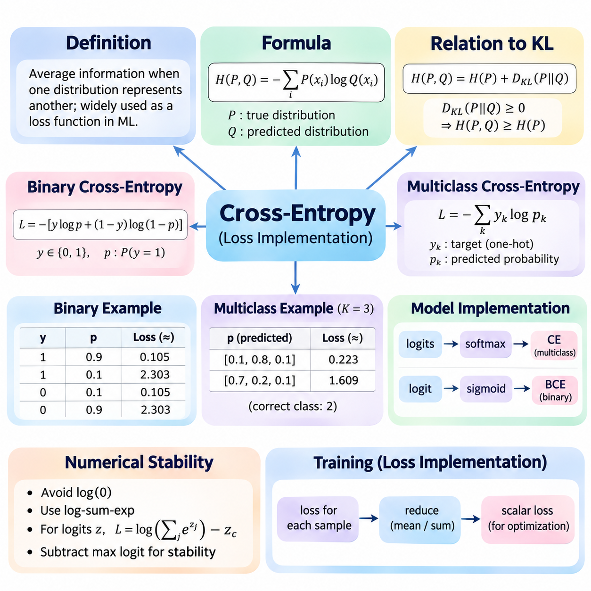
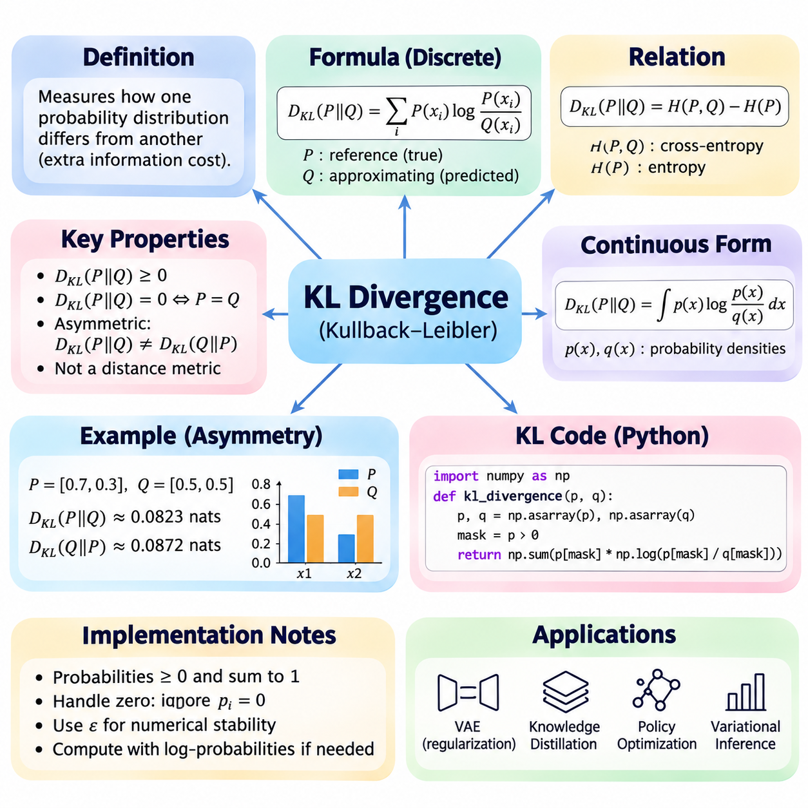
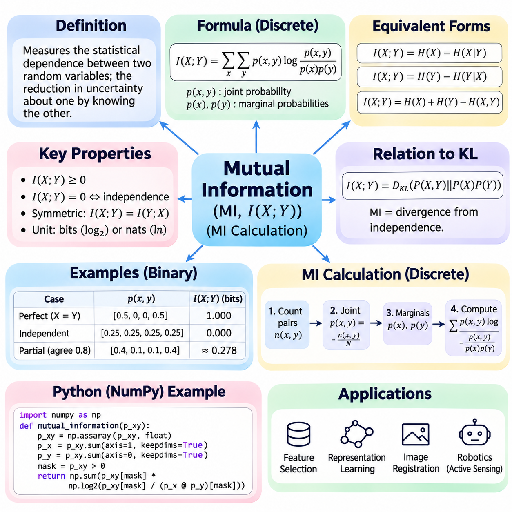
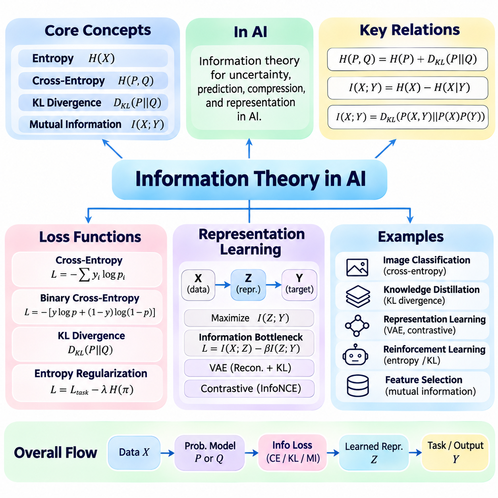

**Volume 05. Mathematics for AI**

# 05. Information Theory

## 05.00 Entropy

{width="7.268055555555556in" height="7.268055555555556in"}

Information theory provides a mathematical framework for measuring uncertainty, quantifying information, and understanding how probability distributions represent unpredictable events. Entropy is one of its fundamental concepts, describing the average amount of information associated with the possible outcomes of a random variable. It connects probability theory with communication, data compression, statistical learning, and artificial intelligence.

Entropy was introduced into information theory by Claude Shannon in 1948 as a mathematical measure of uncertainty in communication systems. The central idea is that an event conveys more information when it is less predictable. Observing an expected outcome provides relatively little new information, whereas observing an unlikely outcome provides more. Entropy summarizes this relationship across all possible outcomes of a probability distribution.

For a discrete random variable X with possible outcomes x₁, x₂, \..., xₙ and probabilities p(xᵢ), Shannon entropy is defined as H(X) = −Σᵢ p(xᵢ) log₂ p(xᵢ). The summation includes every possible outcome, and each probability contributes according to its magnitude and logarithm. The negative sign ensures that entropy remains nonnegative because the logarithm of a probability between zero and one is nonpositive.

The logarithmic base determines the unit used to express entropy. Base two produces bits, the conventional unit in digital communication and computing. Natural logarithms produce nats, which frequently appear in statistical inference and machine learning. Base ten produces decimal information units. Although the numerical values differ, changing the logarithmic base only rescales entropy and does not change its underlying interpretation.

Entropy measures uncertainty before an outcome becomes known. If a random variable always produces the same result, its entropy is zero because no uncertainty exists. If several outcomes are equally likely, entropy reaches its maximum for that number of possible outcomes. Consequently, entropy depends not simply on the number of possible events but on how probability is distributed among those events.

Consider a fair coin with two possible outcomes, heads and tails, each having probability 0.5. Its entropy is H(X) = −0.5 log₂(0.5) − 0.5 log₂(0.5) = 1 bit. This result means that observing the outcome provides an average of one bit of information. A fair coin represents the maximum entropy possible for a random variable containing exactly two outcomes.

A biased coin illustrates how unequal probabilities reduce uncertainty. Suppose the probability of heads is 0.9 and the probability of tails is 0.1. Its entropy becomes H(X) = −0.9 log₂(0.9) − 0.1 log₂(0.1), approximately 0.469 bits. Because heads occurs much more frequently, the outcome is easier to predict, and the average information obtained from each observation is smaller.

For a discrete random variable with n possible outcomes, maximum entropy occurs when every outcome has probability 1/n. Under this uniform distribution, H(X) = log₂(n). A fair six-sided die therefore has entropy log₂(6), approximately 2.585 bits. This property establishes a mathematical upper bound on uncertainty when the number of possible outcomes is fixed and finite.

An important mathematical convention concerns outcomes with zero probability. Although log₂(0) is undefined, the expression p log₂(p) approaches zero as p approaches zero from the positive side. Information theory therefore defines 0 log₂(0) = 0 when evaluating entropy. This convention allows distributions containing impossible outcomes to be handled without changing the contribution of outcomes that can actually occur.

The information associated with an individual outcome is called self-information or surprisal. It is defined as I(x) = −log₂ p(x), where p(x) is the probability of observing that outcome. Rare events have high surprisal because their probabilities are small, while common events have low surprisal. Shannon entropy is the expected value of this quantity, expressed as H(X) = E[I(X)].

Entropy is an expectation rather than a measure of the information contained in one particular observation. Individual outcomes may carry substantially different amounts of information, but entropy averages these values according to their occurrence probabilities. This distinction is essential when interpreting unpredictable events, because a distribution can have low entropy while still assigning a small probability to highly surprising outcomes.

The calculation of entropy begins by identifying the possible outcomes of a random variable and assigning a probability to each outcome. These probabilities must be nonnegative and sum to one. Each nonzero probability is multiplied by its logarithm, the resulting terms are added, and the negative of that sum gives entropy. The calculation is straightforward for small distributions and can be extended computationally to thousands of outcomes.

Consider a categorical variable with four possible outcomes having probabilities 0.4, 0.3, 0.2, and 0.1. Its entropy is H(X) = −[0.4 log₂(0.4) + 0.3 log₂(0.3) + 0.2 log₂(0.2) + 0.1 log₂(0.1)], approximately 1.846 bits. Because the probabilities are unequal, this value is below the maximum of 2 bits for four equally likely outcomes.

In practical applications, probability distributions are often estimated from observed data rather than known beforehand. If a dataset contains N observations and an outcome occurs nᵢ times, its empirical probability can be estimated as pᵢ = nᵢ/N. Substituting these estimated probabilities into the entropy formula produces empirical entropy. The quality of this estimate depends on sample size, sampling procedures, and how accurately the observations represent the underlying distribution.

Empirical entropy is particularly useful for categorical datasets such as class labels, discrete sensor states, and symbolic sequences. A dataset dominated by one category generally has lower label entropy than a dataset containing equally represented categories. However, entropy alone cannot determine whether a dataset is suitable for training, because it does not measure feature quality, labeling accuracy, sample independence, or the complexity of relationships between variables.

Entropy calculations can be implemented efficiently using numerical arrays and logarithmic operations. A typical computational procedure converts category frequencies into normalized probabilities, excludes zero-probability terms, evaluates the logarithm of each remaining probability, and computes the negative weighted sum. Vectorized numerical operations make this procedure suitable for repeated calculations across large datasets and model outputs.

Numerical stability becomes important when probabilities are extremely small. Direct logarithmic evaluation may produce negative infinity for zero probabilities, while limited floating-point precision can introduce rounding errors. Implementations should handle zero probabilities explicitly and use numerically stable operations where appropriate. Adding a small constant may prevent undefined logarithms, but it also changes the distribution and can introduce estimation bias.

The relationship between entropy and data compression provides an important practical interpretation. Shannon\'s source coding theorem establishes that the entropy of a discrete memoryless source is a lower bound on the expected number of bits per symbol for lossless uniquely decodable coding. Efficient coding methods assign shorter representations to frequent symbols and longer representations to rare symbols, approaching the theoretical limit under suitable conditions.

Entropy also appears in decision-tree learning, where it measures the uncertainty of class labels within a dataset or node. A node containing examples from a single class has zero label entropy, while a node containing several equally represented classes has higher entropy. Decision-tree algorithms can compare candidate splits by measuring how much each split reduces the expected uncertainty of the resulting subsets.

The reduction in entropy produced by observing additional information is closely related to information gain. In classification, a useful feature may reduce uncertainty about the target label, making the remaining distribution more predictable. This provides a mathematical explanation for selecting informative features or decision-tree splits. The effectiveness of such selections depends on the joint statistical relationships between the features and target variable.

Entropy is also relevant to probabilistic predictions generated by neural networks. A classifier typically produces a probability distribution over possible classes, and its predictive entropy can be calculated from those probabilities. A distribution concentrated on one class has low entropy, while a nearly uniform distribution has high entropy. Predictive entropy can indicate uncertainty, although it does not guarantee that the probabilities are calibrated or that the model is correct.

In robotics and autonomous systems, entropy can describe uncertainty in discrete estimates of environmental states, object identities, or possible actions. A perception system may assign probabilities to several competing object classifications, and entropy summarizes how dispersed those probabilities are. This information can support decisions about additional sensing or observation, although effective action selection also requires considering costs, risks, and expected information gains.

Entropy should not be confused with variance, even though both concepts describe aspects of uncertainty. Variance measures the expected squared deviation of numerical values from their mean, whereas entropy measures uncertainty through probabilities and logarithms. Entropy applies naturally to categorical variables without requiring numerical distances between outcomes. The two measures therefore capture different properties of probability distributions.

The discrete Shannon entropy formula also differs from differential entropy, which is defined for continuous random variables using probability density functions. Differential entropy can be negative and changes under coordinate scaling, unlike discrete entropy. Applying the discrete formula directly to arbitrary density values is therefore incorrect. Continuous distributions require their own mathematical treatment, particularly when comparing uncertainty across different measurement scales.

Understanding entropy establishes a foundation for more advanced information-theoretic concepts, including cross-entropy, Kullback--Leibler divergence, and mutual information. These quantities extend the study of uncertainty toward comparing distributions and measuring statistical dependence. Their applications include classification losses, generative modeling, representation learning, and probabilistic inference, where information-theoretic reasoning helps explain how learning systems process uncertainty.

Ultimately, entropy transforms the intuitive concept of unpredictability into a precise mathematical quantity. Its definition connects probability distributions with average information, while its calculation provides a practical method for evaluating uncertainty in data and predictions. By understanding both its theoretical properties and numerical implementation, practitioners gain an essential mathematical foundation for analyzing information in artificial intelligence systems.

## 05.01 Cross Entropy

{width="7.268055555555556in" height="7.268055555555556in"}

Cross-entropy is a fundamental concept in information theory that measures the average information required when one probability distribution is represented using another. It extends the concept of Shannon entropy by comparing a true distribution with an estimated distribution. In machine learning, cross-entropy is widely used as a loss function because it quantifies how effectively predicted probabilities represent actual outcomes.

The mathematical definition of cross-entropy involves two probability distributions, P and Q, defined over the same set of possible outcomes. P represents the true or reference distribution, while Q represents the predicted or approximating distribution. For discrete outcomes, cross-entropy is defined as H(P,Q) = −Σᵢ P(xᵢ) log Q(xᵢ), where the summation covers every possible outcome.

Cross-entropy differs from ordinary entropy because it evaluates probabilities from two distributions rather than one. Shannon entropy measures the inherent uncertainty of a distribution, whereas cross-entropy measures the expected information cost of using Q to represent outcomes generated according to P. When Q matches P, cross-entropy equals the entropy of P, establishing the minimum achievable value for a fixed true distribution.

The relationship between cross-entropy and Kullback--Leibler divergence provides an important mathematical interpretation. Cross-entropy can be decomposed as H(P,Q) = H(P) + D_KL(P\|\|Q), where H(P) is the entropy of the true distribution and D_KL measures the divergence between P and Q. Because KL divergence is nonnegative, cross-entropy cannot be smaller than the entropy of P.

In supervised learning, the true distribution is commonly represented by target labels, while the predicted distribution is generated by a machine learning model. Cross-entropy penalizes predictions that assign low probability to the correct outcome. A model that confidently predicts the correct class receives a small loss, whereas a model that confidently predicts an incorrect class receives a much larger loss.

For binary classification, the target variable y takes values of either zero or one, and the model predicts a probability p for the positive class. Binary cross-entropy is defined as L = −[y log(p) + (1−y) log(1−p)]. This expression evaluates the probability assigned to the observed class and provides a continuous, differentiable objective for optimizing classification models.

When the true binary label is one, binary cross-entropy simplifies to L = −log(p). If the model predicts p = 0.9, the loss is approximately 0.105 using natural logarithms. If the prediction decreases to p = 0.1, the loss increases to approximately 2.303. This behavior strongly penalizes incorrect predictions made with high confidence.

When the true binary label is zero, the loss becomes L = −log(1−p). A predicted positive-class probability of 0.1 produces a loss of approximately 0.105, while a probability of 0.9 produces approximately 2.303. Therefore, binary cross-entropy treats both classes consistently and encourages the model to assign high probability to the correct label.

Multiclass classification extends cross-entropy to problems containing more than two mutually exclusive categories. For K classes, categorical cross-entropy is defined as L = −Σₖ yₖ log(pₖ), where yₖ represents the target distribution and pₖ represents the predicted probability. When the target uses one-hot encoding, only the probability assigned to the correct class contributes directly to the loss.

Consider a three-class classification problem in which the correct class is the second category. If the model predicts probabilities [0.1, 0.8, 0.1], the cross-entropy loss is −log(0.8), approximately 0.223. If the predicted probabilities become [0.7, 0.2, 0.1], the loss increases to approximately 1.609, reflecting the reduced probability assigned to the correct class.

Neural networks commonly generate raw prediction scores called logits rather than normalized probabilities. For multiclass classification, the softmax function converts logits into a probability distribution whose components are nonnegative and sum to one. Cross-entropy then evaluates these probabilities against target labels. Combining softmax and cross-entropy produces a standard training objective for multiclass neural networks.

For binary classification, a sigmoid function converts a single logit into a probability between zero and one. Binary cross-entropy can then evaluate the predicted probability against the target label. However, practical implementations usually combine the sigmoid transformation and loss calculation into one numerically stable operation rather than computing them separately.

Numerical stability is essential because logarithms become problematic when predicted probabilities approach zero. Directly evaluating log(0) produces an undefined finite result, while extremely small probabilities can cause numerical overflow or underflow in intermediate calculations. Stable implementations use transformations such as log-sum-exp to evaluate cross-entropy without explicitly calculating unstable intermediate probabilities.

For multiclass logits z₁, z₂, \..., zₖ and a correct class index c, the cross-entropy loss can be written as L = log(Σⱼ exp(zⱼ)) − z_c. Numerically stable implementations subtract the maximum logit before evaluating exponentials. This transformation preserves the mathematical result while reducing the risk of overflow during computation.

Cross-entropy loss is typically calculated for each training example and then aggregated across a minibatch. The most common reduction computes the arithmetic mean of individual losses, producing a scalar objective for gradient-based optimization. Alternatively, losses may be summed or retained separately, depending on the training procedure and the requirements of the application.

The gradient of cross-entropy provides the information needed to update neural network parameters through backpropagation. When softmax is combined with categorical cross-entropy and one-hot targets, the derivative of the loss with respect to each logit simplifies to pₖ − yₖ. This convenient expression contributes to efficient optimization and explains why cross-entropy is widely used in neural network training.

Cross-entropy is closely related to maximum likelihood estimation. Minimizing the average negative log-likelihood of observed class labels is equivalent to minimizing categorical cross-entropy when the model predicts class probabilities. This connection provides a statistical interpretation of classification training: the model adjusts its parameters to assign greater likelihood to the observed training labels.

In practical deep learning frameworks, cross-entropy loss functions generally accept logits directly and perform the required normalization internally. For example, PyTorch provides CrossEntropyLoss for multiclass classification and BCEWithLogitsLoss for binary or independent multilabel classification. These implementations combine mathematical operations to improve numerical stability and simplify training code.

Correct input formatting is important when implementing cross-entropy. Multiclass classification commonly uses a matrix of logits with dimensions corresponding to batch size and number of classes, together with integer class indices. Binary classification commonly uses one logit per target and floating-point labels. Incorrect tensor shapes, label encodings, or repeated activation functions can produce misleading training results.

Cross-entropy can also support soft target distributions rather than only hard class labels. Label smoothing replaces strictly one-hot targets with distributions that allocate a small amount of probability to other classes. This approach can discourage excessive confidence and sometimes improve generalization or calibration, although its effectiveness depends on the dataset, model architecture, and training configuration.

Class imbalance introduces additional considerations when using cross-entropy. If some classes appear much more frequently than others, their contributions may dominate the average training objective. Weighted cross-entropy assigns different importance to classes or examples, allowing minority classes to influence optimization more strongly. However, inappropriate weighting can reduce calibration or degrade performance on other classes.

For multilabel classification, several classes may be simultaneously present in one observation. Independent binary cross-entropy losses are therefore commonly applied to each label rather than using a single softmax distribution. This distinction reflects the difference between mutually exclusive multiclass classification and multilabel prediction, where multiple positive outcomes are permitted.

Cross-entropy measures predictive performance through assigned probabilities, but it should not be interpreted as classification accuracy. Two models may produce identical predicted classes while assigning different confidence levels, resulting in different cross-entropy values. Consequently, cross-entropy is useful for training and probabilistic evaluation, while accuracy, precision, recall, and calibration metrics provide complementary information.

A low cross-entropy value generally indicates that the model assigns high probability to observed outcomes. However, low training loss does not guarantee strong generalization to unseen data. Overfitting may occur when a model memorizes training examples or becomes excessively confident. Validation loss, independent test data, and appropriate regularization are therefore necessary for reliable performance assessment.

Cross-entropy is also important in language modeling, where neural networks predict probability distributions over vocabulary tokens. The loss evaluates the probability assigned to each observed next token, and the average negative log-likelihood guides model training. When natural logarithms are used, exponentiating the average token-level cross-entropy produces perplexity, a common evaluation measure for probabilistic language models.

In computer vision, cross-entropy supports image classification, semantic segmentation, and other categorical prediction tasks. For semantic segmentation, the loss may be evaluated independently at each labeled pixel and aggregated across the image. This allows neural networks to learn spatially distributed class predictions while retaining the same underlying information-theoretic objective.

The practical implementation of cross-entropy requires careful coordination between target representation, model output, numerical precision, and loss reduction. Stable logits-based functions are generally preferable to manually applying activation functions followed by logarithms. Monitoring training and validation losses helps identify optimization problems, numerical instability, class imbalance, and possible overfitting.

Ultimately, cross-entropy connects information theory, probability estimation, and neural network optimization through a unified mathematical objective. Its interpretation as expected information cost explains why incorrect confident predictions receive strong penalties. Understanding its definition, gradients, numerical implementation, and practical limitations provides an essential foundation for designing reliable classification and probabilistic learning systems.

## 05.02 KL Divergence

{width="7.268055555555556in" height="7.268055555555556in"}

Kullback--Leibler divergence, commonly called KL divergence, is a fundamental concept in information theory that measures how one probability distribution differs from another. It quantifies the additional information cost associated with approximating a reference distribution using a different distribution. KL divergence is widely used in statistical inference, machine learning, generative modeling, and probabilistic optimization.

KL divergence was introduced by Solomon Kullback and Richard Leibler in 1951 as a measure of statistical discrepancy between probability distributions. Unlike entropy, which describes uncertainty within a single distribution, KL divergence compares two distributions directly. Its interpretation is based on the expected logarithmic difference between probabilities assigned to outcomes under a reference distribution and an approximating distribution.

For discrete probability distributions P and Q over the same outcome space, KL divergence is defined as D_KL(P\|\|Q) = Σᵢ P(xᵢ) log[P(xᵢ)/Q(xᵢ)]. Here, P represents the reference distribution and Q represents the approximating distribution. Each term is weighted by the probability assigned by P, meaning that outcomes considered important under the reference distribution contribute more strongly to the calculation.

The logarithmic base determines the unit of KL divergence. Natural logarithms express divergence in nats, while base-two logarithms express it in bits. Machine learning implementations commonly use natural logarithms because they integrate naturally with exponential probability models and gradient-based optimization. Changing the logarithmic base rescales the numerical result without changing the underlying comparison.

KL divergence is always nonnegative when properly defined, and it equals zero precisely when P and Q agree almost everywhere with respect to P. This property follows from Gibbs\' inequality and establishes an important mathematical foundation for distribution comparison. However, KL divergence is not a true distance metric because it is generally asymmetric and does not satisfy the triangle inequality.

The asymmetry of KL divergence means that D_KL(P\|\|Q) generally differs from D_KL(Q\|\|P). The first expression evaluates how well Q approximates outcomes generated by P, while the second reverses their roles. This distinction becomes important when designing optimization objectives because changing the direction of divergence can produce substantially different approximating distributions.

Consider two discrete distributions P = [0.7, 0.3] and Q = [0.5, 0.5]. Using natural logarithms, D_KL(P\|\|Q) = 0.7 ln(0.7/0.5) + 0.3 ln(0.3/0.5), approximately 0.0823 nats. Although the distributions are relatively similar, the positive divergence indicates that Q does not perfectly reproduce the probabilities represented by P.

Reversing the distributions produces D_KL(Q\|\|P) = 0.5 ln(0.5/0.7) + 0.5 ln(0.5/0.3), approximately 0.0872 nats. The difference between these results illustrates asymmetry even in a simple two-outcome problem. For more complex distributions, particularly those containing multiple modes or sharply concentrated probabilities, the directional difference can become much larger.

The relationship between KL divergence, entropy, and cross-entropy provides a useful interpretation. KL divergence satisfies D_KL(P\|\|Q) = H(P,Q) − H(P), where H(P,Q) denotes cross-entropy and H(P) denotes Shannon entropy. Thus, KL divergence measures the excess expected information cost incurred when using Q instead of the true distribution P.

When P assigns positive probability to an outcome for which Q assigns zero probability, D_KL(P\|\|Q) becomes infinite. This occurs because Q considers an event impossible even though P allows it to occur. Conversely, outcomes with P(x) = 0 contribute zero to the discrete summation. These conventions are essential for both mathematical correctness and reliable numerical implementations.

KL divergence can also be defined for continuous probability distributions using probability density functions. For densities p(x) and q(x), the expression becomes D_KL(P\|\|Q) = ∫ p(x) ln[p(x)/q(x)] dx. The integral extends over the relevant domain, and the divergence is infinite when P assigns positive probability to a region that Q assigns zero probability.

In practical numerical computation, KL divergence is often evaluated using arrays of probabilities. A typical implementation first verifies that both distributions contain nonnegative values and sum to one. It then identifies entries where the reference probability is positive, computes the logarithmic probability ratio, multiplies each ratio by the reference probability, and sums the resulting contributions.

Python implementations commonly use NumPy for KL divergence calculations because it supports efficient vectorized operations. A numerical function can accept two probability arrays, validate their dimensions, normalize them when appropriate, and calculate the weighted logarithmic ratios. Vectorization avoids explicit loops and improves computational efficiency when evaluating many distributions or large categorical spaces.

Handling zero probabilities requires particular attention during implementation. Directly calculating the logarithm of zero can generate negative infinity, while dividing by zero can produce infinite values. A robust implementation distinguishes mathematically infinite divergence from removable zero-probability contributions. Adding a small epsilon may prevent numerical exceptions, but it changes the original distributions and therefore introduces approximation error.

An alternative computational approach uses logarithmic probabilities directly rather than converting them into ordinary probabilities. This method is particularly valuable when probabilities are extremely small or produced by neural networks. Stable log-softmax operations allow models to calculate log probabilities without first constructing potentially underflowing exponential values.

KL divergence can be computed across batches of probability distributions. In machine learning, each training example may produce a separate reference and predicted distribution, allowing the divergence to be calculated independently for every sample. The resulting values can then be averaged or summed according to the training objective. The choice of reduction affects gradient magnitude and should remain consistent across experiments.

The gradient of KL divergence enables its use as a differentiable optimization objective. When P is fixed and Q depends on trainable model parameters, minimizing D_KL(P\|\|Q) encourages Q to approach P. Because the entropy of P remains constant, this optimization is equivalent to minimizing cross-entropy between P and Q. This relationship connects information-theoretic divergence directly to supervised learning.

KL divergence plays an important role in variational inference, where complex posterior distributions are approximated by simpler probability distributions. The optimization objective frequently minimizes D_KL(Q\|\|P), where Q is a variational approximation and P represents the target posterior. This direction is computationally useful in many settings, although it may favor approximations concentrated around dominant probability modes.

Variational autoencoders use KL divergence as a regularization component in their training objectives. The encoder produces an approximate posterior distribution over latent variables, while a prior distribution defines the desired latent-space structure. A KL divergence term encourages the approximate posterior to remain close to the prior, balancing representation flexibility with probabilistic regularization.

For a diagonal Gaussian approximate posterior with means μⱼ and variances σⱼ², compared against a standard normal prior, KL divergence has a convenient analytical form. The expression is D_KL = 0.5 Σⱼ(μⱼ² + σⱼ² − ln σⱼ² − 1). This closed-form calculation avoids numerical integration and is widely used in variational autoencoder implementations.

KL divergence also appears in knowledge distillation, where a smaller student model learns to reproduce the probability distribution generated by a larger teacher model. Instead of learning only from hard class labels, the student receives information about relative class probabilities. Minimizing divergence between teacher and student distributions can transfer useful predictive relationships that are not visible in one-hot targets.

In reinforcement learning, KL divergence can constrain changes between successive policies. A policy update that produces an excessively large distributional shift may destabilize training or reduce performance. KL-based penalties and trust-region methods help control how rapidly an agent changes its action probabilities, supporting more conservative and potentially stable optimization.

KL divergence is useful for comparing probability distributions produced by sensors, classifiers, language models, and generative systems. It can help identify distributional changes, evaluate approximation quality, or measure disagreement between probabilistic models. However, interpreting its magnitude requires attention to logarithmic units, distribution support, sample quality, and the direction of comparison.

Estimating KL divergence from finite datasets introduces additional challenges because the underlying probability distributions may be unknown. Empirical frequency estimates can become unreliable for rare outcomes, and zero counts can produce unstable calculations. Smoothing, density estimation, and probabilistic modeling can address some difficulties, but each method introduces assumptions that affect the estimated divergence.

KL divergence should not be interpreted as a universal measure of model quality. A small divergence indicates similarity under a particular probabilistic comparison, but it does not guarantee accurate decisions, robust generalization, or safe behavior. Different applications may require additional evaluation metrics, including calibration, predictive accuracy, uncertainty estimates, and task-specific performance measures.

Ultimately, KL divergence provides a mathematical foundation for measuring discrepancies between probability distributions and optimizing probabilistic models. Its asymmetry, nonnegativity, relationship to cross-entropy, and sensitivity to distribution support are essential properties. Understanding its theoretical definition and numerically stable implementation enables reliable use in modern artificial intelligence and statistical learning systems.

## 05.03 Mutual Information

{width="7.268055555555556in" height="7.268055555555556in"}

Mutual information is a fundamental concept in information theory that measures the statistical dependence between two random variables. It quantifies how much knowing one variable reduces uncertainty about another. Unlike entropy, which describes uncertainty within a single variable, mutual information evaluates shared information between variables. This makes it useful for feature selection, statistical learning, representation analysis, and artificial intelligence.

The mathematical foundation of mutual information involves two random variables, X and Y, with joint probability distribution P(X,Y) and marginal distributions P(X) and P(Y). Mutual information is defined as I(X;Y) = ΣₓΣᵧ p(x,y) log[p(x,y)/(p(x)p(y))]. The summation includes all possible outcome pairs with positive joint probability. The expression compares the observed joint distribution with the distribution expected under independence.

Mutual information can also be expressed using Shannon entropy. The relationship I(X;Y) = H(X) − H(X\|Y) shows that mutual information measures the reduction in uncertainty about X after observing Y. Equivalently, I(X;Y) = H(Y) − H(Y\|X). These expressions demonstrate that mutual information is symmetric, even though conditional entropy generally differs depending on which variable is conditioned upon.

Another important identity expresses mutual information through joint entropy. The equation I(X;Y) = H(X) + H(Y) − H(X,Y) combines the individual uncertainties of X and Y with their joint uncertainty. If two variables contain overlapping information, their joint entropy is smaller than the sum of their individual entropies. Mutual information measures this overlap without requiring a linear relationship.

Mutual information is always nonnegative and equals zero when the variables are statistically independent, assuming the distributions are properly defined. Independence implies p(x,y) = p(x)p(y), making every nonzero logarithmic ratio equal to one before taking its logarithm. Conversely, positive mutual information indicates statistical dependence, although it does not establish causality or identify the direction of influence.

The logarithmic base determines the measurement unit. Base-two logarithms express mutual information in bits, while natural logarithms express it in nats. Information-theoretic explanations frequently use bits because they connect directly to binary uncertainty and communication. Machine learning libraries often use natural logarithms for computational convenience. Changing the base rescales the result without changing the underlying dependence.

Consider two binary variables X and Y that always have identical values, with P(X=0)=P(X=1)=0.5. Their joint distribution assigns probability 0.5 to (0,0) and (1,1), and zero to the remaining pairs. Because knowing X completely determines Y, their mutual information is one bit. This example illustrates that perfect dependence between two equally likely binary outcomes eliminates conditional uncertainty.

Now consider two independent fair binary variables. Each of the four possible outcome pairs has probability 0.25, and each marginal probability equals 0.5. The joint probability therefore equals the product of the marginals for every pair. Substituting these values into the mutual information formula gives zero bits, confirming that observing either variable provides no information about the other.

For a partially dependent example, suppose two fair binary variables agree with probability 0.8 and disagree with probability 0.2. Their joint probabilities are 0.4, 0.1, 0.1, and 0.4. The mutual information is I(X;Y) = 1 − H₂(0.2), approximately 0.278 bits, where H₂ denotes binary entropy. This result lies between independence and perfect dependence.

Mutual information is closely related to Kullback--Leibler divergence. Specifically, I(X;Y) = D_KL(P(X,Y)\|\|P(X)P(Y)). This identity interprets mutual information as the divergence between the actual joint distribution and the joint distribution that would exist if the variables were independent. It also explains nonnegativity and provides a general foundation for measuring statistical dependence.

Calculating mutual information from a discrete dataset begins by identifying the possible values of both variables. The next step is constructing a joint frequency table that counts occurrences of each value pair. Dividing each count by the total number of observations produces empirical joint probabilities. Summing the joint probabilities across rows and columns yields the corresponding marginal distributions.

Once joint and marginal probabilities are available, mutual information can be calculated by evaluating p(x,y) log[p(x,y)/(p(x)p(y))] for every pair with positive joint probability. The resulting contributions are summed to obtain the final value. Terms with zero joint probability contribute zero by convention. This procedure provides a direct numerical implementation of the discrete mutual information formula.

Python implementations can use NumPy arrays to represent joint probability tables and compute marginal distributions. Row sums produce one marginal distribution, while column sums produce the other. An outer product of the marginals constructs the independent reference distribution. Elementwise logarithmic ratios, weighted by the joint probabilities, can then be summed to obtain mutual information.

Numerical stability is important when calculating mutual information from sparse datasets. Zero joint probabilities must be excluded from logarithmic calculations, and floating-point rounding can affect very small probabilities. Adding smoothing constants may prevent undefined operations, but it also modifies the estimated distribution. Reliable implementations distinguish mathematical zero contributions from numerical approximation errors.

Empirical mutual information estimates are sensitive to sample size and the number of possible outcomes. When the dataset contains many categories relative to its observations, random sampling fluctuations may create apparent dependence even between independent variables. Consequently, plug-in estimates based on frequency tables often exhibit positive finite-sample bias. Larger datasets and appropriate estimation methods can reduce this problem.

Mutual information can also be defined for continuous random variables using probability density functions. The expression becomes I(X;Y) = ∫∫ p(x,y) ln[p(x,y)/(p(x)p(y))] dx dy. Unlike the discrete case, the required densities are often unknown and must be estimated. Histogram methods, kernel density estimation, and nearest-neighbor estimators provide different approaches with distinct assumptions and limitations.

In machine learning, mutual information is frequently used for feature selection. A feature containing substantial information about a target variable may be useful for prediction, even when the relationship is nonlinear. Ranking features by mutual information can reveal dependencies that correlation coefficients might miss. However, individual feature scores do not necessarily capture redundancy or interactions among multiple features.

Mutual information differs from Pearson correlation because it measures general statistical dependence rather than only linear association. Two variables may have zero linear correlation while retaining strong nonlinear dependence. Mutual information can detect such relationships when estimated accurately. Nevertheless, its magnitude depends on the underlying distributions, and direct comparison across unrelated variables may require careful interpretation.

Conditional mutual information extends the concept by measuring dependence after accounting for a third variable. It is defined as I(X;Y\|Z) = H(X\|Z) − H(X\|Y,Z). This quantity evaluates how much additional information Y provides about X when Z is already known. Conditional mutual information is useful for analyzing feature redundancy, graphical models, and relationships influenced by contextual variables.

The data processing inequality provides an important theoretical constraint. If X, Y, and Z form a Markov chain X → Y → Z, then I(X;Z) ≤ I(X;Y). Processing Y into Z cannot increase the information that Z contains about X under this Markov structure. This principle helps explain limitations of representation transformations, communication channels, and information-preserving learning systems.

Mutual information is widely studied in representation learning, where models transform raw observations into latent features. A representation may be designed to retain information relevant to a prediction target while discarding unnecessary details. Information bottleneck methods formalize this tradeoff using mutual information objectives. Practical optimization often relies on approximations because exact mutual information can be difficult to calculate.

In computer vision, mutual information can measure relationships between image features, object labels, and learned representations. It has also been used in multimodal image registration, where the objective is to align images acquired using different sensing modalities. Because mutual information depends on statistical relationships rather than direct pixel equality, it can support comparisons between images with different intensity characteristics.

In robotics and autonomous systems, mutual information can quantify the expected value of sensor observations. A robot may evaluate how much a potential measurement could reduce uncertainty about an object, location, or environmental state. This supports active perception, sensor selection, and information-driven exploration. Practical decisions must also consider observation costs, motion constraints, and safety requirements.

Mutual information is not a causal measure and should not be interpreted as proof that one variable influences another. Shared information may arise from direct interaction, common causes, or indirect statistical relationships. Furthermore, estimation errors and dataset bias can create misleading dependence measurements. Sound analysis therefore combines mutual information with domain knowledge, validation procedures, and appropriate statistical assumptions.

Ultimately, mutual information provides a unified mathematical framework for quantifying shared information between random variables. Its relationships with entropy, conditional entropy, and KL divergence establish a foundation for both theoretical analysis and practical computation. Understanding discrete calculations, continuous estimation, numerical stability, and statistical limitations enables reliable applications in modern artificial intelligence systems.

## 05.04 Information Theory in AI

{width="7.268055555555556in" height="7.268055555555556in"}

Information theory provides a mathematical foundation for understanding uncertainty, prediction, and information processing in artificial intelligence. Its central concepts, including entropy, cross-entropy, KL divergence, and mutual information, connect probability distributions with learning objectives. These concepts help explain how AI models evaluate predictions, compress observations, construct representations, and preserve information relevant to specific tasks.

Loss functions translate differences between model predictions and desired outcomes into numerical objectives for optimization. Information-theoretic loss functions are especially useful when models generate probability distributions rather than deterministic outputs. By measuring uncertainty or distributional disagreement, they provide differentiable training signals that guide neural network parameters toward statistically meaningful predictions.

Cross-entropy is one of the most widely used information-theoretic loss functions in supervised learning. For a target distribution P and predicted distribution Q, it is defined as H(P,Q) = −Σᵢ P(xᵢ) log Q(xᵢ). Minimizing this expression encourages the model to assign high probability to observed targets. In classification, incorrect predictions made with high confidence receive particularly large penalties.

Binary cross-entropy supports tasks involving two possible outcomes or independent binary labels. Its standard form is L = −[y log(p) + (1−y) log(1−p)], where y represents the target and p represents the predicted positive-class probability. Multiclass classification instead commonly uses softmax cross-entropy. Stable implementations combine activation transformations and logarithmic calculations to prevent numerical overflow and underflow.

KL divergence provides another important loss component by measuring differences between probability distributions. It is defined as D_KL(P\|\|Q) = Σᵢ P(xᵢ) log[P(xᵢ)/Q(xᵢ)]. Unlike a symmetric distance metric, KL divergence depends on the direction of comparison. It appears in variational inference, knowledge distillation, policy optimization, and probabilistic regularization, where models must approximate or constrain distributions.

The relationship H(P,Q) = H(P) + D_KL(P\|\|Q) connects cross-entropy with KL divergence. When the target distribution P is fixed, minimizing cross-entropy is equivalent to minimizing D_KL(P\|\|Q), because H(P) remains constant. This identity explains why classification training can be interpreted as distribution matching. It also highlights the importance of distinguishing predictive uncertainty from disagreement between distributions.

Entropy itself can become part of an optimization objective when controlling the uncertainty of model outputs. Entropy regularization may encourage exploration by preventing action probabilities from collapsing prematurely onto one choice. Conversely, entropy minimization can encourage confident predictions in selected learning settings. The appropriate direction depends on the task, available supervision, and consequences of incorrect confidence.

Information-theoretic losses require careful implementation because predicted probabilities may approach zero. Direct logarithmic evaluation can produce undefined or infinite intermediate values. Log-softmax, log-sum-exp, and logits-based loss functions provide more stable calculations. Loss reduction, class weighting, target encoding, and numerical precision must also be consistent with the intended probabilistic model and training procedure.

Representation learning aims to transform raw observations into useful features that preserve relevant information while reducing unnecessary complexity. Neural networks construct latent representations from images, text, audio, and sensor measurements. Information theory provides tools for examining what these representations retain, discard, or share with target variables. A useful representation should support the intended task without requiring every detail of the original input.

Mutual information measures statistical dependence between variables and is defined as I(X;Y) = H(X) − H(X\|Y). In representation learning, X may represent the original observation, Z a learned representation, and Y a prediction target. Maximizing I(Z;Y) encourages representations that retain information about the target. However, maximizing mutual information alone does not guarantee robustness, interpretability, or efficient generalization.

The information bottleneck principle formalizes a balance between compression and predictive usefulness. A common objective is L = I(X;Z) − βI(Z;Y), where β controls the tradeoff between retaining target information and limiting dependence on the original input. Minimizing this objective encourages compact representations that preserve predictive information. Practical implementations often replace exact mutual information with tractable approximations or variational bounds.

Variational autoencoders illustrate information-theoretic regularization in generative representation learning. Their training objectives combine reconstruction quality with KL divergence between an approximate latent posterior and a prior distribution. The reconstruction term encourages preservation of information needed to reproduce observations, while KL regularization constrains the latent distribution. Their relative weighting affects reconstruction accuracy and representation structure.

Contrastive representation learning also has connections to mutual information. Models learn representations by distinguishing related observations from unrelated alternatives. Objectives such as InfoNCE can provide lower bounds on mutual information under suitable sampling assumptions. However, successful contrastive learning does not require exact mutual information estimation, and representation quality depends strongly on sampling, augmentations, and training design.

Information theory also supports feature selection by measuring how much a candidate feature reveals about a target variable. Features with high mutual information may contain predictive relationships that linear correlation cannot detect. Conditional mutual information can evaluate additional information after accounting for previously selected features. These methods help reduce redundant inputs, although finite-sample estimation bias must be considered.

A classification example illustrates the practical meaning of cross-entropy. Suppose a three-class model predicts probabilities [0.1, 0.8, 0.1], and the second class is correct. The loss is −ln(0.8), approximately 0.223. If the correct-class probability falls to 0.2, the loss becomes approximately 1.609. The larger penalty encourages the model to assign greater probability to the observed class during optimization.

A knowledge distillation example uses KL divergence to transfer predictive information from a teacher model to a smaller student model. The teacher produces a probability distribution across classes, and the student learns to approximate that distribution. Unlike training exclusively with hard labels, distillation exposes relative probabilities among alternatives. Temperature scaling and appropriate loss weighting influence the transferred information.

In image classification, information-theoretic objectives help models distinguish objects while handling uncertain predictions. Cross-entropy trains class probabilities, while entropy can summarize the uncertainty of individual predictions. A low-entropy output indicates concentrated probabilities but does not necessarily imply correctness. Reliable evaluation therefore combines loss measurements with accuracy, calibration, and performance on independent test datasets.

Semantic segmentation extends categorical cross-entropy to spatially distributed predictions. Each pixel may have a probability distribution over semantic classes, and the training objective aggregates losses across labeled pixels. Class weighting or alternative objectives may be necessary when background pixels dominate the dataset. Information-theoretic losses provide probabilistic supervision but do not directly measure geometric boundary accuracy.

Language modeling provides another important application. A model predicts probability distributions over possible next tokens, and cross-entropy evaluates the probability assigned to observed tokens. Minimizing average token-level negative log-likelihood improves probabilistic prediction on the training distribution. Perplexity, obtained by exponentiating average cross-entropy measured in nats, summarizes predictive uncertainty but does not measure factual reliability.

In reinforcement learning, entropy regularization encourages stochastic policies to explore alternative actions. KL divergence can constrain policy updates by penalizing large changes between successive action distributions. These mechanisms balance exploration, exploitation, and optimization stability. Their effectiveness depends on reward design, environment dynamics, policy representation, and the selected regularization coefficients.

Robotics and autonomous systems can use information theory for active perception and sensor selection. A robot may choose an observation expected to reduce uncertainty about its location, surrounding objects, or environmental conditions. Expected information gain measures the anticipated reduction in entropy. Practical decision-making must additionally account for sensing costs, computational latency, physical constraints, and operational safety.

Information theory also contributes to multimodal learning, where models combine information from cameras, microphones, LiDAR, and other sensors. Mutual information can characterize statistical relationships between modalities, while learned representations may preserve complementary information. However, maximizing shared information alone may discard modality-specific details that remain essential for perception, localization, or control.

The practical value of information-theoretic methods depends on accurate probability modeling and reliable estimation. Finite datasets, class imbalance, distribution shift, and poorly calibrated outputs can distort information measurements. Continuous-variable mutual information is especially challenging to estimate in high-dimensional spaces. Therefore, theoretical objectives should be accompanied by numerical validation and task-specific performance evaluation.

Ultimately, information theory connects AI loss functions, representation learning, and practical applications through the mathematics of uncertainty and statistical dependence. Cross-entropy guides probabilistic prediction, KL divergence supports distribution matching, and mutual information evaluates shared information. Together, these concepts provide a foundation for designing learning systems that manage uncertainty, preserve useful information, and optimize meaningful objectives.
