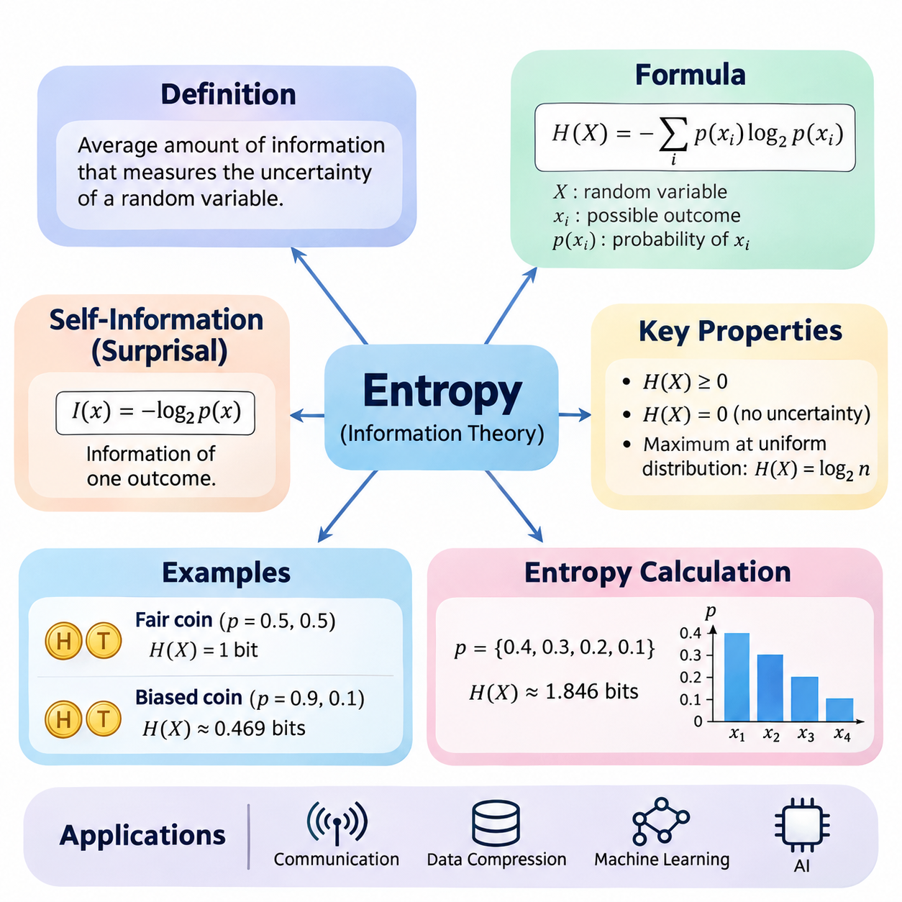
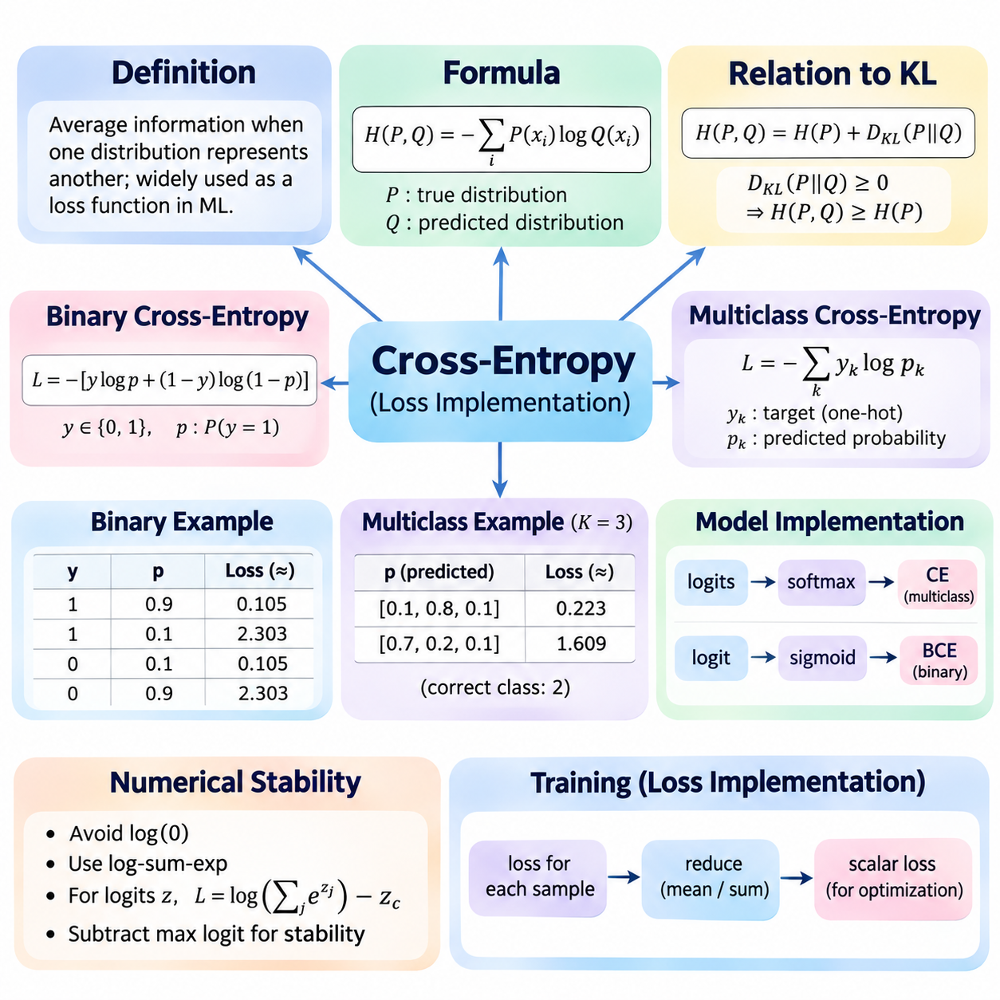
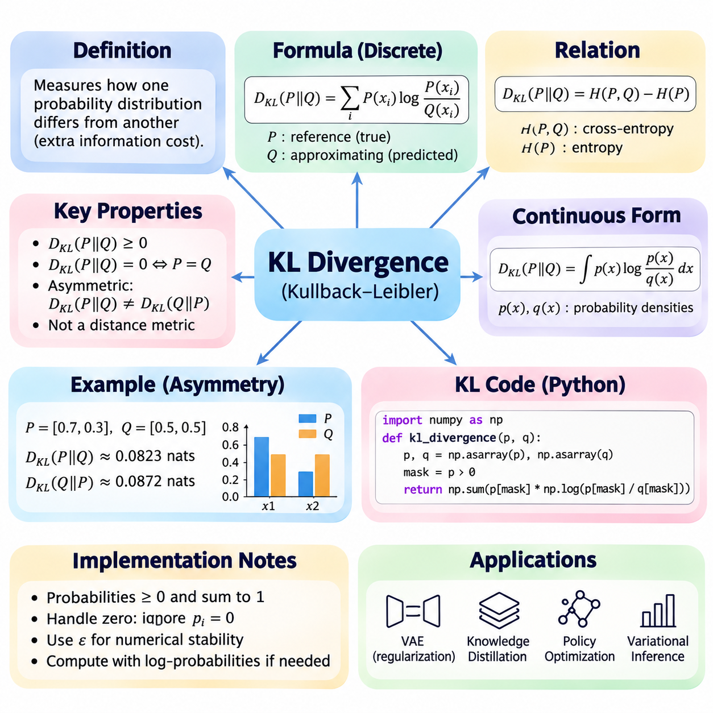
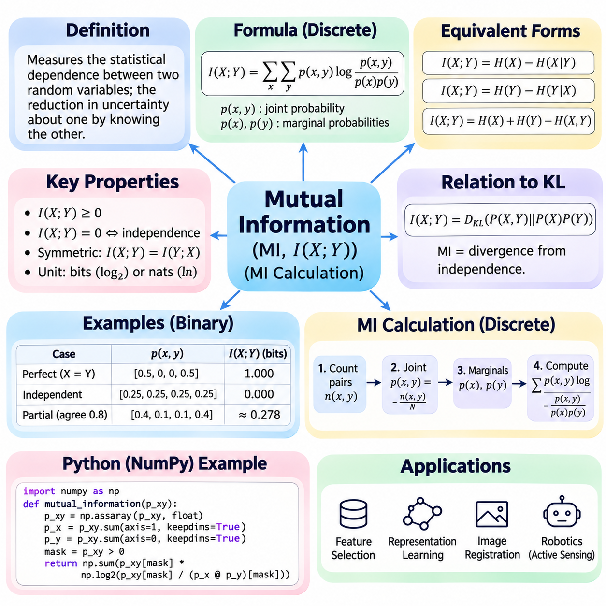
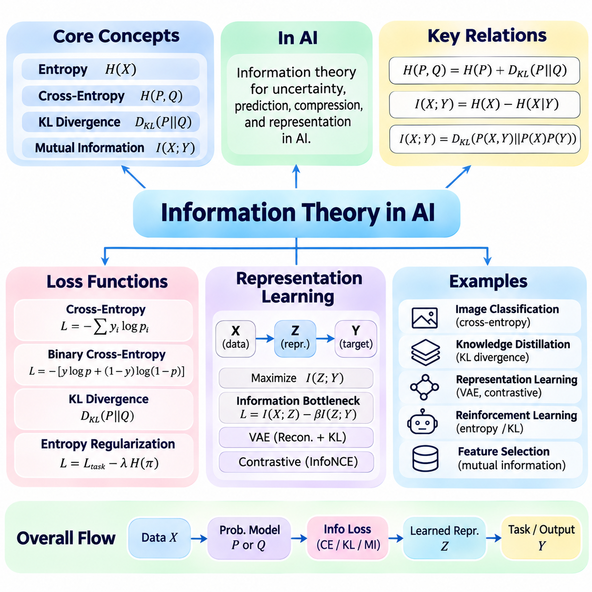

**Volume 05. Mathematics for AI**

# 05. Information Theory

## 05.00 Entropy

{width="7.268055555555556in" height="7.268055555555556in"}

정보 이론(Information Theory)은 불확실성(Uncertainty)을 측정하고, 정보(Information)를 정량화하며, 확률 분포(Probability Distribution)가 예측하기 어려운 사건을 어떻게 표현하는지 이해하기 위한 수학적 체계(Mathematical Framework)를 제공합니다. 엔트로피(Entropy)는 정보 이론의 핵심 개념 중 하나로, 확률 변수(Random Variable)의 가능한 결과와 관련된 평균 정보량(Average Information)을 나타냅니다. 이는 확률 이론(Probability Theory)을 통신(Communication), 데이터 압축(Data Compression), 통계적 학습(Statistical Learning), 인공지능(Artificial Intelligence)과 연결합니다.

엔트로피(Entropy)는 1948년 클로드 섀넌(Claude Shannon)이 통신 시스템(Communication System)의 불확실성을 수학적으로 측정하기 위해 정보 이론(Information Theory)에 도입한 개념입니다. 핵심 원리는 사건의 예측 가능성(Predictability)이 낮을수록 해당 사건이 더 많은 정보를 전달한다는 것입니다. 예상했던 결과를 관측하면 새로운 정보가 상대적으로 적지만, 발생 가능성이 낮은 결과를 관측하면 더 많은 정보를 얻게 됩니다. 엔트로피는 확률 분포(Probability Distribution)의 모든 가능한 결과에 걸쳐 이러한 관계를 요약합니다.

가능한 결과가 x₁, x₂, \..., xₙ이고 각각의 확률이 p(xᵢ)인 이산 확률 변수(Discrete Random Variable) X에 대해, 섀넌 엔트로피(Shannon Entropy)는 H(X) = −Σᵢ p(xᵢ) log₂ p(xᵢ)로 정의됩니다. 합산(Summation)은 모든 가능한 결과를 포함하며, 각 확률은 자신의 크기와 로그값(Logarithm)에 따라 엔트로피에 기여합니다. 0과 1 사이의 확률에 대한 로그값은 0 이하이므로, 음의 부호(Negative Sign)를 사용하여 엔트로피가 음수가 되지 않도록 합니다.

로그의 밑(Logarithmic Base)은 엔트로피를 표현하는 단위(Unit)를 결정합니다. 밑이 2인 경우 비트(Bit)를 사용하며, 이는 디지털 통신(Digital Communication)과 컴퓨팅(Computing)에서 일반적으로 사용됩니다. 자연로그(Natural Logarithm)를 사용하면 냇(Nat) 단위가 되며, 통계적 추론(Statistical Inference)과 머신러닝(Machine Learning)에서 자주 등장합니다. 밑이 10이면 십진 정보 단위(Decimal Information Unit)를 사용합니다. 로그의 밑이 달라져도 엔트로피의 기본적인 의미는 변하지 않으며 수치적 크기만 달라집니다.

엔트로피(Entropy)는 결과를 알기 이전의 불확실성(Uncertainty)을 측정합니다. 확률 변수(Random Variable)가 항상 동일한 결과를 생성한다면 불확실성이 존재하지 않으므로 엔트로피는 0입니다. 여러 결과가 동일한 확률로 발생한다면, 해당 결과 수에 대해 엔트로피는 최댓값(Maximum Value)에 도달합니다. 따라서 엔트로피는 가능한 사건의 개수뿐 아니라 사건들 사이에 확률이 어떻게 분포되어 있는지에 따라 결정됩니다.

앞면(Heads)과 뒷면(Tails)이 각각 0.5의 확률로 발생하는 공정한 동전(Fair Coin)을 생각할 수 있습니다. 이 동전의 엔트로피는 H(X) = −0.5 log₂(0.5) − 0.5 log₂(0.5) = 1비트(Bit)입니다. 이는 동전의 결과를 관측했을 때 평균적으로 1비트의 정보를 얻는다는 의미입니다. 공정한 동전은 정확히 두 가지 결과를 가지는 확률 변수(Random Variable)에서 가능한 최대 엔트로피(Maximum Entropy)를 나타냅니다.

편향된 동전(Biased Coin)은 확률의 불균형이 불확실성을 어떻게 감소시키는지 보여줍니다. 앞면이 나올 확률이 0.9이고 뒷면이 나올 확률이 0.1이라고 가정하면, 엔트로피는 H(X) = −0.9 log₂(0.9) − 0.1 log₂(0.1)이며 약 0.469비트(Bit)가 됩니다. 앞면이 훨씬 자주 발생하므로 결과를 예측하기 쉬워지고, 각 관측에서 얻는 평균 정보량(Average Information)은 감소합니다.

가능한 결과가 n개인 이산 확률 변수(Discrete Random Variable)는 모든 결과의 확률이 1/n인 경우 최대 엔트로피(Maximum Entropy)를 가집니다. 이러한 균등 분포(Uniform Distribution)에서는 H(X) = log₂(n)이 성립합니다. 따라서 공정한 6면체 주사위(Fair Six-Sided Die)의 엔트로피는 log₂(6)으로 약 2.585비트(Bit)입니다. 이 성질은 가능한 결과의 개수가 유한하고 고정되어 있을 때 불확실성의 수학적 상한(Upper Bound)을 제공합니다.

엔트로피 계산(Entropy Calculation)에서 중요한 수학적 관례(Mathematical Convention)는 확률이 0인 결과를 처리하는 방법입니다. log₂(0)은 정의되지 않지만, p가 양의 방향에서 0에 접근하면 p log₂(p)는 0으로 수렴합니다. 따라서 정보 이론(Information Theory)에서는 엔트로피를 계산할 때 0 log₂(0) = 0으로 정의합니다. 이를 통해 실제로 발생할 수 없는 결과가 포함된 확률 분포도 올바르게 처리할 수 있습니다.

개별 결과와 관련된 정보량은 자기 정보량(Self-Information) 또는 놀람도(Surprisal)라고 합니다. 이는 I(x) = −log₂ p(x)로 정의되며, 여기서 p(x)는 해당 결과가 발생할 확률입니다. 드문 사건은 확률이 작으므로 놀람도가 높고, 자주 발생하는 사건은 놀람도가 낮습니다. 섀넌 엔트로피(Shannon Entropy)는 이러한 자기 정보량의 기댓값(Expected Value)으로, H(X) = E[I(X)]로 표현됩니다.

엔트로피(Entropy)는 특정 관측 하나에 포함된 정보량이 아니라 기댓값(Expectation)입니다. 개별 결과는 서로 다른 정보량을 전달할 수 있지만, 엔트로피는 각 결과의 발생 확률에 따라 정보량을 가중 평균(Weighted Average)합니다. 이러한 차이는 예측하기 어려운 사건을 해석할 때 중요합니다. 엔트로피가 낮은 분포에서도 발생 확률은 작지만 매우 놀라운 결과가 나타날 수 있기 때문입니다.

엔트로피 계산(Entropy Calculation)은 확률 변수(Random Variable)의 가능한 결과를 식별하고 각 결과에 확률을 부여하는 과정에서 시작됩니다. 모든 확률은 0 이상이어야 하며 합계는 1이어야 합니다. 0이 아닌 각 확률에 해당 확률의 로그값을 곱하고, 계산된 항을 모두 합산한 다음 음의 부호를 적용하면 엔트로피가 됩니다. 이 계산은 작은 분포에서는 간단하며, 컴퓨터를 사용하면 수천 개의 결과로 확장할 수 있습니다.

네 가지 가능한 결과의 확률이 각각 0.4, 0.3, 0.2, 0.1인 범주형 변수(Categorical Variable)를 생각해 보겠습니다. 엔트로피는 H(X) = −[0.4 log₂(0.4) + 0.3 log₂(0.3) + 0.2 log₂(0.2) + 0.1 log₂(0.1)]이며 약 1.846비트(Bit)입니다. 각 결과의 확률이 동일하지 않으므로 이 값은 네 가지 결과가 동일한 확률로 발생할 때의 최대 엔트로피인 2비트보다 작습니다.

실제 응용(Application)에서는 확률 분포(Probability Distribution)를 사전에 알고 있기보다 관측 데이터(Observed Data)에서 추정하는 경우가 많습니다. 데이터셋(Dataset)에 N개의 관측값이 있고 특정 결과가 nᵢ번 발생했다면, 경험적 확률(Empirical Probability)은 pᵢ = nᵢ/N으로 추정할 수 있습니다. 이러한 추정 확률을 엔트로피 공식에 대입하면 경험적 엔트로피(Empirical Entropy)를 얻습니다. 추정의 품질은 표본 크기(Sample Size), 표본 추출 방법(Sampling Procedure), 실제 분포에 대한 대표성에 영향을 받습니다.

경험적 엔트로피(Empirical Entropy)는 클래스 레이블(Class Label), 이산 센서 상태(Discrete Sensor State), 기호 시퀀스(Symbolic Sequence)와 같은 범주형 데이터셋(Categorical Dataset)에 유용합니다. 하나의 범주가 대부분을 차지하는 데이터셋은 여러 범주가 균등하게 나타나는 데이터셋보다 일반적으로 레이블 엔트로피(Label Entropy)가 낮습니다. 그러나 엔트로피만으로 데이터셋의 학습 적합성을 판단할 수는 없습니다. 특징 품질(Feature Quality), 레이블 정확도(Label Accuracy), 표본 독립성(Sample Independence), 변수 간 관계의 복잡성을 측정하지 않기 때문입니다.

엔트로피 계산(Entropy Calculation)은 수치 배열(Numerical Array)과 로그 연산(Logarithmic Operation)을 이용하여 효율적으로 구현할 수 있습니다. 일반적인 계산 절차는 범주별 빈도(Frequency)를 정규화된 확률(Normalized Probability)로 변환하고, 확률이 0인 항을 제외한 다음, 나머지 확률의 로그값을 계산하여 음의 가중합(Negative Weighted Sum)을 구하는 방식입니다. 벡터화 연산(Vectorized Operation)을 사용하면 대규모 데이터셋과 모델 출력에 대해 반복 계산을 효율적으로 수행할 수 있습니다.

확률이 매우 작을 때는 수치 안정성(Numerical Stability)이 중요해집니다. 확률이 0인 값에 직접 로그 연산을 적용하면 음의 무한대(Negative Infinity)가 발생할 수 있으며, 제한된 부동소수점 정밀도(Floating-Point Precision)는 반올림 오차(Rounding Error)를 유발할 수 있습니다. 따라서 구현 과정에서는 확률이 0인 경우를 명시적으로 처리하고 안정적인 수치 연산을 사용해야 합니다. 작은 상수(Small Constant)를 추가하면 정의되지 않는 로그값을 방지할 수 있지만, 확률 분포를 변경하여 추정 편향(Estimation Bias)을 발생시킬 수도 있습니다.

엔트로피(Entropy)와 데이터 압축(Data Compression)의 관계는 중요한 실용적 해석을 제공합니다. 섀넌의 소스 부호화 정리(Shannon\'s Source Coding Theorem)에 따르면 이산 무기억 정보원(Discrete Memoryless Source)의 엔트로피는 손실 없는 유일 복호 가능 부호화(Lossless Uniquely Decodable Coding)에서 기호당 평균 비트 수의 하한(Lower Bound)이 됩니다. 효율적인 부호화 방법은 자주 발생하는 기호에 짧은 표현을, 드문 기호에 긴 표현을 할당하여 적절한 조건에서 이론적 한계에 접근합니다.

엔트로피(Entropy)는 의사결정 트리 학습(Decision-Tree Learning)에서도 사용되며, 데이터셋이나 노드(Node)에 포함된 클래스 레이블(Class Label)의 불확실성을 측정합니다. 하나의 클래스만 포함하는 노드는 레이블 엔트로피가 0이고, 여러 클래스가 균등하게 포함된 노드는 높은 엔트로피를 가집니다. 의사결정 트리 알고리즘(Decision-Tree Algorithm)은 후보 분할(Candidate Split)이 생성하는 하위 집합의 기대 불확실성을 얼마나 감소시키는지 비교할 수 있습니다.

추가 정보를 관측하여 엔트로피(Entropy)가 감소하는 현상은 정보 이득(Information Gain)과 밀접하게 관련됩니다. 분류(Classification)에서 유용한 특징(Feature)은 목표 레이블(Target Label)에 대한 불확실성을 감소시켜 나머지 확률 분포를 더 예측 가능하게 만듭니다. 이는 유익한 특징을 선택하거나 의사결정 트리의 분할을 결정하는 수학적 근거를 제공합니다. 이러한 선택의 효과는 특징과 목표 변수 사이의 결합 통계적 관계(Joint Statistical Relationship)에 따라 달라집니다.

엔트로피(Entropy)는 신경망(Neural Network)이 생성하는 확률적 예측(Probabilistic Prediction)에서도 중요합니다. 분류기(Classifier)는 일반적으로 가능한 클래스에 대한 확률 분포를 출력하며, 이 확률로부터 예측 엔트로피(Predictive Entropy)를 계산할 수 있습니다. 특정 클래스에 확률이 집중되면 엔트로피가 낮고, 거의 균등하게 분포하면 엔트로피가 높습니다. 예측 엔트로피는 불확실성을 나타낼 수 있지만, 확률이 올바르게 보정되었거나 모델의 예측이 정확하다는 것을 보장하지는 않습니다.

로보틱스(Robotics)와 자율 시스템(Autonomous System)에서 엔트로피(Entropy)는 환경 상태(Environmental State), 객체 식별(Object Identity), 가능한 행동(Possible Action)에 대한 이산 추정(Discrete Estimation)의 불확실성을 표현할 수 있습니다. 인식 시스템(Perception System)은 여러 객체 분류 후보에 확률을 할당하며, 엔트로피는 이러한 확률이 얼마나 분산되어 있는지 요약합니다. 이 정보는 추가 감지(Sensing)나 관측(Observation)의 필요성을 판단하는 데 활용될 수 있지만, 효과적인 행동 선택에는 비용(Cost), 위험(Risk), 기대 정보 이득(Expected Information Gain)도 고려해야 합니다.

엔트로피(Entropy)는 분산(Variance)과 혼동해서는 안 됩니다. 두 개념 모두 불확실성의 일부 특성을 설명하지만 측정 대상이 다릅니다. 분산은 수치값이 평균(Mean)에서 얼마나 떨어져 있는지를 제곱 편차(Squared Deviation)의 기댓값으로 측정하는 반면, 엔트로피는 확률과 로그를 통해 불확실성을 측정합니다. 엔트로피는 결과 사이의 수치적 거리(Numerical Distance)를 요구하지 않으므로 범주형 변수(Categorical Variable)에 자연스럽게 적용됩니다. 따라서 두 측정값은 확률 분포의 서로 다른 특성을 나타냅니다.

이산 섀넌 엔트로피(Discrete Shannon Entropy)의 공식은 연속 확률 변수(Continuous Random Variable)에 적용되는 미분 엔트로피(Differential Entropy)와도 구별됩니다. 미분 엔트로피는 확률 밀도 함수(Probability Density Function)를 이용하여 정의되며, 이산 엔트로피와 달리 음수가 될 수 있고 좌표 스케일링(Coordinate Scaling)에 따라 값이 변합니다. 따라서 임의의 확률 밀도값에 이산 엔트로피 공식을 직접 적용하는 것은 올바르지 않습니다. 연속 분포(Continuous Distribution)는 별도의 수학적 처리가 필요합니다.

엔트로피(Entropy)를 이해하면 교차 엔트로피(Cross-Entropy), 쿨백--라이블러 발산(Kullback--Leibler Divergence), 상호 정보량(Mutual Information)과 같은 고급 정보 이론 개념을 학습할 수 있는 기반이 마련됩니다. 이러한 개념은 불확실성의 분석을 확률 분포 간 비교와 통계적 의존성(Statistical Dependence)의 측정으로 확장합니다. 주요 응용 분야에는 분류 손실 함수(Classification Loss Function), 생성 모델링(Generative Modeling), 표현 학습(Representation Learning), 확률적 추론(Probabilistic Inference)이 포함됩니다.

궁극적으로 엔트로피(Entropy)는 예측 불가능성(Unpredictability)이라는 직관적인 개념을 정밀한 수학적 수량(Mathematical Quantity)으로 변환합니다. 엔트로피의 정의는 확률 분포(Probability Distribution)를 평균 정보량(Average Information)과 연결하며, 계산 방법은 데이터와 예측의 불확실성을 평가하는 실용적인 수단을 제공합니다. 이론적 성질(Theoretical Property)과 수치적 구현(Numerical Implementation)을 함께 이해하면 인공지능 시스템에서 정보를 분석하기 위한 필수적인 수학적 기초(Mathematical Foundation)를 확보할 수 있습니다.

## 05.01 Cross Entropy

{width="7.268055555555556in" height="7.268055555555556in"}

교차 엔트로피(Cross-Entropy)는 하나의 확률 분포(Probability Distribution)를 다른 확률 분포로 표현할 때 필요한 평균 정보량(Average Information)을 측정하는 정보 이론(Information Theory)의 핵심 개념입니다. 이는 실제 분포(True Distribution)와 추정 분포(Estimated Distribution)를 비교함으로써 섀넌 엔트로피(Shannon Entropy)의 개념을 확장합니다. 머신러닝(Machine Learning)에서 교차 엔트로피는 예측 확률(Predicted Probability)이 실제 결과(Actual Outcome)를 얼마나 효과적으로 표현하는지 정량화하므로 손실 함수(Loss Function)로 널리 사용됩니다.

교차 엔트로피(Cross-Entropy)의 수학적 정의(Mathematical Definition)는 동일한 가능한 결과 집합에 대해 정의된 두 확률 분포 P와 Q를 사용합니다. P는 실제 분포(True Distribution) 또는 기준 분포(Reference Distribution)를 나타내며, Q는 예측 분포(Predicted Distribution) 또는 근사 분포(Approximating Distribution)를 나타냅니다. 이산 결과(Discrete Outcome)에 대한 교차 엔트로피는 H(P,Q) = −Σᵢ P(xᵢ) log Q(xᵢ)로 정의되며, 합산은 모든 가능한 결과를 포함합니다.

교차 엔트로피(Cross-Entropy)는 하나의 확률 분포가 아닌 두 확률 분포를 이용하여 평가한다는 점에서 일반적인 엔트로피(Entropy)와 다릅니다. 섀넌 엔트로피(Shannon Entropy)는 확률 분포 자체의 고유한 불확실성(Inherent Uncertainty)을 측정하는 반면, 교차 엔트로피는 P에 따라 생성된 결과를 Q로 표현할 때 발생하는 기대 정보 비용(Expected Information Cost)을 측정합니다. Q가 P와 일치하면 교차 엔트로피는 P의 엔트로피와 같아지며, 이는 고정된 실제 분포에서 달성 가능한 최솟값입니다.

교차 엔트로피(Cross-Entropy)와 쿨백--라이블러 발산(Kullback--Leibler Divergence)의 관계는 중요한 수학적 해석(Mathematical Interpretation)을 제공합니다. 교차 엔트로피는 H(P,Q) = H(P) + D_KL(P\|\|Q)로 분해할 수 있으며, 여기서 H(P)는 실제 분포의 엔트로피이고 D_KL은 P와 Q 사이의 발산(Divergence)을 측정합니다. KL 발산(KL Divergence)은 항상 0 이상이므로 교차 엔트로피는 P의 엔트로피보다 작아질 수 없습니다.

지도 학습(Supervised Learning)에서는 실제 분포(True Distribution)를 일반적으로 목표 레이블(Target Label)로 표현하고, 예측 분포(Predicted Distribution)는 머신러닝 모델(Machine Learning Model)이 생성합니다. 교차 엔트로피(Cross-Entropy)는 정답에 낮은 확률을 부여하는 예측에 큰 벌점(Penalty)을 적용합니다. 정답 클래스를 높은 확신도(Confidence)로 예측한 모델은 작은 손실(Loss)을 얻지만, 잘못된 클래스를 높은 확신도로 예측한 모델은 훨씬 큰 손실을 얻게 됩니다.

이진 분류(Binary Classification)에서 목표 변수(Target Variable) y는 0 또는 1의 값을 가지며, 모델은 양성 클래스(Positive Class)에 대한 확률 p를 예측합니다. 이진 교차 엔트로피(Binary Cross-Entropy)는 L = −[y log(p) + (1−y) log(1−p)]로 정의됩니다. 이 식은 실제 관측된 클래스에 할당된 확률을 평가하며, 분류 모델(Classification Model)을 최적화하기 위한 연속적이고 미분 가능한 목적 함수(Differentiable Objective Function)를 제공합니다.

실제 이진 레이블(Binary Label)이 1이면 이진 교차 엔트로피(Binary Cross-Entropy)는 L = −log(p)로 단순화됩니다. 모델이 p = 0.9를 예측하면 자연로그(Natural Logarithm)를 사용한 손실은 약 0.105입니다. 반면 예측 확률이 p = 0.1로 감소하면 손실은 약 2.303으로 증가합니다. 이러한 특성은 높은 확신도로 수행한 잘못된 예측(Incorrect Prediction)에 강한 벌점을 부여합니다.

실제 이진 레이블(Binary Label)이 0이면 손실 함수(Loss Function)는 L = −log(1−p)가 됩니다. 양성 클래스의 예측 확률이 0.1이면 손실은 약 0.105이고, 예측 확률이 0.9이면 약 2.303이 됩니다. 따라서 이진 교차 엔트로피(Binary Cross-Entropy)는 두 클래스를 일관된 방식으로 처리하며, 모델이 올바른 레이블에 높은 확률을 부여하도록 학습을 유도합니다.

다중 클래스 분류(Multiclass Classification)는 교차 엔트로피(Cross-Entropy)를 서로 배타적인 두 개 이상의 범주를 포함하는 문제로 확장합니다. K개의 클래스에 대한 범주형 교차 엔트로피(Categorical Cross-Entropy)는 L = −Σₖ yₖ log(pₖ)로 정의되며, yₖ는 목표 분포(Target Distribution), pₖ는 예측 확률(Predicted Probability)을 나타냅니다. 목표값이 원-핫 인코딩(One-Hot Encoding)으로 표현되면 정답 클래스에 할당된 확률만 손실에 직접 기여합니다.

정답 클래스가 두 번째 범주인 세 가지 클래스 분류 문제(Three-Class Classification Problem)를 생각해 보겠습니다. 모델이 [0.1, 0.8, 0.1]의 확률을 예측하면 교차 엔트로피 손실(Cross-Entropy Loss)은 −log(0.8)로 약 0.223입니다. 예측 확률이 [0.7, 0.2, 0.1]로 변경되면 손실은 약 1.609로 증가합니다. 이는 정답 클래스에 할당된 확률이 감소했음을 반영합니다.

신경망(Neural Network)은 일반적으로 정규화된 확률(Normalized Probability) 대신 로짓(Logit)이라고 하는 원시 예측 점수(Raw Prediction Score)를 생성합니다. 다중 클래스 분류(Multiclass Classification)에서는 소프트맥스 함수(Softmax Function)가 로짓을 모든 성분이 0 이상이고 합계가 1인 확률 분포로 변환합니다. 이후 교차 엔트로피는 이 확률을 목표 레이블과 비교합니다. 소프트맥스와 교차 엔트로피를 결합하면 다중 클래스 신경망의 표준 학습 목적 함수(Standard Training Objective)가 됩니다.

이진 분류(Binary Classification)에서는 시그모이드 함수(Sigmoid Function)가 하나의 로짓(Logit)을 0과 1 사이의 확률로 변환합니다. 이후 이진 교차 엔트로피(Binary Cross-Entropy)는 예측 확률과 목표 레이블을 비교하여 손실을 계산합니다. 그러나 실제 구현에서는 시그모이드 변환과 손실 계산을 별도로 수행하기보다 하나의 수치적으로 안정적인 연산(Numerically Stable Operation)으로 결합하는 경우가 일반적입니다.

예측 확률(Predicted Probability)이 0에 가까워질 때 로그 연산(Logarithmic Operation)에 문제가 발생할 수 있으므로 수치 안정성(Numerical Stability)이 중요합니다. log(0)을 직접 계산하면 유한한 결과를 얻을 수 없으며, 매우 작은 확률은 중간 계산에서 수치적 오버플로(Overflow)나 언더플로(Underflow)를 유발할 수 있습니다. 안정적인 구현에서는 로그-합-지수(Log-Sum-Exp)와 같은 변환을 사용하여 불안정한 중간 확률을 직접 계산하지 않고 교차 엔트로피를 평가합니다.

다중 클래스 로짓(Multiclass Logit)이 z₁, z₂, \..., zₖ이고 정답 클래스 인덱스(Correct Class Index)가 c일 때, 교차 엔트로피 손실(Cross-Entropy Loss)은 L = log(Σⱼ exp(zⱼ)) − z_c로 표현할 수 있습니다. 수치적으로 안정적인 구현에서는 지수 함수(Exponential Function)를 계산하기 전에 최대 로짓(Maximum Logit)을 빼줍니다. 이 변환은 수학적 결과를 유지하면서 계산 과정에서 오버플로가 발생할 위험을 감소시킵니다.

교차 엔트로피 손실(Cross-Entropy Loss)은 일반적으로 각 학습 샘플(Training Example)에 대해 계산한 다음 미니배치(Minibatch) 전체에서 집계(Aggregation)합니다. 가장 일반적인 축소 방식(Reduction Method)은 개별 손실의 산술 평균(Arithmetic Mean)을 계산하여 경사 기반 최적화(Gradient-Based Optimization)에 사용할 스칼라 목적값(Scalar Objective)을 생성하는 것입니다. 학습 절차와 응용 요구사항에 따라 손실을 합산하거나 개별적으로 유지할 수도 있습니다.

교차 엔트로피(Cross-Entropy)의 기울기(Gradient)는 역전파(Backpropagation)를 통해 신경망 매개변수(Neural Network Parameter)를 업데이트하는 데 필요한 정보를 제공합니다. 소프트맥스(Softmax)와 범주형 교차 엔트로피(Categorical Cross-Entropy)를 원-핫 목표값(One-Hot Target)과 결합하면 각 로짓에 대한 손실의 미분(Derivative)은 pₖ − yₖ로 단순화됩니다. 이러한 간결한 표현은 효율적인 최적화(Efficient Optimization)에 기여하며, 교차 엔트로피가 신경망 학습에 널리 사용되는 이유를 설명합니다.

교차 엔트로피(Cross-Entropy)는 최대 우도 추정(Maximum Likelihood Estimation)과 밀접하게 관련됩니다. 모델이 클래스 확률(Class Probability)을 예측하는 경우, 관측된 클래스 레이블의 평균 음의 로그 우도(Average Negative Log-Likelihood)를 최소화하는 것은 범주형 교차 엔트로피를 최소화하는 것과 같습니다. 이 관계는 분류 학습(Classification Training)에 통계적 해석(Statistical Interpretation)을 제공하며, 모델이 관측된 학습 레이블에 더 높은 우도(Likelihood)를 부여하도록 매개변수를 조정한다는 의미입니다.

실제 딥러닝 프레임워크(Deep Learning Framework)에서 교차 엔트로피 손실 함수(Cross-Entropy Loss Function)는 일반적으로 로짓(Logit)을 직접 입력받고 필요한 정규화(Normalization)를 내부적으로 수행합니다. 예를 들어 파이토치(PyTorch)는 다중 클래스 분류를 위한 CrossEntropyLoss와 이진 분류 또는 독립적인 다중 레이블 분류(Independent Multilabel Classification)를 위한 BCEWithLogitsLoss를 제공합니다. 이러한 구현은 여러 수학적 연산을 결합하여 수치 안정성을 향상시키고 학습 코드(Training Code)를 단순화합니다.

교차 엔트로피(Cross-Entropy)를 구현할 때는 올바른 입력 형식(Input Formatting)이 중요합니다. 다중 클래스 분류(Multiclass Classification)는 일반적으로 배치 크기(Batch Size)와 클래스 수(Number of Classes)에 대응하는 차원의 로짓 행렬(Logit Matrix)과 정수형 클래스 인덱스(Integer Class Index)를 사용합니다. 이진 분류(Binary Classification)는 일반적으로 목표값마다 하나의 로짓과 부동소수점 레이블(Floating-Point Label)을 사용합니다. 잘못된 텐서 형태(Tensor Shape), 레이블 인코딩(Label Encoding), 중복 활성화 함수(Repeated Activation Function)는 학습 결과를 왜곡할 수 있습니다.

교차 엔트로피(Cross-Entropy)는 엄격한 클래스 레이블(Hard Class Label)뿐 아니라 부드러운 목표 분포(Soft Target Distribution)도 지원합니다. 레이블 스무딩(Label Smoothing)은 원-핫 목표값을 다른 클래스에도 소량의 확률을 할당하는 분포로 변경합니다. 이 방법은 과도한 확신(Excessive Confidence)을 억제하고 경우에 따라 일반화 성능(Generalization Performance)이나 확률 보정(Calibration)을 개선할 수 있습니다. 그러나 효과는 데이터셋, 모델 구조(Model Architecture), 학습 설정(Training Configuration)에 따라 달라집니다.

클래스 불균형(Class Imbalance)은 교차 엔트로피(Cross-Entropy)를 사용할 때 추가적인 고려사항을 발생시킵니다. 특정 클래스가 다른 클래스보다 훨씬 자주 등장하면 해당 클래스의 기여가 평균 학습 목적 함수(Average Training Objective)를 지배할 수 있습니다. 가중 교차 엔트로피(Weighted Cross-Entropy)는 클래스나 샘플마다 서로 다른 중요도를 부여하여 소수 클래스(Minority Class)가 최적화에 더 큰 영향을 미치도록 합니다. 그러나 부적절한 가중치는 확률 보정이나 다른 클래스의 성능을 저하시킬 수 있습니다.

다중 레이블 분류(Multilabel Classification)에서는 하나의 관측값에 여러 클래스가 동시에 존재할 수 있습니다. 따라서 하나의 소프트맥스 분포(Softmax Distribution)를 사용하는 대신 각 레이블에 독립적인 이진 교차 엔트로피 손실(Binary Cross-Entropy Loss)을 적용하는 경우가 일반적입니다. 이러한 차이는 클래스가 서로 배타적인 다중 클래스 분류(Multiclass Classification)와 여러 양성 결과(Positive Outcome)를 허용하는 다중 레이블 예측(Multilabel Prediction)의 구조적 차이를 반영합니다.

교차 엔트로피(Cross-Entropy)는 할당된 확률을 통해 예측 성능(Predictive Performance)을 측정하지만, 분류 정확도(Classification Accuracy)와 동일한 의미로 해석해서는 안 됩니다. 두 모델이 동일한 클래스를 예측하더라도 서로 다른 확신도(Confidence Level)를 부여하면 교차 엔트로피 값이 달라질 수 있습니다. 따라서 교차 엔트로피는 학습과 확률적 평가(Probabilistic Evaluation)에 유용하며, 정확도(Accuracy), 정밀도(Precision), 재현율(Recall), 확률 보정 지표(Calibration Metric)는 이를 보완하는 정보를 제공합니다.

낮은 교차 엔트로피(Cross-Entropy) 값은 일반적으로 모델이 관측된 결과에 높은 확률을 부여한다는 의미입니다. 그러나 낮은 학습 손실(Training Loss)이 보지 못한 데이터(Unseen Data)에 대한 우수한 일반화 성능(Generalization Performance)을 보장하지는 않습니다. 모델이 학습 샘플을 암기하거나 지나치게 높은 확신도를 보이면 과적합(Overfitting)이 발생할 수 있습니다. 따라서 신뢰할 수 있는 성능 평가를 위해 검증 손실(Validation Loss), 독립적인 테스트 데이터(Independent Test Data), 적절한 정규화(Regularization)가 필요합니다.

교차 엔트로피(Cross-Entropy)는 언어 모델링(Language Modeling)에서도 중요하며, 신경망(Neural Network)은 어휘 토큰(Vocabulary Token)에 대한 확률 분포를 예측합니다. 손실 함수는 관측된 다음 토큰(Next Token)에 할당된 확률을 평가하며, 평균 음의 로그 우도(Average Negative Log-Likelihood)는 모델 학습을 유도합니다. 자연로그(Natural Logarithm)를 사용하는 경우 평균 토큰 수준 교차 엔트로피(Average Token-Level Cross-Entropy)에 지수 함수를 적용하면 확률적 언어 모델(Probabilistic Language Model)의 일반적인 평가 지표인 퍼플렉서티(Perplexity)를 얻습니다.

컴퓨터 비전(Computer Vision)에서 교차 엔트로피(Cross-Entropy)는 이미지 분류(Image Classification), 의미론적 분할(Semantic Segmentation), 기타 범주형 예측 작업(Categorical Prediction Task)에 사용됩니다. 의미론적 분할에서는 레이블이 지정된 각 픽셀(Pixel)에 대해 손실을 독립적으로 계산하고 이미지 전체에서 집계할 수 있습니다. 이를 통해 신경망은 동일한 정보 이론적 목적 함수(Information-Theoretic Objective)를 유지하면서 공간적으로 분포된 클래스 예측(Spatially Distributed Class Prediction)을 학습할 수 있습니다.

교차 엔트로피(Cross-Entropy)의 실제 구현(Practical Implementation)에서는 목표값 표현(Target Representation), 모델 출력(Model Output), 수치 정밀도(Numerical Precision), 손실 축소 방식(Loss Reduction)을 신중하게 조정해야 합니다. 일반적으로 활성화 함수(Activation Function)를 수동으로 적용한 뒤 로그를 계산하는 방법보다 안정적인 로짓 기반 함수(Stable Logits-Based Function)를 사용하는 것이 좋습니다. 학습 손실과 검증 손실을 모니터링하면 최적화 문제(Optimization Problem), 수치 불안정성(Numerical Instability), 클래스 불균형(Class Imbalance), 잠재적인 과적합(Potential Overfitting)을 식별하는 데 도움이 됩니다.

궁극적으로 교차 엔트로피(Cross-Entropy)는 정보 이론(Information Theory), 확률 추정(Probability Estimation), 신경망 최적화(Neural Network Optimization)를 하나의 통합된 수학적 목적 함수(Unified Mathematical Objective)로 연결합니다. 기대 정보 비용(Expected Information Cost)이라는 해석은 높은 확신도로 수행한 잘못된 예측이 큰 벌점을 받는 이유를 설명합니다. 교차 엔트로피의 정의(Definition), 기울기(Gradient), 수치적 구현(Numerical Implementation), 실용적 한계(Practical Limitation)를 이해하면 신뢰할 수 있는 분류 시스템(Classification System)과 확률적 학습 시스템(Probabilistic Learning System)을 설계하기 위한 필수적인 기초를 확보할 수 있습니다.

## 05.02 KL Divergence

{width="7.268055555555556in" height="7.268055555555556in"}

쿨백--라이블러 발산(Kullback--Leibler Divergence)은 일반적으로 KL 발산(KL Divergence)이라고 하며, 하나의 확률 분포(Probability Distribution)가 다른 확률 분포와 얼마나 다른지를 측정하는 정보 이론(Information Theory)의 핵심 개념입니다. 이는 기준 분포(Reference Distribution)를 다른 분포로 근사할 때 발생하는 추가적인 정보 비용(Information Cost)을 정량화합니다. KL 발산은 통계적 추론(Statistical Inference), 머신러닝(Machine Learning), 생성 모델링(Generative Modeling), 확률적 최적화(Probabilistic Optimization)에서 널리 사용됩니다.

KL 발산(KL Divergence)은 1951년 솔로몬 쿨백(Solomon Kullback)과 리처드 라이블러(Richard Leibler)가 확률 분포 사이의 통계적 차이(Statistical Discrepancy)를 측정하기 위해 도입했습니다. 하나의 분포 내부에 존재하는 불확실성(Uncertainty)을 설명하는 엔트로피(Entropy)와 달리, KL 발산은 두 분포를 직접 비교합니다. 이 개념은 기준 분포와 근사 분포가 각 결과에 부여하는 확률 사이의 로그 차이(Logarithmic Difference)에 대한 기댓값(Expected Value)을 기반으로 합니다.

동일한 결과 공간(Outcome Space)에 정의된 두 이산 확률 분포(Discrete Probability Distribution) P와 Q에 대해 KL 발산은 D_KL(P\|\|Q) = Σᵢ P(xᵢ) log[P(xᵢ)/Q(xᵢ)]로 정의됩니다. 여기서 P는 기준 분포(Reference Distribution)를 나타내고 Q는 근사 분포(Approximating Distribution)를 나타냅니다. 각 항은 P가 부여한 확률에 따라 가중되므로 기준 분포에서 중요하게 간주되는 결과가 계산에 더 큰 영향을 미칩니다.

로그의 밑(Logarithmic Base)은 KL 발산(KL Divergence)의 단위(Unit)를 결정합니다. 자연로그(Natural Logarithm)를 사용하면 발산을 냇(Nat) 단위로 표현하고, 밑이 2인 로그를 사용하면 비트(Bit) 단위로 표현합니다. 머신러닝 구현에서는 지수 확률 모델(Exponential Probability Model)과 경사 기반 최적화(Gradient-Based Optimization)에 자연스럽게 결합되므로 자연로그를 일반적으로 사용합니다. 로그의 밑을 변경하면 수치적 크기만 조정되며 기본적인 비교 의미는 변하지 않습니다.

KL 발산(KL Divergence)은 올바르게 정의된 경우 항상 0 이상이며, P와 Q가 P에 대해 거의 모든 곳에서(Almost Everywhere) 일치할 때에만 0이 됩니다. 이러한 성질은 깁스 부등식(Gibbs\' Inequality)에서 유도되며 확률 분포 비교를 위한 중요한 수학적 기초(Mathematical Foundation)를 제공합니다. 그러나 KL 발산은 일반적으로 비대칭적(Asymmetric)이고 삼각 부등식(Triangle Inequality)을 만족하지 않으므로 진정한 거리 척도(Distance Metric)는 아닙니다.

KL 발산(KL Divergence)의 비대칭성(Asymmetry)은 일반적으로 D_KL(P\|\|Q)와 D_KL(Q\|\|P)가 서로 다르다는 의미입니다. 첫 번째 표현은 P에서 생성된 결과를 Q가 얼마나 잘 근사하는지 평가하고, 두 번째 표현은 두 분포의 역할을 반대로 설정합니다. 이러한 차이는 최적화 목적 함수(Optimization Objective)를 설계할 때 중요합니다. 발산의 방향을 변경하면 근사 분포(Approximating Distribution)가 상당히 달라질 수 있기 때문입니다.

두 이산 분포(Discrete Distribution) P = [0.7, 0.3]과 Q = [0.5, 0.5]를 생각해 보겠습니다. 자연로그(Natural Logarithm)를 사용하면 D_KL(P\|\|Q) = 0.7 ln(0.7/0.5) + 0.3 ln(0.3/0.5)이며 약 0.0823냇(Nat)입니다. 두 분포가 비교적 유사하더라도 발산이 양수라는 사실은 Q가 P의 확률을 완벽하게 재현하지 못한다는 것을 의미합니다.

분포의 순서를 반대로 설정하면 D_KL(Q\|\|P) = 0.5 ln(0.5/0.7) + 0.5 ln(0.5/0.3)이 되며 약 0.0872냇(Nat)입니다. 두 결과의 차이는 단순한 두 결과 문제(Two-Outcome Problem)에서도 비대칭성(Asymmetry)이 존재한다는 사실을 보여줍니다. 여러 최빈 영역(Mode)을 포함하거나 확률이 특정 영역에 강하게 집중된 복잡한 분포에서는 방향에 따른 차이가 훨씬 커질 수 있습니다.

KL 발산(KL Divergence), 엔트로피(Entropy), 교차 엔트로피(Cross-Entropy)의 관계는 유용한 해석을 제공합니다. KL 발산은 D_KL(P\|\|Q) = H(P,Q) − H(P)를 만족하며, 여기서 H(P,Q)는 교차 엔트로피이고 H(P)는 섀넌 엔트로피(Shannon Entropy)를 나타냅니다. 따라서 KL 발산은 실제 분포 P 대신 Q를 사용할 때 발생하는 초과 기대 정보 비용(Excess Expected Information Cost)을 측정합니다.

P가 어떤 결과에 양의 확률(Positive Probability)을 부여하지만 Q가 해당 결과에 0의 확률을 부여하면 D_KL(P\|\|Q)는 무한대(Infinity)가 됩니다. 이는 P에서는 발생 가능한 사건을 Q에서는 불가능한 사건으로 간주하기 때문입니다. 반대로 P(x) = 0인 결과는 이산 합산(Discrete Summation)에 0만큼 기여합니다. 이러한 수학적 관례(Mathematical Convention)는 정확한 정의와 신뢰할 수 있는 수치적 구현(Numerical Implementation)에 필수적입니다.

KL 발산(KL Divergence)은 확률 밀도 함수(Probability Density Function)를 사용하여 연속 확률 분포(Continuous Probability Distribution)에 대해서도 정의할 수 있습니다. 밀도 함수가 p(x)와 q(x)일 때 D_KL(P\|\|Q) = ∫ p(x) ln[p(x)/q(x)] dx로 표현됩니다. 적분(Integral)은 관련 정의역(Domain) 전체에 적용되며, P가 양의 확률을 부여하는 영역에 Q가 0의 확률을 부여하면 발산은 무한대가 됩니다.

실제 수치 계산(Numerical Computation)에서는 KL 발산(KL Divergence)을 확률 배열(Probability Array)을 사용하여 평가하는 경우가 많습니다. 일반적인 구현은 먼저 두 분포의 값이 모두 0 이상이고 합계가 1인지 확인합니다. 이후 기준 확률(Reference Probability)이 양수인 항목을 식별하고, 로그 확률 비율(Logarithmic Probability Ratio)을 계산한 다음, 각 비율에 기준 확률을 곱하여 모든 기여값을 합산합니다.

파이썬(Python)에서는 효율적인 벡터화 연산(Vectorized Operation)을 지원하는 넘파이(NumPy)를 사용하여 KL 발산(KL Divergence)을 계산하는 경우가 많습니다. 수치 계산 함수(Numerical Function)는 두 확률 배열을 입력받아 차원(Dimension)을 검증하고, 필요한 경우 정규화(Normalization)를 수행한 다음 가중 로그 비율(Weighted Logarithmic Ratio)을 계산할 수 있습니다. 벡터화(Vectorization)는 명시적인 반복문을 줄여 여러 분포나 대규모 범주 공간(Categorical Space)을 평가할 때 계산 효율성을 향상시킵니다.

KL 발산(KL Divergence)을 구현할 때 0의 확률(Zero Probability)을 처리하는 방법에는 특별한 주의가 필요합니다. 0의 로그를 직접 계산하면 음의 무한대(Negative Infinity)가 발생할 수 있고, 0으로 나누면 무한대 값이 생성될 수 있습니다. 견고한 구현(Robust Implementation)은 수학적으로 무한한 발산과 기여도가 0인 항을 구분합니다. 작은 엡실론(Epsilon)을 추가하면 수치 예외(Numerical Exception)를 방지할 수 있지만, 원래 분포를 변경하므로 근사 오차(Approximation Error)가 발생합니다.

또 다른 계산 방법은 일반 확률(Ordinary Probability)로 변환하는 대신 로그 확률(Log Probability)을 직접 사용하는 것입니다. 이 방법은 확률이 매우 작거나 신경망(Neural Network)에서 확률을 생성할 때 특히 유용합니다. 안정적인 로그 소프트맥스(Log-Softmax) 연산을 사용하면 언더플로(Underflow)가 발생할 가능성이 있는 지수값(Exponential Value)을 먼저 계산하지 않고도 로그 확률을 얻을 수 있습니다.

KL 발산(KL Divergence)은 확률 분포의 배치(Batch)에 대해서도 계산할 수 있습니다. 머신러닝(Machine Learning)에서는 각 학습 샘플(Training Example)이 별도의 기준 분포(Reference Distribution)와 예측 분포(Predicted Distribution)를 생성할 수 있으므로 샘플별 발산을 독립적으로 계산할 수 있습니다. 이후 학습 목적 함수(Training Objective)에 따라 결과를 평균하거나 합산합니다. 축소 방식(Reduction Method)의 선택은 기울기 크기(Gradient Magnitude)에 영향을 주므로 실험 간 일관성을 유지해야 합니다.

KL 발산(KL Divergence)의 기울기(Gradient)는 이를 미분 가능한 최적화 목적 함수(Differentiable Optimization Objective)로 사용할 수 있게 합니다. P가 고정되어 있고 Q가 학습 가능한 모델 매개변수(Trainable Model Parameter)에 의존할 때, D_KL(P\|\|Q)를 최소화하면 Q가 P에 가까워지도록 유도합니다. P의 엔트로피는 일정하게 유지되므로 이러한 최적화는 P와 Q 사이의 교차 엔트로피(Cross-Entropy)를 최소화하는 것과 같습니다. 이 관계는 정보 이론적 발산을 지도 학습(Supervised Learning)과 직접 연결합니다.

KL 발산(KL Divergence)은 복잡한 사후 분포(Posterior Distribution)를 더 단순한 확률 분포로 근사하는 변분 추론(Variational Inference)에서 중요한 역할을 합니다. 최적화 목적 함수는 Q가 변분 근사(Variational Approximation)를 나타내고 P가 목표 사후 분포(Target Posterior)를 나타낼 때 D_KL(Q\|\|P)를 최소화하는 경우가 많습니다. 이러한 방향은 여러 상황에서 계산상 유용하지만, 근사 분포가 지배적인 확률 최빈 영역(Dominant Probability Mode)에 집중되도록 유도할 수 있습니다.

변분 오토인코더(Variational Autoencoder)는 학습 목적 함수의 정규화 구성 요소(Regularization Component)로 KL 발산(KL Divergence)을 사용합니다. 인코더(Encoder)는 잠재 변수(Latent Variable)에 대한 근사 사후 분포(Approximate Posterior Distribution)를 생성하며, 사전 분포(Prior Distribution)는 원하는 잠재 공간 구조(Latent-Space Structure)를 정의합니다. KL 발산 항은 근사 사후 분포가 사전 분포에 가깝게 유지되도록 유도하여 표현의 유연성(Representation Flexibility)과 확률적 정규화(Probabilistic Regularization) 사이의 균형을 조절합니다.

평균(Mean)이 μⱼ이고 분산(Variance)이 σⱼ²인 대각 가우시안 근사 사후 분포(Diagonal Gaussian Approximate Posterior)를 표준 정규 사전 분포(Standard Normal Prior)와 비교하면 KL 발산은 편리한 해석적 형태(Analytical Form)를 가집니다. 해당 식은 D_KL = 0.5 Σⱼ(μⱼ² + σⱼ² − ln σⱼ² − 1)입니다. 이러한 닫힌 형태 계산(Closed-Form Calculation)은 수치 적분(Numerical Integration)을 피할 수 있게 하며 변분 오토인코더 구현에서 널리 사용됩니다.

KL 발산(KL Divergence)은 작은 학생 모델(Student Model)이 더 큰 교사 모델(Teacher Model)의 확률 분포를 재현하도록 학습하는 지식 증류(Knowledge Distillation)에도 사용됩니다. 학생 모델은 단순한 정답 클래스 레이블(Hard Class Label)뿐 아니라 클래스 간 상대적인 확률(Relative Class Probability)에 대한 정보도 전달받습니다. 교사와 학생의 분포 사이의 발산을 최소화하면 원-핫 목표값(One-Hot Target)만으로는 드러나지 않는 유용한 예측 관계(Predictive Relationship)를 전달할 수 있습니다.

강화학습(Reinforcement Learning)에서는 KL 발산(KL Divergence)을 사용하여 연속적인 정책(Policy) 사이의 변화를 제한할 수 있습니다. 지나치게 큰 분포 변화(Distributional Shift)를 발생시키는 정책 업데이트(Policy Update)는 학습을 불안정하게 만들거나 성능을 저하시킬 수 있습니다. KL 기반 벌점(KL-Based Penalty)과 신뢰 영역 방법(Trust-Region Method)은 에이전트(Agent)가 행동 확률(Action Probability)을 변경하는 속도를 제어하여 더 보수적이고 잠재적으로 안정적인 최적화를 지원합니다.

KL 발산(KL Divergence)은 센서(Sensor), 분류기(Classifier), 언어 모델(Language Model), 생성 시스템(Generative System)이 생성한 확률 분포를 비교하는 데 유용합니다. 이를 통해 분포 변화(Distributional Change)를 식별하고, 근사 품질(Approximation Quality)을 평가하거나 확률적 모델(Probabilistic Model) 사이의 불일치를 측정할 수 있습니다. 그러나 발산의 크기를 해석할 때는 로그 단위(Logarithmic Unit), 분포의 지지 집합(Distribution Support), 표본 품질(Sample Quality), 비교 방향(Direction of Comparison)을 고려해야 합니다.

유한한 데이터셋(Finite Dataset)에서 KL 발산(KL Divergence)을 추정할 때는 실제 확률 분포를 알지 못할 수 있으므로 추가적인 문제가 발생합니다. 경험적 빈도 추정(Empirical Frequency Estimation)은 드문 결과(Rare Outcome)에 대해 신뢰성이 낮아질 수 있으며, 관측 빈도가 0인 경우 계산이 불안정해질 수 있습니다. 평활화(Smoothing), 밀도 추정(Density Estimation), 확률적 모델링(Probabilistic Modeling)은 일부 문제를 해결할 수 있지만, 각 방법은 추정된 발산에 영향을 미치는 가정(Assumption)을 도입합니다.

KL 발산(KL Divergence)을 모델 품질(Model Quality)에 대한 보편적인 척도(Universal Measure)로 해석해서는 안 됩니다. 작은 발산은 특정 확률적 비교(Probabilistic Comparison)에서 두 분포가 유사하다는 의미이지만, 정확한 의사결정(Accurate Decision), 견고한 일반화(Robust Generalization), 안전한 동작(Safe Behavior)을 보장하지는 않습니다. 응용 분야에 따라 확률 보정(Calibration), 예측 정확도(Predictive Accuracy), 불확실성 추정(Uncertainty Estimation), 작업별 성능 지표(Task-Specific Performance Measure)와 같은 추가 평가 지표가 필요할 수 있습니다.

궁극적으로 KL 발산(KL Divergence)은 확률 분포 사이의 차이를 측정하고 확률적 모델(Probabilistic Model)을 최적화하기 위한 수학적 기초(Mathematical Foundation)를 제공합니다. 비대칭성(Asymmetry), 비음수성(Nonnegativity), 교차 엔트로피(Cross-Entropy)와의 관계, 분포의 지지 집합에 대한 민감성(Sensitivity to Distribution Support)은 필수적인 성질입니다. 이론적 정의(Theoretical Definition)와 수치적으로 안정적인 구현(Numerically Stable Implementation)을 이해하면 현대 인공지능(Artificial Intelligence)과 통계적 학습 시스템(Statistical Learning System)에서 KL 발산을 신뢰성 있게 활용할 수 있습니다.

## 05.03 Mutual Information

{width="7.268055555555556in" height="7.268055555555556in"}

상호 정보량(Mutual Information)은 두 확률 변수(Random Variable) 사이의 통계적 의존성(Statistical Dependence)을 측정하는 정보 이론(Information Theory)의 핵심 개념입니다. 이는 하나의 변수를 알고 있을 때 다른 변수에 대한 불확실성(Uncertainty)이 얼마나 감소하는지를 정량화합니다. 단일 변수 내부의 불확실성을 설명하는 엔트로피(Entropy)와 달리, 상호 정보량은 변수 사이에 공유되는 정보(Shared Information)를 평가합니다. 따라서 특징 선택(Feature Selection), 통계적 학습(Statistical Learning), 표현 분석(Representation Analysis), 인공지능(Artificial Intelligence)에 유용합니다.

상호 정보량(Mutual Information)의 수학적 기초(Mathematical Foundation)는 결합 확률 분포(Joint Probability Distribution) P(X,Y)와 주변 확률 분포(Marginal Distribution) P(X), P(Y)를 갖는 두 확률 변수 X와 Y를 포함합니다. 상호 정보량은 I(X;Y) = ΣₓΣᵧ p(x,y) log[p(x,y)/(p(x)p(y))]로 정의됩니다. 합산은 결합 확률(Joint Probability)이 양수인 모든 가능한 결과 쌍(Outcome Pair)을 포함합니다. 이 식은 실제 결합 분포와 독립성(Independence)을 가정했을 때 예상되는 분포를 비교합니다.

상호 정보량(Mutual Information)은 섀넌 엔트로피(Shannon Entropy)를 이용하여 표현할 수도 있습니다. I(X;Y) = H(X) − H(X\|Y)라는 관계는 Y를 관측한 후 X에 대한 불확실성이 얼마나 감소하는지를 나타냅니다. 동일하게 I(X;Y) = H(Y) − H(Y\|X)로도 표현할 수 있습니다. 이러한 관계는 조건부 엔트로피(Conditional Entropy)가 어떤 변수를 조건으로 설정하는지에 따라 일반적으로 달라지더라도 상호 정보량은 대칭적(Symmetric)이라는 사실을 보여줍니다.

또 다른 중요한 항등식(Identity)은 상호 정보량(Mutual Information)을 결합 엔트로피(Joint Entropy)로 표현합니다. I(X;Y) = H(X) + H(Y) − H(X,Y)는 X와 Y 각각의 불확실성을 결합 불확실성(Joint Uncertainty)과 연결합니다. 두 변수가 중복된 정보(Overlapping Information)를 포함하면 결합 엔트로피는 개별 엔트로피의 합보다 작아집니다. 상호 정보량은 선형 관계(Linear Relationship)를 요구하지 않고 이러한 정보의 중복 정도를 측정합니다.

상호 정보량(Mutual Information)은 확률 분포가 올바르게 정의된 경우 항상 0 이상이며, 두 변수가 통계적으로 독립적(Statistically Independent)이면 0이 됩니다. 독립성은 p(x,y) = p(x)p(y)를 의미하므로 결합 확률이 양수인 모든 항에서 로그를 취하기 전의 비율은 1이 됩니다. 반대로 상호 정보량이 양수이면 통계적 의존성(Statistical Dependence)이 존재한다는 의미입니다. 그러나 이는 인과관계(Causality)를 입증하거나 영향의 방향(Direction of Influence)을 식별하지는 않습니다.

로그의 밑(Logarithmic Base)은 상호 정보량(Mutual Information)의 측정 단위(Measurement Unit)를 결정합니다. 밑이 2인 로그를 사용하면 비트(Bit) 단위로 표현하고, 자연로그(Natural Logarithm)를 사용하면 냇(Nat) 단위로 표현합니다. 정보 이론에서는 이진 불확실성(Binary Uncertainty) 및 통신(Communication)과 직접 연결되므로 비트를 자주 사용합니다. 머신러닝 라이브러리(Machine Learning Library)는 계산상의 편의성을 위해 자연로그를 사용하는 경우가 많습니다. 로그의 밑을 변경하면 수치적 크기만 달라지고 기본적인 의존성은 변하지 않습니다.

항상 동일한 값을 가지는 두 이진 변수(Binary Variable) X와 Y를 생각해 보겠습니다. P(X=0)=P(X=1)=0.5라고 가정하면 결합 분포(Joint Distribution)는 (0,0)과 (1,1)에 각각 0.5의 확률을 부여하고 나머지 결과 쌍에는 0을 부여합니다. X를 알면 Y가 완전히 결정되므로 두 변수의 상호 정보량(Mutual Information)은 1비트(Bit)입니다. 이 예시는 동일한 확률을 갖는 두 이진 결과 사이의 완전한 의존성(Perfect Dependence)이 조건부 불확실성(Conditional Uncertainty)을 제거한다는 사실을 보여줍니다.

이제 서로 독립적인 두 공정한 이진 변수(Independent Fair Binary Variable)를 생각해 보겠습니다. 가능한 네 가지 결과 쌍은 각각 0.25의 확률을 가지며, 각 주변 확률(Marginal Probability)은 0.5입니다. 따라서 모든 결과 쌍에서 결합 확률(Joint Probability)은 주변 확률의 곱(Product of Marginal Probabilities)과 같습니다. 이러한 값을 상호 정보량 공식에 대입하면 0비트(Bit)가 되며, 이는 어느 한 변수를 관측해도 다른 변수에 대한 정보를 얻을 수 없음을 확인해 줍니다.

부분적으로 의존하는 사례(Partially Dependent Example)로, 두 공정한 이진 변수(Binary Variable)가 0.8의 확률로 일치하고 0.2의 확률로 불일치한다고 가정해 보겠습니다. 결합 확률(Joint Probability)은 0.4, 0.1, 0.1, 0.4가 됩니다. 상호 정보량은 I(X;Y) = 1 − H₂(0.2)로 계산되며 약 0.278비트(Bit)입니다. 여기서 H₂는 이진 엔트로피(Binary Entropy)를 의미합니다. 이 결과는 독립성(Independence)과 완전한 의존성(Perfect Dependence) 사이에 위치합니다.

상호 정보량(Mutual Information)은 쿨백--라이블러 발산(Kullback--Leibler Divergence)과 밀접하게 관련됩니다. 구체적으로 I(X;Y) = D_KL(P(X,Y)\|\|P(X)P(Y))가 성립합니다. 이 항등식(Identity)은 상호 정보량을 실제 결합 분포(Actual Joint Distribution)와 두 변수가 독립적일 때 형성되는 결합 분포 사이의 발산(Divergence)으로 해석합니다. 또한 상호 정보량의 비음수성(Nonnegativity)을 설명하고 통계적 의존성을 측정하기 위한 일반적인 수학적 기초(Mathematical Foundation)를 제공합니다.

이산 데이터셋(Discrete Dataset)에서 상호 정보량(Mutual Information)을 계산하려면 먼저 두 변수의 가능한 값(Possible Value)을 식별해야 합니다. 다음으로 각 값의 쌍이 발생한 횟수를 기록하는 결합 빈도표(Joint Frequency Table)를 구성합니다. 각 빈도를 전체 관측 수(Total Number of Observations)로 나누면 경험적 결합 확률(Empirical Joint Probability)을 얻습니다. 결합 확률을 행과 열 방향으로 합산하면 해당하는 주변 분포(Marginal Distribution)를 계산할 수 있습니다.

결합 확률(Joint Probability)과 주변 확률(Marginal Probability)을 얻으면 결합 확률이 양수인 모든 결과 쌍에 대해 p(x,y) log[p(x,y)/(p(x)p(y))]를 계산하여 상호 정보량(Mutual Information)을 구할 수 있습니다. 이후 각 항의 기여값(Contribution)을 합산하여 최종 결과를 얻습니다. 결합 확률이 0인 항은 수학적 관례(Mathematical Convention)에 따라 0만큼 기여합니다. 이러한 절차는 이산 상호 정보량 공식(Discrete Mutual Information Formula)을 직접 구현하는 수치 계산 방법(Numerical Calculation Method)을 제공합니다.

파이썬(Python) 구현에서는 넘파이(NumPy) 배열을 사용하여 결합 확률표(Joint Probability Table)를 표현하고 주변 분포(Marginal Distribution)를 계산할 수 있습니다. 행의 합(Row Sum)은 하나의 주변 분포를 생성하고 열의 합(Column Sum)은 다른 주변 분포를 생성합니다. 주변 분포의 외적(Outer Product)을 계산하면 독립성을 가정한 기준 분포(Independent Reference Distribution)를 구성할 수 있습니다. 이후 원소별 로그 비율(Elementwise Logarithmic Ratio)에 결합 확률을 가중하여 합산하면 상호 정보량을 얻습니다.

희소 데이터셋(Sparse Dataset)에서 상호 정보량(Mutual Information)을 계산할 때는 수치 안정성(Numerical Stability)이 중요합니다. 결합 확률이 0인 항은 로그 계산(Logarithmic Calculation)에서 제외해야 하며, 부동소수점 반올림(Floating-Point Rounding)은 매우 작은 확률에 영향을 줄 수 있습니다. 평활화 상수(Smoothing Constant)를 추가하면 정의되지 않은 연산을 방지할 수 있지만 추정 분포(Estimated Distribution)도 변경됩니다. 신뢰할 수 있는 구현은 수학적으로 기여도가 0인 항과 수치 근사 오차(Numerical Approximation Error)를 구분해야 합니다.

경험적 상호 정보량 추정(Empirical Mutual Information Estimation)은 표본 크기(Sample Size)와 가능한 결과의 개수(Number of Possible Outcomes)에 민감합니다. 관측 수에 비해 범주가 많으면 무작위 표본 변동(Random Sampling Fluctuation)으로 인해 독립적인 변수 사이에서도 의존성이 있는 것처럼 나타날 수 있습니다. 따라서 빈도표를 기반으로 하는 플러그인 추정량(Plug-In Estimator)은 유한 표본 편향(Finite-Sample Bias)이 양의 방향으로 나타나는 경우가 많습니다. 더 큰 데이터셋과 적절한 추정 방법(Estimation Method)을 사용하면 이러한 문제를 줄일 수 있습니다.

상호 정보량(Mutual Information)은 확률 밀도 함수(Probability Density Function)를 사용하여 연속 확률 변수(Continuous Random Variable)에 대해서도 정의할 수 있습니다. 이때 I(X;Y) = ∫∫ p(x,y) ln[p(x,y)/(p(x)p(y))] dx dy로 표현됩니다. 이산 변수와 달리 필요한 확률 밀도(Probability Density)를 알지 못하는 경우가 많으므로 이를 추정해야 합니다. 히스토그램 방법(Histogram Method), 커널 밀도 추정(Kernel Density Estimation), 최근접 이웃 추정량(Nearest-Neighbor Estimator)은 각각 서로 다른 가정과 한계를 갖는 접근 방법입니다.

머신러닝(Machine Learning)에서 상호 정보량(Mutual Information)은 특징 선택(Feature Selection)에 자주 사용됩니다. 목표 변수(Target Variable)에 대한 정보가 많은 특징(Feature)은 관계가 비선형적(Nonlinear)이더라도 예측에 유용할 수 있습니다. 상호 정보량을 기준으로 특징의 순위를 결정하면 상관계수(Correlation Coefficient)가 놓칠 수 있는 의존성을 발견할 수 있습니다. 그러나 개별 특징 점수(Individual Feature Score)만으로는 여러 특징 사이의 중복성(Redundancy)이나 상호작용(Interaction)을 충분히 포착하지 못할 수 있습니다.

상호 정보량(Mutual Information)은 선형적 연관성(Linear Association)뿐 아니라 일반적인 통계적 의존성(General Statistical Dependence)을 측정한다는 점에서 피어슨 상관계수(Pearson Correlation)와 다릅니다. 두 변수의 선형 상관관계(Linear Correlation)가 0이더라도 강한 비선형 의존성(Nonlinear Dependence)이 존재할 수 있습니다. 상호 정보량은 정확하게 추정되는 경우 이러한 관계를 탐지할 수 있습니다. 다만 값의 크기는 기본 확률 분포에 영향을 받으므로 서로 관련 없는 변수 사이의 직접적인 비교에는 신중한 해석이 필요합니다.

조건부 상호 정보량(Conditional Mutual Information)은 세 번째 변수를 고려한 이후의 의존성을 측정하도록 개념을 확장합니다. 이는 I(X;Y\|Z) = H(X\|Z) − H(X\|Y,Z)로 정의됩니다. 이 값은 Z를 이미 알고 있을 때 Y가 X에 대해 얼마나 많은 추가 정보(Additional Information)를 제공하는지 평가합니다. 조건부 상호 정보량은 특징 중복성(Feature Redundancy), 그래프 모델(Graphical Model), 문맥 변수(Contextual Variable)의 영향을 받는 관계를 분석하는 데 유용합니다.

데이터 처리 부등식(Data Processing Inequality)은 중요한 이론적 제약(Theoretical Constraint)을 제공합니다. X, Y, Z가 마르코프 연쇄(Markov Chain) X → Y → Z를 형성하면 I(X;Z) ≤ I(X;Y)가 성립합니다. 이러한 마르코프 구조에서는 Y를 Z로 처리하는 과정이 Z가 X에 대해 포함하는 정보를 증가시킬 수 없습니다. 이 원리는 표현 변환(Representation Transformation), 통신 채널(Communication Channel), 정보 보존 학습 시스템(Information-Preserving Learning System)의 한계를 설명하는 데 도움이 됩니다.

상호 정보량(Mutual Information)은 모델이 원시 관측값(Raw Observation)을 잠재 특징(Latent Feature)으로 변환하는 표현 학습(Representation Learning)에서 널리 연구됩니다. 표현(Representation)은 예측 목표(Prediction Target)에 관련된 정보를 유지하면서 불필요한 세부 정보를 제거하도록 설계할 수 있습니다. 정보 병목 방법(Information Bottleneck Method)은 상호 정보량 목적 함수(Mutual Information Objective)를 사용하여 이러한 절충 관계(Tradeoff)를 수학적으로 표현합니다. 정확한 상호 정보량 계산은 어려울 수 있으므로 실제 최적화에서는 근사 방법(Approximation Method)을 자주 사용합니다.

컴퓨터 비전(Computer Vision)에서 상호 정보량(Mutual Information)은 이미지 특징(Image Feature), 객체 레이블(Object Label), 학습된 표현(Learned Representation) 사이의 관계를 측정할 수 있습니다. 또한 서로 다른 감지 방식(Sensing Modality)으로 획득한 이미지를 정렬하는 다중 모달 영상 정합(Multimodal Image Registration)에도 사용됩니다. 상호 정보량은 픽셀의 직접적인 일치(Direct Pixel Equality)가 아니라 통계적 관계에 기반하므로 서로 다른 밝기 특성(Intensity Characteristic)을 갖는 이미지의 비교를 지원할 수 있습니다.

로보틱스(Robotics)와 자율 시스템(Autonomous System)에서 상호 정보량(Mutual Information)은 센서 관측(Sensor Observation)의 기대 가치(Expected Value)를 정량화할 수 있습니다. 로봇(Robot)은 잠재적인 측정(Measurement)이 객체(Object), 위치(Location), 환경 상태(Environmental State)에 대한 불확실성을 얼마나 감소시킬 수 있는지 평가할 수 있습니다. 이는 능동 인식(Active Perception), 센서 선택(Sensor Selection), 정보 기반 탐색(Information-Driven Exploration)을 지원합니다. 실제 의사결정에서는 관측 비용(Observation Cost), 이동 제약(Motion Constraint), 안전 요구사항(Safety Requirement)도 고려해야 합니다.

상호 정보량(Mutual Information)은 인과적 척도(Causal Measure)가 아니며, 하나의 변수가 다른 변수에 영향을 준다는 증거로 해석해서는 안 됩니다. 공유 정보(Shared Information)는 직접적인 상호작용(Direct Interaction), 공통 원인(Common Cause), 간접적인 통계적 관계(Indirect Statistical Relationship)에서 발생할 수 있습니다. 또한 추정 오차(Estimation Error)와 데이터셋 편향(Dataset Bias)은 잘못된 의존성 측정(Dependence Measurement)을 유발할 수 있습니다. 따라서 타당한 분석에는 도메인 지식(Domain Knowledge), 검증 절차(Validation Procedure), 적절한 통계적 가정(Statistical Assumption)이 함께 필요합니다.

궁극적으로 상호 정보량(Mutual Information)은 확률 변수(Random Variable) 사이에 공유되는 정보를 정량화하기 위한 통합된 수학적 체계(Unified Mathematical Framework)를 제공합니다. 엔트로피(Entropy), 조건부 엔트로피(Conditional Entropy), KL 발산(KL Divergence)과의 관계는 이론적 분석(Theoretical Analysis)과 실제 계산(Practical Computation)을 위한 기초를 확립합니다. 이산 계산(Discrete Calculation), 연속 변수 추정(Continuous Estimation), 수치 안정성(Numerical Stability), 통계적 한계(Statistical Limitation)를 이해하면 현대 인공지능 시스템(Artificial Intelligence System)에서 상호 정보량을 신뢰성 있게 활용할 수 있습니다.

## 05.04 Information Theory in AI

{width="7.268055555555556in" height="7.268055555555556in"}

정보 이론(Information Theory)은 인공지능(Artificial Intelligence)에서 불확실성(Uncertainty), 예측(Prediction), 정보 처리(Information Processing)를 이해하기 위한 수학적 기초(Mathematical Foundation)를 제공합니다. 엔트로피(Entropy), 교차 엔트로피(Cross-Entropy), KL 발산(KL Divergence), 상호 정보량(Mutual Information)과 같은 핵심 개념은 확률 분포(Probability Distribution)를 학습 목적 함수(Learning Objective)와 연결합니다. 이러한 개념은 AI 모델이 예측을 평가하고, 관측값을 압축하며, 표현을 구성하고, 특정 작업에 필요한 정보를 보존하는 방법을 설명하는 데 도움이 됩니다.

손실 함수(Loss Function)는 모델 예측(Model Prediction)과 원하는 결과(Desired Outcome) 사이의 차이를 최적화(Optimization)를 위한 수치적 목적 함수(Numerical Objective)로 변환합니다. 정보 이론 기반 손실 함수(Information-Theoretic Loss Function)는 모델이 결정적 출력(Deterministic Output) 대신 확률 분포를 생성할 때 특히 유용합니다. 불확실성이나 분포 간 불일치(Distributional Disagreement)를 측정함으로써 신경망 매개변수(Neural Network Parameter)가 통계적으로 의미 있는 예측을 수행하도록 유도하는 미분 가능한 학습 신호(Differentiable Training Signal)를 제공합니다.

교차 엔트로피(Cross-Entropy)는 지도 학습(Supervised Learning)에서 가장 널리 사용되는 정보 이론 기반 손실 함수(Information-Theoretic Loss Function) 중 하나입니다. 목표 분포(Target Distribution) P와 예측 분포(Predicted Distribution) Q에 대해 H(P,Q) = −Σᵢ P(xᵢ) log Q(xᵢ)로 정의됩니다. 이 식을 최소화하면 모델이 관측된 목표값에 높은 확률을 부여하도록 유도합니다. 분류(Classification)에서는 높은 확신도(Confidence)로 수행한 잘못된 예측에 특히 큰 벌점(Penalty)이 부여됩니다.

이진 교차 엔트로피(Binary Cross-Entropy)는 두 가지 가능한 결과 또는 독립적인 이진 레이블(Independent Binary Label)을 포함하는 작업을 지원합니다. 표준 수식은 L = −[y log(p) + (1−y) log(1−p)]이며, y는 목표값(Target), p는 예측된 양성 클래스 확률(Predicted Positive-Class Probability)을 나타냅니다. 다중 클래스 분류(Multiclass Classification)에서는 일반적으로 소프트맥스 교차 엔트로피(Softmax Cross-Entropy)를 사용합니다. 안정적인 구현(Stable Implementation)은 활성화 변환(Activation Transformation)과 로그 계산(Logarithmic Calculation)을 결합하여 수치적 오버플로(Overflow)와 언더플로(Underflow)를 방지합니다.

KL 발산(KL Divergence)은 확률 분포 사이의 차이를 측정하는 또 다른 중요한 손실 구성 요소(Loss Component)입니다. 이는 D_KL(P\|\|Q) = Σᵢ P(xᵢ) log[P(xᵢ)/Q(xᵢ)]로 정의됩니다. 대칭적인 거리 척도(Symmetric Distance Metric)와 달리 KL 발산은 비교 방향(Direction of Comparison)에 따라 값이 달라집니다. 모델이 확률 분포를 근사하거나 제한해야 하는 변분 추론(Variational Inference), 지식 증류(Knowledge Distillation), 정책 최적화(Policy Optimization), 확률적 정규화(Probabilistic Regularization)에서 사용됩니다.

H(P,Q) = H(P) + D_KL(P\|\|Q)라는 관계는 교차 엔트로피(Cross-Entropy)와 KL 발산(KL Divergence)을 연결합니다. 목표 분포(Target Distribution) P가 고정되어 있으면 H(P)는 일정하게 유지되므로 교차 엔트로피를 최소화하는 것은 D_KL(P\|\|Q)를 최소화하는 것과 같습니다. 이 항등식(Identity)은 분류 학습(Classification Training)을 분포 일치(Distribution Matching)의 관점에서 해석할 수 있는 이유를 설명합니다. 또한 예측 불확실성(Predictive Uncertainty)과 분포 사이의 불일치(Distributional Disagreement)를 구분하는 것이 중요하다는 사실을 보여줍니다.

엔트로피(Entropy) 자체도 모델 출력(Model Output)의 불확실성을 제어할 때 최적화 목적 함수(Optimization Objective)의 일부가 될 수 있습니다. 엔트로피 정규화(Entropy Regularization)는 행동 확률(Action Probability)이 너무 이르게 하나의 선택에 집중되는 것을 방지하여 탐색(Exploration)을 장려할 수 있습니다. 반대로 엔트로피 최소화(Entropy Minimization)는 특정 학습 환경에서 확신도 높은 예측(Confident Prediction)을 유도할 수 있습니다. 적절한 최적화 방향은 작업(Task), 사용 가능한 지도 정보(Supervision), 잘못된 확신으로 인한 결과에 따라 결정됩니다.

정보 이론 기반 손실 함수(Information-Theoretic Loss Function)는 예측 확률(Predicted Probability)이 0에 가까워질 수 있으므로 신중하게 구현해야 합니다. 로그를 직접 계산하면 정의되지 않거나 무한대인 중간값(Intermediate Value)이 발생할 수 있습니다. 로그 소프트맥스(Log-Softmax), 로그-합-지수(Log-Sum-Exp), 로짓 기반 손실 함수(Logits-Based Loss Function)는 더욱 안정적인 계산을 제공합니다. 손실 축소 방식(Loss Reduction), 클래스 가중치(Class Weighting), 목표값 인코딩(Target Encoding), 수치 정밀도(Numerical Precision)도 의도한 확률 모델과 학습 절차에 일치해야 합니다.

표현 학습(Representation Learning)은 원시 관측값(Raw Observation)을 유용한 특징(Feature)으로 변환하면서 필요한 정보를 보존하고 불필요한 복잡성을 줄이는 것을 목표로 합니다. 신경망(Neural Network)은 이미지(Image), 텍스트(Text), 오디오(Audio), 센서 측정값(Sensor Measurement)으로부터 잠재 표현(Latent Representation)을 구성합니다. 정보 이론은 이러한 표현이 어떤 정보를 유지하고 제거하며 목표 변수와 공유하는지 분석하는 도구를 제공합니다. 유용한 표현은 원본 입력의 모든 세부 정보를 필요로 하지 않으면서 의도한 작업을 지원해야 합니다.

상호 정보량(Mutual Information)은 변수 사이의 통계적 의존성(Statistical Dependence)을 측정하며 I(X;Y) = H(X) − H(X\|Y)로 정의됩니다. 표현 학습(Representation Learning)에서 X는 원본 관측값(Original Observation), Z는 학습된 표현(Learned Representation), Y는 예측 목표(Prediction Target)를 나타낼 수 있습니다. I(Z;Y)를 최대화하면 목표에 관한 정보를 유지하는 표현을 학습하도록 유도합니다. 그러나 상호 정보량을 최대화하는 것만으로 견고성(Robustness), 해석 가능성(Interpretability), 효율적인 일반화(Efficient Generalization)가 보장되지는 않습니다.

정보 병목 원리(Information Bottleneck Principle)는 압축(Compression)과 예측 유용성(Predictive Usefulness) 사이의 균형을 수학적으로 표현합니다. 일반적인 목적 함수(Objective Function)는 L = I(X;Z) − βI(Z;Y)이며, β는 목표 정보의 보존과 원본 입력에 대한 의존성 제한 사이의 절충 관계(Tradeoff)를 제어합니다. 이 목적 함수를 최소화하면 예측에 필요한 정보를 보존하는 압축된 표현(Compact Representation)을 유도합니다. 실제 구현에서는 정확한 상호 정보량 대신 계산 가능한 근사값(Tractable Approximation)이나 변분 경계(Variational Bound)를 사용하는 경우가 많습니다.

변분 오토인코더(Variational Autoencoder)는 생성 표현 학습(Generative Representation Learning)에서 정보 이론적 정규화(Information-Theoretic Regularization)를 사용하는 사례입니다. 학습 목적 함수는 재구성 품질(Reconstruction Quality)과 근사 잠재 사후 분포(Approximate Latent Posterior), 사전 분포(Prior Distribution) 사이의 KL 발산을 결합합니다. 재구성 항(Reconstruction Term)은 관측값을 복원하는 데 필요한 정보의 보존을 유도하고, KL 정규화(KL Regularization)는 잠재 분포(Latent Distribution)를 제한합니다. 두 항의 상대적 가중치는 재구성 정확도(Reconstruction Accuracy)와 표현 구조(Representation Structure)에 영향을 줍니다.

대조 표현 학습(Contrastive Representation Learning)도 상호 정보량(Mutual Information)과 관련이 있습니다. 모델은 관련된 관측값(Related Observation)과 관련되지 않은 대안(Unrelated Alternative)을 구별하면서 표현을 학습합니다. InfoNCE와 같은 목적 함수는 적절한 표본 추출 가정(Sampling Assumption) 아래에서 상호 정보량의 하한(Lower Bound)을 제공할 수 있습니다. 그러나 성공적인 대조 학습(Contrastive Learning)에 정확한 상호 정보량 추정이 반드시 필요한 것은 아니며, 표현 품질(Representation Quality)은 표본 추출(Sampling), 데이터 증강(Data Augmentation), 학습 설계(Training Design)에 크게 영향을 받습니다.

정보 이론(Information Theory)은 후보 특징(Candidate Feature)이 목표 변수(Target Variable)에 대해 얼마나 많은 정보를 제공하는지 측정함으로써 특징 선택(Feature Selection)을 지원합니다. 상호 정보량(Mutual Information)이 높은 특징은 선형 상관관계(Linear Correlation)로 탐지할 수 없는 예측 관계(Predictive Relationship)를 포함할 수 있습니다. 조건부 상호 정보량(Conditional Mutual Information)은 이미 선택된 특징을 고려한 후 추가로 제공되는 정보를 평가할 수 있습니다. 이러한 방법은 중복 입력(Redundant Input)을 줄이는 데 도움이 되지만 유한 표본 추정 편향(Finite-Sample Estimation Bias)을 고려해야 합니다.

분류 예제(Classification Example)는 교차 엔트로피(Cross-Entropy)의 실제 의미를 보여줍니다. 세 가지 클래스를 갖는 모델이 [0.1, 0.8, 0.1]의 확률을 예측하고 두 번째 클래스가 정답이라고 가정하면 손실은 −ln(0.8)로 약 0.223입니다. 정답 클래스의 확률이 0.2로 감소하면 손실은 약 1.609가 됩니다. 더 큰 벌점(Penalty)은 모델이 최적화(Optimization) 과정에서 관측된 클래스에 더 높은 확률을 부여하도록 유도합니다.

지식 증류(Knowledge Distillation) 예제에서는 KL 발산(KL Divergence)을 사용하여 교사 모델(Teacher Model)에서 더 작은 학생 모델(Student Model)로 예측 정보를 전달합니다. 교사 모델은 클래스 전체에 대한 확률 분포(Probability Distribution)를 생성하고, 학생 모델은 해당 분포를 근사하도록 학습합니다. 정답 레이블(Hard Label)만으로 학습하는 방법과 달리 지식 증류는 대안 클래스 사이의 상대적 확률(Relative Probability)을 제공합니다. 온도 스케일링(Temperature Scaling)과 적절한 손실 가중치(Loss Weighting)는 전달되는 정보에 영향을 줍니다.

이미지 분류(Image Classification)에서 정보 이론적 목적 함수(Information-Theoretic Objective)는 모델이 불확실한 예측을 처리하면서 객체를 구별하도록 돕습니다. 교차 엔트로피(Cross-Entropy)는 클래스 확률(Class Probability)을 학습시키고, 엔트로피(Entropy)는 개별 예측의 불확실성을 요약할 수 있습니다. 낮은 엔트로피 출력(Low-Entropy Output)은 확률이 특정 클래스에 집중되었음을 의미하지만 반드시 정답이라는 뜻은 아닙니다. 따라서 신뢰할 수 있는 평가는 손실 측정(Loss Measurement), 정확도(Accuracy), 확률 보정(Calibration), 독립적인 테스트 데이터셋(Test Dataset)의 성능을 함께 고려합니다.

의미론적 분할(Semantic Segmentation)은 범주형 교차 엔트로피(Categorical Cross-Entropy)를 공간적으로 분포된 예측(Spatially Distributed Prediction)으로 확장합니다. 각 픽셀(Pixel)은 의미론적 클래스(Semantic Class)에 대한 확률 분포를 가질 수 있으며, 학습 목적 함수는 레이블이 지정된 픽셀 전체의 손실을 집계합니다. 배경 픽셀(Background Pixel)이 데이터셋의 대부분을 차지하면 클래스 가중치(Class Weighting)나 대체 목적 함수(Alternative Objective)가 필요할 수 있습니다. 정보 이론적 손실은 확률적 지도 정보(Probabilistic Supervision)를 제공하지만 기하학적 경계 정확도(Geometric Boundary Accuracy)를 직접 측정하지는 않습니다.

언어 모델링(Language Modeling)은 또 다른 중요한 응용 분야입니다. 모델은 가능한 다음 토큰(Next Token)에 대한 확률 분포를 예측하고, 교차 엔트로피(Cross-Entropy)는 실제 관측된 토큰에 할당된 확률을 평가합니다. 평균 토큰 수준 음의 로그 우도(Average Token-Level Negative Log-Likelihood)를 최소화하면 학습 분포(Training Distribution)에 대한 확률적 예측이 개선됩니다. 냇(Nat) 단위로 측정한 평균 교차 엔트로피에 지수 함수를 적용하여 얻는 퍼플렉서티(Perplexity)는 예측 불확실성을 요약하지만 사실적 신뢰성(Factual Reliability)을 측정하지는 않습니다.

강화학습(Reinforcement Learning)에서 엔트로피 정규화(Entropy Regularization)는 확률적 정책(Stochastic Policy)이 다양한 행동을 탐색하도록 유도합니다. KL 발산(KL Divergence)은 연속적인 행동 분포(Action Distribution) 사이의 큰 변화를 벌점으로 처리하여 정책 업데이트(Policy Update)를 제한할 수 있습니다. 이러한 메커니즘은 탐색(Exploration), 활용(Exploitation), 최적화 안정성(Optimization Stability) 사이의 균형을 조절합니다. 효과는 보상 설계(Reward Design), 환경 동역학(Environment Dynamics), 정책 표현(Policy Representation), 선택된 정규화 계수(Regularization Coefficient)에 따라 달라집니다.

로보틱스(Robotics)와 자율 시스템(Autonomous System)은 능동 인식(Active Perception)과 센서 선택(Sensor Selection)에 정보 이론(Information Theory)을 활용할 수 있습니다. 로봇은 자신의 위치(Location), 주변 객체(Surrounding Object), 환경 조건(Environmental Condition)에 대한 불확실성을 감소시킬 것으로 예상되는 관측(Observation)을 선택할 수 있습니다. 기대 정보 이득(Expected Information Gain)은 예상되는 엔트로피 감소량(Expected Entropy Reduction)을 측정합니다. 실제 의사결정에서는 감지 비용(Sensing Cost), 계산 지연(Computational Latency), 물리적 제약(Physical Constraint), 운영 안전성(Operational Safety)도 추가로 고려해야 합니다.

정보 이론(Information Theory)은 카메라(Camera), 마이크로폰(Microphone), 라이다(LiDAR), 기타 센서(Sensor)의 정보를 결합하는 다중 모달 학습(Multimodal Learning)에도 기여합니다. 상호 정보량(Mutual Information)은 모달리티(Modality) 사이의 통계적 관계를 설명할 수 있으며, 학습된 표현(Learned Representation)은 상호 보완적인 정보(Complementary Information)를 보존할 수 있습니다. 그러나 공유 정보(Shared Information)만 최대화하면 인식(Perception), 위치 추정(Localization), 제어(Control)에 필수적인 모달리티별 세부 정보(Modality-Specific Detail)가 제거될 수 있습니다.

정보 이론적 방법(Information-Theoretic Method)의 실용적 가치는 정확한 확률 모델링(Probability Modeling)과 신뢰할 수 있는 추정(Reliable Estimation)에 달려 있습니다. 유한 데이터셋(Finite Dataset), 클래스 불균형(Class Imbalance), 분포 변화(Distribution Shift), 부정확하게 보정된 출력(Poorly Calibrated Output)은 정보 측정(Information Measurement)을 왜곡할 수 있습니다. 특히 고차원 공간(High-Dimensional Space)에서 연속 변수(Continuous Variable)의 상호 정보량을 추정하는 것은 어렵습니다. 따라서 이론적 목적 함수(Theoretical Objective)는 수치적 검증(Numerical Validation)과 작업별 성능 평가(Task-Specific Performance Evaluation)를 함께 수행해야 합니다.

궁극적으로 정보 이론(Information Theory)은 불확실성(Uncertainty)과 통계적 의존성(Statistical Dependence)의 수학을 통해 AI 손실 함수(AI Loss Function), 표현 학습(Representation Learning), 실제 응용(Practical Application)을 연결합니다. 교차 엔트로피(Cross-Entropy)는 확률적 예측(Probabilistic Prediction)을 유도하고, KL 발산(KL Divergence)은 분포 일치(Distribution Matching)를 지원하며, 상호 정보량(Mutual Information)은 공유 정보(Shared Information)를 평가합니다. 이러한 개념은 불확실성을 관리하고 유용한 정보를 보존하며 의미 있는 목적 함수를 최적화하는 학습 시스템(Learning System)을 설계하기 위한 기초를 제공합니다.
