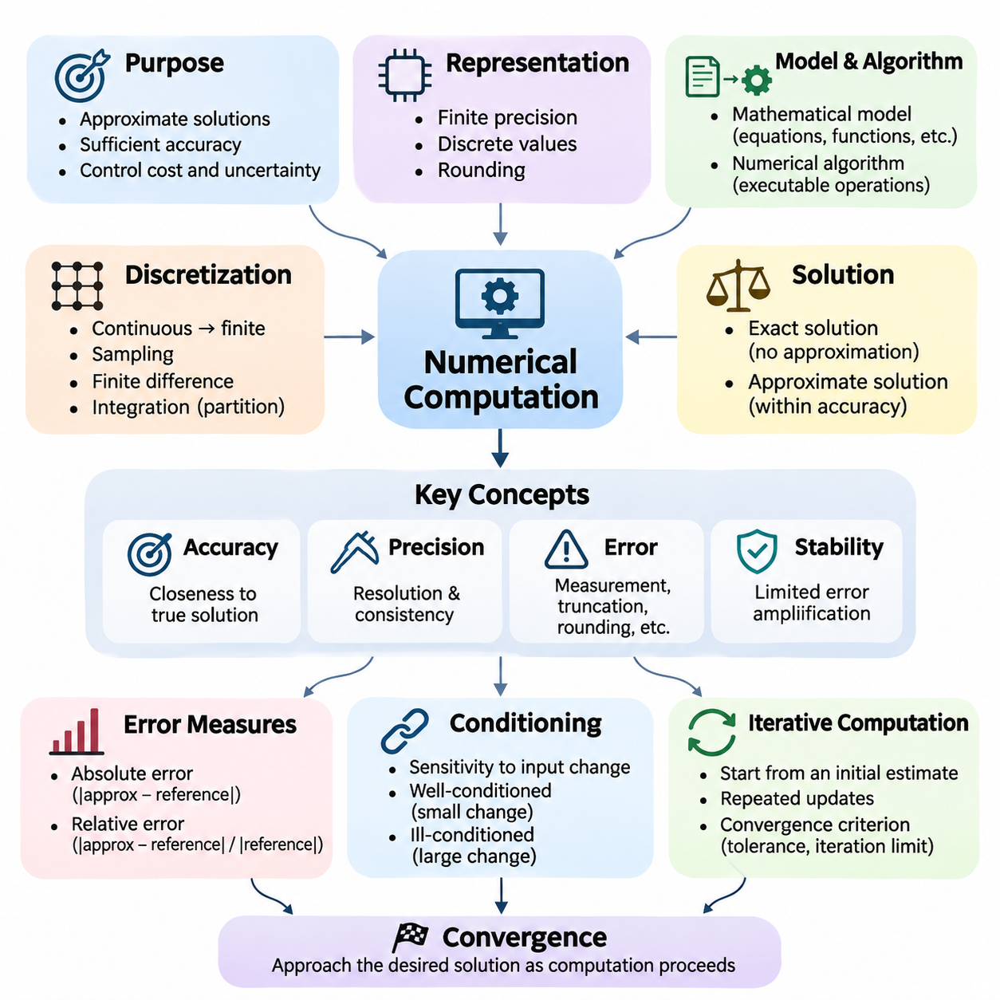
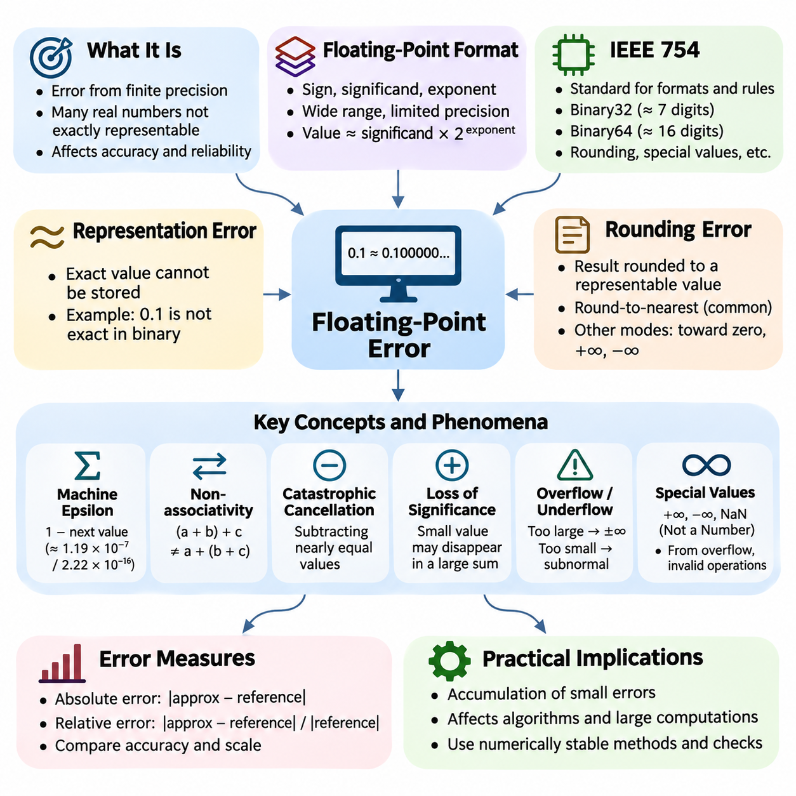
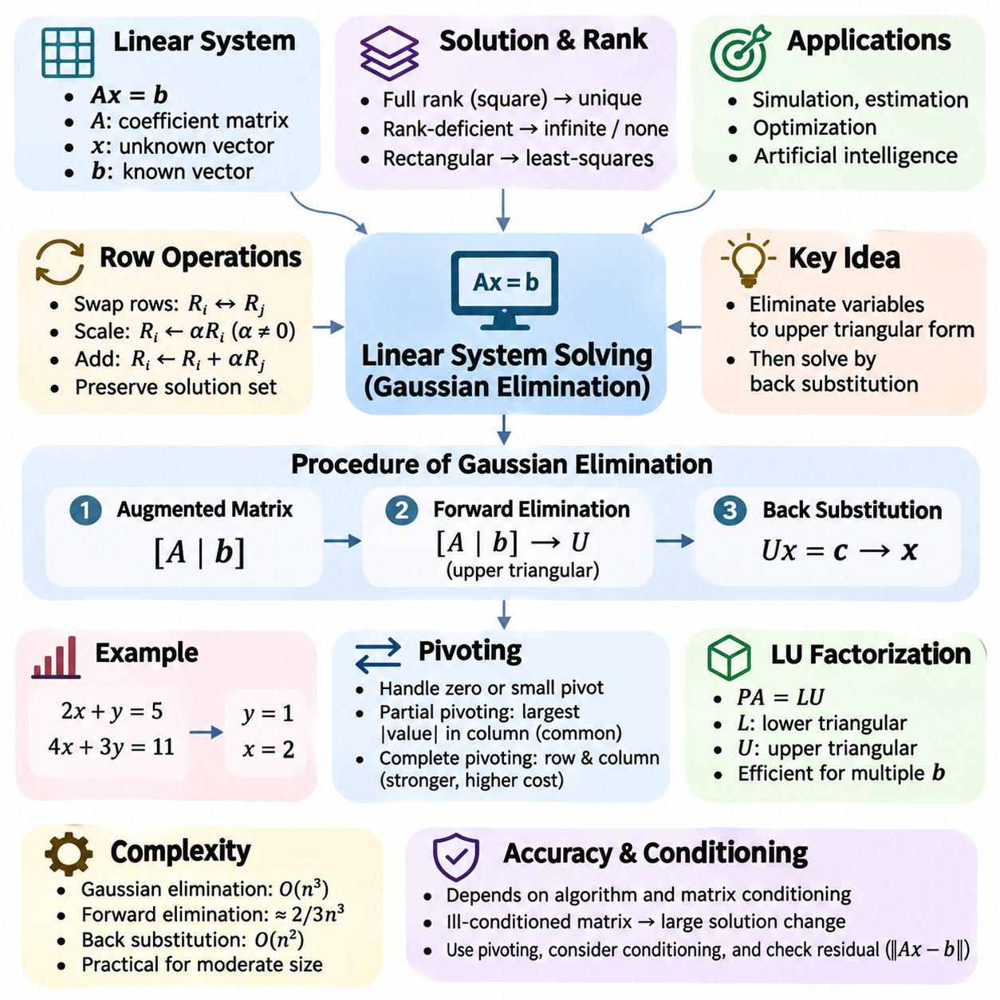
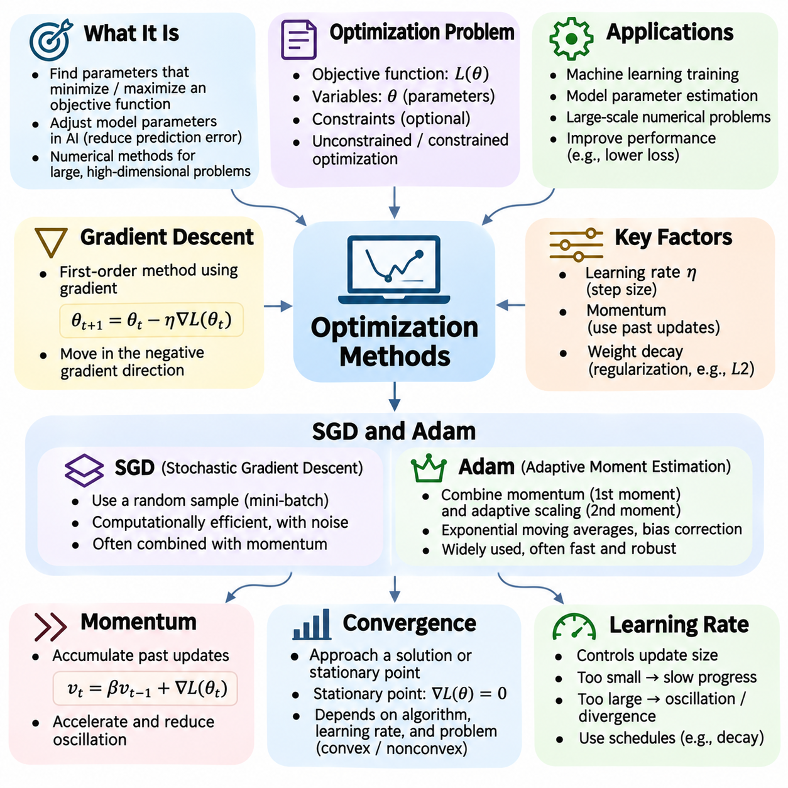
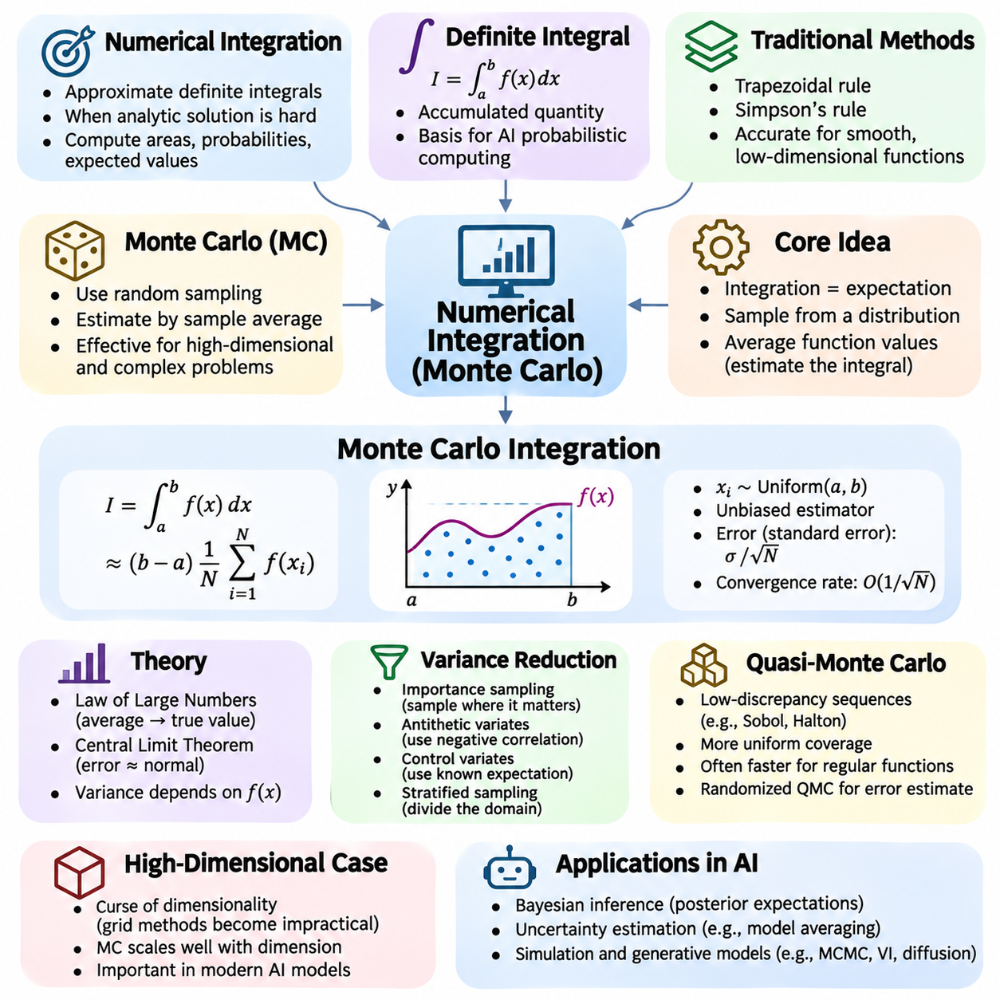
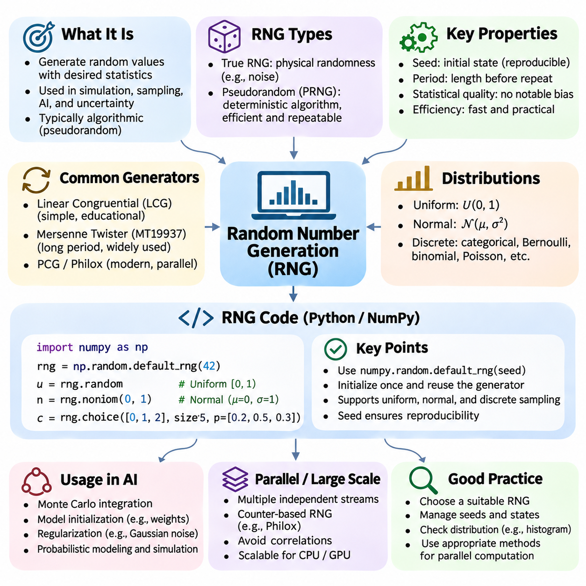
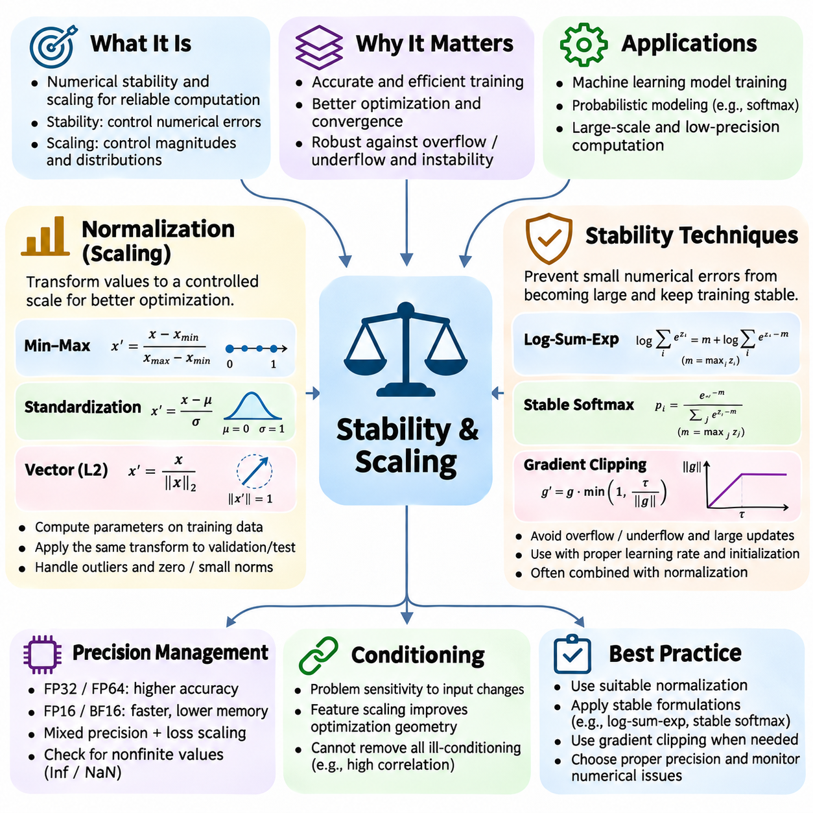
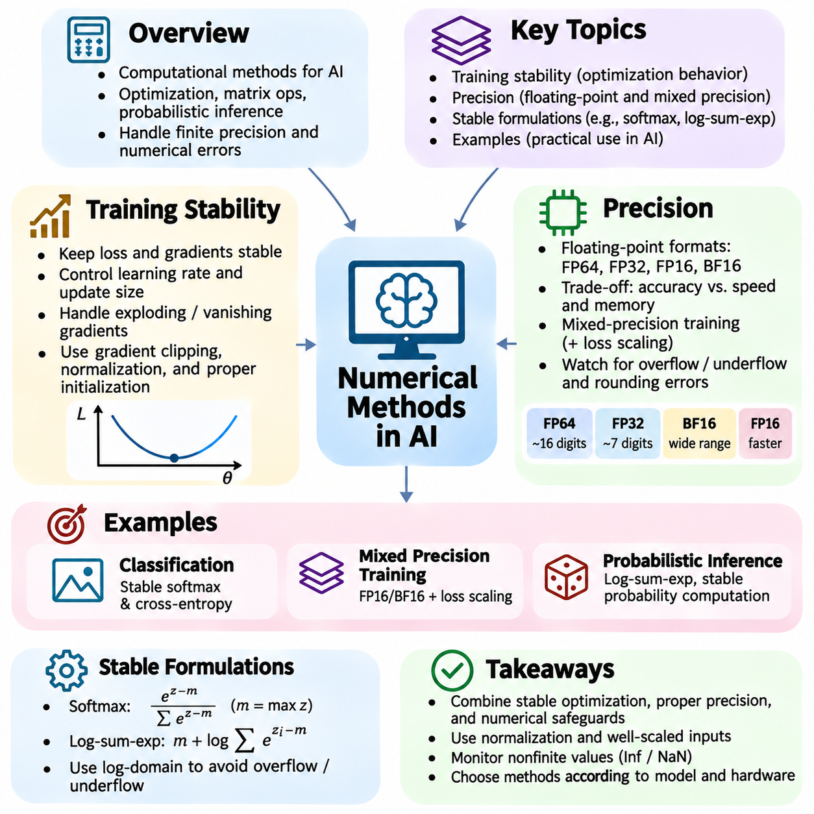

**Volume 05. Mathematics for AI**

# 06. Numerical Methods

## 06.00 Numerical Computation

{width="7.268055555555556in" height="7.268055555555556in"}

Numerical computation is the foundation of modern scientific computing and artificial intelligence, providing systematic methods for approximating mathematical solutions using digital computers. Unlike symbolic mathematics, which manipulates exact expressions, numerical computation represents quantities with finite precision and evaluates algorithms through sequences of arithmetic operations. Its primary objective is to obtain sufficiently accurate results while controlling computational cost, memory consumption, and numerical uncertainty.

Digital computers cannot represent every real number exactly because their memory and arithmetic systems operate with finite resources. Numerical computation therefore relies on discrete representations, approximations, and carefully designed algorithms. Even elementary operations may introduce small discrepancies between mathematical values and their machine representations. Understanding these limitations is essential when developing reliable AI models, scientific simulations, and large-scale computational systems.

The relationship between mathematical models and numerical algorithms is central to computational problem solving. A mathematical model describes a problem through equations, functions, constraints, or probability distributions, while a numerical algorithm transforms that description into executable operations. The quality of the final result depends not only on the mathematical formulation but also on the algorithm, numerical representation, implementation, and available computing hardware.

Numerical computation frequently begins by transforming a continuous mathematical problem into a finite computational representation. This process, known as discretization, replaces continuous domains, functions, or differential equations with finite collections of values and operations. Examples include sampling continuous signals, approximating derivatives using finite differences, and dividing integration intervals into smaller segments. Discretization introduces approximation errors that must be evaluated systematically.

An important distinction exists between exact solutions and approximate solutions. Exact solutions satisfy mathematical relationships without approximation, whereas numerical solutions provide estimates within specified accuracy requirements. Many practical problems cannot be solved analytically or would require excessive computational effort. Numerical methods make such problems manageable by constructing iterative approximations, exploiting mathematical structure, and terminating when appropriate accuracy conditions have been achieved.

Accuracy describes how closely a computed result approaches the intended mathematical solution, while precision concerns the resolution and consistency of numerical representation. These concepts are related but not identical. A computation performed with many decimal digits may still produce an inaccurate answer if the underlying algorithm is unstable or the mathematical model is inappropriate. Reliable numerical computation requires evaluating both representation precision and solution accuracy.

Numerical errors originate from several sources, including measurement uncertainty, discretization, approximation, rounding, and incomplete iterative convergence. Truncation error occurs when an infinite mathematical process is replaced by a finite approximation, while rounding error arises from finite-precision arithmetic. These errors may accumulate or interact during computation. Their effects depend on the problem structure, operation sequence, and numerical properties of the selected algorithm.

Absolute error measures the magnitude of the difference between an approximate value and a reference value. Relative error expresses this difference in proportion to the magnitude of the reference value when that value is nonzero. Relative error is often more informative when comparing quantities with substantially different scales. However, near-zero reference values require special treatment because relative error can become extremely large or undefined despite a small absolute discrepancy.

Computational stability describes how an algorithm responds to numerical disturbances introduced during execution. A stable algorithm limits the amplification of rounding and approximation errors, while an unstable algorithm may magnify small disturbances into significant inaccuracies. Stability is particularly important in repeated matrix operations, iterative optimization, numerical differentiation, and long-running simulations. Algorithm selection must therefore consider stability alongside execution speed.

The conditioning of a mathematical problem determines how sensitive its solution is to changes in input data. A well-conditioned problem produces relatively small output changes when its inputs are slightly perturbed, whereas an ill-conditioned problem may exhibit substantial sensitivity. Conditioning is a property of the problem rather than the algorithm. Even a numerically stable implementation may produce uncertain results when the underlying mathematical problem is severely ill-conditioned.

Iterative computation is widely used when direct mathematical evaluation is impractical. An iterative algorithm begins with an initial estimate and repeatedly updates that estimate according to a defined mathematical rule. The process continues until a convergence criterion, iteration limit, or computational budget is reached. Examples include root-finding procedures, iterative linear solvers, gradient-based optimization, and numerical methods for estimating eigenvalues or probability distributions.

Convergence describes whether a sequence of numerical approximations approaches a desired solution as computation proceeds. Convergence analysis investigates the conditions under which an algorithm approaches its target and the rate at which errors decrease. Some methods converge rapidly near a solution but require suitable initialization, while others offer slower yet more predictable behavior. Practical implementations must balance convergence speed, computational expense, and robustness against unfavorable inputs.

Stopping criteria determine when an iterative computation has produced an acceptable approximation. Common approaches examine changes between successive estimates, residual magnitudes, objective-function improvements, or estimated errors. A small update does not necessarily indicate that the correct solution has been reached, particularly when numerical precision limits further progress. Reliable stopping rules combine meaningful mathematical tolerances with safeguards against stagnation, divergence, and excessive computation.

Numerical computation also depends heavily on efficient data structures and arithmetic operations. Scalars, vectors, matrices, and multidimensional tensors provide representations for mathematical quantities used throughout AI systems. Vectorized operations allow multiple calculations to be expressed and executed collectively, reducing interpreter overhead and improving hardware utilization. Matrix multiplication, elementwise transformations, reductions, and tensor contractions form the computational foundation of neural network training and inference.

Modern numerical software relies on optimized libraries that implement fundamental mathematical operations efficiently. NumPy provides array-based numerical computation, while SciPy offers algorithms for scientific computing, optimization, integration, and linear algebra. PyTorch, TensorFlow, and JAX extend these capabilities to tensor computation and automatic differentiation. Their implementations often exploit optimized CPU instructions, GPU acceleration, and specialized computational kernels to process large numerical workloads.

Parallel numerical computation distributes arithmetic operations across multiple processing units to improve throughput. CPUs are effective for general-purpose computation and complex control flow, while GPUs accelerate workloads containing large numbers of similar operations. However, parallel execution introduces considerations involving synchronization, memory bandwidth, communication overhead, and operation ordering. Floating-point reductions may produce slightly different results when parallel execution changes the order of arithmetic operations.

Computational complexity provides a framework for estimating the resources required by numerical algorithms. Time complexity describes how execution cost grows with problem size, while space complexity characterizes memory requirements. Two algorithms that solve the same mathematical problem may differ significantly in their computational demands. Efficient numerical engineering considers operation counts, memory access patterns, data movement, and hardware characteristics rather than relying exclusively on theoretical complexity.

Scaling becomes increasingly important as numerical problems grow in dimension and dataset size. Large matrices, high-dimensional tensors, and extensive optimization workloads may exceed available memory or computational capacity. Techniques such as batching, sparse representations, decomposition, and distributed processing help manage these limitations. Nevertheless, scaling introduces additional numerical challenges because accumulated errors, communication patterns, and changes in arithmetic precision can influence computational behavior.

Numerical computation in artificial intelligence connects mathematical theory with practical learning algorithms. Neural networks repeatedly evaluate matrix operations, nonlinear functions, loss calculations, and gradients using finite-precision arithmetic. Optimization algorithms update millions or billions of parameters through numerical approximations. Consequently, numerical behavior influences training convergence, gradient quality, computational efficiency, and the reproducibility of experimental results across different hardware platforms.

The selection of numerical precision represents an important engineering tradeoff. Higher-precision formats generally provide greater representational accuracy but may require additional memory and computational resources. Lower-precision formats can improve throughput and reduce memory consumption, especially on specialized accelerators. Mixed-precision computation combines numerical formats to improve efficiency while preserving sufficient accuracy in sensitive operations. Its successful application requires attention to scaling, overflow, underflow, and error propagation.

Reproducibility is another essential concern in numerical computing. Identical mathematical expressions do not always produce bitwise-identical results across different processors, libraries, or execution configurations. Differences may arise from floating-point operation ordering, compiler optimizations, parallel reductions, and nondeterministic algorithms. Reliable experiments therefore document software versions, hardware environments, numerical precision, random seeds, and relevant execution settings when reproducibility is required.

Verification and validation establish confidence in numerical results. Verification examines whether an algorithm and its implementation correctly solve the specified mathematical problem, while validation assesses whether the mathematical model adequately represents the intended real-world phenomenon. Useful verification techniques include analytical reference solutions, residual calculations, convergence studies, and comparisons with independently implemented algorithms. Validation additionally requires appropriate observations, measurements, and application-specific acceptance criteria.

A practical numerical workflow begins with mathematical problem formulation, followed by the selection of suitable representations and algorithms. The implementation is then evaluated for accuracy, stability, convergence, computational complexity, and resource consumption. Results should be compared against meaningful references whenever possible. This systematic approach transforms numerical computation from a collection of arithmetic procedures into a disciplined methodology for constructing trustworthy computational systems.

Ultimately, numerical computation provides the operational foundation through which mathematical concepts become executable AI algorithms. Its importance extends beyond obtaining approximate answers to ensuring that those answers are sufficiently accurate, stable, efficient, and reproducible for their intended applications. Mastering these principles prepares practitioners to understand floating-point errors, solve linear systems, implement optimization methods, perform numerical integration, and develop reliable large-scale AI systems.

## 06.01 Floating Point Error

{width="7.268055555555556in" height="7.268055555555556in"}

Floating-point error is a fundamental limitation of numerical computation arising from the finite precision used to represent real numbers in digital computers. Although mathematical calculations often assume exact arithmetic, computer hardware stores numerical values using a limited number of binary digits. Consequently, many real numbers cannot be represented exactly, and arithmetic operations may introduce small discrepancies that influence the accuracy and reliability of computational results.

Floating-point representation expresses numerical values using a sign, a significand, and an exponent. The significand contains the significant digits of a number, while the exponent determines its magnitude. This structure allows computers to represent values across a wide numerical range, but the available precision remains limited. Numbers requiring more significant digits than the representation supports must be rounded to nearby representable values.

The IEEE 754 standard defines widely used floating-point formats and arithmetic behavior. Common binary formats include 32-bit single precision and 64-bit double precision. Single precision typically provides approximately seven significant decimal digits, while double precision provides approximately sixteen. These formats establish rules for rounding, exceptional values, and arithmetic operations, enabling broadly consistent numerical behavior across compatible computing platforms.

A floating-point number is generally represented mathematically as a signed significand multiplied by a power of two. In normalized binary representation, the leading significant bit is typically implicit, allowing efficient use of the available storage bits. The spacing between representable numbers increases as their magnitude grows. Therefore, floating-point precision is approximately relative to the magnitude of the represented quantity rather than uniformly distributed across the real number line.

Representation error occurs when an exact mathematical value cannot be stored precisely in a floating-point format. For example, the decimal fraction 0.1 has an infinite repeating expansion in binary and cannot be represented exactly using ordinary finite binary floating-point formats. Its stored value is therefore a nearby approximation. Such discrepancies are usually extremely small, but they can become visible when calculations repeatedly manipulate approximate values.

Rounding error arises whenever an arithmetic result must be converted into a representable floating-point value. Under the commonly used round-to-nearest mode, the computer selects the nearest representable number, with a defined rule for resolving exact ties. Other rounding modes may direct results toward zero or positive or negative infinity. The selected rounding behavior influences numerical results, particularly in algorithms involving repeated arithmetic operations.

Machine epsilon is an important quantity for understanding floating-point precision. In common numerical computing terminology, it represents the difference between one and the next larger representable floating-point number. For IEEE 754 binary32, this difference is approximately 1.19 × 10\^-7, while binary64 provides approximately 2.22 × 10\^-16. These values help characterize representational resolution, although the maximum relative rounding error under round-to-nearest is approximately half these quantities.

Floating-point arithmetic does not always satisfy the algebraic properties of exact real-number arithmetic. In particular, addition and multiplication are not generally associative because intermediate results may be rounded differently. Computing a sum in different orders can therefore produce different answers. This behavior becomes important in parallel processing, distributed computing, and numerical algorithms that accumulate large collections of values.

Catastrophic cancellation occurs when two nearly equal floating-point values are subtracted. Although the subtraction itself may be correctly rounded, the resulting difference can contain very few reliable significant digits because errors already present in the operands become large relative to the small result. This phenomenon frequently appears in numerical differentiation, polynomial evaluation, and formulas involving differences between closely related quantities.

Loss of significance also occurs when adding quantities with substantially different magnitudes. If a very small value is added to a sufficiently large value, the smaller contribution may disappear because the floating-point representation cannot retain the required digits. Repeated accumulation of small increments can therefore produce unexpected results. The magnitude and ordering of arithmetic operations must be considered when designing algorithms that process large numerical datasets.

Overflow occurs when a computed magnitude exceeds the largest finite value supported by a floating-point format. Under common IEEE 754 rounding behavior, such operations may produce positive or negative infinity. Underflow occurs when a nonzero result becomes too small to be represented with normal precision. Gradual underflow allows subnormal numbers to preserve some information near zero, although their relative precision decreases as their magnitude becomes smaller.

IEEE 754 also defines special numerical values, including positive infinity, negative infinity, and NaN, meaning Not a Number. Infinity may arise from overflow or certain divisions by zero, while NaN represents invalid or undefined arithmetic results, such as zero divided by zero. These values can propagate through subsequent calculations and disrupt numerical algorithms. Detecting nonfinite values is therefore an important component of reliable computational software.

Floating-point error can be analyzed using absolute error and relative error. Absolute error measures the difference between an exact reference value and its computed approximation, while relative error expresses this difference in proportion to the reference magnitude when nonzero. Relative error is particularly useful when evaluating computations across different numerical scales. However, values close to zero require careful interpretation because relative error may become extremely large.

Error propagation describes how numerical inaccuracies introduced during individual operations influence later computations. Some algorithms naturally suppress perturbations, while others amplify them through repeated transformations or sensitive mathematical relationships. The final error may therefore be much larger than the rounding error of any individual operation. Understanding error propagation requires examining both the computational algorithm and the conditioning of the underlying mathematical problem.

Numerical stability describes whether an algorithm controls the effects of floating-point disturbances during execution. A stable algorithm generally avoids unnecessary amplification of rounding errors, while an unstable algorithm may produce unreliable results even when individual operations are correctly implemented. Backward error analysis provides a useful perspective by asking whether the computed result is the exact solution to a nearby problem with slightly perturbed input data.

Several computational techniques reduce floating-point error without requiring arbitrary increases in precision. Compensated summation methods, including Kahan summation, track information lost during repeated additions and can substantially improve accumulated results. Pairwise summation reduces error growth by combining values in a balanced sequence. These approaches demonstrate that numerical accuracy depends not only on the floating-point format but also on the organization of arithmetic operations.

Algebraically equivalent mathematical expressions can exhibit very different numerical behavior. For example, evaluating the logarithm of one plus a very small number through a specialized log1p function can be more accurate than first computing one plus that number and then applying an ordinary logarithm. Similarly, expm1 accurately evaluates the exponential of a small argument minus one. Numerically informed reformulation is often more effective than simply increasing arithmetic precision.

Floating-point error becomes especially important in machine learning because neural networks execute enormous numbers of numerical operations. Matrix multiplication, activation functions, loss evaluation, and gradient computation all rely on finite-precision arithmetic. Small numerical discrepancies may accumulate across layers or training iterations. Their practical significance depends on network architecture, parameter scaling, optimization behavior, and the numerical properties of the underlying computational kernels.

Deep learning systems frequently employ mixed-precision arithmetic to improve computational throughput and reduce memory consumption. Formats such as FP16 and BF16 provide different tradeoffs between significand precision and exponent range. FP16 offers more significand precision than BF16 but a narrower exponent range. Mixed-precision training commonly retains selected operations or accumulated values in higher precision to reduce numerical risk while exploiting accelerated lower-precision computation.

Gradient calculations are particularly sensitive to numerical range limitations. Very small gradients may underflow in low-precision formats, while large intermediate values may overflow. Loss scaling can reduce gradient underflow by multiplying the loss before backpropagation and subsequently reversing the scaling before parameter updates. Appropriate scaling strategies, finite-value checks, and precision-aware optimizer implementations help maintain reliable training behavior.

Floating-point behavior also affects reproducibility across computing environments. Differences in processor architecture, compiler optimization, parallel reduction order, and mathematical libraries can change the sequence of rounding operations. Consequently, mathematically equivalent computations may produce slightly different outputs on CPUs and GPUs. Deterministic execution settings can reduce some variation, but exact reproducibility across different hardware and software environments is not universally guaranteed.

Reliable numerical engineering requires systematic testing of floating-point behavior. Developers should examine extreme magnitudes, near-zero values, cancellation-sensitive expressions, and computations involving large accumulations. Reference calculations using higher precision can help identify numerical discrepancies. Error tolerances should reflect the expected numerical scale and application requirements rather than assuming exact equality between independently computed floating-point results.

Ultimately, floating-point error is not simply a programming defect but an inherent consequence of representing continuous mathematical quantities with finite digital resources. Effective numerical computation requires understanding representation limits, rounding behavior, error propagation, and algorithmic stability. These principles provide the foundation for designing accurate linear algebra routines, reliable optimization algorithms, stable scientific simulations, and robust artificial intelligence systems operating across diverse computing platforms.

## 06.02 Linear System Solving

{width="7.268055555555556in" height="7.268055555555556in"}

Linear system solving is a fundamental operation in numerical mathematics, concerned with determining unknown variables that satisfy a collection of linear equations. A linear system can be represented compactly as Ax = b, where A is a coefficient matrix, x is a vector of unknown variables, and b is a vector of known values. Such systems arise throughout scientific computing, engineering simulation, statistical estimation, optimization, and artificial intelligence.

The mathematical properties of a linear system determine whether a solution exists and whether that solution is unique. A square coefficient matrix with full rank has exactly one solution for every right-hand-side vector. Rank-deficient systems may have infinitely many solutions or no solution, depending on consistency. Rectangular systems can also be analyzed through matrix rank, with least-squares methods providing approximate solutions when exact solutions are unavailable.

Gaussian elimination is a classical direct method for solving linear systems by systematically transforming equations into a simpler equivalent form. The algorithm applies elementary row operations to eliminate selected coefficients and produce an upper triangular matrix. Once this triangular structure is obtained, the unknown variables can be determined through back substitution. The method forms the conceptual foundation of numerous modern numerical linear algebra algorithms.

Gaussian elimination operates on an augmented matrix that combines the coefficient matrix A with the right-hand-side vector b. This representation allows each equation to be manipulated consistently while preserving the relationships between coefficients and constants. Elementary row operations include exchanging two rows, multiplying a row by a nonzero scalar, and adding a multiple of one row to another. These operations preserve the solution set of the original linear system.

The elimination process begins by selecting a pivot element from the first column of the active matrix. The pivot is used to eliminate coefficients below its position through suitable row operations. The algorithm then advances to the next column and repeats the procedure on the remaining submatrix. After successive elimination stages, the coefficient matrix becomes upper triangular, meaning that every entry below its main diagonal is zero.

For example, consider the equations 2x + y = 5 and 4x + 3y = 11. Subtracting twice the first equation from the second produces y = 1. Substituting this value into the first equation gives x = 2. This simple example demonstrates the central principle of Gaussian elimination: eliminate variables systematically until the remaining equations become straightforward to solve. Larger systems follow the same mathematical procedure.

Back substitution begins with the final equation of an upper triangular system, which typically contains only one unknown. After solving that equation, the calculated value is substituted into the preceding equation to determine another variable. This process continues upward until every unknown has been computed. For a nonsingular triangular matrix, back substitution provides a systematic and computationally efficient solution procedure.

The computational complexity of Gaussian elimination is approximately proportional to the cube of the number of unknowns for a dense square matrix. Forward elimination requires roughly two-thirds of n cubed floating-point operations, while back substitution requires a smaller quadratic number of operations. Consequently, Gaussian elimination is practical for many moderate-sized systems but can become computationally expensive when applied directly to extremely large dense matrices.

Pivot selection is essential for maintaining numerical reliability during elimination. If a pivot element is zero, division by that element is impossible, and the algorithm must exchange rows or otherwise modify its elimination strategy. Even a nonzero pivot can cause serious numerical difficulties when its magnitude is extremely small relative to other matrix entries. Pivoting strategies reduce these risks by selecting more suitable elements before elimination.

Partial pivoting selects the entry with the largest absolute value in the active column among the available rows and exchanges its row with the current pivot row. This strategy is widely used because it substantially improves numerical stability with relatively modest computational overhead. Complete pivoting considers both row and column exchanges, potentially offering stronger protection against numerical difficulties but requiring additional searching and bookkeeping.

Gaussian elimination with partial pivoting is closely related to LU factorization, which decomposes a matrix into lower and upper triangular factors. When row exchanges are necessary, the factorization is commonly expressed as PA = LU, where P represents a permutation matrix. This decomposition separates the elimination process from subsequent triangular solves and is especially useful when multiple right-hand-side vectors share the same coefficient matrix.

LU factorization improves computational efficiency when solving repeated linear systems with an unchanged coefficient matrix. The factorization is computed once, after which each new right-hand-side vector is processed using forward substitution and back substitution. This approach avoids repeating the full elimination procedure for every solution. It is frequently used in numerical simulation, optimization, and computational models requiring repeated matrix solves.

The accuracy of Gaussian elimination depends on both the numerical algorithm and the conditioning of the coefficient matrix. An ill-conditioned matrix can produce substantial changes in its solution when its coefficients or right-hand-side values are slightly perturbed. Even a stable elimination algorithm cannot eliminate the inherent sensitivity of such a problem. Condition numbers provide a quantitative measure of this sensitivity and help interpret the reliability of computed solutions.

Residual analysis provides an important method for evaluating a computed solution. Given an approximate solution x, the residual vector is defined as r = b - Ax. A small residual indicates that the computed vector approximately satisfies the original equations. However, a small residual does not necessarily guarantee a small solution error when the matrix is ill-conditioned. Reliable numerical evaluation therefore considers both residual magnitude and matrix conditioning.

Iterative refinement can improve the accuracy of a solution obtained through Gaussian elimination. The method first computes an approximate solution, evaluates its residual, and solves a correction system using the existing matrix factorization. The correction is then added to the current solution, and the process may be repeated. Under suitable numerical conditions, especially when residuals are evaluated with sufficient precision, iterative refinement can reduce solution errors significantly.

Special matrix structures can be exploited to improve computational performance. Symmetric positive-definite matrices are often solved using Cholesky factorization, which is generally more efficient than unrestricted Gaussian elimination. Sparse matrices require specialized elimination strategies that minimize fill-in, the creation of new nonzero entries during factorization. Recognizing matrix structure is therefore essential when selecting an appropriate linear system solver.

Sparse linear systems frequently arise from discretized differential equations, graph-based models, and large engineering simulations. Although their coefficient matrices may contain millions of entries, only a small fraction are nonzero. Applying ordinary dense Gaussian elimination would waste memory and computation. Sparse direct solvers use specialized storage formats, matrix reorderings, and elimination strategies to preserve sparsity as much as possible.

Gaussian elimination is also closely connected to matrix inversion, although explicitly computing an inverse is usually unnecessary when solving Ax = b. Directly solving the linear system through factorization is generally more efficient and numerically preferable to forming A inverse and multiplying it by b. This distinction is important in scientific computing because mathematical equivalence does not imply equal numerical stability or computational cost.

In machine learning, linear systems appear in linear regression, least-squares estimation, kernel methods, and second-order optimization. Normal equations for least-squares problems produce systems involving the matrix A transpose multiplied by A. However, explicitly forming these normal equations can worsen numerical conditioning. QR factorization and singular value decomposition are often preferable when numerical accuracy is important or the underlying data matrix is poorly conditioned.

Large-scale artificial intelligence systems frequently require solving linear equations associated with optimization updates, parameter estimation, and numerical approximations. Direct elimination methods provide accurate solutions for suitable matrix sizes, while iterative methods such as conjugate gradient become attractive for large structured systems. The appropriate choice depends on matrix dimensions, sparsity, conditioning, available memory, and required solution accuracy.

Practical implementations of Gaussian elimination must account for floating-point precision, pivot thresholds, singular matrices, and computational resource limitations. Numerical libraries generally provide optimized factorization routines that incorporate pivoting and hardware-aware execution. Rather than implementing unrestricted elimination for production workloads, developers typically rely on established linear algebra libraries while understanding the mathematical principles necessary to interpret solver behavior.

Ultimately, Gaussian elimination demonstrates how systematic algebraic transformations convert complex systems of equations into computationally manageable forms. Its significance extends beyond solving individual linear systems because it establishes essential concepts involving matrix factorization, numerical stability, computational complexity, and error analysis. These principles support reliable numerical methods throughout scientific computing, engineering applications, machine learning, and modern artificial intelligence systems.

## 06.03 Optimization Methods

{width="7.268055555555556in" height="7.268055555555556in"}

Optimization methods are fundamental numerical techniques for finding parameter values that minimize or maximize a mathematical objective function. In artificial intelligence, optimization determines how models adjust their parameters to reduce prediction errors and improve performance. Many optimization problems involve high-dimensional parameter spaces, nonlinear relationships, and large datasets, making efficient numerical algorithms essential for practical machine learning.

An optimization problem is typically defined by an objective function, a collection of decision variables, and optional constraints. The objective function measures the quality of a candidate solution, while constraints restrict the feasible region. Unconstrained optimization permits parameters to vary freely, whereas constrained optimization requires solutions to satisfy specified conditions. Numerical optimization seeks satisfactory solutions through systematic computational procedures.

Gradient descent is a first-order optimization method that updates parameters using the gradient of a differentiable objective function. The gradient indicates the direction of steepest local increase, so moving in its negative direction generally reduces the objective for a sufficiently small step. The standard update rule is θ_next = θ_current − η∇L(θ_current), where η represents the learning rate and L denotes the objective function.

The learning rate controls the magnitude of each gradient descent update and strongly influences optimization behavior. A very small learning rate may produce slow progress, while an excessively large rate can cause oscillation, instability, or divergence. Suitable learning rates depend on the objective function, parameter scaling, curvature, and optimization algorithm. Learning rate schedules can gradually adjust the step size as training progresses.

Batch gradient descent evaluates the gradient using the entire training dataset before updating model parameters. This approach provides a deterministic gradient for fixed data and parameters, assuming deterministic arithmetic, but each update can be computationally expensive for large datasets. It is useful for smaller optimization problems and theoretical analysis, although modern large-scale machine learning commonly relies on approximate gradients computed from subsets of data.

Stochastic gradient descent, or SGD, estimates the objective gradient using randomly selected training examples or mini-batches. The resulting updates are computationally cheaper than full-batch gradients but contain sampling noise. This noise produces fluctuations in the optimization trajectory and may help exploration of complex objective landscapes. Mini-batch SGD balances computational efficiency, gradient quality, and hardware utilization.

Momentum extends gradient descent by incorporating information from previous parameter updates. Instead of relying exclusively on the current gradient, momentum maintains an accumulated direction that smooths successive updates. This mechanism can accelerate movement along consistent descent directions and reduce oscillations in regions with uneven curvature. Momentum is particularly useful when optimization landscapes contain narrow valleys or strongly differing directional sensitivities.

Adaptive optimization methods adjust parameter updates according to information derived from historical gradients. AdaGrad accumulates squared gradients and reduces effective learning rates for frequently updated parameters. RMSProp uses an exponential moving average of squared gradients to avoid continuously shrinking step sizes. These methods address limitations of fixed learning rates, particularly when gradients differ substantially across model parameters.

Adam, or Adaptive Moment Estimation, combines momentum-like first-moment estimates with adaptive second-moment estimates. It maintains exponential moving averages of gradients and squared gradients, applies bias corrections, and scales parameter updates using the estimated gradient magnitudes. Adam is widely used in deep learning because it often provides effective optimization with limited manual tuning, although its behavior depends on hyperparameters and problem characteristics.

Adam introduces several important hyperparameters, including the learning rate, first-moment decay coefficient, second-moment decay coefficient, and numerical stability constant. The decay coefficients determine how strongly historical gradients influence current estimates. The stability constant prevents division by zero and influences updates when second-moment estimates are small. Appropriate settings depend on gradient statistics and numerical precision.

SGD and Adam exhibit different practical characteristics. SGD with momentum often performs well when carefully tuned and can provide strong generalization in many supervised learning tasks. Adam frequently converges faster during early training and handles heterogeneous gradient scales effectively. However, neither algorithm is universally superior. Their relative performance depends on model architecture, dataset properties, regularization, training duration, and evaluation criteria.

Weight decay is commonly used alongside optimization algorithms to discourage excessively large parameter values. In conventional SGD, an L2 penalty can be implemented through a corresponding gradient contribution. For adaptive optimizers, coupling weight decay to the loss gradient changes its effective behavior. AdamW separates weight decay from adaptive gradient updates, providing a clearer distinction between parameter regularization and optimization dynamics.

Convergence describes whether an optimization algorithm approaches a desired solution or stationary point as iterations progress. For differentiable objectives, a stationary point has a zero gradient, although it may represent a local minimum, maximum, or saddle point. Convex optimization provides stronger theoretical guarantees because every local minimum is global. Nonconvex neural network optimization generally requires more limited convergence interpretations.

Convergence rates describe how quickly an optimization algorithm reduces error or approaches an optimal solution. Under appropriate smoothness and convexity assumptions, gradient descent admits established convergence bounds. Strong convexity can provide faster theoretical rates with suitable step sizes. Stochastic methods require additional assumptions concerning gradient noise and learning rate schedules. These guarantees should not be applied automatically to arbitrary deep neural networks.

Practical convergence monitoring considers training loss, validation performance, gradient magnitude, and parameter update behavior. A decreasing training loss indicates progress on the training objective but does not necessarily imply improved generalization. Validation metrics help identify overfitting or diminishing practical returns. Early stopping can terminate training when monitored performance no longer improves sufficiently, reducing unnecessary computation.

Numerical stability is essential for reliable optimization. Extremely large gradients can cause unstable parameter updates, while very small gradients may produce negligible progress or underflow in low-precision arithmetic. Gradient clipping limits excessive gradient magnitudes, and appropriate initialization helps control activation and gradient scales. Mixed-precision training additionally requires attention to loss scaling, accumulation precision, and nonfinite numerical values.

Optimization performance is also influenced by the conditioning and curvature of the objective function. Poorly conditioned problems contain directions with substantially different sensitivities, potentially causing slow or oscillatory progress. Feature normalization, parameter scaling, preconditioning, and suitable optimizer selection can improve numerical behavior. Understanding these properties helps distinguish algorithmic limitations from difficulties inherent in the optimization problem.

Ultimately, gradient descent, SGD, Adam, and convergence analysis form a unified foundation for numerical optimization in artificial intelligence. Gradient descent establishes the basic direction-based update principle, stochastic methods enable scalable learning, and adaptive optimizers modify updates using gradient history. Convergence analysis and numerical diagnostics provide the tools needed to evaluate progress, select appropriate algorithms, and develop stable, efficient learning systems.

## 06.04 Numerical Integration

{width="7.268055555555556in" height="7.268055555555556in"}

Numerical integration is a fundamental computational technique for approximating definite integrals when analytical solutions are unavailable or impractical. Integration measures accumulated quantities, including areas, probabilities, expected values, and physical effects. In artificial intelligence, numerical integration supports probabilistic inference, uncertainty estimation, Bayesian learning, and simulation-based analysis of complex mathematical models.

Traditional numerical integration methods approximate integrals by evaluating functions at selected points within an integration domain. Techniques such as the trapezoidal rule and Simpson\'s rule construct approximations from weighted function values. These methods can achieve high accuracy for smooth, low-dimensional functions. However, their computational requirements often increase rapidly as the number of integration dimensions grows.

Monte Carlo integration approaches numerical integration through random sampling rather than deterministic subdivision of the integration domain. Instead of constructing a fixed numerical grid, it evaluates a function at randomly generated points and estimates the integral using sample averages. This probabilistic approach is particularly useful for high-dimensional problems, complicated integration regions, and functions that are expensive to integrate analytically.

The mathematical foundation of Monte Carlo integration is the relationship between integration and expectation. If a random variable X follows a probability density p(x), the expectation of a function f(X) is the integral of f(x)p(x) over its domain. By generating independent samples from p(x), the expectation can be approximated using the arithmetic mean of the observed function values. This relationship transforms integration into statistical estimation.

For a function f(x) defined over an interval [a,b], basic Monte Carlo integration draws N independent samples uniformly from that interval. The integral is estimated as (b − a) multiplied by the average of f evaluated at the sampled points. Under suitable integrability conditions, this estimator is unbiased and converges toward the true integral as the sample count increases. Its accuracy depends on the variability of the sampled function values.

The law of large numbers explains why Monte Carlo estimates become more reliable as additional samples are collected. When sampled values satisfy appropriate statistical assumptions, their average converges to the expected value. The central limit theorem further explains why estimation errors often approach a normal distribution for sufficiently large sample sizes. These results provide the theoretical basis for statistical uncertainty assessment in Monte Carlo computation.

A defining characteristic of ordinary Monte Carlo integration is its convergence rate, which is typically proportional to 1 divided by the square root of the sample count when the estimator has finite variance. Consequently, reducing the standard error by half generally requires approximately four times as many independent samples. This rate can be slower than deterministic methods in low dimensions, but its basic dependence on sample count does not explicitly increase with dimensionality.

The statistical variance of the integrand determines how many samples are needed to obtain a reliable estimate. Functions that produce highly variable values under the sampling distribution require more samples than relatively uniform functions. Estimating sample variance allows the construction of standard errors and approximate confidence intervals. These uncertainty measures distinguish Monte Carlo integration from deterministic methods that primarily analyze approximation error through numerical discretization.

Importance sampling improves Monte Carlo efficiency by drawing samples from a distribution that concentrates computational effort in influential regions. Instead of sampling uniformly, the algorithm uses a proposal distribution and adjusts each function evaluation with an appropriate probability-density ratio. A well-designed proposal can substantially reduce estimator variance, although poorly chosen proposals may create unstable weights and unreliable estimates.

Variance reduction techniques improve estimation accuracy without proportionally increasing the number of samples. Antithetic variates introduce negatively correlated evaluations to reduce fluctuations, while control variates exploit quantities with known expectations. Stratified sampling divides the integration domain into regions and samples them separately. The effectiveness of these approaches depends on the integrand and the statistical relationships they exploit.

Quasi-Monte Carlo methods replace ordinary random samples with low-discrepancy point sequences designed to cover an integration domain more uniformly. Common examples include Sobol and Halton sequences. For sufficiently regular integrands, these methods can converge faster than standard Monte Carlo sampling. However, performance depends on dimensional structure and smoothness, while randomized quasi-Monte Carlo techniques enable statistical error estimation.

High-dimensional integration is especially important in artificial intelligence because probabilistic models often contain many latent variables and uncertain parameters. Deterministic integration grids become impractical as dimensionality increases, a difficulty commonly called the curse of dimensionality. Monte Carlo methods avoid explicitly enumerating every combination of variable values, making them valuable for estimating expectations in complex probabilistic systems.

Monte Carlo integration is central to Bayesian inference, where posterior expectations often involve integrals that cannot be evaluated analytically. Sampling-based approaches estimate quantities such as predictive probabilities, parameter summaries, and uncertainty measures. Markov chain Monte Carlo methods generate dependent samples from target distributions, enabling inference when independent sampling is difficult. Their accuracy requires additional attention to mixing, convergence diagnostics, and sample dependence.

Monte Carlo methods also support machine learning objectives involving expectations over random variables. Variational inference, reinforcement learning, stochastic optimization, and generative modeling frequently estimate expectations using sampled observations or latent states. In reinforcement learning, sampled trajectories approximate expected returns under a policy. In generative models, sampling can approximate probabilistic objectives and support uncertainty-aware predictions.

Practical Monte Carlo computation requires careful management of random number generation, numerical precision, and computational resources. Pseudorandom number generators produce deterministic sequences that approximate random behavior and can be initialized with seeds for reproducibility. Vectorized sampling and GPU acceleration improve throughput when function evaluations can be processed in parallel. Stable accumulation and appropriate precision help prevent numerical errors in large sample averages.

Ultimately, Monte Carlo integration provides a flexible connection between numerical mathematics, probability theory, and artificial intelligence. Its principal strength is the ability to estimate complex integrals through sampling without constructing exhaustive integration grids. Understanding convergence rates, sampling distributions, variance reduction, and statistical uncertainty enables reliable applications in probabilistic inference, simulation, optimization, and large-scale machine learning systems.

## 06.05 Random Number Generation

{width="7.268055555555556in" height="7.268055555555556in"}

Random number generation is a fundamental component of numerical computation, probability theory, simulation, and artificial intelligence. Random numbers support stochastic algorithms, statistical sampling, parameter initialization, and uncertainty estimation. Although randomness is mathematically associated with unpredictable outcomes, digital computers commonly generate sequences through deterministic procedures designed to reproduce the statistical properties of random variables.

A random number generator, or RNG, is a computational mechanism that produces values according to a specified process. True random number generators obtain unpredictability from physical phenomena, while pseudorandom number generators use mathematical algorithms to produce sequences that appear statistically random. Most scientific computing and machine learning applications rely on pseudorandom generators because they provide efficiency, repeatability, and controlled experimentation.

A pseudorandom number generator begins with an internal state that determines its subsequent outputs. The initial state is commonly established using a seed, which allows the same sequence to be reproduced when the algorithm and execution conditions remain unchanged. Reproducibility is essential for debugging numerical programs, comparing machine learning experiments, and verifying statistical simulations. However, identical seeds do not guarantee identical outputs across different generator algorithms.

The quality of a pseudorandom generator depends on its period, statistical properties, computational efficiency, and suitability for the intended application. The period represents the number of generated values before the internal sequence repeats. A long period reduces repetition risks but does not automatically guarantee statistical quality. Reliable generators must also avoid undesirable correlations, distributional biases, and predictable patterns that could compromise simulation results.

Linear congruential generators provide a simple mathematical example of pseudorandom generation. Their internal state follows a recurrence such as X_next = (aX_current + c) mod m, where a, c, and m are fixed parameters. Although these generators are computationally inexpensive and useful for understanding RNG principles, poorly selected parameters can produce short periods and strong correlations. Modern numerical libraries generally provide more sophisticated alternatives.

The Mersenne Twister is a widely known pseudorandom generator designed to provide a very long period and strong statistical behavior for many general-purpose applications. Its MT19937 variant has a period of 2\^19937 − 1. Despite these advantages, it is not cryptographically secure and is not ideal for every parallel computing environment. Modern alternatives include PCG, Philox, and other generators designed for efficient numerical workloads.

Uniform random number generation is the foundation for constructing many other probability distributions. A uniform distribution over [0,1) assigns equal probability density throughout its interval. Numerical libraries commonly provide floating-point samples from this distribution, which can then be transformed into samples from other distributions. The quality and precision of the underlying uniform samples influence the reliability of subsequent stochastic calculations.

Random variables following normal distributions are especially important in artificial intelligence and statistical modeling. Normal samples can be generated using transformations such as the Box--Muller method or specialized rejection and approximation algorithms. Their mean and standard deviation determine the distribution\'s location and spread. Gaussian noise is frequently used in simulation, regularization, probabilistic modeling, and neural network parameter initialization.

Random sampling also supports discrete probability distributions. Algorithms can select categorical outcomes according to assigned probabilities or generate Bernoulli, binomial, and Poisson random variables. These operations are useful for classification simulations, probabilistic decision-making, event modeling, and randomized algorithms. Correct implementation requires careful normalization of probabilities and attention to numerical precision when probabilities are extremely small.

In Python, the standard random module provides basic pseudorandom functionality, including uniform sampling, integer generation, and sequence selection. NumPy provides a more extensive numerical interface through numpy.random.Generator, which supports vectorized sampling and multiple probability distributions. A generator can be initialized using numpy.random.default_rng(seed), allowing experiments to manage random state explicitly without relying on global random-number functions.

An RNG implementation should separate generator initialization from the sampling operations that consume its state. Creating a new generator with the same seed before every sampling call can repeatedly produce identical values rather than a progressing random sequence. A better design initializes the generator once and reuses it throughout the intended computation. Independent generator instances can be used when different experimental components require separately managed random streams.

Parallel random number generation introduces additional challenges because multiple processors or GPU threads may require independent streams of random values. Simply assigning arbitrary seeds does not necessarily guarantee independence between streams. Counter-based generators such as Philox can generate values from counters and keys, supporting reproducible parallel computation. Carefully designed stream management helps prevent accidental correlations and improves scalability.

Random number generation is central to Monte Carlo integration, where random samples approximate expectations and integrals. The accuracy of Monte Carlo estimators depends on sampling distributions, estimator variance, and the statistical properties of generated sequences. Random sampling also underlies bootstrap estimation, randomized numerical algorithms, and uncertainty propagation. Reliable RNG behavior is therefore essential for meaningful statistical conclusions.

Machine learning training uses randomness in dataset shuffling, mini-batch construction, dropout, data augmentation, and parameter initialization. These operations influence optimization trajectories and sometimes final model performance. Setting random seeds can improve experimental reproducibility, but nondeterministic GPU operations, parallel execution, and library differences may still produce varying results. Reproducibility requires coordinated control of randomness and computational settings.

Random number generators should be evaluated using statistical tests that examine properties such as uniformity, independence, and correlations. Test suites including TestU01 and PractRand can detect weaknesses in generated sequences. However, passing statistical tests does not prove that a generator is perfectly random or suitable for every application. Generator selection must also consider period, parallel execution behavior, reproducibility, and security requirements.

Cryptographic random number generation differs from ordinary scientific pseudorandom generation because unpredictability against adversarial observation is essential. Cryptographically secure generators use designs intended to resist prediction even when portions of their output are known. Ordinary generators such as Mersenne Twister should not be used for passwords, authentication tokens, or cryptographic keys. Security-sensitive applications should rely on operating-system cryptographic randomness facilities.

Ultimately, random number generation provides the computational foundation for stochastic numerical methods and probabilistic artificial intelligence. Effective RNG design requires understanding deterministic state evolution, seeding, statistical quality, distribution sampling, and parallel stream management. By selecting appropriate generators and controlling their use, developers can construct reproducible simulations, reliable Monte Carlo algorithms, and robust machine learning experiments.

## 06.06 Stability and Scaling

{width="7.268055555555556in" height="7.268055555555556in"}

Numerical stability and scaling are essential principles for developing reliable computational algorithms in scientific computing and artificial intelligence. Stability describes how an algorithm responds to rounding errors, perturbations, and accumulated numerical inaccuracies. Scaling concerns the magnitudes and distributions of numerical quantities. Together, these principles determine whether computations remain accurate, efficient, and predictable across different datasets and hardware environments.

Normalization transforms numerical values into representations with controlled statistical properties or magnitudes. In machine learning, input features may have substantially different units and ranges, causing certain variables to dominate optimization. Normalization reduces these disparities and often improves numerical conditioning. However, normalization does not automatically eliminate outliers, information loss, or instability arising from poorly designed algorithms.

Min-max normalization maps numerical values into a specified interval, commonly between zero and one. For a feature x, the transformation is expressed as x_normalized = (x − x_min)/(x_max − x_min). This approach preserves relative ordering and provides bounded values when future observations remain within the original range. However, extreme values can compress most observations into a narrow interval, and constant features require special handling.

Standardization transforms a feature by subtracting its mean and dividing by its standard deviation. The resulting values have approximately zero mean and unit variance when the statistics are computed consistently on the reference dataset. Standardization is useful for gradient-based optimization, regression, and distance-sensitive algorithms. Its effectiveness depends on the underlying distribution, and it does not necessarily produce bounded or normally distributed values.

Normalization parameters must be estimated without introducing information leakage. In supervised learning, means, standard deviations, and scaling boundaries should generally be computed using training data only. The same fitted transformation is then applied to validation and test datasets. Recomputing normalization statistics independently for each dataset partition can distort comparisons and introduce inconsistencies between training and deployment.

Vector normalization adjusts a vector according to a selected norm, often its Euclidean length. L2 normalization divides a nonzero vector by its magnitude, producing a unit-length representation. This operation is useful in similarity search, embedding comparison, and directional analysis. Because division by very small norms can amplify numerical noise, implementations must explicitly handle zero vectors and values near machine precision.

Neural networks also use normalization within their computational architectures. Batch normalization standardizes intermediate activations using batch statistics during training and typically uses accumulated statistics during inference. Layer normalization computes statistics across selected feature dimensions within individual samples. These approaches can improve optimization behavior, but their effects depend on model architecture, batch size, and the placement of normalization operations.

Scaling is closely related to the conditioning of numerical problems. When variables differ greatly in magnitude, optimization algorithms may experience uneven curvature and slow convergence. Appropriate feature scaling and parameter reparameterization can improve the geometry of the objective function. Nevertheless, scaling cannot remove every source of ill-conditioning, particularly when variables are highly correlated or the underlying mathematical problem is intrinsically sensitive.

Numerical stability techniques aim to prevent small computational errors from becoming large inaccuracies. Stable algorithms minimize unnecessary subtraction of nearly equal quantities, avoid division by extremely small values, and control intermediate magnitudes. Algebraic reformulation is often effective because mathematically equivalent expressions can behave differently under floating-point arithmetic. Algorithm selection must therefore consider numerical behavior as well as mathematical correctness.

The log-sum-exp technique illustrates stable algebraic reformulation. Directly computing the logarithm of a sum of exponentials may overflow when input values are large. Subtracting the maximum input before exponentiation preserves the mathematical result while reducing overflow risk. This transformation is widely used in probabilistic modeling, classification losses, and softmax computations where exponentials and logarithms appear together.

Stable softmax computation applies a related principle by subtracting the maximum logit before evaluating exponentials. Because adding or subtracting a common constant does not change the resulting softmax probabilities, this adjustment avoids many overflow problems. Extremely small probabilities may still underflow, making log-domain calculations preferable when probabilities are subsequently multiplied or logarithms are required.

Gradient clipping is another important stability technique in machine learning. When gradient magnitudes become excessively large, parameter updates may destabilize training or produce nonfinite values. Gradient clipping limits either individual gradient components or the overall gradient norm. Although clipping can prevent extreme updates, overly aggressive thresholds may distort optimization and slow convergence. It should complement appropriate learning rates and model initialization.

Precision management influences stability across numerical workloads. FP32 and FP64 offer different accuracy and computational costs, while FP16 and BF16 enable efficient accelerated computation with reduced precision or range tradeoffs. Mixed-precision methods combine formats to improve performance while retaining selected sensitive operations in higher precision. Loss scaling, stable accumulation, and finite-value checks help reduce numerical failures during low-precision training.

Matrix scaling and preconditioning improve numerical behavior in linear algebra and optimization. Row and column scaling can reduce disparities among matrix coefficients, while preconditioners transform systems into forms that are easier for iterative solvers to handle. Effective preconditioning can substantially accelerate convergence. However, constructing and applying a preconditioner introduces computational overhead, so its benefits depend on the structure and size of the problem.

Stable accumulation is important when summing large collections of floating-point values. Sequential addition can lose small contributions when accumulated totals become much larger than individual terms. Pairwise summation and compensated summation reduce this loss by modifying the order or bookkeeping of arithmetic operations. Such techniques are valuable in statistical reductions, loss aggregation, numerical integration, and large-scale distributed computation.

Ultimately, normalization and stability techniques form complementary foundations for reliable numerical computation. Normalization controls numerical scales and statistical representations, while stability techniques manage rounding errors, overflow, underflow, and error propagation. Effective implementations combine appropriate transformations, precision choices, stable algorithms, and systematic numerical testing to support robust optimization, scalable machine learning, and dependable artificial intelligence systems.

## 06.07 Numerical Methods in AI

{width="7.268055555555556in" height="7.268055555555556in"}

Numerical methods form the computational foundation of artificial intelligence by enabling efficient optimization, matrix operations, probabilistic inference, and large-scale model training. AI systems repeatedly perform floating-point calculations involving millions or billions of parameters. Small numerical errors can accumulate across operations and affect convergence, prediction accuracy, and reliability. Understanding numerical behavior is therefore essential for designing dependable learning systems.

Training stability describes the ability of a machine learning model to maintain controlled optimization behavior throughout training. Stable training generally produces finite losses, manageable gradients, and consistent progress toward useful solutions. Instability may appear as sudden loss spikes, oscillating parameters, exploding gradients, or numerical overflow. These symptoms can originate from unsuitable learning rates, poorly scaled inputs, inappropriate initialization, or unstable arithmetic operations.

Gradient-based optimization updates model parameters using derivatives of a loss function. If the learning rate is excessively large, parameter updates may overshoot useful regions and cause divergence. If it is too small, convergence may become unnecessarily slow. Learning rate schedules, warmup procedures, and adaptive optimizers help regulate update magnitudes. Their effectiveness depends on model architecture, dataset properties, and the geometry of the optimization objective.

Exploding and vanishing gradients are important stability challenges in deep neural networks. Exploding gradients produce excessively large updates, while vanishing gradients make earlier layers difficult to optimize. Gradient clipping can limit extreme gradient magnitudes, whereas suitable activation functions, residual connections, normalization layers, and parameter initialization can improve gradient propagation. These techniques address different causes of instability and should be selected according to the model.

Numerical precision determines how accurately computers represent and manipulate real-valued quantities. Floating-point formats allocate limited bits to the sign, exponent, and significand, creating finite precision and representable ranges. FP64 provides greater precision than FP32 but often requires more memory and computational resources. Reduced-precision formats such as FP16 and BF16 improve throughput on supported accelerators while introducing additional numerical considerations.

FP16 and BF16 offer different tradeoffs between precision and dynamic range. FP16 provides more significand precision than BF16 but has a substantially narrower exponent range. BF16 preserves an exponent range similar to FP32, making overflow less likely for large values. Neither format is universally superior. Their suitability depends on model sensitivity, hardware capabilities, accumulation precision, and the numerical characteristics of the operations being performed.

Mixed-precision training combines lower-precision computation with selected higher-precision operations to balance speed, memory consumption, and numerical reliability. Matrix multiplications may use reduced precision, while sensitive reductions and optimizer states may retain higher precision. Automatic mixed precision frameworks select supported operation formats. Nevertheless, numerical monitoring remains necessary because automatic precision selection cannot eliminate every source of instability.

Loss scaling helps prevent gradient underflow during low-precision training, particularly when FP16 is used. Multiplying the loss by a scale factor increases the magnitude of gradients before backward computation. Gradients are subsequently unscaled before parameter updates. Dynamic loss scaling adjusts the factor when nonfinite gradients are detected. Although useful for FP16, loss scaling is generally less necessary for BF16 because of its wider exponent range.

Stable mathematical formulations are essential for probabilistic AI models. Direct exponentiation of large logits may overflow, while multiplying many small probabilities can underflow. Stable softmax implementations subtract the maximum logit before exponentiation, and log-domain calculations replace probability products with sums of logarithms. The log-sum-exp operation similarly improves numerical reliability in classification, sequence modeling, and probabilistic inference.

Input scaling and normalization influence training stability by controlling the magnitudes of features and intermediate representations. Standardization and min-max scaling can reduce differences among input variables, while batch normalization and layer normalization regulate selected neural network activations. These transformations often improve optimization efficiency, but they do not guarantee convergence. Training statistics must also be handled consistently during validation and deployment.

Matrix operations introduce additional numerical challenges in AI systems. Ill-conditioned matrices can amplify small input errors, producing inaccurate solutions even when arithmetic operations are implemented correctly. Numerical linear algebra therefore favors stable decompositions and specialized solvers over explicitly calculating matrix inverses. QR decomposition, singular value decomposition, and appropriate regularization can improve reliability in regression, dimensionality reduction, and parameter estimation.

A practical classification example illustrates the interaction between numerical stability and precision. A neural network trained with cross-entropy loss may produce very large logits during optimization. Directly calculating softmax probabilities and then taking logarithms can generate overflow or undefined values. A fused cross-entropy implementation evaluates the objective using a stable mathematical formulation, reducing intermediate numerical errors and improving training reliability.

A second example involves training a deep neural network with mixed precision on a GPU. Reduced-precision matrix operations can accelerate computation and lower memory requirements, allowing larger batches or models. However, gradients and optimizer updates must remain numerically reliable. Monitoring loss values, gradient norms, overflow events, and validation performance helps determine whether the selected precision configuration is appropriate.

A third example arises in probabilistic inference and Monte Carlo computation. Estimating extremely small probabilities through direct multiplication can produce numerical underflow, even when the underlying mathematical result is valid. Logarithmic probability representations and stable accumulation techniques preserve more useful information. Reliable random sampling, adequate sample counts, and variance estimation remain necessary because numerical stability alone cannot eliminate statistical uncertainty.

Numerical diagnostics provide a systematic approach to identifying unstable AI computations. Developers can monitor nonfinite losses, gradient distributions, parameter magnitudes, activation ranges, and optimizer behavior. Comparing selected calculations against higher-precision references helps reveal rounding-related discrepancies. Reproducible experiments, controlled random seeds, and targeted numerical tests make it easier to distinguish implementation defects from ordinary stochastic variation.

Ultimately, numerical methods in artificial intelligence connect mathematical correctness with practical computational reliability. Training stability depends on suitable optimization strategies, controlled numerical scales, and stable algorithmic formulations. Precision management determines the balance between computational efficiency and accuracy. By combining careful implementation, diagnostic monitoring, and representative experiments, developers can build scalable AI systems that train efficiently and produce dependable results.
