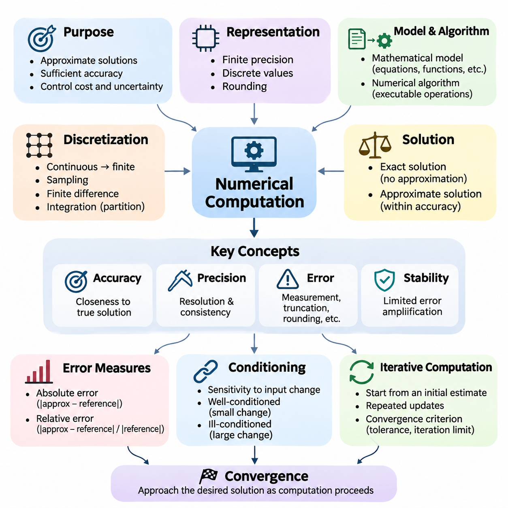
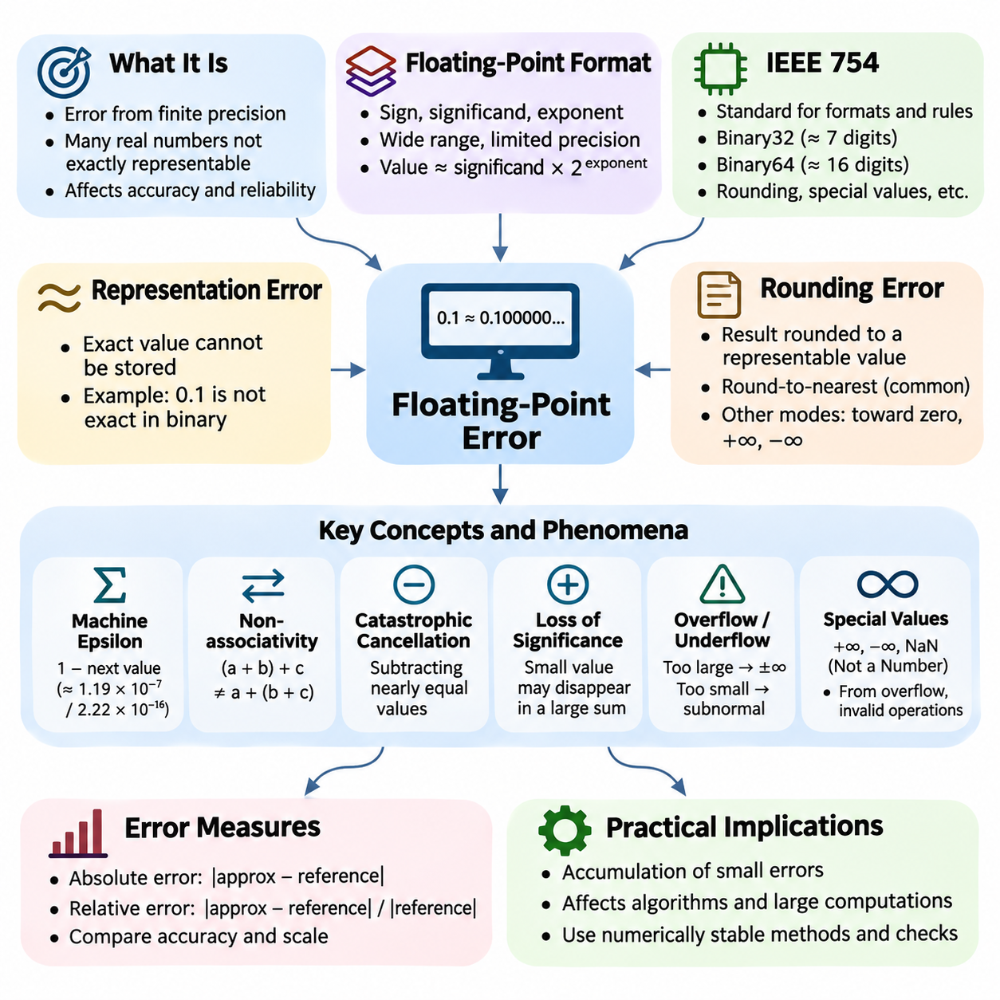
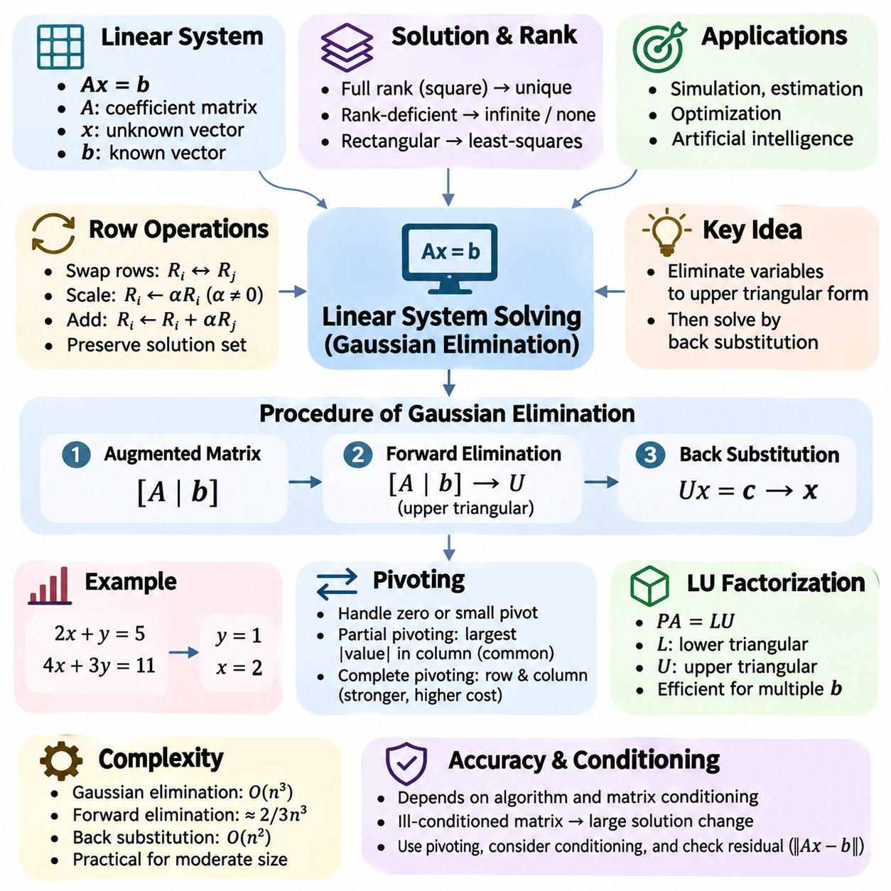
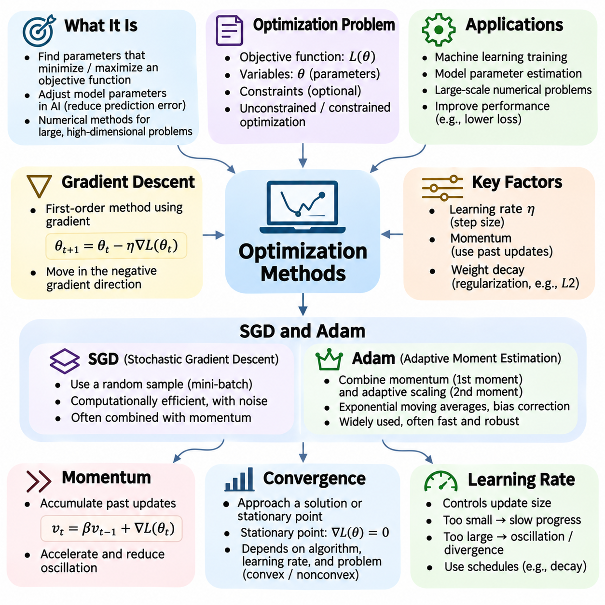
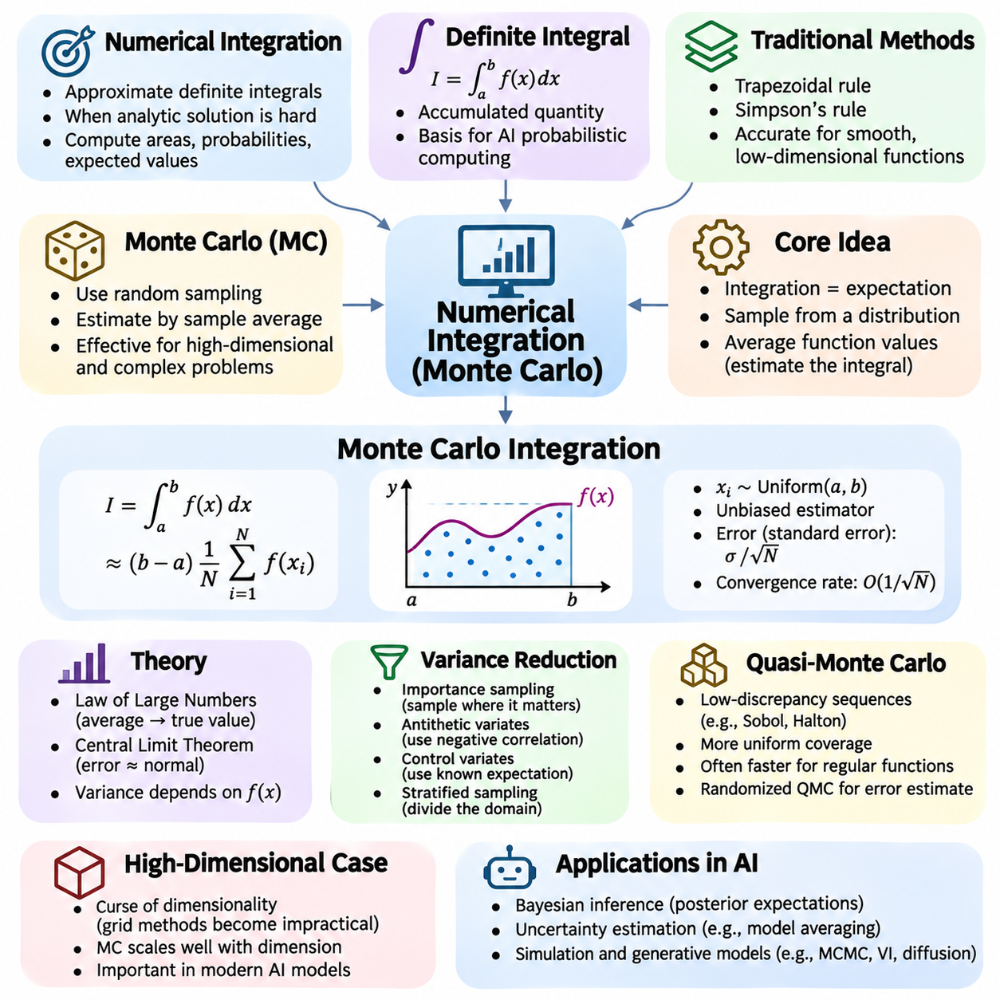
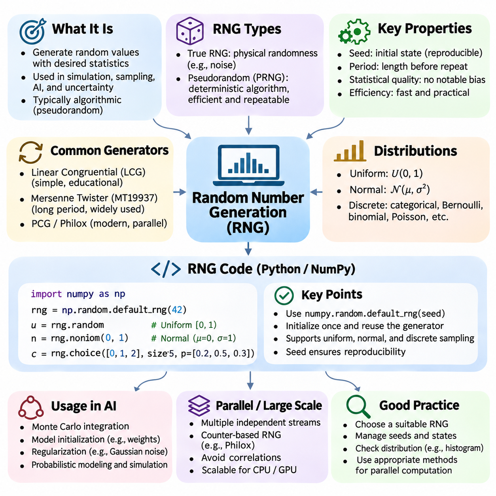
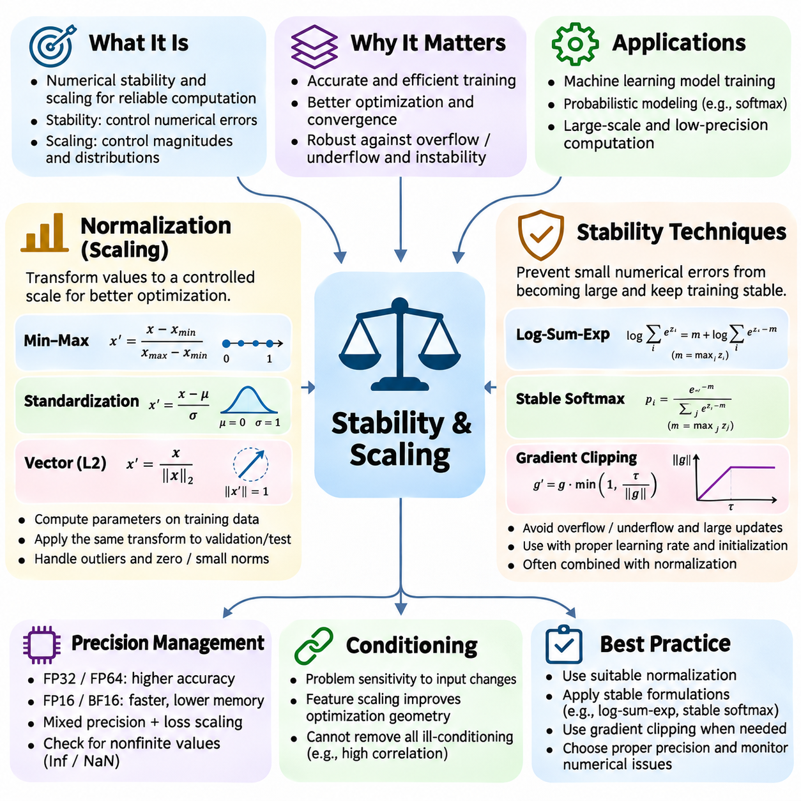
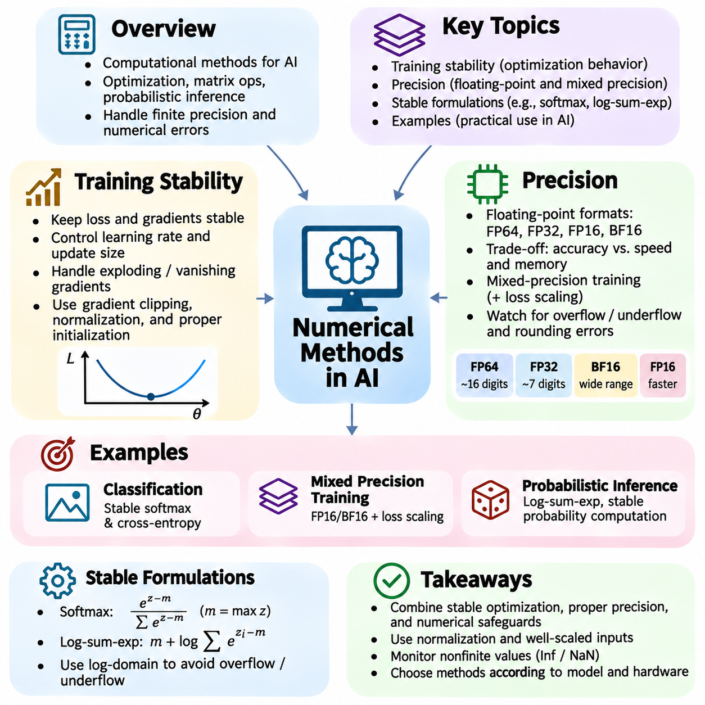

**Volume 05. Mathematics for AI**

# 06. Numerical Methods

## 06.00 Numerical Computation

{width="7.268055555555556in" height="7.268055555555556in"}

수치 계산(Numerical Computation)은 현대 과학 컴퓨팅(Scientific Computing)과 인공지능(Artificial Intelligence)의 기초로서, 디지털 컴퓨터(Digital Computer)를 이용하여 수학적 해(Mathematical Solution)를 근사적으로 구하는 체계적인 방법을 제공한다. 정확한 수식을 조작하는 기호 수학(Symbolic Mathematics)과 달리, 수치 계산은 유한 정밀도(Finite Precision)로 수량을 표현하고 일련의 산술 연산(Arithmetic Operations)을 통해 알고리즘(Algorithm)을 실행한다. 주요 목적은 계산 비용(Computational Cost), 메모리 사용량(Memory Consumption), 수치적 불확실성(Numerical Uncertainty)을 제어하면서 충분히 정확한 결과를 얻는 것이다.

디지털 컴퓨터는 메모리와 산술 시스템이 유한한 자원으로 작동하기 때문에 모든 실수(Real Number)를 정확하게 표현할 수 없다. 따라서 수치 계산은 이산적 표현(Discrete Representation), 근사(Approximation), 신중하게 설계된 알고리즘에 의존한다. 기본적인 산술 연산에서도 수학적 값과 컴퓨터 내부 표현 사이에 작은 차이가 발생할 수 있다. 이러한 한계를 이해하는 것은 신뢰할 수 있는 인공지능 모델(AI Model), 과학 시뮬레이션(Scientific Simulation), 대규모 계산 시스템(Large-Scale Computational System)을 개발하는 데 필수적이다.

수학적 모델(Mathematical Model)과 수치 알고리즘(Numerical Algorithm)의 관계는 계산 문제 해결(Computational Problem Solving)의 핵심이다. 수학적 모델은 방정식(Equation), 함수(Function), 제약조건(Constraint), 확률 분포(Probability Distribution)를 통해 문제를 기술하며, 수치 알고리즘은 이러한 수학적 기술을 실행 가능한 연산으로 변환한다. 최종 결과의 품질은 수학적 공식화(Mathematical Formulation)뿐 아니라 알고리즘, 수치 표현, 구현 방식(Implementation), 사용 가능한 컴퓨팅 하드웨어(Computing Hardware)에 의해서도 결정된다.

수치 계산은 연속적인 수학 문제(Continuous Mathematical Problem)를 유한한 계산 표현(Finite Computational Representation)으로 변환하는 과정에서 시작되는 경우가 많다. 이산화(Discretization)라고 하는 이 과정은 연속 영역(Continuous Domain), 함수, 미분방정식(Differential Equation)을 유한한 값과 연산의 집합으로 대체한다. 대표적인 예로 연속 신호(Continuous Signal)의 샘플링(Sampling), 유한 차분(Finite Difference)을 이용한 미분 근사, 적분 구간(Integration Interval)의 세분화가 있다. 이산화 과정에서는 근사 오차(Approximation Error)가 발생하므로 이를 체계적으로 평가해야 한다.

정확해(Exact Solution)와 근사해(Approximate Solution) 사이에는 중요한 차이가 있다. 정확해는 근사 없이 수학적 관계를 만족하지만, 수치해(Numerical Solution)는 지정된 정확도 요구사항(Accuracy Requirement) 내에서 추정값을 제공한다. 많은 실제 문제는 해석적으로 해결할 수 없거나 지나치게 많은 계산이 필요하다. 수치적 방법(Numerical Method)은 반복적인 근사(Iterative Approximation)를 구성하고 수학적 구조를 활용하며 적절한 정확도 조건에 도달하면 계산을 종료함으로써 이러한 문제를 해결 가능하게 만든다.

정확도(Accuracy)는 계산 결과가 의도한 수학적 해에 얼마나 가까운지를 나타내며, 정밀도(Precision)는 수치 표현의 해상도(Resolution)와 일관성(Consistency)에 관련된다. 두 개념은 서로 연관되어 있지만 동일하지 않다. 많은 소수 자릿수를 사용하여 계산하더라도 알고리즘이 불안정하거나 수학적 모델이 부적절하면 부정확한 결과가 발생할 수 있다. 신뢰할 수 있는 수치 계산을 위해서는 표현 정밀도(Representation Precision)와 해의 정확도(Solution Accuracy)를 모두 평가해야 한다.

수치 오차(Numerical Error)는 측정 불확실성(Measurement Uncertainty), 이산화, 근사, 반올림(Rounding), 불완전한 반복 수렴(Incomplete Iterative Convergence) 등 다양한 원인에서 발생한다. 절단 오차(Truncation Error)는 무한한 수학적 과정을 유한한 근사로 대체할 때 발생하며, 반올림 오차(Rounding Error)는 유한 정밀도 산술(Finite-Precision Arithmetic)에서 발생한다. 이러한 오차는 계산 과정에서 누적되거나 상호작용할 수 있으며, 그 영향은 문제 구조, 연산 순서, 선택한 알고리즘의 수치적 특성에 따라 달라진다.

절대 오차(Absolute Error)는 근삿값(Approximate Value)과 기준값(Reference Value) 사이의 차이의 크기를 측정한다. 상대 오차(Relative Error)는 기준값이 0이 아닐 때 그 크기에 대한 오차의 비율을 나타낸다. 상대 오차는 크기가 크게 다른 수량을 비교할 때 더 유용한 경우가 많다. 그러나 기준값이 0에 가까우면 절대적인 차이가 작더라도 상대 오차가 매우 커지거나 정의되지 않을 수 있으므로 특별한 처리가 필요하다.

계산 안정성(Computational Stability)은 알고리즘이 실행 중 발생하는 수치적 교란(Numerical Perturbation)에 어떻게 반응하는지를 설명한다. 안정적인 알고리즘(Stable Algorithm)은 반올림 오차와 근사 오차의 증폭을 제한하지만, 불안정한 알고리즘(Unstable Algorithm)은 작은 교란을 상당한 부정확성으로 확대할 수 있다. 안정성은 반복 행렬 연산(Repeated Matrix Operations), 반복 최적화(Iterative Optimization), 수치 미분(Numerical Differentiation), 장시간 시뮬레이션에서 특히 중요하다. 따라서 알고리즘을 선택할 때는 실행 속도와 함께 안정성도 고려해야 한다.

수학적 문제의 조건성(Conditioning)은 입력 데이터(Input Data)의 변화에 대해 해가 얼마나 민감하게 반응하는지를 결정한다. 양호한 조건의 문제(Well-Conditioned Problem)는 입력에 작은 교란이 발생해도 출력 변화가 상대적으로 작지만, 악조건 문제(Ill-Conditioned Problem)는 상당한 민감도를 보일 수 있다. 조건성은 알고리즘이 아니라 문제 자체의 특성이다. 따라서 수치적으로 안정적인 구현이라도 근본적인 수학 문제가 심하게 악조건이면 불확실한 결과를 생성할 수 있다.

반복 계산(Iterative Computation)은 직접적인 수학적 계산이 비현실적일 때 널리 사용된다. 반복 알고리즘(Iterative Algorithm)은 초기 추정값(Initial Estimate)에서 시작하여 정의된 수학적 규칙에 따라 추정값을 반복적으로 갱신한다. 이 과정은 수렴 기준(Convergence Criterion), 반복 횟수 제한(Iteration Limit), 계산 예산(Computational Budget)에 도달할 때까지 계속된다. 대표적인 예로 근 찾기(Root Finding), 반복 선형 해법(Iterative Linear Solver), 경사 기반 최적화(Gradient-Based Optimization), 고유값(Eigenvalue)이나 확률 분포를 추정하는 수치적 방법이 있다.

수렴(Convergence)은 계산이 진행됨에 따라 수치 근사의 수열(Sequence of Numerical Approximations)이 원하는 해에 접근하는지를 설명한다. 수렴 분석(Convergence Analysis)은 알고리즘이 목표에 접근하는 조건과 오차가 감소하는 속도를 조사한다. 일부 방법은 해 근처에서 빠르게 수렴하지만 적절한 초기화(Initialization)가 필요하며, 다른 방법은 느리지만 더 예측 가능한 동작을 제공한다. 실제 구현에서는 수렴 속도(Convergence Speed), 계산 비용, 불리한 입력에 대한 강건성(Robustness)을 균형 있게 고려해야 한다.

종료 기준(Stopping Criteria)은 반복 계산이 허용 가능한 근사를 생성한 시점을 결정한다. 일반적인 방법은 연속된 추정값 사이의 변화, 잔차 크기(Residual Magnitude), 목적함수(Objective Function)의 개선 정도, 추정 오차(Estimated Error)를 검사하는 것이다. 특히 수치 정밀도의 한계로 더 이상 진행되지 않는 경우에는 갱신량이 작다고 해서 반드시 올바른 해에 도달한 것은 아니다. 신뢰할 수 있는 종료 규칙은 의미 있는 수학적 허용오차(Tolerance)와 정체(Stagnation), 발산(Divergence), 과도한 계산을 방지하는 보호 장치를 결합한다.

수치 계산은 효율적인 자료구조(Data Structure)와 산술 연산에도 크게 의존한다. 스칼라(Scalar), 벡터(Vector), 행렬(Matrix), 다차원 텐서(Multidimensional Tensor)는 인공지능 시스템 전반에서 사용되는 수학적 수량을 표현한다. 벡터화 연산(Vectorized Operation)은 여러 계산을 집합적으로 표현하고 실행하여 인터프리터 오버헤드(Interpreter Overhead)를 줄이고 하드웨어 활용률(Hardware Utilization)을 높인다. 행렬 곱셈(Matrix Multiplication), 원소별 변환(Elementwise Transformation), 축약 연산(Reduction), 텐서 축약(Tensor Contraction)은 신경망(Neural Network)의 학습과 추론을 구성하는 계산적 기초이다.

현대 수치 소프트웨어(Numerical Software)는 기본 수학 연산을 효율적으로 구현하는 최적화 라이브러리(Optimized Library)에 의존한다. NumPy는 배열 기반 수치 계산(Array-Based Numerical Computation)을 제공하며, SciPy는 과학 계산, 최적화, 적분, 선형대수(Linear Algebra)를 위한 알고리즘을 제공한다. PyTorch, TensorFlow, JAX는 이러한 기능을 텐서 계산(Tensor Computation)과 자동 미분(Automatic Differentiation)으로 확장한다. 이들의 구현은 최적화된 CPU 명령어, GPU 가속(GPU Acceleration), 특수 계산 커널(Computational Kernel)을 활용하여 대규모 수치 작업을 처리한다.

병렬 수치 계산(Parallel Numerical Computation)은 산술 연산을 여러 처리 장치(Processing Unit)에 분산하여 처리량(Throughput)을 향상시킨다. CPU는 범용 계산(General-Purpose Computation)과 복잡한 제어 흐름(Control Flow)에 효과적이며, GPU는 유사한 연산이 대량으로 포함된 작업을 가속한다. 그러나 병렬 실행(Parallel Execution)에서는 동기화(Synchronization), 메모리 대역폭(Memory Bandwidth), 통신 오버헤드(Communication Overhead), 연산 순서를 고려해야 한다. 병렬 실행으로 산술 연산 순서가 달라지면 부동소수점 축약 연산(Floating-Point Reduction)의 결과에도 작은 차이가 발생할 수 있다.

계산 복잡도(Computational Complexity)는 수치 알고리즘에 필요한 자원을 추정하는 기준을 제공한다. 시간 복잡도(Time Complexity)는 문제 크기에 따라 실행 비용이 어떻게 증가하는지를 설명하며, 공간 복잡도(Space Complexity)는 메모리 요구량을 나타낸다. 동일한 수학 문제를 해결하는 두 알고리즘이라도 계산 요구사항은 크게 다를 수 있다. 효율적인 수치 공학(Numerical Engineering)은 이론적 복잡도뿐 아니라 연산 횟수(Operation Count), 메모리 접근 패턴(Memory Access Pattern), 데이터 이동(Data Movement), 하드웨어 특성을 함께 고려한다.

수치 문제의 차원(Dimension)과 데이터셋 크기(Dataset Size)가 증가할수록 확장성(Scalability)이 중요해진다. 대규모 행렬, 고차원 텐서(High-Dimensional Tensor), 방대한 최적화 작업은 사용 가능한 메모리나 계산 능력을 초과할 수 있다. 배치 처리(Batching), 희소 표현(Sparse Representation), 분해(Decomposition), 분산 처리(Distributed Processing)는 이러한 한계를 관리하는 데 도움이 된다. 그러나 확장 과정에서는 누적 오차, 통신 패턴, 산술 정밀도의 변화가 계산 동작에 영향을 줄 수 있으므로 추가적인 수치적 문제가 발생한다.

인공지능에서 수치 계산은 수학적 이론(Mathematical Theory)과 실제 학습 알고리즘(Learning Algorithm)을 연결한다. 신경망은 유한 정밀도 산술을 이용하여 행렬 연산, 비선형 함수(Nonlinear Function), 손실 계산(Loss Calculation), 기울기(Gradient)를 반복적으로 평가한다. 최적화 알고리즘(Optimization Algorithm)은 수치 근사를 통해 수백만 또는 수십억 개의 매개변수(Parameter)를 갱신한다. 따라서 수치적 동작은 학습 수렴(Training Convergence), 기울기 품질(Gradient Quality), 계산 효율성, 서로 다른 하드웨어 환경에서의 실험 재현성(Reproducibility)에 영향을 미친다.

수치 정밀도(Numerical Precision)의 선택은 중요한 공학적 절충(Engineering Tradeoff)을 나타낸다. 고정밀 형식(Higher-Precision Format)은 일반적으로 더 높은 표현 정확도를 제공하지만 추가적인 메모리와 계산 자원이 필요할 수 있다. 저정밀 형식(Lower-Precision Format)은 특히 특수 가속기(Specialized Accelerator)에서 처리량을 높이고 메모리 사용량을 줄일 수 있다. 혼합 정밀도 계산(Mixed-Precision Computation)은 서로 다른 수치 형식을 결합하여 민감한 연산의 정확도를 충분히 유지하면서 효율성을 개선한다. 성공적인 적용을 위해서는 스케일링(Scaling), 오버플로(Overflow), 언더플로(Underflow), 오차 전파(Error Propagation)에 주의해야 한다.

재현성(Reproducibility)은 수치 계산에서 또 다른 핵심 고려사항이다. 동일한 수학적 표현이라도 서로 다른 프로세서(Processor), 라이브러리(Library), 실행 설정(Execution Configuration)에서 항상 비트 단위로 동일한 결과(Bitwise-Identical Result)를 생성하는 것은 아니다. 이러한 차이는 부동소수점 연산 순서, 컴파일러 최적화(Compiler Optimization), 병렬 축약 연산, 비결정적 알고리즘(Nondeterministic Algorithm)에서 발생할 수 있다. 따라서 신뢰할 수 있는 실험을 위해서는 필요에 따라 소프트웨어 버전(Software Version), 하드웨어 환경(Hardware Environment), 수치 정밀도, 난수 시드(Random Seed), 관련 실행 설정을 기록해야 한다.

검증(Verification)과 타당성 확인(Validation)은 수치 결과에 대한 신뢰를 확립한다. 검증은 알고리즘과 구현이 지정된 수학 문제를 올바르게 해결하는지를 조사하며, 타당성 확인은 수학적 모델이 의도한 실제 현상(Real-World Phenomenon)을 적절하게 표현하는지를 평가한다. 유용한 검증 기법에는 해석적 기준해(Analytical Reference Solution), 잔차 계산(Residual Calculation), 수렴 연구(Convergence Study), 독립적으로 구현된 알고리즘과의 비교가 포함된다. 타당성 확인에는 추가적으로 적절한 관측, 측정, 응용 분야별 허용 기준(Application-Specific Acceptance Criteria)이 필요하다.

실용적인 수치 계산 절차(Numerical Workflow)는 수학적 문제 정의(Mathematical Problem Formulation)에서 시작하여 적절한 표현과 알고리즘을 선택하는 과정으로 이어진다. 이후 구현 결과를 정확도, 안정성, 수렴성, 계산 복잡도, 자원 소비(Resource Consumption)의 관점에서 평가한다. 가능하다면 결과를 의미 있는 기준값과 비교해야 한다. 이러한 체계적인 접근 방식은 수치 계산을 단순한 산술 절차의 집합에서 신뢰할 수 있는 계산 시스템(Trustworthy Computational System)을 구축하기 위한 체계적인 방법론(Methodology)으로 발전시킨다.

궁극적으로 수치 계산은 수학적 개념(Mathematical Concept)을 실행 가능한 인공지능 알고리즘으로 변환하는 운영적 기반(Operational Foundation)을 제공한다. 그 중요성은 근삿값을 구하는 것에 그치지 않고, 결과가 의도한 응용 분야에서 충분히 정확하고 안정적이며 효율적이고 재현 가능하도록 보장하는 데 있다. 이러한 원리를 숙달하면 부동소수점 오차(Floating-Point Error)를 이해하고, 선형 시스템(Linear System)을 해결하며, 최적화 방법(Optimization Method)을 구현하고, 수치 적분(Numerical Integration)을 수행하며, 신뢰할 수 있는 대규모 인공지능 시스템을 개발하기 위한 기초를 갖출 수 있다.

## 06.01 Floating Point Error

{width="7.268055555555556in" height="7.268055555555556in"}

부동소수점 오차(Floating-Point Error)는 디지털 컴퓨터(Digital Computer)에서 실수(Real Number)를 표현하는 데 사용되는 유한 정밀도(Finite Precision)로 인해 발생하는 수치 계산(Numerical Computation)의 근본적인 한계이다. 수학적 계산(Mathematical Calculation)은 정확한 산술 연산(Exact Arithmetic)을 가정하는 경우가 많지만, 컴퓨터 하드웨어(Computer Hardware)는 제한된 수의 이진 숫자(Binary Digit)를 사용하여 수치를 저장한다. 따라서 많은 실수를 정확하게 표현할 수 없으며, 산술 연산(Arithmetic Operation) 과정에서 작은 차이가 발생하여 계산 결과의 정확도(Accuracy)와 신뢰성(Reliability)에 영향을 줄 수 있다.

부동소수점 표현(Floating-Point Representation)은 부호(Sign), 가수(Significand), 지수(Exponent)를 사용하여 수치를 나타낸다. 가수는 숫자의 유효 자릿수(Significant Digits)를 포함하며, 지수는 수치의 크기(Magnitude)를 결정한다. 이러한 구조를 통해 컴퓨터는 넓은 수치 범위(Numerical Range)의 값을 표현할 수 있지만, 사용 가능한 정밀도는 여전히 제한된다. 표현 형식이 지원하는 유효 자릿수를 초과하는 숫자는 표현 가능한 가장 가까운 값으로 반올림(Rounding)해야 한다.

IEEE 754 표준(IEEE 754 Standard)은 널리 사용되는 부동소수점 형식(Floating-Point Format)과 산술 연산 동작을 정의한다. 일반적인 이진 형식(Binary Format)에는 32비트 단정밀도(Single Precision)와 64비트 배정밀도(Double Precision)가 있다. 단정밀도는 일반적으로 약 7자리의 십진 유효 숫자(Significant Decimal Digits)를 제공하며, 배정밀도는 약 16자리를 제공한다. 이러한 형식은 반올림, 예외값(Exceptional Value), 산술 연산에 대한 규칙을 정의하여 호환되는 컴퓨팅 플랫폼(Computing Platform)에서 대체로 일관된 수치 동작을 가능하게 한다.

부동소수점 수(Floating-Point Number)는 일반적으로 부호가 있는 가수(Signed Significand)에 2의 거듭제곱(Power of Two)을 곱한 형태로 수학적으로 표현된다. 정규화된 이진 표현(Normalized Binary Representation)에서는 최상위 유효 비트(Leading Significant Bit)가 일반적으로 암묵적으로 포함되어 저장 비트를 효율적으로 활용한다. 표현 가능한 숫자 사이의 간격은 숫자의 크기가 증가할수록 넓어진다. 따라서 부동소수점 정밀도는 실수선(Real Number Line) 전체에 균일하게 분포하는 것이 아니라 표현되는 수량의 크기에 대략적으로 비례한다.

표현 오차(Representation Error)는 정확한 수학적 값을 부동소수점 형식으로 정밀하게 저장할 수 없을 때 발생한다. 예를 들어 십진 소수(Decimal Fraction) 0.1은 이진수(Binary Number)로 변환하면 무한히 반복되는 전개(Infinite Repeating Expansion)를 가지므로 일반적인 유한 이진 부동소수점 형식으로 정확하게 표현할 수 없다. 따라서 저장된 값은 근처의 근삿값(Approximate Value)이 된다. 이러한 차이는 일반적으로 매우 작지만, 계산 과정에서 근삿값을 반복적으로 조작하면 눈에 띄게 나타날 수 있다.

반올림 오차(Rounding Error)는 산술 연산의 결과를 표현 가능한 부동소수점 값으로 변환해야 할 때마다 발생한다. 일반적으로 사용되는 최근접 반올림(Round-to-Nearest) 방식에서는 컴퓨터가 가장 가까운 표현 가능 숫자를 선택하며, 정확히 중간에 위치한 경우에는 정의된 규칙을 적용한다. 다른 반올림 방식(Rounding Mode)은 결과를 0이나 양의 무한대(Positive Infinity), 음의 무한대(Negative Infinity) 방향으로 조정할 수 있다. 선택한 반올림 동작은 특히 반복적인 산술 연산을 포함하는 알고리즘의 수치 결과에 영향을 미친다.

기계 엡실론(Machine Epsilon)은 부동소수점 정밀도를 이해하는 데 중요한 수량이다. 일반적인 수치 계산 용어에서 기계 엡실론은 1과 그보다 큰 다음 표현 가능 부동소수점 수 사이의 차이를 의미한다. IEEE 754 binary32에서 이 차이는 약 1.19 × 10\^-7이며, binary64에서는 약 2.22 × 10\^-16이다. 이러한 값은 표현 해상도(Representational Resolution)를 특성화하는 데 도움이 되지만, 최근접 반올림에서 최대 상대 반올림 오차(Maximum Relative Rounding Error)는 대략 이 값들의 절반에 해당한다.

부동소수점 산술(Floating-Point Arithmetic)은 정확한 실수 산술(Exact Real-Number Arithmetic)의 대수적 성질(Algebraic Property)을 항상 만족하지는 않는다. 특히 중간 결과가 서로 다르게 반올림될 수 있기 때문에 덧셈(Addition)과 곱셈(Multiplication)은 일반적으로 결합법칙(Associative Law)을 만족하지 않는다. 따라서 동일한 합계를 서로 다른 순서로 계산하면 결과가 달라질 수 있다. 이러한 특성은 병렬 처리(Parallel Processing), 분산 컴퓨팅(Distributed Computing), 대량의 값을 누적하는 수치 알고리즘(Numerical Algorithm)에서 중요해진다.

치명적 상쇄(Catastrophic Cancellation)는 거의 동일한 두 부동소수점 값을 뺄셈(Subtraction)할 때 발생한다. 뺄셈 자체가 올바르게 반올림되더라도 피연산자(Operand)에 이미 존재하던 오차가 작은 결과값에 비해 상대적으로 커지기 때문에 결과에 신뢰할 수 있는 유효 자릿수가 거의 남지 않을 수 있다. 이러한 현상은 수치 미분(Numerical Differentiation), 다항식 계산(Polynomial Evaluation), 서로 밀접하게 관련된 수량 사이의 차이를 포함하는 수식에서 자주 발생한다.

유효 자릿수 손실(Loss of Significance)은 크기가 크게 다른 수량을 더할 때도 발생한다. 매우 작은 값을 충분히 큰 값에 더하면 부동소수점 표현이 필요한 자릿수를 유지할 수 없어 작은 값의 기여가 사라질 수 있다. 따라서 작은 증가량을 반복적으로 누적하면 예상하지 못한 결과가 발생할 수 있다. 대규모 수치 데이터셋(Numerical Dataset)을 처리하는 알고리즘을 설계할 때는 산술 연산의 크기와 순서를 함께 고려해야 한다.

오버플로(Overflow)는 계산된 값의 크기가 부동소수점 형식에서 지원하는 최대 유한값(Maximum Finite Value)을 초과할 때 발생한다. 일반적인 IEEE 754 반올림 동작에서는 이러한 연산이 양의 무한대 또는 음의 무한대를 생성할 수 있다. 언더플로(Underflow)는 0이 아닌 결과가 너무 작아 정상적인 정밀도로 표현할 수 없을 때 발생한다. 점진적 언더플로(Gradual Underflow)는 비정규 수(Subnormal Number)를 사용하여 0에 가까운 일부 정보를 보존하지만, 값의 크기가 작아질수록 상대 정밀도(Relative Precision)는 감소한다.

IEEE 754는 양의 무한대, 음의 무한대, NaN(Not a Number) 등 특수 수치값(Special Numerical Value)도 정의한다. 무한대는 오버플로나 특정한 0으로 나누기(Division by Zero) 연산에서 발생할 수 있으며, NaN은 0을 0으로 나누는 경우와 같이 유효하지 않거나 정의되지 않은 산술 결과를 나타낸다. 이러한 값은 후속 계산으로 전파(Propagation)되어 수치 알고리즘의 동작을 방해할 수 있다. 따라서 유한하지 않은 값(Nonfinite Value)을 탐지하는 것은 신뢰할 수 있는 계산 소프트웨어(Computational Software)의 중요한 구성 요소이다.

부동소수점 오차는 절대 오차(Absolute Error)와 상대 오차(Relative Error)를 사용하여 분석할 수 있다. 절대 오차는 정확한 기준값(Reference Value)과 계산된 근삿값(Computed Approximation) 사이의 차이를 측정하며, 상대 오차는 기준값이 0이 아닐 때 기준값의 크기에 대한 차이의 비율을 나타낸다. 상대 오차는 서로 다른 수치 규모(Numerical Scale)의 계산을 평가할 때 특히 유용하다. 그러나 0에 가까운 값에서는 상대 오차가 매우 커질 수 있으므로 신중하게 해석해야 한다.

오차 전파(Error Propagation)는 개별 연산에서 발생한 수치적 부정확성(Numerical Inaccuracy)이 후속 계산에 어떤 영향을 미치는지를 설명한다. 일부 알고리즘은 교란(Perturbation)을 자연스럽게 억제하지만, 다른 알고리즘은 반복적인 변환(Repeated Transformation)이나 민감한 수학적 관계를 통해 오차를 증폭한다. 따라서 최종 오차(Final Error)는 개별 연산의 반올림 오차보다 훨씬 커질 수 있다. 오차 전파를 이해하려면 계산 알고리즘과 근본적인 수학 문제의 조건성(Conditioning)을 함께 검토해야 한다.

수치 안정성(Numerical Stability)은 알고리즘이 실행 중 부동소수점 교란(Floating-Point Disturbance)의 영향을 제어하는지를 설명한다. 안정적인 알고리즘(Stable Algorithm)은 일반적으로 반올림 오차의 불필요한 증폭을 방지하지만, 불안정한 알고리즘(Unstable Algorithm)은 개별 연산이 올바르게 구현되어 있더라도 신뢰할 수 없는 결과를 생성할 수 있다. 후방 오차 분석(Backward Error Analysis)은 계산된 결과가 입력 데이터에 작은 교란이 가해진 인접 문제(Nearby Problem)의 정확한 해인지 확인하는 유용한 관점을 제공한다.

여러 계산 기법(Computational Technique)은 정밀도를 무조건 높이지 않고도 부동소수점 오차를 줄일 수 있다. 카한 합산(Kahan Summation)을 포함한 보상 합산(Compensated Summation)은 반복적인 덧셈에서 손실된 정보를 추적하여 누적 결과를 상당히 개선할 수 있다. 쌍별 합산(Pairwise Summation)은 균형 잡힌 순서로 값을 결합하여 오차 증가를 줄인다. 이러한 방법은 수치 정확도가 부동소수점 형식뿐 아니라 산술 연산의 구성 방식에도 의존한다는 사실을 보여준다.

수학적으로 동등한 대수식(Algebraically Equivalent Expression)이라도 수치적 동작(Numerical Behavior)은 크게 다를 수 있다. 예를 들어 매우 작은 수에 1을 더한 값의 로그(Logarithm)를 계산할 때는 먼저 덧셈을 수행한 뒤 일반 로그 함수를 적용하는 것보다 특수 함수인 log1p를 사용하는 것이 더 정확할 수 있다. 마찬가지로 expm1은 작은 입력값에 대한 지수함수(Exponential Function)의 결과에서 1을 뺀 값을 정확하게 계산한다. 수치적 특성을 고려한 수식 재구성(Numerically Informed Reformulation)은 단순히 산술 정밀도를 높이는 것보다 효과적인 경우가 많다.

부동소수점 오차는 신경망(Neural Network)이 막대한 수의 수치 연산을 수행하기 때문에 기계학습(Machine Learning)에서 특히 중요하다. 행렬 곱셈(Matrix Multiplication), 활성화 함수(Activation Function), 손실 평가(Loss Evaluation), 기울기 계산(Gradient Computation)은 모두 유한 정밀도 산술에 의존한다. 작은 수치적 차이는 여러 계층(Layer)이나 학습 반복(Training Iteration)을 거치면서 누적될 수 있다. 실제 영향은 신경망 구조(Network Architecture), 매개변수 스케일링(Parameter Scaling), 최적화 동작(Optimization Behavior), 계산 커널(Computational Kernel)의 수치적 특성에 따라 달라진다.

딥러닝 시스템(Deep Learning System)은 계산 처리량(Computational Throughput)을 높이고 메모리 사용량을 줄이기 위해 혼합 정밀도 산술(Mixed-Precision Arithmetic)을 자주 사용한다. FP16과 BF16 같은 형식은 가수 정밀도(Significand Precision)와 지수 범위(Exponent Range) 사이에서 서로 다른 절충 관계를 제공한다. FP16은 BF16보다 높은 가수 정밀도를 제공하지만 지수 범위는 더 좁다. 혼합 정밀도 학습(Mixed-Precision Training)은 일반적으로 선택된 연산이나 누적값을 더 높은 정밀도로 유지하여 수치적 위험을 줄이면서 저정밀 가속 연산(Lower-Precision Accelerated Computation)을 활용한다.

기울기 계산은 수치 범위 제한(Numerical Range Limitation)에 특히 민감하다. 매우 작은 기울기는 저정밀 형식(Low-Precision Format)에서 언더플로가 발생할 수 있으며, 큰 중간값(Intermediate Value)은 오버플로를 일으킬 수 있다. 손실 스케일링(Loss Scaling)은 역전파(Backpropagation) 전에 손실값을 확대하고 매개변수 갱신(Parameter Update) 전에 스케일링을 되돌리는 방식으로 기울기 언더플로(Gradient Underflow)를 줄일 수 있다. 적절한 스케일링 전략(Scaling Strategy), 유한값 검사(Finite-Value Check), 정밀도 인식 최적화 구현(Precision-Aware Optimizer Implementation)은 안정적인 학습 동작을 유지하는 데 도움이 된다.

부동소수점 동작은 서로 다른 컴퓨팅 환경(Computing Environment)에서의 재현성(Reproducibility)에도 영향을 미친다. 프로세서 구조(Processor Architecture), 컴파일러 최적화(Compiler Optimization), 병렬 축약 순서(Parallel Reduction Order), 수학 라이브러리(Mathematical Library)의 차이는 반올림 연산의 순서를 변화시킬 수 있다. 따라서 수학적으로 동등한 계산이라도 CPU와 GPU에서 약간 다른 결과를 생성할 수 있다. 결정적 실행 설정(Deterministic Execution Setting)은 일부 변동을 줄일 수 있지만, 서로 다른 하드웨어와 소프트웨어 환경에서 완전한 재현성이 항상 보장되는 것은 아니다.

신뢰할 수 있는 수치 공학(Numerical Engineering)을 위해서는 부동소수점 동작에 대한 체계적인 시험(Systematic Testing)이 필요하다. 개발자는 극단적인 크기의 값(Extreme Magnitude), 0에 가까운 값(Near-Zero Value), 상쇄에 민감한 수식(Cancellation-Sensitive Expression), 대규모 누적 연산(Large Accumulation)을 검토해야 한다. 고정밀 기준 계산(Higher-Precision Reference Calculation)은 수치적 차이를 식별하는 데 도움이 된다. 오차 허용범위(Error Tolerance)는 독립적으로 계산된 부동소수점 결과 사이의 완전한 일치를 가정하기보다 예상되는 수치 규모와 응용 요구사항(Application Requirement)을 반영해야 한다.

궁극적으로 부동소수점 오차는 단순한 프로그래밍 결함(Programming Defect)이 아니라 연속적인 수학적 수량(Continuous Mathematical Quantity)을 유한한 디지털 자원(Finite Digital Resource)으로 표현하는 과정에서 발생하는 본질적인 결과이다. 효과적인 수치 계산을 위해서는 표현 한계(Representation Limit), 반올림 동작(Rounding Behavior), 오차 전파, 알고리즘 안정성(Algorithmic Stability)을 이해해야 한다. 이러한 원리는 정확한 선형대수 루틴(Linear Algebra Routine), 신뢰할 수 있는 최적화 알고리즘(Optimization Algorithm), 안정적인 과학 시뮬레이션(Scientific Simulation), 다양한 컴퓨팅 플랫폼에서 작동하는 강건한 인공지능 시스템(Robust Artificial Intelligence System)을 설계하기 위한 기초를 제공한다.

## 06.02 Linear System Solving

{width="7.268055555555556in" height="7.268055555555556in"}

선형 시스템 풀이(Linear System Solving)는 여러 선형 방정식(Linear Equation)을 동시에 만족하는 미지 변수(Unknown Variable)를 결정하는 수치 수학(Numerical Mathematics)의 기본 연산이다. 선형 시스템은 Ax = b로 간결하게 표현할 수 있으며, 여기서 A는 계수 행렬(Coefficient Matrix), x는 미지 변수 벡터(Vector of Unknown Variables), b는 알려진 값으로 구성된 벡터(Vector of Known Values)를 의미한다. 이러한 시스템은 과학 계산(Scientific Computing), 공학 시뮬레이션(Engineering Simulation), 통계적 추정(Statistical Estimation), 최적화(Optimization), 인공지능(Artificial Intelligence) 전반에서 나타난다.

선형 시스템의 수학적 특성(Mathematical Property)은 해(Solution)의 존재 여부와 유일성(Uniqueness)을 결정한다. 완전 계수(Full Rank)를 갖는 정사각 계수 행렬(Square Coefficient Matrix)은 모든 우변 벡터(Right-Hand-Side Vector)에 대해 정확히 하나의 해를 가진다. 계수 부족 시스템(Rank-Deficient System)은 일관성(Consistency)에 따라 무한히 많은 해를 가지거나 해가 존재하지 않을 수 있다. 직사각형 시스템(Rectangular System) 역시 행렬 계수(Matrix Rank)를 통해 분석할 수 있으며, 정확한 해가 존재하지 않는 경우 최소제곱법(Least-Squares Method)을 사용하여 근사해(Approximate Solution)를 구할 수 있다.

가우스 소거법(Gaussian Elimination)은 방정식을 체계적으로 더 단순한 동치 형태(Equivalent Form)로 변환하여 선형 시스템을 해결하는 고전적인 직접법(Direct Method)이다. 이 알고리즘은 기본 행 연산(Elementary Row Operation)을 적용하여 선택된 계수를 제거하고 상삼각 행렬(Upper Triangular Matrix)을 생성한다. 이러한 삼각 구조가 얻어지면 후진 대입(Back Substitution)을 통해 미지 변수를 결정할 수 있다. 이 방법은 현대 수치 선형대수(Numerical Linear Algebra)의 여러 알고리즘을 이해하는 개념적 기초가 된다.

가우스 소거법은 계수 행렬 A와 우변 벡터 b를 결합한 확대 행렬(Augmented Matrix)을 대상으로 수행된다. 이러한 표현은 계수와 상수 사이의 관계를 유지하면서 각 방정식을 일관되게 조작할 수 있도록 한다. 기본 행 연산에는 두 행을 교환하는 행 교환(Row Exchange), 행에 0이 아닌 스칼라(Nonzero Scalar)를 곱하는 연산, 한 행에 다른 행의 배수를 더하는 연산이 포함된다. 이러한 연산은 원래 선형 시스템의 해집합(Solution Set)을 보존한다.

소거 과정(Elimination Process)은 현재 처리 중인 행렬(Active Matrix)의 첫 번째 열에서 피벗 원소(Pivot Element)를 선택하는 것으로 시작된다. 선택된 피벗은 적절한 행 연산을 통해 해당 위치 아래의 계수를 제거하는 데 사용된다. 이후 알고리즘은 다음 열로 이동하여 남은 부분 행렬(Submatrix)에 동일한 절차를 반복한다. 연속적인 소거 단계가 완료되면 계수 행렬은 주대각선(Main Diagonal) 아래의 모든 원소가 0인 상삼각 행렬로 변환된다.

예를 들어 2x + y = 5와 4x + 3y = 11이라는 두 방정식을 고려할 수 있다. 두 번째 방정식에서 첫 번째 방정식의 두 배를 빼면 y = 1이 얻어진다. 이 값을 첫 번째 방정식에 대입하면 x = 2를 구할 수 있다. 이 간단한 예제는 남은 방정식을 쉽게 해결할 수 있을 때까지 변수를 체계적으로 제거하는 가우스 소거법의 핵심 원리를 보여준다. 더 큰 선형 시스템에서도 동일한 수학적 절차가 적용된다.

후진 대입(Back Substitution)은 일반적으로 하나의 미지 변수만 포함하는 상삼각 시스템(Upper Triangular System)의 마지막 방정식에서 시작한다. 해당 방정식의 해를 구한 후 계산된 값을 이전 방정식에 대입하여 다른 변수를 결정한다. 이러한 과정은 모든 미지 변수가 계산될 때까지 위쪽 방향으로 계속된다. 비특이 삼각 행렬(Nonsingular Triangular Matrix)에 대해 후진 대입은 체계적이고 계산 효율적인 해법을 제공한다.

가우스 소거법의 계산 복잡도(Computational Complexity)는 밀집 정사각 행렬(Dense Square Matrix)의 경우 미지 변수 개수의 세제곱에 대략 비례한다. 전진 소거(Forward Elimination)에는 약 (2/3)n³회의 부동소수점 연산(Floating-Point Operation)이 필요하며, 후진 대입에는 상대적으로 적은 이차 규모(Quadratic Order)의 연산이 필요하다. 따라서 가우스 소거법은 중간 규모의 시스템에서 실용적이지만, 매우 큰 밀집 행렬에 직접 적용하면 계산 비용(Computational Cost)이 상당히 증가할 수 있다.

피벗 선택(Pivot Selection)은 소거 과정에서 수치적 신뢰성(Numerical Reliability)을 유지하는 데 필수적이다. 피벗 원소가 0이면 해당 원소로 나눌 수 없으므로 알고리즘은 행을 교환하거나 소거 전략(Elimination Strategy)을 변경해야 한다. 피벗이 0이 아니더라도 다른 행렬 원소에 비해 크기가 지나치게 작으면 심각한 수치적 문제가 발생할 수 있다. 피벗팅 전략(Pivoting Strategy)은 소거 전에 더 적절한 원소를 선택함으로써 이러한 위험을 줄인다.

부분 피벗팅(Partial Pivoting)은 현재 처리 중인 열에서 사용 가능한 행들 가운데 절댓값(Absolute Value)이 가장 큰 원소를 선택하고 해당 행을 현재 피벗 행(Pivot Row)과 교환한다. 이 전략은 비교적 적은 계산 오버헤드(Computational Overhead)로 수치 안정성(Numerical Stability)을 크게 향상시키기 때문에 널리 사용된다. 완전 피벗팅(Complete Pivoting)은 행과 열의 교환을 모두 고려하여 수치적 문제에 대한 더 강한 보호를 제공할 수 있지만, 추가적인 탐색과 관리 작업이 필요하다.

부분 피벗팅을 사용하는 가우스 소거법은 행렬을 하삼각 인수(Lower Triangular Factor)와 상삼각 인수(Upper Triangular Factor)로 분해하는 LU 분해(LU Factorization)와 밀접하게 관련된다. 행 교환이 필요한 경우 분해는 일반적으로 PA = LU로 표현되며, 여기서 P는 순열 행렬(Permutation Matrix)을 나타낸다. 이러한 분해는 소거 과정과 이후의 삼각 시스템 풀이(Triangular Solve)를 분리하며, 여러 우변 벡터가 동일한 계수 행렬을 공유할 때 특히 유용하다.

LU 분해는 계수 행렬이 변하지 않는 반복적인 선형 시스템 풀이에서 계산 효율성(Computational Efficiency)을 향상시킨다. 행렬 분해(Matrix Factorization)는 한 번만 계산하며, 이후 각각의 새로운 우변 벡터는 전진 대입(Forward Substitution)과 후진 대입을 통해 처리된다. 이러한 접근 방식은 해를 구할 때마다 전체 소거 절차를 반복할 필요가 없도록 한다. 이 방법은 반복적인 행렬 풀이가 필요한 수치 시뮬레이션(Numerical Simulation), 최적화, 계산 모델(Computational Model)에서 자주 사용된다.

가우스 소거법의 정확도(Accuracy)는 수치 알고리즘과 계수 행렬의 조건성(Conditioning)에 모두 의존한다. 악조건 행렬(Ill-Conditioned Matrix)은 계수나 우변 값에 작은 교란(Perturbation)이 발생하더라도 해에 상당한 변화를 일으킬 수 있다. 안정적인 소거 알고리즘이라도 이러한 문제에 내재된 민감도(Inherent Sensitivity)를 제거할 수는 없다. 조건수(Condition Number)는 이러한 민감도를 정량적으로 측정하며 계산된 해의 신뢰성을 해석하는 데 도움을 준다.

잔차 분석(Residual Analysis)은 계산된 해를 평가하는 중요한 방법이다. 근사해 x가 주어졌을 때 잔차 벡터(Residual Vector)는 r = b - Ax로 정의된다. 작은 잔차는 계산된 벡터가 원래 방정식을 근사적으로 만족한다는 것을 나타낸다. 그러나 행렬이 악조건인 경우 작은 잔차가 반드시 작은 해 오차(Solution Error)를 보장하지는 않는다. 따라서 신뢰할 수 있는 수치 평가(Numerical Evaluation)를 위해서는 잔차의 크기(Residual Magnitude)와 행렬의 조건성을 함께 고려해야 한다.

반복 정제(Iterative Refinement)는 가우스 소거법으로 얻은 해의 정확도를 향상시킬 수 있다. 이 방법은 먼저 근사해를 계산하고 잔차를 평가한 다음, 기존 행렬 분해를 사용하여 보정 시스템(Correction System)을 해결한다. 이후 계산된 보정값(Correction)을 현재 해에 더하며 필요에 따라 이 과정을 반복한다. 적절한 수치 조건에서, 특히 잔차를 충분한 정밀도(Precision)로 평가하는 경우 반복 정제는 해 오차를 상당히 줄일 수 있다.

특수한 행렬 구조(Matrix Structure)를 활용하면 계산 성능(Computational Performance)을 향상시킬 수 있다. 대칭 양의 정부호 행렬(Symmetric Positive-Definite Matrix)은 일반적으로 제한 없는 가우스 소거법보다 효율적인 촐레스키 분해(Cholesky Factorization)를 사용하여 해결하는 경우가 많다. 희소 행렬(Sparse Matrix)은 분해 과정에서 새로운 비영 원소(Nonzero Entry)가 생성되는 채움 현상(Fill-In)을 최소화하는 특수 소거 전략이 필요하다. 따라서 행렬 구조를 인식하는 것은 적절한 선형 시스템 해법(Linear System Solver)을 선택하는 데 필수적이다.

희소 선형 시스템(Sparse Linear System)은 이산화된 미분방정식(Discretized Differential Equation), 그래프 기반 모델(Graph-Based Model), 대규모 공학 시뮬레이션에서 자주 발생한다. 이러한 계수 행렬은 수백만 개의 원소를 포함할 수 있지만 실제로 0이 아닌 원소는 극히 일부에 불과하다. 일반적인 밀집 가우스 소거법(Dense Gaussian Elimination)을 적용하면 메모리와 계산 자원이 낭비된다. 희소 직접 해법(Sparse Direct Solver)은 특수 저장 형식(Storage Format), 행렬 재정렬(Matrix Reordering), 소거 전략을 사용하여 가능한 한 희소성을 유지한다.

가우스 소거법은 행렬 역행렬(Matrix Inversion)과도 밀접하게 관련되지만, Ax = b를 해결할 때 역행렬을 명시적으로 계산할 필요는 일반적으로 없다. 행렬 분해를 통해 선형 시스템을 직접 해결하는 것이 A의 역행렬(Inverse Matrix)을 구한 뒤 b를 곱하는 것보다 일반적으로 더 효율적이며 수치적으로도 바람직하다. 이러한 차이는 수학적 동등성(Mathematical Equivalence)이 동일한 수치 안정성이나 계산 비용을 의미하지 않기 때문에 과학 계산에서 중요하다.

기계학습(Machine Learning)에서 선형 시스템은 선형 회귀(Linear Regression), 최소제곱 추정(Least-Squares Estimation), 커널 방법(Kernel Method), 이차 최적화(Second-Order Optimization)에 나타난다. 최소제곱 문제의 정규방정식(Normal Equation)은 A의 전치 행렬(Transpose Matrix)과 A의 곱을 포함하는 시스템을 생성한다. 그러나 이러한 정규방정식을 명시적으로 구성하면 수치적 조건성(Numerical Conditioning)이 악화될 수 있다. 수치 정확도가 중요하거나 원래 데이터 행렬(Data Matrix)의 조건성이 좋지 않은 경우에는 QR 분해(QR Factorization)와 특이값 분해(Singular Value Decomposition)가 더 적절한 경우가 많다.

대규모 인공지능 시스템(Large-Scale Artificial Intelligence System)에서는 최적화 갱신(Optimization Update), 매개변수 추정(Parameter Estimation), 수치 근사(Numerical Approximation)와 관련된 선형 방정식을 해결해야 하는 경우가 많다. 직접 소거법(Direct Elimination Method)은 적절한 크기의 행렬에 대해 정확한 해를 제공하지만, 대규모 구조화 시스템(Large Structured System)에서는 켤레 기울기법(Conjugate Gradient Method)과 같은 반복법(Iterative Method)이 유리할 수 있다. 적절한 방법의 선택은 행렬 차원(Matrix Dimension), 희소성(Sparsity), 조건성, 사용 가능한 메모리, 요구되는 해의 정확도에 따라 달라진다.

가우스 소거법의 실제 구현(Practical Implementation)에서는 부동소수점 정밀도(Floating-Point Precision), 피벗 임계값(Pivot Threshold), 특이 행렬(Singular Matrix), 계산 자원 제한(Computational Resource Limitation)을 고려해야 한다. 수치 라이브러리(Numerical Library)는 일반적으로 피벗팅과 하드웨어 인식 실행(Hardware-Aware Execution)을 포함하는 최적화된 분해 루틴(Optimized Factorization Routine)을 제공한다. 실제 운영 환경(Production Workload)에서는 제한 없는 소거법을 직접 구현하기보다 검증된 선형대수 라이브러리(Linear Algebra Library)를 활용하면서 해법의 동작을 해석하는 데 필요한 수학적 원리를 이해하는 것이 일반적이다.

궁극적으로 가우스 소거법은 체계적인 대수적 변환(Algebraic Transformation)을 통해 복잡한 연립방정식(System of Equations)을 계산적으로 처리 가능한 형태로 변환하는 방법을 보여준다. 그 중요성은 개별 선형 시스템을 해결하는 것에 그치지 않고 행렬 분해, 수치 안정성, 계산 복잡도, 오차 분석(Error Analysis)과 관련된 핵심 개념을 확립하는 데 있다. 이러한 원리는 과학 계산, 공학 응용(Engineering Application), 기계학습, 현대 인공지능 시스템 전반에서 신뢰할 수 있는 수치적 방법을 구현하는 기반이 된다.

## 06.03 Optimization Methods

{width="7.268055555555556in" height="7.268055555555556in"}

최적화 방법(Optimization Methods)은 수학적 목적함수(Objective Function)를 최소화하거나 최대화하는 매개변수(Parameter) 값을 찾기 위한 기본적인 수치 기법(Numerical Technique)이다. 인공지능(Artificial Intelligence)에서 최적화는 모델(Model)이 예측 오차(Prediction Error)를 줄이고 성능을 향상시키기 위해 매개변수를 조정하는 방식을 결정한다. 많은 최적화 문제는 고차원 매개변수 공간(High-Dimensional Parameter Space), 비선형 관계(Nonlinear Relationship), 대규모 데이터셋(Large Dataset)을 포함하므로 실제 기계학습(Machine Learning)을 위해서는 효율적인 수치 알고리즘(Numerical Algorithm)이 필수적이다.

최적화 문제(Optimization Problem)는 일반적으로 목적함수, 결정 변수(Decision Variable), 선택적인 제약조건(Constraint)으로 정의된다. 목적함수는 후보 해(Candidate Solution)의 품질을 측정하며, 제약조건은 실행 가능 영역(Feasible Region)을 제한한다. 비제약 최적화(Unconstrained Optimization)는 매개변수가 자유롭게 변화하도록 허용하지만, 제약 최적화(Constrained Optimization)는 해가 지정된 조건을 만족하도록 요구한다. 수치 최적화(Numerical Optimization)는 체계적인 계산 절차(Computational Procedure)를 통해 만족스러운 해를 찾는다.

경사하강법(Gradient Descent)은 미분 가능한 목적함수(Differentiable Objective Function)의 기울기(Gradient)를 사용하여 매개변수를 갱신하는 일차 최적화 방법(First-Order Optimization Method)이다. 기울기는 국소적으로 가장 가파르게 증가하는 방향(Direction of Steepest Local Increase)을 나타내므로, 충분히 작은 이동 크기(Step Size)로 그 반대 방향으로 이동하면 일반적으로 목적함수가 감소한다. 표준 갱신 규칙(Standard Update Rule)은 θ_next = θ_current − η∇L(θ_current)이며, 여기서 η는 학습률(Learning Rate), L은 목적함수를 의미한다.

학습률(Learning Rate)은 경사하강법에서 각 매개변수 갱신(Parameter Update)의 크기를 제어하며 최적화 동작(Optimization Behavior)에 큰 영향을 미친다. 학습률이 지나치게 작으면 진행 속도가 느려질 수 있고, 지나치게 크면 진동(Oscillation), 불안정성(Instability), 발산(Divergence)이 발생할 수 있다. 적절한 학습률은 목적함수, 매개변수 스케일링(Parameter Scaling), 곡률(Curvature), 최적화 알고리즘에 따라 달라진다. 학습률 스케줄(Learning Rate Schedule)은 학습이 진행됨에 따라 이동 크기를 점진적으로 조정할 수 있다.

배치 경사하강법(Batch Gradient Descent)은 모델 매개변수를 갱신하기 전에 전체 학습 데이터셋(Training Dataset)을 사용하여 기울기를 계산한다. 이 접근 방식은 데이터와 매개변수가 고정되어 있고 산술 연산이 결정적(Deterministic)이라는 가정하에 결정적인 기울기를 제공하지만, 대규모 데이터셋에서는 각 갱신의 계산 비용(Computational Cost)이 높아질 수 있다. 이 방법은 비교적 작은 최적화 문제와 이론적 분석(Theoretical Analysis)에 유용하지만, 현대의 대규모 기계학습에서는 일반적으로 데이터 일부에서 계산한 근사 기울기(Approximate Gradient)를 활용한다.

확률적 경사하강법(Stochastic Gradient Descent, SGD)은 무작위로 선택한 학습 샘플(Training Example)이나 미니배치(Mini-Batch)를 사용하여 목적함수의 기울기를 추정한다. 이렇게 계산된 갱신은 전체 배치 기울기(Full-Batch Gradient)보다 계산 비용이 적지만 샘플링 잡음(Sampling Noise)을 포함한다. 이러한 잡음은 최적화 경로(Optimization Trajectory)에 변동을 발생시키며 복잡한 목적함수 지형(Objective Landscape)을 탐색하는 데 도움이 될 수 있다. 미니배치 SGD는 계산 효율성(Computational Efficiency), 기울기 품질(Gradient Quality), 하드웨어 활용률(Hardware Utilization) 사이의 균형을 제공한다.

모멘텀(Momentum)은 이전 매개변수 갱신에서 얻은 정보를 활용하여 경사하강법을 확장한다. 모멘텀은 현재 기울기에만 의존하지 않고 누적된 이동 방향(Accumulated Direction)을 유지하여 연속적인 갱신을 부드럽게 만든다. 이러한 메커니즘(Mechanism)은 일관된 하강 방향(Descent Direction)으로의 이동을 가속하고 곡률이 불균일한 영역에서 진동을 줄일 수 있다. 모멘텀은 최적화 지형에 좁은 골짜기(Narrow Valley)가 존재하거나 방향에 따른 민감도(Directional Sensitivity)가 크게 다른 경우 특히 유용하다.

적응형 최적화 방법(Adaptive Optimization Method)은 과거 기울기(Historical Gradient)에서 얻은 정보를 바탕으로 매개변수 갱신을 조정한다. AdaGrad는 기울기 제곱(Squared Gradient)을 누적하여 자주 갱신되는 매개변수의 유효 학습률(Effective Learning Rate)을 감소시킨다. RMSProp은 기울기 제곱의 지수 이동평균(Exponential Moving Average)을 사용하여 이동 크기가 지속적으로 감소하는 문제를 방지한다. 이러한 방법은 특히 모델 매개변수마다 기울기 크기가 크게 다른 경우 고정 학습률(Fixed Learning Rate)의 한계를 보완한다.

Adam(Adaptive Moment Estimation)은 모멘텀과 유사한 일차 모멘트 추정(First-Moment Estimation)과 적응형 이차 모멘트 추정(Second-Moment Estimation)을 결합한다. Adam은 기울기와 기울기 제곱의 지수 이동평균을 유지하고 편향 보정(Bias Correction)을 적용하며, 추정된 기울기 크기를 이용하여 매개변수 갱신을 조정한다. Adam은 제한적인 수동 조정(Manual Tuning)만으로도 효과적인 최적화 성능을 제공하는 경우가 많아 딥러닝(Deep Learning)에서 널리 사용되지만, 실제 동작은 하이퍼파라미터(Hyperparameter)와 문제의 특성에 따라 달라진다.

Adam에는 학습률, 일차 모멘트 감쇠 계수(First-Moment Decay Coefficient), 이차 모멘트 감쇠 계수(Second-Moment Decay Coefficient), 수치 안정성 상수(Numerical Stability Constant) 등 여러 중요한 하이퍼파라미터가 존재한다. 감쇠 계수(Decay Coefficient)는 과거 기울기가 현재 추정값에 얼마나 강하게 영향을 미치는지를 결정한다. 안정성 상수(Stability Constant)는 0으로 나누는 연산(Division by Zero)을 방지하며 이차 모멘트 추정값이 작을 때 갱신에 영향을 준다. 적절한 설정은 기울기 통계(Gradient Statistics)와 수치 정밀도(Numerical Precision)에 따라 달라진다.

SGD와 Adam은 실제 적용에서 서로 다른 특성을 나타낸다. 모멘텀을 사용하는 SGD는 신중하게 조정하면 우수한 성능을 제공하며, 여러 지도학습(Supervised Learning) 작업에서 강한 일반화 성능(Generalization Performance)을 보일 수 있다. Adam은 초기 학습 단계에서 더 빠르게 수렴(Convergence)하는 경우가 많으며, 서로 다른 기울기 규모(Heterogeneous Gradient Scale)를 효과적으로 처리한다. 그러나 어느 알고리즘도 모든 문제에서 항상 우수하지는 않다. 상대적인 성능은 모델 구조(Model Architecture), 데이터셋 특성(Dataset Properties), 정규화(Regularization), 학습 시간(Training Duration), 평가 기준(Evaluation Criteria)에 따라 달라진다.

가중치 감쇠(Weight Decay)는 지나치게 큰 매개변수 값을 억제하기 위해 최적화 알고리즘과 함께 사용되는 경우가 많다. 일반적인 SGD에서는 L2 페널티(L2 Penalty)를 해당하는 기울기 항(Gradient Contribution)을 통해 구현할 수 있다. 적응형 최적화기(Adaptive Optimizer)에서는 가중치 감쇠를 손실 기울기(Loss Gradient)에 결합하면 실제 동작이 달라진다. AdamW는 가중치 감쇠를 적응형 기울기 갱신(Adaptive Gradient Update)에서 분리하여 매개변수 정규화(Parameter Regularization)와 최적화 동역학(Optimization Dynamics)을 더욱 명확하게 구분한다.

수렴(Convergence)은 반복이 진행됨에 따라 최적화 알고리즘이 원하는 해(Desired Solution)나 정상점(Stationary Point)에 접근하는지를 설명한다. 미분 가능한 목적함수에서 정상점은 기울기가 0인 지점이지만, 국소 최솟값(Local Minimum), 국소 최댓값(Local Maximum), 안장점(Saddle Point) 중 하나일 수 있다. 볼록 최적화(Convex Optimization)는 모든 국소 최솟값이 전역 최솟값(Global Minimum)이므로 더 강한 이론적 보장(Theoretical Guarantee)을 제공한다. 비볼록 신경망 최적화(Nonconvex Neural Network Optimization)에서는 일반적으로 수렴을 보다 제한적으로 해석해야 한다.

수렴 속도(Convergence Rate)는 최적화 알고리즘이 오차를 얼마나 빠르게 감소시키거나 최적해(Optimal Solution)에 접근하는지를 설명한다. 적절한 평활성(Smoothness)과 볼록성(Convexity) 가정하에서 경사하강법은 확립된 수렴 경계(Convergence Bound)를 가진다. 강한 볼록성(Strong Convexity)은 적절한 이동 크기와 함께 더 빠른 이론적 수렴 속도를 제공할 수 있다. 확률적 방법(Stochastic Method)은 기울기 잡음(Gradient Noise)과 학습률 스케줄에 관한 추가 가정이 필요하다. 이러한 보장을 임의의 심층 신경망(Deep Neural Network)에 자동으로 적용해서는 안 된다.

실제 수렴 모니터링(Convergence Monitoring)은 학습 손실(Training Loss), 검증 성능(Validation Performance), 기울기 크기(Gradient Magnitude), 매개변수 갱신 동작을 함께 고려한다. 학습 손실이 감소한다는 것은 학습 목적함수(Training Objective)에서 진전이 있음을 나타내지만, 반드시 일반화 성능이 향상되었음을 의미하지는 않는다. 검증 지표(Validation Metric)는 과적합(Overfitting)이나 실질적인 개선 효과 감소(Diminishing Practical Returns)를 식별하는 데 도움이 된다. 조기 종료(Early Stopping)는 모니터링하는 성능이 충분히 개선되지 않을 때 학습을 종료하여 불필요한 계산을 줄일 수 있다.

수치 안정성(Numerical Stability)은 신뢰할 수 있는 최적화를 위해 필수적이다. 지나치게 큰 기울기는 불안정한 매개변수 갱신을 유발할 수 있으며, 매우 작은 기울기는 진행이 거의 없거나 저정밀 산술(Low-Precision Arithmetic)에서 언더플로(Underflow)를 발생시킬 수 있다. 기울기 클리핑(Gradient Clipping)은 과도한 기울기 크기를 제한하며, 적절한 초기화(Initialization)는 활성화 값(Activation Value)과 기울기의 규모를 제어하는 데 도움이 된다. 혼합 정밀도 학습(Mixed-Precision Training)에서는 손실 스케일링(Loss Scaling), 누적 정밀도(Accumulation Precision), 비유한 수치값(Nonfinite Numerical Value)에도 주의해야 한다.

최적화 성능은 목적함수의 조건성(Conditioning)과 곡률(Curvature)에도 영향을 받는다. 악조건 문제(Ill-Conditioned Problem)는 방향에 따라 민감도가 크게 달라서 진행 속도가 느려지거나 진동이 발생할 수 있다. 특징 정규화(Feature Normalization), 매개변수 스케일링, 사전 조건화(Preconditioning), 적절한 최적화기 선택(Optimizer Selection)은 수치적 동작을 개선할 수 있다. 이러한 특성을 이해하면 알고리즘 자체의 한계(Algorithmic Limitation)와 최적화 문제에 내재된 어려움(Inherent Difficulty)을 구분하는 데 도움이 된다.

궁극적으로 경사하강법, SGD, Adam, 수렴 분석(Convergence Analysis)은 인공지능 수치 최적화(Numerical Optimization in Artificial Intelligence)의 통합된 기초를 형성한다. 경사하강법은 방향에 기반한 기본 갱신 원리(Direction-Based Update Principle)를 확립하고, 확률적 방법은 확장 가능한 학습(Scalable Learning)을 가능하게 하며, 적응형 최적화기는 기울기 이력(Gradient History)을 활용하여 갱신을 조정한다. 수렴 분석과 수치 진단(Numerical Diagnostics)은 학습 진행 상황을 평가하고 적절한 알고리즘을 선택하며 안정적이고 효율적인 학습 시스템(Learning System)을 개발하는 데 필요한 도구를 제공한다.

## 06.04 Numerical Integration

{width="7.268055555555556in" height="7.268055555555556in"}

수치 적분(Numerical Integration)은 해석적 해(Analytical Solution)를 구할 수 없거나 실제 계산에 적용하기 어려운 경우 정적분(Definite Integral)을 근사하는 기본적인 계산 기법(Computational Technique)이다. 적분(Integration)은 면적(Area), 확률(Probability), 기댓값(Expected Value), 물리적 효과(Physical Effect) 등 누적되는 수량을 측정한다. 인공지능(Artificial Intelligence)에서 수치 적분은 확률적 추론(Probabilistic Inference), 불확실성 추정(Uncertainty Estimation), 베이지안 학습(Bayesian Learning), 복잡한 수학적 모델(Mathematical Model)의 시뮬레이션 기반 분석(Simulation-Based Analysis)을 지원한다.

전통적인 수치 적분 방법(Traditional Numerical Integration Method)은 적분 영역(Integration Domain) 내에서 선택된 지점의 함수값(Function Value)을 계산하여 적분을 근사한다. 사다리꼴 공식(Trapezoidal Rule)과 심프슨 공식(Simpson\'s Rule) 같은 기법은 가중치가 적용된 함수값(Weighted Function Value)을 사용하여 근삿값을 구성한다. 이러한 방법은 매끄러운 저차원 함수(Smooth Low-Dimensional Function)에 대해 높은 정확도(Accuracy)를 달성할 수 있다. 그러나 적분 차원(Integration Dimension)의 수가 증가하면 계산 요구량(Computational Requirement)이 급격하게 증가하는 경우가 많다.

몬테카를로 적분(Monte Carlo Integration)은 적분 영역을 결정론적으로 분할(Deterministic Subdivision)하는 대신 무작위 표본추출(Random Sampling)을 통해 수치 적분을 수행한다. 고정된 수치 격자(Numerical Grid)를 구성하는 대신 무작위로 생성된 지점에서 함수를 평가하고 표본 평균(Sample Average)을 이용하여 적분값을 추정한다. 이러한 확률적 접근법(Probabilistic Approach)은 특히 고차원 문제(High-Dimensional Problem), 복잡한 적분 영역(Complicated Integration Region), 해석적으로 적분하기 어려운 함수에 유용하다.

몬테카를로 적분의 수학적 기초(Mathematical Foundation)는 적분과 기댓값(Expectation) 사이의 관계이다. 확률변수(Random Variable) X가 확률밀도(Probability Density) p(x)를 따른다면 함수 f(X)의 기댓값은 해당 영역에서 f(x)p(x)를 적분한 값이다. p(x)에서 독립 표본(Independent Sample)을 생성하면 관측된 함수값의 산술평균(Arithmetic Mean)을 이용하여 기댓값을 근사할 수 있다. 이러한 관계는 적분 문제를 통계적 추정(Statistical Estimation) 문제로 변환한다.

구간 [a,b]에서 정의된 함수 f(x)에 대해 기본적인 몬테카를로 적분은 해당 구간에서 균등하게 N개의 독립 표본을 추출한다. 적분값은 표본 지점에서 계산한 f의 평균에 (b − a)를 곱하여 추정한다. 적절한 적분 가능 조건(Integrability Condition)이 만족되면 이러한 추정량(Estimator)은 불편 추정량(Unbiased Estimator)이 되며, 표본 수가 증가할수록 실제 적분값(True Integral)에 수렴한다. 추정 정확도는 표본으로 얻은 함수값의 변동성(Variability)에 따라 달라진다.

큰 수의 법칙(Law of Large Numbers)은 더 많은 표본을 수집할수록 몬테카를로 추정값(Monte Carlo Estimate)의 신뢰성이 높아지는 이유를 설명한다. 표본값이 적절한 통계적 가정(Statistical Assumption)을 만족하면 표본 평균은 기댓값에 수렴한다. 중심극한정리(Central Limit Theorem)는 충분히 많은 표본이 존재할 때 추정 오차(Estimation Error)가 정규분포(Normal Distribution)에 가까워지는 이유를 추가로 설명한다. 이러한 결과는 몬테카를로 계산에서 통계적 불확실성 평가(Statistical Uncertainty Assessment)를 수행하는 이론적 기반을 제공한다.

일반적인 몬테카를로 적분의 대표적인 특성은 추정량의 분산(Variance)이 유한할 때 수렴 속도(Convergence Rate)가 일반적으로 표본 수의 제곱근에 반비례한다는 점이다. 따라서 표준오차(Standard Error)를 절반으로 줄이려면 일반적으로 약 네 배의 독립 표본이 필요하다. 이러한 속도는 저차원 문제에서 결정론적 방법(Deterministic Method)보다 느릴 수 있지만, 표본 수에 대한 기본적인 의존성은 차원 수에 명시적으로 비례하여 증가하지 않는다.

피적분 함수(Integrand)의 통계적 분산(Statistical Variance)은 신뢰할 수 있는 추정값을 얻기 위해 필요한 표본 수를 결정한다. 표본추출 분포(Sampling Distribution)에서 함수값의 변동이 큰 경우에는 상대적으로 균일한 함수보다 더 많은 표본이 필요하다. 표본 분산(Sample Variance)을 추정하면 표준오차와 근사 신뢰구간(Approximate Confidence Interval)을 구성할 수 있다. 이러한 불확실성 측정(Uncertainty Measure)은 주로 수치 이산화(Numerical Discretization)에 따른 근사 오차를 분석하는 결정론적 방법과 몬테카를로 적분을 구분하는 특징이다.

중요도 표본추출(Importance Sampling)은 영향력이 큰 영역에 계산 자원을 집중하는 분포에서 표본을 추출하여 몬테카를로 효율성을 향상시킨다. 균등 표본추출(Uniform Sampling) 대신 제안 분포(Proposal Distribution)를 사용하고, 적절한 확률밀도 비율(Probability-Density Ratio)을 통해 각 함수 평가값을 보정한다. 잘 설계된 제안 분포는 추정량의 분산을 상당히 줄일 수 있지만, 부적절한 제안 분포는 불안정한 가중치(Unstable Weight)와 신뢰할 수 없는 추정값을 생성할 수 있다.

분산 감소 기법(Variance Reduction Technique)은 표본 수를 비례적으로 증가시키지 않고도 추정 정확도를 개선한다. 대조 변량법(Antithetic Variates)은 음의 상관관계(Negative Correlation)를 갖는 평가값을 도입하여 변동을 줄이며, 제어 변량법(Control Variates)은 기댓값이 알려진 수량을 활용한다. 층화 표본추출(Stratified Sampling)은 적분 영역을 여러 구역으로 나누고 각 구역에서 별도로 표본을 추출한다. 이러한 접근법의 효과는 피적분 함수와 활용되는 통계적 관계(Statistical Relationship)에 따라 달라진다.

준몬테카를로 방법(Quasi-Monte Carlo Method)은 일반적인 무작위 표본을 적분 영역을 더욱 균일하게 포괄하도록 설계된 저불일치 점열(Low-Discrepancy Point Sequence)로 대체한다. 대표적인 예로 소볼 수열(Sobol Sequence)과 할턴 수열(Halton Sequence)이 있다. 충분히 규칙적인 피적분 함수에 대해서는 이러한 방법이 일반적인 몬테카를로 표본추출보다 빠르게 수렴할 수 있다. 그러나 성능은 차원 구조(Dimensional Structure)와 평활성(Smoothness)에 따라 달라지며, 무작위화 준몬테카를로(Randomized Quasi-Monte Carlo) 기법은 통계적 오차 추정(Statistical Error Estimation)을 가능하게 한다.

고차원 적분(High-Dimensional Integration)은 확률 모델(Probabilistic Model)이 많은 잠재변수(Latent Variable)와 불확실한 매개변수(Uncertain Parameter)를 포함하는 경우가 많기 때문에 인공지능에서 특히 중요하다. 차원 수가 증가하면 결정론적 적분 격자(Deterministic Integration Grid)는 비현실적으로 커지며, 이러한 어려움을 일반적으로 차원의 저주(Curse of Dimensionality)라고 한다. 몬테카를로 방법은 변수값의 모든 조합을 명시적으로 열거하지 않으므로 복잡한 확률 시스템(Probabilistic System)에서 기댓값을 추정하는 데 유용하다.

몬테카를로 적분은 사후 기댓값(Posterior Expectation)이 해석적으로 계산하기 어려운 적분을 포함하는 베이지안 추론(Bayesian Inference)의 핵심 기법이다. 표본추출 기반 접근법(Sampling-Based Approach)은 예측 확률(Predictive Probability), 매개변수 요약 통계(Parameter Summary), 불확실성 측정값을 추정한다. 마르코프 연쇄 몬테카를로(Markov Chain Monte Carlo, MCMC)는 목표 분포(Target Distribution)에서 종속 표본(Dependent Sample)을 생성하여 독립 표본추출이 어려운 경우에도 추론을 가능하게 한다. 정확도를 확보하려면 혼합 특성(Mixing), 수렴 진단(Convergence Diagnostics), 표본 의존성(Sample Dependence)에 추가적인 주의가 필요하다.

몬테카를로 방법은 확률변수에 대한 기댓값을 포함하는 기계학습 목적함수(Machine Learning Objective)도 지원한다. 변분 추론(Variational Inference), 강화학습(Reinforcement Learning), 확률적 최적화(Stochastic Optimization), 생성 모델링(Generative Modeling)은 표본으로 추출한 관측값(Observation)이나 잠재 상태(Latent State)를 사용하여 기댓값을 추정하는 경우가 많다. 강화학습에서는 표본 궤적(Sampled Trajectory)을 통해 정책(Policy)에 따른 기대 보상(Expected Return)을 근사한다. 생성 모델(Generative Model)에서는 표본추출을 통해 확률적 목적함수를 근사하고 불확실성을 고려한 예측(Uncertainty-Aware Prediction)을 지원할 수 있다.

실제 몬테카를로 계산(Practical Monte Carlo Computation)에서는 난수 생성(Random Number Generation), 수치 정밀도(Numerical Precision), 계산 자원(Computational Resource)을 신중하게 관리해야 한다. 의사난수 생성기(Pseudorandom Number Generator)는 무작위 동작을 근사하는 결정론적 수열(Deterministic Sequence)을 생성하며, 재현성(Reproducibility)을 위해 난수 시드(Random Seed)를 설정할 수 있다. 벡터화 표본추출(Vectorized Sampling)과 GPU 가속(GPU Acceleration)은 함수 평가를 병렬로 처리할 수 있을 때 처리량(Throughput)을 향상시킨다. 안정적인 누적 연산(Stable Accumulation)과 적절한 정밀도는 대규모 표본 평균에서 수치 오차(Numerical Error)를 방지하는 데 도움이 된다.

궁극적으로 몬테카를로 적분은 수치 수학(Numerical Mathematics), 확률 이론(Probability Theory), 인공지능을 연결하는 유연한 계산 방법을 제공한다. 가장 큰 장점은 모든 적분 영역을 포괄하는 격자(Exhaustive Integration Grid)를 구성하지 않고도 표본추출을 통해 복잡한 적분을 추정할 수 있다는 것이다. 수렴 속도, 표본추출 분포, 분산 감소, 통계적 불확실성을 이해하면 확률적 추론, 시뮬레이션(Simulation), 최적화, 대규모 기계학습 시스템(Large-Scale Machine Learning System)에서 신뢰할 수 있는 응용이 가능해진다.

## 06.05 Random Number Generation

{width="7.268055555555556in" height="7.268055555555556in"}

난수 생성(Random Number Generation)은 수치 계산(Numerical Computation), 확률 이론(Probability Theory), 시뮬레이션(Simulation), 인공지능(Artificial Intelligence)의 기본 구성 요소이다. 난수(Random Number)는 확률적 알고리즘(Stochastic Algorithm), 통계적 표본추출(Statistical Sampling), 매개변수 초기화(Parameter Initialization), 불확실성 추정(Uncertainty Estimation)을 지원한다. 무작위성(Randomness)은 수학적으로 예측할 수 없는 결과와 관련되지만, 디지털 컴퓨터(Digital Computer)는 일반적으로 확률변수(Random Variable)의 통계적 특성을 재현하도록 설계된 결정론적 절차(Deterministic Procedure)를 통해 수열을 생성한다.

난수 생성기(Random Number Generator, RNG)는 지정된 과정에 따라 값을 생성하는 계산 메커니즘(Computational Mechanism)이다. 진난수 생성기(True Random Number Generator)는 물리적 현상(Physical Phenomenon)에서 예측 불가능성(Unpredictability)을 얻는 반면, 의사난수 생성기(Pseudorandom Number Generator)는 수학적 알고리즘(Mathematical Algorithm)을 사용하여 통계적으로 무작위처럼 보이는 수열을 생성한다. 대부분의 과학 계산(Scientific Computing)과 기계학습(Machine Learning) 응용에서는 효율성(Efficiency), 반복 가능성(Repeatability), 통제된 실험(Controlled Experimentation)을 제공하기 때문에 의사난수 생성기를 사용한다.

의사난수 생성기는 이후의 출력값을 결정하는 내부 상태(Internal State)에서 시작한다. 초기 상태(Initial State)는 일반적으로 시드(Seed)를 사용하여 설정하며, 알고리즘과 실행 조건(Execution Condition)이 동일하게 유지되면 같은 수열을 재현할 수 있다. 재현성(Reproducibility)은 수치 프로그램(Numerical Program)의 디버깅(Debugging), 기계학습 실험의 비교, 통계 시뮬레이션(Statistical Simulation)의 검증(Verification)에 필수적이다. 그러나 동일한 시드를 사용하더라도 서로 다른 생성기 알고리즘(Generator Algorithm)에서는 동일한 출력값이 보장되지 않는다.

의사난수 생성기의 품질(Quality)은 주기(Period), 통계적 특성(Statistical Property), 계산 효율성(Computational Efficiency), 의도한 응용 분야에 대한 적합성(Suitability)에 따라 달라진다. 주기는 내부 수열(Internal Sequence)이 반복되기 전까지 생성되는 값의 개수를 의미한다. 긴 주기는 반복 위험을 줄이지만 통계적 품질을 자동으로 보장하지는 않는다. 신뢰할 수 있는 생성기는 시뮬레이션 결과를 손상시킬 수 있는 바람직하지 않은 상관관계(Correlation), 분포 편향(Distributional Bias), 예측 가능한 패턴(Predictable Pattern)도 피해야 한다.

선형 합동 생성기(Linear Congruential Generator)는 의사난수 생성의 간단한 수학적 예제이다. 내부 상태는 X_next = (aX_current + c) mod m과 같은 점화식(Recurrence Relation)을 따르며, 여기서 a, c, m은 고정된 매개변수(Fixed Parameter)이다. 이러한 생성기는 계산 비용이 낮고 난수 생성 원리(RNG Principle)를 이해하는 데 유용하지만, 부적절한 매개변수를 선택하면 짧은 주기와 강한 상관관계가 발생할 수 있다. 현대 수치 라이브러리(Numerical Library)는 일반적으로 더욱 정교한 대안(Alternative)을 제공한다.

메르센 트위스터(Mersenne Twister)는 매우 긴 주기와 여러 범용 응용(General-Purpose Application)에서 우수한 통계적 동작(Statistical Behavior)을 제공하도록 설계된 널리 알려진 의사난수 생성기이다. MT19937 변형(Variant)은 2\^19937 − 1의 주기를 가진다. 이러한 장점에도 불구하고 암호학적으로 안전하지 않으며(Cryptographically Secure), 모든 병렬 컴퓨팅 환경(Parallel Computing Environment)에 이상적인 것은 아니다. 현대적인 대안으로는 PCG, Philox 및 효율적인 수치 작업(Numerical Workload)을 위해 설계된 다른 생성기들이 있다.

균등 난수 생성(Uniform Random Number Generation)은 다양한 확률 분포(Probability Distribution)를 구성하는 기초이다. 구간 [0,1)에서의 균등분포(Uniform Distribution)는 해당 구간 전체에 동일한 확률밀도(Probability Density)를 부여한다. 수치 라이브러리는 일반적으로 이 분포에서 부동소수점 표본(Floating-Point Sample)을 제공하며, 이러한 표본은 다른 분포의 표본으로 변환할 수 있다. 기본 균등 표본(Uniform Sample)의 품질과 정밀도(Precision)는 이후의 확률적 계산(Stochastic Computation)의 신뢰성에 영향을 미친다.

정규분포(Normal Distribution)를 따르는 확률변수는 인공지능과 통계 모델링(Statistical Modeling)에서 특히 중요하다. 정규분포 표본(Normal Sample)은 박스-뮐러 방법(Box--Muller Method)과 같은 변환이나 특수한 기각 알고리즘(Rejection Algorithm) 및 근사 알고리즘(Approximation Algorithm)을 사용하여 생성할 수 있다. 평균(Mean)과 표준편차(Standard Deviation)는 분포의 위치(Location)와 퍼짐(Spread)을 결정한다. 가우시안 잡음(Gaussian Noise)은 시뮬레이션, 정규화(Regularization), 확률 모델링(Probabilistic Modeling), 신경망 매개변수 초기화(Neural Network Parameter Initialization)에 자주 사용된다.

무작위 표본추출(Random Sampling)은 이산 확률 분포(Discrete Probability Distribution)도 지원한다. 알고리즘은 지정된 확률에 따라 범주형 결과(Categorical Outcome)를 선택하거나 베르누이 확률변수(Bernoulli Random Variable), 이항 확률변수(Binomial Random Variable), 포아송 확률변수(Poisson Random Variable)를 생성할 수 있다. 이러한 연산은 분류 시뮬레이션(Classification Simulation), 확률적 의사결정(Probabilistic Decision-Making), 사건 모델링(Event Modeling), 무작위 알고리즘(Randomized Algorithm)에 유용하다. 올바른 구현을 위해서는 확률의 정규화(Probability Normalization)와 매우 작은 확률을 처리할 때의 수치 정밀도에 주의해야 한다.

파이썬(Python)의 표준 random 모듈(Standard Random Module)은 균등 표본추출, 정수 생성(Integer Generation), 시퀀스 선택(Sequence Selection)을 포함한 기본적인 의사난수 기능(Pseudorandom Functionality)을 제공한다. NumPy는 numpy.random.Generator를 통해 더욱 광범위한 수치 인터페이스(Numerical Interface)를 제공하며, 벡터화 표본추출(Vectorized Sampling)과 다양한 확률 분포를 지원한다. 생성기는 numpy.random.default_rng(seed)를 사용하여 초기화할 수 있으며, 이를 통해 전역 난수 함수(Global Random-Number Function)에 의존하지 않고 실험의 난수 상태(Random State)를 명시적으로 관리할 수 있다.

난수 생성기 구현(RNG Implementation)에서는 생성기 초기화(Generator Initialization)와 내부 상태를 사용하는 표본추출 연산(Sampling Operation)을 분리해야 한다. 매번 표본을 추출할 때 동일한 시드로 새로운 생성기를 만들면 진행되는 난수 수열(Random Sequence) 대신 동일한 값이 반복적으로 생성될 수 있다. 더 적절한 설계는 생성기를 한 번 초기화하고 의도한 계산 과정 전체에서 재사용하는 것이다. 서로 다른 실험 구성 요소(Experimental Component)가 독립적으로 관리되는 난수 스트림(Random Stream)을 필요로 하는 경우에는 별도의 생성기 인스턴스(Generator Instance)를 사용할 수 있다.

병렬 난수 생성(Parallel Random Number Generation)은 여러 프로세서(Processor)나 GPU 스레드(GPU Thread)가 독립적인 난수 스트림을 필요로 할 수 있기 때문에 추가적인 문제를 발생시킨다. 임의의 시드를 단순히 할당하는 것만으로는 스트림 사이의 독립성(Independence)이 반드시 보장되지 않는다. Philox와 같은 카운터 기반 생성기(Counter-Based Generator)는 카운터(Counter)와 키(Key)를 이용하여 값을 생성하므로 재현 가능한 병렬 계산(Reproducible Parallel Computation)을 지원한다. 신중하게 설계된 스트림 관리(Stream Management)는 의도하지 않은 상관관계를 방지하고 확장성(Scalability)을 향상시키는 데 도움이 된다.

난수 생성은 무작위 표본을 사용하여 기댓값(Expectation)과 적분(Integral)을 근사하는 몬테카를로 적분(Monte Carlo Integration)의 핵심이다. 몬테카를로 추정량(Monte Carlo Estimator)의 정확도(Accuracy)는 표본추출 분포(Sampling Distribution), 추정량 분산(Estimator Variance), 생성된 수열의 통계적 특성에 따라 달라진다. 무작위 표본추출은 부트스트랩 추정(Bootstrap Estimation), 무작위 수치 알고리즘(Randomized Numerical Algorithm), 불확실성 전파(Uncertainty Propagation)의 기초이기도 하다. 따라서 신뢰할 수 있는 난수 생성기 동작(RNG Behavior)은 의미 있는 통계적 결론(Statistical Conclusion)을 도출하는 데 필수적이다.

기계학습 학습 과정(Machine Learning Training Process)에서는 데이터셋 셔플링(Dataset Shuffling), 미니배치 구성(Mini-Batch Construction), 드롭아웃(Dropout), 데이터 증강(Data Augmentation), 매개변수 초기화에 무작위성이 사용된다. 이러한 연산은 최적화 경로(Optimization Trajectory)와 최종 모델 성능(Final Model Performance)에 영향을 미칠 수 있다. 난수 시드를 설정하면 실험 재현성을 향상시킬 수 있지만, 비결정적 GPU 연산(Nondeterministic GPU Operation), 병렬 실행(Parallel Execution), 라이브러리 차이(Library Difference)로 인해 결과가 달라질 수 있다. 재현성을 확보하려면 무작위성과 계산 설정(Computational Setting)을 함께 제어해야 한다.

난수 생성기는 균등성(Uniformity), 독립성(Independence), 상관관계와 같은 특성을 검사하는 통계적 검정(Statistical Test)을 통해 평가해야 한다. TestU01과 PractRand를 포함한 검정 도구 모음(Test Suite)은 생성된 수열의 약점을 탐지할 수 있다. 그러나 통계적 검정을 통과했다고 해서 생성기가 완벽하게 무작위이거나 모든 응용 분야에 적합하다는 사실이 증명되는 것은 아니다. 생성기를 선택할 때는 주기, 병렬 실행 동작(Parallel Execution Behavior), 재현성, 보안 요구사항(Security Requirement)도 함께 고려해야 한다.

암호학적 난수 생성(Cryptographic Random Number Generation)은 적대적 관찰(Adversarial Observation)에 대한 예측 불가능성이 필수적이라는 점에서 일반적인 과학용 의사난수 생성(Scientific Pseudorandom Generation)과 다르다. 암호학적으로 안전한 생성기(Cryptographically Secure Generator)는 출력의 일부가 알려져 있더라도 예측을 어렵게 하도록 설계된다. 메르센 트위스터와 같은 일반적인 생성기는 비밀번호(Password), 인증 토큰(Authentication Token), 암호화 키(Cryptographic Key)에 사용해서는 안 된다. 보안에 민감한 응용(Security-Sensitive Application)은 운영체제의 암호학적 난수 기능(Operating-System Cryptographic Randomness Facility)을 사용해야 한다.

궁극적으로 난수 생성은 확률적 수치 방법(Stochastic Numerical Method)과 확률적 인공지능(Probabilistic Artificial Intelligence)의 계산적 기반(Computational Foundation)을 제공한다. 효과적인 난수 생성기 설계(RNG Design)를 위해서는 결정론적 상태 변화(Deterministic State Evolution), 시드 설정(Seeding), 통계적 품질(Statistical Quality), 분포 표본추출(Distribution Sampling), 병렬 스트림 관리(Parallel Stream Management)를 이해해야 한다. 적절한 생성기를 선택하고 사용 방식을 제어함으로써 개발자는 재현 가능한 시뮬레이션(Reproducible Simulation), 신뢰할 수 있는 몬테카를로 알고리즘(Reliable Monte Carlo Algorithm), 강건한 기계학습 실험(Robust Machine Learning Experiment)을 구축할 수 있다.

## 06.06 Stability and Scaling

{width="7.268055555555556in" height="7.268055555555556in"}

수치 안정성(Numerical Stability)과 스케일링(Scaling)은 과학 계산(Scientific Computing)과 인공지능(Artificial Intelligence)에서 신뢰할 수 있는 계산 알고리즘(Computational Algorithm)을 개발하기 위한 필수 원리이다. 안정성(Stability)은 알고리즘이 반올림 오차(Rounding Error), 교란(Perturbation), 누적된 수치적 부정확성(Accumulated Numerical Inaccuracy)에 어떻게 반응하는지를 설명한다. 스케일링은 수치량(Numerical Quantity)의 크기와 분포를 다룬다. 이러한 원리는 서로 결합하여 다양한 데이터셋(Dataset)과 하드웨어 환경(Hardware Environment)에서 계산이 정확하고 효율적이며 예측 가능하게 유지되는지를 결정한다.

정규화(Normalization)는 수치값을 통제된 통계적 특성(Statistical Property)이나 크기(Magnitude)를 갖는 표현으로 변환한다. 기계학습(Machine Learning)에서는 입력 특징(Input Feature)이 서로 다른 단위(Unit)와 범위(Range)를 가질 수 있으며, 이로 인해 특정 변수가 최적화(Optimization)를 지배할 수 있다. 정규화는 이러한 차이를 줄이고 수치적 조건성(Numerical Conditioning)을 개선하는 경우가 많다. 그러나 정규화가 이상치(Outlier), 정보 손실(Information Loss), 부적절하게 설계된 알고리즘에서 발생하는 불안정성(Instability)을 자동으로 제거하는 것은 아니다.

최소-최대 정규화(Min-Max Normalization)는 수치값을 지정된 구간(Interval), 일반적으로 0과 1 사이로 변환한다. 특징 x에 대한 변환은 x_normalized = (x − x_min)/(x_max − x_min)으로 표현된다. 이 방법은 상대적 순서(Relative Ordering)를 보존하며, 이후 관측값(Future Observation)이 원래 범위 내에 유지되는 경우 경계가 정해진 값(Bounded Value)을 제공한다. 그러나 극단적인 값(Extreme Value)은 대부분의 관측값을 좁은 구간으로 압축할 수 있으며, 상수 특징(Constant Feature)은 별도의 처리가 필요하다.

표준화(Standardization)는 특징값에서 평균(Mean)을 빼고 표준편차(Standard Deviation)로 나누어 변환한다. 통계량이 기준 데이터셋(Reference Dataset)에서 일관되게 계산되면 변환된 값은 대략 평균이 0이고 분산(Variance)이 1인 특성을 갖는다. 표준화는 기울기 기반 최적화(Gradient-Based Optimization), 회귀(Regression), 거리 민감 알고리즘(Distance-Sensitive Algorithm)에 유용하다. 그러나 효과는 기본 데이터 분포(Data Distribution)에 따라 달라지며, 반드시 경계가 있는 값이나 정규분포(Normal Distribution)를 생성하는 것은 아니다.

정규화 매개변수(Normalization Parameter)는 정보 누출(Information Leakage)을 발생시키지 않는 방식으로 추정해야 한다. 지도학습(Supervised Learning)에서는 평균, 표준편차, 스케일링 경계(Scaling Boundary)를 일반적으로 학습 데이터(Training Data)만 사용하여 계산해야 한다. 이후 동일하게 적합된 변환(Fitted Transformation)을 검증 데이터셋(Validation Dataset)과 시험 데이터셋(Test Dataset)에 적용한다. 각 데이터 분할(Dataset Partition)에서 정규화 통계량을 독립적으로 다시 계산하면 비교 결과가 왜곡되고 학습과 배포(Deployment) 사이에 불일치가 발생할 수 있다.

벡터 정규화(Vector Normalization)는 선택된 노름(Norm), 일반적으로 유클리드 길이(Euclidean Length)를 기준으로 벡터(Vector)를 조정한다. L2 정규화(L2 Normalization)는 0이 아닌 벡터를 그 크기로 나누어 단위 길이 표현(Unit-Length Representation)을 생성한다. 이러한 연산은 유사도 검색(Similarity Search), 임베딩 비교(Embedding Comparison), 방향 분석(Directional Analysis)에 유용하다. 매우 작은 노름으로 나누면 수치 잡음(Numerical Noise)이 증폭될 수 있으므로 구현 과정에서는 영벡터(Zero Vector)와 기계 정밀도(Machine Precision)에 가까운 값을 명시적으로 처리해야 한다.

신경망(Neural Network)도 계산 구조(Computational Architecture) 내부에서 정규화를 사용한다. 배치 정규화(Batch Normalization)는 학습 중 배치 통계량(Batch Statistics)을 사용하여 중간 활성화 값(Intermediate Activation)을 표준화하고, 추론(Inference) 중에는 일반적으로 누적된 통계량(Accumulated Statistics)을 사용한다. 계층 정규화(Layer Normalization)는 개별 샘플(Individual Sample) 내에서 선택된 특징 차원(Feature Dimension)에 대한 통계량을 계산한다. 이러한 접근법은 최적화 동작(Optimization Behavior)을 개선할 수 있지만, 효과는 모델 구조(Model Architecture), 배치 크기(Batch Size), 정규화 연산의 배치 위치에 따라 달라진다.

스케일링은 수치 문제의 조건성(Conditioning)과 밀접하게 관련된다. 변수의 크기가 크게 다르면 최적화 알고리즘(Optimization Algorithm)은 불균일한 곡률(Uneven Curvature)을 경험하고 수렴(Convergence)이 느려질 수 있다. 적절한 특징 스케일링(Feature Scaling)과 매개변수 재매개변수화(Parameter Reparameterization)는 목적함수(Objective Function)의 기하학적 구조(Geometry)를 개선할 수 있다. 그러나 스케일링이 모든 악조건성(Ill-Conditioning)의 원인을 제거할 수는 없으며, 특히 변수 사이의 상관관계(Correlation)가 높거나 기본 수학 문제가 본질적으로 민감한 경우에는 더욱 그렇다.

수치 안정화 기법(Numerical Stability Technique)은 작은 계산 오차(Computational Error)가 큰 부정확성으로 확대되는 것을 방지하는 것을 목표로 한다. 안정적인 알고리즘(Stable Algorithm)은 거의 동일한 수량 사이의 불필요한 뺄셈을 최소화하고, 극도로 작은 값으로 나누는 연산을 피하며, 중간값(Intermediate Value)의 크기를 제어한다. 수학적으로 동등한 표현이라도 부동소수점 산술(Floating-Point Arithmetic)에서는 다르게 동작할 수 있으므로 대수적 재구성(Algebraic Reformulation)이 효과적인 경우가 많다. 따라서 알고리즘을 선택할 때는 수학적 정확성(Mathematical Correctness)뿐 아니라 수치적 동작(Numerical Behavior)도 고려해야 한다.

로그-합-지수 기법(Log-Sum-Exp Technique)은 안정적인 대수적 재구성의 대표적인 예이다. 지수함수(Exponential Function) 값들의 합에 로그(Logarithm)를 직접 적용하면 입력값이 클 때 오버플로(Overflow)가 발생할 수 있다. 지수 연산(Exponentiation) 전에 최대 입력값(Maximum Input)을 빼면 수학적 결과를 보존하면서 오버플로 위험을 줄일 수 있다. 이러한 변환은 지수함수와 로그가 함께 나타나는 확률 모델링(Probabilistic Modeling), 분류 손실(Classification Loss), 소프트맥스 계산(Softmax Computation)에서 널리 사용된다.

안정적인 소프트맥스 계산(Stable Softmax Computation)은 지수함수를 평가하기 전에 최대 로짓(Maximum Logit)을 빼는 관련 원리를 적용한다. 모든 입력에 동일한 상수(Common Constant)를 더하거나 빼더라도 최종 소프트맥스 확률(Softmax Probability)은 변하지 않으므로 이러한 조정은 여러 오버플로 문제를 방지한다. 그러나 극도로 작은 확률에서는 여전히 언더플로(Underflow)가 발생할 수 있으므로, 이후 확률을 곱하거나 로그를 계산해야 하는 경우에는 로그 영역 계산(Log-Domain Computation)이 더 적절할 수 있다.

기울기 클리핑(Gradient Clipping)은 기계학습에서 중요한 또 다른 안정화 기법이다. 기울기 크기(Gradient Magnitude)가 지나치게 커지면 매개변수 갱신(Parameter Update)이 학습을 불안정하게 만들거나 비유한값(Nonfinite Value)을 생성할 수 있다. 기울기 클리핑은 개별 기울기 성분(Gradient Component)이나 전체 기울기 노름(Gradient Norm)을 제한한다. 클리핑은 극단적인 갱신을 방지할 수 있지만, 임계값(Threshold)을 지나치게 엄격하게 설정하면 최적화가 왜곡되고 수렴이 느려질 수 있다. 따라서 적절한 학습률(Learning Rate)과 모델 초기화(Model Initialization)를 보완하는 방식으로 사용해야 한다.

정밀도 관리(Precision Management)는 다양한 수치 작업(Numerical Workload)의 안정성에 영향을 미친다. FP32와 FP64는 서로 다른 정확도(Accuracy)와 계산 비용(Computational Cost)을 제공하며, FP16과 BF16은 정밀도 또는 표현 범위(Range)의 절충을 통해 효율적인 가속 계산(Accelerated Computation)을 가능하게 한다. 혼합 정밀도 방법(Mixed-Precision Method)은 성능을 향상시키면서 민감한 연산(Sensitive Operation)을 더 높은 정밀도로 유지하기 위해 여러 형식을 결합한다. 손실 스케일링(Loss Scaling), 안정적인 누적 연산(Stable Accumulation), 유한값 검사(Finite-Value Check)는 저정밀 학습(Low-Precision Training)에서 수치적 실패(Numerical Failure)를 줄이는 데 도움이 된다.

행렬 스케일링(Matrix Scaling)과 사전 조건화(Preconditioning)는 선형대수(Linear Algebra)와 최적화에서 수치적 동작을 개선한다. 행 및 열 스케일링(Row and Column Scaling)은 행렬 계수(Matrix Coefficient) 사이의 크기 차이를 줄일 수 있으며, 사전 조건자(Preconditioner)는 반복 해법(Iterative Solver)이 더 쉽게 처리할 수 있는 형태로 시스템을 변환한다. 효과적인 사전 조건화는 수렴 속도(Convergence Speed)를 상당히 높일 수 있다. 그러나 사전 조건자를 구성하고 적용하는 데 추가적인 계산 오버헤드(Computational Overhead)가 발생하므로 그 이점은 문제의 구조와 크기에 따라 달라진다.

안정적인 누적 연산은 많은 부동소수점 값(Floating-Point Value)을 합산할 때 중요하다. 순차 덧셈(Sequential Addition)은 누적 합계(Accumulated Total)가 개별 항(Individual Term)보다 훨씬 커지면 작은 기여분을 잃을 수 있다. 쌍별 합산(Pairwise Summation)과 보상 합산(Compensated Summation)은 산술 연산의 순서나 오차 추적 방식(Error Bookkeeping)을 변경하여 이러한 손실을 줄인다. 이러한 기법은 통계적 축약 연산(Statistical Reduction), 손실 집계(Loss Aggregation), 수치 적분(Numerical Integration), 대규모 분산 계산(Large-Scale Distributed Computation)에서 유용하다.

궁극적으로 정규화와 안정화 기법은 신뢰할 수 있는 수치 계산(Numerical Computation)을 위한 상호 보완적인 기반을 형성한다. 정규화는 수치 규모(Numerical Scale)와 통계적 표현(Statistical Representation)을 제어하며, 안정화 기법은 반올림 오차, 오버플로, 언더플로, 오차 전파(Error Propagation)를 관리한다. 효과적인 구현(Implementation)은 적절한 변환(Transformation), 정밀도 선택(Precision Selection), 안정적인 알고리즘, 체계적인 수치 시험(Systematic Numerical Testing)을 결합하여 강건한 최적화(Robust Optimization), 확장 가능한 기계학습(Scalable Machine Learning), 신뢰할 수 있는 인공지능 시스템(Dependable Artificial Intelligence System)을 지원한다.

## 06.07 Numerical Methods in AI

{width="7.268055555555556in" height="7.268055555555556in"}

수치 기법(Numerical Methods)은 효율적인 최적화(Optimization), 행렬 연산(Matrix Operations), 확률적 추론(Probabilistic Inference), 대규모 모델 학습(Large-Scale Model Training)을 가능하게 함으로써 인공지능(Artificial Intelligence)의 계산적 기반(Computational Foundation)을 형성한다. 인공지능 시스템은 수백만 또는 수십억 개의 매개변수(Parameter)를 포함하는 부동소수점 계산(Floating-Point Calculation)을 반복적으로 수행한다. 작은 수치 오차(Numerical Error)는 연산 과정에서 누적되어 수렴(Convergence), 예측 정확도(Prediction Accuracy), 신뢰성(Reliability)에 영향을 미칠 수 있다. 따라서 수치적 동작(Numerical Behavior)을 이해하는 것은 신뢰할 수 있는 학습 시스템(Learning System)을 설계하는 데 필수적이다.

학습 안정성(Training Stability)은 기계학습 모델(Machine Learning Model)이 학습 과정 전체에서 제어된 최적화 동작(Optimization Behavior)을 유지하는 능력을 의미한다. 안정적인 학습은 일반적으로 유한한 손실값(Finite Loss), 관리 가능한 기울기(Gradient), 유용한 해(Solution)를 향한 일관된 진행을 나타낸다. 불안정성(Instability)은 갑작스러운 손실 급증(Loss Spike), 진동하는 매개변수(Oscillating Parameter), 기울기 폭발(Exploding Gradient), 수치 오버플로(Numerical Overflow) 등으로 나타날 수 있다. 이러한 현상은 부적절한 학습률(Learning Rate), 잘못 스케일링된 입력(Poorly Scaled Input), 부적절한 초기화(Inappropriate Initialization), 불안정한 산술 연산(Unstable Arithmetic Operation)에서 발생할 수 있다.

기울기 기반 최적화(Gradient-Based Optimization)는 손실함수(Loss Function)의 도함수(Derivative)를 사용하여 모델 매개변수를 갱신한다. 학습률이 지나치게 크면 매개변수 갱신(Parameter Update)이 유용한 영역을 지나쳐 발산(Divergence)을 일으킬 수 있다. 반대로 학습률이 너무 작으면 수렴 속도(Convergence Speed)가 불필요하게 느려질 수 있다. 학습률 스케줄(Learning Rate Schedule), 워밍업 절차(Warmup Procedure), 적응형 최적화기(Adaptive Optimizer)는 갱신 크기(Update Magnitude)를 조절하는 데 도움이 된다. 이러한 방법의 효과는 모델 구조(Model Architecture), 데이터셋 특성(Dataset Property), 최적화 목적함수(Optimization Objective)의 기하학적 구조(Geometry)에 따라 달라진다.

기울기 폭발(Exploding Gradient)과 기울기 소실(Vanishing Gradient)은 심층 신경망(Deep Neural Network)에서 중요한 안정성 문제이다. 기울기 폭발은 지나치게 큰 매개변수 갱신을 발생시키며, 기울기 소실은 앞쪽 계층(Earlier Layer)의 최적화를 어렵게 만든다. 기울기 클리핑(Gradient Clipping)은 극단적인 기울기 크기를 제한할 수 있으며, 적절한 활성화 함수(Activation Function), 잔차 연결(Residual Connection), 정규화 계층(Normalization Layer), 매개변수 초기화(Parameter Initialization)는 기울기 전파(Gradient Propagation)를 개선할 수 있다. 이러한 기법은 서로 다른 불안정성 원인을 해결하므로 모델 특성에 따라 선택해야 한다.

수치 정밀도(Numerical Precision)는 컴퓨터가 실수값(Real-Valued Quantity)을 얼마나 정확하게 표현하고 연산할 수 있는지를 결정한다. 부동소수점 형식(Floating-Point Format)은 부호(Sign), 지수(Exponent), 가수(Significand)에 제한된 비트(Bit)를 할당하므로 정밀도와 표현 가능한 범위(Representable Range)에 한계가 존재한다. FP64는 FP32보다 높은 정밀도를 제공하지만 일반적으로 더 많은 메모리(Memory)와 계산 자원(Computational Resource)을 요구한다. FP16과 BF16 같은 저정밀 형식(Reduced-Precision Format)은 지원되는 가속기(Accelerator)에서 처리량(Throughput)을 향상시키지만 추가적인 수치적 고려사항(Numerical Consideration)이 필요하다.

FP16과 BF16은 정밀도(Precision)와 동적 범위(Dynamic Range) 사이에서 서로 다른 절충 관계(Tradeoff)를 제공한다. FP16은 BF16보다 높은 가수 정밀도(Significand Precision)를 제공하지만 지수 범위(Exponent Range)는 상당히 좁다. BF16은 FP32와 유사한 지수 범위를 유지하므로 큰 값에서 오버플로가 발생할 가능성이 상대적으로 낮다. 어느 형식도 모든 상황에서 우월하지는 않다. 적합성(Suitability)은 모델의 민감도(Model Sensitivity), 하드웨어 성능(Hardware Capability), 누적 연산 정밀도(Accumulation Precision), 수행되는 연산의 수치적 특성(Numerical Characteristic)에 따라 달라진다.

혼합 정밀도 학습(Mixed-Precision Training)은 저정밀 계산(Lower-Precision Computation)과 선택적인 고정밀 연산(Higher-Precision Operation)을 결합하여 속도(Speed), 메모리 사용량(Memory Consumption), 수치적 신뢰성(Numerical Reliability)의 균형을 맞춘다. 행렬 곱셈(Matrix Multiplication)은 낮은 정밀도를 사용할 수 있으며, 민감한 축약 연산(Sensitive Reduction)과 최적화기 상태(Optimizer State)는 더 높은 정밀도를 유지할 수 있다. 자동 혼합 정밀도 프레임워크(Automatic Mixed Precision Framework)는 지원되는 연산 형식을 선택한다. 그러나 자동 정밀도 선택(Automatic Precision Selection)이 모든 불안정성 원인을 제거할 수는 없으므로 수치 모니터링(Numerical Monitoring)이 여전히 필요하다.

손실 스케일링(Loss Scaling)은 특히 FP16을 사용할 때 저정밀 학습(Low-Precision Training)에서 발생하는 기울기 언더플로(Gradient Underflow)를 방지하는 데 도움이 된다. 손실값에 스케일 계수(Scale Factor)를 곱하면 역전파 계산(Backward Computation) 전에 기울기의 크기가 증가한다. 이후 매개변수를 갱신하기 전에 기울기의 스케일을 다시 원래대로 복원한다. 동적 손실 스케일링(Dynamic Loss Scaling)은 비유한 기울기(Nonfinite Gradient)가 감지되면 스케일 계수를 조정한다. 이러한 방법은 FP16에서 유용하지만 BF16은 지수 범위가 더 넓기 때문에 일반적으로 손실 스케일링의 필요성이 상대적으로 낮다.

안정적인 수학적 공식화(Stable Mathematical Formulation)는 확률적 인공지능 모델(Probabilistic AI Model)에 필수적이다. 큰 로짓(Logit)에 직접 지수 연산(Exponentiation)을 적용하면 오버플로가 발생할 수 있으며, 매우 작은 확률(Probability)을 여러 번 곱하면 언더플로가 발생할 수 있다. 안정적인 소프트맥스 구현(Stable Softmax Implementation)은 지수 연산 전에 최대 로짓(Maximum Logit)을 빼고, 로그 영역 계산(Log-Domain Computation)은 확률의 곱셈을 로그값의 덧셈으로 대체한다. 로그-합-지수 연산(Log-Sum-Exp Operation)도 분류(Classification), 시퀀스 모델링(Sequence Modeling), 확률적 추론에서 수치적 신뢰성을 향상시킨다.

입력 스케일링(Input Scaling)과 정규화(Normalization)는 특징(Feature)과 중간 표현(Intermediate Representation)의 크기를 제어하여 학습 안정성에 영향을 미친다. 표준화(Standardization)와 최소-최대 스케일링(Min-Max Scaling)은 입력 변수(Input Variable) 사이의 차이를 줄일 수 있으며, 배치 정규화(Batch Normalization)와 계층 정규화(Layer Normalization)는 선택된 신경망 활성화 값(Neural Network Activation)을 조절한다. 이러한 변환은 최적화 효율성(Optimization Efficiency)을 개선하는 경우가 많지만 수렴을 보장하지는 않는다. 또한 학습 통계량(Training Statistics)은 검증(Validation)과 배포(Deployment) 과정에서 일관되게 처리해야 한다.

행렬 연산(Matrix Operation)은 인공지능 시스템에서 추가적인 수치적 문제를 발생시킨다. 악조건 행렬(Ill-Conditioned Matrix)은 작은 입력 오차(Input Error)를 증폭하여 산술 연산이 올바르게 구현되었더라도 부정확한 해(Inaccurate Solution)를 생성할 수 있다. 따라서 수치 선형대수(Numerical Linear Algebra)에서는 행렬 역행렬(Matrix Inverse)을 명시적으로 계산하는 대신 안정적인 분해(Stable Decomposition)와 특수화된 해법(Specialized Solver)을 선호한다. QR 분해(QR Decomposition), 특이값 분해(Singular Value Decomposition), 적절한 정규화(Regularization)는 회귀(Regression), 차원 축소(Dimensionality Reduction), 매개변수 추정(Parameter Estimation)의 신뢰성을 개선할 수 있다.

실제 분류 예제(Practical Classification Example)는 수치 안정성과 정밀도 사이의 상호작용(Interaction)을 보여준다. 교차 엔트로피 손실(Cross-Entropy Loss)로 학습하는 신경망은 최적화 과정에서 매우 큰 로짓을 생성할 수 있다. 소프트맥스 확률(Softmax Probability)을 직접 계산한 다음 로그를 취하면 오버플로나 정의되지 않은 값(Undefined Value)이 발생할 수 있다. 융합 교차 엔트로피 구현(Fused Cross-Entropy Implementation)은 안정적인 수학적 공식화를 사용하여 목적함수(Objective Function)를 계산하므로 중간 수치 오차(Intermediate Numerical Error)를 줄이고 학습 신뢰성을 향상시킨다.

두 번째 예제는 GPU에서 혼합 정밀도를 사용하여 심층 신경망을 학습하는 경우이다. 저정밀 행렬 연산(Reduced-Precision Matrix Operation)은 계산을 가속하고 메모리 요구량(Memory Requirement)을 줄여 더 큰 배치(Batch)나 모델(Model)을 사용할 수 있게 한다. 그러나 기울기와 최적화기 갱신(Optimizer Update)은 수치적으로 신뢰할 수 있어야 한다. 손실값(Loss Value), 기울기 노름(Gradient Norm), 오버플로 발생(Overflow Event), 검증 성능(Validation Performance)을 모니터링하면 선택한 정밀도 구성(Precision Configuration)이 적절한지 판단하는 데 도움이 된다.

세 번째 예제는 확률적 추론(Probabilistic Inference)과 몬테카를로 계산(Monte Carlo Computation)에서 나타난다. 매우 작은 확률을 직접 곱하여 추정하면 기본적인 수학적 결과가 유효하더라도 수치 언더플로(Numerical Underflow)가 발생할 수 있다. 로그 확률 표현(Logarithmic Probability Representation)과 안정적인 누적 연산(Stable Accumulation Technique)은 더 많은 유효 정보를 보존한다. 그러나 수치 안정성만으로 통계적 불확실성(Statistical Uncertainty)을 제거할 수는 없으므로 신뢰할 수 있는 무작위 표본추출(Random Sampling), 충분한 표본 수(Sample Count), 분산 추정(Variance Estimation)이 여전히 필요하다.

수치 진단(Numerical Diagnostics)은 불안정한 인공지능 계산(Unstable AI Computation)을 식별하기 위한 체계적인 접근법(Systematic Approach)을 제공한다. 개발자는 비유한 손실값(Nonfinite Loss), 기울기 분포(Gradient Distribution), 매개변수 크기(Parameter Magnitude), 활성화 범위(Activation Range), 최적화기 동작(Optimizer Behavior)을 모니터링할 수 있다. 선택된 계산을 고정밀 기준값(Higher-Precision Reference)과 비교하면 반올림 관련 차이(Rounding-Related Discrepancy)를 발견하는 데 도움이 된다. 재현 가능한 실험(Reproducible Experiment), 통제된 난수 시드(Controlled Random Seed), 목적에 맞춘 수치 시험(Targeted Numerical Test)은 구현 결함(Implementation Defect)과 일반적인 확률적 변동(Stochastic Variation)을 구분하기 쉽게 만든다.

궁극적으로 인공지능의 수치 기법(Numerical Methods in Artificial Intelligence)은 수학적 정확성(Mathematical Correctness)과 실제 계산 신뢰성(Practical Computational Reliability)을 연결한다. 학습 안정성은 적절한 최적화 전략(Optimization Strategy), 제어된 수치 규모(Controlled Numerical Scale), 안정적인 알고리즘 공식화(Stable Algorithmic Formulation)에 따라 달라진다. 정밀도 관리(Precision Management)는 계산 효율성(Computational Efficiency)과 정확도(Accuracy) 사이의 균형을 결정한다. 신중한 구현(Careful Implementation), 진단 모니터링(Diagnostic Monitoring), 대표적인 실험(Representative Experiment)을 결합함으로써 개발자는 효율적으로 학습하고 신뢰할 수 있는 결과를 생성하는 확장 가능한 인공지능 시스템(Scalable AI System)을 구축할 수 있다.
